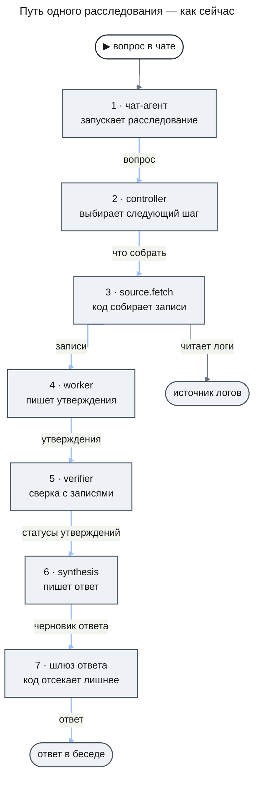
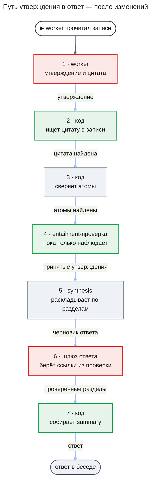

# Качество и надёжность агентской системы — Design Document (overview)

**Status:** Draft · **Date:** 2026-11-05 · **PRD:** нет — это сквозной документ улучшений, а не отдельная фича · **Depends on:** ничего

## 1. Коротко

Agent OS умеет провести расследование по логам и не потерять его при сбое сервера. Слабое место в другом. Система не проверяет, что вывод в ответе действительно следует из логов. И у нас нет способа измерить, хороши ли ответы. Поэтому любое изменение модели, промпта или бюджета сейчас делается вслепую.

Документ предлагает шесть этапов. Первый — записывать, что модель получила и что ответила, и собрать набор проверочных задач с заранее известным ответом. Затем идут дешёвые правки движка, более строгая проверка утверждений перед ответом, аккуратное завершение расследований, механизм ожидания человека и защита перед подключением реальных источников.

- **Не меняется**: собственный диспетчер задач на Postgres, границы пакетов, принцип «модель предлагает, код проверяет».
- **Главный риск**: внешние исследования мерили другие задачи, модели и языки. Насколько предложенные проверки помогут на логах и на русском, покажет только этап А.
- **Решения владельца**: раздел 8.

## 2. Как система работает сейчас

Возьмём пример. Сотрудник пишет в чат: «Почему вчера вечером росли ошибки оплаты?» Дальше происходит следующее.

**Модель** (LLM) — программа, которая по тексту на входе пишет текст на выходе. Текст на входе называют **промптом**. Модель не помнит прошлые вызовы и не ходит в базу сама: она видит только то, что ей положили в промпт. Объём текста считают в **токенах** (примерно часть слова); за токены мы платим.

**Агент** — модель плюс код вокруг неё, который даёт ей инструменты и решает, что делать с её ответом. У нас несколько агентов, у каждого своя **роль**.

1. **Чат-агент** разговаривает с сотрудником. У него один инструмент — `deepResearch`. Он запускает расследование сам (если включён режим исследования) или предлагает его кнопкой.
2. **Runtime** — диспетчер задач в пакете `packages/runtime`. Модели в нём нет. Он хранит расследование и его задачи в Postgres, раздаёт задачи исполнителям и перезапускает задачу, если сервер упал посреди работы.
3. **Controller** — «руководитель расследования». Это модель, которая на каждом шаге выбирает одно действие из семи: собрать записи, проанализировать, проверить, пересмотреть план, подождать, предложить ответ, признать неуспех. Сам controller логи не читает. Его выбор проверяет код (`DecisionGate`): действие должно быть из списка, в правильном формате и в пределах лимитов.
4. **Сбор записей** (`source.fetch`) — код без модели. Он ходит в источник логов по протоколу MCP и сохраняет найденные записи. Сохранённая запись называется **evidence** — «доказательство».
5. **Worker** — «аналитик». Модель читает записи по одному подвопросу и пишет **утверждения** (claims): короткие факты со ссылками на evidence. Например: «с 19:40 до 20:15 сервис `payment-api` записал 412 ошибок timeout». До четырёх аналитиков работают параллельно.
6. **Verifier** — «проверяющий». Модель только выбирает, какие исходные записи запросить для проверки. Сам вердикт выносит код: он ищет в записях **атомы** утверждения — имя сервиса, событие, интервал, число. Все атомы нашлись — утверждение получает статус `supported` («подтверждено»).
7. **Synthesis** — «автор ответа». Модель раскладывает утверждения по разделам ответа и пишет краткое резюме (`summary`).
8. **Шлюз ответа** — код. Он убирает утверждения без ссылок и со ссылками на чужие записи. В раздел «установлено» пускает только `supported`.
9. Ответ отдельным сообщением появляется в беседе.

После каждого шага управление возвращается к controller: он смотрит, что получилось, и выбирает следующий шаг. На схеме это показано цепочкой, чтобы был виден путь данных.

**Кто что решает.** Модель решает три вещи: какой шаг сделать следующим, какие факты видны в записях и как сформулировать ответ. Код решает всё остальное: допустим ли шаг, подтверждено ли утверждение, попадёт ли оно в ответ, хватает ли бюджета.

**Какие модели где стоят.** План, controller и synthesis работают на `claude-sonnet-5-5` — модели среднего класса. Worker и verifier работают на `claude-haiku-5-5` — дешёвой и быстрой. Чат-агент по умолчанию работает на `claude-opus-5-5`, самой дорогой. Модели заданы в файле `packages/engine/src/processes/deep-research.v1.json` и меняются без правки кода.

## 3. Словарь

| Термин | Что это по-человечески | Зачем нам |
|---|---|---|
| расследование (investigation, run) | одна работа по одному вопросу, от запуска до ответа | единица, у которой есть бюджет, статус и ответ |
| задача (task) | один кусок работы внутри расследования: шаг controller, сбор записей, анализ | runtime раздаёт и перезапускает именно задачи |
| structured output | модель отвечает не свободным текстом, а заполняет заданную форму | код может проверить ответ, а не угадывать его смысл |
| fan-out | несколько worker работают одновременно над разными подвопросами | быстрее, но бюджет тратится в несколько потоков сразу |
| бюджет токенов | предел расхода на одно расследование; по умолчанию 300 000 токенов | защита от бесконечной и дорогой работы |
| grounding (обоснованность) | каждое утверждение в ответе опирается на конкретные записи | без этого ответ нельзя проверить |
| entailment (следование) | «из этих записей действительно следует это утверждение» | отличает верный вывод от правдоподобного |
| eval | проверочный прогон: задаём системе задачу с известным ответом и смотрим, справилась ли | единственный способ узнать, стало лучше или хуже |
| fixture | наш тестовый источник логов, в который можно заложить нужную ситуацию | на нём строится набор eval-задач |
| grader | способ выставить оценку за eval-задачу; бывает кодом или моделью | делает оценку повторяемой |
| LLM-судья | grader, в котором оценку ставит другая модель | нужен там, где код оценить не может; сам ошибается |
| транскрипт | полная запись вызова модели: что получила, что ответила | по нему разбирают ошибки и повторяют прогон на другой модели |
| prompt caching | провайдер запоминает начало промпта и берёт за повтор намного меньше | снижает стоимость, когда начало промпта не меняется |
| lease | временная «бронь» задачи за исполнителем | если исполнитель упал, бронь истекает и задачу берёт другой |
| checkpoint | сохранённое промежуточное состояние задачи | после сбоя задача продолжает, а не начинает с нуля |
| идемпотентность | повтор действия не создаёт второй результат | нужна, когда агент начнёт что-то менять во внешних системах |
| `operationId` | постоянный номер одного действия, одинаковый при всех повторах | по нему внешняя система узнаёт повтор |
| сигнал | сообщение расследованию извне: «подтверждаю», «ищи в другом сервисе» | основа подтверждений и управления из чата |
| MCP | стандартный протокол, по которому агент подключается к внешним системам | через него приходят логи, позже — действия |
| prompt injection | текст в данных, который выглядит как команда и сбивает модель | логи пишут чужие системы; им нельзя доверять как инструкциям |
| RBAC | права по ролям: кто какие данные и инструменты может использовать | сейчас не реализованы |
| аудит | журнал «кто, что и от чьего имени сделал» | нужен до подключения реальных систем |

## 4. Что не так и почему это важно

**1. В ответе может оказаться вывод, который из логов не следует.** Статус `supported` означает «названные сервис, событие и число нашлись в записях». Он не означает «утверждение верно». Фраза «ошибки оплаты вызвал релиз в 19:30» пройдёт проверку, если в логах есть и релиз, и ошибки — даже если связи между ними нет. Сотрудник увидит её в разделе «установлено». Проверено по файлу `packages/engine/src/verify/claim-verifier.ts`.

**2. Под подтверждённым утверждением могут стоять не те ссылки.** Шлюз ответа берёт текст утверждения из базы, а список ссылок — из черновика synthesis. Он проверяет только, что такие записи существуют и принадлежат этому расследованию. Сотрудник открывает ссылку и не находит там подтверждения. Проверено по файлу `packages/engine/src/answer/reference-gateway.ts`.

**3. Краткое резюме никто не проверяет.** `summary` — первое, что читает сотрудник. Код передаёт его в ответ как есть. Промпт просит модель не добавлять новых фактов, но это просьба, а не гарантия.

**4. Мы не знаем, насколько хороши ответы.** Все тесты идут на модели-заглушке и проверяют механику: задача перезапустилась, бюджет не превышен. Что система отвечает на реальной модели, не проверяет ничего. Журнал вызовов хранит только токены и стоимость, без текста. Ошибочный ответ нельзя разобрать задним числом.

**5. Расследование стоит дороже, чем могло бы.** Controller на каждом шаге получает весь контекст заново и платит за него полностью: prompt caching в движке не включён. Если код отклонил решение, модель повторяет попытку, не зная причины отказа. Четыре worker с полным окном резервируют больше, чем весь бюджет по умолчанию, и расследование останавливается с причиной `budget_exhausted`. Формулу резерва в коде не проверял, расчёт взят из `design-engine.md`.

**6. Расследование не умеет заканчиваться.** У него три статуса: `active`, `cancelled`, `deleting`. Статуса «завершено» нет. После готового ответа незаконченные задачи продолжают работать и тратить токены. Остановить расследование можно только через вызов модели: если провайдер недоступен, кнопка «Остановить» не сработает.

**7. Система не умеет ждать человека.** Задача может ждать только другую задачу. Нельзя приостановиться до подтверждения, до подсказки из чата или до заданного времени. Без этого не построить ни действия с подтверждением, ни управление расследованием на ходу, ни продолжение сохранённого расследования.

**8. Реальный источник подключать пока небезопасно.** Проверка сессии — заглушка, прав по ролям нет. Вызовы инструментов записываются без аргументов. Текст из логов вставляется в промпт без пометки, что это чужие данные.

**9. Подозрение, не проверенный дефект.** В приёмке заявлена работа нескольких экземпляров сервера. Но блокировки беседы и запуска живут в памяти одного процесса. При двух экземплярах возможен двойной запуск расследования.

## 5. Что предлагается

Этапы идут в порядке выполнения. Этап А — первый, потому что без него нельзя проверить остальные.

### Этап А. Видеть, что делает система

**А1. Журнал вызовов модели**

- **Что делаем.** Для каждого вызова модели сохраняем транскрипт: расследование, задачу, роль, модель, версию промпта, полный вход и полный ответ. Текст хранится отдельно от счётчиков; запись о вызове держит ссылку на него.
- **Зачем.** Сейчас при плохом ответе неизвестно, кто ошибся: controller выбрал не тот шаг, worker неверно прочитал записи или synthesis исказил. Транскрипт отвечает на этот вопрос.
- **Что это даст.** Само по себе качество не меняет. Делает возможным всё остальное: разбор ошибок, eval-прогоны, сравнение моделей.
- **Как поймём, что сработало.** По любому расследованию можно открыть каждый шаг и прочитать, что модель видела и что написала.
- **На чём основано.** Внутренний разбор кода: таблица `research_llm_calls` хранит только токены и стоимость. Внешнее: [Hamel Husain и Shreya Shankar, FAQ по evals](https://hamel.dev/blog/posts/evals-faq/) (мнение практиков); [OpenTelemetry GenAI](https://github.com/open-telemetry/semantic-conventions-genai/blob/main/docs/gen-ai/gen-ai-spans.md) (спецификация, статус Development).
- **Цена и риск.** Небольшая доработка в одном месте — там, где движок вызывает модель. Риск — приватность: в транскрипт попадает содержимое логов. Срок хранения и доступ — решение владельца (раздел 8).

**А2. Первый набор eval-задач**

- **Что делаем.** Собираем 20–30 задач на fixture. В каждую закладываем известную причину, нужные записи и отвлекающие записи. Около пяти задач — «ответа в логах нет». Оценку ставит код: найдены ли заложенные факты, ведут ли ссылки на нужные записи, отказалась ли система там, где ответа нет, сколько шагов и токенов ушло.
- **Зачем.** Это линейка. Без неё «стало лучше» — ощущение.
- **Что это даст.** Число «решено задач из N» и стоимость на одну решённую задачу для текущей конфигурации. От этого числа отсчитываются все следующие этапы.
- **Как поймём, что сработало.** Один и тот же набор, прогнанный трижды, даёт близкие результаты. Провалы читаются по транскриптам и раскладываются по ролям.
- **На чём основано.** [Anthropic, Demystifying evals for AI agents](https://www.anthropic.com/engineering/demystifying-evals-for-ai-agents) (блог вендора: начинать с 20–50 простых задач и проверок кодом); [LangChain, Evaluating Deep Agents](https://www.langchain.com/blog/evaluating-deep-agents-our-learnings) (блог вендора). Приём «заложить неисправность и проверять, найдена ли она» — из OpenRCA 2.0 (только аннотация).
- **Цена и риск.** Несколько дней работы и расход на реальные прогоны. Риск: на 20–30 задачах видны только крупные различия. Честный исход сравнения может быть «неясно».

**А3. Сравнение моделей по ролям**

- **Что делаем.** Берём сохранённые входы controller из прогонов на Sonnet и подаём их же модели Haiku. Сравниваем выбранное действие. То же для synthesis на фиксированном наборе утверждений. Меняем модель в одной роли за раз, по три прогона, порог успеха записываем заранее.
- **Зачем.** Внутреннее ревью от 04.11 предлагает перевести все роли на дешёвые модели. Сейчас это предложение нечем ни подтвердить, ни опровергнуть.
- **Что это даст.** Ответ «можно, нельзя или неясно» по каждой роли, с ценой на решённую задачу.
- **Как поймём, что сработало.** Есть таблица: роль, модель, решено задач, стоимость.
- **На чём основано.** LangChain (там же): около половины их проверок — одношаговые. [Anthropic, A statistical approach to model evals](https://www.anthropic.com/research/statistical-approach-to-model-evals) (методика). Измеренного исследования о замене controller на малую модель с разбивкой по ролям обзор не нашёл.
- **Цена и риск.** Только расход на прогоны. Риск — принять шум за результат; защита — повторы и заранее записанный порог.

### Этап Б. Дешёвые правки движка

**Б1. Повтор с причиной отказа**

- **Что делаем.** Когда код отклонил решение controller, в повторный вызов добавляем код причины отказа. Список допустимых решений во входе уже есть. Отклонённое решение описываем, а не цитируем дословно.
- **Зачем.** Сейчас модель повторяет попытку с тем же входом и может повторить ту же ошибку. После трёх отказов расследование останавливается с причиной `controller_invalid`.
- **Что это даст.** Меньше остановок без ответа, меньше потраченных впустую вызовов.
- **Как поймём, что сработало.** В eval-наборе падает доля шагов с повтором и число остановок `controller_invalid`.
- **На чём основано.** Разбор кода: вход повторного вызова собирается из тех же данных (`packages/engine/src/controller/controller.handler.ts`). Внешнее: [Ray, Goyal, 2026](https://arxiv.org/html/2607.14167v1) (измерено на другой модели: с перечнем допустимых вариантов 36 успехов из 50 против 14 на сыром тексте ошибки).
- **Цена и риск.** Малая правка. Риск низкий.

**Б2. Prompt caching в движке**

- **Что делаем.** Собираем вход controller в постоянном порядке: инструкции и форма ответа, затем вопрос и план, затем журнал записей и решений, который только дополняется. Меняющееся от шага к шагу (бюджет, номер шага) ставим в конец. Включаем кэширование начала.
- **Зачем.** Controller делает до 24 шагов, и на каждом платит за одно и то же начало. С кэшем повтор начала стоит намного меньше.
- **Что это даст.** Снижение стоимости шага controller без смены модели. На качество не влияет.
- **Как поймём, что сработало.** В журнале вызовов уже есть поля чтения из кэша; они перестанут быть пустыми. Стоимость на решённую задачу в eval-наборе снизится.
- **На чём основано.** Разбор кода: в `apps/api` кэширование включено, в `packages/engine` нет. Внешнее: [документация Claude по prompt caching](https://platform.claude.com/docs/en/build-with-claude/prompt-caching); [Lumer и др., 2026](https://arxiv.org/html/2601.06007v2) (измерено на другой системе).
- **Цена и риск.** Средняя правка сборки контекста. У кэша есть минимальная длина начала и время жизни; смена формы ответа между шагами сбрасывает кэш. Размер выигрыша для нас неизвестен до измерения.

**Б3. Ссылки берём из проверки, а не из черновика**

- **Что делаем.** Для уже известного утверждения шлюз ответа берёт ссылки из сохранённого результата проверки. Ссылки, которые synthesis приписал от себя, отбрасываются.
- **Зачем.** Закрывает проблему 2: под подтверждённым утверждением стоят именно те записи, по которым его подтвердили.
- **Что это даст.** Каждая ссылка в разделе «установлено» ведёт на запись, участвовавшую в проверке.
- **Как поймём, что сработало.** Проверка кодом в eval-наборе: все ссылки установленных утверждений входят в множество записей их проверки.
- **На чём основано.** Разбор кода и ревью от 04.11 (находка F3). Внешнее: [VeriTrail](https://arxiv.org/html/2505.21786v2) (измерено: идентификаторы назначает программа, несовпавшие отбрасываются).
- **Цена и риск.** Малая правка в одном файле. Риск низкий.

**Б4. Бюджет согласовать с fan-out**

- **Что делаем.** Резерв на вызов считаем по фактическому расходу роли из журнала, а не по максимуму. Бюджет по умолчанию сверяем с типичным расследованием из eval-набора.
- **Зачем.** Сейчас один шаг с четырьмя worker может зарезервировать больше всего бюджета. Расследование на больших данных останавливается, не начав анализ.
- **Что это даст.** Меньше остановок `budget_exhausted` на задачах, которые в бюджет укладываются.
- **Как поймём, что сработало.** В eval-наборе падает доля остановок по бюджету при том же фактическом расходе.
- **На чём основано.** Расчёт по `deep-research.v1.json` и `design-engine.md`; формула резерва в коде не проверена. Остаток бюджета и шагов controller уже видит во входе — это сделано.
- **Цена и риск.** Малая правка плюс подбор числа. Риск: слишком малый резерв приведёт к перерасходу; факт списывается после вызова, так что перерасход ограничен одним вызовом на поток.

### Этап В. Граница «утверждение → ответ»

Схема показывает путь утверждения после изменений. Зелёные шаги — новые, красные — изменённые.

**В1. Worker приводит дословную цитату**

- **Что делаем.** К каждому утверждению worker прикладывает короткий дословный фрагмент записи, на который опирается. Код проверяет, что такой фрагмент в записи есть.
- **Зачем.** Сейчас у утверждения есть номер записи, но не сказано, какое место в ней его подтверждает. Цитата привязывает утверждение к конкретным словам и защищает от выдуманных деталей.
- **Что это даст.** Сотрудник видит под утверждением строку лога, а не только ссылку. Утверждения без настоящей цитаты отсеиваются до проверки.
- **Как поймём, что сработало.** В eval-наборе растёт доля установленных утверждений, совпадающих с заложенными фактами; доля отсеянных по цитате видна отдельным счётчиком.
- **На чём основано.** Разбор кода: в форме ответа worker есть текст, атомы и ссылки, цитаты нет (`packages/engine/src/claims/claim.schema.ts`). Внешнее: [Attribute First, then Generate, ACL 2024](https://arxiv.org/html/2403.17104v3) (измерено на вопросах по текстам; в задаче пересказа приём оказался хуже обычного).
- **Цена и риск.** Меняется форма ответа worker и промпт. Риск: слабая модель чаще ошибается в точном копировании, и часть верных утверждений отсеется. Это покажет этап А.

**В2. Entailment-проверка в режиме наблюдения**

- **Что делаем.** После сверки атомов задаём малой модели один закрытый вопрос по каждому утверждению: «следует ли это утверждение из этих записей — да или нет». Сначала ответ только записывается и ни на что не влияет.
- **Зачем.** Закрывает проблему 1. Сверка атомов остаётся обязательным условием; entailment добавляет второе — что записи подтверждают смысл фразы.
- **Что это даст.** На первом шаге — данные: как часто «атомы нашлись» и «следует из записей» расходятся. Если проверка совпадает с ручной разметкой, её ответ становится вторым условием статуса `supported`.
- **Как поймём, что сработало.** Размечаем вручную 50–100 пар «утверждение, записи» и сравниваем с ответами проверки. Порог включения записываем заранее.
- **На чём основано.** Аудит продуктов deep research [«Cited but Not Verified», 2026](https://arxiv.org/html/2605.06635): ссылки открываются и относятся к теме почти всегда, а факт подтверждается источником в 39–77% случаев (измерено). [MiniCheck, EMNLP 2024](https://arxiv.org/html/2404.10774v2): малые модели проверяют следование на уровне больших (измерено на английской прозе). [Kamoi и др., TACL 2024](https://arxiv.org/html/2406.01297v2): самопроверка без внешнего сигнала ненадёжна, исключение — задачи, где проверить легче, чем написать (обзор).
- **Цена и риск.** Один дополнительный дешёвый вызов на утверждение. Главный риск: ни один источник не измерял такую проверку на логах и на русском. Поэтому сначала наблюдение.

Это не возврат к LLM-критику, от которого проект отказался. Критик читал весь ответ и оценивал его целиком. Здесь модель отвечает «да» или «нет» на один узкий вопрос, а решение о статусе по-прежнему принимает код.

**В3. Summary из принятых утверждений**

- **Что делаем.** Код собирает резюме из одного–трёх принятых утверждений. Запасной вариант, если свободный текст нужен: каждое предложение резюме проверяется против принятых утверждений, неподтверждённое удаляется.
- **Зачем.** Закрывает проблему 3: в резюме не может появиться факт, которого нет в проверенной части ответа.
- **Что это даст.** Резюме становится таким же проверенным, как раздел «установлено». Цена — оно станет суше.
- **Как поймём, что сработало.** Проверка кодом в eval-наборе: доля предложений резюме без опоры на принятые утверждения равна нулю.
- **На чём основано.** Ревью от 04.11 (находка F1) и внутренний план исправлений. Внешнее: VeriTrail (там же) — проверка итогового текста назад по шагам.
- **Цена и риск.** Малая правка. Это меняет действующее решение в `design-engine.md`, поэтому нужно согласие владельца (раздел 8).

### Этап Г. Жизненный цикл расследования

| Что делаем | Что это даст | На чём основано |
|---|---|---|
| Добавляем расследованию статусы «завершено» и «не удалось». При переходе в них той же операцией отменяем все незаконченные задачи. | После ответа ничего не тратит токены. Видно, чем кончилось каждое расследование. | [Temporal, Parent Close Policy](https://docs.temporal.io/parent-close-policy) (документация); разбор кода |
| Разделяем три срока: ожидание в очереди, одна попытка, вся работа от постановки. | Задача не зависает в очереди навсегда. Сейчас срок отсчитывается только от первого захвата. | [Inngest, timeouts](https://www.inngest.com/docs/features/inngest-functions/cancellation/cancel-on-timeouts) (документация); `packages/runtime/src/guarded-transition.ts` |
| Остановка — прямая запись в базу, без вызова модели. Чат-агент остаётся вторым входом в ту же операцию. | Кнопка «Остановить» работает при недоступном провайдере. | [Claude Managed Agents, events](https://platform.claude.com/docs/en/managed-agents/events-and-streaming) (документация); наш вывод |
| Правило «одно активное расследование на беседу» переносим из памяти процесса в базу. | Снимает подозрение о двойном запуске при двух экземплярах сервера. | [Restate, services](https://docs.restate.dev/concepts/services) (документация); наш вывод |

Новые статусы потребуют миграции базы: допустимые значения статусов там закреплены. Остановка без модели меняет решение KD-2 в `design-chat-entry.md`.

### Этап Д. Ожидание сигнала и `operationId`

Три будущие фичи сводятся к одному механизму: задача ждёт именованное сообщение извне или наступление срока. Подтверждение действия — это сигнал «одобрено» с таймером. Управление из чата — сигнал «подсказка», который controller читает между шагами. Продолжение сохранённого расследования — сигнал, который будит завершённое расследование.

| Понятие | Что в нём | Правило |
|---|---|---|
| сигнал | кому адресован, имя, содержимое, ключ от повторов, кто и когда отправил | сохраняется, даже если задача ещё не ждёт; повтор с тем же ключом не создаёт второй сигнал |
| ожидание | список задач, имя сигнала, срок пробуждения — любое сочетание | задача просыпается от первого наступившего; пока ждёт, не занимает слот исполнителя |
| ожидающее действие | `operationId`, инструмент, полные аргументы, кто решил, когда, причина | исполняется ровно то, что одобрено |
| `operationId` | составляется из номера задачи и логического шага | не зависит от номера попытки и передаётся во внешнюю систему |

Заготовка уже есть: controller на каждом шаге читает непрочитанные сигналы. Но отправить сигнал извне сейчас нельзя.

Основание: [Azure Durable Task, human interaction](https://learn.microsoft.com/en-us/azure/durable-task/common/durable-task-human-interaction) (документация: ожидание события наперегонки с таймером); [OpenAI Agents SDK](https://openai.github.io/openai-agents-python/human_in_the_loop/) (документация: одобрение не гарантирует однократного исполнения); [brandur, Idempotency keys](https://brandur.org/idempotency-keys) (инженерный блог). Риск: восстановление после сбоя сейчас опирается на то, что инструменты только читают. С первым изменяющим действием это допущение перестаёт работать.

### Этап Е. Безопасность

Сейчас защита структурная и неплохая: у worker, verifier и synthesis нет инструментов, а выбор controller проверяет код. Открыт один путь: утверждения worker попадают к controller свободным текстом. Строка в логах может через worker повлиять на то, какие запросы controller сделает дальше.

**До первого реального источника**

- Controller получает из чужих данных только поля с жёстким форматом: идентификаторы, значения из списка, строки ограниченной длины.
- Записи в промпте помечаются как данные, а не инструкции. Это дешёвый дополнительный слой, а не граница.
- Ссылки в ответ подставляет код по номеру записи. Картинки с внешних адресов в ответе запрещены.
- Ответ расследования в памяти чат-агента считается данными. Новое расследование запускается только по свежему сообщению сотрудника.
- Настоящая сессия и права по ролям. Доступ к MCP-серверу — от имени конкретного сотрудника.
- Список серверов и описания инструментов принадлежат платформе. Признак «только чтение» назначаем мы, а не сервер.
- Аудит каждого вызова: кто, от чьего имени, какой инструмент, аргументы, результат.

**До первого изменяющего действия**

- Подтверждение человеком с точными аргументами (механизм этапа Д).
- Отдельные инструменты для чтения и записи, узкие права на каждый.
- Проверка атаками, которые подстраиваются под защиту.

Основание: [Design Patterns for Securing LLM Agents, 2025](https://arxiv.org/abs/2506.08837) (мнение авторов, без измерений); [спецификация MCP, Authorization](https://modelcontextprotocol.io/specification/2025-11-25/basic/authorization) и [Tools](https://modelcontextprotocol.io/specification/2026-07-28/server/tools); [Meta, Agents Rule of Two](https://ai.meta.com/blog/practical-ai-agent-security/) (блог вендора); [MSRC, 2025](https://www.microsoft.com/en-us/msrc/blog/2025/07/how-microsoft-defends-against-indirect-prompt-injection-attacks) (блог вендора); [Anthropic, prompt injection defenses](https://www.anthropic.com/research/prompt-injection-defenses) (измерено; авторы называют проблему нерешённой).

## 6. Как это скажется на качестве

Качество ответа раскладываем на четыре части.

- **Верность** — то, что названо установленным, соответствует тому, что произошло.
- **Обоснованность** — под каждым утверждением стоят записи, которые его подтверждают.
- **Полнота** — ответ покрывает вопрос, а не его часть.
- **Честный отказ** — если данных нет, система говорит «не установлено», а не придумывает.

| Изменение | На что влияет | Ожидаемое направление | Чем проверим |
|---|---|---|---|
| А1–А3 журнал и evals | ни на что напрямую | делает остальное измеримым | сам факт наличия числа |
| Б1 повтор с причиной | полнота | меньше расследований без ответа | доля остановок `controller_invalid` |
| Б2 кэширование | стоимость | дешевле при том же качестве | стоимость на решённую задачу |
| Б3 ссылки из проверки | обоснованность | ссылки всегда ведут на записи проверки | проверка кодом |
| Б4 бюджет | полнота | меньше ложных остановок по бюджету | доля `budget_exhausted` |
| В1 цитата | верность, обоснованность | меньше выдуманных деталей; возможно, меньше утверждений | совпадение с заложенными фактами |
| В2 entailment | верность, честный отказ | меньше выводов, не следующих из записей | сверка с ручной разметкой |
| В3 summary | верность | в резюме нет непроверенных фактов | проверка кодом |
| Г завершение | стоимость, надёжность | нет расхода после ответа | расход после перехода в «завершено» |

Чего обещать нельзя. Все внешние измерения сделаны на других задачах, других моделях и в основном на английском. Ни один найденный источник не измерял проверку утверждений по логам и на русском. Поэтому документ не называет ожидаемых процентов. Для каждого изменения указано направление и способ проверки на нашем eval-наборе. Если проверка покажет, что изменение не помогает, оно откатывается.

У строгости есть цена. Этапы В1–В3 повышают верность, но могут снизить полноту: часть верных утверждений не пройдёт проверку и уйдёт в раздел «не установлено». Для расследований по логам это правильный обмен: ложный «установленный» вывод хуже честного «не знаю». Насколько упадёт полнота, покажет eval-набор.

После этапа А мы сможем назвать для текущей системы: долю решённых задач, долю верных отказов, стоимость на решённую задачу и роль, которая ошибается чаще всего.

## 7. Чего мы не делаем и почему

- **Не переводим controller и synthesis на дешёвую модель до evals.** Источники расходятся, а работа [PEAR, 2026](https://arxiv.org/html/2510.07505v4) показывает, что слабый планировщик ограничивает всю систему. Решение принимается по итогам А3.
- **Не возвращаем LLM-критика.** Оценка ответа целиком той же моделью ненадёжна (Kamoi и др.). Узкая entailment-проверка — другое.
- **Не заменяем controller планом, построенным один раз.** Так устроен проект Open Multi-Agent из дайджеста ChatGPT. Это дешевле, но расследование по логам заранее не знает, что найдёт; пришлось бы строить отдельный механизм перепланирования.
- **Не делаем самоулучшение системы по собственным ошибкам.** Обе статьи из дайджеста требуют сохранённых транскриптов и набора проверочных сценариев. У нас нет ни того, ни другого до этапа А.
- **Не меняем runtime и не берём готовый движок вроде Temporal.** Решение принято в ADR-0001; из чужих систем берём приёмы, а не код.
- **Не отправляем логи во внешние сервисы проверки.** Данные сотрудников ушли бы третьей стороне.
- **Не строим платформу оценки.** Набор задач, проверки кодом и таблица результатов — достаточно для решений этого документа.
- **Не оцениваем «качество отчёта» целиком LLM-судьёй.** По данным [DeepResearch Bench](https://arxiv.org/html/2506.11763), в такой оценке расходятся даже эксперты.

## 8. Решения, которые нужны от владельца

1. **Проверять ли `summary`.** В `design-engine.md` записано, что код резюме не проверяет. Рекомендация: собирать резюме из принятых утверждений (В3).
2. **Начинать ли evals сейчас.** PRD `deep-research` относит стенд оценки к «не делаем», ADR-0004 не планирует пакет для evals. Рекомендация: да, в минимальном объёме этапа А, без платформы.
3. **Хранение транскриптов.** В них попадает содержимое логов. Рекомендация: хранить в Postgres отдельно от счётчиков, доступ — как к самому расследованию, удалять вместе с расследованием. Прогоны на fixture хранить без срока.
4. **Что делать с причинными формулировками.** Сущность «гипотеза» ранее отклонена. Рекомендация: новую сущность не вводить; утверждение с оборотом «из-за», «вызвал», «привёл к» отправлять в существующий раздел предположений, пока entailment-проверка не включена как условие.
5. **Модель controller.** Ревью от 04.11 предлагает дешёвые модели во всех ролях. Рекомендация: оставить Sonnet до результатов А3 и сначала включить кэширование.
6. **Какой моделью делать entailment-проверку.** Готовые малые проверяющие модели обучены на английском. Рекомендация: закрытый вопрос к `claude-haiku-5-5`, решение о включении — по ручной разметке.
7. **Завершённое расследование: окончательно или «спит».** План продолжения исследований предполагает новые раунды того же расследования. Рекомендация: статус «завершено» с отменой всех задач и одним разрешённым переходом обратно — по явному запуску раунда.
8. **Остановка без модели.** Это отменяет решение KD-2 в `design-chat-entry.md` («отдельных операций для кнопок нет»). Рекомендация: добавить одну операцию остановки.
9. **Несколько экземпляров сервера.** Рекомендация: до этапа Г считать поддерживаемым один экземпляр и записать это в приёмке.
10. **Порядок фич.** Рекомендация: `research-followup` и `chat-steering` начинать после этапа Д, потому что обе опираются на ожидание сигнала.

## 9. Источники

Внешние страницы читались через загрузчик, который пересказывает текст. Числа приведены в его передаче; перед переносом в ADR их нужно сверить с оригиналом.

**Внутренние документы**

- `docs/features/deep-research/prd.md`, `design-engine.md`, `design-chat-entry.md`
- `docs/features/research-runtime/prd.md`, `design-runtime.md`, `design-mcp-source.md`
- `docs/adr/ADR-0001` … `ADR-0005`
- `docs/side_reserch/agent_architecture_review_20261104.md`, `agent_architecture_implementation_research_20261104.md`, `papers_digest.md`, `research_followup_study.md`

**Факты о коде, проверенные чтением при подготовке документа**

- сверка атомов и статус `supported` — `packages/engine/src/verify/claim-verifier.ts`
- ссылки из черновика и непроверенное резюме — `packages/engine/src/answer/reference-gateway.ts`
- повтор без причины отказа, остаток бюджета во входе — `packages/engine/src/controller/controller.handler.ts`
- модели, окна и лимиты — `packages/engine/src/processes/deep-research.v1.json`
- статусы расследования — `packages/contracts/src/research.ts`
- журнал вызовов без текста — `packages/db/src/schema.ts`
- кэширование только в чате — `apps/api/src/mastra/models.ts`, `packages/engine/src/model/role-agent.ts`
- форма ответа worker без цитаты — `packages/engine/src/claims/claim.schema.ts`
- срок от первого захвата — `packages/runtime/src/guarded-transition.ts`

Остальные утверждения о коде взяты из разбора от 05.11 и здесь не перепроверялись: продолжение задач после ответа, остановка через вызов модели, заглушка проверки сессии, состав аудита, блокировки в памяти процесса.

**Внешние: страница открыта**

- Anthropic, Demystifying evals for AI agents — https://www.anthropic.com/engineering/demystifying-evals-for-ai-agents
- Anthropic, A statistical approach to model evals — https://www.anthropic.com/research/statistical-approach-to-model-evals
- Anthropic, prompt injection defenses — https://www.anthropic.com/research/prompt-injection-defenses
- Hamel Husain, Shreya Shankar, Evals FAQ — https://hamel.dev/blog/posts/evals-faq/
- LangChain, Evaluating Deep Agents — https://www.langchain.com/blog/evaluating-deep-agents-our-learnings
- OpenTelemetry GenAI spans — https://github.com/open-telemetry/semantic-conventions-genai/blob/main/docs/gen-ai/gen-ai-spans.md
- DeepResearch Bench — https://arxiv.org/html/2506.11763
- Ray, Goyal, 2026 — https://arxiv.org/html/2607.14167v1
- Lumer и др., 2026 — https://arxiv.org/html/2601.06007v2
- PEAR, 2026 — https://arxiv.org/html/2510.07505v4
- Claude, prompt caching — https://platform.claude.com/docs/en/build-with-claude/prompt-caching
- Claude Managed Agents, events — https://platform.claude.com/docs/en/managed-agents/events-and-streaming
- Cited but Not Verified, 2026 — https://arxiv.org/html/2605.06635
- MiniCheck — https://arxiv.org/html/2404.10774v2
- VeriTrail — https://arxiv.org/html/2505.21786v2
- Attribute First, then Generate — https://arxiv.org/html/2403.17104v3
- Kamoi и др. — https://arxiv.org/html/2406.01297v2
- Temporal, Parent Close Policy — https://docs.temporal.io/parent-close-policy
- Inngest, timeouts — https://www.inngest.com/docs/features/inngest-functions/cancellation/cancel-on-timeouts
- Azure Durable Task, human interaction — https://learn.microsoft.com/en-us/azure/durable-task/common/durable-task-human-interaction
- OpenAI Agents SDK, human in the loop — https://openai.github.io/openai-agents-python/human_in_the_loop/
- Restate, services — https://docs.restate.dev/concepts/services
- brandur, Idempotency keys — https://brandur.org/idempotency-keys
- MCP, Authorization — https://modelcontextprotocol.io/specification/2025-11-25/basic/authorization
- MCP, Tools — https://modelcontextprotocol.io/specification/2026-07-28/server/tools
- Meta, Agents Rule of Two — https://ai.meta.com/blog/practical-ai-agent-security/
- MSRC, 2025 — https://www.microsoft.com/en-us/msrc/blog/2025/07/how-microsoft-defends-against-indirect-prompt-injection-attacks
- Design Patterns for Securing LLM Agents — https://arxiv.org/abs/2506.08837
- Open Multi-Agent — https://github.com/open-multi-agent/open-multi-agent

**Внешние: только аннотация или выдача поиска**

- OpenRCA 2.0 — https://arxiv.org/abs/2606.27154
- Self-Healing Harness — https://arxiv.org/abs/2609.24130
- Agentic Harness Engineering — https://arxiv.org/abs/2604.25850

## Update History

| Version | Date | Change |
|---------|------|--------|
| 1.0 | 2026-11-05 | Первая версия |
