# Качество и надёжность расследований — Design Doc — web

**Статус:** Черновик · **Дата:** 2026-11-07 · **PRD:** [prd.md](./prd.md) · **UXRD:** [uxrd.md](./uxrd.md) · **Зависит от:** [design-engine.md](./design-engine.md#contract-definitions), [design-lifecycle.md](./design-lifecycle.md#contract-definitions)

## Snapshot

**Overview.** Сотрудник видит беседу: свой вопрос, реплику агента с карточкой ресерча и потом ответ ресерча отдельным сообщением. Эта часть меняет на экране два места. В ответе появляется сводка из проверенных выводов со словами уверенности, у каждого установленного вывода стоят слова его группы уверенности, а у вывода о причине — метка «причинная связь не доказана». Кнопка «Остановить» на карточке больше не просит агента остановить ресерч скрытым ходом беседы: после подтверждения браузер сам вызывает операцию остановки на сервере, поэтому кнопка работает и пока агент пишет ответ, и когда модель недоступна.

- **Не меняется**: место карточки и ответа в беседе, прежние состояния карточки — новое только одно, «Ещё запускается» (KD-8), — «Запустить» и «Не нужно» через скрытый ход решения, композер и его «Остановить», текстовая версия ответа, которую видит модель чата и копирует «Копировать».
- **Главный риск**: контракт ответа части `engine` ещё не утверждён; если старые сообщения перестанут проходить разбор, все прежние ответы на экране превратятся в простой текст ([Risks and Mitigation](#risks-and-mitigation)).
- **Открытые вопросы**: есть, ни один не блокирует остальной дизайн ([Open Questions](#open-questions)).

### Key Decisions

#### KD-1: Подтверждённая «Остановить» идёт прямым запросом через хранилище запусков беседы, а карточка сообщает о нажатии тем же `onDecision`

Карточка по-прежнему говорит провайдеру ресерча беседы «нажали stop» через свой проп `onDecision`. Провайдер больше не превращает это нажатие в скрытый ход беседы. Он ставит карточке «Остановку» и вызывает новую операцию хранилища запусков `ThreadResearch.stop`, а хранилище — новую функцию клиента `threadsApiClient.stopResearch`, которая отправляет `POST /api/threads/:threadId/research/:launchKey/stop`. «Запустить» и «Не нужно» идут скрытым ходом решения, как раньше.

Хранилище выбрано потому, что оно уже держит запуски открытой беседы, ведёт опрос, знает, какую беседу показывает, и находит события для объявлений. Ответ остановки становится для него ещё одним источником состояния запуска, рядом с чтением `GET /api/threads/:threadId/research` (KD-3). Новых пропов у карточки нет: как доставить нажатие, решает провайдер. Тип `ThreadsApiClient` и хранилище получают по одному новому члену; кто держит полный тип клиента, получает настоящий объект `threadsApiClient`, поэтому прежние потребители работают без изменений, а заглушки клиента в тестах хранилища добавляют `stopResearch`. Не взято: отдельный проп карточки для остановки; вызов клиента прямо из провайдера.

#### KD-2: Пока агент пишет ответ, неактивны только «Запустить» и «Не нужно»; для «Остановить» снимаются все три запрета

Сейчас нажатие во время ответа агента не проходит в трёх местах: кнопки карточки неактивны, обработчики карточки ничего не делают, а провайдер отбрасывает решение (UXRD `deep-research`, KD-8). Для «Остановить» в ряду действий, для «Остановить» в подтверждении и для решения `stop` в провайдере эти запреты снимаются. «Запустить» и «Не нужно» остаются неактивными с описанием MC-30, потому что их решение идёт ходом беседы, а вкладка ведёт один поток ответа ([UXRD, KD-5](./uxrd.md#key-decisions)). Композер при остановке не меняется: запрос остановки не проходит через рантайм беседы.

#### KD-3: Ответ операции остановки хранилище применяет так же, как результат чтения

Пришёл ответ 200 — хранилище подставляет вид запуска из него на место этого запуска, находит событие так же, как после чтения, и отдаёт его в объявления. Поэтому «Ресерч остановлен» (MC-19) звучит один раз: следующее чтение видит тот же `stopped` и событием его не считает. Чтение, которое началось до ответа и вернулось после него, хранилище отбрасывает и сразу читает заново, иначе устаревший `running` вернул бы карточку в «Идёт» и прозвучало бы «Ресерч запущен». Ответ, пришедший, когда вкладка уже показывает другую беседу, хранилище не применяет: эту беседу покажет её собственное чтение. Не взято: держать ответ остановки в провайдере рядом с результатами ходов — тогда события искали бы и провайдер, и хранилище, и одну перемену пришлось бы гасить вторым источником объявлений.

#### KD-4: Ошибка, отказ или 20 секунд без ответа дают «Идёт» со строкой MC-16, после чего хранилище один раз читает состояние

Любая неудача запроса — нет сети, 404, 500, тело вне контракта — для карточки одна: «Идёт», строка ошибки MC-16 (`deep-research` UXRD) и снова доступная «Остановить». Так задаёт [design-lifecycle.md](./design-lifecycle.md#contract-definitions) в пункте «Что из этого читает карточка». Кода ошибки из тела ответа клиент не читает: обе 404 — `THREAD_NOT_FOUND` и `RESEARCH_LAUNCH_NOT_FOUND` — ведут к одному и тому же.

У запроса остановки свой предел ожидания — 20 секунд, и это решение этой части. `lifecycle` ограничивает только ожидание замка беседы и общего срока ответа маршрута не обещает ([design-lifecycle.md, Contract Definitions, «ResearchStopResponse»](./design-lifecycle.md#contract-definitions)). Предел клиента дольше этого ожидания. Без предела карточка при зависшей сети стояла бы в «Остановке» минутами, а UXRD называет «не ответила» ошибкой ([UXRD, Error Flows](./uxrd.md#error-flows)). После неудачи хранилище один раз читает состояние: если остановка успела примениться, карточка сразу переходит в «Остановлен» без строки ошибки. Предел — постоянное значение клиента, а не настройка.

#### KD-5: Сводку экран рисует только по `summaryItems`; строку `summary` старых сообщений он не читает

Есть пункты — под строкой цели подпись «Главное из установленного» (MC-2) и маркированный список: текст пункта и слова его группы уверенности. Пунктов нет — нет ни подписи, ни списка, ни места под них. Прежнего правила «сводка есть, если есть хоть одна группа» больше нет: решает только список пунктов, который собирает `engine`.

Ответ, записанный до этой части, приходит без пунктов и со строкой `summary` — пересказом модели. Поле `summary` экран не читает, поэтому такой ответ выглядит так, как велит [UXRD, KD-7](./uxrd.md#key-decisions) и состояние «Старый ответ» [спецификации ответа](../../design-system/components/research-answer.md#states): без сводки и без новых меток, остальное как раньше. Отдельной ветки для старых ответов в коде нет: нет пунктов — нет сводки, нет `confidence` и `causal` — нет меток.

#### KD-8: Строка пояснения MC-4 — ещё одно значение строки под состоянием карточки, а не новый проп

Если операция ответила 200, а запуск всё ещё `running`, ресерч ещё стартует, и операция его не тронула. Карточка тогда возвращается в «Идёт» со строкой пояснения MC-4 по [UXRD, KD-6](./uxrd.md#key-decisions) и состоянию «Ещё запускается» [спецификации карточки](../../design-system/components/research-card.md#states). Строка стоит на месте строки ошибки, поэтому её несёт тот же проп `decisionError` с новым значением `still_launching`.

Карточка рисует это значение так, как задаёт спецификация для «Ещё запускается», и без роли `alert`, а MC-4 вежливо объявляет провайдер в области объявлений экрана, как и другие итоги. Строка уходит, когда меняется состояние карточки, — по прежнему правилу устаревшей карточки, — и когда сотрудник снова нажимает «Остановить» в ряду действий: карточка прячет её сама до следующего значения пропа. Не взято: отдельный проп пояснения.

#### KD-6: Слова группы — постоянная таблица из четырёх значений `confidence`; метки стоят после сносок обычным текстом

`very_high`, `high`, `medium` и `low` превращаются в «уверенность очень высокая», «уверенность высокая», «уверенность средняя» и «уверенность низкая» (MC-1). Сколько групп настроено — три или четыре, — экрану знать не нужно: при трёх группах `engine` не присылает `very_high`. Метка уверенности, метка причинной связи (MC-3) и «не проверено» — видимый текст сразу после сносок, без скрытого текста и всплывающих подсказок, поэтому программа чтения экрана читает их после «Источник 1, Источник 2». Метка не разрывается внутри и целиком переходит на следующую строку, как уже делает «не проверено». Новых компонентов и токенов нет: метки рисует существующий `ResearchAnswer` ролями, которые задаёт [спецификация ответа](../../design-system/components/research-answer.md).

## Terms

- **Карточка ресерча** — блок в реплике агента: цель, бюджет, состояние одного ресерча и его кнопки «Запустить», «Не нужно», «Остановить».
- **Ответ ресерча** — отдельное сообщение в конце беседы с итогом расследования: шапка, строка цели, сводка, группы выводов, источники.
- **Вывод** — одна строка ответа со сносками, как её видит сотрудник; в контракте это утверждение (claim).
- **Метаданные `researchAnswer`** — структурированная часть сообщения ответа. По ней экран рисует ответ.
- **Текстовая версия ответа** — Markdown того же сообщения. Её видит модель чата в следующих ходах и копирует кнопка «Копировать».
- **Ход беседы** — один запрос `POST /api/chat/:agentId`, в котором агент пишет ответ потоком. Пока поток идёт, говорят, что ответ агента стримится.
- **Скрытый ход решения** — ход беседы, которым кнопка карточки передаёт решение агенту; лента его не показывает.
- **Операция остановки** — маршрут `POST /api/threads/:threadId/research/:launchKey/stop` части `lifecycle`: останавливает ресерч без вызова модели.
- **Вид запуска** — `ResearchLaunchView`: состояние одного ресерча так, как его показывает карточка (`running`, `stopped`, `completed` и другие). На сервере у запуска больше состояний; как они сводятся к этим, задаёт `ResearchLaunchViewSchema` (Contract Definitions).
- **Хранилище запусков беседы** — `ThreadResearch` (`apps/web`): держит виды запусков открытой беседы, опрашивает сервер, пока идёт ресерч, и находит события для объявлений.
- **Провайдер ресерча беседы** — `ThreadResearchProvider`: раздаёт карточкам их вид запуска, принимает нажатия кнопок и держит невидимую область объявлений экрана.
- **Объявление** — текст, который программа чтения экрана произносит вежливо, не перебивая сотрудника.

## Part

- **Part**: `web`
- **Covers**: экранная часть FR-14, FR-15 и FR-16 и кнопка FR-21: AC-15.1, AC-15.3, сторона карточки AC-21.1, решения UXRD KD-1 — KD-7 и тексты MC-1 — MC-4
- **Depends on**: [design-engine.md, Contract Definitions](./design-engine.md#contract-definitions) — `ResearchAnswerMetadata`, контракт для части `web`; [design-lifecycle.md, Contract Definitions](./design-lifecycle.md#contract-definitions) — маршрут остановки, `ResearchStopResponse`, его ошибки и пункт «Что из этого читает карточка»
- **Prerequisite ADRs**: [ADR-0004](../../adr/ADR-0004-agent-framework-packages.md) — `web` зависит только от `@agent-os/contracts`. Решения [ADR-0006](../../adr/ADR-0006-investigation-final-states.md) и [ADR-0007](../../adr/ADR-0007-claim-status-from-assessment-and-calibrated-groups.md) доходят до экрана только через контракты `lifecycle` и `engine`.
- **Sibling parts**: что покрывает каждая часть, задаёт [Delivery Parts PRD](./prd.md#delivery-parts).
  - **`engine`** собирает пункты сводки, группы и признак причинности, меняет схему метаданных ответа в `@agent-os/contracts` и, по допущению этого дизайна, строит текстовую версию ответа.
  - **`lifecycle`** строит операцию остановки, инструмент агента `stopResearch` и принимает прежний скрытый ход решения со `stop` от вкладок, открытых до обновления.
  - **`self-check`** экрана не касается.

**Out of scope**

- Текстовая версия ответа — Markdown, который видит модель чата и копирует «Копировать», вместе со сводкой, словами групп и меткой причинной связи. Её строит `engine` в `buildResearchAnswer` (`apps/api`); это допущение ([Open Questions](#open-questions)). `web` рисует только метаданные `researchAnswer`, а кода, который строит текст ответа, в `web` нет.
- Схема `ResearchAnswerMetadataSchema` в `@agent-os/contracts` — её расширяет `engine`, а `web` только читает.
- Маршрут остановки, инструмент агента `stopResearch` и приём прежнего скрытого хода со `stop` — часть `lifecycle`.
- Композер и его кнопка «Остановить», которая прерывает ответ агента, не меняются.
- Вид карточки и ответа — состояния, роли цвета, отступы — задают спецификации [карточки](../../design-system/components/research-card.md) и [ответа](../../design-system/components/research-answer.md); к прежним состояниям карточки добавляется только «Ещё запускается» (KD-8).
- Своей отрисовки у вызова инструмента `stopResearch` нет: в реплике агента он выглядит как вызов любого другого инструмента, через общий `ToolFallback`.
- Поведение по ширине экрана не меняется ([UXRD, Responsive Behavior](./uxrd.md#responsive-behavior)).

**Constraints**

- **Комфорт долгой сессии.** Новых цветов, токенов и движения нет. Метка уверенности — мелкий приглушённый текст без рамки, рамку носят только метки-исключения ([UXRD, KD-2](./uxrd.md#key-decisions)).
- **WCAG 2.1 AA** (`deep-research` PRD, NFR-05). Метки — видимый текст, сводка — подпись и список, итог остановки — вежливое объявление, ошибка — `alert`; так велят спецификации и [UXRD, Accessibility](./uxrd.md#accessibility).
- **Старые сообщения читаются.** Сообщение, записанное до обновления, проходит разбор новой схемой — это обещает контракт `engine` — и рисуется по KD-5. Сохранённые пары скрытого хода решения, в том числе со `stop`, по-прежнему не видны в ленте.
- **Старые вкладки работают.** Вкладка, открытая до обновления, останавливает ресерч прежним скрытым ходом, и сервер его принимает (`lifecycle`); новой вкладке для этого ничего не нужно.
- **Схемы общие с сервером.** Ответ маршрута остановки `web` разбирает схемой `ResearchStopResponseSchema`, которую `lifecycle` добавляет в `@agent-os/contracts` ([design-lifecycle.md, Contract Definitions, «ResearchStopResponse»](./design-lifecycle.md#contract-definitions)); метаданные ответа — схемой, которую расширяет `engine`. Своих схем этих ответов в `web` нет.
- **Порядок сборки.** `web` проверяет типы и тесты по собранному пакету `@agent-os/contracts`, поэтому изменённая схема ответа и схема ответа остановки должны быть собраны раньше, чем запускаются проверки `web`.

## Acceptance Criteria

### FR-14: метка причинной связи

- Когда у вывода в «Предположениях» `causal` равен true, после его сносок стоит метка «причинная связь не доказана» (MC-3) в рамке, а метки «не проверено» у него нет (DC-1).

### FR-15: группа уверенности

- From the PRD: AC-15.1, AC-15.3
- Слова группы берутся из `confidence` по таблице KD-6; у вывода без группы — в старом сообщении — метки уверенности нет (DC-2).

### FR-16: сводка

- Когда в `summaryItems` есть пункты, под строкой цели стоит подпись MC-2 и под ней маркированный список: текст пункта и слова его группы, без сносок и без других меток (DC-3).
- Когда пунктов нет, нет ни подписи, ни списка, ни пустого места: под строкой цели сразу предупреждение MC-32, причина остановки или первая группа (DC-4).
- Ответ, записанный до этой части, показывается без сводки — ни прежнего абзаца с подписью MC-34, ни подписи MC-2 — и без меток уверенности и причинной связи; группы, сноски, «не проверено» и источники — как раньше (UXRD, KD-7; DC-5).

### FR-21: кнопка «Остановить»

- From the PRD: AC-21.1 — на стороне карточки
- Когда сотрудник подтверждает остановку, карточка сразу переходит в «Остановку», и вкладка отправляет один запрос к операции остановки и ни одного хода беседы; композер и другие карточки не меняются (DC-6).
- Пока агент пишет ответ, «Остановить» в ряду действий, «Остановить» и «Продолжить» в подтверждении и Esc работают, а «Запустить» и «Не нужно» неактивны с описанием MC-30 (DC-7).
- Когда операция отвечает 200 с запуском не в `running`, карточка показывает состояние из `launch` по своим правилам состояний, без строки ошибки: «Остановлен», «Завершён», «Ответ записывается снова», «Не удался», «Предложение» или «Не запущен». Перемену состояния экран объявляет один раз, как после чтения: для `stopped` — MC-19 (DC-8).
- Когда операция отвечает 200, а запуск всё ещё `running`, карточка возвращается в «Идёт» со строкой пояснения MC-4, «Остановить» доступна, и экран вежливо объявляет MC-4; строка уходит при следующей смене состояния карточки или при следующем нажатии «Остановить» (UXRD, KD-6; DC-9).
- Что остаётся от блока ошибки ответа после остановки кнопкой — открытый вопрос «Блок ошибки ответа после остановки кнопкой» (DC-13).
- Когда операция отказывает или не отвечает за 20 секунд, карточка возвращается в «Идёт» со строкой MC-16, которую программа чтения экрана слышит как `alert`, и «Остановить» снова доступна; затем вкладка один раз читает состояние (DC-10).
- Когда остановить ресерч просят агента в беседе, карточка меняется только по чтению состояния и строку MC-16 не показывает (DC-11).
- Сохранённые в истории скрытые ходы решения со `stop` в ленте не видны (DC-12).

## Design

### Как это встраивается в диалог

Сотрудник видит только беседу. Карточка стоит в реплике агента, расследование идёт в фоне, а итог приходит в конец беседы отдельным сообщением. Эта часть меняет два места на этом пути — карточку и ответ; фон меняют части `engine` и `lifecycle`.

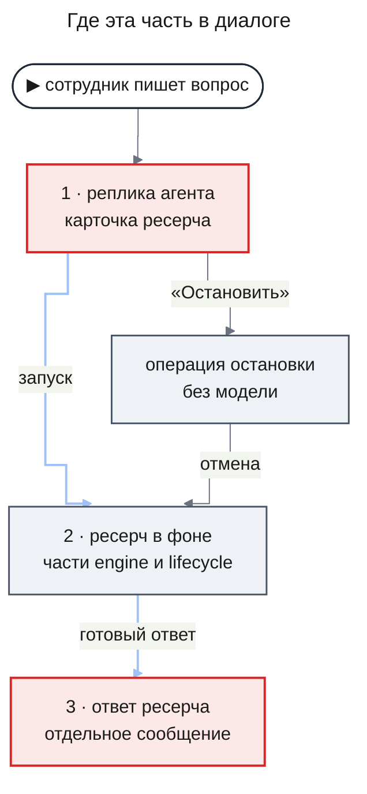

- **Карточка** выглядит как раньше. Меняется то, что происходит после подтверждённой «Остановить»: вместо скрытого хода беседы — прямой запрос к операции остановки, и кнопка не ждёт, пока агент допишет ответ.
- **Ответ** приходит как раньше. Меняется то, что в нём нарисовано: сводка из проверенных выводов, слова уверенности и метка причинной связи.

### Architecture (C1–C4)

#### C2 · Containers

Схема показывает, к каким маршрутам сервера ходит `web`; новый путь — остановка.

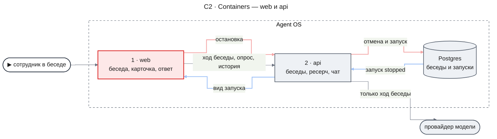

- `web` — беседа, карточки ресерча и ответы ресерча. Эта часть меняет в нём кнопку «Остановить» и рисунок ответа.
- `api` — после частей `lifecycle` и `engine` умеет всё, что нужно экрану: операцию остановки строит `lifecycle`, новые поля ответа — `engine`. Кроме остановки, `web` ходит к нему как раньше: ходами беседы, опросом `GET /api/threads/:threadId/research` и чтением истории, откуда приходят и сообщения ответа.
- Провайдер модели остановку не видит: его вызывает только ход беседы.

#### C3 · Components: web

**web — остановка, как сейчас.** Нажатие уходит в скрытый ход беседы, и до карточки итог доходит через модель.

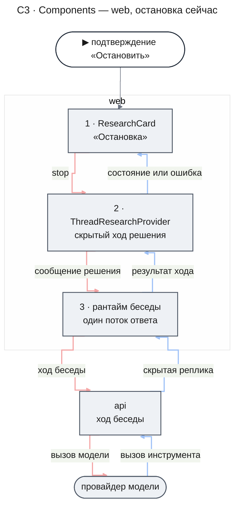

Пока идёт ход решения, композер стоит в состоянии идущего ответа, а кнопки решений на всех карточках неактивны. Пока агент пишет ответ на другое сообщение, кнопку нельзя нажать вовсе. Если модель недоступна, ход падает, и карточка показывает MC-16 — остановить ресерч нельзя.

**web — остановка, как будет.** Нажатие идёт мимо рантайма беседы прямо к операции остановки.

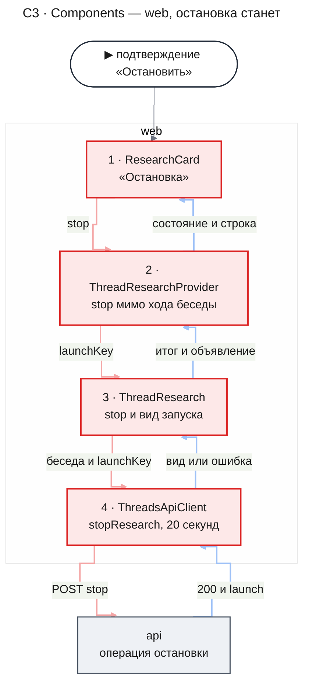

- `ResearchCard` после подтверждения переводит фокус на себя и сообщает `stop` через `onDecision`, как раньше. Обе её кнопки «Остановить» больше не смотрят, стримится ли ответ агента (KD-2).
- `ThreadResearchProvider` различает решения: `confirm` и `decline` уходят скрытым ходом с прежним запретом на время стрима, `stop` — в хранилище без запрета. На время запроса он ставит карточке «Остановку», а по итогу снимает её — со строкой MC-16 при отказе, со строкой MC-4, если запуск ещё стартует, или без строки (KD-1, KD-8).
- `ThreadResearch` вызывает клиент и применяет ответ как результат чтения (KD-3). При отказе он один раз читает состояние беседы (KD-4).
- `ThreadsApiClient` получает функцию `stopResearch` с пределом ожидания 20 секунд; ошибки она отдаёт тем же `ThreadsApiError`, что и остальные маршруты бесед.

**web — ответ ресерча.** Сообщение ответа приходит в ленту как раньше; меняется то, что `ResearchAnswer` рисует из его метаданных.

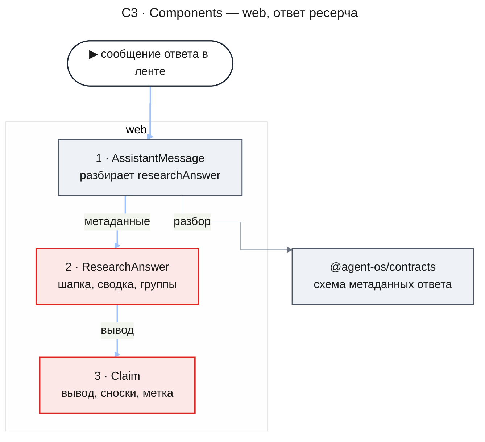

- `AssistantMessage` разбирает метаданные схемой из `@agent-os/contracts`, как сейчас. Если разбор не прошёл, сообщение рисуется своей текстовой версией и в консоль уходит предупреждение. Схему расширяет `engine`, а старые сообщения проходят её по его контракту.
- `ResearchAnswer` рисует сводку по KD-5. Порядок частей и отступы прежние: строка цели, предупреждение, сводка, причина остановки, группы.
- `Claim` ставит после сносок метку по правилу из раздела «Какая метка встаёт после вывода».

#### Как рисуется сводка: сейчас и станет

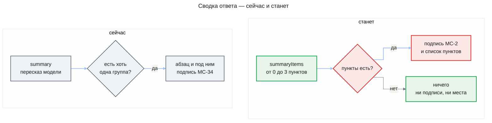

- **Что приходит с сервера.** В новом ответе — `summaryItems`: от нуля до трёх пунктов, у каждого дословный текст принятого вывода и его группа `confidence`. Строка `summary` в новом ответе всегда null. В старом ответе пунктов нет, а `summary` — пересказ модели.
- **Что решает `ResearchAnswer`.** Только одно: есть ли пункты. Строку `summary` он не читает ни в новом, ни в старом ответе (KD-5). Какие выводы стали пунктами и почему пунктов нет — в ответе без принятых выводов, в ответе принудительной остановки, в режиме без источников — решил `engine`, и экрану это различать не нужно.
- **Что видит сотрудник.** Под строкой цели — «Главное из установленного» и список; у каждого пункта после текста слова его группы, например «уверенность высокая». Пунктов нет — под строкой цели сразу предупреждение, причина остановки или первая группа. Сводка не объявляется отдельно и не получает фокуса.

#### Какая метка встаёт после вывода

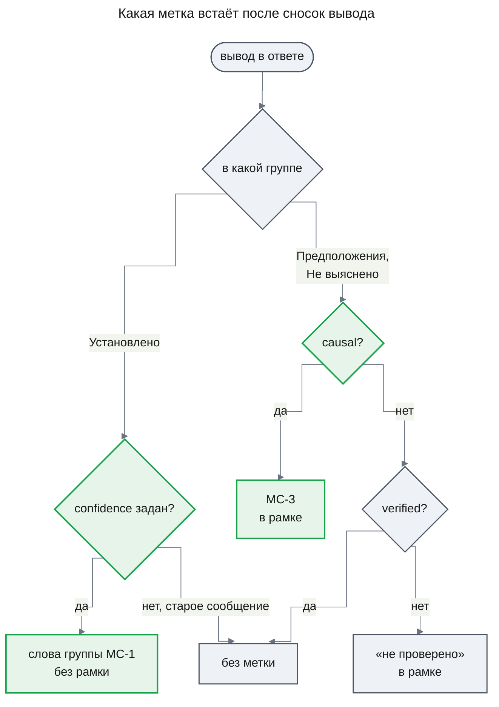

- **Что приходит с сервера.** У вывода в «Установлено» — `confidence`: `very_high`, `high`, `medium` или `low`, а в старом сообщении null. У вывода в «Предположениях» — `causal`: true у причинного вывода, и у него же `verified` true. У остальных выводов `verified` значит то же, что раньше.
- **Что решает `Claim`.** Слова группы — по таблице KD-6. Метка MC-3 — только при `causal` true. «Не проверено» — при `verified` false, как сейчас. Две метки в рамке у одного вывода не встречаются: причинный вывод прошёл проверку, поэтому `verified` у него true.
- **Что видит сотрудник.** «С 19:40 до 20:15 payment-api записал 412 ошибок timeout [1] [2] уверенность высокая» и «Ошибки оплаты вызвал релиз в 19:30 [4] [5] ‹причинная связь не доказана›». Программа чтения экрана читает «…412 ошибок timeout, Источник 1, Источник 2, уверенность высокая».

В режиме без источников сносок нет: вместо них стоит пометка «из знаний модели, без источника» (`deep-research` UXRD, MC-33), а меток уверенности и причинной связи нет, потому что таких полей `engine` в этом режиме не присылает.

#### Как нажатие работает, пока агент пишет ответ

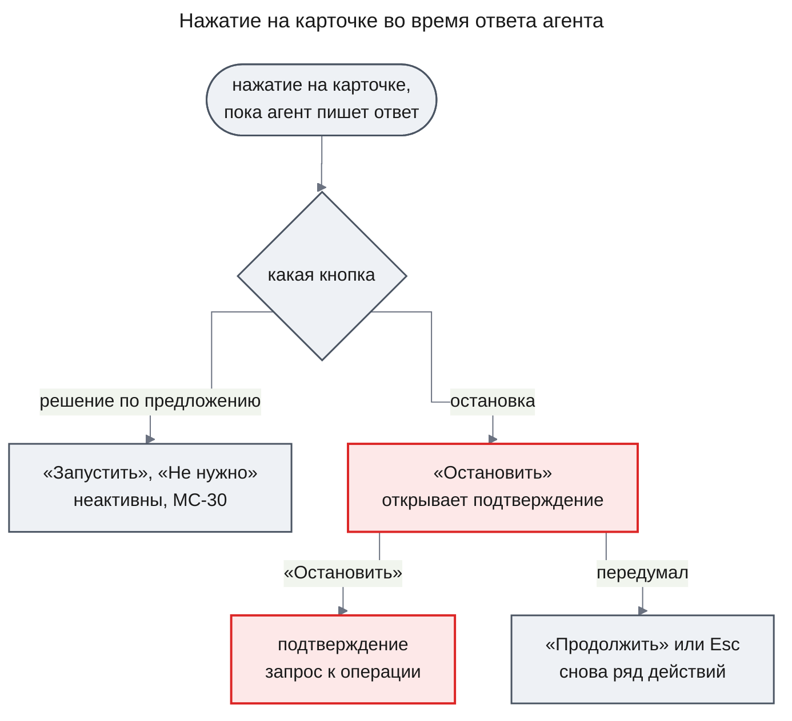

Сейчас все три кнопки в этом положении неактивны. Новое поведение касается только остановки: её запрос не идёт через рантайм беседы, поэтому стрим ответа агента и остановка друг другу не мешают (KD-2). Неактивная кнопка остаётся в порядке Tab и читает описание MC-30, как раньше.

#### Что карточка делает с ответом операции

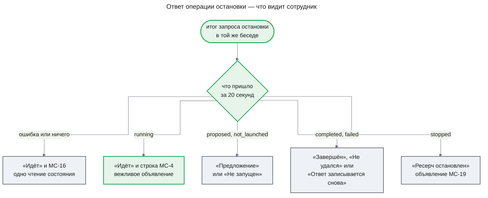

- **Что приходит с сервера.** 200 и `launch` — вид запуска после операции: `stopped`, если ресерч шёл, или то состояние, в котором он уже был. Серверное состояние запуска в `launch` уже сведено к состоянию карточки по `ResearchLaunchViewSchema` (Contract Definitions): например, `answer_reappend` приходит как `completed` с `answerPending` true. Иначе — 404, 400, 500, тело вне контракта или ничего за 20 секунд.
- **Что решает карточка.** Вид из ответа становится видом запуска в хранилище (KD-3), а карточка рисует его по своим правилам состояний из [спецификации карточки](../../design-system/components/research-card.md#states); строка ошибки и «Остановка» видны только при `running`, поэтому в остальных состояниях их нет.
  - `stopped` — «Остановлен».
  - `completed` — «Завершён» со ссылкой «К ответу», если ответ уже в ленте; с `answerPending` true — «Ответ записывается снова», без ссылки.
  - `failed` — «Не удался».
  - `proposed` — «Предложение» с его меткой и кнопками, как у любой карточки-предложения.
  - `not_launched` — «Не запущен» с причиной из `notLaunchedReason`.
  - `running` — ресерч ещё стартует, операция его не тронула, и повтор после старта остановит его (UC-E7 в [design-lifecycle.md](./design-lifecycle.md#error-and-edge-use-cases)); карточка показывает «Ещё запускается»: «Идёт» и строку MC-4 (KD-8).
- **Что видит сотрудник.** Итоговые состояния карточки — те, что на схеме. Перемену состояния экран объявляет вежливо и только те события, которые объявило бы чтение: «Ресерч остановлен», «Ресерч завершён…», «Ресерч не удался»; у «Предложения», «Не запущен» и «Ответ записывается снова» объявления нет. Строку MC-4 экран объявляет вежливо, ошибку MC-16 карточка показывает как `alert`, а сама «Остановка» не объявляется. Фокус остаётся на карточке, куда его перевело подтверждение.

Схема начинается с итога в той же беседе. Если ответ пришёл, когда вкладка уже показывает другую беседу, с карточки снимается «Остановка», и больше ничего не происходит: ничего не объявляется, а вернувшись, сотрудник увидит состояние из чтения этой беседы.

### Runtime Flows

#### Flow 1: остановка с карточки, пока агент пишет ответ

**Starts when:** сотрудник подтверждает «Остановить» на карточке «Идёт», пока в той же вкладке стримится ответ агента на другое сообщение, for AC-21.1, DC-6, DC-7, DC-8, DC-9, DC-10

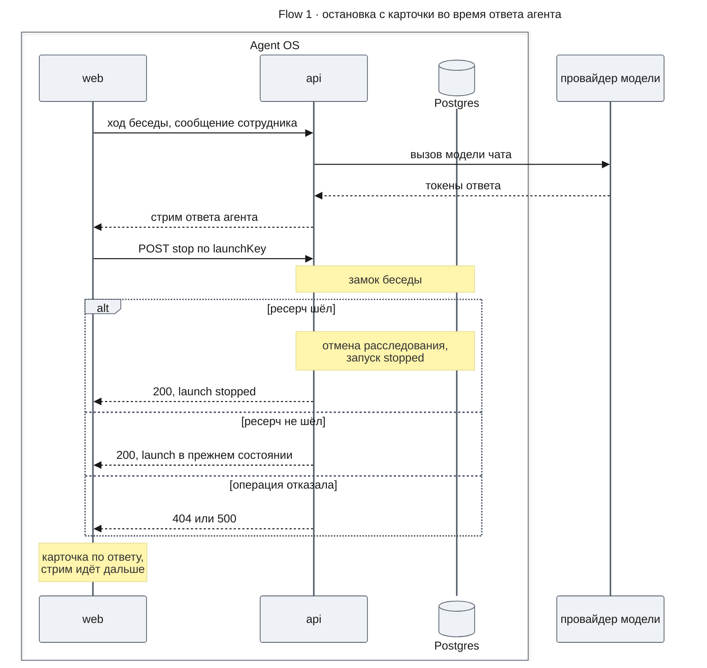

**Outcome:** карточка показывает состояние из ответа, «Идёт» со строкой MC-4, если ресерч ещё стартует, или «Идёт» со строкой MC-16. Хранилище запусков держит вид запуска из ответа, пока его не сменит чтение, начатое после ответа. Ответ агента стримится дальше, композер всё это время в состоянии идущего ответа, ленте ничего не добавлено. Если запуск `stopped`, опрос заканчивается сам, когда в беседе не остаётся идущих ресерчей.

**Failure handling:**

- Ответа нет за 20 секунд → запрос прерывается, карточка «Идёт» со строкой MC-16, хранилище читает состояние. Если сервер успел остановить ресерч, это чтение или следующий опрос переводит карточку в «Остановлен» без строки ошибки, и MC-19 звучит тогда.
- 404 (`THREAD_NOT_FOUND`, `RESEARCH_LAUNCH_NOT_FOUND`), 400, 500 (`RESEARCH_STOP_FAILED`) или тело вне контракта → то же. Повтор кнопкой безопасен: операция идемпотентна.
- Чтение `GET /api/threads/:threadId/research`, начатое до ответа, вернулось после него → его результат отбрасывается, и хранилище сразу читает снова (KD-3).
- Вкладка сменила беседу до ответа → «Остановка» с карточки снимается, вид запуска и объявление не применяются.
- Модель недоступна → ход беседы падает с блоком ошибки ответа (chat-shell UXRD, TH-08), а остановка идёт как на схеме: она модель не вызывает (AC-21.1).

### Contract Definitions

**Что `web` берёт у соседних частей**

- **Метаданные ответа** — [design-engine.md, Contract Definitions](./design-engine.md#contract-definitions), пункт «`ResearchAnswerMetadata` — контракт для части `web`», как записан. `web` читает из него `summaryItems`, `established[].confidence`, `assumed[].causal` и `verified`; поле `summary` не читает (KD-5).
- **Операция остановки** — [design-lifecycle.md, Contract Definitions](./design-lifecycle.md#contract-definitions): маршрут `POST /api/threads/:threadId/research/:launchKey/stop`, `ResearchStopResponse`, ошибки `THREAD_NOT_FOUND`, `RESEARCH_LAUNCH_NOT_FOUND`, `RESEARCH_STOP_FAILED` и пункт «Что из этого читает карточка», как записаны. Ответ разбирается схемой `ResearchStopResponseSchema` из модуля `research-chat` пакета `@agent-os/contracts`, которую добавляет `lifecycle` (пункт «ResearchStopResponse» там же). Общего срока ответа маршрут не обещает; предел ожидания клиента — решение этой части (KD-4).
- **Состояние запуска на карточке** — поле `state` вида запуска. Как серверные состояния запуска сводятся к состояниям карточки, задаёт `ResearchLaunchViewSchema` в [design-chat-entry.md, Contract Definitions](../deep-research/design-chat-entry.md#contract-definitions); `web` берёт это сведение как есть, и ответ остановки несёт уже сведённое состояние.

**Что части `web` предлагают друг другу**

- **`threadsApiClient.stopResearch`** — останавливает ресерч одной беседы. Вход — идентификатор беседы, `launchKey` и необязательный предел ожидания, по умолчанию 20 секунд. Отправляет `POST` без тела с сессией в cookie, как все запросы бесед; оба идентификатора кодируются в адресе. Возвращает вид запуска из поля `launch`, разобранный схемой `ResearchStopResponseSchema`. Ошибки — `ThreadsApiError`: `network`, когда нет связи или вышел предел ожидания; `not_found` на 404 любого кода и на 400 неверного идентификатора; `http` на 500 и прочие статусы; `invalid_response`, когда тело не JSON или вне схемы. Код ошибки из тела клиент не читает. Функция входит в тип `ThreadsApiClient` и объект `threadsApiClient`.
- **`ThreadResearch.stop(launchKey)`** — останавливает ресерч открытой беседы и сообщает, чем кончилось. Итог всегда один из трёх, а исключения нет:
  - «применено» — ответ 200; итог несёт вид запуска из ответа, этот вид стоит в `launches`, а событие, если вид сменился, — в `announcements`;
  - «отказ» — запрос не удался или не ответил; хранилище запустило одно чтение состояния;
  - «устарело» — к моменту итога хранилище показывает другую беседу или закрыто; ничего не применено. Без открытой беседы этот итог приходит сразу, без запроса.
- **`ThreadResearchProvider`, `decide(launchKey, action)`** — сигнатура прежняя. `confirm` и `decline` — скрытый ход решения, как сейчас, и, пока стримится ответ, решение отбрасывается. `stop` — без этого запрета: провайдер ставит карточке «Остановку» (`pendingDecision` `stop`), вызывает `ThreadResearch.stop` и по итогу снимает её. При «отказе» он ставит `decisionError` `stop_failed`. При «применено» с видом в `running` он ставит `decisionError` `still_launching` и вежливо объявляет MC-4 в области объявлений экрана. При остальных «применено» и при «устарело» строки нет.
- **`ResearchCard`** — пропы прежние, а у `decisionError` появляется значение `still_launching` (KD-8). `onDecision('stop')` значит «остановка подтверждена». `replyStreaming` теперь касается только «Запустить» и «Не нужно». `pendingDecision` `stop` — запрос остановки в пути. `decisionError` `stop_failed` — операция отказала или не ответила: строка MC-16 с ролью `alert`. `decisionError` `still_launching` — ресерч ещё стартует: строка MC-4 в виде состояния «Ещё запускается» спецификации карточки, без роли `alert`; карточка прячет её, когда сотрудник нажимает «Остановить» в ряду действий, и показывает снова только при новом значении пропа. Обе строки видны только при `running`.
- **`ResearchAnswer`** — пропы прежние; набор полей `answer` растёт вместе с контрактом `engine`.

**Error handling**

- Любая ошибка запроса остановки → итог «отказ» и строка MC-16 на карточке. В консоль уходит одно предупреждение с видом ошибки и статусом, без тел ответов и без текста беседы, как у опроса.
- Метаданные ответа не прошли разбор → сообщение рисуется текстовой версией, как сейчас.

### State Transitions and Invariants

Схема показывает, как карточка проходит остановку с этой вкладки. Остальные состояния и переходы карточки задаёт [спецификация карточки](../../design-system/components/research-card.md#states).

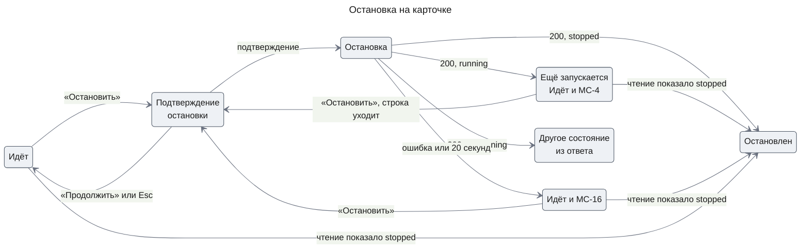

**Invariants**

1. Карточка стоит в «Остановке», только пока запрос остановки этой вкладки в пути; любой итог её снимает.
2. «Остановка», строка MC-16 и строка MC-4 видны, только пока запуск `running`; когда сервер сообщает другое состояние, карточка показывает его без этих строк.
3. Остановка с карточки не добавляет в ленту ни одного сообщения и не начинает хода беседы.
4. Чтение, начатое до ответа остановки, не возвращает карточку из состояния этого ответа в прежнее.
5. Каждое событие запуска — запущен, завершён, не удался, остановлен — объявляется во вкладке не больше одного раза, от какого бы источника оно ни пришло — чтения или ответа остановки.
6. Пока стримится ответ агента, решения `confirm` и `decline` не отправляются, а остановку стрим не задерживает.

## Test Strategy

Текстовую версию ответа и то, что копирует «Копировать», проверяет часть `engine` ([Open Questions](#open-questions)).

### Main Use Cases

- **UC-1: ответ со сводкой и метками** — covers AC-15.1, AC-15.3, DC-1, DC-3
  - Given: ответ из источников; два пункта сводки с группами `high` и `medium`; в «Установлено» два вывода с теми же группами и сносками; в «Предположениях» причинный вывод (`causal` true, `verified` true) и непроверенный вывод
  - When: ответ появляется в ленте
  - Then: под строкой цели подпись «Главное из установленного», под ней список из двух пунктов, у каждого после текста «уверенность высокая» или «уверенность средняя» и ни одной сноски; у выводов «Установлено» те же слова стоят после сносок; у причинного вывода после сносок «причинная связь не доказана», и «не проверено» у него нет; у непроверенного — «не проверено» и нет MC-3; подписи MC-34 нет нигде
- **UC-2: четыре группы** — covers AC-15.1
  - Given: выводы «Установлено» с группами `very_high`, `high`, `medium` и `low`
  - When: ответ появляется в ленте
  - Then: после сносок стоят по порядку «уверенность очень высокая», «уверенность высокая», «уверенность средняя», «уверенность низкая»; процентов и чисел рядом нет
- **UC-3: остановка, пока агент пишет ответ** — covers AC-21.1, DC-6, DC-7, DC-8
  - Given: карточка «Идёт» и рядом карточка-предложение; в той же вкладке стримится ответ агента на новое сообщение; операция остановки отвечает 200 со `stopped`
  - When: сотрудник нажимает «Остановить» на карточке и подтверждает
  - Then: сразу «Останавливаем…» на карточке и фокус на ней; ушёл ровно один запрос остановки и ни одного нового хода беседы; «Запустить» на предложении остаётся неактивной с MC-30, а композер — в состоянии идущего ответа; после ответа карточка «Ресерч остановлен» с «Ответа не будет.», в области объявлений один раз «Ресерч остановлен», и после следующего чтения состояния он не повторяется
- **UC-4: модель недоступна** — covers AC-21.1, DC-6
  - Given: карточка «Идёт», а последний ход беседы упал с блоком ошибки ответа, потому что провайдер модели недоступен
  - When: сотрудник останавливает ресерч кнопкой
  - Then: карточка «Ресерч остановлен», и хода беседы не было; что стало с блоком ошибки ответа — открытый вопрос «Блок ошибки ответа после остановки кнопкой» (DC-13)
- **UC-5: старый ответ** — covers DC-2, DC-5
  - Given: ответ, записанный до этой части: без `summaryItems`, `confidence` и `causal`, со строкой `summary` и с непроверенным выводом
  - When: беседа открывается
  - Then: ответ нарисован из метаданных, а не текстом; сводки нет — ни прежнего абзаца, ни подписи MC-34, ни подписи MC-2, и под строкой цели сразу первая группа; меток уверенности и причинной связи нет; группы, сноски, «не проверено» и список источников — как раньше
- **UC-6: длинная метка** — covers AC-15.1, DC-1
  - Given: вывод «Установлено» и причинный вывод, чьи тексты со сносками заполняют строку почти до конца; включена светлая, а затем тёмная тема
  - When: ответ появляется в ленте
  - Then: метка уверенности и метка MC-3 целиком переходят на следующую строку и не разрываются внутри; цвет меток — приглушённый цвет текста, а не цвет статуса

### Error and Edge Use Cases

- **UC-E1: нет принятых выводов** — covers DC-4
  - Given: в ответе пустые `summaryItems` и только «Предположения» и «Не выяснено»
  - When: ответ появляется в ленте
  - Then: подписи MC-2 и списка нет, и первым после строки цели идёт заголовок «Предположения»
- **UC-E2: ответ без источников** — covers DC-4
  - Given: ответ в режиме `model_knowledge`
  - When: ответ появляется в ленте
  - Then: под строкой цели предупреждение MC-32 и сразу группы; у выводов пометка MC-33; сводки, меток уверенности и причинной связи нет
- **UC-E3: ответ принудительной остановки** — covers AC-15.1, DC-4
  - Given: ответ с причиной остановки, пустыми `summaryItems` и выводом в «Установлено» с группой `medium`
  - When: ответ появляется в ленте
  - Then: под строкой цели причина остановки, сводки нет, у вывода после сносок «уверенность средняя»
- **UC-E4: операция отказала** — covers DC-10
  - Given: карточка «Идёт»; операция остановки отвечает 500, в другом прогоне — 404, в третьем — 200 с телом вне контракта
  - When: сотрудник подтверждает остановку
  - Then: карточка «Ресерч идёт», строка «Не удалось остановить ресерч. Попробуйте ещё раз.» с ролью `alert`, «Остановить» доступна; после ошибки ровно одно чтение состояния
- **UC-E5: операция не ответила** — covers DC-10
  - Given: карточка «Идёт»; операция остановки не отвечает; у клиента короткий предел ожидания
  - When: сотрудник подтверждает остановку, и предел выходит
  - Then: то же, что в UC-E4
- **UC-E6: судьба ресерча уже решена** — covers DC-8
  - Given: карточка «Идёт», а операция отвечает 200 с запуском не в `running`; прогоны по одному на каждый вид: `completed` с ответом, который уже есть в ленте; `completed` с `answerPending` true; `failed`; `proposed`; `not_launched` с причиной `declined`
  - When: сотрудник подтверждает остановку
  - Then: ни в одном прогоне нет строки MC-16 и строки MC-4. Карточка показывает по прогонам: «Ресерч завершён» со ссылкой «К ответу» и одним объявлением «Ресерч завершён…»; «Ресерч завершён» без ссылки «К ответу» и без объявления; «Ресерч не удался» и одно объявление «Ресерч не удался»; «Предложение» с кнопками «Запустить» и «Не нужно» без объявления; «Ресерч не запущен» с причиной отказа (MC-13) без объявления
- **UC-E7: ресерч ещё стартует** — covers DC-9
  - Given: карточка «Идёт», а операция отвечает 200 с `running`
  - When: сотрудник подтверждает остановку, а потом снова нажимает «Остановить» в ряду действий
  - Then: после ответа карточка снова «Ресерч идёт» со строкой пояснения MC-4 в виде состояния «Ещё запускается» спецификации карточки и без роли `alert`, «Остановить» доступна, в области объявлений один раз звучит MC-4, а строки MC-16 нет; после нового нажатия «Остановить» строка исчезает, а если следующее чтение показывает `stopped`, карточка «Ресерч остановлен» без строки
- **UC-E8: чтение, начатое до ответа** — covers DC-8
  - Given: опрос состояния ушёл до ответа остановки и вернул `running` после того, как пришёл ответ со `stopped`
  - When: оба ответа обработаны
  - Then: карточка остаётся «Ресерч остановлен», «Ресерч запущен» не звучит
- **UC-E9: беседа сменилась во время остановки** — covers DC-6
  - Given: запрос остановки в пути
  - When: сотрудник открывает другую беседу, а потом возвращается
  - Then: в другой беседе ничего не объявлено; в прежней карточка показывает состояние из чтения, а не «Остановку»
- **UC-E10: подтверждение во время ответа агента** — covers DC-7
  - Given: стримится ответ агента, открыто подтверждение остановки
  - When: сотрудник нажимает Esc, затем снова «Остановить» и «Продолжить»
  - Then: Esc и «Продолжить» возвращают ряд действий и фокус на «Остановить»; у обеих «Остановить» нет `aria-disabled` и описания MC-30
- **UC-E11: остановку попросили агента** — covers AC-21.2 на стороне карточки, DC-11
  - Given: карточка «Идёт»; агент в обычном ходе вызвал `stopResearch`
  - When: следующее чтение состояния возвращает `stopped`, а в другом прогоне — `running`
  - Then: в первом случае карточка «Ресерч остановлен» и звучит «Ресерч остановлен»; во втором она остаётся «Ресерч идёт» без строки MC-16
- **UC-E12: сохранённая остановка ходом решения** — covers DC-12
  - Given: в истории беседы сохранена пара скрытого хода решения со `stop` от вкладки старой версии
  - When: беседа открывается
  - Then: ни сообщения решения, ни его реплики в ленте нет, а «Копировать» стоит у последнего видимого сообщения

### Проверка в настоящем браузере

Сценарии идут на собранном приложении против настоящего API в браузере через Claude-in-Chrome; их сигналы видны в DOM, во вкладке Network и в консоли.

| Сценарий | Шаги | Что проверить |
|---|---|---|
| L1-1 ответ со сводкой | Запустить ресерч на fixture и дождаться ответа | Подпись MC-2 и пункты с MC-1; MC-1 после сносок в «Установлено»; MC-3 у причинного вывода; длинная метка целиком переносится на следующую строку; в светлой и тёмной теме метки — приглушённый цвет текста, а не цвет статуса |
| L1-2 остановка во время ответа агента | Запустить ресерч, отправить новое сообщение и, пока ответ стримится, остановить ресерч кнопкой | В Network один `POST …/research/…/stop` со статусом 200 и ни одного нового хода беседы; ответ агента дописывается; карточка «Ресерч остановлен»; в консоли нет ошибок |
| L1-3 остановка без связи | Заблокировать адрес остановки в DevTools (Network request blocking) и подтвердить остановку | Карточка «Ресерч идёт» со строкой MC-16; «Остановить» доступна; после снятия блокировки повтор останавливает ресерч |
| L1-4 старый ответ | Открыть беседу с ответом, записанным до обновления | Ответ нарисован, а не показан текстом; сводки и меток нет; в консоли нет предупреждения о метаданных вне контракта |

## Security Considerations

- **Authentication & Authorization**: запрос остановки идёт с сессией в cookie, как все запросы бесед. `launchKey` берётся только из вызова, который создал карточку, а принадлежность запуска беседе и владельцу проверяет сервер (`lifecycle`).
- **Input Validation**: идентификаторы беседы и запуска кодируются в адресе. Ответ остановки и метаданные ответа проходят схемы `@agent-os/contracts`: тело вне схемы — ошибка, а не данные. Тексты выводов, пунктов и меток экран выводит как текст, без HTML.
- **Sensitive Data Handling**: в консоль уходит только вид ошибки и статус. Тела ответов, цель ресерча и тексты выводов не логируются.

## Risks and Mitigation

- **Контракт `engine` не утверждён, а разбор старых сообщений зависит от него** — высокий ущерб, вероятность низкая. Если схема не примет сообщения без новых полей, все прежние ответы покажутся простым текстом. UC-5 и L1-4 ловят это; зависимость записана открытым вопросом.
- **Пока агент пишет ответ, на экране две доступные кнопки «Остановить»** — средний ущерб, вероятность средняя. Кнопка композера прерывает ответ агента, кнопка карточки — ресерч. Кнопка карточки стоит внутри группы «Ресерч: {цель}», поэтому программа чтения экрана называет её контекст; название кнопки задаёт спецификация карточки, и этот дизайн его не меняет.
- **Сервер отвечает дольше 20 секунд** — низкий ущерб, вероятность низкая. Карточка покажет MC-16, хотя ресерч остановлен; чтение после ошибки или следующий опрос переведут её в «Остановлен» без строки ошибки.

## Open Questions

- **Контракт ответа `engine` не утверждён.** `web` полагается на пункт «`ResearchAnswerMetadata` — контракт для части `web`» в [design-engine.md](./design-engine.md#contract-definitions): старые сообщения без `summaryItems`, `confidence` и `causal` проходят разбор как пустой список, null и false; `confidence` принимает только `very_high`, `high`, `medium` и `low`; `summary` в новых ответах null; в режиме без источников пунктов нет. Блокирует отрисовку и проверку по UC-1 — UC-5. Решает владелец, утверждая дизайн `engine`.
- **Кто строит текстовую версию ответа.** Дизайн исходит из допущения, записанного в Out of scope: текст строит `engine` в `buildResearchAnswer`. Если владелец решит иначе, `web` получит работу по тексту, который копирует «Копировать». Блокирует только содержимое копии. Решает владелец по [открытому вопросу `engine`](./design-engine.md#open-questions).
- **Блок ошибки ответа после остановки кнопкой.** Сейчас ход решения карточки сбрасывает ошибку чата, и блок ошибки ответа (chat-shell UXRD, TH-08) исчезает; так записано в chat-shell UXRD, абзац TH-08, и в `deep-research` UXRD, Primary Flow, шаг 3. Остановка кнопкой хода беседы больше не начинает, поэтому блок остаётся на месте (DC-13). Решает `ux-designer`: оставить блок или убирать его и после остановки кнопкой; блокирует только Then у UC-4.

## Appendix: Fact Disposition

| Fact | Disposition | Handled in |
|------|-------------|------------|
| Сводка — абзац `summary` и подпись MC-34 после него, `research-answer.tsx` (F01) | transform | KD-5, «Как рисуется сводка» |
| Сводка показывается при любой непустой группе, `research-answer.tsx` (F02) | transform | KD-5: решает только `summaryItems` |
| Сноски и «не проверено» — инлайн-текст через пробел, `research-answer.tsx` (F05) | transform | KD-6: метки тем же приёмом после сносок |
| Текстовая версия и «Копировать» строятся в `apps/api`, `research-answer.builder.ts` (F09) | out-of-scope | Out of scope, Open Questions |
| В схеме метаданных нет новых полей, `research-chat.ts` (F11) | out-of-scope | Схему меняет `engine`; Contract Definitions |
| Старые сообщения: нет новых полей, есть строка `summary`, `research-chat.ts` (F12) | transform | KD-5 по UXRD KD-7, DC-5, UC-5 |
| Нет схемы ответа маршрута остановки, `research-chat.ts` (F14) | out-of-scope | `ResearchStopResponseSchema` добавляет `lifecycle`; `web` разбирает ею ответ — Constraints, Contract Definitions |
| «Остановить» сообщает `stop` через `onDecision`, `research-card.tsx` (F16) | transform | KD-1: проп прежний, доставку меняет провайдер |
| Три запрета на нажатие во время стрима, `research-card.tsx`, `research-thread.tsx` (F17) | transform | KD-2 |
| Остановка — скрытый ход решения, `research-thread.tsx` (F18) | transform | KD-1, C3 «остановка» |
| Хранилище запусков: опрос и чтение после хода, `thread-research-store.ts` (F20) | transform | KD-3: операция `stop` и отброс устаревшего чтения |
| MC-16 по ошибке хода решения, `research-card.tsx` (F22) | transform | KD-4 |
| Клиент `send` и `parse` без предела ожидания, `threads-api-client.ts` (F23) | transform | KD-4, `threadsApiClient.stopResearch` |
| Объявления с защитой от эха только после хода, `research-thread.tsx` (F26) | transform | KD-3: событие из диффа хранилища |
| Кнопки получают общий набор свойств неактивности, `research-card.tsx` (F28) | transform | KD-2: у «Остановить» его нет |
| Разница ответа со спецификацией, `research-answer.tsx` (F29) | transform | KD-5, KD-6; копия — Out of scope |
| Разница карточки со спецификацией, `research-card.tsx` (F30) | transform | KD-1 — KD-4 |
| Тесты ответа закрепляют `summary` и MC-34, `research-answer.test.tsx` (F32) | transform | Test Strategy: UC-1, UC-5, UC-E1 — UC-E3 |
| Общая сборка метаданных ответа для тестов без новых полей, `fixtures.ts` (F33) | transform | Test Strategy: UC-1, UC-5 |
| Тесты карточки: «Остановить» неактивна во время стрима, `research-card.test.tsx` (F34) | transform | Test Strategy: UC-3, UC-E10 |
| Тест решений ведёт остановку через ход беседы, `shell.research-decisions.int.test.tsx` (F35) | transform | Test Strategy: подмена API с маршрутом остановки, UC-3, UC-E4 |
| Тест доставки проверяет `summary` и MC-34, `shell.research-delivery.int.test.tsx` (F36) | transform | Test Strategy: UC-1; скрытая остановка — UC-E12 |
| У клиента нет случая для остановки, `threads-api-client.test.ts` (F37) | transform | Contract Definitions: виды ошибок `stopResearch` |
| Разметка ответа: сводка — абзац, метки — простой текст, `research-answer.tsx` (F39) | transform | KD-5, KD-6: подпись и список |
| Две кнопки с именем «Остановить» во время стрима, `thread.aui.tsx` (F41) | out-of-scope | Risks: название задаёт спецификация карточки |
| 200 с `running` после остановки стартующего ресерча, `design-lifecycle.md` (F43) | transform | KD-8 по UXRD KD-6, DC-9, UC-E7 |
| Текст и экран — две независимые отрисовки, `research-answer.builder.ts` (F44) | out-of-scope | Out of scope: проверяет `engine` |
| Ход решения сбрасывает ошибку чата и убирает блок TH-08, `design-web-shell.md` (вне F01–F44) | transform | KD-1, DC-13, Open Questions |

Дизайн сохраняет как есть: порядок частей ответа и его отступы (F03); группы и их заголовки (F04); правило «не проверено» по `verified` (F06); шапку, исход и причину остановки (F07); список источников и переход по сноске (F08); единственную точку разбора метаданных с откатом к тексту (F10); сборку `web` по собранному пакету контрактов (F13, Constraints); правила состояний карточки, в том числе устаревшей (F15); правило скрытия пар хода решения (F19); выбор вида запуска для карточки (F21); классификацию ошибок клиента и слияние двух 404 (F24); отсутствие библиотеки серверного состояния (F25); токены дизайн-системы (F27); подтверждение и отказ ходом решения и путь остановки через агента опросом (F31); тестовую обвязку (F38); роли и фокус карточки (F40); потребляемые контракты `engine` и `lifecycle` (F42).

## Update History

| Version | Date | Change |
|---------|------|--------|
| 1.0 | 2026-11-07 | Первая версия |
| 1.1 | 2026-11-07 | Схема ответа остановки — `ResearchStopResponseSchema` части `lifecycle`, предел ожидания клиента — решение этой части; сведение серверных состояний запуска к состояниям карточки — ссылкой на `ResearchLaunchViewSchema`; ответ 200 в каждом состоянии запуска на схеме, в DC-8 и UC-E6; строка MC-4 для ресерча, который ещё стартует (KD-8, DC-9, UC-E7, схема состояний); старый ответ по UXRD KD-7 (KD-5, DC-5, UC-5); Part покрывает UXRD KD-1 — KD-7 и MC-1 — MC-4; закрыты три открытых вопроса |
