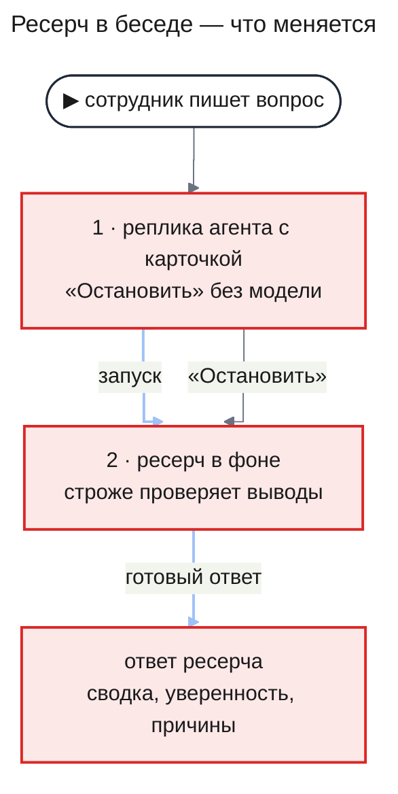
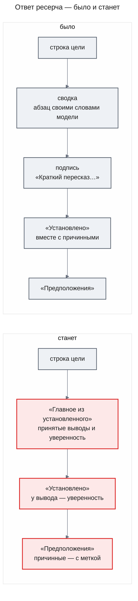
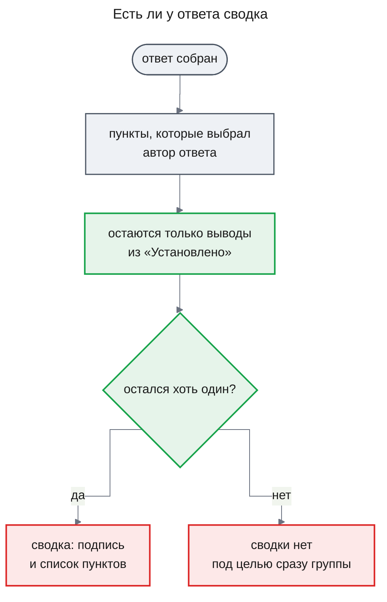
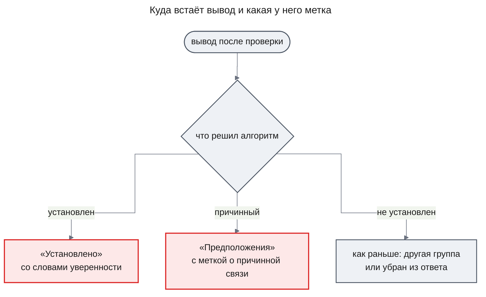
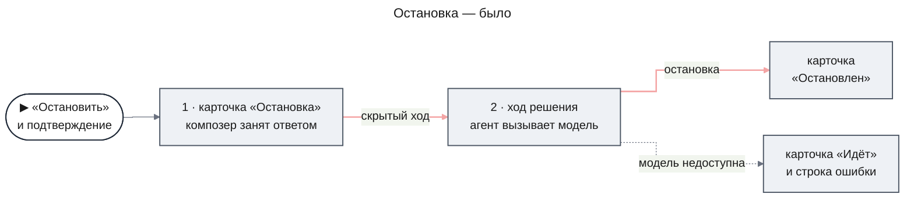
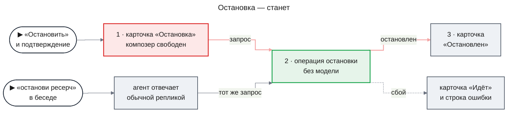

# UXRD: Качество и надёжность расследований (agent-quality)

| Статус | Дата | PRD | Что меняет | Design Docs |
|---|---|---|---|---|
| Draft | 2026-11-06 | [prd.md](./prd.md) | [UXRD `deep-research`](../deep-research/uxrd.md) | — |

## Snapshot

**Overview.** Сотрудник пишет вопрос в чате, агент ставит в беседу карточку ресерча, расследование идёт в фоне, а готовый ответ приходит в беседу отдельным сообщением. Этот путь не меняется, меняются ответ и кнопка остановки. У каждого установленного вывода в ответе появляются слова о том, насколько система в нём уверена. Сводка в начале ответа состоит из самих проверенных выводов, а выводы о причинах стоят среди предположений с меткой. Кнопка «Остановить» на карточке останавливает ресерч сразу и без модели, поэтому остановка не занимает беседу и работает, даже когда модель недоступна.

- **Не меняется**: место карточки и ответа в беседе, набор состояний карточки, вид композера, сносок и списка источников.
- **Главный UX-риск**: сводки теперь нет у любого ответа без установленных выводов, в том числе у каждого ответа без источников, и сотрудник, вернувшийся к беседе, начинает читать сразу с предположений.
- **Открытые вопросы**: нет.

### Key Decisions

| ID | Решение | Почему |
|---|---|---|
| KD-1 | Группа уверенности показывается словами «уверенность …» (MC-1). При трёх группах это «высокая», «средняя» и «низкая»; при четырёх сверху добавляется «очень высокая», а три прежних слова остаются. Процентов, баллов и оценок модели на экране нет | Группу алгоритм выводит из нескольких признаков, а границы групп сдвигаются после каждой калибровки. Поэтому слова говорят, насколько система уверена, а не почему: описание вроде «подтверждено несколькими записями» стало бы неправдой для части выводов. Порядок от «очень высокой» до «низкой» читается без пояснений |
| KD-2 | Метка уверенности — мелкий серый текст после сносок вывода, без рамки, цвета и иконки; все группы выглядят одинаково, отличаются только слова | Метка стоит у каждого установленного вывода, и цветная или обведённая метка в каждой строке шумит и утомляет за долгий день. Цвет в дизайн-системе означает состояние работы агента, а не степень уверенности. Рамку носят только метки-исключения: «не проверено», пометка знаний модели и метка причинной связи (KD-4) |
| KD-3 | Сводка — подпись «Главное из установленного» (MC-2) и под ней список. Каждый пункт — дословный текст принятого вывода со словами его группы, без сносок. Сколько пунктов брать, задаёт Design Doc `engine`; экран показывает их все, без сворачивания. Если пунктов нет, нет ни подписи, ни списка, ни пустого места под них | Пункты — те же выводы, что ниже стоят в «Установлено» со сносками, поэтому сноски в сводке только повторяли бы их. Подпись над списком говорит, откуда пункты, до того как сотрудник начнёт читать; без неё список выглядел бы ещё одной группой |
| KD-4 | Вывод о причине стоит в «Предположениях» и несёт метку «причинная связь не доказана» (MC-3) в рамке, как у метки «не проверено» | Логи показывают события и время, но не связь «из-за». Без метки сотрудник видит в логах и релиз, и ошибки и не понимает, почему вывод не установлен. Метка остаётся рядом с выводом, когда его копируют или цитируют |
| KD-5 | После подтверждения «Остановить» сразу вызывает операцию остановки. Карточка стоит в «Остановка», только пока операция не ответит; композер и кнопки других карточек при этом не меняются. «Остановить» доступна и тогда, когда агент пишет ответ | Остановке не нужен ответ агента, поэтому ей незачем ждать конца ответа и занимать беседу. Кнопка, которая ждёт конца ответа, не сработала бы как раз тогда, когда модель недоступна и ответ завис (AC-21.1) |

## Terms

Пример везде один: сотрудник спрашивает в чате «почему вчера вечером росли ошибки оплаты?». Слова о самом расследовании — расследование (в интерфейсе «ресерч»), утверждение, принятое утверждение, разделы ответа, сводка, группа уверенности, тип утверждения — объяснены в [PRD, раздел Terms](./prd.md#terms). Здесь только то, что видно на экране.

- **Вывод** — так этот документ называет утверждение, как его видит сотрудник: одна строка ответа со сносками. Пример: «С 19:40 до 20:15 payment-api записал 412 ошибок timeout [1] [2]». Принятый вывод — вывод из группы «Установлено».
- **Композер** — поле ввода сообщения внизу беседы. Пока агент пишет ответ, в композере вместо «Отправить» стоит кнопка «Остановить», которая прерывает этот ответ.
- **Карточка ресерча** — блок в реплике агента: цель, бюджет, состояние ресерча («Идёт», «Остановлен», «Завершён») и кнопки «Запустить», «Не нужно», «Остановить».
- **Ответ ресерча** — отдельное сообщение в конце беседы с итогом: шапка, строка цели, сводка, группы выводов и список источников.
- **Сноска** — номер в квадратных скобках после вывода; ведёт на запись в списке «Источники».
- **Автор ответа** — роль модели, которая пишет ответ (в PRD — synthesis).
- **Ход решения** — скрытый ответ агента, через который кнопки «Запустить» и «Не нужно» передают решение. Лента его не показывает, а композер на это время стоит в состоянии идущего ответа.
- **Операция остановки** — прямой запрос к серверу, который останавливает ресерч без вызова модели.

## Design System

Фича следует [дизайн-системе](../../design-system/README.md) и меняет два компонента ресерча; новых компонентов нет.

### Component Inventory

| Компонент | Спецификация | Статус | Что изменено |
|---|---|---|---|
| Ответ ресерча | [research-answer.md](../../design-system/components/research-answer.md) | extended | Сводка из подписи и списка принятых выводов (KD-3); метка уверенности (KD-1, KD-2); метка причинной связи (KD-4) |
| Карточка ресерча | [research-card.md](../../design-system/components/research-card.md) | extended | «Остановка» длится, пока отвечает операция остановки; «Остановить» доступна во время ответа агента (KD-5) |

## User Flows

### Где изменения в диалоге

Схема показывает весь путь ресерча в беседе. Красным отмечено то, что меняет эта фича.



Сотрудник видит только беседу: реплику агента с карточкой и потом ответ. Строгая проверка выводов в фоне видна ему только через ответ — через то, что стоит в «Установлено», и через слова уверенности. Остановка меняет поведение карточки, а не её вид.

### Primary User Flow

**Implements:** UC-4, UC-5; AC-09.1, AC-11.1, AC-12.1, AC-12.2, AC-13.1, AC-14.1, AC-15.1, AC-15.3, AC-16.1, AC-16.2

Сотрудник возвращается к беседе и читает пришедший ответ сверху вниз. Сверху — ответ, каким он был, снизу — каким он станет.



1. **Ответ пришёл.** Ответ встаёт в конец беседы отдельным сообщением, как раньше; шапка с исходом и строка цели на своих местах.
2. **Сводка.** Под строкой цели стоит подпись «Главное из установленного» и список главных принятых выводов, каждый со словами своей группы уверенности (KD-3, AC-15.3, AC-16.1). Вывод из «Предположений» в сводку не попадает (AC-16.2). Сотрудник, вернувшийся к беседе через несколько минут, по этим пунктам видит итог и сразу понимает, на какой из них можно опереться.
3. **«Установлено».** Здесь стоят только выводы, которые прошли проверку (AC-11.1, AC-12.1, AC-12.2, AC-13.1). После сносок каждого вывода — слова его группы уверенности (KD-2, AC-15.1). Сноски выглядят как раньше, но ведут только на записи, по которым вывод проверили (AC-09.1).
4. **«Предположения».** Здесь же стоят причинные выводы, каждый с меткой «причинная связь не доказана» (KD-4, AC-14.1). Остальные пункты «Предположений» и группа «Не выяснено» не меняются.

#### Когда в ответе есть сводка



Автор ответа только выбирает, какие выводы поставить в сводку, а их тексты в сводку подставляет код. Из выбранного код оставляет только принятые выводы. Если не осталось ни одного — потому что в ответе нет принятых выводов (AC-16.3) или автор ответа ничего не выбрал, как в ответе принудительной остановки, — сводки нет.

#### Что стоит рядом с выводом



Модель оценивает вывод, а куда он встанет и с какой группой уверенности, решает алгоритм. Экран показывает только это решение — словами, без чисел.

### Alternative Flows

- **Ответ без принятых выводов** (AC-16.3). В «Установлено» нет ни одного вывода, поэтому сводки нет. Под строкой цели сразу идёт первая непустая группа — обычно «Предположения» — или причина остановки, если ресерч остановлен принудительно. На месте сводки ничего не стоит.
- **Без источников** (`deep-research` UC-11). Каждый вывод в таком ответе стоит в «Предположениях» с пометкой «из знаний модели, без источника» (`deep-research` UXRD, MC-33), и принятых выводов нет. Поэтому сводки нет: под предупреждением ответа (`deep-research` UXRD, MC-32) сразу идут группы. Меток уверенности и причинной связи тоже нет — выводы без источника не проходят проверку.
- **Ответ принудительной остановки** (`deep-research` UXRD, Error Flows). Такой ответ собирает код без автора ответа, поэтому сводки нет. Установленные выводы в нём всё равно несут слова уверенности (AC-15.1).

#### Остановка

**Implements:** UC-6; AC-21.1, AC-21.2

Так остановка шла до этой фичи: решение уходило агенту ходом решения, то есть через вызов модели.



Так остановка идёт после изменений. Вторая точка входа — сотрудник просит агента в беседе остановить ресерч.



1. **Кнопка.** Сотрудник нажимает «Остановить» на карточке «Идёт» — в том числе пока агент пишет ответ на другое сообщение (KD-5). Ряд действий сменяется вопросом подтверждения, как раньше (`deep-research` UXRD, MC-9).
2. **Подтверждение.** Сотрудник подтверждает, и карточка переходит в «Остановка». Композер не переходит в состояние идущего ответа, кнопки других карточек не гаснут, сотрудник может сразу писать дальше.
3. **Итог.** Операция остановки отвечает, и карточка показывает «Остановлен» (`deep-research` UXRD, MC-11); экран объявляет остановку (`deep-research` UXRD, MC-19). Так же всё идёт, когда модель недоступна (AC-21.1). Если ресерч к этому моменту уже завершился, упал или остановлен, карточка сразу показывает это состояние, без строки ошибки, как раньше.
4. **Через агента.** Сотрудник пишет в беседе, например, «останови ресерч». Агент отвечает обычной репликой, а карточка этого ресерча на своём месте переходит в «Остановлен» — тем же запросом, что и кнопка (AC-21.2). Этот путь вызывает модель и поэтому, в отличие от кнопки, не работает, когда модель недоступна.

### Error Flows

- **Остановка не удалась** (UC-6, AC-21.1). Операция остановки отказала или не ответила. Карточка возвращается в «Идёт» со строкой «Не удалось остановить ресерч. Попробуйте ещё раз.» (`deep-research` UXRD, MC-16), и «Остановить» снова доступна. Кнопка «Остановить» в композере прерывает только ответ агента и на остановку ресерча не влияет.

## Screens

### Screen 1: беседа с ресерчем (`/chat/<id>`)

Карточка выглядит как раньше; меняется ответ ресерча. Три наброска показывают один и тот же ответ: каким он был, каким станет и каким станет, если ни один вывод не установлен.

Было:

```
┌ Ответ ресерча — было ───────────────────────────────────────┐
│ ⌕ Ответ ресерча  ✓ Есть ответ                 К запросу ↑   │
│ Почему вчера вечером росли ошибки оплаты                     │ строка цели
│ Ошибки оплаты вызвал релиз в 19:30: после него payment-api   │ сводка — абзац
│ стал получать таймауты от провайдера.                        │ своими словами модели
│ Краткий пересказ — основания в утверждениях ниже             │ подпись
│ Установлено                                                  │
│ С 19:40 до 20:15 payment-api записал 412 ошибок timeout [1]  │
│ Ошибки оплаты вызвал релиз в 19:30 [2] [3]                   │ причина среди фактов
│ ▸ Источники (3)                                              │
└──────────────────────────────────────────────────────────────┘
```

Станет:

```
┌ Ответ ресерча — станет ─────────────────────────────────────┐
│ ⌕ Ответ ресерча  ✓ Есть ответ                 К запросу ↑   │
│ Почему вчера вечером росли ошибки оплаты                     │ строка цели
│ Главное из установленного                                    │ MC-2
│ • С 19:40 до 20:15 payment-api записал 412 ошибок timeout    │ пункт сводки
│   уверенность высокая                                        │ MC-1
│ • Таймауты шли только на запросах к провайдеру PayGate       │
│   уверенность средняя                                        │
│ Установлено                                                  │
│ С 19:40 до 20:15 payment-api записал 412 ошибок timeout      │
│ [1] [2]  уверенность высокая                                 │ сноски, затем MC-1
│ Таймауты шли только на запросах к провайдеру PayGate [3]     │
│ уверенность средняя                                          │
│ Предположения                                                │
│ Ошибки оплаты вызвал релиз в 19:30 [4] [5]                   │
│ ‹причинная связь не доказана›                                │ MC-3
│ ▸ Источники (5)                                              │
└──────────────────────────────────────────────────────────────┘
```

Станет, если ни один вывод не установлен:

```
┌ Ответ ресерча — нет принятых выводов ───────────────────────┐
│ ⌕ Ответ ресерча  … исход …                    К запросу ↑   │ исход ставит движок
│ Почему вчера вечером росли ошибки оплаты                     │ строка цели
│ Предположения                                                │ сводки нет
│ Ошибки оплаты вызвал релиз в 19:30 [1] [2]                   │
│ ‹причинная связь не доказана›                                │ MC-3
│ Не выяснено                                                  │
│ Почему таймауты начались именно в 19:40                      │
│ ▸ Источники (2)                                              │
└──────────────────────────────────────────────────────────────┘
```

`‹ ›` — рамка метки. Метка уверенности рамки не имеет (KD-2).

**Layout**:

- **Сводка** стоит между строкой цели и первой группой, на месте прежнего абзаца и подписи; отступы — в [спецификации ответа ресерча](../../design-system/components/research-answer.md).
- **Метки** стоят после сносок вывода, в той же строке, если помещаются, иначе целиком переходят на следующую строку.

**Screen states** — только те, что меняет эта фича:

| Состояние | Что видно | AC |
|---|---|---|
| Ответ пришёл | Под строкой цели — сводка: подпись MC-2 и пункты со словами уверенности; в «Установлено» у каждого вывода слова уверенности; причинные выводы — в «Предположениях» с меткой MC-3 | AC-14.1, AC-15.1, AC-15.3, AC-16.1 |
| Нет принятых выводов | Сводки нет, под строкой цели сразу группы или причина остановки | AC-16.3 |
| Без источников: ответ | Под предупреждением MC-32 сразу «Предположения» с пометками MC-33; сводки, меток уверенности и причинной связи нет | AC-16.3 |
| Стримится ответ агента | «Запустить» и «Не нужно» неактивны, как раньше (`deep-research` UXRD, KD-8); «Остановить» доступна | AC-21.1 |
| Остановка | Карточка «Остановка», пока операция не ответит; композер и другие карточки без изменений | AC-21.1 |

## Accessibility

- **Целевой уровень**: WCAG 2.1 AA (`deep-research` PRD, NFR-05).
- **Ответ**: роли, порядок чтения сводки и меток и правило цвета — в [спецификации ответа ресерча](../../design-system/components/research-answer.md#accessibility). На уровне экрана: приход ответа объявляется как раньше (`deep-research` UXRD, MC-18), а сводка и метки отдельно не объявляются и фокуса не получают. Программа чтения экрана читает метку сразу после сносок: «…412 ошибок timeout, Источник 1, Источник 2, уверенность высокая».
- **Остановка**: фокус и объявления те же, что раньше (`deep-research` UXRD, раздел Accessibility). Подтверждённая остановка переводит фокус на карточку, итог объявляется вежливо (MC-19), ошибка — как `alert` (MC-16), состояние «Остановка» не объявляется.

## Responsive Behavior

Фича не меняет поведение по ширине экрана: новые метки, как и прежние метки ответа, целиком переходят на следующую строку, когда не помещаются после сносок.

## Content and Microcopy

Тон — как в `deep-research` UXRD: короткие нейтральные фразы, без восклицательных знаков, кавычки «ёлочки». Остановка пользуется прежними текстами `deep-research` UXRD: MC-9, MC-11, MC-16 и MC-19.

| ID | Где (экран / компонент / состояние) | Текст | Примечание |
|---|---|---|---|
| MC-1 | Ответ ресерча, метка уверенности после сносок вывода в «Установлено» и после пункта сводки | Три группы, от высшей: «уверенность высокая» / «уверенность средняя» / «уверенность низкая». Четыре группы, от высшей: «уверенность очень высокая» / «уверенность высокая» / «уверенность средняя» / «уверенность низкая» | Со строчной, без точки, не усекается; число групп задаёт Design Doc `engine`; KD-1 |
| MC-2 | Ответ ресерча, подпись над пунктами сводки | «Главное из установленного» | Без точки; нет, когда нет сводки; KD-3 |
| MC-3 | Ответ ресерча, метка причинного вывода в «Предположениях» | «причинная связь не доказана» | Со строчной, без точки, не усекается; KD-4 |

## Update History

| Версия | Дата | Изменение |
|---|---|---|
| 1.0 | 2026-11-06 | Первая версия |
