# Агенты как сущность платформы — Design Doc — agent-core

**Status:** Утверждён владельцем 2026-11-08 · **Date:** 2026-11-08 · **PRD:** [prd.md](./prd.md) · **UXRD:** нет · **Depends on:** ничего

## Snapshot

**Overview.** Сейчас каждая роль расследования — один вызов модели без памяти, а что делать дальше, решает цикл в коде. Эта часть даёт платформе агента: модель, которая работает над одним заданием ходами, пока не вернёт результат. На каждом ходе модель получает свою сессию — все прежние сообщения задания — и просит вызвать инструменты, а исполняет их код движка: память расследования, чтение данных расследования, вызов другого агента. Запуск агента — обычная задача runtime, поэтому рестарт, сроки и «Остановить» работают для него как для любой задачи. Сессия и каждый вызов инструмента записываются в базу после каждого шага, и повтор после рестарта ничего не исполняет дважды. Агент, вызвав другого агента, ждёт его как задачу и получает только результат; все вызовы модели дерева платятся из одного бюджета расследования долями, которые родитель выдаёт детям. Определение может назвать форму результата с кодом процесса из закрытого реестра движка: этот код строит первое сообщение запуска, проверяет и записывает результат, а когда запуску не хватило бюджета, ходов, срока или окна, может кончить его результатом вместо сбоя.

- **Не меняется**: всё, что видит сотрудник; набор поставляемых процессов в `apps/api` — его меняет часть `research-flow`; закрытие расследования по ADR-0006 и запрет вызова модели после остановки.
- **Главный риск**: длинный запуск агента делает много ходов, и вместе с сессией растут цена и время; это ограничивают предел ходов, правило окна и доли бюджета ([Risks and Mitigation](#risks-and-mitigation)).
- **Открытые вопросы**: есть — источник прав сотрудника на источники и срок хранения аудита; дизайн они не блокируют ([Open Questions](#open-questions)).

### Key Decisions

#### KD-1: Запуск агента — задача runtime, ход — один запрос к модели, а вызовы инструментов исполняет код движка

Запуск агента — задача `agent.run` версии 1, а корень дерева — задача `agent.root` версии 1; обе исполняет один обработчик движка `AgentRunHandler`. Ход — один вызов шлюза модели (`ModelGateway`) с резервом, как у каждой роли v2, и один запрос к провайдеру. Модель получает инструменты определения без исполняющей функции и отвечает вызовами инструментов, а код движка проверяет аргументы, права и пределы и исполняет вызовы сам. Mastra остаётся клиентом одного запроса: новый `Agent` на каждый ход, без `Memory`, без субагентов (`agents`), без `DurableAgent`, с `maxSteps: 1` ([ADR-0001](../../adr/ADR-0001-durable-runtime-owner.md)). Так резерв по-прежнему стоит перед каждым запросом, а отмена по расследованию доходит до каждого запуска.

Корень отличается типом задачи, чтобы потребитель `engine.lifecycle` закрывал расследование, когда кончился корень, так же, как сейчас, когда кончилась задача `research.controller`: проверка `isControllerTask` узнаёт оба типа. «Главная задача» расследования из ADR-0006 для процесса на агентах — корневой запуск. Проверка по сохранённому `controller_task_id` не подходит: корень может кончиться раньше, чем старт запишет его идентификатор.

В установленном `@mastra/core` 1.80.0 у инструмента поле `execute` необязательно, а `generate` принимает `maxSteps`, `toolChoice` и `clientTools` (`dist/agent/agent.types.d.ts`, `dist/tools/types.d.ts`). Что такой `generate` делает ровно один запрос и возвращает вызовы, не исполняя их, — допущение, которое план проверяет пробным запуском первым делом. Если оно не подтвердится, ход идёт через структурный выход со списком действий и аргументами строкой JSON, как сейчас у решений controller (`ModelArgsSchema`); остальной дизайн от этого не меняется. Субагенты и инструменты Mastra с исполнением не взяты: один `generate` тогда делает несколько запросов мимо резерва, а работа субагента идёт вне задач runtime, без журнала и без отмены.

#### KD-2: Данные агентов — новые таблицы схемы `app`, сессия только дописывается, а транскрипт хода ссылается на сессию, а не копирует её

Шесть новых хранилищ: запуски агентов, сообщения сессии, вызовы инструментов, память расследования, аудит вызовов инструментов и память определения агента. Первые четыре удаляются каскадом вместе с расследованием, а аудит и память определения — нет; аудит поэтому хранит только факт вызова ([Data Model](#data-model)). Сообщение сессии после записи не меняется, поэтому начало сессии остаётся тем же от хода к ходу и его можно кэшировать (FR-21). Вызов инструмента — отдельная изменяемая строка: она хранит состояние исполнения, исход и ссылку на дочернюю задачу.

Существующие места не подходят. Checkpoint задачи — один слот до 64 KiB, который перезаписывается целиком, а сессия растёт с каждым ходом. Транскрипты — одна строка на вызов модели с полной копией входа и сроком хранения, поэтому как сессия они дали бы квадратичный рост и потерю по сроку. Mastra Memory — второй владелец состояния вне транзакций runtime, что запрещает ADR-0001.

Строка журнала вызовов (`research_llm_calls`) и транскрипт хода получают роль `agent`; имя агента берётся из запуска по `task_id`, у журнала новой колонки нет. Транскрипт получает поле имени агента только для ходов `Engine.assessAgent`, у которых строки запуска нет. Транскрипт хода агента хранит инструкции, выход модели и ссылку на вид сессии — до какого сообщения и какие результаты заменены заглушками (KD-5), — а чтение транскриптов восстанавливает вход из сессии. Сессию запуска удаляет та же фоновая чистка, что транскрипты, с тем же исключением для системного владельца самопроверки, и не раньше, чем истёк срок самого нового транскрипта её ходов; поэтому, пока транскрипт читается, его сессия на месте ([Contract Definitions](#изменения-контракта-транскриптов-и-журнала)).

#### KD-3: Каждый побочный эффект инструмента либо пишется в своих таблицах той же транзакцией, что его итог, либо становится задачей runtime с ключом, который не меняется при повторе

У каждого инструмента в реестре есть класс эффекта. Класс `read` только читает; его результат записывается в строку вызова охраняемой записью, и повтор после рестарта берёт записанный результат. Класс `write` пишет таблицы движка, например заметку памяти, в одной охраняемой транзакции с итогом вызова, поэтому эффект и запись о нём фиксируются вместе или не фиксируются вовсе. Класс `task` ставит задачу runtime: дочерний запуск или, в `research-flow`, задачу сбора записей. Ключ дедупликации дочернего запуска `call_agent` складывается из запуска, хода и номера вызова (AC-05.4). Дедупликация runtime отдаёт прежнюю задачу (`subscribed`), только пока та не `failed` и не `cancelled`; поэтому повтор `call_agent` сначала ищет задачу с этим ключом среди задач расследования в любом статусе и ставит новую, только если её нет ([Как исполняется вызов инструмента](#как-исполняется-вызов-инструмента)). Задача `source.fetch` инструмента `gather` сохраняет существующий ключ по запросу: источник, инструмент, аргументы и срез источника. Запуска, хода и номера вызова в этом ключе нет, поэтому сбор с тем же запросом ждёт идущую задачу, и источник вызывается один раз ([design-research-flow.md](./design-research-flow.md#инструменты-возможностей), DC-11). Класс `finish` — результат запуска. Внешний вызов внутри хода не исполняется никогда: к источникам агент обращается только задачами.

Перед исполнением любой вызов проходит охраняемую проверку в режиме `requireActive`: после остановки или закрытия вызов не начинается. Исход вызова — одно из шести значений: пять классов аудита проекта — `success`, `empty`, `tool_error`, `transport_failure`, `access_denied` — и `rejected`, отказ кодом с причиной (нет инструмента в определении, предел, неверные аргументы). Та же охраняемая транзакция, что записывает исход, пишет одну строку аудита вызова, поэтому на вызов приходится ровно одна запись аудита. Аудит лежит в отдельной таблице без каскада от расследования и переживает удаление беседы, как `audit_events`, поэтому хранит только факт вызова: пользователь, время, инструмент, источник, исход. Аргументы и то, какой агент вызвал инструмент, лежат в строке вызова, которая ссылается на строку аудита и удаляется вместе с расследованием. Сама `audit_events` не подходит: её создаёт и пишет `apps/api` пакетами вне транзакций движка, а движок по ADR-0004 не зависит от `apps/api`.

#### KD-4: Родитель выдаёт дочернему агенту долю своего бюджета, а неистраченное возвращается

Сейчас бюджет устроен в два уровня: общий пул расследования и потолок задачи `TaskBudget.maxTokens`, который правило резерва (`decideReserve`) проверяет по всем попыткам задачи. Решение сохраняет оба уровня и связывает потолки по дереву. У корня потолок — весь бюджет расследования. Вызывая агента, родитель выдаёт ему долю — меньшее из `runTokens` его определения и своего свободного остатка; доля становится потолком дочерней задачи и сразу занимает остаток родителя. Пока в поддереве дочернего есть задачи в работе, у родителя занята вся доля; когда их не осталось, у родителя занят только фактический расход поддерева по журналу вызовов, а остальное вернулось ([Как считается доля бюджета](#как-считается-доля-бюджета)).

Каждый резерв по-прежнему проверяет две вещи: свой потолок и пул расследования. Поэтому вызов сверх доли или сверх бюджета не начинается ни в одном запуске дерева, а один дочерний агент не съест весь бюджет. Правило «вызов ждёт, если мешают только чужие открытые резервы» (design-engine.md, KD-5) остаётся для пула, а KD-6 не даёт такому ожиданию держать слот диспетчера бесконечно. Остановка отменяет всё дерево по расследованию, как сейчас (ADR-0006).

Другие варианты: (а) общий пул и пределы глубины и ширины без долей — один дочерний агент может истратить весь пул, и у каждой задачи нет своего явного предела, которого требует бизнес-ограничение 4; (б) общий пул и постоянный потолок на запуск, как сейчас у вспомогательных задач (`maxTokens` — три резерва роли), — число ходов запуска заранее неизвестно, поэтому такой потолок либо обрывает работу, либо ничего не ограничивает; (в) доля без возврата — неистраченное пропадает до конца расследования.

#### KD-5: Модель видит сессию целиком, пока она помещается, а старые результаты инструментов заменяются заглушками со ссылкой

Хранимая сессия не меняется никогда; меняется только вид — то, что модель получает на ходу. Пока сессия помещается в окно определения за вычетом запаса (`windowTokens − marginTokens`), вид — вся сессия. Когда не помещается, код по правилу без модели идёт по четырём ступеням ([Что модель видит из сессии](#что-модель-видит-из-сессии)): заглушки на результатах инструментов старше трёх последних ходов; затем одна заглушка на весь такой старый ход вместе с ответом модели; затем заглушки на результатах трёх последних ходов, кроме самого нового; в конце обрезка результатов самого нового хода с пометкой. Заглушка говорит, что убрано, сколько в нём было и каким вызовом его прочитать снова; результат дочернего агента читается вызовом `investigation_read` с видом `runs`, его `run` и `from` 0 — по частям при любом размере ([Базовые инструменты](#реестр-инструментов)). Заглушки заменяют разом всё, что относится к ступени, поэтому начало вида меняется на переходе ступени и когда очередной ход уходит за три последних, а до этого места кэш читается. Число ходов ограничивает `maxTurns` определения, число вызовов в одном ходе — `maxCallsPerTurn`; на последнем ходе модели доступен только `finish`.

Помещается ли вид, правило сначала оценивает без провайдера: байты текста, делённые на постоянную движка `BYTES_PER_TOKEN`. Решает посчитанный вход: перед резервом шлюз считает вход хода счётчиком токенов провайдера, как для каждой роли v2. Если посчитанный вход больше `windowTokens − marginTokens`, резерва нет, а вид переходит на следующую ступень и строится заново. Если вид не помещается и на ступени 4, запрос больше окна к модели не уходит: запуск кончается кодом `context_overflow` — результатом принудительного конца формы или явным сбоем (DC-30).

Кэш: метка кэша провайдера стоит в конце неизменного блока — системного промпта с инструментами — и на последнем сообщении вида. Следующий ход читает из кэша всё до прежней метки и платит полную цену только за новое; так выполняется FR-21 по тому же принципу, что у controller v2 (design-engine.md, KD-6): метка стоит на сообщении, а не на всём запросе.

Другие варианты: скользящее окно последних ходов — агент теряет задание и свои прежние вызовы, а начало вида меняется на каждом ходе, и кэш не работает; сжатие старых ходов вызовом модели — лишний платный вызов, недетерминированный пересказ, в котором модель может потерять или придумать факт; только предел ходов — он не ограничивает размер результатов.

#### KD-6: Долгий запуск отдаёт слот диспетчера — новый исход попытки `yield` возвращает задачу в очередь без расхода повторов

Одна попытка ограничена `RUNTIME_ATTEMPT_MS` (900 с), а пробуждение после ожидания — новая попытка. Запуск агента, который много ходов не ждёт дочерних задач, упёрся бы в срок попытки, и runtime повторил бы его как потерянный, тратя один из трёх повторов (`RUNTIME_MAX_RECOVERIES`). Поэтому схема `HandlerResultSchema` в `@agent-os/contracts` получает четвёртый вид `yield`, а `outcomeOfResult` в диспетчере переводит его в исход `released`: задача возвращается в `queued` тем же переходом, что сейчас при штатной остановке процесса, без увеличения `recovery_count`. Без изменения схемы диспетчер отклонил бы такой итог как неверный (`internal`). Срок ожидания в очереди на такую задачу не действует: он считается только для задачи, которую ни разу не захватывали (`expireQueueWait`).

Обработчик отдаёт попытку в двух случаях: прошло `AGENT_ATTEMPT_SLICE_MS` от её начала, или резерв ждёт чужих резервов дольше `AGENT_BUSY_WAIT_MS`. Для второго шлюз получает предел ожидания резерва ([Contract Definitions](#изменения-контракта-транскриптов-и-журнала), «Резерв хода агента»): по его истечении шлюз отвечает `no_answer` с причиной `busy_wait_exhausted`, без строки журнала и без вызова модели. Сессия уже записана, поэтому следующая попытка продолжает со следующего хода. Изменение контракта только добавляет значение: существующие обработчики `yield` не возвращают. Меньший путь — держать ходы в одной попытке и полагаться на повтор после срока — не взят: он расходует повторы и каждый раз списывает резерв прерванного хода полностью.

#### KD-7: Определения агентов — вторая форма `ProcessConfig` рядом с формой ролей; решение записывает новый ADR-0009, который расширяет ADR-0005

Конфигурация процесса бывает двух форм. Форма ролей — нынешняя схема `ProcessConfigSchema` без изменений, по ней загружаются v2 и все замороженные копии сохранённых расследований (AC-13.2, AC-14.3). Форма агентов — новая строгая схема с ключами `agents`, `rootAgent` и `agentLimits` ([Contract Definitions](#contract-definitions)). Загрузка выбирает схему по наличию ключа `agents` и проверяет конфигурацию строго; код, который читает `config.roles`, получает только конфигурации формы ролей. Инструменты определения берутся только из закрытого реестра движка, поэтому кода в конфигурации по-прежнему нет.

Правило ADR-0005 «процесс — только данные со строгой схемой и закрытым реестром» сохраняется, а меняется его содержание: вместо промптов ролей и возможностей, которые открывают решения controller, — определения агентов с инструментами и правилом, кого агент может вызвать. Решение проходит проверку на ADR по всем трём условиям ([ADR-0009](../../adr/ADR-0009-agent-definitions-as-process-data.md)). Править ADR-0005 на месте нельзя: принятый ADR не редактируется. Заменить его целиком тоже неверно: v2 по-прежнему идёт по форме ролей. Поэтому ADR-0009 расширяет ADR-0005, а когда v2 удалят, ADR-0005 получит статус «заменён ADR-0009». Агенты как модули TypeScript не взяты по тому же доводу, что в ADR-0005: шаблон пользователя не может быть кодом. Агенты Mastra, которых описывает и исполняет фреймворк, не взяты по KD-1.

#### KD-8: Форма результата может нести код процесса из закрытого реестра движка — пролог, закрытие и принудительный конец; решение записывает ADR-0010

Процессу на агентах нужно то, чего модель делать не должна: собрать проверяющему пакет утверждения со сверкой атомов, поставить статус по его оценке, записать ответ и собрать ответ кодом, когда у корня кончился бюджет ([design-research-flow.md](./design-research-flow.md#key-decisions), KD-2, KD-3). Поэтому запись реестра формы результата может нести три функции процесса. **Пролог** работает до первого хода и строит первое сообщение сессии. **Закрытие** работает на вызове `finish` в той же охраняемой записи, что результат запуска. **Принудительный конец** работает, когда обработчик сам кончил бы запуск сбоем по бюджету, сроку, пределу ходов или недоступной модели, и может вместо сбоя записать результат. Определение называет форму по имени, как инструмент, поэтому конфигурация остаётся данными (ADR-0005, ADR-0009), а код живёт в движке рядом с реестром инструментов ([Формы результата и код процесса](#формы-результата-и-код-процесса)).

У каждой функции есть чистый шаг, который только решает; шаг чтения `collect` необязателен, а шаг записи `write` есть только у закрытия и принудительного конца, и модель, внешнюю систему и постановку задач не вызывает ни один шаг. Поэтому повтор после рестарта не исполняет записанное второй раз, а `Engine.assessAgent` гоняет чистые шаги проверяющего вне расследования с тем же решением, что в нём. Варианты, проверка на ADR и граница с ADR-0009 — в [ADR-0010](../../adr/ADR-0010-result-form-process-code.md).

#### KD-9: Источники запуска приходят в промпт полем шаблона `sources`, а значение строит код из тех же пар, которые проверяет инструмент сбора

Агент, который собирает записи, должен знать `sourceId`, `toolName` и аргументы каждого инструмента источника. Этот список зависит от запуска: дочернему запуску источники могут сузить (DC-12), а в режиме без источников их нет. Поэтому список подставляет движок: поле `{{sources}}` даёт по одной строке JSON на инструмент ([Поле шаблона `sources`](#поле-шаблона-sources)). Строка — та же запись `FetchToolLine`, которую controller v2 читает во входе `tools`; другого описания инструмента источника для модели в `packages/engine` и `packages/sources` нет, поэтому новой формы не появляется.

Поле допустимо только у определения с инструментом, который читает источники запуска. Такой инструмент помечен признаком в записи реестра. Поле не нужно агенту без сбора, а вход проверяющего так остаётся независимым от источников.

Не взяты:

- перечень пар текстом шаблона — текст не следует за сужением источников и расходится со схемой источника при её правке;
- каталог в описании инструмента сбора — описание одно на реестр, а не на запуск;
- отдельный инструмент чтения каталога — лишний ход, и модель может его не вызвать;
- каталог в задании или первом сообщении — родитель или пролог собирали бы его на каждый вызов;
- сжатая запись вместо JSON-схемы — второй формат рядом с `FetchToolLine` и потеря перечислений, без которых модель угадывала аргументы;
- `sources` в общем списке полей с формой ролей — каждому обработчику v2 пришлось бы подставлять значение, которого у роли нет;
- проверка имени `gather` при загрузке вместо признака — `agent-core` узнал бы инструмент чужой части.

## Terms

Слова расследования — модель, роль, controller, worker, проверяющий, резерв, бюджет, задача, транскрипт, самопроверка — объяснены в [Terms PRD agent-quality](../agent-quality/prd.md#terms), а агент, ход, сессия, определение, запуск, базовые инструменты, память расследования, данные расследования, вызов агента, дерево агентов и память определения — в [Terms PRD этой фичи](./prd.md#terms). Ниже только слова этого дизайна.

- **Корневой запуск** — первый запуск дерева, задача `agent.root`; его конец закрывает расследование.
- **Дочерний запуск** — запуск, который создал вызов агента, задача `agent.run`.
- **Вызов инструмента** — одна просьба модели в ответе хода: имя инструмента и аргументы. Код хранит его строкой с состоянием и исходом.
- **Класс эффекта** — что инструмент делает с миром: только читает (`read`), пишет таблицы движка (`write`), ставит задачу runtime (`task`) или отдаёт результат запуска (`finish`).
- **Охраняемая запись** — транзакция `TaskContext.withAttemptGuard`: она пишет, только если попытка ещё текущая, а в режиме `requireActive` — ещё и если расследование не остановлено.
- **Ключ дедупликации** — отпечаток спецификации задачи; runtime не ставит вторую задачу с тем же ключом, а отдаёт прежнюю.
- **Доля** — потолок токенов дочернего запуска, который выдал родитель из своего остатка.
- **Вид сессии** — то, что модель получает на ходу: сессия, в которой старые результаты могут быть заменены заглушками.
- **Заглушка** — короткий текст на месте убранного из вида результата: что убрано и как прочитать снова.
- **Квант попытки** — сколько попытка запуска работает, прежде чем отдать слот диспетчера (`AGENT_ATTEMPT_SLICE_MS`).
- **Отпечаток определения** — короткий код из модели, усилия, промпта, инструментов, формы результата с её версией и потолка выхода; меняется определение или его форма — меняется отпечаток.
- **Пробный процесс** — второй процесс из одних данных, `agent-probe`, на котором проверяется эта часть без предметной области расследования.
- **Форма результата** — запись закрытого реестра движка: схема результата `finish` и, если нужно, код процесса.
- **Код процесса** — функции формы результата в коде движка: пролог до первого хода, закрытие на `finish` и принудительный конец вместо сбоя (KD-8). У каждой функции есть чистый шаг, который решает; шаг чтения необязателен, а шаг записи есть только у закрытия и принудительного конца.

## Part

- **Part**: `agent-core`
- **Covers**: FR-01, FR-02, FR-03, FR-04, FR-05, FR-06, FR-07, FR-08, FR-09, FR-10, FR-11, FR-21, FR-22; NFR-01, NFR-02, NFR-03 в части агентов
- **Depends on**: нет — первая часть
- **Prerequisite ADRs**: [ADR-0001](../../adr/ADR-0001-durable-runtime-owner.md) (runtime — единственный долговечный владелец), [ADR-0003](../../adr/ADR-0003-drizzle-data-layer.md) (схема `app` и миграции drizzle-kit), [ADR-0004](../../adr/ADR-0004-agent-framework-packages.md) (слои пакетов), [ADR-0005](../../adr/ADR-0005-process-config-data-only.md) (процесс — данные), [ADR-0006](../../adr/ADR-0006-investigation-final-states.md) (закрытие и запрет вызова после остановки), [ADR-0009](../../adr/ADR-0009-agent-definitions-as-process-data.md) (определения агентов — данные, KD-7), [ADR-0010](../../adr/ADR-0010-result-form-process-code.md) (код процесса у формы результата, KD-8; Accepted 2026-11-08)
- **Sibling parts**: `research-flow` (FR-12–FR-20) — процесс `deep-research` v3 на агентах, переход сервера на v3 и удаление v2, калибровка проверяющего агента, самопроверка на v3. Он строится на [контракте этой части](#contract-definitions). Замер делителя `BYTES_PER_TOKEN` касается его окон: наименьший вид `verifier` по оценке — 25 329 токенов, а на деле около 45 600 при доступных 60 800; вид помещается, но запас меньше, чем показывает оценка ([Что модель видит из сессии](#что-модель-видит-из-сессии)).

**Out of scope**

- Процесс `deep-research` v3: определения его пяти агентов, их промпты, инструменты возможностей (сбор записей, запись утверждений, ответ), пределы v3 и его формы результата — `claim_assessment`, `answer_draft`, `research_close` — с их кодом процесса: проверка утверждения, ворота закрытия, запись ответа и ответ кодом. Эта часть даёт реестр форм и контракт кода процесса, а сами формы пишет `research-flow`.
- Какую версию процесса загружает `apps/api` (`ENGINE_PROCESSES`): переход на v3 делает часть `research-flow`, а пробный процесс живёт в тестовой обвязке движка.
- Таблица групп v3, набор пар калибровки, ход калибровки и перевод самопроверки на v3 — `research-flow`. Эта часть даёт ключ таблицы (`agentFingerprint` и `definitionMemoryFingerprint`) и операцию `Engine.assessAgent`, которой калибровка гоняет проверяющего вне расследования.
- Причина остановки «бюджет исчерпан» в ответе сотруднику: её ставит `research-flow` (AC-12.3) по признаку `budgetExhausted` из чтения дерева; эта часть только не допускает вызова сверх бюджета и делает исчерпание видимым.
- Чат-агент, его `Memory` и стриминг.
- Наполнение памяти определения и её жизнь — `self-correction`; здесь хранилище, области и правила доступа, а пишущего инструмента у агентов нет.
- Права сотрудника на отдельные источники по ролям: их модели на платформе нет, эта часть даёт место проверки, а правила даст `access-control` ([Open Questions](#open-questions)).

**Constraints**

- **v2 работает как до этой части.** Схема формы ролей не меняется; расследования v2 не создают ни одного запуска агента; новые значения CHECK и колонки только добавляются; сохранённые строки журнала и транскрипты читаются, как раньше. Сохранённые и новые расследования v2 проходят существующие тесты без правок. Форму ролей и код v2 удаляет часть `research-flow` ([design-research-flow.md](./design-research-flow.md#переход-на-v3-и-удаление-старого-кода)): это её изменение, а не этой части.
- **Один долговечный владелец** (ADR-0001). Запуск — задача runtime, сессия и память — таблицы `app`, Mastra — только клиент одного запроса (KD-1).
- **Слои пакетов** (ADR-0004). Агент — модуль `@agent-os/engine`: шлюз модели, журнал вызовов и транскрипты уже живут там. Модуль агента не импортирует модули процесса расследования (controller, analyze, verify, synthesize), а `research-flow` зависит от модуля агента, не наоборот: формы процесса и их код лежат в модуле процесса, а в реестр их передаёт сборка движка (KD-8). `@agent-os/runtime` получает только новый вид итога, причину сбоя ожидаемой задачи и экспорт уже существующей функции ключа дедупликации `computeDedupKey`; он по-прежнему не знает ни агентов, ни Mastra.
- **Процесс — данные** (ADR-0005, ADR-0009, KD-7). Определение агента — данные строгой схемы; инструмент или форма результата вне реестра отклоняются при загрузке. Код процесса формы — код движка из закрытого реестра, а не код в конфигурации (ADR-0010, KD-8).
- **Остановка отменяет всё дерево** (ADR-0006). Все запуски — задачи одного расследования, поэтому `InvestigationService.cancel` и `closeInTx` отменяют их тем же переходом; резерв и каждый вызов инструмента проверяют `requireActive`.
- **Контракт проверяющего вызова v2** (design-engine.md, KD-2, KD-3, KD-9). Эта часть его не меняет: проверку, атомы и таблицу групп она не трогает. Проверяющего агента с тем же закрытым ответом строит `research-flow` на контракте этой части: форма результата с прологом и закрытием, ключ таблицы групп и `Engine.assessAgent`.
- **Модель оценивает, алгоритм решает.** Код решает только проверяемое без понимания текста: есть ли инструмент в определении, проходят ли аргументы схему, помещается ли вызов в долю и пределы, принадлежит ли ссылка расследованию. Правило окна (KD-5) убирает результаты по возрасту и размеру, не читая текст. Код процесса формы оценок модели не пересматривает: он строит вход, проверяет результат по правилам формы и записывает его.

## Building-block Inventory

В репозитории нет `docs/code-system/`, поэтому строки называют существующий код, который искали перед выбором.

| Building block | Status | Note |
|---|---|---|
| `TaskScheduler.propose`, `TaskContext.registerWait`, ожидание `waits_for` | reused | дочерний запуск — задача, родитель ждёт её, как controller v2 ждёт задачи своего решения |
| `TaskContext.withAttemptGuard` | reused | каждая запись хода, вызова и памяти |
| Дедупликация задач, `computeDedupKey` | reused | у `call_agent` ключ из запуска, хода и номера вызова, у `gather` — ключ по запросу; функция ключа становится экспортом runtime (KD-3) |
| `InvestigationService.cancel`, `closeInTx` | reused | отменяют всё дерево по расследованию |
| `HandlerResult`, `UpstreamTask` | extended | вид `yield` (KD-6); причина сбоя ожидаемой задачи |
| `ModelGateway` | extended | вызов хода с инструментами и метками кэша; запись ответа хода вместо checkpoint |
| `postgresCallLedger`, `decideReserve` | extended | занятое запуска включает доли дочерних (KD-4) |
| `createRoleAgent` | extended | ход с инструментами без исполнения (KD-1) |
| Транскрипты (`transcript-writes`, `readTranscripts`) | extended | роль `agent`, ссылка на вид сессии (KD-2); поле `agentName` для ходов `Engine.assessAgent` |
| `Engine.assess` | reused | `Engine.assessAgent` берёт у него транскрипт с полным входом, привязку к запуску самопроверки, `notAfter` и список `assessModels` |
| `ProcessConfigSchema`, `createEngine` | extended | вторая форма, проверка определений и реестра (KD-7) |
| `findPromptTemplateFault`, `renderPromptTemplate`, `FetchToolLine` | extended | отдельный закрытый список полей для формы агентов; строка значения `{{sources}}` — запись `FetchToolLine` (KD-9) |
| `isControllerTask` | extended | узнаёт корень `agent.root` (KD-1) |
| `AgentRunHandler`, `SessionWindow`, `ToolRegistry`, `ToolExecutor` | new | искали в engine, runtime и Mastra: цикла ходов с инструментами под резервом нет; субагенты Mastra запрещены ADR-0001 |
| Хранилища запусков, сессии, вызовов, аудита и обеих памятей | new | KD-2 |
| Реестр форм результата и код процесса (`prologue`, `closure`, `forcedEnd`) | new | искали в engine: результат роли v2 проверяет схема выхода роли, а пишет его и собирает ответ кодом обработчик роли; общего места для кода формы нет — KD-8, ADR-0010 |

## Acceptance Criteria

### FR-01: Агент задан данными

- From the PRD: AC-01.1, AC-01.2
- Конфигурация формы агентов отклоняется при загрузке, если определение называет вызываемого агента, которого нет среди `agents`, если `rootAgent` или `modelKnowledgeRoot` не назван среди определений, если `sources` определения не входят в источники процесса, если `result` не назван в реестре форм, если `limits.deadlineMs` не больше суммы `AGENT_DEADLINE_MARGIN_MS` и `AGENT_TURN_MS` (запуск не начал бы ни одного хода, DC-27) или если оценка наименьшего вида сессии в худшем случае не помещается в `windowTokens − marginTokens` ([Что модель видит из сессии](#что-модель-видит-из-сессии)); ошибка называет агента и поле (DC-1).
- У определения, чья форма результата имеет пролог, первое сообщение сессии строит пролог, а предел его длины в байтах задаёт форма (`firstMessageMaxBytes`). Вход пролога хранится в строке запуска и ограничен 64 KiB — тем же пределом, что checkpoint задачи runtime; движок проверяет вход, откуда бы он ни пришёл — из `collect` или из задания. Если вход длиннее 64 KiB или `build` вернул `start` с первым сообщением длиннее предела формы, запуск завершается `failed` с кодом `prologue_oversize`, модель не вызывается, а вход не записывается (DC-19).
- Закрытие формы на вызове `finish` либо принимает результат — тогда его строки и результат запуска записаны одной охраняемой записью, — либо отклоняет его с причиной: тогда его строки записаны вместе с замечанием `invalid_result` и этой причиной, а запуск продолжает следующим ходом. Отказ может нести структурный `detail`: его получает шаг `write`, модель читает его следующим ходом, а `collect` позднейшего закрытия находит его в строке отклонённого вызова (DC-20).
- Когда обработчик кончил бы запуск сбоем с кодом `run_tokens_exhausted`, `investigation_tokens_exhausted`, `not_after`, `turn_limit`, `model_unavailable` или `context_overflow`, а у формы есть принудительный конец для этого кода, запуск кончается успехом с его результатом; если принудительного конца нет или он вернул `none`, запуск кончается тем же сбоем и ничего не записано. Сбой, который ставит runtime, — срок задачи, исчерпание повторов, внутренняя ошибка, отмена, — принудительного конца не вызывает (DC-21).
- Если пролог вернул результат без хода модели, закрытие формы проверяет его; принятый результат, строки закрытия и итог пролога записаны одной охраняемой записью, а отклонённый кончает запуск `failed` с кодом `prologue_refused`, и строки закрытия не записаны (DC-26).
- `Engine.assessAgent` делает ходы определения без задачи runtime, строки запуска и строки журнала и не пишет строк закрытия. Пролог и проверка результата формы работают так же, как в расследовании, включая отказ `prologue_oversize` для входа длиннее 64 KiB. Привязки формы те же, кроме одной: привязку вида «таблица по паре отпечатков определения» движок заменяет пометкой «калибруемый» для пары, посчитанной из входа вызова, поэтому форма с группами отдаёт результат без группы. Определение с инструментами, кроме `finish`, или с шагом чтения в закрытии формы отклоняется `agent_not_detachable` (DC-25).
- Конфигурация отклоняется при загрузке, если определение называет форму в нарушение её ограничений места: форма с `onlyOn` стоит не у того определения, её называют больше определений, чем `maxDefinitions`, или у определения есть инструменты вне `toolsAllowed`; ошибка называет агента, форму и ограничение (DC-28).
- Конфигурация отклоняется при загрузке, если шаблон называет поле вне закрытого списка своей формы, если `{{sources}}` стоит у определения без инструмента, который читает источники запуска, или если наибольшее значение поля длиннее предела ([Поле шаблона `sources`](#поле-шаблона-sources)); ошибка называет агента и поле (DC-31).
- В режиме без источников корнем ставится определение `modelKnowledgeRoot`, если ключ задан; без ключа корень — `rootAgent` в любом режиме (DC-22).
- Ответ модели без вызова инструмента — тоже ход: агент получает следующим сообщением замечание `no_tool_call`, а ход засчитывается в предел ходов (DC-2).

### FR-02: Запуск агента переживает рестарт

- From the PRD: AC-02.1, AC-02.2
- Если процесс упал после ответа модели, но до записи хода, ход выполняется заново новым вызовом модели: резерв потерянного вызова списывается полностью, как сейчас, а инструменты этого хода ещё не исполнялись (DC-3).
- Пролог, закрытие и принудительный конец после рестарта не исполняются второй раз, если их запись зафиксирована; если нет — исполняются заново целиком. Запуск, чей результат уже записан, следующая попытка кончает этим результатом без нового хода (DC-23).

### FR-03: Память расследования

- From the PRD: AC-03.1, AC-03.2, AC-03.3, AC-03.4
- Заметка со ссылкой на запись или утверждение другого расследования не пишется: агент получает отказ `foreign_ref` (DC-4).

### FR-04: Данные расследования

- From the PRD: AC-04.1, AC-04.2

### FR-05: Вызов агента

- From the PRD: AC-05.1, AC-05.2, AC-05.3, AC-05.4
- Результаты дочерних агентов одного хода приходят родителю одним пробуждением, когда закончились все, и стоят в его сессии в порядке вызовов (DC-5).
- Отказ по дочернему агенту называет причину из закрытого списка: `budget_exhausted`, `deadline`, `turn_limit`, `model_unavailable`, `failed` (DC-6).
- Вызов `finish` исполняется, только если он единственный вызов своего хода; рядом с другими вызовами он отклоняется с причиной `finish_not_alone`, а остальные вызовы хода исполняются. Поэтому запуск кончается успехом, только когда ни одной его дочерней задачи уже нет в работе (DC-17).

### FR-06: Пределы дерева

- From the PRD: AC-06.1; отказ называет предел кодом `depth_limit`, `children_limit` или `task_limit`.
- Дочерний агент не начинает ход после срока родителя и завершается причиной `deadline` (DC-7).
- Срок запуска `notAfter` — меньшее из двух: срок его задачи runtime минус `AGENT_DEADLINE_MARGIN_MS` и, у дочернего, `notAfter` родителя минус `RUNTIME_LEASE_MS`. Этот действующий срок считает обработчик; у корня срок во входе задачи — без запаса, и запас отнимает обработчик ([Задачи запусков](#contract-definitions)). Шлюз обрывает вызов модели хода в `notAfter`, а новый ход не начинается, если до `notAfter` осталось меньше `AGENT_TURN_MS`. При свободном слоте диспетчера — когда пробуждение каждого уровня и вызовы инструментов после последнего ответа укладываются в `AGENT_DEADLINE_MARGIN_MS` минус одну охраняемую запись — запуск кончается сбоем `not_after` или результатом принудительного конца до срока своей задачи runtime. Дочерний при этом кончается раньше родителя хотя бы на одну охраняемую запись, и родитель успевает записать свой принудительный конец (DC-27).

### FR-07: Один бюджет на дерево

- From the PRD: AC-07.1 в части «ни одного вызова сверх бюджета» — причину «бюджет исчерпан» в ответе ставит `research-flow` (AC-12.3); AC-07.2; AC-07.3 решает KD-4. DC-8–DC-10 и DC-16 опираются на KD-4.
- Дочерний запуск получает долю — меньшее из `runTokens` своего определения и свободного остатка родителя. Если остаток меньше одного хода дочернего, вызов отклонён с причиной `budget_exhausted`, и запуск не создан (DC-8).
- Когда дочерний запуск кончился и в его поддереве не осталось задач в работе, его неистраченная доля возвращается родителю, и родитель может потратить её на свои ходы или на других дочерних агентов. Пока в поддереве есть задачи в работе, доля занята целиком, даже если сам дочерний уже провалился (DC-9).
- Запуск, которому на следующий ход не хватает доли или бюджета расследования, завершается причиной `budget_exhausted`; вызова модели сверх доли нет (DC-10).
- Если в дереве вызов агента или резерв отказан по бюджету расследования либо запуск завершился с классом `budget_exhausted`, чтение дерева показывает признак `budgetExhausted`; причину «бюджет исчерпан» в ответе по нему ставит `research-flow` (DC-16).

### FR-08: Остановка и закрытие отменяют всё дерево

- From the PRD: AC-08.1; AC-08.2 в части «дочерние запуски отменены тем же переходом» — состояние «завершено» с готовым ответом, пока дочерние работают, проверяет `research-flow`.
- По DC-17 корень не кончается успехом, пока работают его прямые дочерние. Поэтому закрытие застаёт запуски дерева в двух случаях: корень кончился сбоем — например, сроком, пока дочерний ещё в вызове модели, — или корень кончился успехом, когда runtime уже завершил дочернего сам, а задачи его поддерева ещё идут (DC-9). Их отменяет тот же переход `closeInTx`, что при закрытии с ответом (DC-18). Закрытие с готовым ответом, пока работают другие задачи, строит `research-flow`.

### FR-09: Ход дерева записан

- From the PRD: AC-09.1
- Дерево расследования читает только его владелец; для чужого чтение отвечает `investigation_not_found` (DC-11).
- `readInvestigation` и `readRunRecord` по расследованию формы агентов отдают те же поля, что сейчас, а его вызовы модели — строками расхода роли `agent`; ни одно из двух чтений не падает на замороженной конфигурации формы агентов (DC-29).

### FR-10: Права и аудит на каждом вызове инструмента

- From the PRD: AC-10.1, AC-10.2
- Источники дочернего запуска — пересечение источников родителя и источников его определения: вызов агента не добавляет источник, которого нет у родителя (DC-12).
- Поле `{{sources}}` показывает только инструменты источников этого запуска, а запуску без источников — постоянный текст; от хода к ходу значение одно и то же (DC-32).

### FR-11: Сессия не упирается в окно

- From the PRD: AC-11.1; AC-11.2 решает KD-5.
- Когда сессия не помещается в окно определения, модель видит на месте старых результатов инструментов заглушки, а хранимая сессия не меняется (DC-13).
- Решает посчитанный вход хода: если вход, который шлюз перед резервом посчитал счётчиком токенов провайдера, больше `windowTokens − marginTokens`, резерва и вызова модели нет, а вид переходит на следующую ступень правила окна и строится заново. Если вход не помещается и на ступени 4, вызова модели нет: сначала работает принудительный конец формы для `context_overflow`, если он есть (DC-21), а без него или при `none` запуск завершается `failed` с классом `validation_rejected` и кодом `context_overflow` (DC-30).
- На ходе номер `maxTurns` модели доступен только `finish`. Если и этот ход не кончил запуск — вызова `finish` нет, он отклонён (`finish_not_alone`) или его результат не проходит форму, — запуск завершается причиной `turn_limit` (DC-14).

### FR-21: Неизменное начало сессии дешевле

- From the PRD: AC-21.1

### FR-22: Память определения агента

- From the PRD: AC-22.1, AC-22.2, AC-22.3, AC-22.4, AC-22.5, AC-22.6
- Запись, после которой тексты активных записей одной области одного определения превысили бы 8 KiB, отклоняется с причиной `limit_reached` (DC-15).
- Запись в область `user` определения, чья форма результата запрещает память области `user` (так у формы проверяющего), отклоняется с причиной `scope_not_allowed`, и память не меняется. Запись области `user`, которая уже лежит у такого определения — например, написана, пока у него была другая форма, — в снимок нового расследования не попадает (DC-24).

### Нефункциональные требования

- From the PRD: NFR-01 для сессий, памяти, дерева и памяти определения; NFR-02; NFR-03 для четырёх точек хода агента.

## Design

### Как агент встраивается в расследование

Сейчас обработчик роли v2 делает один вызов модели через шлюз и пишет результат, а следующее действие выбирает controller. Агент встраивается в ту же цепочку: тот же диспетчер выдаёт попытку, тот же шлюз резервирует токены и зовёт модель, тот же журнал вызовов пишет расход. Новое — цикл ходов внутри обработчика, сессия в базе и исполнение вызовов инструментов кодом.

### Architecture (C1–C4)

#### C2 · Containers

Контекст системы (C1) не меняется: сотрудник, модель и источники те же.

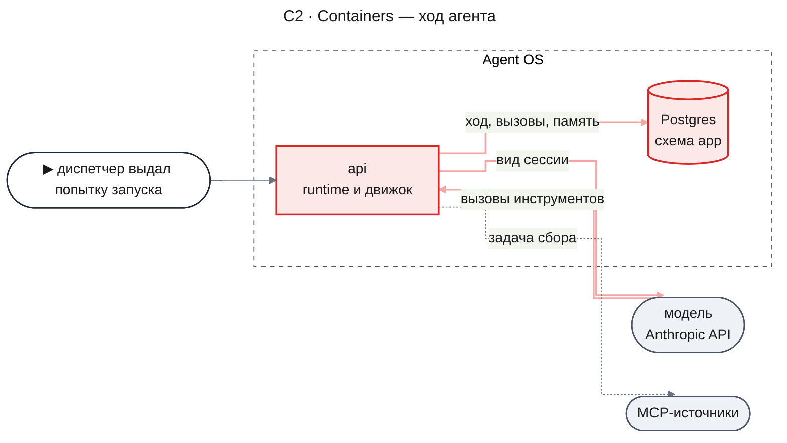

- `api` — процесс NestJS, в котором работают воркеры runtime и движок; в нём идёт цикл ходов каждого запуска агента.
- `Postgres` получает новые таблицы агентов, роль `agent` в журнале вызовов и транскриптах и снимок памяти определения у строки расследования движка.
- MCP-источники агент не вызывает сам: к ним обращаются задачи сбора, которые инструменты возможностей `research-flow` ставят как вызовы класса `task`.

#### C3 · Components: api

**api — ход агента**

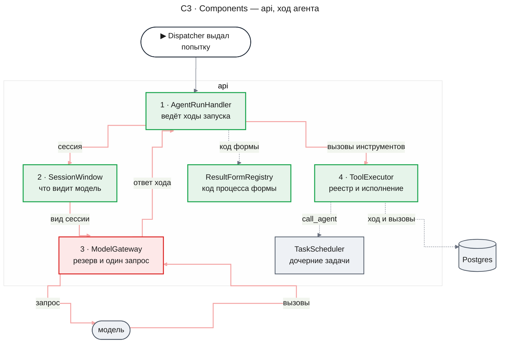

- `AgentRunHandler` — обработчик задач `agent.run` и `agent.root`. Он читает запуск и сессию, решает, где продолжать после рестарта, ведёт ходы, ждёт дочерние задачи и возвращает результат, отказ или `yield`.
- `ResultFormRegistry` — закрытый реестр форм результата. Обработчик зовёт пролог формы до первого хода, закрытие на `finish` и принудительный конец вместо сбоя (KD-8, [Формы результата и код процесса](#формы-результата-и-код-процесса)).
- `SessionWindow` строит вид сессии по правилу окна (KD-5) и ставит метки кэша; хранимую сессию он не меняет.
- `ModelGateway` получает вызов хода: сообщения с вызовами и результатами инструментов, схемы инструментов без исполнения и выбор инструмента. Резерв, повтор по ошибке провайдера и закрытие строки журнала остаются прежними, а ответ хода вместо checkpoint записывает обработчик в сессию той же транзакцией, что закрывает строку журнала.
- `ToolExecutor` для каждого вызова находит инструмент в закрытом реестре `ToolRegistry`, проверяет, есть ли инструмент в определении, проходят ли аргументы схему, разрешает ли его порт прав `ToolAccessPolicy`, и исполняет его по классу эффекта (KD-3). Реестр — список в коде движка: базовые инструменты этой части и инструменты возможностей, которые добавит `research-flow`.

#### C4 · Code flow: один ход

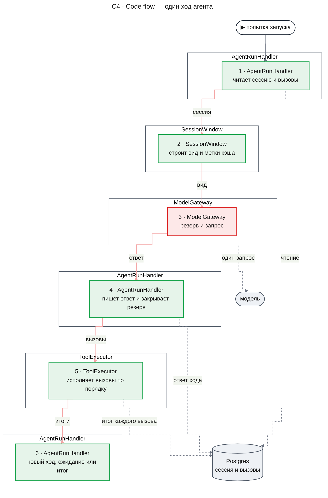

Шаг 1 решает, где продолжать. Если результат запуска уже записан, попытка сразу кончается этим результатом (DC-23). Если сессия пуста и у формы результата есть пролог, сначала работает он (KD-8). Если у последнего ответа модели есть вызовы без итога, обработчик сначала доводит их: записанные пропускает, начатые дочерние задачи проверяет по их статусу, остальные исполняет. Если все вызовы прошлого хода с итогом — начинается новый ход. Шаг 6 выбирает одно из четырёх: запуск вернул результат вызовом `finish`, единственным в своём ходе (DC-17), — итог `completed`; среди вызовов хода есть задачи — `registerWait` на них и итог `wait`; квант попытки исчерпан — `yield`; иначе — следующий ход с шага 2.

Перед шагом 2 обработчик проверяет пределы: номер хода против `maxTurns` и срок запуска (DC-27). Если посчитанный вход больше `windowTokens − marginTokens`, шаг 3 не резервирует и возвращает ход на шаг 2 со следующей ступенью окна; на ступени 4 запуск кончается сбоем `context_overflow` (DC-30). Шаг 3 с отказом резерва `stopping` заканчивает попытку без записи, отказ `run_tokens_exhausted` или `investigation_tokens_exhausted` — итогом `failed` с классом `budget_exhausted`, а ожидание чужих резервов дольше `AGENT_BUSY_WAIT_MS` — итогом `yield`. Сбои по бюджету, сроку, пределу ходов, недоступной модели и `context_overflow` сначала проходят принудительный конец формы (DC-21).

#### Как исполняется вызов инструмента

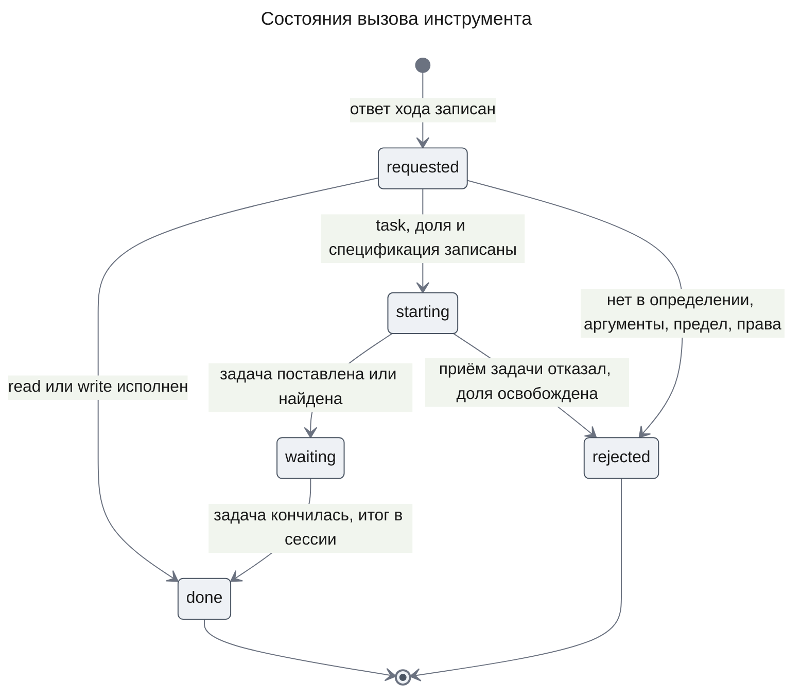

Вызов рождается в `requested` той же транзакцией, что записывает ответ хода. Переход в `rejected` или `done` — одна охраняемая запись, которая пишет исход, сообщение результата в сессию и строку аудита, а у `write` ещё и сам эффект. У вызова `task` три шага. Сначала охраняемая запись фиксирует долю, срок и спецификацию задачи (`starting`). Затем `TaskScheduler.propose` ставит задачу по этой спецификации. Последней охраняемой записью вызов получает идентификатор задачи (`waiting`). Если приём задачи отказал по пределам расследования, вызов переходит из `starting` в `rejected` с кодом `task_limit`, и его доля больше не занимает остаток родителя.

Повтор после падения между `starting` и `waiting` берёт уже записанную спецификацию. Дедупликация runtime отдаёт прежнюю задачу, только пока та жива или `succeeded`, а дочерняя задача могла успеть провалиться. Поэтому повтор `call_agent` сначала считает ключ дедупликации записанной спецификации функцией runtime `computeDedupKey` и ищет задачу с этим ключом среди задач расследования в любом статусе — тем же чтением `InvestigationService.listForThread`, которым сейчас controller и analyze читают задачи; задача в этом чтении несёт свой `dedupKey`. Найденная задача записывается в вызов, и вызов переходит в `waiting`; если она уже кончилась, ожидание сразу будит родителя, и тот пишет её исход. Новая задача ставится, только если не найдена ни одна.

Ключ задачи `gather` один на запрос, поэтому повтор `gather` ищет только задачу, которая жива или `succeeded`. Проваленная задача того же запроса от прошлого вызова не становится задачей этого вызова, и вызов ставит новую.

Каждая охраняемая запись вызова идёт в режиме `requireActive`, поэтому после остановки ни один вызов не переходит дальше `requested`. Переход `waiting → done` пишет обработчик родителя после пробуждения: он читает исход дочерней задачи — результат из строки запуска или причину сбоя из `UpstreamTask` — и пересчитывает её долю по журналу вызовов.

#### Как считается доля бюджета

По KD-4 занятое запуском — это его собственный расход по журналу (списанное и открытые резервы всех попыток), плюс по каждому дочернему запуску: вся доля, пока в его поддереве есть задачи в работе, и фактический расход поддерева, когда их не осталось. Свободный остаток — потолок запуска минус занятое.

Дочерний запуск может кончиться раньше своего поддерева: например, runtime завершил его `recovery_exhausted`, когда он уже поставил внучатую задачу. Родитель получает `child_failed` сразу, но доля такого дочернего остаётся занятой целиком, пока внучатые задачи не кончатся, — они тратят из неё же и ограничены своими долями и сроком. Остаток возвращается, когда в поддереве не осталось задач в работе (DC-9).

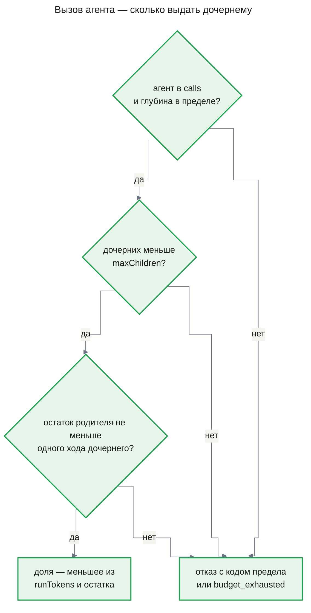

Один ход дочернего — его окно плюс потолок выхода (`windowTokens` + `maxOutputTokens`): больше этого одиночный резерв его хода быть не может, потому что посчитанный вход хода не больше `windowTokens − marginTokens` (DC-30), а резерв — вход плюс запас и выход. Резерв хода проверяет потолок запуска против занятого, как сейчас `decideReserve` проверяет `taskTokensHeld`, и пул расследования; отказ потолка — `run_tokens_exhausted`. Предел задач расследования (`maxTasks`) проверяет сам runtime при приёме задачи; его отказ приходит родителю как `task_limit`.

Пример. Бюджет расследования 300 000, у корня потолок 300 000. Корень вызывает двух worker с `runTokens` 80 000: у корня занято 160 000 плюс свой расход. Первый worker кончился, истратив 30 000: у корня теперь занято 80 000 + 30 000 плюс свой расход, и 50 000 вернулись. Сумма расхода всех запусков по журналу равна расходу расследования, потому что каждый вызов модели записан ровно одной строкой с задачей своего запуска (AC-07.2).

#### Что модель видит из сессии

По KD-5 неизменная часть вида — системный блок (промпт определения, преамбула о данных, записи области `deployment` из снимка памяти определения, схемы инструментов), задание и записи области `user` в конверте данных; она всегда целиком в виде. У формы с прологом на месте задания стоит первое сообщение пролога, и оно тоже в конверте данных.

Загрузка конфигурации оценивает наименьший вид, до которого правило может сжать сессию в худшем случае, и проверяет, что оценка помещается в `windowTokens − marginTokens` (DC-1). Наименьший вид — неизменная часть с предельными длинами промпта (со значением `{{sources}}`, наибольшим для определения), снимка памяти определения (16 KiB) и задания (8000 символов по 3 байта — столько UTF-8 тратит на любой символ основной плоскости Unicode, куда входят кириллица и латиница; тот же расчёт `research-flow` применяет к `{{query}}`), причём у формы с прологом вместо задания берётся предел первого сообщения этой формы `firstMessageMaxBytes`; по одной заглушке хода на каждый ход до `maxTurns`; два последних хода целиком, кроме результатов, — ответы до `maxOutputTokens` и по заглушке на каждый из `maxCallsPerTurn` вызовов; ответ самого нового хода и место под обрезанные результаты. Заглушки, конверты, замечания и обёртку каждого сообщения код ограничивает в байтах. Ответы модели уже в токенах, а все байты оценка переводит в токены делением на `BYTES_PER_TOKEN` = 3. Проверка поэтому не зовёт провайдера. Той же оценкой правило окна меряет вид на каждом ходе, когда выбирает ступень.

Делитель — оценка, а не верхняя граница. Сколько байт приходится на токен, зависит от текста: строка, густая от UUID и чисел, режется на короткие токены и может дать меньше 3 байт на токен. Поэтому оценка на загрузке отсеивает окна, которые заведомо малы, а на ходе решает посчитанный вход (DC-30). `BYTES_PER_TOKEN` — постоянная движка, а не Runtime Setting: от делителя зависит, какие конфигурации загружаются, и одна и та же конфигурация должна загружаться или отклоняться одинаково в каждом развёртывании; меняет его выпуск кода. Замер 2026-11-08 счётчиком провайдера (`count_tokens`, `claude-haiku-5-5`, четыре запроса) дал байт на токен: русский текст — 4.43 (образец 7883 байта), английский промпт роли — 2.99 (6902 байта), пакет проверяющего, густой от UUID, — 1.67 (10 830 байт). Делитель остаётся 3. Для пакетов вроде пакета проверяющего посчитанный вход поэтому примерно в 1.8 раза больше оценки; такой вход ловит проверка посчитанного входа (DC-30), а ход платит лишними переходами на следующую ступень окна. Делитель 1.67 переоценил бы русский текст в 2.65 раза, и загрузка отклоняла бы окна, в которые такой вид помещается.

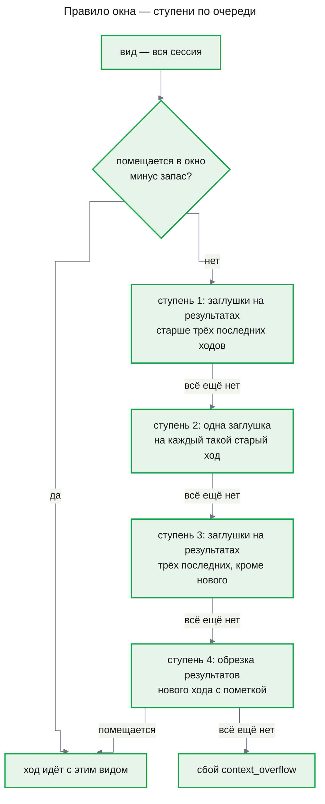

«Помещается» на каждой ступени значит два ответа «да» подряд: сначала оценки по `BYTES_PER_TOKEN`, затем входа, который шлюз посчитал перед резервом. Отказ по счёту стоит одного запроса к счётчику провайдера и не стоит ни резерва, ни строки журнала, поэтому ход платит только за вид, который ушёл к модели (DC-30).

Ступень, раз достигнутая, держится до конца запуска: следующий ход начинает с неё, поэтому начало вида меняется только при переходе на новую ступень или когда очередной ход уходит за три последних. До ступени 2 ответы модели прошлых ходов — вызовы с аргументами и короткий текст — в виде остаются целиком; на ступени 2 заглушка хода всё ещё называет вызванные инструменты, поэтому агент видит, что он уже делал. Заглушка результата называет инструмент, ход, размер убранного и как прочитать снова: заметки — `memory_read`, данные расследования — `investigation_read`, результат дочернего агента — `investigation_read` с видом `runs`, его `run` и `from` 0.

### Runtime Flows

Во всех потоках `runtime` и `движок` работают в одном процессе `api`, а модель — внешний провайдер.

#### Flow 1: Ход с записью в память и рестарт после неё

**Starts when:** диспетчер выдал попытку запуска агента, чья модель на этом ходе просит записать заметку, а процесс падает сразу после записи, for AC-02.1, AC-02.2, AC-03.1, DC-3, NFR-03

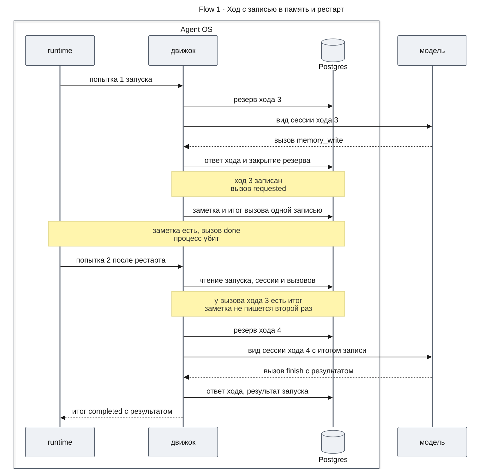

**Outcome:** в памяти одна заметка с агентом и запуском автора; у запуска четыре хода, у каждого ответа модели своя строка журнала; результат запуска лежит в строке запуска и в итоге задачи. Транскрипты ходов ссылаются на вид сессии, которую видела модель.

**Failure handling:**

- Процесс упал после ответа модели, но до записи хода → строка журнала осталась открытой; следующая попытка закрывает её как брошенную с полным списанием и делает ход заново новым вызовом (DC-3).
- Процесс упал до записи заметки → у вызова нет итога, следующая попытка исполняет его; заметка и итог фиксируются одной транзакцией, поэтому заметка не может появиться без итога.
- Попытка не текущая (её аренду забрал reaper) → охраняемая запись отвечает `fenced`, ничего не пишется, а текущая попытка продолжает по сессии.
- Модель вернула аргументы, которые не проходят схему → вызов `rejected` с причиной `invalid_arguments`, агент получает отказ следующим сообщением, ход засчитан.

#### Flow 2: Родитель вызывает двух дочерних агентов

**Starts when:** модель родителя одним ходом просит два вызова `call_agent`, for AC-05.1, AC-05.2, AC-05.4, DC-5, DC-8, DC-9

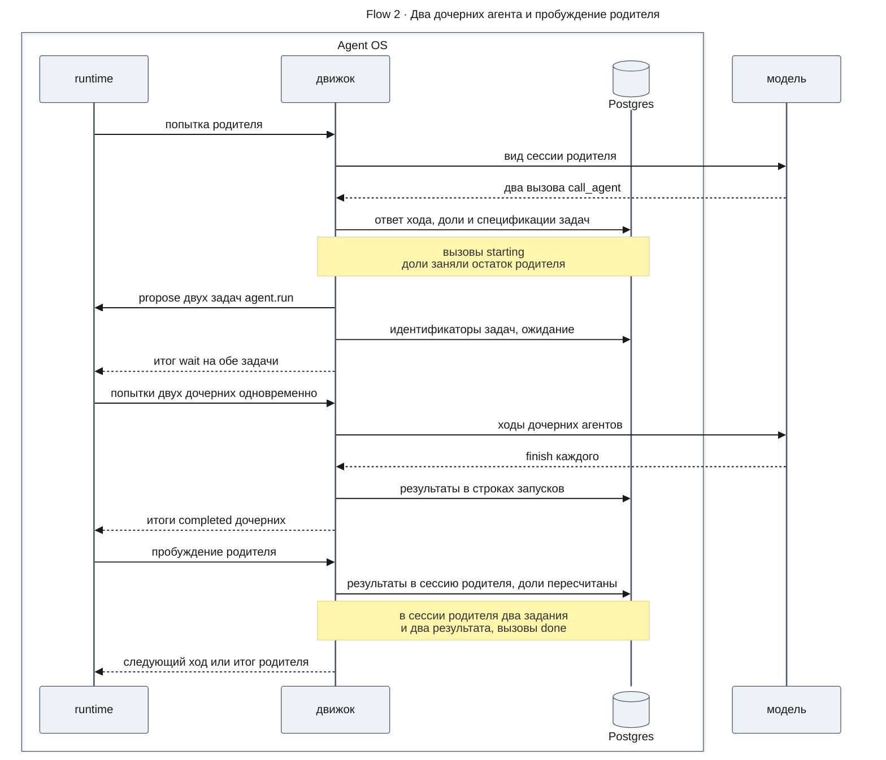

**Outcome:** у родителя в сессии ответ хода с двумя заданиями и два результата в порядке вызовов, ни одного сообщения дочерних сессий; у каждого дочернего запуска своя сессия, строка запуска с родителем и вызовом, своя доля. Неистраченное дочерними вернулось в остаток родителя.

**Failure handling:**

- Процесс упал между `starting` и `waiting` → следующая попытка родителя сначала ищет задачи этих вызовов в любом статусе и записывает найденные; по записанной спецификации ставится только не найденная задача, поэтому второго дочернего запуска нет, даже если первый уже провалился (AC-05.4).
- Рестарт, пока родитель ждёт → родитель остаётся `waiting`, дочерние продолжают с последнего хода, пробуждение приходит один раз, когда кончились оба.
- Дочерний запуск провалился, вышел за срок или исчерпал долю → runtime будит родителя так же; в сессию родителя приходит отказ `child_failed` с причиной из закрытого списка, и родитель решает сам (AC-05.3, DC-6).
- Пул расследования занят чужими резервами → резерв ждёт по KD-5 design-engine.md; дольше `AGENT_BUSY_WAIT_MS` — попытка отдаёт слот итогом `yield`.

#### Flow 3: Остановка дерева

**Starts when:** сотрудник останавливает ресерч (существующая операция `ResearchLaunchService.stopLaunch` → `InvestigationService.cancel`) или расследование закрывается, пока в дереве работают агенты, for AC-08.1, AC-08.2 (в части отмены), DC-18

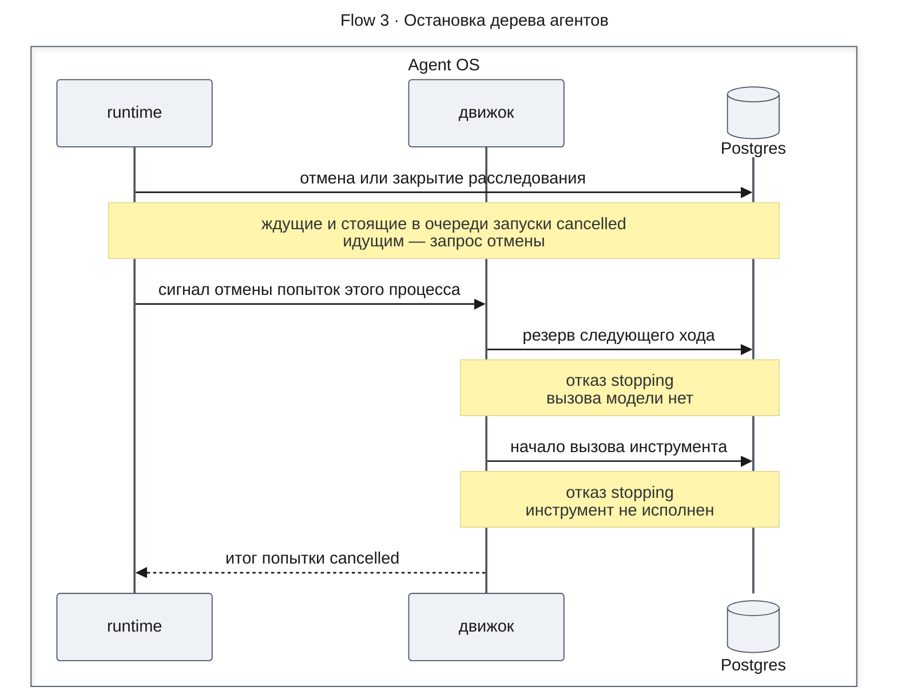

**Outcome:** все запуски дерева — задачи одного расследования, поэтому один переход runtime отменяет их все; после него ни один запуск не начинает вызов модели или инструмента. При закрытии расследования дочерние запуски отменяются тем же переходом (AC-08.2 в части отмены, DC-18); закрытие `completed` с готовым ответом, пока дочерние работают, строит `research-flow`.

**Failure handling:**

- Запуск работает на другом экземпляре сервера → сигнал отмены дойдёт после ближайшего пульса аренды, а до этого любой новый резерв и любой вызов инструмента получают `stopping` из базы.
- Вызов модели уже идёт → сигнал прерывает его; резерв остаётся открытым и закрывается, как при любой отмене в v2.
- Родитель ждёт отменённых дочерних → он сам отменён тем же переходом, пробуждения нет.

#### Flow 4: Вызов агента, на который не хватает доли

**Starts when:** модель родителя просит `call_agent`, а свободный остаток родителя меньше одного хода дочернего агента, for AC-06.1, AC-07.1, DC-8, DC-10, DC-16

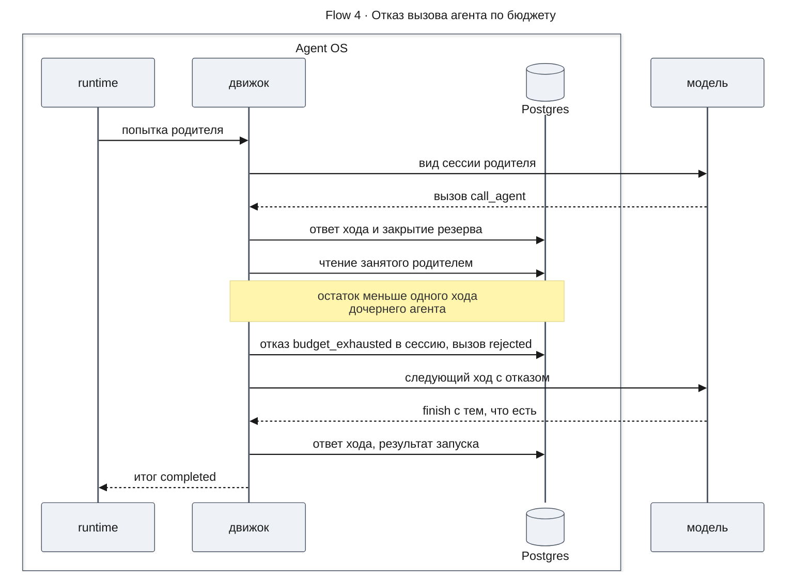

**Outcome:** дочерний запуск не создан, задача не поставлена, вызов записан с исходом `rejected` и причиной; родитель закончил с тем, что успел. Если родитель — корень, его остаток и есть остаток бюджета расследования, поэтому чтение дерева показывает `budgetExhausted`, и по нему `research-flow` ставит в ответе причину «бюджет исчерпан» (DC-16). Тот же путь у отказов по `depth_limit`, `children_limit` и `task_limit`: у последнего отказ приходит от приёма задачи runtime, и вызов из `starting` переходит в `rejected`.

**Failure handling:**

- На следующий ход не хватает доли самого родителя → резерв отказывает `run_tokens_exhausted`, вызова модели нет, запуск завершается `failed` с классом `budget_exhausted`, а его родитель получает отказ `child_failed` с причиной `budget_exhausted` (DC-10).
- Бюджет расследования исчерпан у корня → то же с кодом `investigation_tokens_exhausted`. В этой части ответа нет, поэтому расследование закрывается `failed`; ответ при исчерпании собирает `research-flow`, и тогда расследование закрывается `completed` по ADR-0006.

#### Flow 5: `finish` с закрытием и принудительный конец

**Starts when:** модель запуска, чья форма результата несёт закрытие, отвечает `finish`, единственным вызовом хода, for DC-17, DC-20, DC-21, DC-23

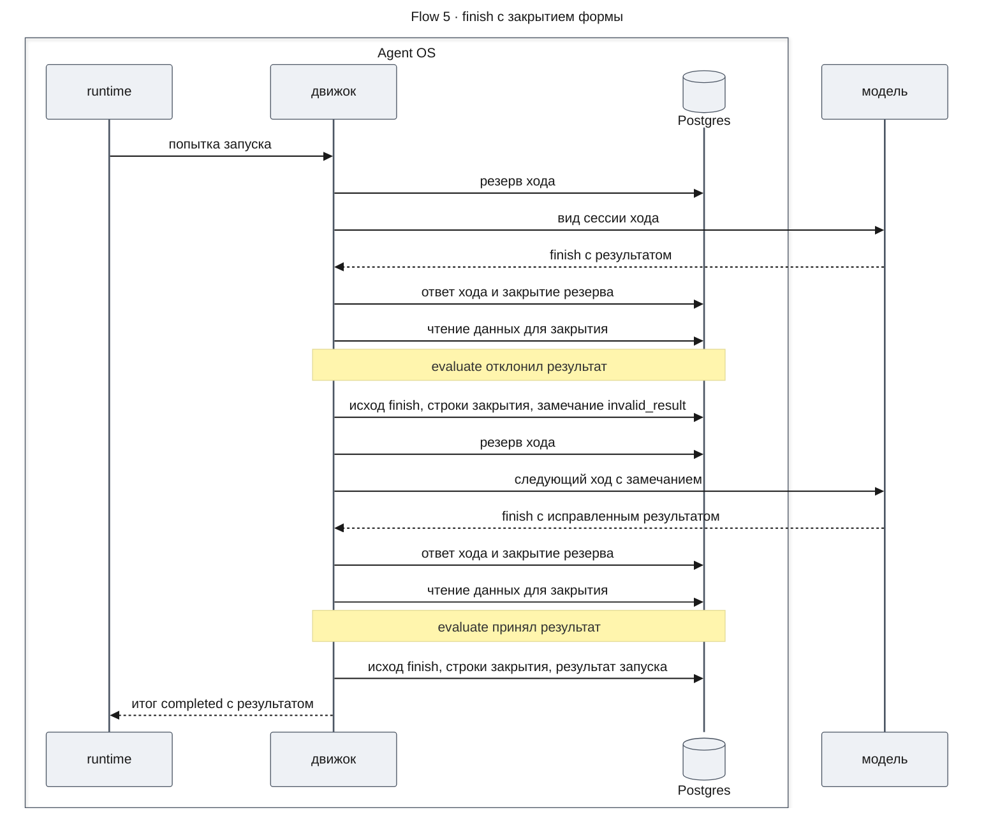

**Outcome:** у запуска два хода с `finish`; строки первого закрытия лежат вместе с замечанием `invalid_result`, строки второго — вместе с результатом запуска, каждые одной охраняемой записью. Результат запуска — тот, который вернул `evaluate`, и он же в итоге задачи.

**Failure handling:**

- Процесс упал после записи закрытия, но до итога задачи → следующая попытка видит записанный результат и кончает задачу им без нового хода и без второго закрытия (DC-23).
- Процесс упал до записи закрытия → ничего из закрытия не записано; следующая попытка доводит вызов `finish` и зовёт закрытие заново целиком.
- Посчитанный вход следующего хода — с замечанием `invalid_result` сессия длиннее — больше `windowTokens − marginTokens` → резерва нет, вид строится на следующей ступени окна; если вход не помещается и на ступени 4, вызова модели нет; работает принудительный конец формы для `context_overflow`, а без него или при `none` запуск кончается `failed` с кодом `context_overflow` (DC-30, DC-21).
- Резерв следующего хода отказал `run_tokens_exhausted` → вызова модели нет; работает принудительный конец формы для этого кода, и при `result` его строки и результат запуска записаны одной записью, а задача кончается `completed`; при `none` ничего не записано, и запуск кончается `failed` с классом `budget_exhausted` (DC-21).
- Расследование остановлено → охраняемая запись закрытия или принудительного конца отвечает `stopping`, ничего не записано, и попытка кончается `cancelled`.

### Contract Definitions

Этот раздел — контракт, на котором строит `research-flow`.

#### Конфигурация процесса формы агентов

Конфигурация с ключом `agents` проверяется новой строгой схемой; конфигурация без него — прежней схемой формы ролей (KD-7). Общие поля формы ролей — `processId`, `version`, `goal`, `sources`, `answer` — остаются с прежним смыслом; `capabilities` и `roles` в форме агентов не допускаются.

- `agents` — словарь «имя агента → определение», 1–16 определений; имя — 1–40 символов из латиницы, цифр, `-` и `_`.
- `rootAgent` — имя определения корня.
- `modelKnowledgeRoot` — необязательное имя определения, которое становится корнем в режиме без источников (DC-22); должно быть среди `agents` (DC-1).
- `agentLimits.maxDepth` — глубина дерева, 1–5; корень — глубина 0. Для пробного процесса 2.
- `limits.maxTasks`, `limits.investigationTokens` — как в форме ролей. `limits.maxToolCalls` — тот же пул runtime: каждая задача расследования при приёме занимает из него свой `maxToolCalls`, задача запуска агента — один, задача сбора — сколько вызовов источника ей разрешено.

**Определение агента**

- `model`, `effort`, `prompt` — как у роли: модель из каталога, усилие, шаблон промпта с закрытым списком полей: `goal`, `query`, `sourceMode`, `answerSections`, как у роли, и `sources` — только у определения агента ([Поле шаблона `sources`](#поле-шаблона-sources)).
- `tools` — имена инструментов из реестра; `finish` есть у каждого и не перечисляется. Базовые инструменты тоже называются явно: так определение без памяти и данных — например, проверяющий агент с фиксированным входом — не видит текста, который в них могли занести логи.
- `calls` — имена определений, которые агент может вызвать; непустой список требует `call_agent` в `tools`.
- `sources` — необязательное подмножество источников процесса; без него агент наследует источники родителя.
- `result` — имя формы результата из реестра форм ([Формы результата и код процесса](#формы-результата-и-код-процесса)); базовая форма — `text`.
- `limits.maxTurns` — 1–64; `limits.maxCallsPerTurn` — вызовов инструментов в одном ходе, 1–16; `limits.maxChildren` — дочерних запусков за запуск, 0–32; `limits.runTokens` — доля, которую запуск просит у родителя, не меньше одного своего хода (KD-4); `limits.deadlineMs` — 1000–3 600 000; `limits.windowTokens`, `limits.marginTokens`, `limits.maxOutputTokens` — в тех же пределах, что у роли; окно и запас задают правило окна (KD-5).

Значения для v3 выбирает `research-flow`.

**Задачи запусков.** Задача `agent.root` и задача `agent.run` ставятся с бюджетом runtime: `maxToolCalls` 1 — наименьшее, что допускает схема, потому что инструменты исполняет движок, а источники вызывают отдельные задачи сбора; `maxRetries` 0; `deadlineMs` — `limits.deadlineMs` определения, а у дочернего ещё не больше остатка срока родителя; `maxTokens` — доля. Вход задачи — имя агента, задание, родительский запуск и номер вызова, глубина, источники и срок `notAfter` по DC-27; из него же складывается ключ дедупликации. У задачи `agent.root` срок во входе — `createdAt` расследования плюс `deadlineMs` корня, без запаса, поэтому ключ дедупликации корня не зависит от `AGENT_DEADLINE_MARGIN_MS`. Запас корня отнимает обработчик, когда считает действующий срок (`runNotAfter`) от срока задачи runtime, поэтому действующий срок корня тот же, что по DC-27.

#### Поле шаблона `sources`

Поле `{{sources}}` называет модели инструменты источников этого запуска. Значение строит обработчик запуска, а инструмент сбора проверяет вызов по тем же парам, поэтому в значении есть только пары, которые разрешают конфигурация и источники запуска.

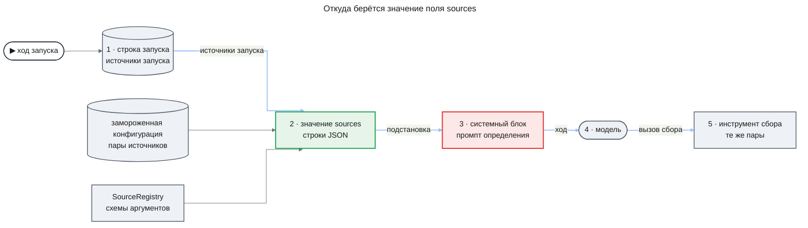

**Что подставляется.** Значение — по одной строке JSON на инструмент источника с ключами `sourceId`, `toolName` и `argsSchema`; строки разделены переводом строки. `argsSchema` — JSON-схема аргументов из описания инструмента в `SourceRegistry`, входной вид, как во входе `tools` controller v2. Строки идут по `sourceId`, затем по `toolName` в порядке кодовых точек, поэтому порядок не зависит от локали машины. Правило, которое JSON-схема не выражает, например правило между двумя аргументами, остаётся фразой шаблона.

**Какие инструменты входят.** Инструмент входит, если его пара есть в `sources` замороженной конфигурации, её `sourceId` есть в источниках запуска, а `SourceRegistry.resolveTool` отдаёт её для `source.fetch`. Источники запуска записаны в строке запуска. У корня это `sources` его определения или все источники процесса, а у дочернего — пересечение источников родителя и определения (`childSources`, DC-12). Поэтому запуск с суженными источниками видит только свои инструменты, а обработчик строит значение один раз на попытку из этой строки.

Порт прав `ToolAccessPolicy` значение не сужает: пару, которую он запрещает владельцу, модель увидит, а её вызов получит `access_denied`.

**Если источников нет.** Значение — строка `No data source is available to this run.` Так бывает в режиме `model_knowledge`, где у корня источников нет, и у дочернего запуска с пустым пересечением. Подстановка не отказывает, а вызов сбора в таком запуске получит `access_denied`.

**Предел.** Значение не длиннее 8 192 байт (`SOURCES_FIELD_MAX_BYTES`). Предел проверяет загрузка на наибольшем значении определения: на всех парах процесса, суженных `sources` определения, если он их называет (DC-31). То же значение входит в оценку наименьшего вида (DC-1). Источники любого запуска этого определения — часть этого набора, поэтому при запуске значение помещается в предел, и код его не обрезает: обрезанный JSON или список без части пар дал бы модели неверный каталог.

**Текст значения.** В значении есть текст конфигурации — `sourceId` и `toolName` — и схема аргументов из описания инструмента, которое объявляет проект, а не сервер MCP. Правило то же, что у остальных полей шаблона: значение подставляется как есть. Разделители экранируются только внутри конверта данных, а поле стоит в системном блоке. Экранирование конверта здесь и навредило бы: `&quot;` и `&lt;` сломали бы JSON и регулярные выражения в `pattern`.

Текста от модели, пользователя или из логов в значении нет: пара прошла `resolveTool`, значит её строки совпали с описанием адаптера. Кавычки и переводы строк внутри значений экранирует запись JSON, поэтому значение остаётся в своих строках.

**Кто может поставить поле.** Поле допустимо только в шаблоне определения, у которого в `tools` есть инструмент с признаком «читает источники запуска» ([Реестр инструментов](#реестр-инструментов)). Определения с формой, разрешающей только `finish`, такого инструмента не имеют, поэтому поля у них нет. `Engine.assessAgent` отказывает определениям с инструментами (`agent_not_detachable`), поэтому определение с этим полем там до подстановки не доходит.

**Проверка при загрузке.** Движок отклоняет конфигурацию с кодом `process_config_rejected` и путём `agents.<имя>.prompt` в трёх случаях (DC-31):

- шаблон называет поле вне закрытого списка своей формы или в скобках стоит выражение; ошибка называет поле и разрешённые поля; форма ролей сохраняет прежний список, поэтому `{{sources}}` в промпте роли — такое же неизвестное поле;
- `{{sources}}` стоит у определения без инструмента с признаком;
- наибольшее значение поля длиннее `SOURCES_FIELD_MAX_BYTES`.

Значение строит чистая функция от `sources` конфигурации, источников запуска и `resolveTool`. Схема инструмента, которая не является схемой zod, — дефект сборки: функция бросает исключение с именем пары, как `fetchToolCatalog`, и создание движка не проходит.

**Кэш.** Значение стоит в системном блоке, до метки кэша (KD-5). Источники запуска после записи строки не меняются, а описания инструментов — это код. Поэтому от хода к ходу и после рестарта в пределах одного выпуска значение одно и то же байт в байт, и кэш начала сессии работает как прежде. Выпуск со сменой схемы меняет значение идущих запусков, и один ход читает начало не из кэша; значение при этом совпадает со схемой, которой проверяется вызов.

**Отпечаток.** `agentFingerprint` считается от шаблона до подстановки. Сам `{{sources}}` входит в него как текст шаблона, поэтому добавление поля меняет отпечаток, как любая правка шаблона. Значение поля и признак инструмента в отпечаток не входят, поэтому смена источников процесса или схемы отпечаток не меняет.

**Транскрипт.** Транскрипт хода хранит системный блок таким, каким он ушёл к модели. Чтение берёт его оттуда, размер для ступени 4 считает по нему и поле заново не подставляет. Поэтому транскрипт показывает значение на момент хода даже после выпуска со сменой схемы.

#### Реестр инструментов

`ToolRegistry` — закрытый список в коде движка. Инструмент описан именем, описанием для модели, схемой аргументов, классом эффекта (`read`, `write`, `task`, `finish`), пределом результата и необязательным признаком «читает источники запуска», который разрешает поле `{{sources}}` и моделью не виден; предел результата любого инструмента — не больше 16 KiB. Модуль процесса добавляет инструменты возможностей кодом движка; конфигурация только называет их. Инструмент класса `task` даёт по аргументам спецификацию задачи и по исходу задачи — результат для сессии.

**Базовые инструменты**

- **`memory_read`** (`read`) — заметки памяти этого расследования по фильтру: вид, агент-автор, после заметки с номером; до 50 за вызов, новые последними. Возвращает заметки с номером, видом, текстом, ссылками, агентом и запуском автора.
- **`memory_write`** (`write`) — новая заметка: вид (`finding`, `tried`, `dead_end`, `note`), текст до 2000 символов, до 20 ссылок на записи и утверждения этого расследования. Возвращает номер заметки. Отказ `foreign_ref`, если ссылка ведёт в другое расследование или в никуда.
- **`investigation_read`** (`read`) — данные этого расследования: текущий план; утверждения с последними статусами; список страниц записей; записи одной страницы с номера; результаты законченных запусков агентов (вид `runs`). Аргумента «расследование» нет: идентификатор из другого расследования даёт отказ `not_found` и ни одной записи. Результат больше предела делится на страницы с продолжением.
  - Вид `runs` без аргумента `run` — такая страница. Результат запуска больше половины предела стоит на ней элементом с полями `index`, `omitted` и `bytes`: номер на странице, пометка, что результат убран, и его размер в байтах.
  - С аргументами `run` — идентификатор задачи запуска этого расследования — и `from` — смещение в байтах — вид `runs` отдаёт кусок текста JSON результата одного запуска длиной до предела результата, полный размер `bytes` и `next` — смещение следующего куска или `null` на последнем. Так результат дочернего читается по частям при любом размере: форма `text` допускает сводку около 16 KB и ещё ссылки, а это больше предела результата.
  - На вызов с `run` и `from` 0 указывают пометка обрезки `CHILD_RESULT_CUT_MARK`, с которой результат дочернего длиннее предела приходит в сессию родителя, и заглушки правила окна на результатах дочерних агентов (KD-5).
- **`call_agent`** (`task`) — имя агента и задание, текст до 8000 символов. Возвращает результат дочернего запуска или отказ: `rejected` с кодом `agent_not_callable`, `depth_limit`, `children_limit`, `task_limit`, `budget_exhausted`, либо `child_failed` с причиной из закрытого списка DC-6. Код `task_limit` ставится на любой отказ приёма задачи runtime по пределам расследования — числу задач или пулу `maxToolCalls`.
- **`finish`** (`finish`) — результат запуска по форме `result` определения. Форма `text`: сводка до 8000 символов и до 50 ссылок на заметки, утверждения, записи и запуски этого расследования. Исполняется, только если это единственный вызов хода; иначе — отказ `finish_not_alone` (DC-17). Результат не по форме — замечание `invalid_result` следующим сообщением. Ссылки результата формы `text` — заметку по номеру, утверждение, запись и запуск — шаг `finish` проверяет в своей охраняемой транзакции: ссылка в другое расследование или в никуда даёт замечание `invalid_result` с причиной `foreign_ref`, и запуск продолжается; поэтому `version` формы `text` — 2 (DC-4). Если последний ход не кончил запуск — `finish` нет, он отклонён или его результат не по форме, — запуск кончается с `turn_limit` (DC-14).

**Сообщения кода в сессии**

Отказы и замечания кода приходят модели сообщением результата того вызова, к которому относятся, с кодом причины: `tool_not_in_definition`, `invalid_arguments`, `access_denied`, `foreign_ref`, `not_found`, `calls_per_turn_limit` (вызовы сверх `maxCallsPerTurn` не исполняются), `finish_not_alone`, коды пределов выше, `invalid_result`. Замечания без вызова — `no_tool_call` и «последний ход: верни результат».

Каждый результат инструмента, заметка памяти, результат дочернего агента и запись памяти определения из области `user` приходят модели внутри конверта данных с источником и автором, а системная преамбула движка говорит, что текст внутри конверта — данные, а не инструкции. Код экранирует в тексте данных разделители конверта, поэтому текст не может закрыть конверт и продолжиться как инструкция. Вне конверта модель получает только системный блок и задание. У формы с прологом задания в сессии нет: первое сообщение пролога собрано из данных расследования и тоже приходит в конверте. Задание дочернего запуска пишет модель родителя, и в нём может оказаться текст из логов: это единственный путь такого текста вне конверта, и его ограничивают набор инструментов дочернего определения и проверки кода над аргументами каждого вызова (схема, принадлежность ссылок, `ToolAccessPolicy`), а не разметка.

#### Формы результата и код процесса

Реестр форм результата `ResultFormRegistry` — закрытый список в коде движка, как реестр инструментов. Его получает внутренняя функция сборки движка `composeEngine` в `create-engine.ts`. `createEngine` передаёт ей поставляемые формы — базовую форму `text` этой части и формы, которые даёт модуль процесса `research-flow`, — и параметра форм не принимает. Тестовая обвязка движка зовёт `composeEngine` из исходников пакета и добавляет пробную форму `probe_record`; `index.ts` эту функцию не экспортирует, поэтому `apps/api` и другие пакеты реестр не дополняют ([ADR-0010](../../adr/ADR-0010-result-form-process-code.md)).

Запись реестра — имя, `version` (целое число, входит в `agentFingerprint`), схема результата для `finish` и необязательно:

- пролог с пределом первого сообщения в байтах `firstMessageMaxBytes`; вход пролога ограничен отдельно — 64 KiB, тем же пределом, что checkpoint задачи runtime (DC-19);
- закрытие и принудительный конец;
- признак «память области `user` запрещена»;
- ограничения места, которые загрузка проверяет одинаково для любой формы (DC-28): `onlyOn` — форму может назвать только `rootAgent` или только `modelKnowledgeRoot`; `maxDefinitions` — сколько определений одной конфигурации могут её назвать; `toolsAllowed` — какие инструменты допустимы у такого определения, например только `finish`;
- привязки — неизменные данные движка, которые `composeEngine` передаёт форме при регистрации, например таблицы групп вместе с каталогом таблиц развёртывания. Форма объявляет вид каждой привязки. Вид «таблица по паре отпечатков определения» — таблица, которую ищут по паре `agentFingerprint` и `definitionMemoryFingerprint`, — единственный, который `Engine.assessAgent` заменяет (DC-25).

Форма `text` кода процесса и ограничений не несёт.

Функция кода процесса складывается из шагов трёх видов; какие шаги есть у каждой функции, сказано ниже.

- **Шаг чтения `collect`** получает контекст запуска — расследование, владельца, запуск, определение, задание, режим источников — и читатель данных этого расследования. Читатель отдаёт план, утверждения, страницы записей, результаты запусков, строку расследования движка, `definitionMemoryFingerprint` определения этого запуска по снимку, строки вызовов инструментов (`research_agent_tool_calls`) — в том числе отклонённые вызовы `call_agent` с причиной, запуском-родителем и номером вызова и отклонённые вызовы `finish` с причиной формы и `detail` в исходе — и признак чтения дерева `budgetExhausted`. Шаг возвращает вход для чистого шага.
- **Чистый шаг** получает этот вход и привязки формы и решает; базу он не читает и ничего не пишет.
- **Шаг записи `write`** пишет строки в таблицы движка этого расследования через переданную охраняемую транзакцию в режиме `requireActive`.

Шаги одной функции — `collect`, чистый шаг и `write` — идут в одной охраняемой транзакции: чистый шаг работает, пока она открыта, и вместе с записью укладывается в её срок (`RUNTIME_LEASE_MS`). Модель, внешнюю систему, `TaskScheduler.propose` и функции `TaskContext` не вызывает ни один шаг. Исключение любого шага кончает запуск сбоем с классом `internal`, как любое исключение обработчика.

- **`prologue`** — необязательный `collect` (без него вход пролога — задание), затем чистый `build`. Работает один раз, когда сессия запуска пуста. `build` получает вход пролога и возвращает `start` с первым сообщением сессии или `end` с результатом без хода модели. На `start` движок одной охраняемой записью пишет первое сообщение в сессию и вход пролога в строку запуска; первое сообщение стоит на месте задания и приходит в конверте данных. Вход длиннее 64 KiB — движок проверяет его до `build`, откуда бы он ни пришёл, — и первое сообщение `start` длиннее `firstMessageMaxBytes` формы кончают запуск `prologue_oversize` без вызова модели и без записи входа (DC-19). Поэтому `collect` для слишком большого пакета может вернуть компактный вход — идентификаторы и пометку о превышении, — а `build` ответить на него `end`. Повтор после рестарта видит записанное первое сообщение и пролог не зовёт.
- **`closure`** — необязательный `collect`, затем чистый `evaluate`, затем `write`. Работает на вызове `finish`, который один в своём ходе, после проверки результата схемой формы, и на `end` пролога. `evaluate` получает результат, вход пролога из строки запуска (у формы без пролога — задание) и то, что вернул `collect`, и возвращает `accept` с результатом запуска — тем же или заменённым, например со статусом и группой, — или `refuse` с причиной и необязательным `detail`. `write` пишет строки по этому решению в той же охраняемой транзакции, что исход вызова `finish`. При `accept` та же транзакция пишет результат запуска, и задача кончается `completed`; при `refuse` — замечание `invalid_result` с причиной, ход засчитан, и запуск продолжает (DC-20).
  - **`detail` отказа** — структурные данные решения `refuse`. Форма кладёт туда то, что иначе пришлось бы кодировать в строке причины: номера утверждений, данные для шага `write`. Форма без `detail` отказывает одной причиной.
  - **Куда идёт `detail`.** Движок передаёт его шагу `write` в составе решения и пишет одной записью в исход отклонённой строки вызова `finish` и в сообщение результата этого вызова в сессии. Модель читает `detail` из сообщения вместе с причиной, а шаг `collect` позднейшего закрытия находит его среди строк вызовов инструментов. В строке отклонённого `finish` причина строки — всегда `invalid_result`, а причина формы и её `detail` лежат в исходе. У `end` пролога и под `Engine.assessAgent` строки вызова нет, поэтому там `detail` не хранится. Под `Engine.assessAgent` строки нет, но замечание `invalid_result` несёт `detail` так же, как сообщение результата в расследовании, поэтому вход следующего хода тот же.
- **`end` пролога** проходит `evaluate` так же. Принятый результат, строки `write` и итог пролога записываются одной охраняемой записью, и задача кончается `completed`. Отклонить `end`, как `finish`, нельзя: хода, на котором модель исправила бы результат, нет. Поэтому `refuse` на `end` кончает запуск `failed` с кодом `prologue_refused`, а `write` не зовётся (DC-26).
- **`forcedEnd`** — словарь «код сбоя → функция» с ключами `run_tokens_exhausted`, `investigation_tokens_exhausted`, `not_after`, `turn_limit`, `model_unavailable` и `context_overflow`; у `prologue_oversize` и `prologue_refused` принудительного конца нет. Функция — необязательный `collect`, затем чистый `decide`, затем `write`. Она работает между ходами, когда обработчик кончил бы запуск сбоем с этим кодом. Если `decide` вернул `result`, одной охраняемой записью пишутся строки `write` и результат запуска, и задача кончается `completed`. Если он вернул `none`, ничего не пишется, и запуск кончается тем же сбоем, как без принудительного конца (DC-21). После остановки или закрытия расследования охраняемая запись отвечает `stopping`, ничего не пишется, и запуск кончается `cancelled`.

**Как код процесса встречается с остальными правилами.**

- **Дочерние задачи.** Закрытие и принудительный конец работают, когда у запуска нет прямых дочерних задач в работе: `finish` один в своём ходе (DC-17), а принудительный конец работает между ходами, когда у всех вызовов прошлого хода есть итог. Поддерево при этом может ещё работать: дочерний, которого runtime завершил сам, оставляет свои задачи, и его доля занята у запуска целиком, пока они идут (DC-9, UC-E10). Когда такой запуск кончается успехом, эти задачи доживают со своими долями и сроками; если это корень, закрытие расследования отменяет их тем же переходом (DC-18).
- **Бюджет.** Шаги не резервируют токенов и не меняют занятого, поэтому принудительный конец по `run_tokens_exhausted` работает и тогда, когда бюджета нет. Если `write` пишет ответ расследования, его запись закрывает открытые резервы расследования, как сейчас `writeAnswer`.
- **Срок.** Принудительный конец по `not_after` успевает записать результат до того, как runtime завершит задачу сам, потому что срок запуска выбран с запасом по DC-27.

#### Операции движка

- **`startInvestigation`** (существующая) — для конфигурации формы агентов создаёт строку расследования движка с бюджетом, замороженной копией конфигурации и снимком памяти определения (без записей области `user` у определений, чья форма запрещает такую память, — DC-24), ставит корневую задачу `agent.root` с заданием из вопроса и долей, равной бюджету расследования (KD-4), и записывает её как `controller_task_id`. Корень — `rootAgent`, а в режиме без источников — `modelKnowledgeRoot`, если ключ задан (DC-22). Для формы ролей всё как сейчас.
- **`readAgentTree`** — по `investigationId` и `resourceId` владельца возвращает запуски дерева: идентификатор запуска, имя агента, родителя и вызов, задание и, у формы с прологом, первое сообщение пролога, статус задачи, результат или причину сбоя, свой расход и расход поддерева по журналу, ходы со ссылками на строки журнала и транскрипты, вызовы инструментов с исходами и причинами. Ещё он возвращает снимок памяти определения, с которым шло расследование, — записи по каждому определению с идентификатором, областью и текстом (AC-22.4), и признак `budgetExhausted`: в дереве был отказ вызова агента или резерва по бюджету расследования либо запуск завершился с классом `budget_exhausted`. Чужое или неизвестное расследование — `investigation_not_found`. Транскрипты ходов читает существующее `readTranscripts`.
- **`writeDefinitionMemory`** — процесс, имя агента, область (`deployment` или `user` с идентификатором пользователя), текст до 2000 символов и пишущий с его ролями. Возвращает `written` с идентификатором записи или `refused` с причиной `no_write_right`, `limit_reached`, `unknown_definition`, `scope_not_allowed`.
- **`removeDefinitionMemory`** — идентификатор записи и пишущий. Запись помечается удалённой; снимки уже начатых расследований её сохраняют. Отказ `no_write_right` или `not_found`.
- **`listDefinitionMemory`** — процесс, имя агента и читающий. Возвращает активные записи областей, которые читающему разрешено читать.
- **`agentFingerprint`** — по определению возвращает 12 hex-символов sha256 от модели, усилия, шаблона промпта (до подстановки полей), имён и схем инструментов, имени и `version` формы результата и потолка выхода. Правка кода процесса формы, которая меняет её решения, поднимает `version`, и отпечаток меняется. Ключ таблицы групп проверяющего агента (FR-16) — этот отпечаток вместе с `definitionMemoryFingerprint` его снимка.
- **`definitionMemoryFingerprint`** — по записям области `deployment` из снимка памяти определения возвращает 12 hex-символов sha256 от их идентификаторов и текстов в порядке идентификаторов; у пустого снимка отпечаток тоже есть. Новое правило `self-correction` в памяти проверяющего меняет этот отпечаток и требует новой калибровки.
- **`Engine.assessAgent`** — ходы одного определения вне расследования, рядом с `Engine.assess` и для тех же целей: калибровки и замера влияния текста (DC-25).
  - Вход: конфигурация формы агентов, имя определения, вход пролога (у формы без пролога — задание), записи области `deployment` памяти определения, привязка к запуску самопроверки и момент `notAfter`, после которого ход не начинается.
  - Работа: движок зовёт `build` пролога. На `start` он делает ходы с тем же видом сессии, теми же схемами инструментов и тем же пределом ходов, что в расследовании, и на каждом `finish` зовёт `evaluate`; `refuse` даёт замечание `invalid_result` с причиной и следующий ход, как в расследовании. Шаги `collect` и `write` и принудительный конец не вызываются. Резерва и счётчика токенов у этих ходов нет, поэтому ступень окна выбирает только оценка по `BYTES_PER_TOKEN`, а проверки посчитанного входа (DC-30) нет.
  - Привязки: `build` и `evaluate` получают те же привязки формы, что в расследовании, кроме одной. Привязку вида «таблица по паре отпечатков определения» движок заменяет пометкой «калибруемый» для пары, которую считает из входа вызова: `agentFingerprint` определения и `definitionMemoryFingerprint` переданных записей области `deployment`. Остальные привязки не меняются. `evaluate` формы, которая ставит группу по такой таблице, тогда возвращает статус и профиль без группы (DC-25).
  - Итог: `finished` с результатом, который принял `evaluate`, и расходом по ходам; `ended` с результатом `end` пролога, который принял `evaluate`; `invalid_result`, если и последний ход не дал принятого результата; `failed` с кодом `model_unavailable`, `not_after`, `prologue_oversize` (вход длиннее 64 KiB или первое сообщение длиннее предела, как в расследовании), `prologue_refused` или `context_overflow`. Код `context_overflow` значит, что оценка вида не помещается и на ступени 4: к модели ничего не уходит, как по DC-30 у хода в расследовании, только решает здесь оценка, потому что счётчика нет.
  - Отказы до первого хода: `agent_not_detachable` — у определения есть инструменты, кроме `finish`, или у закрытия его формы есть шаг `collect`; `model_unavailable` — модели определения нет в списке `assessModels` у `createEngine`, как у `Engine.assess`.
  - Следы: задачи runtime, строки запуска, сессии и журнала вызовов нет, в бюджет расследования вызов не входит. Каждый ход пишет транскрипт роли `agent` с привязкой к запуску самопроверки, полным входом, как у `Engine.assess`, и именем агента в поле `agentName`.

Правила доступа к памяти определения: область `deployment` пишет и читает тот, у кого есть роль из `AGENT_MEMORY_ADMIN_ROLE`; область `user` пишет и читает только её пользователь. Запись и удаление отклоняются с `no_write_right`, если у пишущего пустой идентификатор пользователя или у области `user` пустой идентификатор пользователя. У `listDefinitionMemory` отказа в контракте нет: читающему с пустым идентификатором пользователя он возвращает пустой список. Хранилище само не принимает пустой идентификатор пользователя (миграция `0008`). Пишущего и читающего с его ролями `apps/api` берёт из проверенного субъекта запроса (`AuthUser`), а не из данных, которые прислал вызывающий. Агент расследования получает записи не по правам читающего, а из снимка: область `deployment` и область владельца расследования (`resourceId`). Записи области `deployment` идут в системный блок как правила: их пишет только роль администратора. Записи области `user` пишет любой пользователь о своих агентах, поэтому они идут в конверт данных, а не в инструкции. Запись области `user` для определения, чья форма результата запрещает такую память, отклоняется с `scope_not_allowed`, а уже лежащие записи этой области в снимок не попадают (DC-24): так у проверяющего агента действуют только правила области `deployment`, которые входят в ключ его таблицы групп.

**Что этот контракт допускает для проверяющего агента.** Каждый запуск начинается с чистой сессии, а его задание — вход задачи, то есть данные, которые сохраняются и сравниваются. Поэтому вариант U-3 «новая сессия на каждое утверждение с фиксированным входом» выражается одним вызовом агента на утверждение, а определение без инструментов, кроме `finish`, даёт запуск из одного хода. Пролог формы проверяющего строит пакет утверждения, а `Engine.assessAgent` гоняет то же определение с теми же чистыми шагами `build` и `evaluate` вне расследования; вход пролога для пары и ход калибровки выбирает `research-flow`.

#### Изменения контракта runtime

- **`HandlerResultSchema`** в `@agent-os/contracts` получает вид `yield` (KD-6), а `outcomeOfResult` в диспетчере переводит его в исход `released`: задача возвращается в `queued` без расхода повторов, переносит счётчики попытки, как штатное возвращение, и не пишет итога.
- **`UpstreamTask`** получает поле `failure` — причину сбоя ожидаемой или зависимой задачи (`FailureReason`) или null. Так родитель узнаёт, почему кончился дочерний запуск, которого runtime завершил сам — сроком, отменой или исчерпанием повторов.
- **`computeDedupKey`** — существующая функция ключа дедупликации спецификации задачи становится экспортом `@agent-os/runtime`. Движок считает ею ключ записанной спецификации и ищет задачу вызова по `dedupKey` задач из `InvestigationService.listForThread`: у `call_agent` в любом статусе, у `gather` — только живую или `succeeded` (KD-3). Функция чистая и не меняет ни таблиц, ни правила дедупликации.

#### Изменения контракта транскриптов и журнала

- **Роль `agent`** — значение `role` у строки журнала вызовов и у транскрипта хода агента. Имя агента читается из строки запуска по `task_id`. Расход по ролям (`usage.byRoleAndModel` в `RunRecord` и отчёт `show` самопроверки) показывает такие строки одной ролью `agent`; у расследований v2 их нет, а разбивку по агентам для v3 строит `research-flow`.
- **`readInvestigation` и `readRunRecord`** разбирают замороженную копию конфигурации схемой двух форм — форма агентов узнаётся по ключу `agents` (ADR-0009, KD-7), — а не только `ProcessConfigSchema`. Для расследования формы агентов они отдают те же поля, что сейчас, а вызовы модели — строками роли `agent` в расходе по ролям (DC-29); разбивку по агентам — `agentTree` и `usage.byAgentAndModel` в `RunRecord` — строит `research-flow`.
- **`input` транскрипта роли `agent`** хранит инструкции и ссылку на вид сессии, а `readTranscripts` отдаёт вход, восстановленный из сессии, в том же виде, что у транскриптов ролей. Сессия по правилу чистки живёт не меньше своего самого нового транскрипта; если её всё же нет — расследование удалено целиком, — чтение транскрипта отвечает так же, как для удалённого расследования. Транскрипт хода `Engine.assessAgent` хранит вход целиком и имя агента в своём поле `agentName`; у ходов в расследовании `readTranscripts` заполняет `agentName` из строки запуска.
- **Чистка сессий** — фоновая чистка транскриптов (`purgeExpiredTranscripts`) удаляет сообщения сессии запуска закрытого расследования, когда истёк срок самого нового транскрипта её ходов, с тем же исключением для системного владельца самопроверки. Сессия запуска без единого транскрипта — например, запуск кончился до первого вызова модели — удаляется, когда тот же срок истёк от закрытия расследования.
- **Предел входа хода агента** — вызов хода агента передаёт шлюзу `windowTokens − marginTokens`. Если посчитанный вход больше, шлюз возвращает `no_answer` с причиной `window_exceeded` и посчитанным числом — без резерва, без строки журнала и без вызова модели, — и обработчик строит вид на следующей ступени (DC-30). Вызовы ролей v2 предела не передают: их вход ограничивает `ContextBuilder`, как сейчас.
- **Резерв хода агента** — шлюз принимает предел ожидания чужих резервов. Вызов хода агента передаёт `AGENT_BUSY_WAIT_MS`; когда он истёк, шлюз возвращает `no_answer` с причиной `busy_wait_exhausted` — рядом с нынешними причинами `cancelled` и `deadline` — без строки журнала и без вызова модели, и обработчик возвращает `yield`. Вызовы ролей v2 предела не передают и ждут, как сейчас.

#### Порт прав

- **`ToolAccessPolicy`** — `createEngine` получает его от `apps/api`. На каждый вызов инструмента он отвечает по пользователю-владельцу расследования, инструменту и источнику, если он есть: разрешено или `access_denied`. Отказ записывается исходом `access_denied`, инструмент и источник не вызываются. Сборка `apps/api` по умолчанию разрешает инструменты и источники, которые разрешает конфигурация процесса.

#### Error Handling

Причины, с которыми задача запуска агента завершается `failed`:

- класс `budget_exhausted`, код `run_tokens_exhausted` — не хватило доли запуска (KD-4); код `investigation_tokens_exhausted` — бюджета расследования;
- класс `validation_rejected`, код `turn_limit` — последний ход не кончил запуск: вызова `finish` нет, он отклонён (`finish_not_alone`) или его результат не проходит форму;
- класс `transport_protocol`, код `model_unavailable` — модель недоступна после повторов шлюза;
- класс `deadline`, код `not_after` — срок запуска по DC-27 не оставил места для нового хода или шлюз оборвал вызов модели хода;
- класс `cancelled` — запуск остановлен вместе с расследованием;
- класс `validation_rejected`, код `prologue_oversize` — вход пролога длиннее 64 KiB или первое сообщение длиннее `firstMessageMaxBytes` формы (DC-19);
- класс `validation_rejected`, код `context_overflow` — посчитанный вход хода больше `windowTokens − marginTokens` и на ступени 4 правила окна (DC-30);
- класс `validation_rejected`, код `prologue_refused` — закрытие формы отклонило результат `end` пролога (DC-26).

Сбои с кодами `run_tokens_exhausted`, `investigation_tokens_exhausted`, `not_after`, `turn_limit`, `model_unavailable` и `context_overflow` сначала проходят принудительный конец формы, если он есть для этого кода, и тогда запуск кончается успехом (DC-21).

Родитель получает их как причины `child_failed`: класс `budget_exhausted` — `budget_exhausted`, класс `deadline` — `deadline`, код `turn_limit` — `turn_limit`, код `model_unavailable` — `model_unavailable`, любая другая причина, в том числе `recovery_exhausted` и `internal` от runtime, — `failed`. Отменённого дочернего родитель не получает: отмена идёт по расследованию и отменяет родителя тем же переходом. `research-flow` переводит те же причины в причины остановки, которые видит сотрудник (AC-12.3). Код отказа потолка запуска агента — `run_tokens_exhausted`; задачи v2 сохраняют прежний `task_tokens_exhausted`.

#### Runtime Settings

- `AGENT_ATTEMPT_SLICE_MS` — по умолчанию `300000`; сколько попытка запуска работает до итога `yield`. Треть `RUNTIME_ATTEMPT_MS`, чтобы самый долгий ход успел кончиться до срока попытки.
- `AGENT_BUSY_WAIT_MS` — по умолчанию `30000`; сколько резерв хода ждёт чужих резервов, прежде чем попытка отдаёт слот.
- `AGENT_TURN_MS` — по умолчанию `60000`; сколько может идти один ход; правило — DC-27.
- `AGENT_DEADLINE_MARGIN_MS` — по умолчанию `90000`; на столько срок запуска раньше срока его задачи runtime (DC-27). Вызов модели шлюз обрывает в `notAfter`, поэтому запас покрывает пробуждение запуска, вызовы инструментов после последнего ответа модели и охраняемую запись принудительного конца; ещё по одной охраняемой записи на каждый уровень дерева DC-27 отнимает от срока дочернего. Сборка `apps/api` при старте сверяет запас с суммой `leaseMs` runtime и `AGENT_TURN_MS` и не стартует, если он меньше. `AGENT_TURN_MS` стоит в этой сумме потому, что вызовы инструментов последнего хода могут идти и после `notAfter`, а ход вместе с ними по смыслу этой настройки укладывается в `AGENT_TURN_MS`; отдельной настройки на вызовы инструментов нет. `createEngine` получает `AGENT_DEADLINE_MARGIN_MS`, `AGENT_TURN_MS` и `leaseMs` из конфигурации runtime (`apps/api` берёт его из `parseRuntimeConfig`) и передаёт загрузке конфигураций (DC-1) и обработчику запуска для срока дочернего по DC-27.
- `AGENT_MEMORY_ADMIN_ROLE` — по умолчанию `agent-memory-admin`; роль пользователя, которая пишет и читает область `deployment` памяти определения.

### Data Model

Все новые таблицы — в схеме `app`, модель в `@agent-os/db`, одна миграция drizzle-kit только вперёд ([ADR-0003](../../adr/ADR-0003-drizzle-data-layer.md)).

- **Запуски агентов** (`research_agent_runs`) — одна строка на задачу `agent.run` или `agent.root`: имя агента, родительский запуск и номер вызова, глубина, задание, доля, действующий срок `notAfter` по DC-27, а не срок из входа задачи, источники, у формы с прологом — вход пролога до 64 KiB, и, когда запуск кончился сам, результат или причина. Статус запуска — статус его задачи runtime; таблица его не дублирует. Строку пишет первая попытка запуска из входа задачи.
- **Сообщения сессии** (`research_agent_messages`) — сообщения одного запуска в порядке номеров: задание, ответы модели со ссылкой на строку журнала вызовов, результаты вызовов, замечания кода. Сообщение после записи не меняется.
- **Вызовы инструментов** (`research_agent_tool_calls`) — одна строка на вызов, который попросила модель: ход и номер, инструмент, аргументы, состояние, исход, причина, время начала и конца, ссылка на строку аудита, у `call_agent` — дочерняя задача, доля и пересчитанный расход. Через запуск строка называет агента, который вызвал инструмент (AC-10.2).
- **Аудит вызовов инструментов** (`agent_tool_audit`) — одна строка на вызов с исходом, только факт вызова: пользователь-владелец расследования, время, инструмент, источник и исход аудита (бизнес-ограничение 3). Строку пишет та же охраняемая транзакция, что исход вызова. Аргументов и ссылок на расследование и запуск в ней нет; таблица не ссылается на расследование и при удалении беседы не меняется, как `audit_events`.
- **Память расследования** (`research_agent_memory`) — заметки: номер по порядку записи, вид, текст, ссылки, запуск и агент автора. Заметки только добавляются, поэтому две одновременные записи сохраняются обе.
- **Память определения** (`agent_definition_memory`) — записи определения: процесс, имя агента, область и её пользователь, текст, кто и когда написал, когда удалил. Проверка таблицы запрещает пустой `user_id` (миграция `0008`). Таблица не ссылается на расследования и при их удалении не меняется.
- **Снимок памяти определения** — новое поле строки расследования движка (`research_engine_runs`): копия активных записей для каждого определения на момент старта — идентификатор, область и текст; записей области `user` у определения, чья форма запрещает такую память, в нём нет (DC-24).
- **Имя агента у транскрипта** — новое необязательное поле транскрипта (`research_llm_transcripts`); заполнено только у ходов `Engine.assessAgent`, у которых нет строки запуска.

Запуски, сообщения, вызовы и память расследования ссылаются на свою задачу или своё расследование с каскадным удалением, поэтому удаление беседы и расследования удаляет их строки (AC-03.4). Проверка роли журнала вызовов и транскриптов получает значение `agent` — тем же приёмом, что миграции `0005` и `0006`: снять проверку и поставить новую. Сохранённые строки v2 не меняются.

### State Transitions and Invariants

Состояния вызова инструмента — на схеме в разделе [Как исполняется вызов инструмента](#как-исполняется-вызов-инструмента). Запуск своих состояний не хранит: он в состоянии своей задачи runtime (`queued`, `running`, `waiting`, `succeeded`, `failed`, `cancelled`), а место внутри работы определяют сессия и вызовы.

**Invariants**

1. Сообщение сессии не меняется после записи; новые сообщения получают номера по порядку без пропусков.
2. У каждого ответа модели в сессии ровно одна строка журнала вызовов с задачей его запуска.
3. Вызов инструмента с итогом не исполняется второй раз: повтор хода читает его итог.
4. Эффект вызова класса `write` и итог этого вызова либо записаны вместе, либо не записаны вовсе.
5. На один вызов `call_agent` приходится не больше одной дочерней задачи.
6. Занятое запуском плюс любой его резерв не больше его доли, а у корня доля равна бюджету расследования (KD-4). Доля дочернего занята у родителя целиком, пока в поддереве дочернего есть задачи в работе.
7. Глубина запуска не больше `maxDepth`, а число его дочерних запусков не больше `maxChildren` его определения.
8. Источники дочернего запуска — подмножество источников родителя.
9. В сессию родителя попадают только задание и результат дочернего запуска.
10. После остановки или закрытия расследования ни один запуск не начинает вызов модели или инструмента.
11. Агент расследования видит записи памяти определения только из снимка своего расследования, и только областей `deployment` и владельца расследования; агент, чья форма результата запрещает память области `user`, видит только записи области `deployment`.
12. На каждый вызов инструмента с исходом приходится ровно одна строка аудита; удаление расследования её не удаляет, а аргументов вызова в ней нет.
13. Запуск кончается успехом только тогда, когда ни одной его дочерней задачи уже нет в работе.
14. Каждое исполнение пролога, закрытия и принудительного конца записывает свои строки не больше одного раза: строки фиксируются той же охраняемой записью, что отмечает это исполнение.

## Test Strategy

Все проверки идут на пробном процессе `agent-probe` — конфигурации формы агентов из одних данных, без предметной области расследования. У него четыре определения:

- `lead` — корень с `memory_read`, `memory_write` и `call_agent`, который может вызвать `helper`;
- `helper` — с `memory_read`, `memory_write` и `call_agent`, который может вызвать `leaf` и `recorder`;
- `leaf` — только `finish`, с базовой формой `text`; он же назван в `modelKnowledgeRoot`;
- `recorder` — только `finish`, с пробной формой `probe_record`.

Тестовая обвязка добавляет в реестр через `composeEngine` две пробные формы.

- `probe_record`: привязка вида «таблица по паре отпечатков определения» — пробная таблица групп; `collect` пролога возвращает задание и, если задание просит, вход заданного размера; `build` строит первое сообщение из задания и возвращает `end`, если в задании есть поле готового результата; закрытие пишет заметку в память расследования, отклоняет результат с полем отказа, а принятому добавляет группу из привязанной таблицы; принудительный конец есть для `turn_limit`, `run_tokens_exhausted` и `not_after`; память области `user` запрещена. Закрытие базовой формы шага `collect` не имеет и отказывает без `detail`, поэтому `Engine.assessAgent` её принимает. Два варианта сборки реестра меняют только закрытие:
  - вариант с чтением отказывает с `detail` и имеет `collect` в закрытии; его использует только первый прогон UC-12;
  - вариант без чтения отказывает с `detail`, а `collect` в закрытии не имеет, поэтому `Engine.assessAgent` его принимает; его использует только прогон UC-14 с `detail`.
- `probe_deadline`: только принудительный конец для `not_after`, который пишет результат с пометкой срока. Эту форму `helper` получает только в варианте конфигурации для UC-E14.

Источников у пробного процесса нет, и все проверки, кроме UC-13, стартуют в обычном режиме. UC-1–UC-11, UC-13 и UC-E1–UC-E10 идут только на базовой форме: `recorder` в них не вызывается, а `helper` в них с формой `text`, поэтому код процесса их не меняет. Конфигурация живёт в тестовой обвязке движка и в `apps/api` не загружается. Окна пробных определений можно вернуть к правдоподобным значениям: оценка наименьшего вида делит байты на `BYTES_PER_TOKEN` (DC-1), и загрузке больше не нужны окна в сотни тысяч токенов. Модель в этих проверках отвечает по сценарию вызовами инструментов, а рестарт проверяется в четырёх точках хода из NFR-03; как это устроено в обвязке, решает план.

Гарантированное столкновение в UC-E5 проверяется на уровне хранилища: две одновременные записи в настоящую таблицу памяти расследования. В UC-E4 условие «`helper` провалился до подъёма сервера» значит, что тестовый процесс выходит только после того, как база показывает задачу `helper` в статусе `failed`.

### Main Use Cases

- **UC-1: Пробный процесс проходит от вопроса до результата** — covers AC-01.2, AC-03.1, AC-05.1, AC-09.1, AC-10.2, DC-29
  - Given: пробный процесс загружен; `lead` по сценарию пишет заметку, вызывает `helper`, а `helper` вызывает `leaf`; один из ходов `lead` просит инструмент, которого нет в его определении
  - When: расследование запущено и корень вернул `finish`
  - Then: расследование `completed`; дерево показывает три запуска с родителями, заданиями, результатами и расходом; в сессии `lead` есть задание и результат `helper` и нет ни одного сообщения сессии `helper`; заметку видит `helper` с агентом-автором `lead`; лишний инструмент не исполнен, а `lead` получил `tool_not_in_definition`; на каждый вызов инструмента ровно одна строка вызова с агентом и ровно одна строка аудита с пользователем, временем, инструментом и исходом, без аргументов; `readInvestigation` и `readRunRecord` по этому расследованию отвечают без ошибки, и в расходе по ролям его вызовы модели стоят строками роли `agent`
- **UC-2: Конфигурация с ошибкой не загружается** — covers AC-01.1, DC-1, DC-31
  - Given: варианты пробной конфигурации — инструмент вне реестра, вызов несуществующего агента, `rootAgent` вне `agents`, источник вне процесса, `result` вне реестра форм, `deadlineMs` не больше суммы `AGENT_DEADLINE_MARGIN_MS` и `AGENT_TURN_MS`, окно меньше неизменной части сессии, неизвестный ключ, неизвестное поле в шаблоне, `{{sources}}` у определения без инструмента с признаком, `{{sources}}` с наибольшим значением длиннее предела, `{{sources}}` в промпте роли формы ролей; рядом поставляемая конфигурация v2
  - When: движок загружает каждую
  - Then: каждый вариант отклонён с именем агента и поля, ни одно расследование по нему не стартует; v2 загружается без ошибок
- **UC-3: Данные расследования читаются, чужие — нет** — covers AC-04.1, AC-04.2
  - Given: два расследования; в первом записаны план, страница записей и утверждение со статусом
  - When: агент первого читает данные своего расследования, а затем просит страницу и утверждение второго по их идентификаторам
  - Then: своё утверждение видно со статусом; на чужие идентификаторы — `not_found` и ни одной записи
- **UC-4: Два дочерних агента одним ходом** — covers AC-05.2, DC-5
  - Given: `lead` одним ходом вызывает `helper` дважды; первый `helper` не отвечает, пока не начал работу второй
  - When: оба отвечают `finish`
  - Then: оба дочерних запуска шли одновременно; `lead` проснулся один раз, и результаты стоят в его сессии в порядке вызовов
- **UC-5: Доля дочернего и возврат остатка** — covers AC-07.2, DC-8, DC-9
  - Given: бюджет расследования и `runTokens` `helper` выбраны так, что `lead` может выдать долю одному `helper`, но не двум сразу
  - When: `lead` вызывает `helper`, тот тратит меньше доли и кончается, а `lead` вызывает `helper` снова
  - Then: второй вызов исполнен за счёт вернувшегося остатка; сумма расхода запусков по журналу равна расходу расследования
- **UC-6: Остановка и закрытие останавливают всё дерево** — covers AC-08.1, AC-08.2 в части отмены тем же переходом, DC-18
  - Given: `lead` ждёт двух `helper`, один из которых завис в вызове модели, а другой стоит в очереди
  - When: расследование остановлено; во втором прогоне срок `lead` истекает, пока `helper` ещё в вызове модели
  - Then: все запуски `cancelled`; после перехода в журнале нет ни одного нового резерва и ни одного нового вызова инструмента; во втором прогоне расследование `failed`, а `helper` отменён тем же переходом закрытия, и его вызов модели прерван
- **UC-7: Сессия длиннее окна** — covers AC-11.1, DC-13
  - Given: окно `helper` выбрано так, что после пятого хода с большими результатами `memory_read` сессия не помещается
  - When: `helper` делает шестой ход
  - Then: ход выполнен; модель видит заглушки на месте результатов старше трёх последних ходов; хранимая сессия содержит все результаты целиком
- **UC-8: Ходы после первого дешевле** — covers AC-21.1
  - Given: двойник отдаёт по запросу прочитанные из кэша токены, как провайдер, для префикса до метки прежнего хода
  - When: `lead` делает три хода
  - Then: у второго и третьего хода в журнале есть прочитанные из кэша токены, и их цена ниже цены того же входа без кэша
- **UC-9: Память определения по областям** — covers AC-22.1, AC-22.2, AC-22.4, AC-22.5, AC-22.6
  - Given: у `helper` запись области `deployment` и запись области пользователя А
  - When: идут расследования пользователя А и пользователя Б; посреди расследования А запись области `deployment` удалена; потом расследование А удалено
  - Then: в расследовании А `helper` видит обе записи — запись `deployment` в системном блоке, запись пользователя А в конверте данных, — в расследовании Б только запись `deployment`; расследование А докончилось со снимком, где удалённая запись есть, и чтение его дерева показывает обе записи снимка; после удаления расследования записи определения на месте; ни одного вызова записи в память определения из дерева нет
- **UC-10: Права на запись памяти определения** — covers AC-22.3, DC-15
  - Given: пишущие без роли `AGENT_MEMORY_ADMIN_ROLE` и с ней; область пользователя А; почти полная область
  - When: каждый пишет в `deployment`, Б пишет в область А, запись превышает 8 KiB области
  - Then: без роли и чужая область — `no_write_right`, переполнение — `limit_reached`; память не изменилась
- **UC-11: Источники не расширяются вызовом агента** — covers AC-10.1, DC-12
  - Given: тестовая политика прав запрещает пользователю один инструмент; у `lead` нет источника, который есть в определении `helper`
  - When: `helper`, вызванный `lead`, просит запрещённый инструмент и инструмент чужого источника
  - Then: оба вызова `access_denied`, источник не вызван ни разу, у `helper` источников не больше, чем у `lead`
- **UC-12: Код процесса формы результата** — covers DC-19, DC-20, DC-21, DC-26
  - Given: `helper` вызывает `recorder`; прогоны по сценарию:
    1. реестр собран с вариантом с чтением формы `probe_record`; `recorder` сначала отвечает `finish` с полем отказа, и отказ закрытия несёт `detail`, потом обычным `finish`;
    2. `recorder` до последнего хода не отвечает `finish`;
    3. доли `recorder` хватает на один ход; первый ход отвечает текстом без вызова, и на второй ход доли нет;
    4. задание длиннее предела формы `probe_record`;
    5. задание несёт поле готового результата;
    6. готовый результат в задании несёт и поле отказа;
    7. как в третьем прогоне, но расследование остановлено до записи принудительного конца;
    8. задание просит у `collect` вход больше 64 KiB
  - When: запуски идут
  - Then:
    1. первое сообщение сессии построил пролог, и оно в конверте данных; первый `finish` отклонён замечанием `invalid_result` с причиной, и заметка закрытия записана вместе с замечанием; второй `finish` принят, и его заметка и результат запуска с группой из привязанной таблицы записаны одной записью; `write` первого закрытия получил `detail`; модель видит его в результате отклонённого вызова; `collect` второго закрытия находит его в строке вызова `finish`;
    2. `recorder` кончается успехом с результатом принудительного конца вместо `turn_limit`;
    3. `recorder` кончается успехом с результатом принудительного конца вместо `run_tokens_exhausted`, вызова модели сверх доли нет;
    4. `recorder` кончается `prologue_oversize` без вызова модели;
    5. `recorder` кончается успехом без хода модели, а заметка закрытия и результат записаны одной записью;
    6. `recorder` кончается `failed` с `prologue_refused`, заметки закрытия нет;
    7. ни результата, ни заметки принудительного конца нет, а `recorder` отменён вместе с расследованием;
    8. `recorder` кончается `prologue_oversize` без вызова модели, а вход пролога в строку запуска не записан
- **UC-13: Корень в режиме без источников** — covers DC-22, DC-1
  - Given: пробный процесс с `modelKnowledgeRoot` `leaf`; вариант конфигурации, где `modelKnowledgeRoot` называет несуществующее определение
  - When: расследование стартует в режиме без источников, затем в обычном режиме; движок загружает неверный вариант
  - Then: в режиме без источников корень — `leaf`, в обычном — `lead`; неверный вариант отклонён с именем поля
- **UC-14: Определение вне расследования** — covers DC-25
  - Given: определение `recorder` и вход его пролога; определение `helper` с инструментами; список `assessModels`, в котором нет модели одного варианта `recorder`; `notAfter` в прошлом
  - When: самопроверка зовёт `Engine.assessAgent` для каждого случая; в одном прогоне `recorder` сначала отвечает `finish` с полем отказа; ещё в одном прогоне с вариантом без чтения формы `probe_record` `recorder` отвечает так же, и отказ закрытия несёт `detail`
  - Then: для `recorder` — `finished` с результатом без группы, хотя в расследовании тот же ответ получает группу из привязанной таблицы; ни одной задачи, строки запуска, строки журнала и заметки закрытия; на `finish` с полем отказа модель получает `invalid_result` и отвечает снова; у варианта без чтения замечание `invalid_result` на следующем ходу несёт этот `detail`; транскрипт хода хранит полный вход и `agentName` `recorder`; вход пролога с полем готового результата даёт `ended` без вызова модели; для `helper` — отказ `agent_not_detachable`; модель вне `assessModels` — `model_unavailable` без обращения к провайдеру; прошедший `notAfter` — `failed` с `not_after`; вход пролога длиннее 64 KiB — `failed` с `prologue_oversize` без вызова модели, как в расследовании

- **UC-15: Форма не на своём месте не загружается** — covers DC-28
  - Given: три варианта сборки реестра, в каждом у `probe_record` одно ограничение и конфигурация, которая его нарушает: `onlyOn` `rootAgent` — форма у `recorder`, который не корень; `maxDefinitions` 1 — форма у `recorder` и у `leaf`; `toolsAllowed` только `finish` — форма у `helper`
  - When: движок загружает каждый вариант
  - Then: каждый вариант отклонён с именем агента, формы и нарушенного ограничения, и ни одно расследование по нему не стартует
- **UC-16: Поле `sources` показывает источники запуска** — covers DC-12, DC-32
  - Given: пробный процесс с источниками `alpha` и `beta`; у `lead`, `helper` и `leaf` в шаблоне `{{sources}}` и пробный инструмент с признаком чтения источников; `sources` определения `helper` — только `beta`, определения `leaf` — пустой список
  - When: `lead` вызывает `helper`, `helper` делает два хода и вызывает `leaf`
  - Then: в системном блоке `lead` по одной строке на обе пары со схемой аргументов; у `helper` — только пара `beta`, и системный блок на двух ходах совпадает байт в байт; у `leaf` — текст `No data source is available to this run.`; смена схемы аргументов не меняет `agentFingerprint` определения `helper`

### Error and Edge Use Cases

- **UC-E1: Пределы дерева** — covers AC-06.1
  - Given: `maxDepth` 2, `maxChildren` `lead` 2, малый `maxTasks`
  - When: `leaf` пытается вызвать агента на глубине 3 (вариант с разрешённым вызовом), `lead` вызывает третьего `helper`, дерево упирается в число задач
  - Then: вызовы `rejected` с кодами `depth_limit`, `children_limit`, `task_limit`; задачи не поставлены; агент продолжает работу
- **UC-E2: Дочерний агент провалился** — covers AC-05.3, DC-6, DC-7
  - Given: `helper` по сценарию в одном прогоне упирается в предел ходов, в другом — в недоступную модель, в третьем — в срок родителя
  - When: `lead` ждёт его
  - Then: `lead` просыпается и получает `child_failed` с причиной `turn_limit`, `model_unavailable` или `deadline` и продолжает
- **UC-E3: Рестарт в каждой точке хода** — covers AC-02.1, AC-02.2, DC-3, NFR-03
  - Given: процесс убивается до вызова модели, после ответа модели, после записи заметки и до записи ожидания
  - When: сервер поднимается
  - Then: запуск продолжает; заметка одна; записанные ходы не повторены; ход без записанного ответа повторён одним новым вызовом, а резерв потерянного списан полностью
- **UC-E4: Рестарт, пока родитель ждёт** — covers AC-05.4
  - Given: `lead` ждёт `helper`; во втором прогоне процесс убит между постановкой задачи `helper` и записью её идентификатора; в третьем — так же, а `helper` успел провалиться до подъёма
  - When: сервер поднимается
  - Then: `helper` продолжает свою работу, `lead` получает его результат; в третьем прогоне `lead` получает `child_failed`; задача `helper` по этому вызову в каждом прогоне одна
- **UC-E5: Одновременные заметки** — covers AC-03.3
  - Given: два `helper` пишут заметки в одно и то же мгновение
  - When: оба вызова исполнены
  - Then: обе заметки сохранены с разными номерами
- **UC-E6: Бюджет меньше требуемого** — covers AC-07.1, DC-10, DC-16
  - Given: бюджет расследования меньше хода `lead` плюс одного хода `helper`; во втором прогоне — меньше двух ходов самого `lead`
  - When: `lead` вызывает `helper`
  - Then: в первом прогоне вызов `rejected` с `budget_exhausted`, `lead` закончил, а чтение дерева показывает `budgetExhausted`; во втором прогоне резерв второго хода отказан, расследование `failed`, а корень завершён с классом `budget_exhausted`; ни в одном прогоне ни один запуск не начал вызов модели сверх бюджета
- **UC-E7: Ответ без вызова, `finish` не один, предел ходов, неверный результат** — covers DC-2, DC-14, DC-17
  - Given: `leaf` отвечает текстом без вызова; `helper` одним ходом просит `memory_write` и `finish`; `leaf` затем до последнего хода, включая его, отвечает `finish` не по форме; во втором прогоне `leaf` на последнем ходе просит два вызова `finish`
  - When: ходы идут
  - Then: `leaf` получает `no_tool_call` и `invalid_result`, на последнем ходе ему доступен только `finish`, и запуск кончается `turn_limit`; у `helper` заметка записана, а `finish` отклонён `finish_not_alone`, и запуск продолжается; во втором прогоне оба `finish` отклонены `finish_not_alone`, и запуск `leaf` кончается `turn_limit`
- **UC-E8: Долгий запуск отдаёт слот** — covers KD-6
  - Given: `AGENT_ATTEMPT_SLICE_MS` меньше времени трёх ходов `helper` без ожиданий
  - When: `helper` делает пять ходов
  - Then: задача отдала попытку итогом `yield` и продолжила со следующего хода; `recovery_count` не вырос
- **UC-E9: Чужая ссылка в заметке** — covers DC-4, AC-03.2
  - Given: два расследования
  - When: агент первого пишет заметку со ссылкой на утверждение второго и читает память
  - Then: запись отклонена `foreign_ref`; в памяти первого нет заметок второго
- **UC-E10: Дочерний провалился раньше своего поддерева** — covers DC-9, AC-05.3
  - Given: `helper` поставил задачу `leaf`, после чего runtime завершил `helper` с `recovery_exhausted`, а `leaf` ещё работает
  - When: `lead` просыпается и делает следующий ход
  - Then: `lead` получает `child_failed` с причиной `failed`; пока `leaf` работает, у `lead` занята вся доля `helper`; когда `leaf` кончился, у `lead` занят только фактический расход поддерева `helper`, и остаток вернулся
  - Во втором прогоне `lead` после `child_failed` сразу отвечает `finish`: запуск `lead` кончается успехом, хотя `leaf` ещё работает, а закрытие расследования отменяет `leaf` тем же переходом (DC-18)
- **UC-E11: Рестарт в коде процесса** — covers DC-23
  - Given: процесс убивается после зафиксированной записи пролога `recorder`, затем после зафиксированной записи закрытия, но до итога задачи
  - When: сервер поднимается
  - Then: пролог не вызван второй раз, первое сообщение одно; закрытие не вызвано второй раз, заметка закрытия одна, а задача `recorder` кончилась `completed` с записанным результатом
- **UC-E12: Память области пользователя у проверяющей формы** — covers DC-24
  - Given: у `recorder` форма запрещает память области `user`; в таблице памяти определения уже лежит запись области пользователя А для `recorder`, вставленная напрямую, как запись времён другой формы
  - When: пользователь А пишет в свою область `recorder`, затем стартует расследование А, где `helper` вызывает `recorder`
  - Then: запись отклонена `scope_not_allowed`, память не изменилась; в снимке расследования А у `recorder` нет записи области А, и в виде сессии `recorder` её нет
- **UC-E13: Срок запуска с запасом** — covers DC-27
  - Given: тестовые `AGENT_TURN_MS` и `AGENT_DEADLINE_MARGIN_MS`; `deadlineMs` у `recorder` такой, что после первого хода до `notAfter` остаётся меньше `AGENT_TURN_MS`
  - When: `recorder` делает первый ход без `finish`
  - Then: второй ход не начат, вызова модели нет; принудительный конец по `not_after` записал результат, и задача `recorder` кончилась `completed` раньше срока своей задачи runtime
- **UC-E14: Срок наступает, пока запуск ждёт дочернего** — covers DC-27, DC-21
  - Given: тестовый `AGENT_TURN_MS` больше `RUNTIME_LEASE_MS`; вариант конфигурации, где у `helper` форма `probe_deadline`; `deadlineMs` у `leaf` не меньше остатка срока `helper`, поэтому срок `leaf` задаёт `notAfter` `helper`; `helper` вызвал `leaf` и ждёт его, а сценарий модели не отвечает на ход `leaf`
  - When: `leaf` оборван шлюзом в своём `notAfter`, затем наступает `notAfter` `helper`
  - Then: `notAfter` `leaf` раньше `notAfter` `helper` на `RUNTIME_LEASE_MS`, и `leaf` кончился `not_after` не позже `notAfter` `helper`; `helper` проснулся с `child_failed` и причиной `deadline`, нового хода не начал, а его принудительный конец по `not_after` записал результат, и задача `helper` кончилась `completed` раньше срока своей задачи runtime

- **UC-E15: Посчитанный вход больше оценки** — covers DC-30
  - Given: двойник счётчика токенов считает вход хода `helper` больше `windowTokens − marginTokens`, пока вид на ступени 0 или 1, и меньше на ступени 2; во втором прогоне — больше на каждой ступени
  - When: `helper` делает ход
  - Then: в первом прогоне ход идёт с видом ступени 2, а у хода один резерв и одна строка журнала; во втором прогоне нет ни резерва, ни вызова модели, `helper` кончился `failed` с классом `validation_rejected` и кодом `context_overflow`, а `lead` получил `child_failed` с причиной `failed`

### Non-Functional Use Cases

- **UC-N1: Два пользователя** — covers NFR-01, DC-11, AC-03.4
  - Given: расследования пользователей А и Б по пробному процессу
  - When: Б читает дерево, транскрипты и память расследования А и записи области А памяти определения через `listDefinitionMemory`; расследование А удалено
  - Then: 0 случаев доступа к чужому — каждое чтение расследования отвечает `investigation_not_found`, а `listDefinitionMemory` не отдаёт ни одной записи области А; после удаления сессии, вызовы и память А не читаются никем
- **UC-N2: Провайдеры моделей** — covers NFR-02
  - Given: прогон пробного процесса
  - When: разработчик читает транскрипты ходов
  - Then: каждый ход ушёл к модели из определения, и других адресатов у сессии и заметок нет

## Security Considerations

- **Authentication & Authorization**: новых маршрутов HTTP нет. Чтение дерева, сессий, транскриптов и памяти проверяет владельца расследования, как `readTranscripts`. Каждый вызов инструмента любым запуском проверяет порт `ToolAccessPolicy` от имени владельца расследования; вызов агента не расширяет ни прав, ни источников (DC-12). Запись памяти определения проверяет роль пишущего, а роли `apps/api` берёт из проверенного субъекта запроса.
- **Input Validation**: внешний вход — аргументы вызовов от модели. Код проверяет их схемой инструмента, а каждую ссылку — на принадлежность расследованию. Конфигурацию проверяет строгая схема при загрузке.
- **Prompt injection**: заметки, данные и результаты дочерних агентов — текст, который мог прийти из логов. Он попадает к модели только в конверте данных, разделители которого код экранирует, а не в системный блок. Код не меняет по нему ни одного решения: форма ответа хода — вызовы инструментов по схеме, а статус утверждения ставит только проверяющий в `research-flow`. В системный блок идут только записи памяти определения области `deployment`, которые пишет роль администратора, и значение `{{sources}}`, которое состоит из конфигурации и описаний инструментов, объявленных проектом; записи области `user` и первое сообщение пролога формы идут в конверт данных. Оставшийся путь текста вне конверта — задание дочернего запуска, которое пишет модель родителя ([Contract Definitions](#реестр-инструментов)).
- **Sensitive Data Handling**: сессии и заметки содержат записи источников; их видит только владелец расследования, а сессии закрытых расследований чистятся по сроку транскриптов. Строка аудита переживает удаление беседы, поэтому хранит только факт вызова без аргументов; аргументы лежат в строке вызова и удаляются вместе с расследованием. Срок хранения аудита — вопрос владельцу ([Open Questions](#open-questions)).

## Risks and Mitigation

- **Mastra не делает один запрос с инструментами без исполнения** — средняя вероятность, высокое влияние: резерв перестанет стоять перед каждым запросом. План начинается с пробного запуска; запасной путь — структурный выход со списком действий (KD-1).
- **Делитель `BYTES_PER_TOKEN` занижает вход** — высокая вероятность для пакетов вроде пакета проверяющего: замер дал 1.67 байта на токен, и посчитанный вход примерно в 1.8 раза больше оценки ([Что модель видит из сессии](#что-модель-видит-из-сессии)). Конфигурация проходит загрузку, а посчитанный вход может не поместиться в окно. Запрос больше окна к модели не уходит: вид сжимается дальше, а на ступени 4 запуск кончается `context_overflow` (DC-30); цена — лишние переходы на следующую ступень. `research-flow` задаёт окно `verifier` с запасом около 1.8 раза к оценке наименьшего вида ([Part](#part)).
- **Сессии дорожают** — высокая вероятность для длинных заданий. Предел ходов, ступени окна, доли и кэш начала (KD-4, KD-5); цену видно по журналу на каждом запуске.
- **Кэш провайдера истекает, пока родитель ждёт детей** — родитель после долгого ожидания платит за вход полностью. Это видно по журналу; если цена важна, `research-flow` может выбрать более долгое хранение кэша провайдера.
- **Доли запирают бюджет** — параллельные дочерние запуски держат свои доли целиком до конца, и корню может не хватить на ход. Доля определения задаётся данными, а остаток возвращается, как только в поддереве дочернего не осталось задач в работе (DC-9).
- **Брошенный резерв держит пул** — ход, прерванный падением, оставляет открытый резерв до следующей попытки своей задачи, и другие резервы ждут. Ожидание дольше `AGENT_BUSY_WAIT_MS` отдаёт слот (KD-6), так что ожидающие не занимают диспетчер.
- **Двойной вызов модели после падения** — ход без записанного ответа повторяется платно (DC-3). Окно между ответом и записью — одна транзакция; инструменты в это окно не исполняются.
- **Модель класса Haiku бесконечно читает память и данные** — ходы без вызова задач идут подряд. Их ограничивают предел ходов, доля и квант попытки; качество поведения проверяет `research-flow` программой самопроверки.
- **Слоты диспетчера заняты, когда корень просыпается к сроку** — средняя вероятность при многих одновременных расследованиях, высокое влияние: пробуждение ждёт слота дольше запаса, runtime завершает задачу по сроку, и принудительный конец по `not_after` не успевает (гарантия DC-27 условна). Смягчение — поднять `RUNTIME_CONCURRENCY` или `AGENT_DEADLINE_MARGIN_MS`; срыв видно по задачам, которые runtime завершил по сроку. `research-flow` ссылается на этот риск там, где обещает ответ кодом по сроку.
- **Код формы изменили, а `version` не подняли** — отпечаток проверяющего остаётся прежним, и таблица групп действует для изменённых решений. Правку кода процесса формы проверяет ревью вместе с её `version`, как сейчас правку `decideClaim` без новой калибровки; после неё `research-flow` калибрует заново.
- **Изменение формы конфигурации ломает разбор замороженных копий** — форма ролей не меняется, выбор схемы идёт по ключу `agents`; сохранённые расследования v2 разбираются той же схемой, что сейчас (UC-2), пока форму ролей не удалит `research-flow`.

## Open Questions

- Откуда берутся права сотрудника на отдельные источники? Модели прав по ролям на источники на платформе нет, поэтому `ToolAccessPolicy` по умолчанию разрешает то, что разрешает конфигурация процесса. Это блокирует проверку AC-10.1 на настоящих правах — сейчас её проверяет тестовая политика; решает владелец вместе с фичей `access-control`. Там же решается, сужает ли `ToolAccessPolicy` значение поля `{{sources}}`.
- Сколько хранить аудит вызовов инструментов агентов? Он хранит только факт вызова и переживает удаление беседы, как `audit_events`, а срока хранения у него пока нет. Это блокирует только правило чистки аудита; решает владелец.

## Appendix: Fact Disposition

| Fact | Disposition | Handled in |
|------|-------------|------------|
| Пробуждение — новая попытка, checkpoint — один слот 64 KiB (FA-1, F-A4) | transform | сессия в таблицах, checkpoint не используется — KD-2 |
| Одна попытка не дольше 900 с, повтор после срока тратит повторы (FA-1, F-A5) | transform | исход `yield` — KD-6 |
| `upstream` без исхода дочерней задачи (FA-1, F-A3) | transform | результат в строке запуска, причина — `UpstreamTask.failure` |
| Сессий и памяти в `app` нет, транскрипты не годятся как сессия (FA-2, F-C2, F-B8) | transform | новые таблицы, транскрипт ссылается на сессию — KD-2 |
| Дедупликация отдаёт прежнюю задачу и для `succeeded` (FA-3, F-A6) | transform | у `call_agent` ключ из запуска, хода и номера вызова, у `gather` — ключ по запросу — KD-3 |
| Нет колонки родителя у задачи (FA-3, F-A7) | transform | родитель в строке запуска |
| Пределов глубины и ширины в runtime нет (FA-3, F-A2) | transform | `maxDepth`, `maxChildren` в движке; `maxTasks` в runtime |
| Корень закрывает расследование по типу `research.controller` (FA-3, FA-10, F-B9) | transform | `isControllerTask` узнаёт `agent.root` — KD-1 |
| Идемпотентность: ответ в checkpoint, строки с ключом (FA-4) | transform | классы эффектов и охраняемые записи вызова — KD-3 |
| Точек остановки хода агента нет (FA-4, FA-14) | transform | четыре новые точки в тестовом коде — Test Strategy |
| Общий пул и потолок задачи, `maxTokens` вспомогательных — три резерва (FA-5, F-B3) | transform | доли с возвратом — KD-4 |
| Ожидание `busy` держит слот и не пишет строку (FA-5) | transform | `AGENT_BUSY_WAIT_MS` и `yield` — KD-6 |
| Токены считаются дважды на вызов (FA-5, F-B3) | out-of-scope | цена подсчёта видна по журналу; оптимизация — не эта часть |
| Пять ролей в CHECK и коде, `recordedRole` бросает на неизвестной (FA-6, F-C4) | transform | роль `agent` в CHECK, `ModelRole` и `ROLE_ORDER`; имя агента — из запуска |
| Схема ролей строго пять ключей, разбор замороженных копий (FA-7, F-B5) | transform | вторая форма по ключу `agents` — KD-7 |
| Версия по умолчанию — максимальная, переключателя нет (FA-7, F-D2) | out-of-scope | `research-flow`; эта часть не грузит v3 в `apps/api` |
| Отпечаток определения в коде отсутствует (FA-7, FA-11) | transform | `agentFingerprint` с `version` формы результата и `definitionMemoryFingerprint` в контракте |
| Mastra: один `generate` — один запрос; субагенты и Memory вне runtime (FA-8, F-E2–F-E4) | transform | ход — один запрос без исполнения инструментов — KD-1 |
| Метка кэша на сообщении (FA-8, F-B2) | transform | метки на системном блоке и последнем сообщении вида — KD-5 |
| Заплатки цикла controller v2 (FA-9, F-B7) | out-of-scope | остаются в v2; в v3 — `research-flow` |
| Режим без источников (FA-9) | transform | корень по режиму — ключ `modelKnowledgeRoot` (DC-22); какое определение назвать, решает `research-flow` (AC-12.4) |
| Проверяющий вызов, калибровка, таблица групп (FA-11, F-B11) | transform | свежая сессия на запуск, пролог и закрытие формы (KD-8), ключ таблицы групп и `Engine.assessAgent` (DC-25); форма проверяющего, таблица и калибровка — `research-flow` |
| Самопроверка опирается на роли и решения controller (FA-12, F-D3) | transform | `Engine.assessAgent` и поле `agentName` у транскрипта; перевод самопроверки на v3 — `research-flow`, для v2 ничего не меняется |
| Прав пользователя на источник и аудита вызовов нет, allowlist по типу задачи (FA-13, F-D4) | transform | `ToolAccessPolicy` и таблица аудита вызовов — KD-3; Open Questions |
| Двойник модели узнаёт роль по схеме выхода и не умеет вызовов инструментов (FA-14, F-F1) | transform | сценарий с вызовами инструментов — Test Strategy; устройство двойника — план |

The design preserves: контракт обработчика и транзакции runtime, отмену и закрытие по расследованию (F-A8, F-A9); резерв перед каждым вызовом, его формулу и запрет `stopping` (F-B3, F-B4); схему формы ролей, обработчики v2 и их заплатки (F-B5–F-B7); сборку ответа из утверждений и шлюз ответа (F-B10); каскад от расследования и соглашения миграций (F-C1, F-C5); зависимость движка только от `@mastra/core` (F-E1).

## Update History

| Version | Date | Change |
|---------|------|--------|
| 1.0 | 2026-11-08 | Первая версия |
| 1.1 | 2026-11-08 | Аудит хранит только факт вызова; повтор вызова агента ищет задачу в любом статусе; `finish` только один в ходе; записи области `user` — в конверте данных; контракт транскриптов, чистки сессий и предела ожидания резерва; метки зависимостей от KD-4 и KD-5 |
| 1.2 | 2026-11-08 | Утверждён владельцем: KD-4, KD-5, KD-7 — решения; повтор вызова агента ищет задачу по `dedupKey`, runtime экспортирует `computeDedupKey`; `turn_limit` и при отклонённом `finish`; доля провалившегося дочернего занята до конца его поддерева; исход шлюза `no_answer` с `busy_wait_exhausted`; чистка сессии без транскриптов; DC-18 разбит на три предложения, названы проверки кода над заданием дочернего, FR-07 ссылается на KD-4 как на решение; у `helper` пробного процесса есть `memory_read`, уточнено, как проверяются UC-E4 и UC-E5 |
| 1.3 | 2026-11-08 | Решения владельца: форма результата несёт код процесса — `prologue`, `closure`, `forcedEnd` (KD-8, DC-19–DC-21, DC-23); ключ `modelKnowledgeRoot` (DC-22); операция `Engine.assessAgent` и поле `agentName` у транскрипта; ключ таблицы групп проверяющего — `agentFingerprint` и `definitionMemoryFingerprint`, запись области `user` для такой формы отклоняется (DC-24); пробная форма `probe_record` и UC-12–UC-14, UC-E11, UC-E12 |
| 1.4 | 2026-11-08 | По ревью 1.3, на утверждении: решение KD-8 записывает ADR-0010 (Proposed); каждая функция кода процесса — шаг чтения `collect`, чистый шаг (`build`, `evaluate`, `decide`) и шаг записи `write`, вход пролога хранится в строке запуска; `end` пролога и `prologue_refused` (DC-26); ключи принудительного конца — коды сбоя, `none` ничего не пишет; `Engine.assessAgent` гоняет `build` и `evaluate`, исход `ended`, `notAfter` и список `assessModels` (DC-25); срок `notAfter` с запасом `AGENT_DEADLINE_MARGIN_MS` и `AGENT_TURN_MS` (DC-27); снимок без записей области `user` у таких форм (DC-24, инвариант 11); инвариант 14 и поддерево провалившегося дочернего при успехе запуска (FR-08, UC-E10); `version` формы в `agentFingerprint`; реестр собирает внутренняя `composeEngine`; пробное определение `recorder`, UC-E13; Flow 5 |
| 1.5 | 2026-11-08 | По ревью 1.4, на утверждении: срок дочернего — `notAfter` родителя минус `RUNTIME_LEASE_MS` (DC-27, правило один раз в FR-06), владелец проверки запаса — сборка `apps/api`, DC-1 отклоняет слишком короткий `deadlineMs`; UC-E14 и пробная форма `probe_deadline`; `modelKnowledgeRoot` пробного процесса — `leaf`; KD-8 ссылается на ADR-0010 за вариантами и границей с ADR-0009; шаги одной функции — одна охраняемая транзакция; предел формы — только для первого сообщения, вход пролога — до 64 KiB (DC-19); привязки формы при сборке и результат без группы под `Engine.assessAgent` (DC-25); читатель `collect` отдаёт вызовы инструментов и признаки дерева; ограничения места формы `onlyOn`, `maxDefinitions`, `toolsAllowed` (DC-28, UC-15); в Flow 5 резерв хода перед вызовом модели |
| 1.6 | 2026-11-08 | По ревью 1.5, на утверждении: гарантия DC-27 условна свободным слотом диспетчера, риск «Слоты диспетчера заняты, когда корень просыпается к сроку»; `createEngine` получает запас, `AGENT_TURN_MS` и `leaseMs` из конфигурации runtime, объяснено, зачем `AGENT_TURN_MS` в сумме проверки при старте; вход пролога — до 64 KiB, тем же пределом, что checkpoint задачи runtime, из `collect` или задания, без записи при превышении (DC-19, UC-12, UC-14); привязка вида «таблица по паре отпечатков определения» — единственная, которую заменяет `Engine.assessAgent` (DC-25); признак `budgetExhausted` и `definitionMemoryFingerprint` определения запуска в читателе `collect`; UC-2 — короткий `deadlineMs`; UC-E14 уточнён; UC-15 покрывает только DC-28; утверждён владельцем 2026-11-08; после утверждения: ADR-0010 в Part — Accepted; `readInvestigation` и `readRunRecord` разбирают конфигурацию схемой двух форм и отдают расход роли `agent` (DC-29, UC-1) |
| 1.6.1 | 2026-11-08 | Решение владельца: оценка наименьшего вида и мера вида в правиле окна переводят байты в токены постоянной движка `BYTES_PER_TOKEN` = 3 — оценкой, а не верхней границей, с одним замером на образцах (DC-1); задание считается по 3 байта на символ; решает посчитанный вход хода — новая ступень окна при превышении, код `context_overflow` на ступени 4, причина шлюза `window_exceeded` (KD-5, DC-30, UC-E15, Flow 5, риск); `context_overflow` — ключ принудительного конца (DC-21); ходы `Engine.assessAgent` выбирают ступень только по оценке; предел первого сообщения формы — в байтах, `firstMessageMaxBytes` (DC-19); окна пробного процесса можно вернуть к правдоподобным |
| 1.6.2 | 2026-11-08 | Замер делителя 2026-11-08 (`count_tokens`, `claude-haiku-5-5`, четыре запроса): русский текст — 4.43 байта на токен, английский промпт роли — 2.99, пакет проверяющего, густой от UUID, — 1.67; решение в рамках варианта (б) владельца: `BYTES_PER_TOKEN` остаётся 3, занижение около 1.8 раза на таких пакетах ловит DC-30 ценой лишних переходов ступени (DC-1, «Что модель видит из сессии»); риск «Делитель `BYTES_PER_TOKEN` занижает вход» — высокая вероятность для пакетов вроде пакета проверяющего, запас около 1.8 раза в окне `verifier` у `research-flow`; в Part — наименьший вид `verifier` около 45 000 токенов при доступных 60 800 |
| 1.6.3 | 2026-11-08 | Решения цикла исправлений agent-core: у `Engine.assessAgent` исход `failed` с кодом `context_overflow`, когда оценка вида не помещается и на ступени 4; запись и удаление памяти определения отклоняются `no_write_right` при пустом идентификаторе пользователя у пишущего или у области `user`, `listDefinitionMemory` тогда возвращает пустой список, хранилище запрещает пустой `user_id` (миграция `0008`); ссылки результата формы `text` проверяются на принадлежность расследованию внутри шага `finish`, отказ `invalid_result` с причиной `foreign_ref`, `version` формы `text` — 2 |
| 1.6.4 | 2026-11-08 | Решения второго цикла исправлений agent-core: у `investigation_read` вид `runs` с аргументами `run` и `from` отдаёт результат одного запуска кусками текста JSON по пределу результата с `next` и полным `bytes`, а на странице без `run` результат больше половины предела заменён элементом `index`, `omitted`, `bytes`; пометка обрезки `CHILD_RESULT_CUT_MARK` в сессии родителя и заглушки окна указывают на вызов с `run` и `from` 0 (KD-5, «Что модель видит из сессии», «Базовые инструменты»); срок во входе задачи `agent.root` — `createdAt` плюс `deadlineMs` без запаса, ключ дедупликации корня не зависит от `AGENT_DEADLINE_MARGIN_MS`, запас отнимает обработчик (`runNotAfter`), действующий срок корня прежний (FR-06, DC-27, «Задачи запусков», Data Model) |
| 1.6.5 | 2026-11-09 | Решение владельца: `refuse` закрытия несёт необязательный структурный `detail`, он идёт шагу `write` и хранится в отклонённой строке вызова `finish`; формы без `detail` не меняются |
| 1.6.6 | 2026-11-09 | `detail` отказа закрытия: одна запись кладёт его в исход отклонённой строки `finish` и в сообщение результата, модель читает его из сообщения, а под `Engine.assessAgent` его несёт замечание `invalid_result`; причина строки — всегда `invalid_result`, причина формы и `detail` — в исходе; читатель `collect` отдаёт отклонённые `finish`; DC-20 и первый прогон UC-12 проверяют `detail`; два варианта `probe_record`: с чтением для первого прогона UC-12 и без чтения для UC-14, где замечание `invalid_result` несёт `detail`; базовая форма не меняется; в Part вид `verifier` — около 45 600 токенов, как в `design-research-flow.md` |
| 1.6.7 | 2026-11-09 | Решение владельца: поле шаблона `sources` (KD-9, DC-31, DC-32, UC-2, UC-16) — значение из источников запуска, предел `SOURCES_FIELD_MAX_BYTES`, текст для запуска без источников, отдельный список полей формы агентов, признак инструмента в реестре, отпечаток от шаблона до подстановки, системный блок транскрипта при чтении |
| 1.6.8 | 2026-11-09 | Поле `sources`: значение отражает конфигурацию и источники запуска, порт прав его не сужает, сужение — в открытом вопросе о правах; KD-3: ключ `gather` — по запросу, ключ из запуска, хода и номера вызова и поиск в любом статусе — у `call_agent`, повтор `gather` ищет живую или `succeeded` задачу |
| 1.6.9 | 2026-11-09 | Одна версия процесса: удаление формы ролей записано изменением части `research-flow`, снята ссылка на AC-13.2, убраны слова о переключателе и сравнении с v2; решения этой части не меняются |
