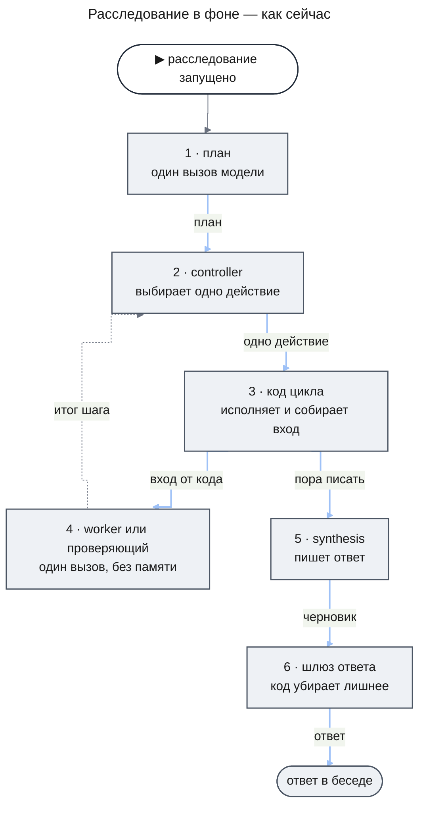
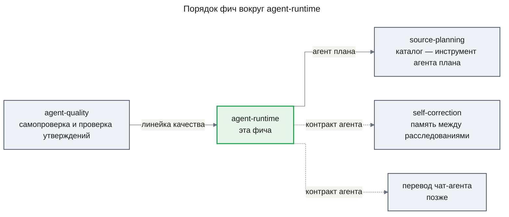
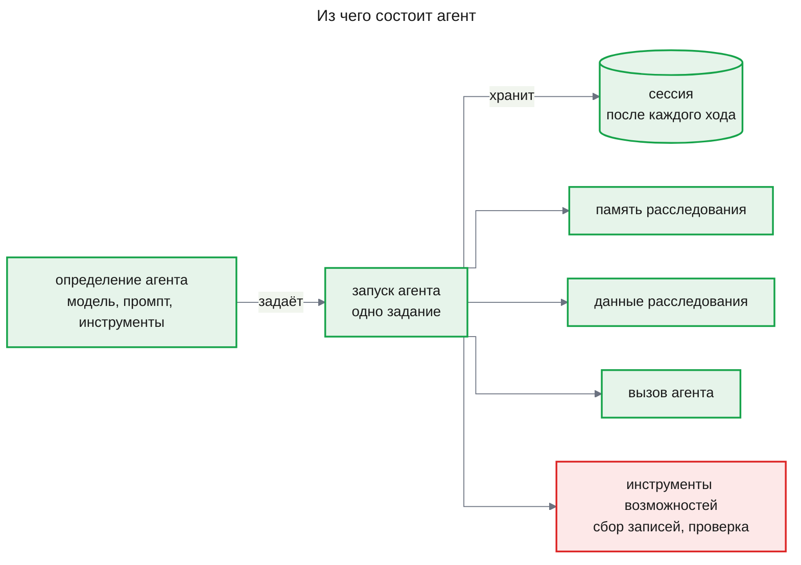
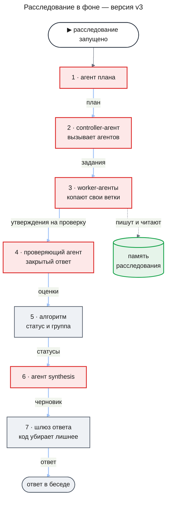

# PRD: Агенты как сущность платформы (agent-runtime)

| Status | Date | Depth | UXRD | Designs |
|---|---|---|---|---|
| Draft, ждёт утверждения владельца | 2026-11-08 | full | не нужен: экран сотрудника не меняется | — |

## Snapshot

**Overview.** Сейчас глубокое расследование — зашитый в код цикл. На каждом шаге модель-руководитель (controller) выбирает одно действие из закрытого списка, код его исполняет, а каждая роль — один вызов модели без памяти. Что узнала одна роль, другая получает только через вход, который собирает код, а каждое новое поведение — «копни глубже», «уточни», «перепроверь» — требует нового кода цикла. Фича делает агента сущностью платформы: это модель с базовыми инструментами — память расследования, данные расследования и вызов другого агента — и со своей сохраняемой сессией сообщений. Все пять стадий расследования становятся агентами новой версии процесса (v3), и агент, вызвав другого агента, видит только его результат. Новая версия выходит рядом с нынешней (v2) и становится версией по умолчанию, только когда самопроверка покажет, что она не хуже по качеству и цене.

- **Для сотрудника**: ответ того же вида, не хуже и не дороже; «Остановить» останавливает всех агентов расследования.
- **Что не меняется**: «модель оценивает, алгоритм решает», ссылки на записи, права, аудит и один бюджет на расследование.
- **Части**: `agent-core` → `research-flow`.
- **Не входит**: перевод чат-агента на новую сущность, память между расследованиями (`self-correction`), показ дерева агентов сотруднику.
- **Порядок**: дизайн начинается после выпуска `agent-quality`; `source-planning` строится после этой фичи.
- **Главный риск**: модели класса Haiku в свободном цикле агента ответят хуже, чем в зашитом цикле.
- **Открытые вопросы**: есть; они блокируют дизайн или переключение на v3, но не само решение — [Undetermined Items](#undetermined-items).

## Terms

Слова расследования и самопроверки — модель, вызов модели, роль, controller, worker, проверяющий, synthesis, запись, утверждение, бюджет, задача, диспетчер задач, транскрипт, самопроверка, калибровка, группа уверенности, сигнал сбоя, prompt injection — объяснены в [Terms PRD agent-quality](../agent-quality/prd.md#terms). Ниже только новые слова. Пример везде один: сотрудник спрашивает «почему вчера вечером росли ошибки оплаты?».

- **Агент** — модель с промптом, набором инструментов и своей сессией, которая работает над одним заданием, пока не вернёт результат. Пример: worker-агент получает задание «что писал payment-api в 19:40–20:15» и возвращает утверждения.
- **Инструмент** — операция, которую модель агента просит исполнить в своём ответе, например «собрать записи» или «записать в память». Исполняет её код, а результат приходит агенту следующим сообщением.
- **Ход агента** — один вызов модели и исполнение инструментов, которые модель в этом ответе попросила. Агент делает ходы, пока не вернёт результат.
- **Сессия агента** — все сообщения одного задания: само задание, ответы модели, вызовы инструментов и их результаты. Модель сама ничего не помнит, поэтому на каждом ходе снова получает сессию.
- **Определение агента** — описание агента данными: имя, модель, промпт, инструменты и пределы. Определения лежат в конфигурации процесса.
- **Запуск агента** — одна работа агента над одним заданием. Запуск переживает рестарт сервера.
- **Базовые инструменты** — три инструмента, которые есть у каждого агента: память расследования, данные расследования и вызов агента.
- **Память расследования** — общие заметки агентов одного расследования: что выяснено, что пробовали, что не сработало. Пример: «запрос timeout по payment-api за 19:40–20:15 вернул 412 записей». Память живёт, пока живёт расследование.
- **Данные расследования** — то, что расследование уже накопило: план, записи, утверждения и их статусы. Агент читает их инструментом, а не получает пересказом во входе.
- **Вызов агента** — инструмент, которым агент-родитель даёт задание дочернему агенту и ждёт результат. Дочерний агент работает в своей сессии, а родитель видит только задание и результат — так устроены субагенты Claude Code.
- **Дерево агентов** — все запуски агентов одного расследования: корень — первый агент, ветви — вызовы агентов.
- **Версия процесса** — номер поставляемой конфигурации процесса `deep-research`. v2 — нынешний цикл controller с ролями, v3 — те же стадии агентами.
- **Переключатель версии** — настройка развёртывания, которая говорит, по какой версии идут новые расследования.
- **Заплатки цикла** — правила кода, которые возмещают controller то, что он не помнит своих шагов: счётчик шагов без новизны, пересказ прежних шагов в его входе и список отклонённых попыток ([design-engine.md](../agent-quality/design-engine.md), KD-6, KD-11, KD-12).
- **Отпечаток** — короткий код, вычисленный из текста, например из промпта. Меняется текст — меняется отпечаток. По отпечатку таблица групп уверенности узнаёт, для какой проверки она построена.
- **Окно** — сколько текста модель принимает за один вызов.

## Background

### Как это работает сейчас

В чате агент уже есть: чат-агент помнит беседу и отвечает потоком. В фоне агентов нет — там идёт цикл, который ведёт код.

На каждом шаге controller выбирает одно действие из закрытого списка, например: собрать записи, раздать анализ, проверить, перестроить план или писать ответ. Код цикла исполняет действие, собирает вход для worker или проверяющего, а итог шага пересказывает controller в его следующем входе. Ни одна роль не помнит своих прошлых вызовов. Worker не может сам попросить ещё записей или перепроверку: он отдаёт утверждения и заканчивает.

### Что не так

- **Каждое новое поведение — новый код цикла.** «Копни эту ветку глубже», «уточни у другого аналитика», «перепроверь до сдачи» не выражаются одним действием из списка. Каждое такое поведение — новое действие в коде, новые проверки решения controller и новые правила остановки.
- **Controller не помнит своих шагов, и код это возмещает заплатками.** На первых расследованиях на настоящих моделях controller повторял запрос с пустым ответом до восьми раз ([design-engine.md](../agent-quality/design-engine.md), KD-12). Чтобы так не было, код пересказывает ему прежние запросы, хранит список отклонённых попыток и отклоняет шаги без новизны. Каждая заплатка лечит одну находку и добавляет правило, которое нужно поддерживать.
- **Знание идёт только через controller.** Что выяснил один worker, другой узнаёт, только если controller перескажет это в задании. Общего места, где агенты оставляют выясненное, нет.
- **Следующие фичи упираются в тот же цикл.** Каталог источников (`source-planning`) меняет шаг плана, правила самокоррекции (`self-correction`) — промпты и память, продолжение расследования (`research-followup`) — его ход. На зашитом цикле каждая из них снова правит код цикла.

### Почему сейчас и в каком порядке

Фича `agent-quality` дала линейку: самопроверку, которая сравнивает две конфигурации на одном наборе сценариев. Поэтому заменить цикл агентами теперь можно не вслепую — v3 сравнивается с v2 на тех же сценариях. Дизайн фичи начинается, когда `agent-quality` выпущена: дизайн её части `engine` утверждён, код закоммичен.

`source-planning` идёт после этой фичи. Её [PRD](../source-planning/prd.md) — черновик, и он меняет шаг плана. Здесь шаг плана становится агентом плана, а каталог источников потом станет его инструментом; иначе шаг плана пришлось бы строить дважды. Пунктир — фичи, которые воспользуются контрактом агента позже: память между расследованиями и перевод чат-агента в эту фичу не входят, но контракт агента не должен им мешать.

## Что меняется и куда встраивается

### Агент — что это

Агент — одна и та же обёртка для любой стадии. Чем стадии отличаются, говорит определение: модель, промпт и набор инструментов. Три базовых инструмента есть у каждого агента, а инструменты возможностей — те действия, которые сейчас исполняет код цикла по выбору controller, — агент получает по своему определению. Сессия сохраняется после каждого хода, поэтому рестарт сервера не теряет работу агента.

### Расследование после изменений

Та же картина фона в версии v3. Зелёное — новое, красное — изменённое.

На схеме путь данных вытянут в цепочку. На деле controller-агент сам решает, кого и когда вызвать, а worker-агент посреди задания может вызвать другого агента, чтобы копнуть глубже или перепроверить. Кто отправляет утверждение на проверку, решает дизайн `research-flow`; схема показывает только, что каждое утверждение до ответа проходит проверяющего агента. Что меняется в каждом звене:

- **Агент плана** пишет план, как сейчас шаг плана, и потом получит инструмент каталога источников из `source-planning` (FR-12).
- **Controller-агент** видит свои прежние вызовы в своей сессии, поэтому заплатки цикла ему не нужны (FR-17).
- **Worker-агенты** пишут выясненное в общую память и читают её, а не ждут пересказа от controller (FR-03).
- **Проверяющий агент** по-прежнему отвечает закрытой формой об одном утверждении. Статус и группу ставит алгоритм, как в v2 (FR-15, FR-16).
- **Алгоритм и шлюз ответа** не меняются: ссылки, сводка и группы собираются по правилам `agent-quality`.

### Как агент вызывает агента

```mermaid
---
title: "Вызов агента: родитель видит только результат"
config:
  theme: base
  look: classic
  themeVariables:
    primaryColor: "#eef1f5"
    primaryBorderColor: "#4b5563"
    primaryTextColor: "#1a1a1a"
    lineColor: "#6b7280"
  flowchart:
    curve: step
  themeCSS: |
    @keyframes litr_ar3{0%,18%{stroke:#1d4ed8;stroke-width:6px}20%,100%{stroke:#9ec1f7;stroke-width:2px}}
---
flowchart LR
    p["1 · агент-родитель<br/>ждёт результат"]
    t["2 · вызов агента<br/>инструмент"]
    rt["3 · платформа<br/>запускает дочернего агента"]
    c["4 · дочерний агент<br/>своя сессия"]
    s[("сессии")]
    p e1@-->|"задание"| t
    t e2@-->|"новый запуск"| rt
    rt e3@-->|"задание"| c
    c e4@-->|"результат"| rt
    rt e5@-->|"только результат"| p
    c -.->|"каждый ход"| s
    classDef new fill:#e6f4ea,stroke:#16a34a,stroke-width:2px,color:#1a1a1a
    classDef changed fill:#fde8e8,stroke:#dc2626,stroke-width:2px,color:#1a1a1a
    classDef r1 stroke:#9ec1f7,stroke-width:2px,animation:litr_ar3 6s linear 0s infinite
    classDef r2 stroke:#9ec1f7,stroke-width:2px,animation:litr_ar3 6s linear 1.2s infinite
    classDef r3 stroke:#9ec1f7,stroke-width:2px,animation:litr_ar3 6s linear 2.4s infinite
    classDef r4 stroke:#9ec1f7,stroke-width:2px,animation:litr_ar3 6s linear 3.6s infinite
    classDef r5 stroke:#9ec1f7,stroke-width:2px,animation:litr_ar3 6s linear 4.8s infinite
    class p,t,c,s new
    class rt changed
    class e1 r1
    class e2 r2
    class e3 r3
    class e4 r4
    class e5 r5
```

Дочерний агент — отдельный запуск, и на него действуют те же правила, что на любую фоновую работу расследования: повтор прерванной попытки, сроки, отмена. Родитель не видит сессию дочернего агента — только задание, которое дал, и результат, который получил. Так родитель не тратит своё окно на чужую работу, а дочерний агент начинает с чистого листа и берёт общее знание из памяти и данных расследования. Глубину и ширину дерева ограничивает код, а все вызовы модели в дереве платятся из одного бюджета расследования.

### Что держит код, а что решает агент

Свобода агента касается только того, что раньше решал controller: кого вызвать, что собрать, когда писать ответ. Всё, что код решает сейчас, он решает и в v3: ведёт ли указатель на записи этого расследования, прошёл ли ответ закрытую форму, помещается ли вызов в бюджет и в пределы дерева, разрешён ли инструмент сотруднику. Статус утверждения алгоритм по-прежнему ставит из закрытого ответа проверяющего, а группу берёт из таблицы калибровки. Запись в памяти не делает вывод установленным: в ответ попадают только утверждения, которые прошли проверку.

## Что увидит сотрудник в диалоге

На экране ничего не меняется. Карточка ресерча, кнопка «Остановить», ответ с разделами «Установлено», «Предположения» и «Не выяснено», группы уверенности и сводка выглядят, как сейчас. Сотрудник не видит, по какой версии шло расследование и сколько агентов в нём работало. Причины принудительной остановки остаются из прежнего списка, поэтому новых состояний карточки нет. «Остановить» останавливает всё дерево агентов, а не только controller.

Ход дерева агентов видит разработчик — в транскриптах и в отчётах программы самопроверки.

## Подход и почему мы в него верим

У каждой опоры стоит её тип: **измерено**, **вендор** (инженерный блог поставщика), **мнение**, **наш вывод** — как в [PRD agent-quality](../agent-quality/prd.md#подход-и-почему-мы-в-него-верим). То, что для нас не измерено, записано гипотезой в разделе [Assumptions](#assumptions).

### 1. Агент вызывает агента, родитель видит только результат

**Что делаем.** Стадии расследования становятся агентами со своими сессиями. Агент поручает работу другому агенту и получает назад сжатый результат, а общее знание лежит в памяти и данных расследования.

**Почему верим.**

- Система исследования из ведущего агента на Claude Opus 4 и субагентов на Claude Sonnet 4 обошла одного агента на Claude Opus 4 на 90,2% по внутренней оценке поставщика. Субагенты работают параллельно, каждый в своём окне, и отдают ведущему сжатый результат — **вендор, измерено на его наборе**, [Anthropic, How we built our multi-agent research system](https://www.anthropic.com/engineering/multi-agent-research-system).
- Тот же источник предупреждает: схема плохо подходит задачам, где всем агентам нужен один контекст и между агентами много зависимостей — **вендор**. Расследование по логам раскладывается на ветки, а общее знание мы кладём в память, а не в сессии — **наш вывод**.
- Агенты, которые работают без общего контекста, принимают противоречащие решения — **мнение**, [Cognition, Don't Build Multi-Agents](https://cognition.com/blog/dont-build-multi-agents). Это довод против нас: его снимают общая память и данные расследования, и это проверяет гипотеза H-02.

**Что не измерено для нас.** Все измерения сделаны на сильных моделях и не на логах. Удержит ли модель класса Haiku свободный цикл агента, проверяет H-01.

### 2. Цена растёт вместе с токенами

**Что делаем.** Один бюджет на всё дерево, правило окна сессии (U-2), кэш неизменного начала сессии и стоимость в отчёте сравнения.

**Почему верим.** Агенты тратят примерно в 4 раза больше токенов, чем чат, а системы из нескольких агентов — примерно в 15 раз больше. На наборе BrowseComp расход токенов сам по себе объясняет 80% разброса качества — **вендор, измерено**, [Anthropic](https://www.anthropic.com/engineering/multi-agent-research-system). Значит, качество v3 может прийти вместе с ценой, и сравнение с v2 должно смотреть на оба числа — **наш вывод**.

**Что не измерено для нас.** Сколько стоит сессия на наших расследованиях. Проверяет H-03.

### 3. Новая версия растёт рядом со старой

**Что делаем.** v3 выходит рядом с v2 (FR-14), а версию по умолчанию переключают по отчёту сравнения (FR-19).

**Почему верим.** Самопроверка `agent-quality` уже сравнивает две конфигурации парно и с повторами. Если v3 хуже, сотрудники этого не заметят: их расследования идут по v2 — **наш вывод**.

## Users and Use Cases

### Users

- **Сотрудник (аналитик, SRE)** — запускает ресерч в чате и читает ответ. Ему важно, чтобы ответ не стал хуже и дороже, а «Остановить» срабатывала.
- **Разработчик Agent OS** — строит новое поведение расследования и разбирает плохие ответы. Ему важно добавлять поведение определением агента, а не кодом цикла, и видеть, какой агент ошибся первым.
- **Владелец развёртывания** — решает, по какой версии процесса идут расследования, и задаёт бюджеты.

### Use Cases

- **UC-1**: Сотрудник запускает ресерч, как раньше, и получает ответ того же вида, не хуже по качеству и не дороже → ему не нужно ничего переучивать. Covers FR-11, FR-12, FR-15, FR-19, FR-21.
- **UC-2**: Сотрудник останавливает ресерч → останавливаются все агенты дерева, бюджет не утекает. Covers FR-07, FR-08.
- **UC-3**: Разработчик даёт стадии новое поведение — «копни глубже», «перепроверь до сдачи» — определением агента и его инструментами → кода цикла для этого не нужно. Covers FR-01, FR-03, FR-04, FR-05, FR-06, FR-13, FR-17.
- **UC-4**: Разработчик открывает плохой ответ v3 и по дереву агентов находит агента, который ошибся первым → чинит нужное определение. Covers FR-09, FR-18.
- **UC-5**: Разработчик сравнивает v3 с v2 на одном наборе сценариев, а владелец развёртывания по вердикту переключает версию по умолчанию → переход не ухудшает ответы сотрудников. Covers FR-14, FR-18, FR-19.
- **UC-6**: Разработчик меняет проверяющего агента и калибрует его заново → группы уверенности в v3 значат то же, что в v2. Covers FR-16.
- **UC-7**: Сервер перезапускается посреди расследования → агенты продолжают с последнего хода, и ни один инструмент не применён дважды. Covers FR-02, FR-05.
- **UC-8**: Сотрудник запускает ресерч и может быть уверен, что ни один агент дерева не прочтёт то, что ему запрещено, и не выполнит команду из текста логов. Covers FR-10, FR-20.

## Functional Requirements

### Must Have (MVP)

**Агент как сущность платформы**

- **FR-01. Агент задан данными.** Агента описывает определение: имя, модель, промпт, инструменты и пределы. Инструменты берутся только из закрытого реестра платформы — три базовых и инструменты возможностей движка, — поэтому исполняемого кода в определении нет.
  - AC-01.1: Given определение агента называет инструмент, которого нет в реестре, When сервер загружает конфигурацию, Then конфигурация отклонена, ни одно расследование по ней не стартует, а ошибка называет агента и инструмент.
  - AC-01.2: Given инструмента нет в определении агента, When модель агента просит его вызвать, Then инструмент не исполнен, а агент получает отказ с причиной следующим сообщением сессии.
- **FR-02. Запуск агента переживает рестарт.** После рестарта сервера запуск агента продолжается с последнего завершённого хода. Вызов инструмента, который уже исполнен, при повторе прерванного хода второй раз не исполняется.
  - AC-02.1: Given сервер остановлен между ходами агента, When сервер перезапущен, Then агент продолжает со следующего хода, и ни один сохранённый ход не выполнен заново.
  - AC-02.2: Given сервер остановлен посреди хода, после того как инструмент этого хода уже исполнен, When ход повторяется после рестарта, Then инструмент не исполнен второй раз, а агент получает его прежний результат.
- **FR-03. Память расследования.** Агенты одного расследования пишут заметки в общую память и читают их. У каждой заметки видно, какой агент её оставил. Память видна только агентам этого расследования и удаляется вместе с ним.
  - AC-03.1: Given агент записал заметку в память, When другой агент того же расследования читает память, Then он видит заметку и агента, который её оставил.
  - AC-03.2: Given агенты двух разных расследований, Then ни один из них не видит заметок чужого расследования.
  - AC-03.3: Given два агента пишут в память одновременно, Then сохранены обе заметки.
  - AC-03.4: Given расследование удалено, Then его память недоступна.
- **FR-04. Данные расследования.** Агент читает инструментом план, записи, утверждения и статусы утверждений своего расследования. Это чтение того, что уже собрано; новые записи из источника агент получает только инструментом сбора, под правами и аудитом (FR-10).
  - AC-04.1: Given worker-агент сохранил утверждение, When controller-агент читает данные расследования, Then он видит это утверждение и его статус проверки.
  - AC-04.2: Given агент просит данные другого расследования, Then он получает отказ и ни одной записи.
- **FR-05. Вызов агента.** Агент-родитель вызывает агента по имени с заданием и ждёт результата. Дочерний агент работает в своей сессии, а в сессию родителя попадают только задание и результат. Одним ходом родитель может вызвать несколько агентов, и они работают одновременно. Если дочерний агент не справился, родитель получает отказ с причиной и сам решает, что делать дальше.
  - AC-05.1: Given родитель вызвал дочернего агента, When тот вернул результат, Then в сессии родителя есть задание и результат и нет ни одного сообщения дочерней сессии.
  - AC-05.2: Given родитель одним ходом вызвал несколько дочерних агентов, Then они работают одновременно, и родитель получает результат каждого.
  - AC-05.3: Given дочерний агент завершился неудачей — ошибкой, сроком или бюджетом, Then родитель получает отказ с причиной и продолжает работу, а не ждёт бесконечно.
  - AC-05.4: Given сервер перезапущен, пока родитель ждёт дочернего агента, Then после рестарта дочерний агент продолжает свою работу, родитель получает его результат, и второго запуска по тому же вызову нет.
- **FR-06. Пределы дерева.** Код ограничивает глубину дерева агентов, число дочерних агентов у одного агента и общее число задач расследования. Пределы лежат в конфигурации процесса, а их значения задаёт дизайн.
  - AC-06.1: Given вызов агента превысил бы предел глубины, ширины или числа задач, Then вызов не исполнен, а агент получает отказ с названием предела.
- **FR-07. Один бюджет на дерево.** Все вызовы модели всех агентов расследования, проверяющие тоже, платятся из одного бюджета расследования. Перед каждым вызовом модели резервируется его расход, как сейчас ([PRD agent-quality](../agent-quality/prd.md), FR-10).
  - AC-07.1: Given бюджет расследования меньше требуемого, Then ни один агент дерева не начинает вызов модели сверх бюджета, а расследование завершается с причиной «бюджет исчерпан».
  - AC-07.2: Given расследование завершено, Then журнал токенов показывает расход каждого запуска агента, и сумма по запускам равна расходу расследования.
  - AC-07.3: Получает ли дочерний агент свою долю бюджета и что происходит, когда она кончилась, — вопрос U-1.
- **FR-08. Остановка и закрытие отменяют всё дерево.** Остановка сотрудником, закрытие расследования с ответом и срыв расследования отменяют все запуски агентов дерева тем же переходом ([ADR-0006](../../adr/ADR-0006-investigation-final-states.md); PRD agent-quality, FR-19, FR-21).
  - AC-08.1: Given в дереве работают несколько агентов, When сотрудник останавливает расследование, Then после перехода ни один агент дерева не начинает вызов модели или инструмента.
  - AC-08.2: Given ответ готов, а дочерние агенты ещё работают, Then расследование в состоянии «завершено», и их запуски отменены тем же переходом.
- **FR-09. Ход дерева записан.** Каждый ход каждого агента оставляет транскрипт (PRD agent-quality, FR-01) с именем агента и его запуском. По расследованию разработчик восстанавливает дерево: кто кого вызвал, с каким заданием, что вернулось и сколько стоил каждый запуск. Срок хранения и доступ — как у транскриптов.
  - AC-09.1: Given расследование по v3 завершено, When разработчик открывает его ход, Then у каждого запуска агента видны родитель, задание, результат, расход и транскрипты всех его ходов.
- **FR-10. Права и аудит на каждом вызове инструмента.** Агент вызывает инструменты от имени сотрудника, который запустил расследование. Каждый вызов инструмента любым агентом дерева проходит ту же проверку прав и оставляет ту же запись аудита, что любой вызов инструмента на платформе (бизнес-ограничения 1 и 3 проекта). Вызов агента прав не расширяет: дочерний агент может не больше, чем может сотрудник.
  - AC-10.1: Given права сотрудника не разрешают источник, When любой агент дерева вызывает инструмент этого источника, Then вызов получает отказ по правам, а источник не вызван ни разу.
  - AC-10.2: Given агенты дерева вызвали инструменты, Then на каждый вызов приходится ровно одна запись аудита, и в ней видно, какой агент вызвал инструмент.
- **FR-11. Сессия не упирается в окно.** Сессия растёт с каждым ходом. Когда она подходит к окну модели агента, следующий ход всё равно выполняется, и расследование не останавливается из-за длины сессии. Какую часть сессии модель видит на таком ходе, решает вопрос U-2.
  - AC-11.1: Given сессия агента выросла до окна его модели, When агент делает следующий ход, Then ход выполнен, а не отклонён по размеру входа.
  - AC-11.2: Что из сессии модель видит на этом ходе — вопрос U-2.

**Расследование на агентах**

- **FR-12. Пять стадий — агенты версии v3.** В версии процесса v3 план, controller, worker, проверяющий и synthesis — агенты. Controller-агент ведёт расследование вызовами агентов и инструментов, а не выбором одного действия из закрытого списка на каждом шаге. Агент, которому определение разрешает вызов другого агента, сам копает глубже, уточняет или перепроверяет, не возвращаясь к controller.
  - AC-12.1: Given расследование по v3 завершено, Then в его дереве есть запуски агентов плана, controller, worker, проверяющего и synthesis.
  - AC-12.2: Given определение worker-агента разрешает вызов другого агента, When worker вызывает его посреди своего задания, Then вызов исполнен, и шага controller между ними нет.
  - AC-12.3: Given расследование по v3 остановлено принудительно, Then причина остановки — одна из тех, что сотрудник видит и в v2.
  - AC-12.4: Given в развёртывании не подключён ни один источник данных, When расследование идёт по v3, Then выполняются критерии FR-25 и FR-27 [PRD deep-research](../deep-research/prd.md): ответ на знаниях модели с пометкой у каждого утверждения и предупреждением в беседе.
- **FR-13. Конфигурация v3 — данные.** Версия v3 описывает агентов в конфигурации процесса данными, со строгой схемой, как сейчас описаны роли. Схема отклоняет неизвестный ключ до старта любого расследования. Поправить [ADR-0005](../../adr/ADR-0005-process-config-data-only.md) или заменить его новым решением — вопрос U-4.
  - AC-13.1: Given конфигурация v3 с неизвестным ключом, Then сервер её не принимает, и ни одно расследование по ней не стартует.
  - AC-13.2: Given конфигурация v2, Then она загружается и проверяется, как до фичи.
- **FR-14. Две версии рядом.** Новые расследования идут по версии, которую задаёт переключатель развёртывания; по умолчанию это v2. Расследование доканчивается по той версии, с которой началось. Программа самопроверки запускает любую из двух версий независимо от переключателя. Расследования, сохранённые до фичи, читаются, как раньше.
  - AC-14.1: Given переключатель стоит на v2, Then новые расследования идут по v2, и в их ходе нет запусков агентов.
  - AC-14.2: Given переключатель изменён, пока идёт расследование, Then оно доканчивается по версии, с которой началось.
  - AC-14.3: Given расследования v2 сохранены до выпуска фичи, Then их ход, транскрипты и ответы читаются, а их повтор (PRD agent-quality, FR-02) запускается, как до фичи.
- **FR-15. Ответ v3 подчиняется тем же правилам.** Ответ по v3 выполняет правила проверки и сборки ответа `agent-quality`: ссылки установленного вывода — только записи его проверки, указатель на место в записи, статус от закрытого ответа проверяющего, причинные выводы — в предположения, сводка из принятых утверждений. Заметка в памяти и результат агента вывода не устанавливают.
  - AC-15.1: Given расследование по v3, Then выполняются критерии FR-09, FR-11, FR-12, FR-13, FR-14 и FR-16 [PRD agent-quality](../agent-quality/prd.md).
  - AC-15.2: Given агент записал в память или вернул в результате вывод, которого нет среди проверенных утверждений, Then в «Установлено» и в сводке ответа этого вывода нет.
- **FR-16. Калибровка проверяющего агента.** Таблица групп уверенности сейчас построена для модели и отпечатка промпта проверяющего вызова, вход которого фиксирован: одно утверждение, записи его указателя и итог сверки значений ([ADR-0008](../../adr/ADR-0008-claim-status-from-verifier-answer-and-universal-atoms.md); [design-engine.md](../agent-quality/design-engine.md), KD-3). У проверяющего агента есть сессия, поэтому фича заново определяет, какой вход отпечатывается и когда нужна новая калибровка. Калибровка гоняет проверяющего агента так же, как он работает в расследовании. Что именно входит в фиксированный вход — вопрос U-3.
  - AC-16.1: Given изменились модель, промпт, инструменты или форма ответа проверяющего агента, Then его отпечаток меняется, и сервер с переключателем на v3 не стартует, пока для нового отпечатка нет таблицы групп; ошибка называет отпечаток.
  - AC-16.2: Given калибровка v3 прогнана, Then отчёт показывает долю совпадений проверяющего агента с ключом по каждому типу пар, сравнение с правилом «значение не нашлось — не установлено» и долю верных по группам — так же, как для v2 (PRD agent-quality, AC-06.1, AC-13.2, AC-15.2).
  - AC-16.3: Given калибровочная пара, Then проверяющий агент в калибровке получает вход того же вида, что в расследовании; вид входа решает вопрос U-3.
- **FR-17. Без заплаток цикла.** В v3 controller-агент видит свои прежние вызовы и их результаты в своей сессии и в данных расследования. Поэтому заплаток цикла в v3 нет: счётчика шагов без новизны, пересказа прежних шагов во входе и списка отклонённых попыток. В v2 они остаются, пока v2 поставляется.
  - AC-17.1: Given controller-агент в расследовании по v3 сделал несколько ходов, When разработчик открывает его сессию, Then в ней по порядку видны все его прежние вызовы и их результаты, и ни один его вызов код не отклонил за отсутствие новизны.
  - AC-17.2: Given расследование по v3, Then ни один вызов controller-агента не отклонён кодом за повтор или за отсутствие новизны.
- **FR-18. Самопроверка на v3.** Программа самопроверки работает с v3 так же, как с v2: прогон набора, повтор, сравнение, калибровка и отчёт о ходе. Сигналы сбоя, которые сейчас опираются на решения controller, определены для агентов: отклонённые кодом вызовы агентов и инструментов с причинами. Отчёт о ходе показывает дерево агентов.
  - AC-18.1: Given набор сценариев прогнан на v3, Then по каждому сценарию видны вердикт, число вызовов модели и стоимость; для v2 отчёт показывает вместо числа вызовов число шагов (PRD agent-quality, AC-04.3).
  - AC-18.2: Given сохранённое расследование v3, When разработчик запускает повтор, Then повтор идёт по v3 на том же срезе данных.
  - AC-18.3: Given расследование по v3 без ключа завершено, Then отчёт показывает его сигналы сбоя, в том числе отклонённые вызовы агентов и инструментов с причинами, и дерево агентов с транскриптами.
- **FR-19. Сравнение с v2 решает о версии по умолчанию.** Владелец развёртывания переключает версию по умолчанию на v3 по сравнению на одном наборе сценариев с повторами. Сравниваются четыре числа: доля решённых сценариев, доля честных отказов, доля ложных «установлено» и стоимость решённого сценария. Переключение возможно, только когда пороги вердикта записаны для всех четырёх чисел — это пороги сравнения конфигураций ([PRD agent-quality](../agent-quality/prd.md), U-6), — и ни по одному числу вердикт не «хуже». Допускает ли переключение вердикт «неясно» — вопрос U-5.
  - AC-19.1: Given v2 и v3 прогнаны на одном наборе сценариев с повторами, Then отчёт сравнения показывает эти четыре числа по каждой версии и вердикт «лучше», «хуже» или «неясно» по каждому.
- **FR-20. Текст в памяти и результатах — данные.** Заметки памяти, результаты дочерних агентов и данные расследования приходят модели как данные, а не как инструкции. Текст из логов, обращённый к модели, который попал в заметку или в результат, не меняет форму ответа агента. Как часто он меняет решения, измеряет самопроверка.
  - AC-20.1: Given набор самопроверки со сценариями, где текст в записях обращён к модели, прогнан на v3, Then отчёт показывает долю сценариев, где этот текст изменил оценку проверяющего агента или вывод ответа, и сравнивает её с допустимой долей (PRD agent-quality, U-6).

### Should Have

- **FR-21. Неизменное начало сессии дешевле.** Начало сессии агента, которое не меняется от хода к ходу, не оплачивается каждый раз полностью.
  - AC-21.1: Given агент сделал больше одного хода, Then в журнале вызовов ходы после первого стоят меньше, чем стоил бы тот же вход без повтора начала.

### Could Have

Нет: остальная работа принадлежит соседним фичам из Won't Have.

### Won't Have

- **Перевод чат-агента на новую сущность** — позже, отдельной фичей. Чат-агент работает на Mastra Agent с памятью беседы и отвечает потоком, и эта фича его не трогает. Контракт агента не должен мешать переводу.
- **Память между расследованиями** — фича `self-correction`: правила, которые система пишет себе по итогам расследований. Здесь память живёт одно расследование; контракт памяти не должен мешать расширить её.
- **Показ дерева агентов сотруднику** — сотруднику достаточно ответа; ход дерева разработчик видит в транскриптах и отчётах самопроверки.
- **Каталог источников как инструмент агента плана** — фича `source-planning`, которая строится после этой.
- **Агенты, которые составляет пользователь** — фича `workflow-templates`: она хранит шаблоны процессов пользователей.
- **Изменяющие действия агентов во внешних системах** — фича `human-approval`: такие действия требуют подтверждения человека.
- **Продолжение завершённого расследования** — фича `research-followup`.
- **Удаление v2 и её заплаток из кода** — после того как v3 станет версией по умолчанию; до этого v2 — точка сравнения и запасной путь.

## Non-Functional Requirements

### Security

- **NFR-01**: сессии, память, дерево и транскрипты агентов расследования недоступны пользователю, которому недоступно само расследование. Проверяется e2e-тестом с двумя пользователями: 0 случаев доступа к чужому (бизнес-ограничение 2 проекта).
- **NFR-02**: сессии и заметки памяти уходят только к провайдерам моделей, которыми уже пользуется расследование. Проверяется по транскриптам самопроверки.

### Reliability

- **NFR-03**: остановка сервера в любой точке хода агента — до вызова модели, после её ответа, после исполнения инструмента, до записи хода — не теряет ход и не исполняет инструмент дважды. Проверяется прогоном с принудительной остановкой процесса в каждой из этих точек (требование проекта «рестарт не теряет и не дублирует работу»).

## Delivery Parts

| Part | Covers | Cut along | Depends on | Rationale |
|------|--------|-----------|------------|-----------|
| `agent-core` | FR-01–FR-11, FR-21 | domain | — | Агент — новая сущность платформы со своими данными: запуски, сессии, память; она не знает, какой процесс на ней построен. |
| `research-flow` | FR-12–FR-20 | domain | `agent-core` | Процесс глубокого расследования v3, его конфигурация, калибровка и самопроверка строятся на контракте агента. |

Две части, поэтому порядок проектирования говорит столбец Depends on: сначала `agent-core`, потом `research-flow`.

## Success Criteria

- **v3 не хуже v2 по качеству** — по доле решённых сценариев, доле честных отказов и доле ложных «установлено» вердикт не «хуже» на одном наборе с повторами, по порогам U-6 PRD agent-quality, когда они записаны (U-5). Читается в отчёте сравнения самопроверки до переключения версии по умолчанию.
- **v3 не дороже сверх порога** — стоимость решённого сценария v3 выше, чем у v2, не больше чем на порог U-6 PRD agent-quality. Читается в том же отчёте. На настоящих расследованиях за первый месяц после переключения медианная стоимость расследования по журналу токенов не выше медианы v2 за месяц до него больше чем на тот же порог.
- **Группы уверенности v3 упорядочены** — в группе выше доля верных утверждений на калибровочных парах выше, чем в группе ниже. Читается в отчёте калибровки v3.
- **Следующая фича строится без кода цикла** — `source-planning` подключает каталог источников инструментом агента плана, и её дизайн не меняет код цикла расследования. Читается в Design Doc `source-planning`.
- **Остановка останавливает дерево** — в журнале вызовов за первый месяц после переключения на v3 нет вызовов модели и инструментов, начатых после остановки или закрытия расследования.

## Constraints and Risks

### Constraints

- **Модель оценивает, алгоритм решает.** Всё, что требует понимания текста, решает отдельный вызов модели закрытой формой: подтверждают ли записи утверждение вместе с его именами, числами и временем и какого оно типа. Алгоритм решает, ведёт ли указатель на записи этого расследования, прошёл ли ответ форму и помещается ли вызов в бюджет; статус он берёт из полей ответа, а группу — из таблицы калибровки. Итог сверки значений алгоритм передаёт модели и учитывает в группе, но «подтверждают» им не отменяет. Для проверяющего агента правило то же, что для проверяющего вызова (FR-15, FR-16).
- **Единственный долговечный владелец — свой диспетчер задач.** Запуск агента — задача диспетчера, сессия и память лежат в базе; Mastra используется только как обёртка вызова модели, без собственной долговечности, супервизора и Mastra Memory для агентов расследования ([ADR-0001](../../adr/ADR-0001-durable-runtime-owner.md)).
- **Слои пакетов.** Агент встраивается в раскладку пакетов, где пакет зависит только от слоёв ниже ([ADR-0004](../../adr/ADR-0004-agent-framework-packages.md)).
- **Процесс — только данные.** Определения агентов — данные со строгой схемой и закрытым реестром инструментов ([ADR-0005](../../adr/ADR-0005-process-config-data-only.md); как поступить с самим ADR — U-4).
- **Остановка отменяет всё дерево** ([ADR-0006](../../adr/ADR-0006-investigation-final-states.md)).
- **Бизнес-ограничения проекта** действуют на каждый агент дерева: права на инструменты (1), изоляция данных пользователей (2), запись аудита на каждый вызов инструмента (3), явный бюджет у каждой задачи и у расследования (4), ссылка на запись у каждого утверждения ответа (5), цена не выше одного сильного агента (7).
- **Контракт агента открыт для будущих фич.** Он не привязывает агента к расследованию `deep-research`, чтобы позже на нём встали чат-агент и память между расследованиями.
- **v2 остаётся, пока v3 не доказана.** v2 поставляется и стоит по умолчанию, пока сравнение не покажет, что v3 не хуже (FR-19).
- **Порядок работ.** Дизайн начинается после выпуска `agent-quality`; `source-planning` строится после этой фичи.

### Затронутые утверждённые решения

Фича меняет следующие решения. Отметку о замене ставит владелец каждого документа в самом документе; этот PRD их не правит.

- [ADR-0005](../../adr/ADR-0005-process-config-data-only.md) — в конфигурации появляются определения агентов вместо ролей; поправка или замена решения — U-4.
- [design-engine.md](../agent-quality/design-engine.md), KD-3 — таблица групп для v3 привязана к отпечатку проверяющего агента, а не к промпту роли `verifier` (FR-16).
- design-engine.md, KD-6, KD-11, KD-12 — в v3 не действуют (FR-17); в v2 остаются.
- design-engine.md, KD-7 — «схема конфигурации не меняется» верно для v2; v3 меняет схему (FR-13).
- design-engine.md, KD-10 — каждое утверждение и в v3 проходит проверяющего агента (AC-15.1); кто отправляет его на проверку, решает дизайн `research-flow`.
- [PRD agent-quality](../agent-quality/prd.md), FR-08 и FR-18 — в v3 controller-агент видит причину отказа в своей сессии (FR-17), а неизменное начало сессии дешевле у каждого агента (FR-21).
- PRD agent-quality, FR-07, и сигналы сбоя в [design-self-check.md](../agent-quality/design-self-check.md) — для v3 сигналы определены для агентов (FR-18).
- [PRD deep-research](../deep-research/prd.md), термин «Воркер» — в v3 worker-агент не работает в свежем контексте без истории: у него своя сессия и доступ к памяти расследования.
- [PRD source-planning](../source-planning/prd.md) — шаг плана становится агентом плана, а каталог источников — его инструментом; PRD обновляется до начала её дизайна.

### Assumptions

Исход «неясно» значит, что данных для проверки гипотезы не хватило; как он влияет на переключение версии, решает вопрос U-5.

- **H-01. Модели класса Haiku держат свободный цикл агента.**
  - Предполагаем: worker и проверяющий на модели класса Haiku в цикле агента решают сценарии не хуже, чем в зашитом цикле.
  - Опровергнет: сравнение выносит v3 «хуже» по доле решённых сценариев или ложных «установлено», и правка промптов агентов за две итерации этого не меняет.
  - Измерим: отчёт сравнения v3 и v2 (FR-19).
  - Неясно, если: интервал разницы включает ноль при малом наборе.
- **H-02. Общая память заменяет пересказ через controller.**
  - Предполагаем: с памятью и своей сессией агенты реже повторяют уже сделанное, чем controller v2 с заплатками.
  - Опровергнет: доля повторных вызовов инструментов с теми же аргументами в v3 не ниже, чем в v2.
  - Измерим: транскрипты и журнал вызовов на одном наборе сценариев.
  - Неясно, если: повторов мало в обеих версиях.
- **H-03. Сессии не делают расследование дороже порога.**
  - Предполагаем: с одним бюджетом, правилом окна сессии (U-2) и кэшем начала сессии стоимость решённого сценария v3 не выходит за порог.
  - Опровергнет: стоимость решённого сценария v3 выше v2 больше чем на порог U-6 PRD agent-quality.
  - Измерим: отчёт сравнения (FR-19) и журнал токенов по запускам агентов (AC-07.2).
  - Неясно, если: разница стоимости в пределах шума.
- **H-04. Проверяющего агента можно откалибровать так же, как проверяющий вызов.**
  - Предполагаем: при фиксированном входе (U-3) группы уверенности v3 упорядочены по верности.
  - Опровергнет: на калибровочных парах группа выше не точнее группы ниже после двух калибровок подряд.
  - Измерим: отчёт калибровки v3 (AC-16.2).
  - Неясно, если: интервалы долей соседних групп перекрываются.
- **H-05. Набор сценариев различает v3 и v2.**
  - Предполагаем: набора самопроверки хватает, чтобы сравнение вынесло вердикт, а не только «неясно».
  - Опровергнет: два сравнения подряд дают «неясно» по большинству чисел.
  - Измерим: вердикты отчёта сравнения.
  - Неясно, если: разброс повторов одной версии сравним с порогом различия.

### Risks

| Risk | Impact | Probability | Mitigation |
|------|--------|-------------|------------|
| В свободном цикле модели класса Haiku отвечают хуже, чем в зашитом | High | Medium | v2 стоит по умолчанию, пока сравнение не покажет, что v3 не хуже (FR-14, FR-19); H-01 |
| Сессии растут, и расследование дорожает | High | High | Один бюджет на дерево (FR-07), правило окна сессии (FR-11, U-2), кэш начала сессии (FR-21), правило бюджета дочерних агентов (U-1), стоимость в сравнении (FR-19) |
| Текст из логов через память или результат агента управляет другими агентами | High | Medium | Память и результаты — данные (FR-20); вывод из памяти не становится установленным (AC-15.2); закрытая форма ответа проверяющего; доля влияния измеряется на каждом прогоне |
| Самопроверка ломается: ход, повтор и сигналы сбоя завязаны на решения controller | Medium | High | Самопроверка переходит на v3 (FR-18); путь v2 и сохранённые расследования читаются, как раньше (AC-14.3) |
| Агенты вызывают друг друга без конца | High | Low | Пределы глубины, ширины и числа задач в коде (FR-06); один бюджет (FR-07) |
| Рестарт посреди хода исполняет инструмент дважды | High | Medium | Сессия после каждого хода и повтор хода без повторного исполнения (FR-02, NFR-03) |
| Одновременные записи в память теряют заметки | Medium | Medium | Обе заметки сохраняются (AC-03.3) |
| Миграция базы ломает чтение старых расследований: журналы вызовов и транскрипты сейчас знают только пять ролей | Medium | Medium | Старые расследования, транскрипты и повтор читаются, как раньше (AC-14.3); порядок миграции решает дизайн по [ADR-0002](../../adr/ADR-0002-app-schema-migrations.md) |
| Калибровка мерит не тот вход, что видит проверяющий агент в расследовании, и группы теряют смысл | High | Medium | Калибровка гоняет агента так же, как в расследовании (AC-16.3); фиксированный вход — U-3; сервер не стартует без таблицы (AC-16.1) |
| Две версии процесса вдвое увеличивают поддержку | Medium | High | v2 не развивается, пока идёт сравнение; удаляется после переключения (Won't Have) |

## Undetermined Items

- **U-1. Доля бюджета дочернему агенту.** Варианты: (а) все агенты берут из одного общего бюджета, пока он не кончится, — как резерв сейчас; (б) родитель выделяет дочернему долю из своего бюджета, и дочерний останавливается, когда она кончилась. От ответа зависит, может ли один дочерний агент съесть весь бюджет. Бизнес-ограничение 4 проекта требует явного бюджета у каждой задачи, поэтому при варианте (а) владелец подтверждает, что общий резерв этому ограничению отвечает, или у каждого запуска остаётся свой предел. Блокирует AC-07.3 и дизайн `agent-core`. Дизайн предлагает, решает владелец.
- **U-2. Правило окна сессии.** Варианты: скользящее окно последних ходов; сжатие старых ходов вызовом модели; замена старых результатов инструментов ссылками на данные расследования; предел числа ходов. От ответа зависят цена и качество длинных заданий. Блокирует AC-11.2 и дизайн `agent-core`. Дизайн предлагает, решает владелец.
- **U-3. Фиксированный вход проверяющего агента для калибровки.** Варианты: (а) на каждое утверждение — новая сессия с тем же входом, что сейчас у проверяющего вызова, и тогда таблица значит то же, что в v2; (б) одна сессия на круг проверки, отпечаток покрывает промпт, инструменты и форму ответа, а калибровка гоняет сессии того же вида. От ответа зависит, когда нужна новая калибровка и может ли оценка одного утверждения влиять на соседнее. Блокирует AC-16.3 и дизайн `research-flow`. Дизайн предлагает, решает владелец.
- **U-4. ADR-0005: поправка или замена.** Определения агентов вместо ролей меняют формат конфигурации процесса. Варианты: поправить ADR-0005, сохранив правило «процесс — только данные», или заменить его новым ADR. Блокирует ADR при дизайне `research-flow`. Дизайн предлагает, решает владелец.
- **U-5. Правило переключения на v3.** Два пробела. Во-первых, пороги сравнения ещё не записаны (PRD agent-quality, U-6), а для доли честных отказов и доли решённых сценариев порога там нет вовсе; их нужно добавить. Во-вторых, неясно, разрешает ли переключение вердикт «неясно»: если да — v3 может стать версией по умолчанию без доказанного равенства; если нет — равные версии могут никогда не получить другого вердикта. Блокирует переключение по FR-19 и первые два пункта Success Criteria, но не дизайн. Решает владелец; пороги записываются в PRD agent-quality.

## Update History

| Version | Date | Change |
|---------|------|--------|
| 1.0 | 2026-11-08 | Первая версия |
