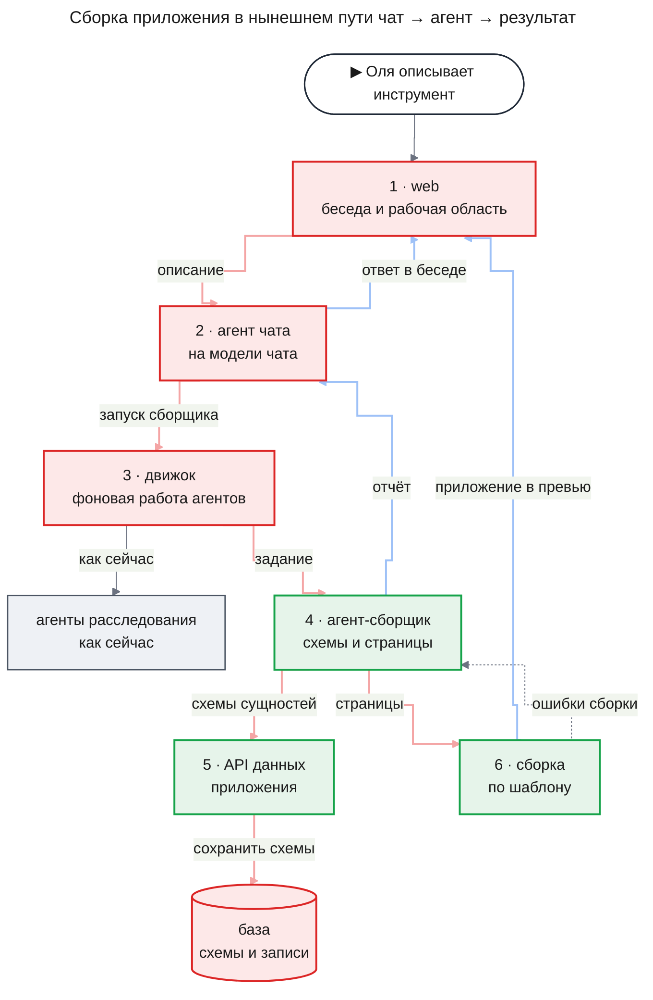
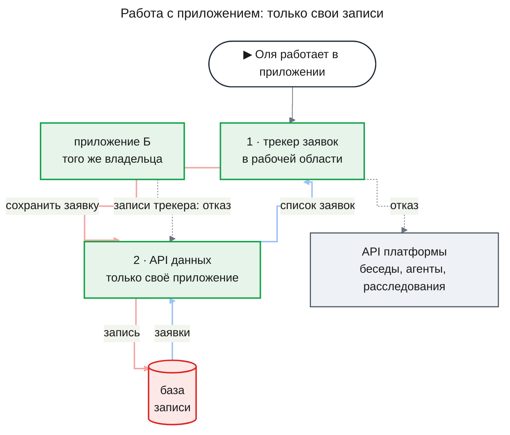
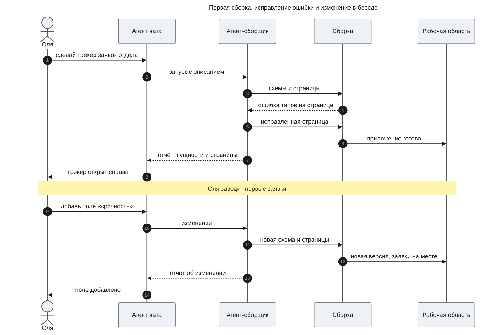
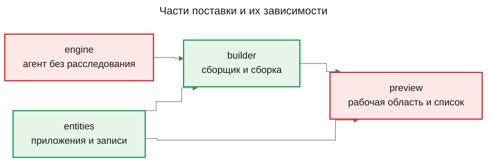

# PRD: Конструктор приложений (app-builder)

| Статус | Дата | Глубина | UXRD | Дизайны |
|---|---|---|---|---|
| Черновик | 2026-11-14 | full | будет после утверждения PRD | — |

## Snapshot

**Overview.** Сотруднику без разработчика нужен небольшой рабочий инструмент: трекер заявок, реестр, форма или дашборд. Сейчас Agent OS умеет только отвечать в чате и вести расследования, а сделать такой инструмент не может. Фича даёт сотруднику описать инструмент в чате и получить работающее приложение со своими данными. Агент-сборщик описывает данные приложения как сущности и пишет страницы поверх фиксированного шаблона. Приложение сразу работает в рабочей области рядом с беседой, меняется следующими просьбами в чате и открывается из списка «Мои приложения» без беседы.

- **Для**: сотрудник, который сам делает себе инструмент; пользуется приложением только он.
- **Не входит**: показ приложения коллегам, файлы, вызовы модели и внешних систем из приложения.
- **Части**: `engine` и `entities` → `builder` → `preview`.
- **Главный риск**: сгенерированный код доберётся до данных платформы или чужого приложения ([Risks](#risks)).
- **Открытые вопросы**: один — порядок с `agent-platform` ([Undetermined Items](#undetermined-items)); ещё два допущения ждут подтверждения владельца ([Assumptions](#assumptions)).

## Terms

Пример везде один: менеджер Оля делает трекер заявок своего отдела.

- **Приложение** — небольшой рабочий инструмент, который платформа собирает по описанию: страницы и свои данные. Пример: трекер заявок.
- **Владелец** — сотрудник, который описал приложение. В этой фиче приложением пользуется только он.
- **Сущность** — тип записей приложения, как лист таблицы с заголовками колонок. Пример: сущность «Заявка».
- **Схема сущности** — поля сущности и их типы. Пример: у «Заявки» поля «название», «автор», «статус».
- **Запись** — одна строка сущности. Пример: заявка «Сломался принтер».
- **Страница** — экран приложения. Пример: список заявок или форма новой заявки.
- **Шаблон приложения** — фиксированная заготовка, в которой уже есть всё, кроме схем и страниц. Сборщик пишет только схемы и страницы.
- **Агент-сборщик** — агент, который по просьбам владельца создаёт и меняет схемы и страницы приложения.
- **Сборка** — превращение страниц в работающее приложение. На сборке находятся ошибки, например ошибка типов: страница кладёт текст в числовое поле.
- **API данных приложения** — небольшой фиксированный набор операций над записями, под который написан код приложения: создать, найти, изменить, удалить.
- **Доступ в рамках приложения** — правило: приложение получает только свои сущности и записи, а не все права владельца.
- **Рабочая область** — правая панель рядом с беседой (`chat-shell` FR-11). Сейчас в ней только заглушка.
- **Движок** — часть платформы, которая сегодня ведёт фоновую работу расследований: хранит её в базе, переживает рестарт сервера и записывает токены каждого вызова модели в журнал токенов.
- **Модель чата** — модель, на которой работает агент чата; сейчас её задаёт настройка развёртывания `ASSISTANT_MODEL`.

## Background

Сегодня сотрудник пишет в чат, а агент чата отвечает сам или запускает глубокое расследование. Расследование идёт на движке, и движок умеет вести только расследования: вся его работа привязана к расследованию. Правая рабочая область оставлена под будущие результаты инструментов и пока пуста. Приложений, их данных и правил доступа для сгенерированного кода на платформе нет.

Владелец хочет, чтобы Agent OS делал приложения. Образец — Base44: данные приложения объявлены как сущности, у приложения маленький фиксированный API, а стек приложения фиксирован, так что модель пишет только схемы и страницы. В июле 2025 в Base44 нашли обход доступа: по публичному идентификатору приложения посторонний регистрировался в чужом закрытом приложении ([The Hacker News](https://thehackernews.com/2025/07/wiz-uncovers-critical-access-bypass.html)). Поэтому в этой фиче приложение не получает ничего сверх своих записей, а идентификатор приложения сам доступа не даёт.

Схема показывает, как сборка встраивается в нынешний путь «чат → агент → результат». Красным — то, что меняется, зелёным — то, чего раньше не было.

Агент чата получает новый инструмент — запустить сборщика. Движок перестаёт требовать расследование для каждой работы, но расследования идут на нём как раньше. Ошибку сборки получает сборщик, а не владелец: он исправляет страницы и собирает снова.

Когда приложение собрано, Оля работает с ним как с обычной программой. Код приложения ходит только в API данных своего приложения. Всё остальное на платформе для него закрыто.

## Users and Use Cases

### Users

- **Владелец приложения** — аналитик, SRE, инженер или менеджер, который ведёт свою работу в таблицах и заметках. Ему важно получить рабочий инструмент без разработчика, менять его словами и не потерять уже внесённые данные.
- **Разработчик платформы** — единственный разработчик Agent OS. Ему важно, чтобы сгенерированный код не дотянулся до данных платформы, а стоимость каждой сборки была видна в журнале токенов.

### Use Cases

- **UC-1**: Владелец описывает в чате инструмент → получает работающее приложение в рабочей области рядом с беседой, так что начинает вносить данные сразу.
- **UC-2**: Владелец просит в беседе изменение — новое поле, новую страницу → видит новую версию приложения, а внесённые записи остаются, так что инструмент растёт вместе с работой.
- **UC-3**: Владелец открывает приложение из списка «Мои приложения» без беседы → работает со своими записями, так что пользуется инструментом каждый день, не ища беседу.
- **UC-4**: Сборка ломается на ошибке → сборщик сам исправляет её, а если не смог — владелец видит причину, а прежняя версия продолжает работать, так что неудачная просьба не ломает инструмент.
- **UC-5**: Разработчик проверяет изоляцию → приложение, которое пытается прочитать чужие записи или данные платформы, получает отказ, так что сгенерированный код нельзя превратить в лазейку.

### Путь владельца

Диаграмма показывает UC-1, UC-2 и UC-4 вместе: Оля просит трекер, сборщик исправляет ошибку без неё, потом Оля просит новое поле.

Оля не видит ошибку типов: сборщик получает её и исправляет сам (FR-10). Записи, внесённые до изменения, остаются в приложении (FR-07).

## Functional Requirements

Требования сгруппированы по частям поставки ([Delivery Parts](#delivery-parts)).

### Must Have (MVP)

#### Движок: работа агента без расследования

- **FR-01. Работа агента без расследования.** Движок ведёт работу агента, который не относится к расследованию: хранит её, переживает рестарт сервера, записывает токены и умеет её остановить. Расследования идут на движке как раньше.
  - AC-01.1: Given агент запущен не как расследование, when он работает, then в беседе не появляется расследование, а каждый его вызов модели записан в журнал токенов с сотрудником, моделью и стоимостью.
  - AC-01.2: Given такой агент делает многошаговую работу, when сервер останавливают посреди работы и запускают снова, then агент доходит до итога, а шаги не потеряны и не повторены.
  - AC-01.3: Given агент работает, when его останавливают, then он больше не вызывает ни модель, ни инструменты.
  - AC-01.4: Given сотрудник запускает глубокое расследование, when оно идёт, then оно работает и заканчивается так же, как до изменения движка.

- **FR-02. Запуск агента из беседы.** Агент чата запускает на движке агента по его определению и получает итог в беседу. Определение агента — описание агента данными: промпт, инструменты, модель и пределы.
  - AC-02.1: Given беседа, when агент чата запускает агента, then чат отвечает сразу, не дожидаясь конца его работы, а в беседе видно, что агент работает.
  - AC-02.2: Given агент закончил, when сотрудник смотрит беседу, в том числе открыв её заново, then видит итог агента.
  - AC-02.3: Given агент принадлежит другому сотруднику, when сотрудник пытается увидеть или остановить его, then ответ такой же, как для несуществующего агента.

#### Сущности: приложения и их данные

- **FR-03. Приложения владельца.** Приложение — объект платформы, который принадлежит одному владельцу. Оно живёт отдельно от беседы: открывается без неё (FR-14) и остаётся вместе с записями, когда беседу удаляют.
  - AC-03.1: Given первая сборка приложения удалась, when владелец смотрит свои приложения, then приложение среди них, а у другого сотрудника его нет.
  - AC-03.2: Given Оля удалила беседу, в которой собран трекер, when она открывает «Мои приложения», then трекер в списке, работает, а его записи на месте.
  - AC-03.3: Given первая сборка приложения не удалась, when владелец смотрит свои приложения, then этого приложения в списке нет (допущение, [Assumptions](#assumptions)).

- **FR-04. Сущности.** Приложение хранит данные в сущностях, которые объявляет сборщик. Сущности хранят то, что нужно небольшому рабочему инструменту: текст, числа, даты, отметки «да/нет», выбор из списка и ссылки между записями.
  - AC-04.1: Given сборщик объявил сущность «Заявка», when приложение сохраняет заявку, then запись хранится и читается с теми же значениями.
  - AC-04.2: Given у заявки есть ссылка на запись другой сущности, when приложение сохраняет заявку, then ссылка на запись этого же приложения принимается, а на запись другого приложения — отклоняется.

- **FR-05. Записи.** Код приложения создаёт, находит, изменяет и удаляет записи своих сущностей через API данных приложения. Поиск отбирает записи по значениям полей и сортирует их.
  - AC-05.1: Given Оля создала заявку в приложении, when она перезагружает страницу, then заявка на месте.
  - AC-05.2: Given в трекере есть новые и закрытые заявки, when приложение запрашивает только новые, отсортированные по дате, then получает только новые и в этом порядке.
  - AC-05.3: Given заявка изменена или удалена, when приложение читает заявки снова, then видит изменение, а удалённой заявки нет.
  - AC-05.4: Given запись не подходит под схему — в числовом поле текст или нет обязательного поля, when приложение её сохраняет, then запись не сохраняется, а приложение получает отказ с названием поля.

- **FR-06. Доступ в рамках приложения.** Приложение читает и пишет только свои записи. Всё остальное — записи другого приложения того же владельца, данные других сотрудников и данные платформы — для него закрыто, и закрытость видна как отказ, а не как пустой ответ.
  - AC-06.1: Given у Оли трекер и приложение Б, when код приложения Б запрашивает или меняет записи трекера, then получает отказ, а записи трекера не выданы и не изменены.
  - AC-06.2: Given другой сотрудник знает идентификатор приложения, when он запрашивает или меняет его записи, then ответ такой же, как для несуществующего приложения (AC-06.3): идентификатор приложения сам доступа не даёт.
  - AC-06.3: Given приложение принадлежит другому сотруднику, when сотрудник пытается открыть его или его записи, then ответ такой же, как для несуществующего приложения.
  - AC-06.4: Given приложение запросило записи другого приложения того же владельца или данные платформы, when запрос отклонён, then приложение получает отказ с причиной, который отличается от пустого списка записей.

- **FR-07. Схема меняется, старые записи остаются как были.** Сборщик меняет сущность, в которой уже есть записи, так же, как пустую, а старые записи под новую схему не переделывает. Пример: в трекере 200 заявок, и у каждой заполнено поле «Приоритет». Оля просит убрать это поле или заменить свободный текст выбором «высокий / низкий». Сборщик меняет приложение, а 200 старых заявок остаются прежними, поэтому у них могут быть пустые места, а старый приоритет может показываться неверно. Сборщик предупреждает об этом владельца (AC-09.5).
  - AC-07.1: Given в сущности есть записи, when сборщик меняет её схему, then ни одна запись не удаляется без явной просьбы владельца.

#### Сборщик: схемы и страницы по описанию

- **FR-08. Первая сборка по описанию.** Владелец описывает инструмент в беседе, агент чата запускает сборщика, а сборщик создаёт сущности и страницы поверх шаблона приложения.
  - AC-08.1: Given Оля описала трекер заявок с названием, автором и статусом, when сборщик закончил, then приложение работает: заявку можно создать, она видна в списке и остаётся после перезагрузки.
  - AC-08.2: Given сборщик закончил, when Оля смотрит беседу, then видит отчёт: какие сущности и страницы созданы.

- **FR-09. Изменения в беседе.** После первой сборки владелец меняет приложение следующими просьбами в беседе, в любой день. Беседа меняет своё приложение — то, которое последним открывали в её рабочей области; если панель скрыть или закрыть, приложение беседы остаётся тем же. Если у беседы приложения нет, просьба об инструменте создаёт новое (допущение, [Assumptions](#assumptions)). Схемы и страницы одной просьбы применяются вместе: пока новая версия не собрана, приложение и его записи работают по прежним схемам.
  - AC-09.1: Given в трекере есть заявки, when Оля просит «добавь поле срочность», then поле есть в форме и в списке, а прежние заявки на месте.
  - AC-09.2: Given трекер работает, when Оля просит добавить страницу со сводкой по статусам, then новая страница появляется, а прежние работают как раньше.
  - AC-09.3: Given над приложением идёт сборка, when Оля просит ещё одно изменение, then вторая сборка того же приложения не начинается, а чат отвечает, что сборка идёт.
  - AC-09.4: Given приложение собрано вчера, when Оля открывает ту же беседу и просит изменение, then меняется это же приложение.
  - AC-09.5: Given в трекере 200 заявок, when Оля просит убрать поле «Приоритет» или поменять, что в нём хранится, then сборщик меняет приложение (FR-07), а в отчёте об изменении Оля видит предупреждение: старые заявки могут показываться с пропусками или неверно.

- **FR-10. Ошибки возвращаются сборщику.** Ошибку сборки, ошибку типов или падение приложения при открытии получает сборщик и исправляет сам. Число попыток ограничено.
  - AC-10.1: Given сборщик написал страницу с ошибкой типов, when сборка падает, then сборщик получает текст ошибки и собирает снова, а владельцу ничего делать не нужно.
  - AC-10.2: Given рабочая область заметила, что приложение падает при открытии (AC-13.3), when падение передано сборщику, then сборщик исправляет страницы и собирает снова так же, как при ошибке сборки.
  - AC-10.3: Given попытки исчерпаны, when сборщик заканчивает, then владелец видит в беседе, что изменение не удалось и почему, а приложение работает в прежней версии; при первой сборке владелец видит, что приложение не собрано.
  - AC-10.4: Given сборщик изменил схему сущности, when сборка этой просьбы не удалась, then приложение работает по прежней схеме, а записи читаются так же, как до просьбы.

- **FR-11. Сборщик меняет только своё приложение.** Сборщик меняет схемы и страницы приложения без запроса подтверждения: владелец сам попросил изменение, а изменение касается только его приложения. Ничего другого сборщик менять не может.
  - AC-11.1: Given Оля попросила изменение, when сборщик меняет схему и страницы трекера, then подтверждения у Оли не спрашивают.
  - AC-11.2: Given у Оли два приложения, when сборщик работает над трекером, then попытка изменить приложение Б или данные платформы отклоняется, а приложение Б не меняется.
  - AC-11.3: Given сборщик вызвал инструмент, when вызов закончился, then в аудите ровно одна запись: владелец, время, инструмент, аргументы и класс исхода.

- **FR-12. Модель и бюджет сборщика.** Сборщик работает на модели чата, какой бы она ни была: если чат переведут на другую модель, сборщик переходит на неё вместе с чатом. У каждой работы сборщика есть бюджет токенов.
  - AC-12.1: Given сборщик работает, when он вызывает модель, then вызов идёт на ту модель, на которой в этот момент работает агент чата, и журнал токенов это показывает.
  - AC-12.2: Given бюджет работы исчерпан, when сборщику нужен ещё вызов модели, then вызов не делается, работа заканчивается с причиной «бюджет исчерпан», а приложение работает в прежней версии.

#### Превью и список приложений

- **FR-13. Приложение в рабочей области.** Собранное приложение открывается в рабочей области рядом с беседой. Владелец работает в нём, не уходя из беседы.
  - AC-13.1: Given сборщик закончил первую сборку, when Оля смотрит беседу, then трекер открыт в рабочей области, и в нём можно работать.
  - AC-13.2: Given сборщик закончил изменение, when рабочая область открыта, then в ней новая версия без перезагрузки страницы, а записи на месте.
  - AC-13.3: Given собранное приложение падает при открытии в рабочей области, when это происходит, then платформа замечает падение и передаёт его текст сборщику (AC-10.2), а не оставляет только в окне приложения.

- **FR-14. Мои приложения.** Владелец видит список своих приложений и открывает любое без беседы.
  - AC-14.1: Given у Оли два приложения, when она открывает «Мои приложения», then видит оба, а приложений других сотрудников в списке нет.
  - AC-14.2: Given Оля открыла трекер из списка, when она работает с ним, then видит и меняет те же записи, что в рабочей области.

- **FR-15. Код приложения отделён от платформы.** Код приложения работает отдельно от страниц платформы. Он не читает страницу платформы, не действует на платформе от имени владельца и не ломает чат.
  - AC-15.1: Given код приложения пытается прочитать текст беседы или другие данные страницы платформы, when он это делает, then попытка не удаётся.
  - AC-15.2: Given код приложения пытается вызвать API платформы — беседы, агентов, расследования, when он это делает, then вызов не проходит.
  - AC-15.3: Given код приложения падает или зависает, when Оля пишет в беседу, then чат работает как обычно.

- **FR-17. Изменения из новой беседы.** Владелец открывает приложение из «Мои приложения» в новой беседе и продолжает менять его там. Это работает и тогда, когда беседа, где приложение собрано, уже удалена.
  - AC-17.1: Given беседа, где собран трекер, удалена, when Оля открывает трекер из «Мои приложения» в новой беседе и просит изменение, then трекер открыт в рабочей области этой беседы, меняется именно он, а его записи на месте.

### Should Have

- **FR-16. Остановка сборки.** Владелец останавливает идущую сборку просьбой в чате.
  - AC-16.1: Given идёт сборка, when Оля просит чат остановить её, then сборщик останавливается (AC-01.3), а приложение работает в прежней версии.

- **FR-18. Удаление приложения.** Владелец удаляет приложение из списка «Мои приложения» вместе с его записями.
  - AC-18.1: Given Оля удалила приложение, when она смотрит список, then приложения там нет, а его записи больше нигде не читаются.

### Won't Have

- Показ и передача приложения коллегам, публикация по ссылке — позже: первым делом нужно проверить сборку и изоляцию на одном владельце.
- Пользователи приложения со своим входом и своими правами — позже, вместе с публикацией.
- Файлы и вложения в записях — позже: первый срез проверяет сборку и изоляцию на записях, а файлам нужен свой доступ в рамках приложения.
- Вызов модели из приложения — не в первом срезе: каждый такой вызов тратит токены владельца вне его глаз.
- Доступ приложения к корпоративным источникам через MCP и к агентам платформы — не в первом срезе: приложение читает и пишет только свои сущности (FR-06).
- Свой серверный код приложения и выбор стека — нет: сборщик пишет только схемы и страницы поверх шаблона, чтобы генерация была надёжнее, а изоляция проще.
- Подгонка старых записей под изменённую схему — нет: для PoC это лишняя работа, а владельца предупреждают о последствиях (AC-09.5).
- История версий и откат приложения — позже. Сохраняется только последняя рабочая версия (AC-10.3).
- Импорт и экспорт записей — позже: первые инструменты заполняются с нуля прямо в приложении.
- Удобство сгенерированного приложения на телефоне и его доступность для скринридера — не гарантируются в первом срезе. Требования доступности относятся к экранам платформы (NFR-06).
- Мягкое удаление — позже, для всей платформы сразу: сейчас удаление на платформе физическое, и приложение удаляется так же (FR-18).
- Обратная совместимость и перенос данных — PoC: при смене формата старые приложения не переносятся.

## Non-Functional Requirements

### Security

- **NFR-01**: Изоляция данных пользователей — как в бизнес-ограничении 2 в `.claude/skills/project-context/SKILL.md`: каждая точка доступа к приложениям, схемам и записям покрыта e2e-тестом с двумя сотрудниками, 0 случаев доступа к чужому.
- **NFR-02**: Доступ в рамках приложения проверяется тестовым враждебным приложением. Оно пробует прочитать и изменить записи другого приложения того же владельца, вызвать API платформы, прочитать страницу платформы и получить записи по одному идентификатору приложения. Цель — каждая попытка получает отказ, 0 успешных.

### Performance

- **NFR-03**: Чтение 200 записей сущности укладывается в p95 ≤ 300 мс на локальном Postgres. Измеряется тем же способом, что список бесед в Performance Requirements `project-context`.
- **NFR-04**: Пока идёт сборка, чат в другой беседе укладывается в бюджет времени до первого токена из Performance Requirements `project-context`. Измеряется тестом, в котором сборка и чат идут одновременно.

### Reliability

- **NFR-05**: Рестарт сервера посреди сборки не теряет и не повторяет работу. После рестарта у владельца либо новая, либо прежняя рабочая версия приложения, и никогда не наполовину собранная. Проверяется тестом с остановкой сервера посреди сборки.

### Accessibility and responsiveness

- **NFR-06**: Экраны платформы этой фичи — рабочая область с приложением и список «Мои приложения» — соответствуют уровню `chat-shell` NFR-18 (WCAG 2.1 AA). Список пригоден к работе от ширины `chat-shell` NFR-22, а рабочая область доступна на тех же ширинах, что в `chat-shell` NFR-24.

## Delivery Parts

| Часть | Покрывает | Срез | Зависит от | Почему отдельно |
|---|---|---|---|---|
| `engine` | FR-01, FR-02 | release-unit | — | Движок отвязывается от расследований до того, как на нём запустят сборщика; это узкое изменение, которое пересекается с `agent-platform` (Q-3). |
| `entities` | FR-03–FR-07, FR-18 | domain | — | Приложения, сущности, записи и доступ в рамках приложения — своя область данных со своим контрактом для сборщика и для кода приложения. |
| `builder` | FR-08–FR-12, FR-16 | domain | `engine`, `entities` | Агент-сборщик, шаблон приложения, сборка и возврат ошибок — отдельная задача дизайна поверх движка и API данных. |
| `preview` | FR-13–FR-15, FR-17 | frontend | `builder`, `entities` | Запуск собранного приложения рядом с беседой, отделение его кода от платформы и список приложений — работа веба. |

Части `engine` и `entities` не зависят друг от друга, поэтому их дизайн можно вести одновременно.

Владельцу на выбор есть две другие нарезки. Первая — три части: `engine` входит в `builder`. Передач между дизайнами меньше, но изменение движка, которое пересекается с `agent-platform`, прячется внутри дизайна сборщика, и пересмотреть его отдельно труднее. Вторая — `preview` входит в `builder`, раз сборщик исправляет падения приложения, которые замечает рабочая область. Тогда в одном дизайне смешиваются серверная сборка и отделение кода в браузере, а у них разные вопросы дизайна.

### Part Dependency Diagram

Стрелка идёт от части к той, что строится на её утверждённом дизайне.

`engine` меняет существующий движок, а `preview` наполняет существующую рабочую область, поэтому обе части красные.

## Success Criteria

- Владелец собирает пять типичных инструментов — трекер, реестр, форму, дашборд и ещё один на выбор — каждый по одному описанию. Цель — не меньше 4 из 5 работают: записи создаются, меняются и сохраняются после перезагрузки, а владелец не правит код. Читается ручным прогоном на dev-развёртывании сразу после выпуска части `preview`.
- По собранным приложениям владелец делает пять просьб об изменении. Цель — не меньше 4 из 5 применены, и ни одна запись не потеряна. Читается тем же ручным прогоном по записям приложений до и после.
- Изоляция держится: враждебное приложение (NFR-02) и тесты с двумя сотрудниками (NFR-01) не получают ни одного чужого или платформенного ответа. Цель — 0, читается по прогону тестов перед каждым выпуском частей `entities` и `preview`.
- Стоимость каждой сборки видна по журналу токенов. Цель по сумме не ставится, пока нет первых прогонов; сумма пяти сборок из первого критерия записывается как базовая линия.

## Constraints and Risks

### Constraints

- Проект — PoC: обратной совместимости нет, старые форматы заменяются сразу, существующие записи не переносятся.
- Сборщик пишет только схемы сущностей и страницы поверх фиксированного шаблона приложения. Из чего сделан шаблон, решает дизайн части `builder`.
- Рабочая область описана в `chat-shell` (FR-11 и UXRD WS-01–WS-03). Эта фича наполняет её приложением; документы `chat-shell` не правятся, а изменения рабочей области задаёт UXRD этой фичи.
- Действуют бизнес-ограничения из `.claude/skills/project-context/SKILL.md`: изоляция пользователей (NFR-01), аудит вызовов инструментов (AC-11.3), бюджет токенов (AC-12.2) и учёт стоимости в журнале токенов (AC-01.1).
- Исключение из бизнес-ограничения 1: изменения сборщика в приложении владельца не ждут подтверждения (FR-11), потому что их просит сам владелец, а затрагивают они только его приложение. Записи приложения сборщик не удаляет без явной просьбы (AC-07.1).
- Часть `engine` пересекается с черновиком `docs/features/agent-platform/prd.md`: его части `runtime` (FR-01, FR-02) и `agents` (FR-03–FR-13) обобщают тот же движок. Узкая часть строится здесь, а `agent-platform` пересматривается поверх неё (Q-3). Документы `agent-platform` эта фича не правит.

### Assumptions

- Модель чата на фиксированном шаблоне собирает типичный инструмент за число попыток из FR-10. Проверяется ручным прогоном трёх описаний сразу после части `builder`, до начала `preview`.
- Ширины рабочей области хватает, чтобы работать с небольшим приложением рядом с беседой. Проверяется в UXRD; если не хватает, приложение открывается на всю ширину из списка (FR-14).
- Беседа меняет своё приложение — то, которое последним открывали в её рабочей области (FR-09). Это самое простое правило, при котором приложение можно менять из любой беседы. Ждёт подтверждения владельца.
- Приложение появляется в «Мои приложения» только после первой удачной сборки (AC-03.3). Ждёт подтверждения владельца.

### Risks

| Риск | Влияние | Вероятность | Что делаем |
|---|---|---|---|
| Сгенерированный код добирается до данных платформы или чужого приложения, как в Base44 в 2025 году | Высокое | Среднее | Доступ в рамках приложения (FR-06), отделение кода (FR-15), враждебное приложение в тестах (NFR-02). |
| В dev-развёртывании сервер верит заголовку с идентификатором сотрудника, и код приложения мог бы назваться любым сотрудником | Высокое | Среднее | Код приложения вообще не достаёт до API платформы (AC-15.2), это проверяет NFR-02. |
| Отказ по доступу выглядит как пустой список, и ошибка прав прячется под «данных нет» | Среднее | Среднее | Отказ отличим от пустого ответа (AC-06.4). |
| Модель не собирает рабочее приложение даже с повторами | Высокое | Среднее | Фиксированный шаблон, ошибки возвращаются сборщику, прежняя версия остаётся (FR-10); ранний ручной прогон (Assumptions). |
| После смены схемы старые записи показываются с пропусками или неверно | Среднее | Высокое | Принято для PoC: записи не удаляются (AC-07.1), владельца предупреждают (AC-09.5). |
| Сборка нагружает сервер, и чат тормозит | Среднее | Среднее | Бюджет времени чата во время сборки (NFR-04). |
| Эта фича и `agent-platform` одновременно меняют движок и веб-оболочку | Среднее | Высокое | Часть `engine` узкая, порядок фич решает владелец (Q-3). |

## Undetermined Items

- **Q-3. Порядок с `agent-platform`.** Часть `engine` строится первой, а части `runtime` и `agents` в `agent-platform` пересматриваются поверх неё. При пересмотре нужно согласовать одно правило: в `agent-platform` инструмент без пометки ждёт подтверждения (FR-11, FR-12), а изменения сборщика в своём приложении подтверждения не ждут (FR-11 здесь). Блокирует пересмотр `agent-platform` и порядок дизайнов двух фич. Решает владелец.

## Update History

| Версия | Дата | Изменение |
|---|---|---|
| 1.0 | 2026-11-14 | Первая версия |
| 1.1 | 2026-11-14 | Закрыты Q-1, Q-2, Q-4: старые записи не подгоняются под новую схему, приложение переживает беседу и меняется из новой (FR-17 перенесён в Must), сборщик следует за моделью чата; падение при открытии замечает рабочая область; два допущения о беседе и списке приложений |
