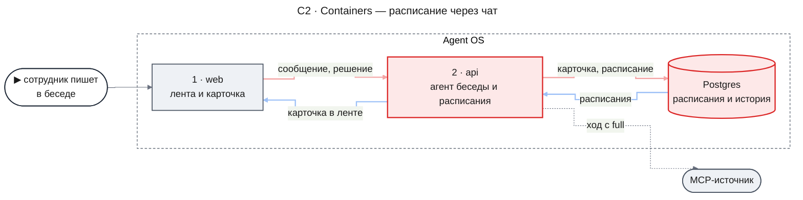
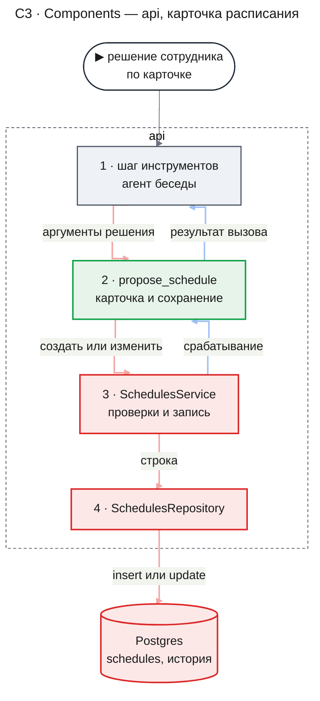
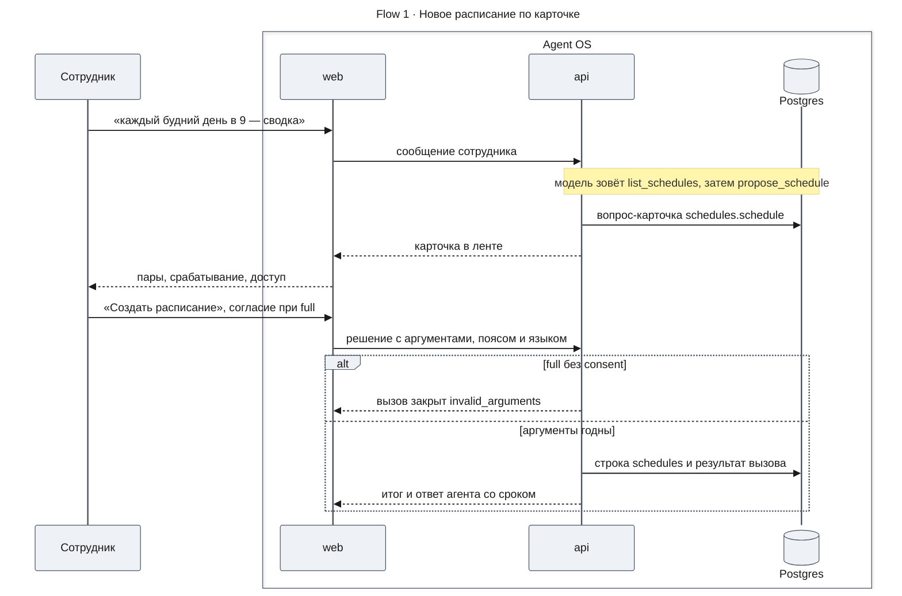
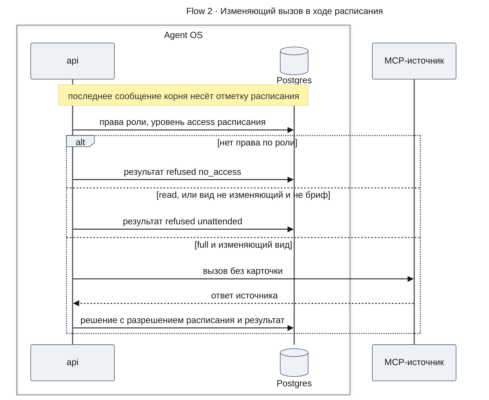

# Расписания через чат Design Document — server

**Status:** На утверждении · **Date:** 2026-11-28 · **PRD:** [prd.md](./prd.md) · **UXRD:** [uxrd.md](./uxrd.md) · **Depends on:** nothing

## Snapshot

**Overview.** Агент беседы получает два встроенных инструмента. `list_schedules` читает расписания сотрудника и текущую дату, чтобы модель нашла расписание по словам и поняла «завтра». `propose_schedule` предлагает новое расписание или изменение существующего: вызов идёт готовым путём подтверждения, как бриф глубокого агента, и в ленте встаёт правимая карточка вида `schedules.schedule`. Сохраняет расписание только подтверждённая карточка, в транзакции шага. Список разрешённых инструментов расписания заменяет поле `access` — `read` или `full`: правило вызова `callRule` по нему отправляет изменяющий вызов хода расписания без карточки или отказывает `unattended`. Окно расписания уходит вместе со своими маршрутами создания, изменения и списка инструментов.

- **Не меняется**: срабатывание и доставка сообщения расписания, история срабатываний, пауза, возобновление, «Запустить сейчас», удаление, «Разрешить в этой беседе» (`granted_tools`), проверка прав роли перед правилом вызова.
- **Главный риск**: ход с `full` делает записи без человека по тексту, который прочитал в источнике; держат согласие в карточке, права роли и записи вызова с отметкой расписания ([Risks](#risks-and-mitigation)).
- **Open questions**: [два](#open-questions).

### Key Decisions

#### KD-1: Расписание создаёт и меняет один инструмент главного чата с правимой карточкой на готовом пути подтверждения

`propose_schedule` встроен в `apps/api` и регистрируется так же, как инструменты записей библиотеки ([record-tools.ts](../../../apps/api/src/library/record-tools.ts)): `rootOnly`, `review` строит содержимое карточки до вопроса, `execute` пишет в транзакции шага. Правку переносит готовый механизм `editableArgs: true` брифа `start_deep_agent`: правленые аргументы возвращаются с решением и проходят схему инструмента. Каждая часть — самый простой вариант, который ещё выполняет PRD:

- Один инструмент вместо пары «создать» и «изменить»: поля одни и те же, а изменение отличается только `scheduleId`. Вторая схема повторила бы первую.
- `review`, а не `content`: карточке нужны прочитанные факты — сохранённые значения для «было», агент с id; проверка до карточки даёт AC-01.5 и AC-02.3 без карточки.
- `review` выбирает id нового расписания, как `create_record` выбирает id записи: итог карточки ведёт на страницу расписания (AC-06.5), а строка получает этот id при сохранении.
- `execute` берёт действие и id из содержимого карточки, а поля — из аргументов решения: правка не может перенаправить подтверждение на другое расписание.
- Свой вид карточки вместо `agents.tool_confirmation`: общая карточка показывает аргументы как есть, а UXRD требует пары, «было», поля правила и согласие, и `web` различает карточки по `kind`.
- Маршрут формы не нужен: путь решения уже несёт правку (`POST /api/decisions/:decisionId` с `args`).

#### KD-2: Согласие приходит только в правленых аргументах решения, а записью согласия служит сама запись решения

Аргумент `consent` есть в схеме инструмента, но модель его не ставит: вызов модели с `consent: true` отклоняется до карточки. Значит, `consent: true` попадает к `execute` только через `args` решения, которые прислал сотрудник. `execute` не сохраняет `access: full` без `consent: true` — так закрыт обход интерфейса (AC-04.1), и то же правило требует согласия на каждой карточке, которая оставляет полный доступ (AC-04.3). Сотрудник, время и уровень уже записаны: решение хранит `args` в записи `tool_decision` истории и в `resolution` с `resolvedAt` подтверждения ([ConfirmationSchema](../../../packages/contracts/src/chat.ts)), а вопрос принадлежит владельцу беседы (AC-04.2). Колонка согласия у расписания не нужна: её никто бы не читал, а `access: full` без согласия сохранить нельзя.

#### KD-3: Уровень доступа заменяет список инструментов, а правило вызова пропускает при `full` только изменяющие виды карточек

Колонка `access` (`read` | `full`) заменяет `allowed_tools`. `callRule` получает уровень расписания вместо его пар. В ходе расписания бриф идёт без карточки на любом уровне, как сейчас. Карточки `agents.tool_confirmation` (изменяющий MCP-инструмент, `run_code` и скрипт с записью) и `library.record` идут без карточки при `full` и получают отказ `unattended` при `read`. Любой другой вид — `schedules.schedule` и будущие карточки других фич — получает отказ `unattended` на любом уровне (AC-04.4). Перечень изменяющих видов совпадает с определением изменяющего вызова в PRD. «Отправлять при `full` любую карточку» не подходит: без человека ушли бы изменение расписания и личной инструкции ([agent-guidance design-server.md](../agent-guidance/design-server.md), KD-8). Права роли проверяются раньше правила, поэтому `full` не выходит за них (AC-03.3).

#### KD-4: Пояс и язык нового расписания даёт браузер в решении, как их давало окно, а правило модель пишет по местным часам

Окно расписания клало в тело пояс браузера (`Intl`) и язык интерфейса, а расписание хранит их в `time_zone` и `language`. Теперь веб кладёт их в `args` решения рядом с согласием. Правило не требует пояса до подтверждения: «по будням в 09:00» и «один раз 2026-11-29 09:00» — местные часы. Ближайшее срабатывание карточки веб считает маршрутом `POST /api/schedules/next-run` в поясе браузера, а у изменения — в поясе расписания. Дату для «завтра» модель берёт из `list_schedules`: в блоках промпта даты нет. Язык нужен только для дня в заголовке новой беседы срабатывания. Отправка сообщений не меняется.

#### KD-5: Беседа расписания переходит в беседу карточки, когда карточка выбирает «эту беседу»

`conversation_id` расписания — беседа расписания из Terms PRD: беседа, куда пишет срабатывание `this_conversation`. Карточка с `target: this_conversation` ставит беседу карточки, карточка с `new_conversation` ставит `null`, а изменение без `target` оставляет и место ответа, и беседу (AC-05.2, AC-05.4). Правило «беседа расписания не меняется» удаляется: AC-05.2 требует обратного.

#### KD-6: Маршруты окна удаляются, предпросмотр срабатывания остаётся

`POST /api/schedules`, `PUT /api/schedules/:id` и `GET /api/schedules/tools` теряют единственного потребителя — окно расписания, которое удаляет часть `web` (FR-10), — и удаляются вместе с проверкой списка инструментов. `POST /api/schedules/next-run` остаётся: карточка и её правка показывают срабатывание в поясе браузера (KD-4, UXRD CS-02), а правило сроков живёт только на сервере.

## Terms

- **Карточка расписания** — вопрос сотруднику вида `schedules.schedule` на вызов `propose_schedule`; его содержимое — `ScheduleCard`.
- **Ход расписания** — шаги агентов беседы, пока последнее сообщение корня несёт отметку расписания ([improvements design-server.md](../improvements/design-server.md), KD-1).
- **Сообщение, на которое отвечает вызов** — последняя запись `user_message` или `task` до ответа модели с этим вызовом; из неё `start_deep_agent` уже берёт чип.
- **Изменяющий вид карточки** — `agents.tool_confirmation` или `library.record`.

## Part

- **Prerequisite ADRs**: [ADR-0022](../../adr/ADR-0022-one-database-and-nestjs-modules.md) — одна база и модули NestJS.

**Out of scope**

- Срабатывание, захват срока, доставка в беседу, пауза из-за удалённой беседы и «Запустить сейчас» в `ScheduleTriggersService` — без изменений.
- `granted_tools` и третий ответ «Разрешить в этой беседе» работают как сейчас; ход расписания ими не пользуется.
- Пауза, возобновление и удаление словами (PRD, Won't Have).
- Экран: карточка, согласие, список `/`, страница и удаление окна — часть `web`.

**Constraints**

- Расписания, созданные до фичи, работают на уровне `read`: у колонки `access` значение по умолчанию `read`, а база разработки пересоздаётся, поэтому кода переноса нет.
- Миграции сжаты: `0000_schema.sql` генерируется заново, `0001_builtin_rows.sql` восстанавливается как есть.

## Building-block Inventory

Follows the [code system](../../code-system/README.md).

| Building block | Pattern | Status | Note |
|---|---|---|---|
| `list_schedules`, `propose_schedule` | [tool-declaration.md](../../code-system/patterns/tool-declaration.md) | extended | Встроенные `rootOnly`-инструменты, их регистрирует `SchedulesModule` в `onModuleInit` по образцу `RecordToolsRegistration` |
| `callRule` | [pure-decision.md](../../code-system/patterns/pure-decision.md) | extended | Факт `scheduleAccess` вместо `schedulePairs`, правило по виду карточки (KD-3) |
| `SchedulesService` | [repository-over-transaction.md](../../code-system/patterns/repository-over-transaction.md) | extended | Создание и изменение по карточке: проверки до транзакции, запись в транзакции шага |
| `SchedulesRepository` | [repository-over-transaction.md](../../code-system/patterns/repository-over-transaction.md) | extended | `access` вместо `allowedTools`, вставка с заданным id |

## Acceptance Criteria

### FR-01: Создать расписание словами

- From the PRD: AC-01.1 – AC-01.5.
- Карточка нового расписания несёт `access: read`, если модель не передала уровень (AC-01.1).
- Результат сохранённого вызова называет ближайшее срабатывание в поясе расписания (AC-01.2).

### FR-02: Найти и изменить своё расписание словами

- From the PRD: AC-02.1 – AC-02.4.
- `list_schedules` возвращает только расписания вызывающего сотрудника; чужой или неверный `scheduleId` в `propose_schedule` отклоняется `schedule_not_found` тем же текстом, что и несуществующий (AC-02.3).
- Расписание, удалённое, пока карточка ждала, не создаётся заново: подтверждение закрывает вызов `schedule_not_found` (AC-02.4).

### FR-03: Уровень доступа расписания

- From the PRD: AC-03.1 – AC-03.5, по таблице [правила вызова](#how-the-call-rule-works).

### FR-04: Согласие на полный доступ

- From the PRD: AC-04.1 – AC-04.4.
- Вызов модели с `consent: true` отклоняется `invalid_arguments` до карточки.

### FR-05: Место результата из карточки

- From the PRD: AC-05.1 – AC-05.4, по KD-5.

| AC | Чем выполнено | Тест |
|---|---|---|
| AC-01.1, AC-01.4 | `review` строит карточку по аргументам модели; `once` на завтра — по дате из `list_schedules`, пояс браузера — при подтверждении (KD-4) | вне CI: качество модели — критерий успеха PRD |
| AC-01.2, AC-06.2 | `execute` пишет строку из аргументов решения, результат называет срабатывание | e2e инструмента |
| AC-01.3 | готовый исход `rejected` | — |
| AC-01.5 | `review` отклоняет агента вне «+» `agent_not_visible` | e2e инструмента |
| AC-02.1 | `list_schedules` и карточка `change` с `previous` | — |
| AC-02.2 | изменение не трогает строки срабатываний | — |
| AC-02.3 | выборка по владельцу в обоих инструментах | e2e инструмента |
| AC-02.4 | `execute` не находит строку и отказывает | e2e инструмента |
| AC-03.1 – AC-03.5, AC-04.4 | `callRule` по уровню и виду карточки | таблица `callRule`; e2e хода |
| AC-04.1, AC-04.3 | `execute` требует `consent: true` для `full` (KD-2) | e2e инструмента |
| AC-04.2 | `tool_decision.args`, `resolution`, `resolvedAt` | — |
| AC-05.1 – AC-05.4 | KD-5 | e2e инструмента |

## Design

### Architecture (C1–C4)

#### C2 · Containers

`web` в этой части не меняется: вид карточки, пояс и язык в решении и `access` в списке расписаний он берёт в своей части. В Postgres меняется таблица `schedules`.

#### C3 · Components: api

**api — карточка расписания**

- **Шаг инструментов** не меняется: права роли, схема аргументов, правило повтора, `review` и вопрос-карточка идут готовым путём. Перед карточкой он спрашивает `callRule`; меняются только факты правила (`ruleOn` читает `access` расписания) и само правило ([How the call rule works](#how-the-call-rule-works)).
- **`propose_schedule`** в `review` читает чип сообщения, на которое отвечает вызов, сохранённое расписание при `scheduleId` и название беседы карточки, проверяет аргументы через `SchedulesService` и отдаёт `ScheduleCard`. В `prepare` до транзакции он повторяет чтение фактов по аргументам решения, а в `execute` пишет строку в транзакции шага.
- **`SchedulesService`** держит все проверки — правило, агент по чипу и «+», беседа, согласие — и пишет строку; HTTP-тело `ScheduleBody` ему больше не нужно.
- **`list_schedules`** — инструмент чтения без карточки: `SchedulesService.list` по владельцу и текущая дата.

#### How the call rule works

`callRule` отвечает на вызов, которому нужна карточка и у которого нет решения сотрудника. До него шаг уже отказал в вызове без права по роли (`no_access`), с неверными аргументами, при третьем одинаковом вызове и по проверке `review` самого инструмента. Поэтому `propose_schedule` с негодными аргументами в ходе расписания получает причину `review`, а годный вызов — `unattended` с текстом AC-04.4; в обоих случаях ничего не сохраняется.

| Ход | Вид карточки | Уровень расписания | Решение |
|---|---|---|---|
| обычный — последнее сообщение написал сотрудник | MCP-пара есть в `granted_tools` беседы | — | отправить по разрешению беседы |
| обычный | любой другой | — | карточка |
| расписания | `agents.brief` | любой | отправить по разрешению расписания |
| расписания | `agents.tool_confirmation`, `library.record` | `full` | отправить по разрешению расписания |
| расписания | `agents.tool_confirmation`, `library.record` | `read`, или расписания нет | отказ `unattended`: ход только читает |
| расписания | любой другой, в том числе `schedules.schedule` | любой | отказ `unattended`: это решает только сотрудник в беседе |

Удалённое или чужое расписание читается как отсутствующее и даёт уровень `read`. Отказ закрывает вызов без обращения к источнику. Модель получает текст: при `read` — что ход расписания только читает и что запись нужно описать в ответе; для остальных видов — что менять это может только сотрудник в беседе. Карточку `agents.question` часть `agent-guidance` добавляет к строке брифа ([design-server.md](../agent-guidance/design-server.md), KD-2).

### Runtime Flows

#### Flow 1: Новое расписание по карточке

**Starts when:** сотрудник пишет задачу в беседе, for AC-01.1, AC-01.2, AC-01.4, AC-04.1, AC-04.2, AC-05.1

`review` и запись строки читают и пишут по владельцу вызова, поэтому вызов не видит чужих расписаний. Строка, результат вызова и запись решения коммитятся вместе с шагом: повтор шага после рестарта не создаёт второго расписания. Изменение идёт тем же путём с `scheduleId`; если строку удалили, пока карточка ждала, `execute` закрывает вызов `schedule_not_found` и ничего не пишет (AC-02.4).

#### Flow 2: Изменяющий вызов в ходе расписания

**Starts when:** срок расписания или «Запустить сейчас» доставил сообщение с отметкой расписания, и модель вызвала изменяющий инструмент, for AC-03.1 – AC-03.3, AC-04.4

Исход вызова в ходе расписания — его записи в истории беседы: `tool_decision` с разрешением расписания и его id и одна `tool_result`; отказ — `tool_result` с причиной. Таблица `audit_events` этот путь не пишет, как и сейчас ([improvements design-server.md](../improvements/design-server.md), «Аудит вызова»). Как только сотрудник сам написал в беседу, отметки на последнем сообщении нет, и вызов получает карточку (AC-03.5).

### Contract Definitions

**Инструменты модели**

- **`list_schedules`** — без аргументов. Возвращает текст: текущие дату, день недели и время UTC с подсказкой, что правило пишется по местным часам сотрудника, и по каждому расписанию сотрудника его id, название, состояние, правило с поясом, ближайшее срабатывание, агента, место ответа, уровень доступа и инструкцию. Читает только расписания вызывающего сотрудника. Карточки нет.
- **`propose_schedule`** — аргументы `ScheduleToolArgs`. Ставит в ленту карточку вида `schedules.schedule` с содержимым `ScheduleCard` и ждёт решения. После подтверждения возвращает `success` с текстом «сохранено: id, название, ближайшее срабатывание в поясе расписания»; после отклонения — готовый исход `rejected`. Отказы — в «Отказы инструмента».

Оба инструмента `rootOnly`: их получает только агент беседы; глубокие агенты, сабагенты, тренер и прогоны обучения — нет. `loggedArgs` у `propose_schedule` — `scheduleId`, вид правила, `target`, `access` и `consent`: инструкция в лог не идёт.

**`ScheduleToolArgs`** — аргументы `propose_schedule`; в `POST /api/decisions/:decisionId` веб передаёт их целиком в `args`, когда сотрудник что-то поправил или отметил согласие.

- `scheduleId` — id расписания при изменении; без него вызов предлагает новое. При подтверждении решает id из карточки, а не из `args`.
- `name` — до `SCHEDULE_NAME_MAX_LENGTH` (100) знаков; у нового расписания пустое или отсутствующее — начало инструкции.
- `instruction` — текст по правилам `ChatTextSchema`; обязателен для нового расписания.
- `agent` — имя записи, как его называет список агентов чата, или `null` — агент чата; у нового расписания отсутствие значит агента чата. Имя чипа сообщения выбирает запись чипа.
- `rule` — `ScheduleRule`; обязателен для нового расписания.
- `target` — `new_conversation` или `this_conversation`; обязателен для нового расписания.
- `access` — `read` или `full`; у нового расписания отсутствие значит `read`.
- `consent` — необязательно; `true` значит, что сотрудник отметил согласие. От модели не принимается.
- `timeZone` — имя пояса IANA из браузера; обязателен в решении о новом расписании. От модели не принимается.
- `language` — `LanguageSchema`, язык интерфейса; обязателен в решении о новом расписании. От модели не принимается.

Поэтому решение «создать» всегда несёт `args`. При изменении отсутствующее поле оставляет сохранённое значение: «перенеси на 10:00» передаёт только `scheduleId` и `rule`. Уровень `full`, который изменение оставляет, снова требует `consent: true` (AC-04.3). Нет обязательного поля нового расписания — отказ `invalid_arguments` до карточки.

**`ScheduleCard`** — содержимое карточки `schedules.schedule`, `content` вопроса в `ConfirmationSchema`.

- `action` — `create` или `change`.
- `scheduleId` — id расписания; при `create` его выбрал `review`, и с этим id расписание сохраняется — на него ведёт «Открыть расписание».
- `next` — что будет сохранено: поля `name`, `instruction`, `agent`, `rule`, `timeZone`, `target`, `conversation`, `access` в том же смысле, что у `ScheduleView`; `timeZone` — `null` у нового расписания. `conversation` — беседа, куда пишет `this_conversation`: беседа карточки или нынешняя беседа расписания.
- `previous` — те же поля сохранённого расписания на момент карточки; `null` при `create`. Веб сравнивает `next` с `previous` для «изменено» и «было».
Ближайшее срабатывание карточка не несёт: веб берёт его у `POST /api/schedules/next-run` в поясе браузера, у изменения — в поясе расписания (KD-4). Согласия карточка тоже не несёт: оно всегда начинается пустым (UXRD KD-2).

**Отказы инструмента** — `refusalReason` результата вызова. До карточки модель читает текст причины, а карточки нет; после подтверждения карточка заканчивается итогом «Не сохранено» (UXRD KD-6).

- `invalid_arguments` — до карточки: правило негодно, нет `target` у нового расписания, `consent`, `timeZone` или `language` от модели, беседа карточки удалена. После подтверждения: `full` без `consent: true`, решение о новом расписании без `timeZone` или `language`, неизвестный пояс, негодное правило в правке.
- `schedule_time_passed` — новое значение: время правила `once` уже прошло. До карточки — только у изменения, где пояс известен; после подтверждения — у обоих.
- `schedule_not_found` — новое значение: расписания с таким id нет среди расписаний сотрудника — неверный, чужой или удалённый id. До карточки и после подтверждения.
- `agent_not_visible` — агента нет среди тех, кого сотрудник может выбрать в «+». До карточки и после подтверждения.
- `unattended` — вызов в ходе расписания, по `callRule`; карточки нет.

Правку, которая не проходит схему `ScheduleToolArgs`, отклоняет `POST /api/decisions/:decisionId` ответом 400 `INVALID_ARGUMENTS`, как правку брифа; вопрос остаётся открытым.

**Изменённые договоры**

- **`ConfirmationKind`** — новое значение `schedules.schedule`.
- **`ScheduleView`** (`GET /api/schedules`, `GET /api/schedules/:id`, ответы паузы и возобновления) — поле `access` (`read` | `full`) вместо `allowedTools`; `conversation` — беседа расписания по KD-5, у расписания `new_conversation` — `null`, и «Изменить» открывает новый чат (AC-09.2).
- **`SchedulesErrorCode`** — без `RECORD_NOT_FOUND` и `THREAD_NOT_FOUND`: они уходят вместе с маршрутами создания и изменения.
- Без изменений: `GET /api/schedules/:id/runs`, `POST /api/schedules/:id/pause`, `/resume`, `/run`, `DELETE /api/schedules/:id`, `POST /api/schedules/next-run`.

### Data Model

- **`schedules`** — колонка `access` (`text not null default 'read'`, CHECK по `ScheduleAccessSchema`) вместо `allowed_tools`. `conversation_id` — беседа расписания (KD-5): карточка с `this_conversation` ставит беседу карточки, с `new_conversation` — `null`, изменение без `target` её не трогает. Проверка «`this_conversation` требует беседы» остаётся.
- CHECK колонки причины отказа в `code_calls` строится из `ToolRefusalReasonSchema` и получает два новых значения при генерации схемы.

## Change Impact

Потребители найдены поиском по тексту с чтением каждого места (LSP не вызывался); `coverage.notSearched` — SQL миграций и файлы переводов веба.

| Файл | Изменение |
|---|---|
| `packages/contracts/src/schedules.ts` | `ScheduleAccessSchema`, `ScheduleToolArgs`, `ScheduleCard`, имена инструментов и вид `schedules.schedule`; `access` в `ScheduleView` |
| `packages/contracts/src/chat.ts` | вид в `ConfirmationKindSchema` |
| `packages/contracts/src/agents.ts` | `schedule_not_found`, `schedule_time_passed` в `ToolRefusalReasonSchema` |
| `packages/db/src/schema/schedules.ts`, `src/repositories/schedules.repository.ts`, миграции `0000`/`0001` | `access`, вставка с заданным id |
| `packages/agents/src/agent/call-rule.ts`, `tool-step.ts` | `scheduleAccess` и правило по виду (KD-3) |
| `apps/api/src/schedules/` — новый модуль инструментов, `schedules.service.ts`, `schedules.module.ts`, `schedules.controller.ts`, `schedules.errors.ts` | инструменты и их регистрация, чип сообщения через `History.answeredChip`; создание и изменение по карточке, переход беседы; удаление маршрутов |
| `packages/agents/src/agent/call-rule.spec.ts`, `apps/api/test/schedules-search-memory-schedules.int.e2e-spec.ts` | строки таблицы и сценарии по Test Plan |
| Потребители в части `web` | `schedule-dialog.tsx`, `allowed-tools.tsx`, `composer-actions.tsx`, `schedule-rule-field.tsx` (остаётся в правке карточки), `schedule-screen.tsx`, `schedules-api.ts`, `test/msw-server.ts`, `schedules-search-memory-schedules.int.test.tsx` |

**Что удаляется в этой части**

- `ScheduleBodySchema`, `ScheduleBody`, `ScheduleToolSchema`, `ScheduleTool`, `ScheduleToolsResponseSchema`, `ScheduleToolsResponse`, `ScheduleView.allowedTools`.
- Колонка `allowed_tools` и её место в записи строки репозитория.
- Маршруты `POST /api/schedules`, `PUT /api/schedules/:id`, `GET /api/schedules/tools` и методы контроллера.
- В `SchedulesService`: `tools`, `changingMcpTools`, `checkAllowedTools`, `distinctPairs`, `pairKey`, `ALL_SERVERS`, внедрение `ToolRegistry`, если других вызовов не останется, и правило «беседа расписания не меняется».
- `schedulePairs` в `CallRuleFacts` и чтение пар расписания в `ruleOn`.
- Тесты удалённого: сценарии `allowedTools` (повтор пары, замена, чужой инструмент), `GET /api/schedules/tools`, создания и изменения через HTTP; строки `schedulePairs` таблицы `callRule`.

## Security Considerations

- **Authentication & Authorization**: оба инструмента работают от `caller.ownerId` и читают расписания по владельцу; чужой id отвечает как несуществующий (AC-02.3). `full` не расширяет прав: права роли проверяются до `callRule`, и вызов без права закрыт `no_access` без обращения к источнику (AC-03.3). Ход расписания не создаёт и не меняет расписаний на любом уровне (KD-3), а `rootOnly` не даёт инструмента глубоким агентам и сабагентам.
- **Согласие**: `consent: true` приходит только в решении сотрудника (KD-2); вызов модели с ним отклоняется, `full` без него не сохраняется.
- **Аудит без человека**: каждый вызов хода расписания по разрешению оставляет `tool_decision` с id расписания, каждый отказ — `tool_result` с причиной; лог пишет `scheduleId`, `callId`, `agentId`, `rootId`, сервер и инструмент.
- **Input Validation**: аргументы модели и правка проходят схему `ScheduleToolArgs`; правило, агент и беседа проверяет `SchedulesService` до карточки и снова при сохранении, пояс — при сохранении.
- **Sensitive Data Handling**: инструкция расписания не идёт в лог (`loggedArgs`); текст отказа называет поле и правило, но не данные чужих расписаний.

## Risks and Mitigation

- **Модель ставит неверное время или дату** — вероятно на модели класса Haiku. Карточка показывает ближайшее срабатывание в поясе браузера, `list_schedules` даёт текущую дату, а прошедшее время отклоняется `schedule_time_passed`. Дата UTC около полуночи может отличаться от местной на день; сотрудник видит это в срабатывании карточки до подтверждения.
- **Ход с `full` делает лишнюю запись по тексту из источника** — низкая вероятность, высокое влияние. Согласие с текстом риска, права роли и записи вызова с id расписания; на `read` записи не выполняются.
- **Модель отвечает на изменение без `list_schedules` и угадывает id** — `schedule_not_found` возвращает модели причину, и она может прочитать список.

## Test Plan

Только критичное: права и изоляция, согласие, целостность, главный путь.

- **Таблица `callRule`** (чистая функция, одна таблица строк вместо прежних строк пар): каждая строка таблицы правила вызова. Ловит дефект, при котором `read` пропускает запись или `full` пропускает `schedules.schedule`. AC-03.1 – AC-03.5, AC-04.4.
- **E2e инструмента** (путь решения на тестовой базе): подтверждение с правленым временем сохраняет расписание с этим временем и id карточки (AC-01.2, AC-06.2); `full` без `consent` в решении не создаёт строку, вызов модели с `consent: true` отклонён до карточки (AC-04.1); сотрудник Б с id расписания А получает `schedule_not_found`, а `list_schedules` Б не содержит А, и строка А не изменилась (AC-02.3); удаление до подтверждения — строки нет (AC-02.4); изменение с `this_conversation` из беседы Y переносит беседу, изменение только времени — нет (AC-05.2, AC-05.4).
- **E2e хода расписания** (двойник MCP-источника, переписанные сценарии `allowedTools`): `read` — изменяющий вызов закрыт `unattended`, источник не вызван ни разу (AC-03.1); `full` — вызов отправлен, `tool_decision` несёт id расписания (AC-03.2); `full` без права по роли — `no_access`, источник не вызван (AC-03.3).

## Open Questions

- Пояс расписания задаётся только при создании: изменение оставляет пояс расписания, а поля пояса в UXRD нет. Брать ли при изменении пояс браузера, если он другой? Блокирует только поведение при переезде сотрудника; решает владелец.
- Страница расписания (UXRD SP-02) подписывает беседу как «Создано … в беседе …», а по KD-5 сервер хранит только беседу расписания: после переноса это другая беседа, у `new_conversation` её нет. Нужна ли странице беседа создания? Блокирует подпись на странице; решает владелец с частью `web`.

## Update History

| Version | Date | Change |
|---------|------|--------|
| 1.0 | 2026-11-28 | Initial version |
