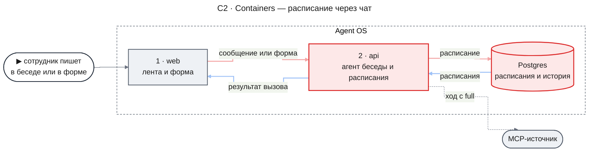
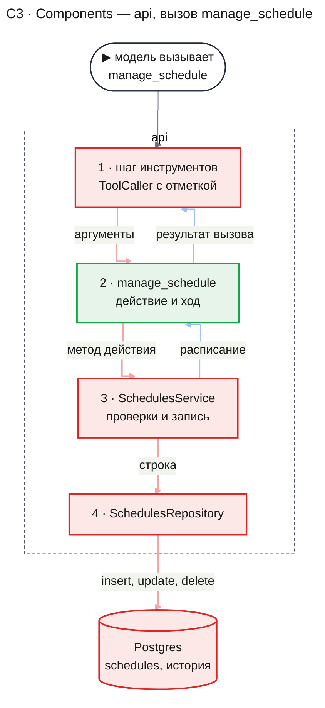
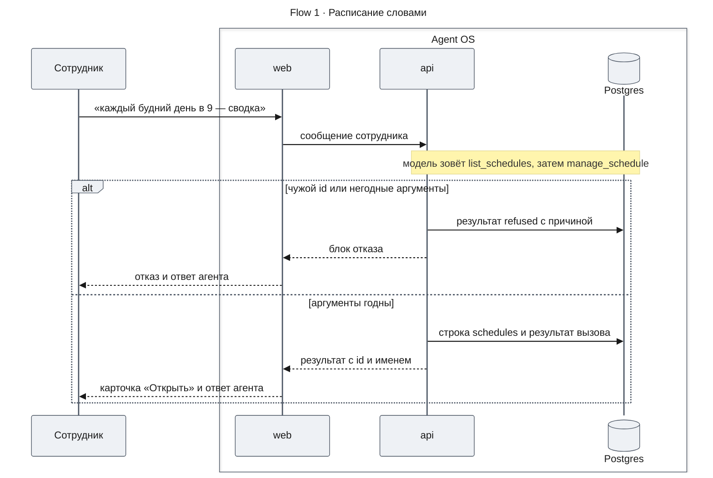
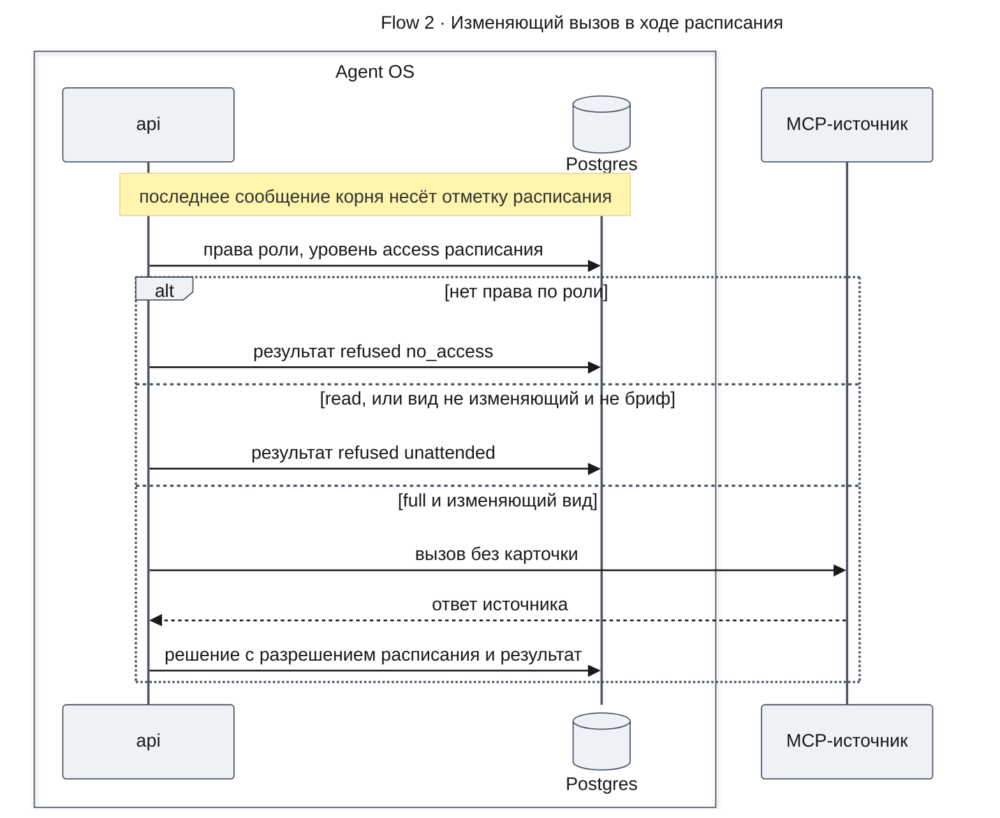

# Расписания через чат Design Document — server

**Status:** На утверждении · **Date:** 2026-11-28 · **PRD:** [prd.md](./prd.md) · **UXRD:** [uxrd.md](./uxrd.md) · **Depends on:** nothing

## Snapshot

**Overview.** Агент беседы получает два встроенных инструмента, как в задачах ChatGPT. `list_schedules` читает расписания сотрудника и текущее местное время, чтобы модель нашла расписание по словам, поняла «завтра» и не завела второе такое же. `manage_schedule` сразу создаёт, меняет, ставит на паузу, возобновляет или удаляет расписание теми же методами `SchedulesService`, что и маршруты формы на странице «Расписания»; карточки подтверждения нет. Результат вызова веб показывает в ленте компактной карточкой с кнопкой «Открыть», которая открывает форму этого расписания. Расписание из чата всегда работает на уровне `read`; `full` с согласием даёт только форма. Поле `access` — `read` или `full` — заменяет список разрешённых инструментов расписания: по нему правило вызова `callRule` отправляет изменяющий вызов хода расписания без карточки или отказывает `unattended`.

- **Не меняется**: срабатывание и доставка сообщения расписания, история срабатываний, кнопки страницы, «Разрешить в этой беседе» (`granted_tools`), проверка прав роли перед правилом вызова.
- **Главный риск**: ход с `full` делает записи без человека по тексту, который прочитал в источнике; держат согласие в форме, права роли и записи вызова с отметкой расписания ([Risks](#risks-and-mitigation)).
- **Open questions**: none.

### Key Decisions

#### KD-1: Чат управляет расписанием одним инструментом без карточки, через методы, которые зовут маршруты формы

`manage_schedule` встроен в `apps/api` и регистрируется так же, как инструменты записей библиотеки ([record-tools.ts](../../../apps/api/src/library/record-tools.ts)): `rootOnly`, `in_commit`. Аргумент `action` выбирает `create`, `change`, `pause`, `resume` или `delete`, и `execute` зовёт `create`, `update`, `pause`, `resume` или `delete` сервиса. Каждая часть — самый простой вариант, который ещё выполняет PRD:

- Один инструмент вместо пяти: у действий одни поля и одна проверка владельца, а пять описаний модель путала бы.
- Те же методы сервиса, что у формы: правило, агент, беседа, пояс и уровень проверяются в одном месте, и пути не расходятся.
- `in_commit` вместо записи вне транзакции: запись вне коммита шага повторилась бы при повторе шага после рестарта и завела бы второе расписание.
- Изменение передаёт только то, что меняется; инструмент дополняет его сохранёнными значениями до полного набора, который ждёт `update`.

#### KD-2: Из чата расписание получает только `read`, а изменение из чата снимает `full`

У `manage_schedule` нет аргумента уровня: новое расписание всегда `read`. Изменение расписания с `full` сохраняет его на уровне `read`, а текст результата говорит об этом модели. Иначе текст, который чат прочитал в письме или тикете, мог бы переписать инструкцию расписания, которое выполняет записи без человека, и никто бы этого не подтвердил. Пауза, возобновление и удаление уровень не трогают. `full` ставит только форма: `consent: true` в теле её запроса — собственное действие сотрудника, и тот же метод сервиса без него `full` не сохраняет.

#### KD-3: Уровень доступа заменяет список инструментов, а правило вызова пропускает при `full` только изменяющие виды карточек

Колонка `access` (`read` | `full`) заменяет `allowed_tools`. `callRule` получает уровень расписания вместо его пар. В ходе расписания бриф идёт без карточки на любом уровне, как сейчас. Карточки `agents.tool_confirmation` (изменяющий MCP-инструмент, `run_code` и скрипт с записью) и `library.record` идут без карточки при `full` и получают отказ `unattended` при `read`. Любой другой вид — например, будущая карточка личной инструкции — получает отказ `unattended` на любом уровне. Перечень изменяющих видов совпадает с определением изменяющего вызова в PRD. «Отправлять при `full` любую карточку» не подходит: без человека ушло бы изменение личной инструкции ([agent-guidance design-server.md](../agent-guidance/design-server.md), KD-8). Права роли проверяются раньше правила, поэтому `full` не выходит за них.

#### KD-4: Ход расписания узнаёт сам инструмент по отметке, которую шаг кладёт в `ToolCaller`

У `manage_schedule` нет карточки, поэтому `callRule` его не видит. Шаг инструментов уже читает отметку расписания последнего сообщения корня для `ruleOn`; теперь он кладёт её id в `ToolCaller.scheduleId`, а `ruleOn` и `manage_schedule` читают её оттуда. В ходе расписания инструмент отказывает `unattended` с текстом «менять расписания может только сотрудник — словами в беседе или в форме» и ничего не пишет. Чтение отметки в `apps/api` повторило бы правило «что такое ход расписания» во втором месте.

#### KD-5: Пояс и язык — последнего расписания сотрудника, иначе системные

Инструмент работает без запроса браузера, а у сотрудника пояса нет: его хранит только расписание (`time_zone`), а язык — профиль (`identity_users.language`, бывает `null`) и расписание (`language`). Поэтому новое расписание берёт пояс последнего изменённого расписания сотрудника, а без расписаний — пояс процесса сервера. Язык нового расписания берётся из профиля, затем из последнего расписания, затем `en` — тот же язык по умолчанию, что у веба. Изменение сохраняет пояс и язык самого расписания (AC-15.3). Необязательный аргумент `timeZone` ставит пояс, который сотрудник назвал словами: «пока сотрудник не попросил другой» в AC-15.3 иначе выполнить нельзя. Модель пишет правило по местным часам («по будням в 09:00», «один раз 2026-11-29 09:00»), а дату и время в этом поясе ей даёт `list_schedules`: в блоках промпта даты нет. Пояс расписания сотрудник видит и меняет в форме, поэтому после первого сохранения формой чат знает его пояс. Один только пояс сервера проще, но тогда каждое расписание из чата пришлось бы править в форме; новое поле пояса у сотрудника или в каждом сообщении потребовало бы менять путь отправки сообщений ради одного инструмента.

#### KD-6: Беседа расписания — беседа вызова, когда выбрано «в эту беседу»

`conversation_id` расписания — беседа, куда пишет срабатывание `this_conversation`. `target: this_conversation` из чата ставит беседу, где вызван инструмент, `new_conversation` ставит `null`, а изменение без `target` оставляет и место ответа, и беседу. Изменение без `target` расписания, чья беседа удалена, ставит `this_conversation` и беседу вызова (AC-05.5): карточки, где сотрудник выбрал бы место, больше нет. Правило «беседа расписания не меняется» удаляется: перенос в другую беседу его нарушает. Сохранённое изменение, как и сейчас, снимает причину паузы `conversation_deleted` и оставляет состояние `paused`.

## Terms

- **Ход расписания** — шаги агентов беседы, пока последнее сообщение корня несёт отметку расписания ([improvements design-server.md](../improvements/design-server.md), KD-1).
- **Изменяющий вид карточки** — `agents.tool_confirmation` или `library.record`.

## Part

- **Prerequisite ADRs**: [ADR-0022](../../adr/ADR-0022-one-database-and-nestjs-modules.md) — одна база и модули NestJS.

**Out of scope**

- Срабатывание, захват срока, доставка в беседу, пауза из-за удалённой беседы и «Запустить сейчас» в `ScheduleTriggersService` — без изменений.
- `granted_tools` и третий ответ «Разрешить в этой беседе» работают как сейчас; ход расписания ими не пользуется.
- Экран: карточка результата, список `/`, страница с формой и согласием, удаление входов формы из поля сообщения — часть `web`.

**Constraints**

- Расписания, созданные до фичи, работают на уровне `read`: у колонки `access` значение по умолчанию `read`, а база разработки пересоздаётся, поэтому кода переноса нет.
- Миграции сжаты: `0000_schema.sql` генерируется заново, `0001_builtin_rows.sql` восстанавливается как есть.

## Building-block Inventory

Follows the [code system](../../code-system/README.md).

| Building block | Pattern | Status | Note |
|---|---|---|---|
| `list_schedules`, `manage_schedule` | [tool-declaration.md](../../code-system/patterns/tool-declaration.md) | extended | Встроенные `rootOnly`-инструменты, их регистрирует `SchedulesModule` в `onModuleInit` по образцу `RecordToolsRegistration` |
| `callRule` | [pure-decision.md](../../code-system/patterns/pure-decision.md) | extended | Факт `scheduleAccess` вместо `schedulePairs`, правило по виду карточки (KD-3) |
| `SchedulesService` | [repository-over-transaction.md](../../code-system/patterns/repository-over-transaction.md) | extended | Одни `create`, `update`, `pause`, `resume`, `delete` для маршрутов формы и инструмента; `access` и согласие; пояс и язык по KD-5 |
| `SchedulesRepository` | [repository-over-transaction.md](../../code-system/patterns/repository-over-transaction.md) | extended | `access` вместо `allowedTools`; чтение последнего расписания сотрудника |

## Acceptance Criteria

Критерии PRD частей FR-01 – FR-05, FR-11, FR-14 и FR-15 держатся как написаны; дизайн уточняет их так:

- Сотрудник пишет «каждый будний день в 9 присылай сводку», и в его списке сразу есть расписание `read` по будням в 09:00 в поясе по KD-5; в ленте карточка результата с его именем (FR-01).
- Агент передал агента вне «+» или негодное правило — расписания нет, модель читает причину (FR-01).
- Сотрудник Б с id расписания сотрудника А получает отказ тем же текстом, что для несуществующего id, а расписание А не меняется; `list_schedules` Б не показывает расписаний А (FR-02, FR-11).
- Изменение из чата расписания с `full` сохраняет его с `read`, и ответ агента говорит об этом (FR-04, KD-2).
- Вызов `manage_schedule` в ходе расписания на любом уровне отклонён `unattended` и ничего не пишет (FR-04, FR-11).
- `full` без `consent: true` в теле формы — 400 `VALIDATION_FAILED`, ничего не записано (FR-14).
- Остальное о ходе расписания — по таблице [правила вызова](#how-the-call-rule-works) (FR-03).

## Design

### Architecture (C1–C4)

#### C2 · Containers

`web` в этой части не меняется: карточку результата, `access` и согласие формы он берёт в своей части. В Postgres меняется таблица `schedules`.

#### C3 · Components: api

**api — вызов `manage_schedule`**

- **Шаг инструментов** кладёт в `ToolCaller` id отметки расписания последнего сообщения корня (KD-4); права роли, схема аргументов и правило повтора — как сейчас. Для вызовов с карточкой он, как и сейчас, спрашивает `callRule` ([How the call rule works](#how-the-call-rule-works)).
- **`manage_schedule`** отказывает в ходе расписания, дополняет изменение сохранёнными значениями, у создания выбирает пояс и язык по KD-5 и зовёт метод сервиса в транзакции шага; ошибку сервиса возвращает модели причиной отказа.
- **`SchedulesService`** держит все проверки — правило, агент по правилу чипа «+» (`checkAgent`), беседа, уровень и согласие — для маршрутов формы и для инструмента.
- **`list_schedules`** — инструмент чтения: `SchedulesService.list` по владельцу и текущее время в поясе по KD-5.

#### How the call rule works

`callRule` отвечает на вызов, которому нужна карточка и у которого нет решения сотрудника. До него шаг уже отказал в вызове без права по роли (`no_access`), с неверными аргументами, при третьем одинаковом вызове и по проверке `review` самого инструмента.

| Ход | Вид карточки | Уровень расписания | Решение |
|---|---|---|---|
| обычный — последнее сообщение написал сотрудник | MCP-пара есть в `granted_tools` беседы | — | отправить по разрешению беседы |
| обычный | любой другой | — | карточка |
| расписания | `agents.brief` | любой | отправить по разрешению расписания |
| расписания | `agents.tool_confirmation`, `library.record` | `full` | отправить по разрешению расписания |
| расписания | `agents.tool_confirmation`, `library.record` | `read`, или расписания нет | отказ `unattended`: ход только читает |
| расписания | любой другой | любой | отказ `unattended`: это решает только сотрудник в беседе |

Удалённое или чужое расписание читается как отсутствующее и даёт уровень `read`. Отказ закрывает вызов без обращения к источнику. Модель получает текст: при `read` — что ход расписания только читает и что запись нужно описать в ответе; для остальных видов — что это может только сотрудник в беседе. Карточку `agents.question` часть `agent-guidance` добавляет к строке брифа ([design-server.md](../agent-guidance/design-server.md), KD-2).

### Runtime Flows

#### Flow 1: Расписание словами

**Starts when:** сотрудник пишет в беседе, что и когда делать, for FR-01, FR-02, FR-11

Строка расписания и результат вызова коммитятся вместе с шагом: повтор шага после рестарта не создаёт второго расписания. Выборка по владельцу не показывает и не меняет чужих расписаний. Расписание, удалённое на странице, при изменении из чата даёт отказ, как несуществующее.

#### Flow 2: Изменяющий вызов в ходе расписания

**Starts when:** срок расписания или «Запустить сейчас» доставил сообщение с отметкой расписания, и модель вызвала изменяющий инструмент, for FR-03

Исход вызова в ходе расписания — его записи в истории беседы: `tool_decision` с разрешением расписания и его id и одна `tool_result`; отказ — `tool_result` с причиной. Таблица `audit_events` этот путь не пишет, как и сейчас ([improvements design-server.md](../improvements/design-server.md), «Аудит вызова»). Как только сотрудник сам написал в беседу, отметки на последнем сообщении нет, и вызов получает карточку.

### Contract Definitions

**Инструменты модели**

- **`list_schedules`** — без аргументов. Возвращает текст: текущие дату, день недели и время в поясе по KD-5 и по каждому расписанию сотрудника его id, название, состояние, правило с поясом, ближайшее срабатывание, агента (id и имя), место ответа, уровень доступа и инструкцию. Только расписания вызывающего сотрудника.
- **`manage_schedule`** — аргументы `ScheduleToolArgs`. Выполняет действие сразу. Возвращает `success`; первая строка текста — `Schedule <id>: <name>`, дальше — что сделано: у создания, изменения и возобновления — ближайшее срабатывание в поясе расписания, у изменения расписания с `full` вторая строка — ровно `Access: full -> read`, у паузы — «на паузе», у удаления — «удалено». Отказы — в «Отказы инструмента».

Оба инструмента `rootOnly`: их получает только агент беседы; глубокие агенты, сабагенты, тренер и прогоны обучения — нет. `loggedArgs` у `manage_schedule` — `action`, `scheduleId`, вид правила и `target`: инструкция в лог не идёт. Аудит вызова — его `tool_result` в истории беседы с аргументами и исходом.

**`ScheduleToolArgs`** — аргументы `manage_schedule`.

- `action` — `create`, `change`, `pause`, `resume` или `delete`.
- `scheduleId` — id расписания; обязателен у всех действий, кроме `create`.
- `name` — до `SCHEDULE_NAME_MAX_LENGTH` (100) знаков; у нового расписания пустое или отсутствующее — начало инструкции.
- `instruction` — текст по правилам `ChatTextSchema`; обязателен у `create`.
- `agentId` — id записи библиотеки, как его хранит колонка `agent_id` и как его называет `list_records`, или `null` — агент чата; отсутствие у `create` — агент чата.
- `rule` — `ScheduleRule` по местным часам; обязателен у `create`.
- `target` — `new_conversation` или `this_conversation`; обязателен у `create`.
- `timeZone` — необязательно, имя пояса IANA, когда сотрудник назвал пояс словами; без него — по KD-5.

У `change` отсутствующее поле оставляет сохранённое значение. У `pause`, `resume`, `delete` другие поля, кроме `scheduleId`, — отказ `invalid_arguments`.

**Карточка результата в ленте.** Веб узнаёт вызов по имени `manage_schedule`, действие — по `args.action`, расписание — по первой строке результата, снятый полный доступ — по второй строке `Access: full -> read`, которую читает и модель, чтобы сказать об этом в ответе, как уже читает заголовок документа из первой строки результата инструментов блокнота. Строку правила и «Открыть» веб берёт из `GET /api/schedules/:id` и формы страницы. Отдельного поля результата для веба нет: `ScheduleView` в результате дублировал бы маршрут, который веб уже читает, и устаревал бы после правки в форме.

**Отказы инструмента** — `refusalReason` результата; модель читает текст.

- `unattended` — вызов в ходе расписания (KD-4).
- `agent_not_visible` — агента нет среди тех, кого сотрудник может выбрать в «+».
- `invalid_arguments` — всё остальное, с текстом проблемы: расписания с таким id нет среди расписаний сотрудника (тот же текст для неверного, чужого и удалённого id), правило негодно или время прошло, нет обязательного поля, лишнее поле у действия, неизвестный пояс, возобновить нельзя.

Новых причин отказа нет: карточки с итогом больше нет, и вебу различать причины не нужно.

**Маршруты расписаний**

- **`POST /api/schedules`**, **`PUT /api/schedules/:id`** (форма страницы) — тело `ScheduleBody`: `access` (`read` | `full`) и `consent` (`true`, когда сотрудник отметил согласие) вместо `allowedTools`; `full` без `consent: true` — 400 `VALIDATION_FAILED`, ничего не записано. `timeZone` — пояс, который сотрудник выбрал в поле формы (сначала пояс браузера); поле тела уже есть, и сервис, как сейчас, отвечает 400 `VALIDATION_FAILED` на неизвестное имя IANA. `language` даёт браузер. При `target: new_conversation` сервис сохраняет беседу `null`, что бы ни пришло в `conversationId`; при `this_conversation` `conversationId` обязателен и должен быть живой беседой сотрудника. Остальные ответы — как сейчас.
- **`ScheduleView`** (`GET /api/schedules`, `GET /api/schedules/:id`, ответы маршрутов) — поле `access` вместо `allowedTools`; `conversation` — беседа расписания по KD-6, у `new_conversation` — `null`.
- Без изменений: `GET /api/schedules/:id/runs`, `POST /api/schedules/:id/pause`, `/resume`, `/run`, `DELETE /api/schedules/:id`, `POST /api/schedules/next-run`, `SchedulesErrorCode`.

Сохранение формой с `full` пишет одну запись `audit_events` — сотрудник, время, id расписания и уровень: запрос формы не оставляет в истории беседы другого следа того, кто дал полный доступ.

### Data Model

- **`schedules`** — колонка `access` (`text not null default 'read'`, CHECK по `ScheduleAccessSchema`) вместо `allowed_tools`. `conversation_id` — беседа расписания (KD-6). Проверка «`this_conversation` требует беседы» остаётся.
- `SchedulesRepository` получает чтение последнего изменённого расписания сотрудника — для пояса и языка по KD-5.

## Change Impact

Потребители найдены поиском по тексту с чтением каждого места (LSP не вызывался); `coverage.notSearched` — SQL миграций и файлы переводов веба.

| Файл | Изменение |
|---|---|
| `packages/contracts/src/schedules.ts` | `ScheduleAccessSchema`, `ScheduleToolArgs`, имена инструментов; `access`, `consent` в `ScheduleBody`, `access` в `ScheduleView` |
| `packages/db/src/schema/schedules.ts`, `src/repositories/schedules.repository.ts`, миграции `0000`/`0001` | `access`; последнее расписание сотрудника |
| `packages/agents/src/tools/tool.ts`, `agent/call-rule.ts`, `agent/tool-step.ts` | `ToolCaller.scheduleId`; `scheduleAccess` и правило по виду (KD-3, KD-4) |
| `apps/api/src/schedules/` — новый модуль инструментов, `schedules.service.ts`, `schedules.module.ts`, `schedules.controller.ts` | инструменты и их регистрация; одни методы для формы и инструмента, `access` и согласие, пояс и язык по KD-5, перенос беседы, запись аудита формы; удаление `GET /api/schedules/tools` |
| `packages/agents/src/agent/call-rule.spec.ts`, `apps/api/test/schedules-search-memory-schedules.int.e2e-spec.ts` | строки таблицы и сценарии по Test Plan |
| Потребители в части `web` | `schedule-dialog.tsx` (остаётся формой страницы, `access` и согласие вместо списка), `allowed-tools.tsx`, `composer-actions.tsx`, `schedule-screen.tsx`, `schedules-api.ts`, `tool-fallback.aui.tsx`, `test/msw-server.ts`, `schedules-search-memory-schedules.int.test.tsx` |

**Что удаляется в этой части**

- `ScheduleToolSchema`, `ScheduleTool`, `ScheduleToolsResponseSchema`, `ScheduleToolsResponse`, `ScheduleBody.allowedTools`, `ScheduleView.allowedTools`.
- Колонка `allowed_tools` и её место в записи строки репозитория.
- Маршрут `GET /api/schedules/tools` и метод контроллера; счётчик `allowedTools` в логе маршрутов создания и изменения.
- В `SchedulesService`: `tools`, `changingMcpTools`, `checkAllowedTools`, `distinctPairs`, `pairKey`, `ALL_SERVERS`, внедрение `ToolRegistry`, если других вызовов не останется, и правило «беседа расписания не меняется».
- `schedulePairs` в `CallRuleFacts` и чтение пар расписания в `ruleOn`.
- Тесты удалённого: сценарии `allowedTools` (повтор пары, замена, чужой инструмент), `GET /api/schedules/tools`; строки `schedulePairs` таблицы `callRule`. Сценарии создания и изменения через HTTP остаются с `access` вместо списка.

## Security Considerations

- **Authentication & Authorization**: оба инструмента работают от `caller.ownerId` и читают расписания по владельцу; чужой id отвечает как несуществующий. `full` не расширяет прав: права роли проверяются до `callRule`, и вызов без права закрыт `no_access` без обращения к источнику. Ход расписания не создаёт и не меняет расписаний (KD-4), а `rootOnly` не даёт инструмента глубоким агентам и сабагентам.
- **Полный доступ**: ставит его только форма с `consent: true` в запросе сотрудника; чат его не ставит и снимает при изменении (KD-2), так что текст из источника не перепишет расписание, которое пишет без человека.
- **Аудит**: каждый вызов инструментов — `tool_result` в истории беседы; каждый вызов хода расписания по разрешению — `tool_decision` с id расписания; сохранение формы с `full` — запись `audit_events`.
- **Input Validation**: аргументы модели проходят схему `ScheduleToolArgs`, тело формы — `ScheduleBody`; правило, пояс, агент, беседа и уровень проверяет один `SchedulesService`.
- **Sensitive Data Handling**: инструкция расписания не идёт в лог (`loggedArgs`); текст отказа называет поле и правило, но не данные чужих расписаний.

## Risks and Mitigation

- **Модель ставит неверное время, дату или не то расписание, и подтверждения нет** — вероятно на модели класса Haiku. Карточка результата и ответ агента называют расписание и ближайшее срабатывание, «Открыть» ведёт в форму для правки, а `list_schedules` даёт местную дату и список, по которому видно дубль.
- **Пояс по KD-5 не совпадает с местным у сотрудника без расписаний** — срабатывание по поясу сервера. Ответ агента называет срабатывание с поясом, и сотрудник меняет пояс в поле формы; дальше чат берёт этот пояс.
- **Ход с `full` делает лишнюю запись по тексту из источника** — низкая вероятность, высокое влияние. Согласие в форме, права роли, снятие `full` при изменении из чата и записи вызова с id расписания.

## Test Plan

Только критичное: права и изоляция, уровень, целостность, главный путь.

- **Таблица `callRule`** (чистая функция, одна таблица строк вместо прежних строк пар): каждая строка таблицы правила вызова. Ловит дефект, при котором `read` пропускает запись или `full` пропускает неизменяющий вид (FR-03).
- **E2e инструмента** (двойник модели на тестовой базе): создание словами сохраняет расписание `read` в поясе последнего расписания сотрудника; изменение расписания с `full` сохраняет `read`; сотрудник Б с id расписания А получает отказ на изменение и на удаление, `list_schedules` Б не содержит А, а строка А не изменилась; вызов в ходе расписания отклонён `unattended`, строки нет.
- **E2e формы**: `full` без `consent` в `POST /api/schedules` — 400, строки нет; с `consent` — строка `full` и запись `audit_events`.
- **E2e хода расписания** (двойник MCP-источника, переписанные сценарии `allowedTools`): `read` — изменяющий вызов закрыт `unattended`, источник не вызван ни разу; `full` — вызов отправлен, `tool_decision` несёт id расписания; `full` без права по роли — `no_access`, источник не вызван.

## Update History

| Version | Date | Change |
|---------|------|--------|
| 1.0 | 2026-11-28 | Initial version |
| 1.1 | 2026-11-28 | Пауза, возобновление и удаление словами; агент по id; форма страницы остаётся и делит с чатом методы сервиса |
| 1.2 | 2026-11-28 | Как в ChatGPT: инструмент действует сразу, без карточки подтверждения; из чата только `read`; пояс и язык — последнего расписания или системные; пояс — поле формы |
