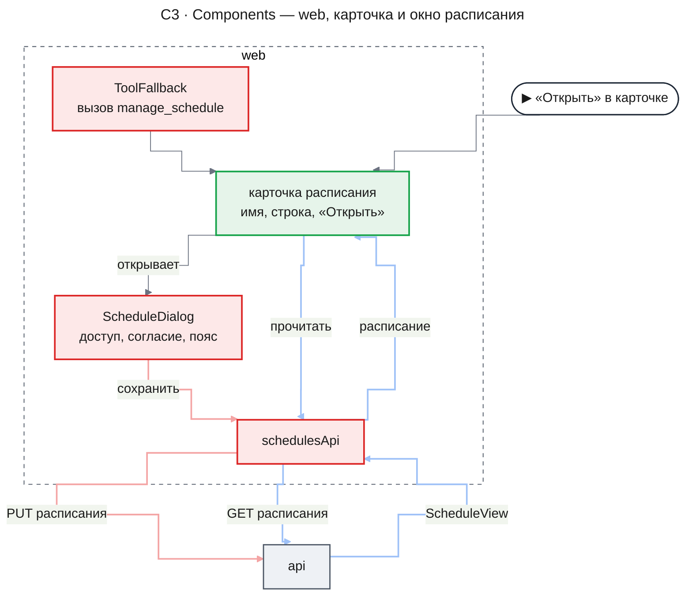
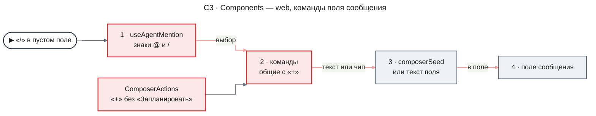
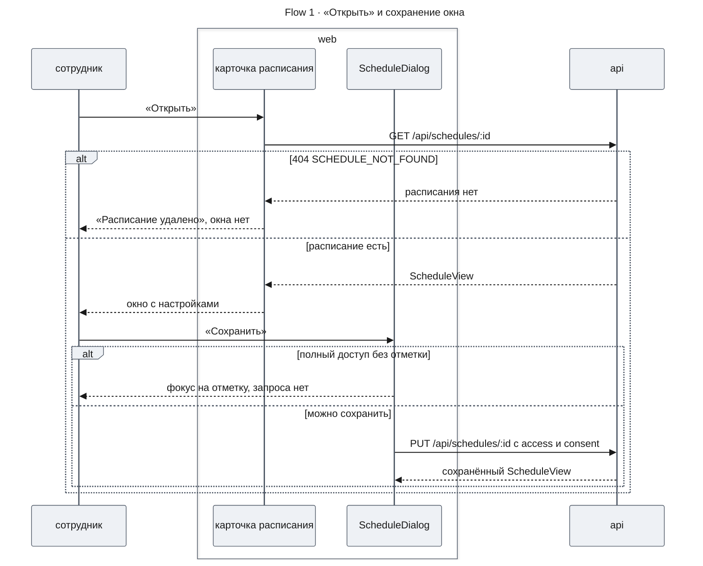

# Расписания через чат Design Document — web

**Status:** Draft · **Date:** 2026-11-28 · **PRD:** [prd.md](./prd.md) · **UXRD:** [uxrd.md](./uxrd.md) · **Depends on:** [design-server.md#contract-definitions](./design-server.md#contract-definitions)

## Snapshot

**Overview.** Часть `server` даёт агенту беседы инструмент `manage_schedule`, который сразу создаёт, меняет, ставит на паузу, возобновляет или удаляет расписание. Карточки подтверждения у него нет, а форма страницы остаётся. Эта часть показывает итог вызова и правит форму. Под блоком вызова `manage_schedule` лента ставит карточку расписания: имя, строку правила с поясом и доступом и кнопку «Открыть». Блок выбирается по имени инструмента, как блоки инструментов записей. Карточка читает расписание тем же `GET /api/schedules/:id`, что страница, а «Открыть» открывает то же окно расписания, что «Изменить» на странице. В окне список «Без вас» заменяет поле «Доступ» с отметкой согласия, без которой «Полный доступ» не сохранить, а под «Когда» встаёт поле «Часовой пояс». Окно больше не открывается из поля сообщения: «Запланировать» в «+» и «Отправить позже» удаляются, а `/` открывает короткий список команд на хуке списка `@`. Строка списка «Расписания» — имя и одна строка, щелчок по ней ведёт в беседу расписания.

- **Не меняется**: блок вызова инструмента, карточка решения, «Изменить», пауза, «Запустить сейчас» и удаление на странице расписания, уведомления окна.
- **Главный риск**: окно сохранит «Полный доступ» без отметки, если проверка в нём ошибётся. Её проверяет тест окна, а сервер всё равно отвечает 400 на `full` без `consent: true` ([design-server.md](./design-server.md), KD-2).
- **Открытые вопросы**: [два](#open-questions).

### Key Decisions

#### KD-1: Карточка расписания встаёт под блоком вызова `manage_schedule` по имени инструмента

`ToolFallback` (`tool-fallback.aui.tsx`) уже выбирает отрисовку вызова по имени инструмента: вызовы инструментов записей идут в `RecordToolBlock`. Для `manage_schedule` с исходом `success` он рисует обычный `ToolBlock` и под ним карточку расписания из `components/schedules`. Отказ — только блок, как у любого неудачного вызова (UXRD Error Flows). Блок не прячется: UXRD ставит карточку под ним (CS-01). Поэтому `SHOWN_ELSEWHERE` в `toFeed` не меняется.

Id и имя расписания карточка берёт из первой строки результата `Schedule <id>: <name>`, а действие — из `args.action` ([design-server.md](./design-server.md), «Карточка результата в ленте»). Так уже читается документ блокнота: регулярное выражение `NOTEPAD_RESULT_TITLE` над первой строкой результата.

#### KD-2: Карточка читает расписание при показе и снова при «Открыть»; окно отдаёт ей сохранённое

Строку правила, пояс и доступ карточка берёт из `GET /api/schedules/:id` через `useResource`, как страница расписания (`schedule-screen.tsx`): другого источника контракт `server` не даёт. Поэтому карточка показывает нынешнее расписание, а не итог вызова, что расходится с UXRD KD-1 и CS-01 ([открытый вопрос](#open-questions) к владельцу). Слово итога в начале строки — «На паузе», «Возобновлено», «Удалено» — даёт `args.action`, то есть то, что сделал этот вызов. Ответ 404 `SCHEDULE_NOT_FOUND` даёт состояние «Расписание удалено»: «Открыть» становится `aria-disabled`, а под строкой стоит пометка (CS-02). У карточки самого удаления кнопки нет, и расписание она не читает.

«Открыть» читает расписание ещё раз и только с ответом открывает окно `ScheduleDialog` в режиме изменения. Без второго чтения удаление, случившееся при открытой ленте, открыло бы окно, которое упадёт при сохранении (UXRD CS-02). Ответ 404 ставит состояние «Расписание удалено», и пометка объявляется `polite`.

Пока вопрос не решён иначе, свежесть карточки после сохранения обеспечивает `onSaved` окна: окно уже отдаёт сохранённый `ScheduleView`, и карточка показывает его. Общего кэша чтений нет: у `useResource` нет ключа запроса, а кэш для одного потребителя — лишний слой. Другие карточки того же расписания в ленте берут новое состояние при следующем показе ленты.

#### KD-3: В окне поле «Доступ» с согласием заменяет «Без вас»; согласие держит кнопку сохранения

`allowed-tools.tsx` удаляется. На его место в `ScheduleDialog` встаёт поле по [schedule-access.md](../../design-system/components/schedule-access.md): `AdminRadioField` с пунктами «Только чтение» и «Полный доступ», которым окно уже выбирает место ответа, и под ним shadcn `checkbox` согласия. Отметка начинается пустой при каждом открытии и при каждом новом выборе «Полный доступ», в том числе у расписания, у которого `full` уже есть (AC-04.3).

Пока выбран «Полный доступ» без отметки, кнопка сохранения — `aria-disabled` с описанием подсказкой MC-4. Нажатие ничего не отправляет и переводит фокус на отметку. `disabled` не годится: кнопка выпала бы из Tab и не могла бы отдать фокус отметке (schedule-access.md, States). Тело `POST` и `PUT /api/schedules` несёт `access` и `consent: true` только при `full` с отметкой. Начальный уровень — `read` у нового расписания и `access` из `ScheduleView` у существующего.

#### KD-4: «Часовой пояс» — поле в `ScheduleRuleField` на `Combobox` из `@base-ui/react`

Пояс решает, когда сработает правило, поэтому поле стоит в компоненте правила, как требует [schedule-rule.md](../../design-system/components/schedule-rule.md), часть 5. Оно заменяет строку «Время по поясу …» под предпросмотром. `ScheduleRuleField` уже получает пояс и считает в нём предпросмотр; теперь он ещё и меняет пояс. Поле собрано на `Combobox` из `@base-ui/react`, как поиск в `share-dialog.tsx`: своего combobox в `components/ui` нет, а второй способ поиска по списку не нужен. Пункты — `Intl.supportedValuesOf('timeZone')` с подписью «{пояс} (UTC{смещение})» по готовому `utcOffset`; поиск ищет по подстроке имени пояса, где есть и город.

У нового расписания поле начинается с пояса браузера — того же `Intl.DateTimeFormat().resolvedOptions().timeZone`, которым окно уже заполняет `timeZone`. У существующего поле начинается с `timeZone` расписания. Если начального пояса нет в списке — `UTC` или прежнее имя, — он добавляется к пунктам, показывается со смещением, как любой другой, и уходит без изменений, пока сотрудник не выберет другой. Тело запроса несёт выбранный пояс; неизвестное имя сервер отклоняет 400, как сейчас.

#### KD-5: Окно открывают только страницы и карточка; режим создания теряет данные поля сообщения

Входы окна из поля сообщения удаляются: пункт «Запланировать» в «+», `SendLater` и общий для них `useComposerSchedule`. У `useComposerSchedule` других потребителей нет. Без них режиму создания не нужны текст поля, чип агента, беседа и пресет `later`, и режим создания становится пустым: окно начинается с пустых полей, агента чата, правила по умолчанию и `read`. `laterRuleDraft` удаляется вместе с пресетом.

«Куда писать ответ» у нового расписания — один пункт «Каждый раз в новую беседу» с подсказкой MC-3: у окна со страницы нет беседы. У существующего к нему добавляется «В беседу «{название}»», пока та беседа есть (SP-04). Окно открывают «Новое расписание» в шапке списка (новое), «Изменить» на странице расписания (как сейчас) и «Открыть» в карточке (KD-2).

#### KD-6: Список `/` — хук списка `@` со вторым знаком; строки команд у `/` и «+» общие

`useAgentMention` уже держит всё, что требует SL-01: каретку, роль `combobox`, ↑ ↓ Enter Tab Esc, список над полем, пустое состояние, прокрутку к активной строке. Хук получает второй знак: `/`, который стоит первым в поле и после которого до каретки нет пробела. Строки списка тогда — команды, имя списка «Команды», пустая строка «Команд не нашлось» (MC-2). Выбор убирает `/` с набранным текстом и выполняет команду. Второй хук отвергнут: он повторил бы около 150 строк каретки и клавиш, а `Composer` принимает один список.

Команды «Создать агента в чате» и «Создать и проверить агента» с их значками, подсказками и правилом показа (`user.trainOwn`) выносятся из `ComposerActions` в одно место, откуда их берут «+» и `/`. Так AC-08.3 («то же, что пункт «+»») держит один код: `composerSeed.put` с текстом шаблона или с действием `TEST_RUN_ACTION`.

«Запланировать» ставит «Запланируй: » через `aui.composer.setText`, а не через `composerSeed.put`: `put` только с текстом снимает чип агента, а SL-01 оставляет его в поле. Ничего не отправляется. Список стоит только там, где стоит хук, — в `SeededComposer` с «+».

#### KD-7: Строка списка — одна ячейка с двумя линиями и ссылкой в беседу; «Подробнее» — действие строки

`rowOf` в `schedules-screen.tsx` уже кладёт в первую ячейку имя и линию под ним. Теперь линия — «{следующее срабатывание или состояние} · {правило} · {доступ}» (MC-3), а колонки «Состояние», «Следующее» и «Последнее» уходят. Так строка выглядит одинаково на любой ширине без нового режима `DataTable`. Ссылка строки ведёт:

- в беседу расписания, если `conversation` есть и не удалена;
- иначе в беседу `lastRun.conversationId`;
- иначе на страницу расписания (AC-09.3 – AC-09.5).

«Подробнее» — действие строки `DataTable` (`actions`), которое ведёт на страницу расписания. Шапка списка получает «Новое расписание», а пустой список — текст MC-3. На странице расписания пара «Доступ» встаёт на место «Без вас», а пара «Создано» уходит (SP-02).

## Terms

- **Карточка расписания** — блок ленты под вызовом `manage_schedule`: имя, строка, «Открыть» ([schedule-card.md](../../design-system/components/schedule-card.md)).
- **Окно расписания** — `ScheduleDialog`, форма расписания из PRD.
- **`composerSeed`** — стор оболочки, который несёт чип и текст в поле сообщения беседы.

## Part

- **Prerequisite ADRs**: [ADR-0020](../../adr/ADR-0020-next-intl-client-layer.md) — тексты через каталоги next-intl.

**Out of scope**

- Карточка решения и её общие части: эта фича из `decision-card.tsx` ничего не берёт и не выносит.
- Отказы `manage_schedule`: их показывает обычный блок вызова, причины веб не различает ([design-server.md](./design-server.md), «Отказы инструмента»).
- Страница расписания, кроме пар «Доступ» и «Создано».

**Constraints**

- Контракт `server` берётся как есть; нехватка в нём — вопрос к той части ([Open Questions](#open-questions)).
- Без обратной совместимости: входы окна из поля сообщения, список инструментов, их вызов API, тексты и тесты удаляются в том же изменении.
- Тексты en и ru под одинаковыми ключами ([interface-text.md](../../code-system/patterns/interface-text.md)).

## Building-block Inventory

Follows the [code system](../../code-system/README.md) и [web.md](../../code-system/packages/web.md). Искали в `components/assistant-ui/elements`, `components/schedules`, `components/library` и `components/ui` отрисовку вызова по имени инструмента, поиск по списку и строку-итог в ленте.

| Building block | Pattern | Status | Note |
|---|---|---|---|
| карточка расписания | [read-on-open.md](../../code-system/patterns/read-on-open.md) | new | строки-итога со ссылкой на экран настройки в ленте нет; читает расписание `useResource` (KD-1, KD-2) |
| `schedulesApi` | [web-api-client.md](../../code-system/patterns/web-api-client.md) | extended | без `tools`; `access` и `consent` приходят из схем `contracts` |
| каталоги текста | [interface-text.md](../../code-system/patterns/interface-text.md) | extended | MC-1 – MC-4 UXRD |

## Acceptance Criteria

### FR-06: Карточка расписания в ленте

- From the PRD: AC-06.1 – AC-06.4.
- Пока чтение расписания идёт, карточка показывает имя из результата без строки; ошибка чтения, кроме 404, оставляет имя и «Открыть» (AC-06.1).
- «Открыть» с ответом 404 не открывает окно, ставит «Расписание удалено» и объявляет пометку (AC-06.3).
- Закрытие окна возвращает фокус на «Открыть».

### FR-08: Команды `/`

- From the PRD: AC-08.1 – AC-08.4.
- Выбор «Запланировать» оставляет чип агента в поле.

### FR-09: Страница «Расписания»

- From the PRD: AC-09.1 – AC-09.6.

### FR-10: Из поля сообщения форму не открыть

- From the PRD: AC-10.1.

### FR-12: Итог паузы, возобновления и удаления в ленте

- From the PRD: AC-12.1 — слово итога по `args.action` (KD-2).

### FR-13: Форма расписания

- From the PRD: AC-13.1 – AC-13.6; поле пояса — AC-15.4 части `server`.
- При «Полный доступ» без отметки нажатие кнопки сохранения не отправляет запрос и ставит фокус на отметку (AC-13.3).

| AC | Чем выполнено | Тест |
|---|---|---|
| AC-06.1, AC-12.1 | карточка под блоком (KD-1, KD-2) | в браузере |
| AC-06.2 | «Открыть» открывает окно этого расписания (KD-2) | карточка: окно |
| AC-06.3 | 404 при показе и при «Открыть» (KD-2) | карточка: удалено |
| AC-06.4 | пометка о снятом доступе | после ответа на [вопрос](#open-questions) к `server` |
| AC-08.1 – AC-08.4 | `useAgentMention` со знаком `/`, общие команды (KD-6) | в браузере |
| AC-09.1 – AC-09.6 | строка списка и «Новое расписание» (KD-7) | в браузере |
| AC-10.1 | удаление входов окна (KD-5) | в браузере |
| AC-13.1, AC-13.2, AC-13.6 | окно без входов поля сообщения и без «Без вас» (KD-3, KD-5) | в браузере |
| AC-13.3, AC-13.4, AC-04.3 | согласие держит сохранение (KD-3) | окно: согласие |
| AC-13.5 | пара «Доступ» страницы (KD-7) | в браузере |
| AC-15.4 | поле «Часовой пояс» (KD-4) | в браузере |

## Design

### Architecture (C1–C4)

Акторы, внешние системы и контейнеры не меняются: веб зовёт только маршруты части `server`. Поэтому C1 и C2 не нарисованы.

#### C3 · Components: web — карточка и окно

- **Карточка** — группа с именем «Расписание «{название}»» по schedule-card.md: значок часов, имя, строка через « · » из `ruleLine` и `zoneLine` (`schedule-parts.tsx`, ими уже пользуется страница) и уровня доступа. Ниже стоит пометка, а справа — «Открыть» (`outline`, `sm`, 44 px при грубом указателе). Появление карточки фокус не двигает и не объявляется: итог называет ответ агента.
- **Окно** монтируется внутри карточки в режиме изменения с прочитанным `ScheduleView`. `finalFocus` возвращает фокус на «Открыть», как SP-04 требует для всех кнопок, которые открывают окно.
- **Страница и список** зовут то же окно: «Изменить» — как сейчас, «Новое расписание» — в пустом режиме создания (KD-5).

#### C3 · Components: web — поле сообщения

`Composer` в `thread.aui.tsx` теряет проп `sendLater` и кнопку «Отправить позже»; кнопка отправки стоит одна (RM-01). Текст, положенный через `composerSeed`, поле берёт готовым `useSeedText`.

### Runtime Flows

#### Flow 1: «Открыть» и сохранение окна

**Starts when:** сотрудник нажал «Открыть» в карточке расписания, for AC-06.2, AC-06.3, AC-13.3

После ответа `PUT` окно закрывается, показывает уведомление, как сейчас, и отдаёт `ScheduleView` карточке (KD-2). Отказ `PUT` окно показывает как сейчас: у поля или над кнопками, по `describeSchedulesError`. «Новое расписание» и «Изменить» на странице идут тем же путём от строки «Сохранить», с `POST` у нового расписания.

### Contract Definitions

Часть не отдаёт контрактов другим частям. Она берёт [контракт `server`](./design-server.md#contract-definitions) как есть; ниже — как веб показывает каждый его ответ.

- **Результат `manage_schedule`** — `success` ставит карточку (KD-1). Id и имя берутся из первой строки `Schedule <id>: <name>`, слово итога — из `args.action`. Первая строка не того вида оставляет только блок вызова, и это пишется в лог предупреждением.
- **`GET /api/schedules/:id`** — строка карточки и окно из «Открыть»; 404 `SCHEDULE_NOT_FOUND` — «Расписание удалено»; другая ошибка — карточка без строки, «Открыть» доступна.
- **`POST`, `PUT /api/schedules`** — тело с `access`, `consent` и `timeZone` из поля (KD-3, KD-4); без `allowedTools`. 400 `VALIDATION_FAILED` показывается, как сейчас.
- **`ScheduleView.access`** — строка карточки, линия строки списка и пара «Доступ»; **`conversation`** и **`lastRun.conversationId`** — ссылка строки списка (KD-7).

## Change Impact

Потребители удаляемого найдены поиском по тексту с чтением каждого места (LSP не вызывался); `coverage.notSearched` — `docs/` и другие приложения.

| Файл | Изменение |
|---|---|
| `components/schedules/` — новый файл карточки | карточка (KD-1, KD-2) |
| `components/assistant-ui/elements/tool-fallback.aui.tsx` | ветка `manage_schedule` (KD-1) |
| `components/schedules/schedule-dialog.tsx` | поле «Доступ» с согласием; пустой режим создания; без «Без вас», текста, чипа, беседы и `later` (KD-3, KD-5) |
| `components/schedules/schedule-rule-field.tsx` | поле «Часовой пояс» вместо строки пояса; без `laterRuleDraft` (KD-4, KD-5) |
| `components/schedules/schedules-screen.tsx`, `schedule-screen.tsx` | строка списка, «Новое расписание», пустой список; пары «Доступ» и «Создано» (KD-7) |
| `components/assistant-ui/elements/agent-mention.tsx`, `composer-actions.tsx`, `thread.aui.tsx` | знак `/` и общие команды; без «Запланировать», `SendLater`, `useComposerSchedule`, пропа `sendLater` (KD-5, KD-6) |
| `lib/schedules/schedules-api.ts` | без `tools` |
| `i18n/translations/{en,ru}/schedules.json`, `chat.json`, `tools.json` | MC-1 – MC-4; подписи `manage_schedule` и `list_schedules` |
| `test/msw-server.ts`, `components/shell/schedules-search-memory-schedules.int.test.tsx` | по «Что удаляется» и [Test Strategy](#test-strategy) |

**Что удаляется в этой части**

- Файл `components/schedules/allowed-tools.tsx` (`useScheduleTools`, `listedPairs`, `allowedToolLine`, `AllowedToolsField`).
- В `composer-actions.tsx`: пункт «Запланировать», `SendLater`, `useComposerSchedule` и импорт окна; в `thread.aui.tsx`: импорт и рендер `SendLater` и проп `sendLater` у `Composer`.
- В `schedule-dialog.tsx`: поле «Без вас», чтение списка инструментов, режим создания с текстом, чипом, беседой и `later`, пункт «В эту беседу» нового расписания.
- В `schedule-rule-field.tsx`: `laterRuleDraft` и строка пояса под предпросмотром.
- В `schedule-screen.tsx`: пары «Без вас» и «Создано».
- В `schedules-screen.tsx`: колонки «Состояние», «Следующее», «Последнее» и режим `twoLines`.
- В `schedules-api.ts`: `tools` (`GET /api/schedules/tools`) и его схемы в импортах.
- Тексты: `schedules.dialog.allowedTools.*`, `dialog.laterTitle`, `dialog.schedule`, `dialog.thisConversation`, `dialog.thisConversationHint`, `dialog.noConversationYet`, `page.allowedTools`, `page.toolLine`, `page.readsOnly`, `page.created`, `page.createdIn`, `page.createdDeleted`, колонки списка и их подписи; `chat.composer.schedule`, `scheduleHint`, `sendLater`. Ключи, которые останутся без потребителя после правки, удаляются с ними.
- Тесты: в `schedules-search-memory-schedules.int.test.tsx` — «+» → «Запланировать», окно из поля сообщения, «окно не сохраняется до списка», блок «Отправить позже» и обработчики `tools`; `allowedTools` в данных теста — на `access`. В `msw-server.ts` — обработчик `GET /api/schedules/tools`.

## Test Strategy

Только то, где ошибка даст полный доступ без согласия или откроет не то расписание.

- **Окно: согласие** — окно с MSW на `POST /api/schedules`. При «Полный доступ» без отметки нажатие «Создать расписание» не шлёт запрос и ставит фокус на отметку. С отметкой тело несёт `access: full` и `consent: true`. После «Только чтение» отметки нет, а тело несёт `access: read` без `consent`. У расписания с `full` окно открывается с пустой отметкой. Ловит обход согласия в интерфейсе. AC-13.3, AC-13.4, AC-04.3.
- **Карточка: окно** — карточка с результатом `Schedule s1: Утренняя сводка` и MSW на `GET /api/schedules/s1`: «Открыть» открывает окно с настройками `s1`. Ловит окно не того расписания. AC-06.2.
- **Карточка: удалено** — `GET` отвечает 404 при показе, и в другом случае при нажатии: «Открыть» `aria-disabled`, пометка «Расписание удалено», окна нет. Ловит окно, которое упадёт при сохранении. AC-06.3.

### Проверка в браузере

jsdom не показывает раскладку, фокус и переходы, поэтому экраны проверяют на `next build && next start` против настоящего API по навыку `browser-check`, на 1280 px, 900 px и 360 px в обоих режимах.

| Сценарий | Шаги | Что должно быть видно |
|---|---|---|
| Создано словами | Написать «каждый будний день в 9 присылай сводку инцидентов» | Блок вызова, под ним карточка: имя, «По будням в 09:00 · {пояс} (UTC…) · Только чтение», «Открыть»; в Network один `GET /api/schedules/…` |
| Пауза и удаление словами | «поставь сводку на паузу», затем «удали сводку» | «На паузе · …» с «Открыть»; «Удалено» без кнопки; у прежних карточек после перезагрузки — «Расписание удалено», кнопка приглушена |
| «Открыть» | Нажать «Открыть», сменить время, «Сохранить»; Esc | Окно с настройками; после сохранения карточка показывает новое время; фокус снова на «Открыть» |
| Согласие | В окне выбрать «Полный доступ», нажать «Сохранить»; отметить; сохранить | Кнопка приглушена, фокус на отметке, запроса нет; с отметкой `PUT` с `consent: true`; страница показывает «Полный доступ» |
| Часовой пояс | В окне найти «Novosibirsk», выбрать, сохранить | Предпросмотр в новом поясе; в теле `timeZone: Asia/Novosibirsk`; у нового расписания поле начинается с пояса браузера |
| Список `/` | В пустом поле набрать `/`, затем «запл», выбрать; повторить с чипом агента; выбрать «Создать агента в чате» | Список «Команды» над полем; «Запланируй: » в поле, курсор в конце, чип на месте, ничего не отправлено; шаблон как у «+»; у сотрудника без права проверки строки нет |
| Без входов окна | Открыть «+» и поле с текстом в беседе с сообщениями | Нет «Запланировать» и «Отправить позже» |
| Список «Расписания» | Щёлкнуть строки расписаний «эта беседа», «новая беседа» после срабатывания и без срабатываний; «Подробнее»; «Новое расписание» | Открыта беседа расписания, беседа последнего срабатывания, страница расписания; «Подробнее» ведёт на страницу; окно пустое, один пункт ответа |
| Ширина | Карточка, окно с согласием и поясом, список `/`, список «Расписания» на 360 px | Карточка во всю ширину ленты, «Открыть» справа 44 px; окно во весь экран с видимыми кнопками; отметка 44 × 44; без горизонтальной прокрутки |

## Security Considerations

- **Согласие**: `consent: true` окно ставит только при `full` с отметкой (KD-3); сервер всё равно отклоняет `full` без него.
- **Input Validation**: имя расписания из результата и инструкцию веб выводит как текст, без разметки.
- **Sensitive Data Handling**: лог веба не пишет инструкцию расписания — только id расписания, действие, исход запроса и время.

## Risks and Mitigation

- **Каждая карточка в ленте читает своё расписание** — беседа с десятком карточек делает десяток `GET` при показе. Чтение одно на карточку и маленькое; общий кэш — если это станет заметно.
- **Первая строка результата сменит вид** — карточки нет, блок вызова остаётся, лог пишет предупреждение (Contract Definitions).

## Open Questions

- **Пометка о снятом полном доступе** (против [design-server.md](./design-server.md), Contract «`manage_schedule`»; UXRD CS-01, AC-06.4). Контракт говорит, что текст результата сообщает модели, что уровень стал `read`, но не задаёт для этого строки, которую веб мог бы узнать. По `ScheduleView` после вызова не видно, был ли `full` до него. Нужна ли в результате строка точного вида, например вторая строка `Access: full -> read`? Блокирует пометку карточки; решает часть `server`.
- **Карточка показывает нынешнее расписание, а не итог вызова** (UXRD KD-1, CS-01; schedule-card.md, States «Default»). Карточка берёт строку из `GET /api/schedules/:id`, поэтому прежняя карточка после изменения расписания покажет новое правило. У карточки удаления строки правила нет: расписания уже нет, а аргументы удаления несут только `scheduleId`. Принять так — слово итога от вызова, строка от нынешнего расписания и обновление после сохранения окна (KD-2), у удаления только имя и «Удалено» — или серверу класть правило, пояс и доступ в результат? Блокирует строку карточки; решает владелец с `ux-designer`.

## Update History

| Version | Date | Change |
|---------|------|--------|
| 1.0 | 2026-11-28 | Первая версия |
| 2.0 | 2026-11-28 | PRD v1.2, UXRD v1.2, `server` v1.2: инструмент действует сразу; карточка-итог под блоком вызова с «Открыть»; окно остаётся со страницей, доступ, согласие и поле пояса; строка списка ведёт в беседу |
