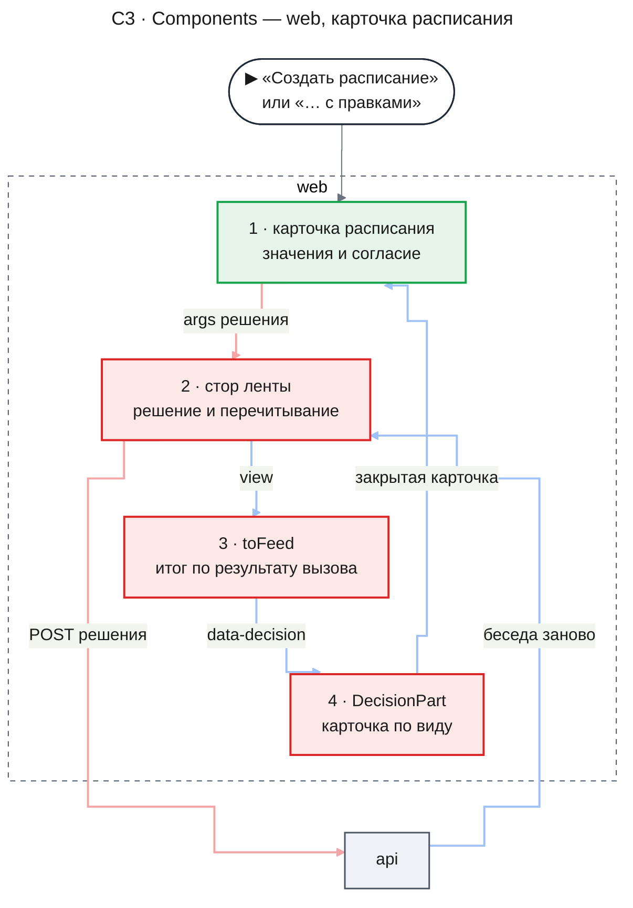
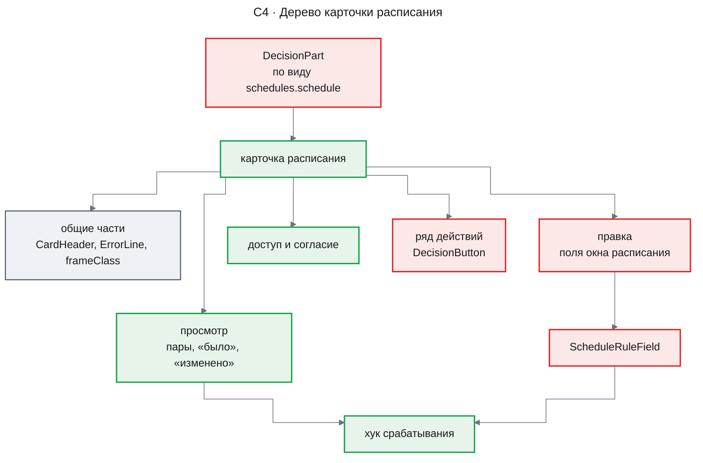
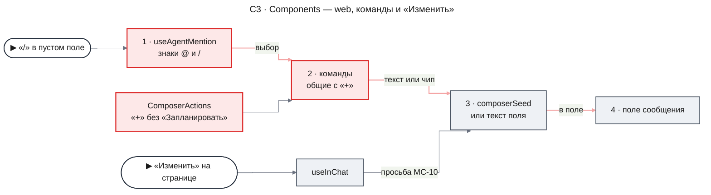
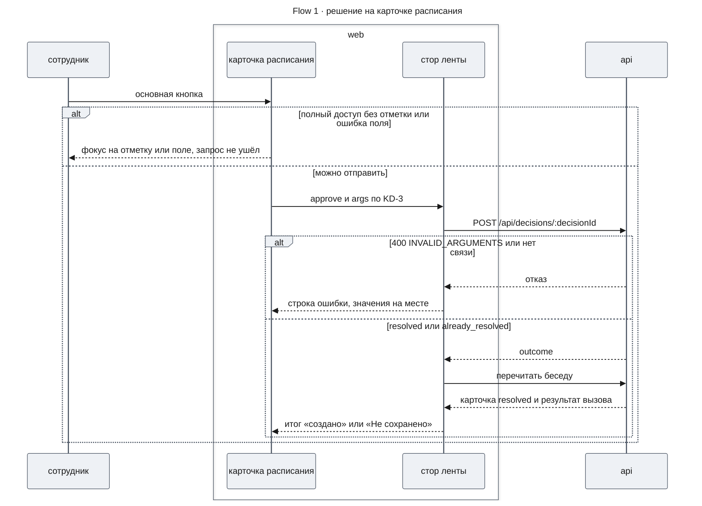

# Расписания через чат Design Document — web

**Status:** Draft · **Date:** 2026-11-28 · **PRD:** [prd.md](./prd.md) · **UXRD:** [uxrd.md](./uxrd.md) · **Depends on:** [design-server.md#contract-definitions](./design-server.md#contract-definitions)

## Snapshot

**Overview.** Часть `server` кладёт в ленту карточку вида `schedules.schedule` и сохраняет расписание только по решению сотрудника; эта часть показывает карточку и убирает окно расписания. Карточка расписания — свой компонент рядом с карточкой решения, как карточки вопроса и личной инструкции из agent-guidance: место ленты выбирает её по виду, а рамку, шапку, кнопки, правку и отправку она берёт у тех же общих частей `decision-card.tsx`. Поля правки — поля окна расписания, перенесённые в карточку вместе с полем правила и его предпросмотром срабатывания; к ним добавлены уровень доступа и отметка согласия, без которой основная кнопка не отправляет «Полный доступ». Решение несёт аргументы, которые собирает одна чистая функция: правленые поля, согласие, пояс и язык браузера. Список `/` — тот же список над полем, что у `@`, со вторым знаком и строками команд. Страница «Расписания» теряет окно: «Изменить» кладёт просьбу в поле беседы расписания или нового чата, а пара «Без вас» становится парой «Доступ».

- **Не меняется**: контракт части `server`, лоток очереди и «К запросу», карточки других видов, пауза, «Возобновить», «Запустить сейчас» и удаление на странице.
- **Главный риск**: согласие уйдёт без отметки, если сборка аргументов ошибётся; её проверяет тест сборки, а сервер всё равно не сохраняет `full` без `consent: true` ([design-server.md](./design-server.md), KD-2).
- **Открытые вопросы**: [два](#open-questions).

### Key Decisions

#### KD-1: Карточка расписания — свой файл на общих частях карточки решения, как карточки agent-guidance

`DecisionPart` в `thread.aui.tsx` монтирует сегодня `DecisionCard` для каждой карточки ленты. По виду `schedules.schedule` он монтирует карточку расписания из `components/schedules`, а для остальных видов — как раньше. Это тот же способ монтирования, что у `QuestionCard` и карточки личной инструкции ([agent-guidance design-web.md](../agent-guidance/design-web.md), KD-1, KD-8). Карточка берёт у `decision-card.tsx` ровно то, что выносит agent-guidance:

- `CardHeader`, `ErrorLine`, `frameClass` и тип итога `Outcome`;
- `DecisionButton`;
- хук правки без полей брифа: черновик любого вида, `null` вне «Правки», фокус при «Исправить», «Отмена» и Esc с фокусом обратно;
- хук отправки решения: нажатая кнопка, флаг сбоя и фокус на карточку после итога.

Второго варианта этих частей нет. Какая фича строится первой, та и выносит части из `decision-card.tsx`; вторая берёт их готовыми.

Ветка внутри `DecisionCard` отвергнута по той же причине, что в agent-guidance: файл в 1 411 строк уже ведёт три вида одной цепочкой условий, а у расписания полей и состояний больше, чем у брифа.

`DecisionButton` получает два атрибута, которые передаёт кнопке: `aria-disabled` и `aria-describedby`. Без них отметку не потребовать: кнопка с `disabled` выпадает из Tab и не может перевести фокус на отметку, а спецификация требует обоих (schedule-card.md, States «Без согласия»).

#### KD-2: Поля правки — поля окна расписания, перенесённые в карточку; окно удаляется

Окно `ScheduleDialog` уже собирает из готовых полей формы всё, что нужно правке (UXRD CS-02): «Название» и «Инструкция» (`AdminTextField`), «Агент» (`AdminSelectField` со списком записей `libraryIndex`, годных для чата, и сохранением исходного агента, `agentChoices`), «Когда» (`ScheduleRuleField` целиком) и «Куда писать ответ» (`AdminRadioField`). Эти поля и проверка перед отправкой (`checkRule`, пустая инструкция, фокус на первом поле с ошибкой) переезжают в карточку. Окно удаляется вместе со «Списком без вас» и пресетом «Отправить позже». К полям добавлены радиогруппа «Доступ» и отметка согласия — shadcn `checkbox` в блоке по schedule-card.md.

Чтение срабатывания выносится из `ScheduleRuleField` в хук над `schedulesApi.nextRun`, у которого два потребителя: поле правила в правке и пара «Следующее срабатывание» в просмотре. Без хука просмотр повторил бы чтение с задержкой ввода и разбором ответа «время прошло». Пояс чтения — `next.timeZone` карточки изменения, у нового расписания — пояс браузера ([design-server.md](./design-server.md), KD-4).

Строку правила и пояса в паре «Когда» дают готовые `ruleLine` и `zoneLine` из `schedule-parts.tsx`, которыми уже пользуется страница расписания.

#### KD-3: Аргументы решения собирает одна чистая функция, и при подтверждении они уходят всегда

`POST /api/decisions/:decisionId` с `approve: true` всегда несёт `args` — `ScheduleToolArgs` ([design-server.md](./design-server.md), Contract Definitions). Отправлять их только после правки отвергнуто. Решение «создать» без пояса и языка сервер отклоняет, а с одним путём для обеих кнопок нечего проверять. Функция получает содержимое карточки, значения карточки и язык интерфейса:

- поля `name`, `instruction`, `rule`, `access` — из значений карточки: исходных `next` или правленых;
- `agentId` — id выбранной записи, «Агент чата» — `null`; у новой карточки без правки — `next.agent.id`. Имя в `next.agent` и `previous.agent` служит только для показа. У изменения агент с тем же id, что у `previous.agent`, поля не ставит, и сервер оставляет сохранённого агента;
- `consent: true` — только когда выбран `full` и отметка стоит; иначе поля нет;
- `target` — выбранный пункт; у изменения пункт «В беседу «{название}»» (нынешнее место) поля не ставит, и сервер оставляет место и беседу ([design-server.md](./design-server.md), KD-5);
- `timeZone` и `language` — только у нового расписания: пояс браузера (`Intl.DateTimeFormat().resolvedOptions().timeZone`) и язык `useLocale`. Окно брало их так же, и код переезжает из него;
- `scheduleId` — у изменения из содержимого карточки.

«Отклонить» отправляет `approve: false` без аргументов.

#### KD-4: Итог карточки — из перечитанной карточки и результата её вызова, как у записи библиотеки

Пока решения нет, итога нет. Подтверждённая карточка до результата вызова показывает общее «Подтверждено». С результатом `success` она показывает «Расписание создано» или «Расписание изменено» и ссылку «Открыть расписание» на `schedulePath(scheduleId)`, с любым другим — «Не сохранено: {причина}» (UXRD KD-6, MC-7). Результат находит готовое правило `recordSaveOf` в `toFeed`: первый результат того же инструмента после решения. Правило принимает вид `schedules.schedule` наравне с карточкой записи, как agent-guidance добавляет `identity.instructions`.

`RecordSave` получает `refusalReason` результата. У записи причину показывает текст платформы, а MC-7 требует своих слов: `schedule_not_found` — «расписания больше нет — его удалили», `agent_not_visible` — «агент «{имя}» вам недоступен», `schedule_time_passed` — «это время уже прошло». Для других причин карточка показывает текст платформы, как запись.

Строку вызова `propose_schedule` лента прячет, как строку `start_deep_agent`: инструмент встаёт в `SHOWN_ELSEWHERE`. Строка остаётся при исходе кроме `success` и `rejected`, то есть ровно когда карточки нет (UXRD Error Flows, «Карточки нет») или сохранение не прошло. `list_schedules` — обычная строка вызова чтения. Подписи обоих инструментов — в `tools.json`.

#### KD-5: Список `/` — хук списка `@` со вторым знаком; строки команд у `/` и «+» общие

`useAgentMention` уже держит всё, что требует SL-01: каретку, роль `combobox`, ↑ ↓ Enter Tab Esc, список над полем, пустое состояние, прокрутку к активной строке. Хук получает второй знак: `/`, который стоит первым в поле и после которого до каретки нет пробела. Строки списка тогда — команды, имя списка «Команды», пустая строка «Команд не нашлось» (MC-9). Выбор убирает `/` с набранным текстом и выполняет команду. Второй хук отвергнут: он повторил бы около 150 строк каретки и клавиш, а `Composer` принимает один список.

Команды «Создать агента в чате» и «Создать и проверить агента» с их значками, подсказками и правилом показа (`user.trainOwn`) выносятся из `ComposerActions` в одно место, откуда их берут «+» и `/`. Так «то же, что пункт «+»» (AC-08.3) держится одним кодом: `composerSeed.put` с текстом шаблона или с действием `TEST_RUN_ACTION`.

«Запланировать» ставит «Запланируй: » через `aui.composer.setText`, а не через `composerSeed.put`: `put` только с текстом снимает чип, а чип сообщения выбирает агента расписания ([design-server.md](./design-server.md), Contract «`agentId`»). Ничего не отправляется. Список стоит только там, где стоит хук: в `SeededComposer` с «+».

#### KD-6: «Изменить» на странице — готовый `useInChat` с текстом просьбы

`useInChat` уже кладёт текст в поле нужной беседы, переходит туда и ставит фокус в поле. «Изменить» зовёт его с текстом «Измени расписание «{название}»: » (MC-10). Цель — беседа расписания, если `target` — `this_conversation` и `conversation` не удалена, иначе новый чат (UXRD KD-5). Ту же функцию зовут кнопка в блоке паузы из-за удалённой беседы и действие уведомления «Запустить сейчас». Состояние открытого окна на странице удаляется.

Пара «Доступ» встаёт на место «Без вас» и читает `access` из `ScheduleView`. Вторая строка списка «Расписания» получает уровень доступа последним элементом (SP-02). После подтверждённой карточки, которая сменила беседу, страница при чтении получает новую `conversation`: блок паузы уходит, «Возобновить» становится доступна без отдельного кода (SP-01).

## Terms

- **`DecisionPart`** — место ленты, которое монтирует карточку для каждой части `data-decision`; такую часть `toFeed` строит из каждой карточки беседы.
- **Значения карточки** — то, что показывает или правит карточка: поля `next` или черновик правки, а также отметка согласия.
- **`composerSeed`** — стор оболочки, который несёт чип и текст в поле сообщения беседы.

## Part

- **Prerequisite ADRs**: [ADR-0020](../../adr/ADR-0020-next-intl-client-layer.md) — тексты через каталоги next-intl.

**Out of scope**

- Пояс расписания при изменении: правка его не показывает и не меняет ([design-server.md](./design-server.md), Open Questions).
- Пауза, возобновление и удаление словами (PRD, Won't Have).
- Карточки других видов и лоток очереди: лоток уже ведёт к любой открытой карточке по `data-decision-id`.

**Constraints**

- Контракт `server` берётся как есть; нехватка в нём — вопрос к той части ([Open Questions](#open-questions)).
- Общие части карточки решения — ровно те, что выносит agent-guidance (KD-1).
- Без обратной совместимости: окно, «Отправить позже», «Запланировать» в «+», список инструментов, их вызовы API, тексты и тесты удаляются в том же изменении.
- Тексты en и ru под одинаковыми ключами ([interface-text.md](../../code-system/patterns/interface-text.md)).

## Building-block Inventory

Follows the [code system](../../code-system/README.md) и [web.md](../../code-system/packages/web.md). Искали в `components/agents`, `components/schedules`, `components/assistant-ui/elements` и `lib/feed` карточку с полями расписания, список над полем и способ положить текст в беседу.

| Building block | Pattern | Status | Note |
|---|---|---|---|
| карточка расписания | — | new | тело с полями, доступом и согласием; ветка в `DecisionCard` отвергнута (KD-1) |
| чтение срабатывания | [read-on-open.md](../../code-system/patterns/read-on-open.md) | new | хук над `useResource`; поле правила и пара просмотра (KD-2) |
| сборка аргументов решения | [pure-decision.md](../../code-system/patterns/pure-decision.md) | new | одна чистая функция (KD-3) |
| `schedulesApi` | [web-api-client.md](../../code-system/patterns/web-api-client.md) | extended | без `create`, `update`, `tools`; `access` приходит из схем `contracts` |
| каталоги текста | [interface-text.md](../../code-system/patterns/interface-text.md) | extended | MC-1 – MC-10 UXRD |

## Acceptance Criteria

### FR-06: Карточка расписания в ленте

- From the PRD: AC-06.1 – AC-06.5.
- Пара «Следующее срабатывание» читает `POST /api/schedules/next-run` по правилу карточки; пока чтение идёт или правило не составить, стоит «—» (AC-06.1).
- «Создать с правками» отправляет правленые значения в `args` решения (AC-06.2).
- Ошибка поля не отправляет решение: ошибка стоит у поля, фокус — на первом поле с ошибкой. Если время правила прошло, пока карточка ждала, основная кнопка в просмотре открывает правку с ошибкой у «Когда» (AC-06.3).
- 400 `INVALID_ARGUMENTS` или сбой связи на отправке решения: карточка остаётся открытой со строкой ошибки, а значения и черновик правки — на месте.
- Отказ сервера после подтверждения ставит итог «Не сохранено: {причина}» по KD-4 (AC-06.3, AC-02.4).
- У изменения каждая пара, где `next` отличается от `previous`, несёт метку «изменено» и строку «было: …»; «Следующее срабатывание» прежнего значения не несёт (AC-06.4).
- Закрытая карточка показывает отправленные значения и итог со ссылкой; кнопок нет (AC-06.5).

### FR-07: Согласие в карточке

- From the PRD: AC-07.1 – AC-07.3.
- При «Полный доступ» без отметки основная кнопка — `aria-disabled` с описанием текстом подсказки; нажатие ничего не отправляет и переводит фокус на отметку (AC-07.1).
- Выбор «Только чтение» убирает согласие и сбрасывает отметку; новый выбор «Полный доступ» снова показывает пустую отметку (AC-07.2).
- Отметка всегда начинается пустой, в том числе в карточке изменения расписания с полным доступом (AC-04.3 части `server`).

### FR-08: Команды `/`

- From the PRD: AC-08.1 – AC-08.4.
- Выбор «Запланировать» оставляет чип агента в поле.

### FR-09: Страница «Расписания» без формы

- From the PRD: AC-09.1, AC-09.2.
- Пара «Доступ» на странице и уровень во второй строке списка (SP-02).

### FR-10: Окна расписания больше нет

- From the PRD: AC-10.1.

| AC | Чем выполнено | Тест |
|---|---|---|
| AC-06.1 | карточка расписания, хук срабатывания (KD-1, KD-2) | в браузере |
| AC-06.2 | сборка аргументов (KD-3) | сборка аргументов |
| AC-06.3 | проверка полей, итог по KD-4 | карточка: отказ |
| AC-06.4 | сравнение `next` и `previous` | в браузере |
| AC-06.5 | итог по KD-4 | в браузере |
| AC-07.1, AC-07.2 | отметка и `aria-disabled` основной кнопки (KD-1) | карточка: согласие |
| AC-07.3 | пара «Доступ» страницы (KD-6) | в браузере |
| AC-08.1 – AC-08.4 | `useAgentMention` со знаком `/`, общие команды (KD-5) | в браузере |
| AC-09.1, AC-09.2 | `useInChat` (KD-6) | в браузере |
| AC-10.1 | удаление окна и кнопок | в браузере |

## Design

### Architecture (C1–C4)

Акторы, внешние системы и контейнеры не меняются: веб зовёт только маршруты части `server`. Поэтому C1 и C2 не нарисованы.

#### C3 · Components: web — решение на карточке расписания

Срабатывание для пары и поля правила карточка читает отдельно, через `schedulesApi.nextRun` (KD-2). Решение она отправляет через `decide` стора ленты, как карточка решения; итог она берёт только из перечитанной карточки и результата вызова (KD-4). Стор ленты объявляет новую карточку расписания фразой MC-8: `decisionAnnouncement` получает ветку для вида `schedules.schedule` с названием из `next.name` и действием карточки. Контейнер карточки несёт `data-decision-id` и `tabIndex` −1, поэтому «К запросу» лотка находит её без изменений. Id беседы ленты карточке передаёт `DecisionPart`: по нему карточка изменения решает, нужен ли пункт «В беседу «{название}»» — когда `previous` пишет в другую беседу.

#### C4 · Дерево карточки

- **Просмотр** — пары по schedule-card.md, Anatomy: «Инструкция», «Агент», «Когда», «Следующее срабатывание», «Ответ», «Доступ». Агент — имя чипа `next.agent` или «Агент чата». Согласие стоит прямо в просмотре, когда `next.access` — `full`: отметить его можно без «Исправить» (CS-03).
- **Правка** — черновик общего хука правки: поля, доступ и отметка. «Исправить» ставит фокус в «Название», Esc и «Отмена» возвращают все значения, включая доступ и отметку.
- **Ряд действий** — основная кнопка, «Исправить», «Отклонить» в просмотре; «… с правками» и «Отмена» в правке (MC-3). Основная кнопка без нужной отметки — `aria-disabled`, подсказка MC-5 стоит над рядом.

#### C3 · Components: web — поле сообщения и страница

`Composer` в `thread.aui.tsx` теряет проп `sendLater` и кнопку «Отправить позже»; кнопка отправки стоит одна (RM-01). Текст, положенный через `composerSeed`, поле берёт готовым `useSeedText`.

### Runtime Flows

#### Flow 1: Решение на карточке расписания

**Starts when:** сотрудник нажал основную кнопку карточки в просмотре или в правке, for AC-06.2, AC-06.3, AC-06.5, AC-07.1

Значения и черновик живут только в состоянии карточки: перезагрузка их теряет, и карточка снова показывает `next` с пустой отметкой. Решение в другой копии карточки приходит перечитыванием, и карточка переходит в итог без строки ошибки. «Отклонить» идёт тем же путём с `approve: false` и итогом «Отклонено».

### Contract Definitions

Часть не отдаёт контрактов другим частям. Она берёт [контракт `server`](./design-server.md#contract-definitions) как есть; ниже — как веб показывает каждый его ответ.

- **`schedules.schedule`** — `DecisionPart` монтирует карточку расписания. Открытая карточка показывает `content.next`, у изменения — рядом с `content.previous`. Закрытая показывает `content.next`, поверх которого лежат поля `resolution.args`.
- **`POST /api/decisions/:decisionId`** — `approve: true` с `args` по KD-3 или `approve: false`. `resolved` и `already_resolved` ведут к перечитыванию и итогу. 400 и сбой связи — строка ошибки карточки решения, карточка открыта с прежними значениями.
- **Результат вызова `propose_schedule`** — `success` даёт итог «создано» или «изменено» со ссылкой на `schedulePath(content.scheduleId)`. Отказ с `refusalReason` даёт «Не сохранено» по KD-4.
- **`POST /api/schedules/next-run`** — пара «Следующее срабатывание» и предпросмотр поля правила; ответ 400 по прошедшему `once` — ошибка «Это время уже прошло» у «Когда».
- **`ScheduleView.access`** — пара «Доступ» страницы и уровень в строке списка; `conversation` — цель «Изменить» (KD-6).

### State Transitions and Invariants

Состояния и переходы карточки задаёт UXRD (Screen 1, «Карточка расписания · состояния» и «Доступ и согласие в карточке»). Вот что держит каждое из них в коде:

| Состояние UXRD | Что держит карточка | AC |
|---|---|---|
| Ждёт, только чтение | `outcome` — `null`, черновика нет; основная кнопка доступна | AC-01.1, AC-06.1 |
| Ждёт, полный доступ без отметки | `next.access` или черновик — `full`, отметки нет; основная кнопка `aria-disabled`, подсказка видна | AC-04.3, AC-07.1 |
| Правка | черновик общего хука правки: поля, доступ, отметка | AC-06.2 |
| Ошибка поля | ошибки полей в состоянии карточки, решение не отправлено | AC-06.3 |
| Отправка | нажатая кнопка в хуке отправки; кнопки неактивны | — |
| Ошибка отправки | флаг сбоя хука отправки, строка ошибки; значения на месте | — |
| Создано или изменено | итог из `resolution` и результата `success` (KD-4) | AC-01.2, AC-06.5, AC-07.3 |
| Не сохранено | итог из результата с отказом (KD-4) | AC-02.4 |
| Отклонено, Не понадобилось | итоги карточки решения | AC-01.3 |

**Invariants**

1. Итог карточки следует только из перечитанной карточки и результата её вызова, никогда из нажатой кнопки.
2. `consent: true` уходит, только когда в момент отправки выбран `full` и отметка стоит.
3. Отметка начинается пустой при каждом появлении согласия; выбор «Только чтение» её сбрасывает.
4. Закрытая карточка не меняется и не шлёт решений.

## Change Impact

Потребители удаляемого найдены поиском по тексту с чтением каждого места (LSP не вызывался); `coverage.notSearched` — `docs/` и другие приложения.

| Файл | Изменение |
|---|---|
| `components/schedules/` — новый файл карточки расписания | карточка (KD-1 – KD-3) и сборка аргументов |
| `components/agents/decision-card.tsx` | общие части agent-guidance, если они ещё не вынесены; два атрибута `DecisionButton` |
| `components/assistant-ui/elements/thread.aui.tsx` | `DecisionPart` по виду; без `SendLater` и пропа `sendLater` |
| `lib/feed/to-feed.ts`, `lib/feed/feed-store.ts` | `recordSaveOf` и `RecordSave.refusalReason`, `SHOWN_ELSEWHERE`; объявление MC-8 |
| `components/schedules/schedule-rule-field.tsx` | хук срабатывания вынесен; без `laterRuleDraft` |
| `components/assistant-ui/elements/agent-mention.tsx` | знак `/` и строки команд |
| `components/assistant-ui/elements/composer-actions.tsx` | команды вынесены; без «Запланировать», `SendLater`, `useComposerSchedule` |
| `components/schedules/schedule-screen.tsx`, `schedules-screen.tsx`, `schedule-parts.tsx` | «Изменить» через `useInChat`, пара «Доступ», уровень в строке, пустой список MC-10 |
| `lib/schedules/schedules-api.ts` | без `create`, `update`, `tools` |
| `lib/schedules/schedules-errors.ts` | без ветки окна и кодов `RECORD_NOT_FOUND`, `THREAD_NOT_FOUND` |
| `i18n/translations/{en,ru}/schedules.json`, `chat.json`, `agents.json`, `tools.json` | тексты MC-1 – MC-10, подписи `propose_schedule` и `list_schedules` |
| `test/msw-server.ts`, `components/shell/schedules-search-memory-schedules.int.test.tsx` | по «Что удаляется» и [Test Strategy](#test-strategy) |

**Что удаляется в этой части**

- Файлы `components/schedules/schedule-dialog.tsx` (`ScheduleDialog`, `ScheduleDialogMode`, `ScheduleDialogProps`) и `components/schedules/allowed-tools.tsx` (`useScheduleTools`, `listedPairs`, `allowedToolLine`, `AllowedToolsField`).
- В `composer-actions.tsx`: пункт «Запланировать», `SendLater`, `useComposerSchedule`, импорт окна; в `thread.aui.tsx`: импорт и рендер `SendLater` и проп `sendLater` у `Composer`.
- В `schedule-screen.tsx`: окно правки и его состояние, пара «Без вас» и чтение списка инструментов.
- В `schedule-rule-field.tsx`: `laterRuleDraft` — пресет «Отправить позже»; карточка начинает правку с `ruleDraftOf` по правилу `next`.
- В `schedules-api.ts`: `create` (`POST /api/schedules`), `update` (`PUT /api/schedules/:id`), `tools` (`GET /api/schedules/tools`) и их схемы в импортах.
- В `schedules-errors.ts`: место `dialog` и ветки кодов, которые сервер удаляет.
- Тексты: `schedules.dialog.allowedTools.*`, ключи окна, которые карточка не берёт (`createTitle`, `editTitle`, `laterTitle`, `create`, `save`, `schedule`, `created`, `open`, `saved`), `schedules.page.allowedTools`, `page.toolLine`, `page.readsOnly`; `chat.composer.schedule`, `scheduleHint`, `sendLater`. Ключи полей окна переходят к карточке с текстами MC-4.
- Тесты: в `schedules-search-memory-schedules.int.test.tsx` — «+» → «Запланировать», создание окном, правка окном, «окно не сохраняется до списка», блок «Отправить позже» и их обработчики `POST /api/schedules`, `PUT`, `tools`; `allowedTools` в данных теста — на `access`. В `msw-server.ts` — обработчик `GET /api/schedules/tools`.

## Test Strategy

Только то, где ошибка отправит не то решение или даст полный доступ без согласия.

- **Сборка аргументов** — чистая функция, одна таблица случаев: правленые время и инструкция уходят как правлены; `consent: true` — только при `full` с отметкой; новое расписание несёт `timeZone` и `language`, изменение — нет; пункт нынешней беседы не ставит `target`; агент — `agentId` записи или `null`, а у изменения агент с прежним id поля не ставит. Ловит отправку не тех значений и согласие без отметки. AC-06.2, AC-07.1, AC-04.1 части `server`.
- **Карточка: согласие** — компонент с `onDecide`: при `full` без отметки нажатие основной кнопки не зовёт `onDecide` и ставит фокус на отметку; после отметки решение уходит с `consent: true`; после «Только чтение» отметки нет, а решение уходит без `consent`. Ловит обход отметки в интерфейсе. AC-07.1, AC-07.2.
- **Карточка: отказ** — `onDecide` отклоняется, как при 400 `INVALID_ARGUMENTS`: карточка открыта в «Правке» с введёнными значениями и строкой ошибки, повтор отправляет те же `args`. Ловит потерю правок при отказе. AC-06.3.

Тесты `toFeed` и `useAgentMention`, которые уже есть, получают по строке в своих таблицах только если строка ловит свой дефект: итог «Не сохранено» по `refusalReason` — одна строка в тесте `recordSaveOf`.

### Проверка в браузере

jsdom не показывает раскладку, фокус и переходы, поэтому экраны проверяют на `next build && next start` против настоящего API по навыку `browser-check`, на 1280 px, 900 px и 360 px в обоих режимах.

| Сценарий | Шаги | Что должно быть видно |
|---|---|---|
| Новое расписание | Написать «каждый будний день в 9 присылай сводку инцидентов» | Карточка с шестью парами по schedule-card.md, название в заголовке, «Следующее срабатывание» с датой, «Только чтение»; строки вызова `propose_schedule` нет; объявление MC-8 |
| Правка | «Исправить», время 10:00, «Создать с правками» | Фокус в «Название», предпросмотр 10:00; в Network одно `POST /api/decisions/…` с `args.rule.time` 10:00, `timeZone`, `language`; итог «Расписание создано» и «Открыть расписание» ведёт на страницу |
| Согласие | Выбрать «Полный доступ», нажать основную кнопку; отметить; снять; выбрать «Только чтение» | Без отметки кнопка приглушена, нажатие ставит фокус на отметку, запроса нет; с отметкой запрос с `consent: true`; страница показывает «Полный доступ» |
| Esc | В правке сменить доступ и отметку, нажать Esc | Все значения до правки, фокус на «Исправить» |
| Изменение | «перенеси сводку на 10:00» в другой беседе | «изменено» и «было: …» у «Когда»; у «Куда писать ответ» три пункта, выбран нынешний; в запросе нет `target` |
| Удалено до решения | Удалить расписание на странице, подтвердить карточку | «Не сохранено: расписания больше нет — его удалили»; расписания нет |
| Список `/` | В пустом поле набрать `/`, затем «запл», выбрать; повторить с чипом агента; выбрать «Создать агента в чате» | Список «Команды» над полем; «Запланируй: » в поле, курсор в конце, чип на месте, ничего не отправлено; шаблон как у «+»; у сотрудника без права проверки строки нет |
| Без окна | Открыть «+» и поле с текстом в беседе с сообщениями | Нет «Запланировать» и «Отправить позже» |
| «Изменить» | На странице расписания «эта беседа» и затем «новая беседа» | Открыта беседа расписания или новый чат, в поле MC-10, фокус в поле, ничего не отправлено |
| Ширина | Карточка в просмотре и правке, согласие, список `/` на 360 px | Пары подписью над значением, кнопки столбцом 44 px, отметка 44 × 44, список во всю ширину поля, без горизонтальной прокрутки |

## Security Considerations

- **Согласие**: `consent: true` ставит только сборка аргументов при отметке (Invariant 2); сервер всё равно отклоняет `full` без него.
- **Input Validation**: инструкцию и имена пишут модель и сотрудник, поэтому веб выводит их как текст, без разметки. Длину полей веб проверяет по константам `contracts`, но решает сервер.
- **Sensitive Data Handling**: лог веба не пишет инструкцию расписания — только id карточки, вид, исход запроса и время.

## Risks and Mitigation

- **Общие части карточки ещё не вынесены**, если chat-scheduling строится раньше agent-guidance — эта фича выносит их сама, по KD-1 agent-guidance, без своего варианта.
- **Неверное время от модели** — пара «Следующее срабатывание» показывает срок до подтверждения (PRD, Assumptions and Risks).

## Open Questions

- **Пара «Создано … в беседе …» на странице** (UXRD SP-02; [design-server.md](./design-server.md), Open Questions). После KD-5 сервера `conversation` — беседа расписания, а не беседа создания, и после переноса подпись назовёт не ту беседу. Оставить пару с беседой, оставить только день или вернуть беседу создания в `ScheduleView`? Блокирует подпись на странице; решает владелец.
- **Нынешняя беседа удалена** (UXRD CS-04, SP-01). Расписание стоит на паузе, и сотрудник открывает карточку изменения. UXRD не говорит, есть ли в «Куда писать ответ» пункт «В беседу «{название}»» с удалённой беседой. Окно в этом случае выключало пункт с подсказкой. Как поступать карточке? Блокирует один пункт радиогруппы; решает `ux-designer` с владельцем.

## Update History

| Version | Date | Change |
|---------|------|--------|
| 1.0 | 2026-11-28 | Первая версия |
