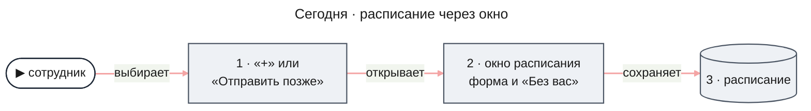
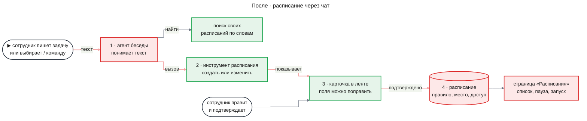

# PRD: Расписания через чат (chat-scheduling)

| Date | Depth |
|---|---|
| 2026-11-28 | full |

## Snapshot

**Overview.** Сегодня расписание заводят в отдельном окне-форме: сотрудник открывает её из меню «+» или кнопкой «Отправить позже», заполняет поля и отмечает список инструментов, которые расписанию можно вызывать без него. После фичи сотрудник просто пишет в чате, что и когда нужно делать, а агент беседы кладёт в ленту карточку расписания с заполненными полями — так же, как сегодня кладёт карточку брифа глубокого ресерча. Сотрудник правит поля прямо в карточке и подтверждает её; меняют расписание так же, словами из любой своей беседы. Вместо списка инструментов у расписания два уровня доступа: «только чтение» и «полный доступ», и на полный сотрудник явно соглашается в самой карточке. Набранный в поле `/` открывает короткий список команд, а окно расписания, «Отправить позже» и «Запланировать» в «+» удаляются.

- **Не меняется**: как и когда расписание срабатывает, куда пишет результат, история срабатываний, «Разрешить в этой беседе» в обычных беседах.
- **Не входит**: другие настройки через чат (они названы правилом на будущее, но не делаются) и общие механизмы настроек ([Won't Have](#wont-have)).
- **Главный риск**: «полный доступ» выполняет любые записи в пределах прав роли без человека, в том числе по тексту, который ход прочитал в источнике ([Assumptions and Risks](#assumptions-and-risks)).

## Terms

- **Инструмент** — действие, которое модель вызывает сама: найти записи, создать тикет, запустить глубокий агент. Сотрудник видит вызов в ленте беседы.
- **Карточка** — блок в ленте беседы, где сотрудник подтверждает или отклоняет вызов инструмента. Карточка брифа глубокого агента уже позволяет поправить текст перед подтверждением.
- **Карточка расписания** — карточка вызова инструмента расписания: в ней настройки нового расписания или изменения существующего, которые сотрудник может поправить.
- **Изменяющий вызов** — вызов, который сегодня ждёт карточки: изменяющий MCP-инструмент (тот, что не отмечен как только читающий), изменяющий скрипт, `run_code` с правом записи, изменение записи библиотеки.
- **Ход расписания** — работа агента в ответ на сообщение, которое отправило расписание (в срок или «Запустить сейчас»), вместе с агентами, которых этот ход запустил. Как только владелец сам написал в беседу, следующий ход обычный.
- **Уровень доступа** — настройка расписания: что ходу расписания можно делать без человека. «Только чтение» — изменяющие вызовы отклоняются. «Полный доступ» — изменяющие вызовы выполняются без карточки, в пределах прав роли владельца.
- **Согласие** — отметка сотрудника в карточке расписания, что он понимает и принимает «полный доступ». Без неё карточку с полным доступом не подтвердить.
- **Беседа расписания** — беседа, куда пишет расписание с местом результата «эта беседа»: та, где последней подтверждена карточка, выбравшая это место. У расписания «новая беседа» беседы расписания нет.

## Background

Сегодня расписание живёт в форме, отдельной от чата:

Владелец хочет, чтобы действия в чате шли через сам чат, как в ChatGPT: человек описывает задачу своими словами, а модель готовит карточку настройки — так, как это уже сделано с брифом глубокого ресерча. Поле «Без вас» со списком инструментов оказалось сложным: сотрудник должен заранее угадать, какие инструменты понадобятся. Его заменяют два понятных уровня. После фичи путь такой:

Пока сотрудник не подтвердил карточку, расписания нет и ничего не меняется. Изменение — это новая карточка от следующего вызова инструмента, как у записей библиотеки агентов: подтверждённая карточка остаётся в ленте как след решения и сама больше не меняется.

В ходе расписания уровень доступа решает судьбу каждого изменяющего вызова:

Оба исхода попадают в аудит с отметкой расписания. Вызовы, которые ничего не меняют, и бриф глубокого агента идут как сегодня, на любом уровне.

### Что эта фича заменяет

Требования соседних документов, перечисленные ниже, больше не действуют; их правила о сроках, истории, месте результата и правах по ролям остаются.

- `schedules-search-memory` [prd.md](../schedules-search-memory/prd.md): FR-01 в части окна создания, FR-10; [uxrd.md](../schedules-search-memory/uxrd.md): SH-01, SH-02.
- `improvements` [prd.md](../improvements/prd.md): FR-03 в части списка разрешённых инструментов, FR-07, FR-10; [uxrd.md](../improvements/uxrd.md): IM-01, IM-02, IM-08.

## Users and Use Cases

### Users

- **Сотрудник** — аналитик, SRE или менеджер, который поручает агенту повторяющуюся работу: утреннюю сводку, проверку логов, завод тикетов. Ему важно описать задачу своими словами и не разбираться в форме, а для изменяющих действий — понимать, что он разрешает.

### Use Cases

- **UC-1**: сотрудник описывает в чате, что и когда делать → получает в ленте готовую карточку и подтверждает её, так что расписание заводится без формы.
- **UC-2**: сотрудник словами просит изменить своё расписание в любой своей беседе → получает карточку изменения, где видно, что поменяется, так что не нужно искать расписание на странице.
- **UC-3**: сотрудник даёт расписанию, которое должно заводить тикеты, полный доступ с явным согласием → ход расписания делает записи без него и в пределах его прав, так что работа не стоит без подтверждения.
- **UC-4**: сотрудник не помнит, как начать, и набирает `/` → выбирает команду из короткого списка, так что ему не нужно знать формулировку.
- **UC-5**: сотрудник просматривает свои расписания на странице, ставит на паузу, запускает сейчас или удаляет → а за изменением настроек переходит в беседу расписания.

## Functional Requirements

### Must Have (MVP)

#### Инструмент, доступ и согласие — часть `server`

- **FR-01. Создать расписание словами.** Агент беседы по тексту сотрудника вызывает инструмент расписания, и расписание появляется только после того, как сотрудник подтвердил карточку этого вызова.
  - AC-01.1: Given сотрудник написал «каждый будний день в 9 утра присылай сводку новых инцидентов», when агент отвечает, then в ленте стоит карточка расписания с этим промптом, правилом «по будним дням в 09:00» и уровнем «только чтение», а в списке расписаний нового расписания нет.
  - AC-01.2: Given карточка нового расписания, when сотрудник её подтверждает, then расписание появляется в его списке с настройками из карточки, а агент в ответе называет ближайшее срабатывание.
  - AC-01.3: Given карточка нового расписания, when сотрудник её отклоняет, then расписания нет, а агент знает, что сотрудник отказался.
  - AC-01.4: Given сотрудник написал «отправь это завтра в 9», when агент отвечает, then карточка предлагает правило «один раз» на завтра в 09:00 и место результата «эта беседа».
  - AC-01.5: Given агент передал настройку, из которой расписание не составить (например, агента, недоступного сотруднику в меню «+»), when инструмент её проверяет, then карточки нет, а агент получает причину и может переспросить сотрудника.

- **FR-02. Найти и изменить своё расписание словами.** Агент беседы находит расписания сотрудника по словам из его сообщения и предлагает изменение карточкой; беседы, в которые расписание уже написало, изменение не трогает.
  - AC-02.1: Given у сотрудника расписания «Утренняя сводка» и «Проверка логов», when он пишет в любой своей беседе «перенеси утреннюю сводку на 10:00», then в ленте стоит карточка изменения расписания «Утренняя сводка» с новым временем.
  - AC-02.2: Given карточка изменения подтверждена, when сотрудник открывает расписание, then ближайшее срабатывание посчитано по новому правилу, а прежние беседы срабатываний не изменились.
  - AC-02.3: Given у сотрудника А есть расписание «Утренняя сводка», when сотрудник Б пишет «перенеси утреннюю сводку» или его агент передаёт инструменту id расписания А, then агент Б не получает расписаний А, изменение отклонено как для несуществующего расписания, а расписание А не изменилось.
  - AC-02.4: Given карточка изменения ждёт решения, when сотрудник удаляет это расписание на странице и потом подтверждает карточку, then расписание не появляется снова, а карточка сообщает, что расписания больше нет.

- **FR-03. Уровень доступа расписания.** У каждого расписания один из двух уровней — «только чтение» (по умолчанию) или «полный доступ», — и он один решает, что делать с изменяющим вызовом в ходе этого расписания и в агентах, которых ход запустил.
  - AC-03.1: Given расписание «только чтение», when его ход вызывает создание тикета в Jira, отправку письма, `run_code` с записью или изменение записи библиотеки, then вызов не выполнен и источник не вызван ни разу, карточки нет, ход не ждёт владельца, аудит записал отказ с отметкой расписания, а модель получила объяснение отказа.
  - AC-03.2: Given расписание «полный доступ», when его ход вызывает те же действия, then они выполнены без карточки, а в аудите у каждого вызова отметка этого расписания.
  - AC-03.3: Given расписание «полный доступ», но у владельца нет права на отправку письма по его роли, when ход вызывает отправку письма, then вызов отклонён по правам, как в чате, и источник не вызван ни разу.
  - AC-03.4: Given расписание на любом уровне, when его ход отправляет бриф глубокого агента, then карточки нет, и глубокий агент стартует.
  - AC-03.5: Given владелец сам написал сообщение в беседу расписания, when следующий ход делает изменяющий вызов, then беседа показывает карточку, как сегодня, на любом уровне расписания.

- **FR-04. Согласие на полный доступ.** Расписание получает или сохраняет «полный доступ» только по карточке, в которой сотрудник отметил согласие, и это согласие записано.
  - AC-04.1: Given карточка с уровнем «полный доступ» без отметки согласия, when её пытаются подтвердить в обход интерфейса, then расписание не создано и не изменено.
  - AC-04.2: Given сотрудник отметил согласие и подтвердил карточку, when администратор открывает аудит, then у вызова инструмента расписания видны сотрудник, время подтверждения и уровень «полный доступ».
  - AC-04.3: Given у расписания «полный доступ», when агент предлагает изменить в нём любую настройку, then карточка изменения снова требует отметки согласия, пока сотрудник не выберет «только чтение».
  - AC-04.4: Given ход расписания на любом уровне, when он вызывает создание или изменение расписания, then вызов отклонён, расписание не создано и не изменено, а модель получила объяснение: менять расписания может только сотрудник в беседе.

- **FR-05. Место результата из карточки.** Карточка задаёт, куда пишет срабатывание: в новую беседу каждый раз или в эту беседу — ту, где карточку подтвердили; карточка изменения сохраняет текущее место, пока в ней не выбрано другое.
  - AC-05.1: Given сотрудник подтвердил в беседе X карточку с местом «эта беседа», when наступает срок, then сообщение расписания приходит в беседу X.
  - AC-05.2: Given расписание пишет в беседу X, when сотрудник в беседе Y выбирает в карточке изменения место «эта беседа» и подтверждает, then карточка показывала прежнюю беседу X и новую Y, а следующие срабатывания приходят в беседу Y.
  - AC-05.3: Given карточка с местом «новая беседа», when наступает срок, then каждое срабатывание открывает новую беседу, как сегодня.
  - AC-05.4: Given расписание пишет в беседу X, when сотрудник в беседе Y подтверждает изменение только времени, then срабатывания по-прежнему приходят в беседу X.

#### Карточка, команды и страница — часть `web`

- **FR-06. Карточка расписания в ленте.** Карточка показывает все настройки расписания и ближайшее срабатывание, позволяет поправить любую из них до решения и остаётся в ленте с итогом после него.
  - AC-06.1: Given агент вызвал инструмент расписания, when сотрудник смотрит ленту, then карточка показывает имя, промпт, агента, правило с часовым поясом, ближайшее срабатывание, место результата и уровень доступа.
  - AC-06.2: Given карточка нового расписания с временем 09:00, when сотрудник меняет в ней время на 10:00 и подтверждает, then расписание сохранено с 10:00, а агент получает поправленные настройки.
  - AC-06.3: Given сотрудник ввёл в карточке настройку, из которой расписание не составить, when он подтверждает, then карточка показывает причину, а расписание не создано и не изменено.
  - AC-06.4: Given карточка изменения, when сотрудник смотрит её, then у каждой меняющейся настройки видно прежнее и новое значение.
  - AC-06.5: Given карточка подтверждена, when сотрудник смотрит ленту, then карточка показывает итог со ссылкой на страницу расписания, и подтвердить её ещё раз нельзя.

- **FR-07. Согласие в карточке.** Когда в карточке выбран «полный доступ», в ней же появляется отметка согласия, которая объясняет, что ход расписания будет делать записи от имени сотрудника без подтверждения, и без неё карточку не подтвердить.
  - AC-07.1: Given в карточке выбран «полный доступ», when согласие не отмечено, then подтвердить карточку нельзя, а отклонить можно.
  - AC-07.2: Given согласие отмечено, when сотрудник переключает уровень на «только чтение», then отметка согласия исчезает, и карточку можно подтвердить.
  - AC-07.3: Given карточка с отмеченным согласием подтверждена, when сотрудник открывает страницу расписания, then на ней указан уровень «полный доступ».

- **FR-08. Команды `/`.** Набранный в начале пустого поля сообщения `/` открывает короткий список команд — запланировать, создать агента, проверить агента, — а выбор только кладёт в поле то же, что пункт меню «+», и ничего не отправляет.
  - AC-08.1: Given поле сообщения пусто, when сотрудник набирает `/`, then открывается список команд; when он набирает дальше «запл», then в списке остаётся «Запланировать».
  - AC-08.2: Given список команд открыт, when сотрудник выбирает «Запланировать», then в поле стоит начало фразы о расписании, курсор после него, и ничего не отправлено.
  - AC-08.3: Given список команд открыт, when сотрудник выбирает создание или проверку агента, then в поле то же, что кладёт соответствующий пункт «+»: текст шаблона или чип действия.
  - AC-08.4: Given сотруднику недоступна проверка агента в меню «+», when он открывает список команд, then этой команды в списке нет.

- **FR-09. Страница «Расписания» без формы.** Страница показывает список расписаний с уровнем доступа и даёт паузу, возобновление, «Запустить сейчас» и удаление, как сегодня, а «Изменить» ведёт в беседу расписания.
  - AC-09.1: Given беседа расписания существует, when сотрудник нажимает «Изменить», then открывается эта беседа.
  - AC-09.2: Given у расписания нет беседы расписания или она удалена, when сотрудник нажимает «Изменить», then открывается новый чат, где в поле сообщения стоит просьба изменить расписание с его именем, и ничего не отправлено.

- **FR-10. Окна расписания больше нет.** Ни одно место интерфейса не открывает форму расписания: в меню «+» нет пункта «Запланировать», рядом с отправкой нет «Отправить позже», а поля «Без вас» и выбора инструментов нет нигде.
  - AC-10.1: Given беседа с сообщениями и текстом в поле, when сотрудник смотрит на поле сообщения и открывает «+», then нет ни «Отправить позже», ни «Запланировать», а «Создать агента», «Проверить агента» и «Подключения» на месте.

### Won't Have

- Пауза, возобновление и удаление словами в чате — не в этой версии: страница «Расписания» уже это делает.
- Карточка, которая живёт и обновляется на месте, — не эта фича: каждое изменение — новая карточка, как у записей библиотеки.
- Список отдельных инструментов, разрешённых расписанию, — убран: его заменяют два уровня доступа.
- Общие формы, которые интерфейс собирает сам по описанию настроек, единый реестр всех настроек чата и палитра команд — поиск по всем действиям продукта, а не короткий список `/` (FR-08), — не эта фича: каждая настройка через чат — свой инструмент и своя карточка.
- Изменения «Разрешить в этой беседе» в обычных беседах — не эта фича: ход расписания этим разрешением не пользуется, как сегодня.
- Расписания в панели администратора — не эта фича.
- Другие команды в списке `/` и другие настройки через чат — позже, по правилу из [Constraints](#constraints).

## Non-Functional Requirements

### Accessibility and Responsiveness

- **NFR-01**: карточка расписания, отметка согласия и список команд `/` проходят WCAG 2.1 AA и работают с клавиатуры.
- **NFR-02**: карточка расписания и список команд пригодны к работе с ширины 360 px.

## Delivery Parts

| Part | Covers | Cut along | Depends on | Rationale |
|------|--------|-----------|------------|-----------|
| `server` | FR-01, FR-02, FR-03, FR-04, FR-05 | backend | — | Инструменты расписания, содержимое карточки, уровень доступа в правиле вызова и замена списка инструментов — договор, который читает экран. |
| `web` | FR-06, FR-07, FR-08, FR-09, FR-10 | frontend | `server` | Карточка, согласие, список `/`, страница и удаление окна строятся на готовом содержимом карточки. |

Возможна и одна часть: фича невелика, и один Design Doc её удержит; две части выбраны потому, что содержимое карточки — договор между сервером и экраном.

## Success Criteria

- Карточка заполнена верно без правки — не меньше 8 из 10 формулировок владельца (один раз, каждый день, по дням недели, каждые N часов, с агентом из библиотеки, «в эту беседу»), на модели класса Haiku; владелец проверяет руками на своих задачах в первую неделю после сборки.

## Constraints and Risks

### Constraints

- **Правило для будущих настроек чата.** Настройка или команда чата делается одинаково: сотрудник пишет текст, агент вызывает инструмент, в ленте появляется карточка, которую сотрудник правит и подтверждает. Кандидаты на потом, не требования этой фичи: язык и тема интерфейса; память; подключения — только как ссылка на их экран; пароль — никогда через чат; текст личных инструкций решает фича `agent-guidance`.
- Бизнес-ограничение 1 (`.claude/skills/project-context/SKILL.md`) соблюдено: «полный доступ» — это разрешение, которое владелец заранее дал расписанию, а вызов по нему отмечен в аудите.
- Продукт — прототип: окно расписания, «Отправить позже», пункт «Запланировать» в «+», поле «Без вас» и список разрешённых инструментов удаляются, а не прячутся. Расписания, созданные до фичи, работают на уровне «только чтение», пока владелец не даст им полный доступ в чате.

### Assumptions and Risks

- Модель класса Haiku может понять время неверно, например «в 9» как 21:00. Карточка показывает ближайшее срабатывание, и сотрудник видит ошибку до подтверждения.
- «Полный доступ» выполняет любую запись в пределах прав роли. Текст, который ход прочитал в письме или тикете, может подтолкнуть модель к лишней записи, и человека рядом нет. Удерживают отметка согласия с объяснением, права роли и аудит с отметкой расписания.
- Согласие на каждое изменение расписания с полным доступом может утомлять, и сотрудник начнёт отмечать его не читая. Повторное согласие выбрано осознанно: изменённый промпт меняет то, что будет выполнено без человека.

## Update History

| Version | Date | Change |
|---------|------|--------|
| 1.0 | 2026-11-28 | Initial version |
