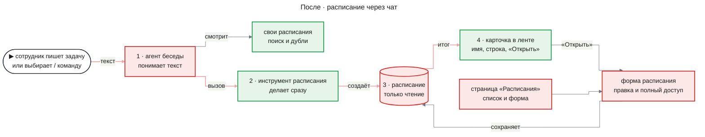
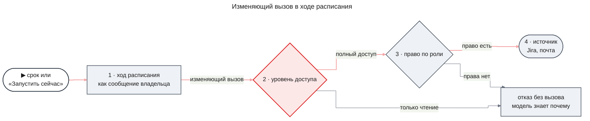

# PRD: Расписания через чат (chat-scheduling)

| Date | Depth |
|---|---|
| 2026-11-28 | full |

## Snapshot

**Overview.** Сегодня расписание заводят в отдельном окне-форме: сотрудник открывает её из меню «+» или кнопкой «Отправить позже», заполняет поля и отмечает список инструментов, которые расписанию можно вызывать без него. После фичи сотрудник может просто написать в чате, что и когда нужно делать, и агент беседы сразу заводит расписание, как в ChatGPT: в ленте появляется короткая карточка с именем, строкой расписания и кнопкой «Открыть», а агент в ответе говорит, когда первое срабатывание. Так же, словами из любой своей беседы, расписание меняют, ставят на паузу, возобновляют и удаляют. Вместо списка инструментов у расписания два уровня доступа: расписание из чата всегда получает «только чтение», а «полный доступ» с явным согласием даёт только сам сотрудник в форме. Форма остаётся на странице «Расписания» и открывается из карточки, а из поля сообщения её больше не открыть: «Отправить позже» и «Запланировать» в «+» удаляются, вместо них — текст или короткий список команд по `/`.

- **Не меняется**: как и когда расписание срабатывает, куда пишет результат, история срабатываний, «Разрешить в этой беседе» в обычных беседах.
- **Не входит**: другие настройки через чат (они названы правилом на будущее, но не делаются) и общие механизмы настроек ([Won't Have](#wont-have)).
- **Главный риск**: «полный доступ» выполняет любые записи в пределах прав роли без человека, в том числе по тексту, который ход прочитал в источнике ([Assumptions and Risks](#assumptions-and-risks)).

## Terms

- **Инструмент** — действие, которое модель вызывает сама: найти записи, создать тикет, запустить глубокий агент. Сотрудник видит вызов в ленте беседы.
- **Карточка** — блок в ленте беседы, где сотрудник подтверждает или отклоняет изменяющий вызов.
- **Изменяющий вызов** — вызов, который сегодня ждёт карточки: изменяющий MCP-инструмент (тот, что не отмечен как только читающий), изменяющий скрипт, `run_code` с правом записи, изменение записи библиотеки.
- **Инструмент расписания** — инструмент агента беседы, который сразу создаёт, меняет, ставит на паузу, возобновляет или удаляет расписание сотрудника. Карточки подтверждения у него нет.
- **Карточка расписания** — короткий блок в ленте после того, как агент создал или изменил расписание: имя, строка расписания и кнопка «Открыть». Подтверждать в ней нечего.
- **Форма расписания** — окно с полями расписания. Его открывают со страницы «Расписания» и кнопкой «Открыть» в карточке расписания; оно сохраняет расписание сразу, без модели.
- **Ход расписания** — работа агента в ответ на сообщение, которое отправило расписание (в срок или «Запустить сейчас»), вместе с агентами, которых этот ход запустил. Как только владелец сам написал в беседу, следующий ход обычный.
- **Уровень доступа** — настройка расписания: что ходу расписания можно делать без человека. «Только чтение» — изменяющие вызовы отклоняются. «Полный доступ» — изменяющие вызовы выполняются без карточки, в пределах прав роли владельца.
- **Согласие** — отметка сотрудника в форме расписания, что он понимает и принимает «полный доступ». Без неё форму с полным доступом не сохранить.
- **Беседа расписания** — беседа, куда пишет расписание с местом результата «эта беседа»: та, где агент беседы завёл расписание или перенёс его сюда. У расписания «новая беседа» беседы расписания нет.

## Background

Сегодня расписание живёт в форме, отдельной от чата:

Владелец хочет, чтобы расписания в чате работали как в ChatGPT: человек описывает задачу своими словами, а агент сразу заводит расписание и показывает, что получилось. Поле «Без вас» со списком инструментов оказалось сложным: сотрудник должен заранее угадать, какие инструменты понадобятся. Его заменяют два понятных уровня. Форма при этом остаётся: в ней сотрудник проверяет и правит то, что сделал агент, и только в ней даёт полный доступ. После фичи путь через чат такой:

Расписание появляется сразу после вызова. Ошибку сотрудник видит в карточке и в ответе агента и исправляет словами или в форме. Расписание из чата не делает записей без человека, пока сотрудник сам не дал ему полный доступ в форме.

В ходе расписания уровень доступа решает судьбу каждого изменяющего вызова:

Оба исхода попадают в аудит с отметкой расписания. Вызовы, которые ничего не меняют, и бриф глубокого агента идут как сегодня, на любом уровне.

### Что эта фича заменяет

Требования соседних документов, перечисленные ниже, больше не действуют; их правила о сроках, истории, месте результата и правах по ролям остаются.

- `schedules-search-memory` [prd.md](../schedules-search-memory/prd.md): FR-01 в части окна, открытого из беседы; [uxrd.md](../schedules-search-memory/uxrd.md): SH-01.
- `improvements` [prd.md](../improvements/prd.md): FR-03 в части списка разрешённых инструментов, FR-07, FR-10; [uxrd.md](../improvements/uxrd.md): IM-01, IM-02, IM-08.

## Users and Use Cases

### Users

- **Сотрудник** — аналитик, SRE или менеджер, который поручает агенту повторяющуюся работу: утреннюю сводку, проверку логов, завод тикетов. Ему важно описать задачу своими словами и не разбираться в форме, а для изменяющих действий — понимать, что он разрешает.

### Use Cases

- **UC-1**: сотрудник описывает в чате, что и когда делать → агент сразу заводит расписание и говорит, когда первое срабатывание, так что расписание появляется, не уходя из беседы; если что-то не так, сотрудник открывает форму из карточки.
- **UC-2**: сотрудник словами просит изменить своё расписание в любой своей беседе → агент сразу меняет его, так что не нужно искать расписание на странице.
- **UC-3**: сотрудник даёт расписанию, которое должно заводить тикеты, полный доступ в форме с явным согласием → ход расписания делает записи без него и в пределах его прав, так что работа не стоит без подтверждения.
- **UC-4**: сотрудник не помнит, как начать, и набирает `/` → выбирает команду из короткого списка, так что ему не нужно знать формулировку.
- **UC-5**: сотрудник просматривает свои расписания на странице, открывает беседу расписания, ставит на паузу, запускает сейчас, удаляет, заводит новое или меняет его в форме → без чата и модели, если ему так удобнее.
- **UC-6**: сотрудник пишет в любой своей беседе «поставь утреннюю сводку на паузу», «возобнови» или «удали» → агент сразу делает это и называет расписание, так что страницу открывать не нужно.

## Functional Requirements

### Must Have (MVP)

#### Инструмент, доступ и правила — часть `server`

- **FR-01. Создать расписание словами.** Агент беседы по тексту сотрудника сразу создаёт расписание с уровнем «только чтение» и в ответе называет первое срабатывание.
  - AC-01.1: Given сотрудник написал «каждый будний день в 9 утра присылай сводку новых инцидентов», when агент отвечает, then в списке сотрудника уже есть расписание с этим промптом, правилом «по будним дням в 09:00» и уровнем «только чтение», в ленте стоит карточка расписания, а ответ агента называет первое срабатывание.
  - AC-01.2: Given сотрудник написал «отправь это завтра в 9», when агент отвечает, then создано расписание «один раз» на завтра в 09:00 с местом результата «эта беседа».
  - AC-01.3: Given агент передал настройку, из которой расписание не составить (например, агента, недоступного сотруднику в меню «+»), when инструмент её проверяет, then расписания нет, а агент получает причину и может переспросить сотрудника.
  - AC-01.4: Given у сотрудника уже есть расписание «Утренняя сводка» — по будним дням в 09:00 присылать сводку инцидентов, when он пишет «каждый будний день в 9 присылай сводку инцидентов», then второго такого расписания нет, а агент в ответе называет существующее и предлагает изменить его.

- **FR-02. Найти и изменить своё расписание словами.** Агент беседы находит расписания сотрудника по словам из его сообщения и сразу меняет нужное; изменение не трогает беседы, в которые расписание уже написало.
  - AC-02.1: Given у сотрудника расписания «Утренняя сводка» и «Проверка логов», when он пишет в любой своей беседе «перенеси утреннюю сводку на 10:00», then «Утренняя сводка» уже срабатывает в 10:00, «Проверка логов» не изменилась, а в ленте стоит карточка расписания «Утренняя сводка».
  - AC-02.2: Given расписание изменено словами, when сотрудник открывает его, then ближайшее срабатывание посчитано по новому правилу, а прежние беседы срабатываний не изменились.
  - AC-02.3: Given у сотрудника А есть расписание «Утренняя сводка», when сотрудник Б пишет «перенеси утреннюю сводку» или его агент передаёт инструменту id расписания А, then агент Б не получает расписаний А, изменение отклонено как для несуществующего расписания, а расписание А не изменилось.

- **FR-03. Уровень доступа расписания.** У каждого расписания один из двух уровней — «только чтение» (по умолчанию) или «полный доступ», — и он один решает, что делать с изменяющим вызовом в ходе этого расписания и в агентах, которых ход запустил.
  - AC-03.1: Given расписание «только чтение», when его ход вызывает создание тикета в Jira, отправку письма, `run_code` с записью или изменение записи библиотеки, then вызов не выполнен и источник не вызван ни разу, карточки нет, ход не ждёт владельца, аудит записал отказ с отметкой расписания, а модель получила объяснение отказа.
  - AC-03.2: Given расписание «полный доступ», when его ход вызывает те же действия, then они выполнены без карточки, а в аудите у каждого вызова отметка этого расписания.
  - AC-03.3: Given расписание «полный доступ», но у владельца нет права на отправку письма по его роли, when ход вызывает отправку письма, then вызов отклонён по правам, как в чате, и источник не вызван ни разу.
  - AC-03.4: Given расписание на любом уровне, when его ход отправляет бриф глубокого агента, then карточки нет, и глубокий агент стартует.
  - AC-03.5: Given владелец сам написал сообщение в беседу расписания, when следующий ход делает изменяющий вызов, then беседа показывает карточку, как сегодня, на любом уровне расписания.

- **FR-04. Полный доступ только в форме.** «Полный доступ» расписанию даёт только сотрудник в форме и только с отметкой согласия, которая записана; агент беседы полный доступ не даёт и не сохраняет, когда меняет расписание.
  - AC-04.1: Given в форме выбран «полный доступ» без отметки согласия, when форму сохраняют в обход интерфейса, then расписание не создано и не изменено.
  - AC-04.2: Given сотрудник отметил согласие и сохранил форму с «полным доступом», when администратор открывает аудит, then видны сотрудник, время сохранения и уровень «полный доступ».
  - AC-04.3: Given у расписания «полный доступ», when сотрудник меняет в форме любую настройку, then сохранить можно только с новой отметкой согласия или после выбора «только чтение».
  - AC-04.4: Given сотрудник написал «каждый день в 9 заводи тикет по новым инцидентам, с полным доступом», when агент создаёт расписание, then у расписания уровень «только чтение», а агент в ответе говорит, что полный доступ даётся в форме.
  - AC-04.5: Given у расписания «полный доступ», when агент беседы меняет в нём любую настройку, then у расписания становится «только чтение», а агент получает это в итоге вызова и говорит об этом в ответе.
  - AC-04.6: Given ход расписания на любом уровне, when он вызывает создание или изменение расписания, then вызов отклонён, расписание не создано и не изменено, а модель получила объяснение: менять расписания может только сотрудник — словами в беседе или в форме.

- **FR-05. Место результата словами.** Агент задаёт, куда пишет срабатывание: в новую беседу каждый раз или в эту беседу — ту, где агент завёл расписание или куда его перенёс; изменение сохраняет текущее место, пока сотрудник не попросил другое, а если беседы расписания больше нет, переносит его в эту беседу.
  - AC-05.1: Given сотрудник в беседе X попросил присылать результат сюда, when наступает срок, then сообщение расписания приходит в беседу X.
  - AC-05.2: Given расписание пишет в беседу X, when сотрудник в беседе Y пишет «присылай утреннюю сводку сюда», then следующие срабатывания приходят в беседу Y.
  - AC-05.3: Given у расписания место «новая беседа», when наступает срок, then каждое срабатывание открывает новую беседу, как сегодня.
  - AC-05.4: Given расписание пишет в беседу X, when сотрудник в беседе Y просит изменить только время, then срабатывания по-прежнему приходят в беседу X.
  - AC-05.5: Given расписание писало в беседу X, а беседа X удалена, when агент в беседе Y меняет это расписание, then следующие срабатывания приходят в беседу Y.

- **FR-11. Пауза, возобновление и удаление словами.** Агент беседы по просьбе сотрудника сразу ставит его расписание на паузу, возобновляет или удаляет, так же как кнопкой на странице, и называет расписание в ответе.
  - AC-11.1: Given расписание «Утренняя сводка» работает, when сотрудник пишет в любой своей беседе «поставь утреннюю сводку на паузу», then расписание на паузе и не срабатывает, как после паузы на странице.
  - AC-11.2: Given «Утренняя сводка» на паузе, when сотрудник пишет «возобнови утреннюю сводку», then расписание снова срабатывает по своему правилу, а агент в ответе называет ближайшее срабатывание.
  - AC-11.3: Given сотрудник написал «удали проверку логов», when агент отвечает, then расписание удалено так же, как кнопкой на странице, его нет в списке, а агент в ответе называет удалённое расписание.
  - AC-11.4: Given расписание с «полным доступом», when агент ставит его на паузу или возобновляет, then уровень доступа не изменился.
  - AC-11.5: Given у сотрудника А есть расписание «Утренняя сводка», when сотрудник Б пишет «удали утреннюю сводку» или его агент передаёт инструменту паузу, возобновление или удаление с id расписания А, then агент Б не получает расписаний А, действие отклонено как для несуществующего расписания, а расписание А не изменилось.
  - AC-11.6: Given ход расписания на любом уровне, when он вызывает паузу, возобновление или удаление любого расписания, then вызов отклонён, расписание не изменилось, а модель получила то же объяснение, что в AC-04.6.

- **FR-14. Одни правила для агента и формы.** Инструмент расписания и форма сохраняют расписание после одной и той же проверки настроек, так что одно и то же расписание принимается или отклоняется одинаково на обоих путях.
  - AC-14.1: Given в настройках агент, недоступный сотруднику в меню «+», when сотрудник сохраняет форму или агент беседы вызывает инструмент с этими настройками, then расписание не создано и не изменено, а оба пути сообщают одну и ту же причину.

- **FR-15. Часовой пояс расписания.** У каждого расписания свой часовой пояс: агент беседы ставит новому расписанию пояс сотрудника, когда система его знает, а иначе — пояс системы, а в форме пояс — отдельное поле, которое сотрудник может поменять; карточка расписания и форма показывают пояс.
  - AC-15.1: Given система знает, что сотрудник работает в поясе Asia/Novosibirsk, when агент создаёт расписание «каждый день в 9», then расписание срабатывает в 09:00 по Asia/Novosibirsk, а карточка показывает этот пояс.
  - AC-15.2: Given система не знает пояс сотрудника, when агент создаёт расписание, then правило считается в поясе системы, карточка показывает этот пояс, а сотрудник может поменять его в форме (AC-15.4).
  - AC-15.3: Given у расписания пояс Europe/Moscow, when агент беседы меняет в нём время, then пояс остаётся Europe/Moscow, пока сотрудник не попросил другой.
  - AC-15.4: Given сотрудник открыл форму, when он смотрит поле часового пояса, then в нём пояс расписания, а у нового расписания — пояс браузера; when он выбирает Asia/Novosibirsk и сохраняет, then расписание срабатывает по Asia/Novosibirsk.

#### Карточка, команды, страница и форма — часть `web`

- **FR-06. Карточка расписания в ленте.** После того как агент создал или изменил расписание, в ленте стоит карточка с именем расписания, строкой расписания с часовым поясом и кнопкой «Открыть», которая открывает форму этого расписания.
  - AC-06.1: Given агент создал расписание «Утренняя сводка» на каждый день в 09:00, when сотрудник смотрит ленту, then карточка показывает имя, строку правила расписания с поясом и кнопку «Открыть», а полей для правки и кнопок подтверждения в ней нет.
  - AC-06.2: Given карточка расписания, when сотрудник нажимает «Открыть», then открывается та же форма этого расписания, что по «Изменить» на странице «Расписания».
  - AC-06.3: Given расписание удалено после того, как появилась его карточка, when сотрудник нажимает «Открыть», then форма не открывается, а сотрудник видит, что расписания больше нет.
  - AC-06.4: Given агент беседы изменил расписание с «полным доступом» (AC-04.5), when сотрудник смотрит ленту, then карточка расписания говорит, что у расписания теперь «только чтение» и что вернуть полный доступ можно в форме.

- **FR-08. Команды `/`.** Набранный в начале пустого поля сообщения `/` открывает короткий список команд — запланировать, создать агента, проверить агента, — а выбор только кладёт в поле начало фразы или то же, что пункт меню «+», и ничего не отправляет.
  - AC-08.1: Given поле сообщения пусто, when сотрудник набирает `/`, then открывается список команд; when он набирает дальше «запл», then в списке остаётся «Запланировать».
  - AC-08.2: Given список команд открыт, when сотрудник выбирает «Запланировать», then в поле стоит начало фразы о расписании, курсор после него, и ничего не отправлено.
  - AC-08.3: Given список команд открыт, when сотрудник выбирает создание или проверку агента, then в поле то же, что кладёт соответствующий пункт «+»: текст шаблона или чип действия.
  - AC-08.4: Given сотруднику недоступна проверка агента в меню «+», when он открывает список команд, then этой команды в списке нет.

- **FR-09. Страница «Расписания».** Страница показывает каждое расписание строкой с именем, ближайшим срабатыванием и периодичностью и по щелчку открывает его беседу, а у расписания по-прежнему есть пауза или возобновление, «Запустить сейчас», «Изменить» и удаление.
  - AC-09.1: Given расписание «Утренняя сводка» работает по будним дням в 09:00, when сотрудник смотрит страницу, then в его строке видны имя «Утренняя сводка», ближайшее срабатывание и периодичность строкой правила расписания.
  - AC-09.2: Given расписание на паузе, when сотрудник смотрит страницу, then вместо ближайшего срабатывания в строке видно, что расписание на паузе, а периодичность остаётся.
  - AC-09.3: Given беседа расписания существует, when сотрудник щёлкает по строке, then открывается эта беседа.
  - AC-09.4: Given расписание с местом «новая беседа» уже срабатывало, when сотрудник щёлкает по строке, then открывается беседа последнего срабатывания.
  - AC-09.5: Given у расписания нет ни беседы расписания, ни беседы последнего срабатывания, when сотрудник щёлкает по строке, then открывается страница этого расписания с историей срабатываний.
  - AC-09.6: Given расписание на странице «Расписания», when сотрудник выбирает паузу, возобновление, «Запустить сейчас» или удаление, then действие выполняется сразу, как сегодня, а «Изменить» открывает форму с настройками этого расписания (FR-13).

- **FR-10. Из поля сообщения форму не открыть.** В меню «+» нет пункта «Запланировать», а рядом с отправкой нет «Отправить позже»; в чате расписание заводят текстом или командой `/`.
  - AC-10.1: Given беседа с сообщениями и текстом в поле, when сотрудник смотрит на поле сообщения и открывает «+», then нет ни «Отправить позже», ни «Запланировать», а «Создать агента», «Проверить агента» и «Подключения» на месте.

- **FR-12. Итог паузы, возобновления и удаления в ленте.** После паузы, возобновления или удаления словами лента показывает, какое расписание и что с ним сделано.
  - AC-12.1: Given агент поставил «Утреннюю сводку» на паузу, when сотрудник смотрит ленту, then в ней видно имя «Утренняя сводка» и итог «на паузе», а подтверждать ничего не нужно.

- **FR-13. Форма расписания.** Кнопка создания на странице «Расписания» открывает форму пустой, а «Изменить» на странице и «Открыть» в карточке — с настройками расписания; форма сохраняет расписание сразу, без модели, а вместо поля «Без вас» в ней два уровня доступа и отметка согласия.
  - AC-13.1: Given сотрудник открыл пустую форму на странице «Расписания», when он заполняет имя, промпт и правило и сохраняет форму, then расписание есть в его списке, в беседах ничего не появилось, а каждое срабатывание открывает новую беседу.
  - AC-13.2: Given сотрудник открыл форму расписания, when он смотрит её, then в ней настройки расписания, его часовой пояс и уровень доступа; when он меняет время и сохраняет, then ближайшее срабатывание посчитано по новому правилу.
  - AC-13.3: Given в форме выбран «полный доступ», when согласие не отмечено, then сохранить форму нельзя, а закрыть без сохранения можно; отметка объясняет, что ход расписания будет делать записи от имени сотрудника без подтверждения.
  - AC-13.4: Given согласие отмечено, when сотрудник переключает уровень на «только чтение», then отметка согласия исчезает, и форму можно сохранить.
  - AC-13.5: Given форма с отмеченным согласием сохранена, when сотрудник открывает страницу расписания, then на ней указан уровень «полный доступ».
  - AC-13.6: Given форма открыта, when сотрудник смотрит её поля, then списка инструментов «Без вас» в ней нет.

### Won't Have

- Подтверждение перед созданием, изменением, паузой или удалением расписания словами — нет: агент делает это сразу, а ошибку сотрудник исправляет словами или в форме.
- Полный доступ, который даёт агент беседы, — нет: его даёт только сотрудник в форме с согласием.
- Список отдельных инструментов, разрешённых расписанию, — убран: его заменяют два уровня доступа.
- Общие формы, которые интерфейс собирает сам по описанию настроек, единый реестр всех настроек чата и палитра команд — поиск по всем действиям продукта, а не короткий список `/` (FR-08), — не эта фича: каждая настройка через чат — свой инструмент.
- Изменения «Разрешить в этой беседе» в обычных беседах — не эта фича: ход расписания этим разрешением не пользуется, как сегодня.
- Расписания в панели администратора — не эта фича.
- Строка «Создано в беседе» в списке расписаний — не нужна: строка списка — это имя расписания и его срок.
- Общий доступ к расписанию, своя модель у расписания и дата окончания повторов — не эта фича.
- Другие команды в списке `/` и другие настройки через чат — позже, по правилу из [Constraints](#constraints).

## Non-Functional Requirements

### Accessibility and Responsiveness

- **NFR-01**: карточка расписания, форма с отметкой согласия и список команд `/` проходят WCAG 2.1 AA и работают с клавиатуры.
- **NFR-02**: карточка расписания, форма и список команд пригодны к работе с ширины 360 px.

## Delivery Parts

| Part | Covers | Cut along | Depends on | Rationale |
|------|--------|-----------|------------|-----------|
| `server` | FR-01, FR-02, FR-03, FR-04, FR-05, FR-11, FR-14, FR-15 | backend | — | Инструмент расписания, уровень доступа в правиле вызова, одни правила для агента и формы, часовой пояс и замена списка инструментов — договор, который читает экран. |
| `web` | FR-06, FR-08, FR-09, FR-10, FR-12, FR-13 | frontend | `server` | Карточка расписания, итог действий в ленте, список `/`, страница, форма и удаление входов из поля сообщения строятся на готовом договоре. |

Возможна и одна часть: фича невелика, и один Design Doc её удержит; две части выбраны потому, что содержимое карточки и правила сохранения — договор между сервером и экраном.

## Success Criteria

- Расписание, созданное словами, верно без открытия формы — не меньше 8 из 10 формулировок владельца (один раз, каждый день, по дням недели, каждые N часов, с агентом из библиотеки, «в эту беседу»), на модели класса Haiku; владелец проверяет руками на своих задачах в первую неделю после сборки.

## Constraints and Risks

### Constraints

- **Правило для будущих настроек чата.** Настройка или команда чата делается одинаково: сотрудник пишет текст, агент вызывает инструмент, который сразу делает дело, а в ленте появляется короткая карточка с итогом и переходом к экрану этой настройки. Кандидаты на потом, не требования этой фичи: язык и тема интерфейса; память; подключения — только как ссылка на их экран; пароль — никогда через чат; текст личных инструкций решает фича `agent-guidance`.
- Пауза, возобновление и удаление словами делаются тем же инструментом расписания, что создание и изменение, а не отдельными инструментами.
- Бизнес-ограничение 1 (`.claude/skills/project-context/SKILL.md`) соблюдено: «полный доступ» — это разрешение, которое владелец заранее дал расписанию в форме, а вызов по нему отмечен в аудите.
- Продукт — прототип: «Отправить позже», пункт «Запланировать» в «+», поле «Без вас» и список разрешённых инструментов удаляются, а не прячутся. Расписания, созданные до фичи, работают на уровне «только чтение», пока владелец не даст им полный доступ в форме.

### Assumptions and Risks

- Модель класса Haiku может понять время неверно, например «в 9» как 21:00. Ответ агента называет первое срабатывание, карточка показывает строку расписания, и сотрудник исправляет ошибку словами или в форме; расписание из чата только читает, поэтому неверное срабатывание ничего не записывает.
- Модель может отнести «удали сводку» не к тому расписанию, а удаление происходит сразу и не отменяется. Ответ агента называет удалённое расписание, и сотрудник заводит его заново.
- «Полный доступ» выполняет любую запись в пределах прав роли. Текст, который ход прочитал в письме или тикете, может подтолкнуть модель к лишней записи, и человека рядом нет. Удерживают согласие в форме с объяснением, права роли и аудит с отметкой расписания.
- Изменение словами снимает с расписания полный доступ, и записи, которых сотрудник ждёт, перестанут выполняться. Карточка говорит об этом сразу, а вернуть доступ можно в форме: агент не должен ни дать полный доступ, ни переписать промпт расписания с полным доступом без согласия.
- Согласие на каждое изменение расписания с полным доступом в форме может утомлять, и сотрудник начнёт отмечать его не читая. Повторное согласие выбрано осознанно: изменённый промпт меняет то, что будет выполнено без человека.

## Update History

| Version | Date | Change |
|---------|------|--------|
| 1.0 | 2026-11-28 | Initial version |
| 1.1 | 2026-11-28 | Пауза, возобновление и удаление словами (FR-11, FR-12, UC-6); изменение берёт текущий пояс сотрудника (AC-02.5) |
| 1.2 | 2026-11-28 | Агент делает расписание сразу, без карточки подтверждения, а лента показывает короткую карточку с «Открыть» (FR-01, FR-02, FR-06, FR-11, FR-12); полный доступ только в форме, изменение словами его снимает (FR-04); форма остаётся на странице (FR-13), одни правила для агента и формы (FR-14), пояс сотрудника или системы и поле пояса в форме (FR-15); проверка дублей (AC-01.4); строка списка и щелчок по ней (FR-09); из поля сообщения уходят только «Запланировать» и «Отправить позже» (FR-10); согласие в карточке (FR-07) убрано |
