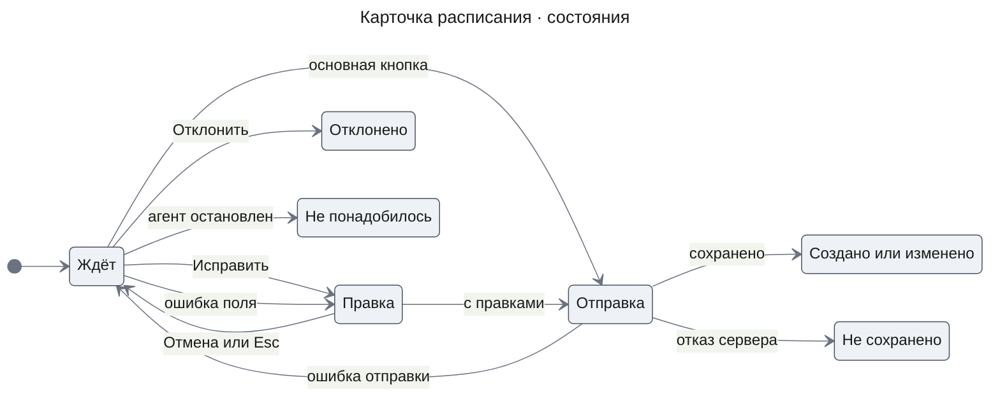
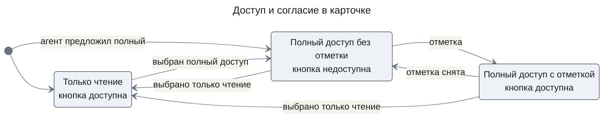

# UXRD: Расписания через чат (chat-scheduling)

| Дата | PRD |
|---|---|
| 2026-11-28 | [prd.md](./prd.md) |

## Snapshot

**Overview.** Сотрудник больше не заполняет окно расписания: он пишет в беседе, что и когда делать, и агент кладёт в ленту карточку расписания — ещё один вид карточки решения, той же, что у задания глубокого агента. В карточке видны все настройки и ближайшее срабатывание; «Исправить» превращает их в знакомые поля расписания, а уровень доступа выбирается там же: «Только чтение» или «Полный доступ» с отметкой согласия. Изменить расписание можно словами в любой беседе — агент кладёт новую карточку, где видно, что было и что станет. Набранный в пустом поле `/` открывает короткий список команд по образцу списка `@`. Страница «Расписания» остаётся списком с паузой, запуском и удалением, а «Изменить» ведёт в беседу с готовой просьбой в поле.

- **Не меняется**: срабатывание, подпись сообщения от расписания, история срабатываний, блок «Отказано» в ходе расписания (improvements UXRD, IM-03), «Разрешить в этой беседе» в обычных беседах.
- **Главный UX-риск**: сотрудник отметит согласие на полный доступ, не читая. Отметка никогда не стоит заранее, её текст называет риск словами, а её требует каждая карточка, которая оставляет полный доступ (KD-2).

### Key Decisions

| ID | Решение | Почему |
|---|---|---|
| KD-1 | Карточка расписания — вариант карточки решения, устроенный как задание глубокого агента: сначала пары «подпись — значение», «Исправить» заменяет их полями, «Отмена» и Esc возвращают прежние значения. Изменение — всегда новая карточка; подтверждённая карточка остаётся в ленте следом решения | Сотрудник уже умеет читать и править задание глубокого агента. Карточка, которая обновлялась бы на месте, спрятала бы, что именно он подтвердил |
| KD-2 | Уровень доступа — пара «Доступ» и радиогруппа в правке. При «Полный доступ» сразу под ним встаёт отметка согласия; пока она пуста, основная кнопка недоступна. Отметка всегда начинается пустой — и в карточке изменения расписания, у которого полный доступ уже есть | Согласие дают в той же карточке, где видно, что именно будет выполняться без человека. Изменённая инструкция меняет то, что агент сделает сам, поэтому прошлое согласие на неё не переносится |
| KD-3 | Карточка изменения показывает все настройки; у меняющихся новое значение, метка «изменено» и строка «было: …». «Следующее срабатывание» всегда посчитано заново | Сотрудник подтверждает расписание целиком, а не разницу, и видит, что осталось прежним. Срабатывание по новому правилу ловит ошибку модели во времени до подтверждения |
| KD-4 | Список `/` — тот же список над полем, что у `@` (improvements UXRD, IM-12): место, клавиши, вид строки, пустое состояние. Его строки — «Запланировать» и пункты меню «+» «Создать агента в чате» и «Создать и проверить агента»; у этих двух выбор делает то же, что пункт | Сотрудник знает одно поведение списка над полем. Команда ничего не отправляет, поэтому не нужна новая логика: она только начинает фразу или ставит чип |
| KD-5 | «Изменить» на странице расписания открывает беседу расписания, а если её нет — новый чат. В поле стоит «Измени расписание «{название}»: », курсор в конце, ничего не отправлено | Следующий шаг очевиден в обоих случаях: дописать, что поменять. Одинаковое поведение не заставляет помнить, у какого расписания есть беседа |
| KD-6 | Ошибку в полях карточка показывает до отправки, как поле расписания. Отказ сервера после подтверждения (расписание удалено, агент стал недоступен) заканчивает карточку итогом «Не сохранено: {причина}», а агент получает причину и может предложить новую карточку | Ошибку ввода сотрудник исправляет на месте. Отказ после решения — уже итог, а новая карточка от агента соблюдает правило «изменение — новая карточка» |

## Terms

- **Пара** — строка карточки «подпись — значение», как в задании глубокого агента.
- **Правка** — режим карточки, в котором пары заменены полями.
- **Основная кнопка** — первая кнопка ряда действий: «Создать расписание» или «Сохранить изменения».

## Design System

Фича следует [дизайн-системе](../../design-system/README.md). Карточка — плотность ленты, страницы расписаний — комфортная ([foundations → Spacing & Density](../../design-system/foundations.md#spacing--density)).

### Component Inventory

| Компонент | Спецификация | Статус | Примечание |
|---|---|---|---|
| Карточка решения | [decision-card.md](../../design-system/components/decision-card.md) | extended | Вариант «Расписание» (CS-01) |
| Карточка расписания | [schedule-card.md](../../design-system/components/schedule-card.md) | new | Тело варианта: пары, «было», поля, доступ, согласие. У брифа и записи нет полей формы и согласия, а форма настроек — панель, а не карточка в ленте |
| Правило расписания | [schedule-rule.md](../../design-system/components/schedule-rule.md) | reused | Поле «Когда» в правке (CS-02) и строка правила в парах |
| Форма настроек | [settings-form.md](../../design-system/components/settings-form.md) | reused | Правила подписи, подсказки и ошибки полей правки (CS-02) |
| Метка состояния | [state-badge.md](../../design-system/components/state-badge.md), вариант «Источник» | reused | «изменено» у меняющейся пары (CS-04) |
| Лоток очереди | [message-queue.md](../../design-system/components/message-queue.md) | reused | «К запросу» ведёт и к карточке расписания |
| Список по `@` | improvements UXRD, IM-12 | extended | Те же список и клавиши для команд по `/` (SL-01) |
| Меню «+» поля сообщения | create-and-test UXRD, CT-01 | extended | Пункта «Запланировать» нет (RM-01) |
| Поле сообщения | improvements UXRD, IM-08 | extended | Кнопки «Отправить позже» нет (RM-01) |
| Страницы расписаний | schedules-search-memory UXRD, SH-04, SH-05 | extended | Уровень доступа, «Изменить» ведёт в беседу (SP-01, SP-02) |

## User Flows

### Primary User Flow

**Создать расписание текстом или через `/`.** Implements: UC-1, UC-4; AC-01.1 – AC-01.4, AC-06.1, AC-06.2, AC-06.5, AC-08.1 – AC-08.3

```mermaid
---
title: "Flow 1 · Создать расписание"
config:
  theme: base
  look: classic
  themeVariables:
    primaryColor: "#eef1f5"
    primaryBorderColor: "#4b5563"
    primaryTextColor: "#1a1a1a"
    lineColor: "#6b7280"
  flowchart:
    curve: step
  themeCSS: |
    @keyframes lit_f1{0%,18%{stroke:#991b1b;stroke-width:6px}20%,100%{stroke:#f4a5a5;stroke-width:2px}}
---
flowchart LR
    entry(["▶ сотрудник в беседе"])
    text["1 · пишет задачу<br/>или «/» → Запланировать"]
    agent["2 · агент беседы"]
    card["3 · карточка расписания<br/>Ждёт подтверждения"]
    sched[("4 · расписание")]
    page["5 · страница расписания"]
    edit["Исправить<br/>поля в карточке"]
    rej["Отклонено<br/>расписания нет"]
    entry e1@--> text
    text e2@-->|"отправляет"| agent
    agent e3@-->|"карточка"| card
    card e4@-->|"Создать расписание"| sched
    sched e5@-->|"Открыть расписание"| page
    card -->|"Исправить"| edit
    edit -->|"Создать с правками"| sched
    card -->|"Отклонить"| rej
    classDef entry fill:#ffffff,stroke:#1f2937,stroke-width:1.5px,color:#1a1a1a
    classDef changed fill:#fde8e8,stroke:#dc2626,stroke-width:2px,color:#1a1a1a
    classDef new fill:#e6f4ea,stroke:#16a34a,stroke-width:2px,color:#1a1a1a
    classDef w1 stroke:#f4a5a5,stroke-width:2px,animation:lit_f1 6s linear 0s infinite
    classDef w2 stroke:#f4a5a5,stroke-width:2px,animation:lit_f1 6s linear 1.2s infinite
    classDef w3 stroke:#f4a5a5,stroke-width:2px,animation:lit_f1 6s linear 2.4s infinite
    classDef w4 stroke:#f4a5a5,stroke-width:2px,animation:lit_f1 6s linear 3.6s infinite
    classDef w5 stroke:#f4a5a5,stroke-width:2px,animation:lit_f1 6s linear 4.8s infinite
    class entry entry
    class text,agent,sched,page changed
    class card,edit,rej new
    class e1 w1
    class e2 w2
    class e3 w3
    class e4 w4
    class e5 w5
```



Команда `/` только начинает фразу «Запланируй: » (SL-01) — дальше путь тот же, что у своего текста. Агент заполняет все настройки: «отправь это завтра в 9» становится правилом «Один раз» на завтра в 09:00 с ответом «В эту беседу» (AC-01.4). Доступ по умолчанию «Только чтение» (AC-01.1). После решения карточка встаёт в итог со ссылкой «Открыть расписание», а агент отвечает в ленте и называет ближайшее срабатывание (AC-01.2, AC-06.5).

### Alternative Flows

**Изменить словами или со страницы.** Implements: UC-2, UC-5; AC-02.1, AC-02.2, AC-05.2, AC-05.4, AC-06.4, AC-09.1, AC-09.2

```mermaid
---
title: "Flow 2 · Изменить расписание"
config:
  theme: base
  look: classic
  themeVariables:
    primaryColor: "#eef1f5"
    primaryBorderColor: "#4b5563"
    primaryTextColor: "#1a1a1a"
    lineColor: "#6b7280"
  flowchart:
    curve: step
  themeCSS: |
    @keyframes lit_f2{0%,18%{stroke:#991b1b;stroke-width:6px}20%,100%{stroke:#f4a5a5;stroke-width:2px}}
---
flowchart LR
    entry(["▶ сотрудник в любой беседе"])
    text["1 · «перенеси сводку<br/>на 10:00»"]
    agent["2 · агент находит<br/>расписание"]
    card["3 · карточка изменения<br/>было и стало"]
    sched[("4 · расписание")]
    done["5 · итог в ленте<br/>Расписание изменено"]
    page(["▶ страница расписания"])
    seed["«Изменить» → беседа<br/>или новый чат с текстом"]
    entry e1@--> text
    text e2@-->|"отправляет"| agent
    agent e3@-->|"карточка"| card
    card e4@-->|"Сохранить изменения"| sched
    sched e5@-->|"сохранено"| done
    page --> seed
    seed -->|"дописывает"| text
    classDef entry fill:#ffffff,stroke:#1f2937,stroke-width:1.5px,color:#1a1a1a
    classDef changed fill:#fde8e8,stroke:#dc2626,stroke-width:2px,color:#1a1a1a
    classDef new fill:#e6f4ea,stroke:#16a34a,stroke-width:2px,color:#1a1a1a
    classDef w1 stroke:#f4a5a5,stroke-width:2px,animation:lit_f2 6s linear 0s infinite
    classDef w2 stroke:#f4a5a5,stroke-width:2px,animation:lit_f2 6s linear 1.2s infinite
    classDef w3 stroke:#f4a5a5,stroke-width:2px,animation:lit_f2 6s linear 2.4s infinite
    classDef w4 stroke:#f4a5a5,stroke-width:2px,animation:lit_f2 6s linear 3.6s infinite
    classDef w5 stroke:#f4a5a5,stroke-width:2px,animation:lit_f2 6s linear 4.8s infinite
    class entry,page entry
    class agent,sched changed
    class text,card,done,seed new
    class e1 w1
    class e2 w2
    class e3 w3
    class e4 w4
    class e5 w5
```



- **Место ответа** (AC-05.2, AC-05.4). Если расписание пишет в беседу «Сбои оплаты», а карточка изменения стоит в другой беседе, у «Куда писать ответ» три пункта, и выбран пункт «В беседу «Сбои оплаты»» — нынешнее место ответа, пока агент не предложил другое. Изменение только времени место не трогает.
- **«Изменить» со страницы** (AC-09.1, AC-09.2). Сотрудник дописывает просьбу после текста KD-5 и отправляет; дальше путь тот же. Беседы прошлых срабатываний не меняются (AC-02.2).
- **Полный доступ** (UC-3; AC-04.3, AC-07.1 – AC-07.3). Сотрудник просит «заводи тикеты сам», и агент предлагает «Полный доступ» — или сотрудник выбирает его в правке. В карточке встаёт согласие, и основная кнопка доступна только после отметки (CS-03). После подтверждения страница расписания показывает «Полный доступ».
- **Отклонить** (AC-01.3). «Отклонить» ставит итог «Отклонено» без ссылки; расписания нет, а агент в ответе говорит, что ничего не создал.

### Error Flows

- **Ошибка в поле** (AC-06.3). Пустая инструкция, прошедшее время, ни одного дня или неверное время: основная кнопка не отправляет решение, ошибка стоит у поля (MC-6), фокус — на первом поле с ошибкой. Если ошибку нашла карточка в просмотре (время прошло, пока карточка ждала), основная кнопка открывает правку с ошибкой у поля «Когда». Итог «Не сохранено: это время уже прошло» бывает, только когда время прошло между нажатием и сохранением.
- **Не сохранено** (AC-02.4, KD-6). Расписание удалили на странице, пока карточка ждала, или агент стал недоступен: карточка переходит в итог «Не сохранено: {причина}» (MC-7), расписание не появляется снова. Агент получает причину и отвечает в ленте.
- **Карточки нет** (AC-01.5, AC-02.3). Агент передал настройку, из которой расписание не составить, или не нашёл расписания по словам: в ленте блок вызова инструмента с ошибкой, как у любого неудачного вызова, и вопрос агента. Чужое расписание сотрудник не видит ни в карточке, ни в ответе.
- **Ошибка отправки решения** — строка ошибки карточки решения, кнопки снова доступны.
- **Ход расписания** (AC-03.1, AC-03.3, AC-04.4). Изменяющий вызов при «Только чтение», вызов без права по роли и попытка хода создать или изменить расписание дают блок «Отказано» с причиной (improvements UXRD, IM-03); карточки нет. При «Полный доступ» записи идут без карточки (AC-03.2), а бриф глубокого агента — на любом уровне (AC-03.4). Как только владелец сам написал в беседу, изменяющий вызов снова показывает обычную карточку (AC-03.5).

## Screens

### Screen 1: Карточка расписания в ленте

```
 ≥ 900 px, колонка ленты
┌──────────────────────────────────────────────────────┐
│ ✋ Ждёт подтверждения                         14:36  │  CS-01
│ Новое расписание «Сводка инцидентов»                 │
│ Инструкция              Присылай сводку новых        │
│                         инцидентов за ночь           │
│ Агент                   Агент чата                   │
│ Когда                   По будням в 09:00 ·          │
│                         Europe/Moscow (UTC+3)        │
│ Следующее срабатывание  1 дек., 09:00                │
│ Ответ                   Каждый раз в новую беседу    │
│ Доступ                  Только чтение                │
│ [ Создать расписание ] [ Исправить ] [ Отклонить ]   │
└──────────────────────────────────────────────────────┘
```

**CS-01. Карточка в ленте** — [карточка решения](../../design-system/components/decision-card.md), вариант «Расписание», с телом [карточки расписания](../../design-system/components/schedule-card.md), вариант «Новое» (AC-06.1). Карточка стоит на месте вызова инструмента, как задание глубокого агента. Пока она ждёт, сообщения сотрудника встают в лоток очереди, и «К запросу» ведёт к ней. Кнопки — MC-3 (KD-1).

```
 Правка
┌──────────────────────────────────────────────────────┐
│ ✋ Ждёт подтверждения                         14:36  │  CS-02
│ Новое расписание «Сводка инцидентов»                 │
│ Название (необязательно)                             │
│ [ Сводка инцидентов                                ] │
│ Инструкция                                           │
│ [ Присылай сводку новых инцидентов за ночь         ] │
│ Агент                                                │
│ [ Агент чата                                     ▾ ] │
│ Когда                                                │
│ ( Один раз ) ( Каждый день ) (• По дням недели )     │
│ ( Каждые N часов )                                   │
│ [Пн] [Вт] [Ср] [Чт] [Пт]  Сб   Вс       в [ 10:00 ]  │
│ Следующее срабатывание: 1 дек., 10:00                │
│ Время по поясу Europe/Moscow (UTC+3)                 │
│ Куда писать ответ                                    │
│ (•) Каждый раз в новую беседу                        │
│ ( ) В эту беседу                                     │
│ Доступ                                               │
│ ( ) Только чтение                                    │
│ (•) Полный доступ                                    │
│ ┌──────────────────────────────────────────────────┐ │  CS-03
│ │ [✓] Понимаю: по этому расписанию агент сам       │ │
│ │     создаёт и меняет записи от моего имени…      │ │
│ └──────────────────────────────────────────────────┘ │
│ [ Создать с правками ] [ Отмена ]                    │
└──────────────────────────────────────────────────────┘
```

**CS-02. Правка** — «Исправить» заменяет пары полями карточки расписания с текущими значениями; время меняется в том же поле «Когда», что было в окне расписания, и предпросмотр срабатывания обновляется сразу (AC-06.2). «Куда писать ответ» предлагает «Каждый раз в новую беседу» и «В эту беседу» (AC-05.1, AC-05.3). «Создать с правками» или «Сохранить с правками» отправляет поправленные значения, и агент получает их в ответе инструмента.

**CS-03. Доступ и согласие** — пара «Доступ» и радиогруппа правки (KD-2). Выбор «Полный доступ» ставит под ним согласие MC-5 и, пока отметки нет, подсказку над кнопками; основная кнопка недоступна, «Отклонить» доступна (AC-07.1). Выбор «Только чтение» убирает согласие и сбрасывает отметку (AC-07.2). Если агент сам предложил полный доступ, согласие стоит уже в просмотре, и отметить его можно без «Исправить».

```
 Изменение
┌──────────────────────────────────────────────────────┐
│ ✋ Ждёт подтверждения                         09:40  │  CS-04
│ Изменить расписание «Утренняя сводка»                │
│ Инструкция              Собери новые инциденты…      │
│ Агент                   Агент чата                   │
│ Когда                   По будням в 10:00  изменено  │
│                         было: По будням в 09:00      │
│ Следующее срабатывание  1 дек., 10:00                │
│ Ответ                   В эту беседу       изменено  │
│                         было: В беседу «Сбои оплаты» │
│ Доступ                  Только чтение                │
│ [ Сохранить изменения ] [ Исправить ] [ Отклонить ]  │
└──────────────────────────────────────────────────────┘
```

**CS-04. Изменение** — вариант «Изменение» тела карточки (KD-3; AC-02.1, AC-06.4). Если у расписания полный доступ и карточка его оставляет, согласие стоит пустым, пока сотрудник не отметит его или не выберет «Только чтение» (AC-04.3).

```
 Итоги
┌──────────────────────────────────────────────────────┐
│ ✓ Расписание создано · 14:37                         │  CS-05
│ Новое расписание «Сводка инцидентов»                 │
│ …пары с подтверждёнными значениями…                  │
│ Доступ                  Полный доступ                │
│                         Согласие дано                │
│ Открыть расписание                                   │
└──────────────────────────────────────────────────────┘
┌──────────────────────────────────────────────────────┐
│ ⓧ Не сохранено: расписания больше нет — его удалили  │
│ Изменить расписание «Утренняя сводка»                │
│ …                                                    │
└──────────────────────────────────────────────────────┘
```

**CS-05. Итоги** — состояния карточки решения с текстами MC-7. «Расписание создано» и «Расписание изменено» несут ссылку «Открыть расписание» на страницу расписания; кнопок нет, подтвердить ещё раз нельзя (AC-06.5). Тело показывает то, что подтверждено, с правками.

Как карточка идёт от ожидания к итогу:



Основная кнопка в «Ждёт» и «Правке» доступна, только когда согласие не нужно или отмечено:



| Состояние | Что показано | AC |
|---|---|---|
| Ждёт, только чтение | Пары, три кнопки | AC-01.1, AC-06.1 |
| Ждёт, полный доступ без отметки | Согласие и подсказка, основная кнопка недоступна | AC-04.3, AC-07.1 |
| Правка | Поля, «… с правками» и «Отмена» | AC-06.2 |
| Ошибка поля | Ошибка у поля MC-6, решение не отправлено | AC-06.3 |
| Создано или изменено | Итог MC-7 и «Открыть расписание» | AC-01.2, AC-06.5, AC-07.3 |
| Не сохранено | Итог MC-7 с причиной | AC-02.4 |
| Отклонено | Итог карточки решения «Отклонено» | AC-01.3 |

### Screen 2: Поле сообщения

```
┌ Команды ────────────────────────────────────┐   SL-01
│ ◷ Запланировать                             │
│   Агент сам выполнит задачу в заданное время│
│ ✦ Создать агента в чате                     │
│   Опишите агента — чат соберёт его          │
│ ⚗ Создать и проверить агента                │
│   Тренер соберёт агента и тесты · до $5     │
└─────────────────────────────────────────────┘
┌──────────────────────────────────────────────────────┐
│ /                                                    │
│ [+]                                        [ ↑ ]     │  RM-01
└──────────────────────────────────────────────────────┘
```

**SL-01. Список `/`** — список над полем по IM-12 (KD-4). Он открывается, когда `/` — первый знак поля без текста; чип агента в поле этому не мешает (AC-08.1). Текст после `/` сужает список по названию: «запл» оставляет «Запланировать». Строки — «Запланировать» со значком часов и подсказкой MC-9 и пункты «+» «Создать агента в чате» и «Создать и проверить агента» с их значками и подсказками, в порядке MC-9; «Создать и проверить агента» есть только у того, кому этот пункт доступен в «+» (AC-08.4). Выбор убирает `/` с набранным текстом и:

- «Запланировать» ставит в поле текст «Запланируй: » и курсор после него (AC-08.2).
- «Создать агента в чате» ставит текст шаблона, «Создать и проверить агента» — чип действия (AC-08.3).

Ничего не отправляется. Esc, пробел и удаление `/` закрывают список, текст остаётся как есть; если ничего не подошло — строка MC-9. Где у поля нет «+» (вкладка «В стороне», страница агента), `/` — просто знак.

**RM-01. Что убрано** (AC-10.1). В меню «+» нет «Запланировать»: остаются агенты, «Создать агента в чате», «Создать и проверить агента» и «Подключения». Справа от поля нет «Отправить позже» — кнопка отправки стоит одна. Окна расписания и поля «Без вас» нет нигде.

### Screen 3: Страницы расписаний

```
 Страница расписания
┌──────────────────────────────────────────────────────────────────────┐
│ Расписания /                                                         │
│ Утренняя сводка   ✓ Активно                                          │
│ [ Изменить ] [ Пауза ] [ Запустить сейчас ]  ⋯                       │
│ Инструкция              Собери новые инциденты за ночь…              │
│ Агент                   Агент чата                                   │
│ Когда                   По будням в 10:00 · Europe/Moscow (UTC+3)    │
│ Следующее срабатывание  1 дек., 10:00                                │
│ Ответ                   В беседу «Сбои оплаты»                       │
│ Доступ                  Полный доступ                                │  SP-02
│ Создано                 24 нояб. в беседе «Сбои оплаты»              │
│ История срабатываний …                                               │
└──────────────────────────────────────────────────────────────────────┘
```

**SP-01. «Изменить»** — кнопка шапки страницы (SH-05) и кнопка блока паузы из-за удалённой беседы ведут в беседу по KD-5: в беседу расписания, а если её нет или она удалена — в новый чат (AC-09.1, AC-09.2). Фокус — в поле сообщения, в конце текста MC-10. Подтверждённая карточка с новым местом ответа паузу не снимает: страница расписания, остановленного из-за удалённой беседы, убирает блок предупреждения, и «Возобновить» становится доступна. Пауза, «Возобновить», «Запустить сейчас» и «Удалить» работают как раньше.

**SP-02. Уровень доступа** — на странице расписания пара «Доступ» стоит после «Ответ» на месте прежней пары «Без вас» (AC-07.3). В списке «Расписания» (SH-04) уровень стоит в конце второй строки записи: «По будням в 10:00 · Europe/Moscow · Агент чата · Полный доступ». Расписание без карточки доступа показывает «Только чтение».

| Состояние | Что показано | AC |
|---|---|---|
| Список пуст | Пустое состояние с подсказкой MC-10 вместо «+» → «Запланировать» | — |
| На паузе: беседа удалена | Блок предупреждения с текстом MC-10 и «Изменить» | AC-09.2 |

Остальные состояния страниц — SH-04, SH-05.

## Accessibility

- **Появление карточки** фокус не забирает: сотрудник может печатать в поле. Экран объявляет карточку `polite` фразой MC-8. К карточке ведут Tab по ленте и «К запросу» лотка очереди.
- **Фокус в карточке**: «Исправить» — в поле «Название»; «Отмена» и Esc — на «Исправить»; нажатие недоступной основной кнопки — на отметку согласия; ошибка поля — на первое поле с ошибкой; после решения — на карточку, по спецификации карточки решения.
- **Появление согласия** не двигает фокус: он остаётся на пункте «Полный доступ», а описание пункта говорит, что ниже нужна отметка (MC-5). Подсказка над кнопками — описание основной кнопки.
- **Итог «Не сохранено»** объявляется `polite` вместе с причиной.
- **Список `/`** — `listbox` поля-`combobox`, как IM-12: фокус остаётся в поле, ↑ и ↓ ведут по строкам, Enter и Tab выбирают, Esc закрывает. Имя списка — «Команды». После выбора курсор стоит в конце вставленного текста.
- **«Изменить» со страницы** переводит в беседу; экран объявляет её название, как при обычном переходе, и фокус стоит в поле сообщения.

## Responsive Behavior

| Элемент | 360 px | ~900 px | ≥ 1280 px |
|---|---|---|---|
| Карточка CS-01 – CS-05 | Во всю ширину ленты; пары подписью над значением; кнопки столбцом во всю ширину, кнопки 44 px | Пары в две колонки; кнопки в ряд, ряд переносится целыми кнопками | Как ~900 px, ширина — колонка прозы ленты |
| Правка CS-02 | Поля во всю ширину; дни недели — семь равных колонок, время следующей строкой (правило расписания); радиогруппы столбцом | Поля во всю ширину карточки | Как ~900 px |
| Согласие CS-03 | Отметка 44 × 44 при грубом указателе, текст переносится под ней по краю текста | Отметка слева, текст справа | Как ~900 px |
| Список SL-01 | Во всю ширину поля, не выше 5 строк, подсказки строк переносятся | Шириной по самой длинной строке | Как ~900 px |
| Страницы SP-01, SP-02 | По SH-04, SH-05: кнопки шапки отдельной строкой под названием | Как SH-05 | Как SH-05 |

## Content and Microcopy

| ID | Где | Текст |
|---|---|---|
| MC-1 | Заголовок карточки (CS-01, CS-04) | «Новое расписание «{название}»»; «Изменить расписание «{название}»»; имя группы — «Нужно решение: {заголовок}» |
| MC-2 | Пары (CS-01, CS-04, SP-02) | «Инструкция», «Агент», «Когда», «Следующее срабатывание», «Ответ», «Доступ»; «Агент чата»; «Каждый раз в новую беседу», «В эту беседу», «В беседу «{название}»»; «Только чтение», «Полный доступ»; «изменено»; «было: {значение}»; «Согласие дано» |
| MC-3 | Кнопки (CS-01, CS-02, CS-04) | Новое — «Создать расписание», «Исправить», «Отклонить»; изменение — «Сохранить изменения», «Исправить», «Отклонить»; правка — «Создать с правками» или «Сохранить с правками», «Отмена» |
| MC-4 | Поля правки (CS-02) | «Название» и «(необязательно)» — «Если оставить пустым, названием станет начало инструкции.»; «Инструкция» — «Что сделать агенту — так же, как написали бы в чат»; «Агент»; «Когда» — тексты правила, schedules-search-memory UXRD, MC-4; «Куда писать ответ»: «Каждый раз в новую беседу» — «Отдельная беседа на каждое срабатывание — для независимых отчётов.», «В эту беседу» и «В беседу «{название}»» — «Агент видит прошлые ответы и может сравнить с прошлым разом.» |
| MC-5 | Доступ и согласие (CS-03) | «Доступ»; «Только чтение» — «Агент ищет и читает. Записи — тикеты, письма, изменения данных — не делает и пишет об этом в ответе.»; «Полный доступ» — «Агент делает записи без вашего подтверждения, в пределах ваших прав. Ниже нужно согласие.»; согласие — «Понимаю: по этому расписанию агент сам создаёт и меняет записи от моего имени — тикеты, письма, данные в системах — и не спрашивает подтверждения. Он может сделать запись и по тексту, который прочитал в письме или тикете.»; подсказка — «Чтобы дать полный доступ, отметьте согласие.» |
| MC-6 | Ошибки полей (CS-02) | «Напишите, что сделать агенту.»; «Это время уже прошло — выберите будущее.»; «Выберите хотя бы один день.»; «Укажите время в виде ЧЧ:ММ, от 00:00 до 23:59.»; «Укажите целое число часов от 1 до {max}.» |
| MC-7 | Итоги (CS-05) | «Расписание создано · {время}», «Расписание изменено · {время}» и ссылка «Открыть расписание»; «Отклонено · {время}»; «Не понадобилось: агент остановлен»; «Не сохранено: {причина}» — «расписания больше нет — его удалили», «агент «{имя}» вам недоступен», «это время уже прошло» |
| MC-8 | Объявление (Accessibility) | «Агент предлагает расписание «{название}» — нужно решение»; у изменения — «Агент предлагает изменить расписание «{название}» — нужно решение» |
| MC-9 | Список `/` (SL-01) | Имя списка «Команды»; строки по порядку: «Запланировать» — «Агент сам выполнит задачу в заданное время»; «Создать агента в чате» и «Создать и проверить агента» с подсказками пунктов меню «+»; пусто — «Команд не нашлось»; текст в поле — «Запланируй: » |
| MC-10 | Страницы (SP-01, SP-02) | Текст в поле — «Измени расписание «{название}»: »; пустой список — «Расписаний пока нет» / «Напишите в любой беседе, что и когда сделать, — агент предложит расписание. Или наберите «/» в пустом поле сообщения.»; блок паузы — «Беседа «{название}» удалена, поэтому расписание на паузе. Нажмите «Изменить», выберите в карточке, куда писать ответ, и возобновите.»; уведомление «Запустить сейчас» без беседы — «Беседа «{название}» удалена — отправлять некуда. Нажмите «Изменить», чтобы выбрать, куда писать ответ.» с действием «Изменить» |

## Update History

| Version | Date | Change |
|---------|------|--------|
| 1.0 | 2026-11-28 | Initial version |
