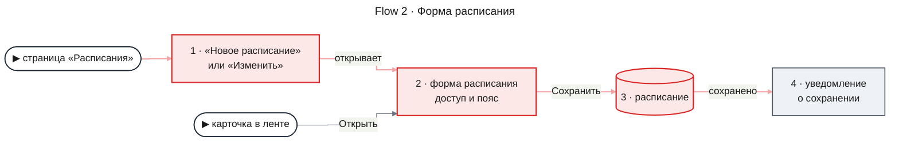

# UXRD: Расписания через чат (chat-scheduling)

| Дата | PRD |
|---|---|
| 2026-11-28 | [prd.md](./prd.md) |

## Snapshot

**Overview.** Сотрудник пишет в беседе, что и когда делать, и агент беседы сразу заводит расписание, как в ChatGPT: в ленте после вызова встаёт короткая карточка — значок часов, имя, строка правила с поясом и уровнем доступа и кнопка «Открыть». Так же, словами, расписание меняют, ставят на паузу, возобновляют и удаляют, и карточка говорит, что сделано. «Открыть» ведёт в форму расписания — ту же, что на странице «Расписания» по «Новое расписание» и «Изменить»; в форме вместо отметок «Без вас» стоит уровень доступа с отметкой согласия и новое поле «Часовой пояс». Из поля сообщения уходят «Запланировать» в «+» и «Отправить позже», а `/` открывает короткий список команд по образцу списка `@`. Строка списка «Расписания» — имя и одна строка со срабатыванием и правилом, и клик по ней открывает беседу расписания.

- **Не меняется**: срабатывание, подпись сообщения от расписания, история срабатываний, блок «Отказано» в ходе расписания (improvements UXRD, IM-03), «Разрешить в этой беседе» в обычных беседах.
- **Главный UX-риск**: агент сразу меняет или удаляет не то расписание, либо снимает полный доступ, которого ждёт сотрудник. Карточка называет расписание и итог, а снятый полный доступ отмечает строкой с путём назад (KD-3).

### Key Decisions

| ID | Решение | Почему |
|---|---|---|
| KD-1 | Карточка расписания — короткая строка-итог после вызова инструмента, без решения: значок, имя, строка правила, «Открыть». Каждый вызов даёт свою карточку. Имя, правило, пояс и доступ карточка показывает такими, какие они у расписания сейчас; от самого вызова в ней только слово итога и строка о снятом полном доступе | Агент уже всё сделал, подтверждать нечего; так устроен ChatGPT. Сотрудник видит итог одним взглядом, а ошибку исправляет словами или в форме |
| KD-2 | «Открыть» открывает ту же форму расписания, что «Изменить» на странице, поверх беседы. Если расписания больше нет, кнопка недоступна, а карточка говорит «Расписание удалено» | Одна форма — одно место правки. Недоступная кнопка с причиной честнее, чем форма, которая откроется и упадёт |
| KD-3 | Полный доступ даёт только форма, с отметкой согласия при каждом сохранении, которое оставляет полный доступ. Если агент, меняя расписание, снял полный доступ, карточка говорит об этом строкой с путём назад — «Открыть» | Согласие дают там, где видно всё, что будет выполняться без человека. Снятый доступ меняет, что расписание сделает утром, поэтому об этом сказано сразу |
| KD-4 | Список `/` — тот же список над полем, что у `@` (improvements UXRD, IM-12): место, клавиши, вид строки, пустое состояние. Его строки — «Запланировать» и пункты меню «+» «Создать агента в чате» и «Создать и проверить агента»; у этих двух выбор делает то же, что пункт | Сотрудник знает одно поведение списка над полем. Команда ничего не отправляет: она только начинает фразу или ставит чип |
| KD-5 | Форма — окно расписания SH-02 на странице «Расписания»: «Новое расписание» открывает его пустым, «Изменить» и «Открыть» — с настройками. Вместо «Без вас» в нём [доступ расписания](../../design-system/components/schedule-access.md), а пояс — поле «Часовой пояс» сразу под правилом | Поправить время или выдать полный доступ руками быстрее и надёжнее, чем словами. Пояс решает, когда сработает правило, поэтому стоит рядом с ним, а не в скрытых настройках: полей в форме немного |
| KD-6 | Строка списка «Расписания» — имя и одна строка «следующее срабатывание · правило · доступ», у расписания на паузе или выполненного — состояние вместо срабатывания. Клик по строке открывает беседу расписания; настройки, кнопки и история — по «Подробнее» | Сотрудник узнаёт задачу по имени и сразу видит, когда она сработает; так устроен список задач ChatGPT. Результаты расписания живут в беседе, поэтому строка ведёт туда |

## Design System

Фича следует [дизайн-системе](../../design-system/README.md). Карточка — плотность ленты, страницы и форма — комфортная ([foundations → Spacing & Density](../../design-system/foundations.md#spacing--density)).

### Component Inventory

| Компонент | Спецификация | Статус | Примечание |
|---|---|---|---|
| Карточка расписания | [schedule-card.md](../../design-system/components/schedule-card.md) | new | В ленте есть блок вызова, карточка решения и карточка хода; короткой строки-итога со ссылкой на экран настройки нет |
| Доступ расписания | [schedule-access.md](../../design-system/components/schedule-access.md) | new | Поле формы: «Только чтение» или «Полный доступ» с отметкой согласия, без которой форму не сохранить. В формах есть радиогруппы и отметки, но нет отметки, которая держит сохранение |
| Правило расписания | [schedule-rule.md](../../design-system/components/schedule-rule.md) | extended | Поле «Часовой пояс» вместо строки пояса браузера (SP-04); строка правила в карточке |
| Форма настроек | [settings-form.md](../../design-system/components/settings-form.md), вариант «Форма диалога» | reused | Окно расписания (SP-04) |
| Таблица данных | [data-table.md](../../design-system/components/data-table.md), вариант «Две строки» | extended | «Две строки» на любой ширине по выбору экрана; кнопка действия справа у строки-ссылки — список с «Подробнее» (SP-03) |
| Вызов инструмента | [tool-call.md](../../design-system/components/tool-call.md) | reused | Вызов инструмента расписания над карточкой; ошибка, когда расписание не составить |
| Список по `@` | improvements UXRD, IM-12 | extended | Те же список и клавиши для команд по `/` (SL-01) |
| Меню «+» поля сообщения | create-and-test UXRD, CT-01 | extended | Пункта «Запланировать» нет (RM-01) |
| Поле сообщения | improvements UXRD, IM-08 | extended | Кнопки «Отправить позже» нет (RM-01) |
| Страницы и окно расписания | schedules-search-memory UXRD, SH-02, SH-04, SH-05 | extended | Строка списка, «Новое расписание», доступ и пояс в окне, нет пары «Создано» (SP-01 – SP-04) |

## User Flows

### Primary User Flow

**Завести расписание словами.** Implements: UC-1, UC-4; AC-01.1 – AC-01.4, AC-04.4, AC-06.1, AC-06.2, AC-08.1 – AC-08.3, AC-15.1, AC-15.2

```mermaid
---
title: "Flow 1 · Завести расписание словами"
config:
  theme: base
  look: classic
  themeVariables:
    primaryColor: "#eef1f5"
    primaryBorderColor: "#4b5563"
    primaryTextColor: "#1a1a1a"
    lineColor: "#6b7280"
  flowchart:
    curve: step
  themeCSS: |
    @keyframes lit_f1{0%,18%{stroke:#991b1b;stroke-width:6px}20%,100%{stroke:#f4a5a5;stroke-width:2px}}
---
flowchart LR
    entry(["▶ сотрудник в беседе"])
    text["1 · пишет задачу<br/>или «/» → Запланировать"]
    agent["2 · агент беседы"]
    sched[("3 · расписание<br/>только чтение")]
    card["4 · карточка в ленте<br/>и ответ агента"]
    form["5 · форма расписания"]
    ask["агент переспрашивает<br/>расписания нет"]
    entry e1@--> text
    text e2@-->|"отправляет"| agent
    agent e3@-->|"заводит"| sched
    sched e4@-->|"итог вызова"| card
    card e5@-->|"Открыть"| form
    agent -->|"не составить или дубль"| ask
    classDef entry fill:#ffffff,stroke:#1f2937,stroke-width:1.5px,color:#1a1a1a
    classDef changed fill:#fde8e8,stroke:#dc2626,stroke-width:2px,color:#1a1a1a
    classDef new fill:#e6f4ea,stroke:#16a34a,stroke-width:2px,color:#1a1a1a
    classDef w1 stroke:#f4a5a5,stroke-width:2px,animation:lit_f1 6s linear 0s infinite
    classDef w2 stroke:#f4a5a5,stroke-width:2px,animation:lit_f1 6s linear 1.2s infinite
    classDef w3 stroke:#f4a5a5,stroke-width:2px,animation:lit_f1 6s linear 2.4s infinite
    classDef w4 stroke:#f4a5a5,stroke-width:2px,animation:lit_f1 6s linear 3.6s infinite
    classDef w5 stroke:#f4a5a5,stroke-width:2px,animation:lit_f1 6s linear 4.8s infinite
    class entry entry
    class text,agent,sched,form changed
    class card,ask new
    class e1 w1
    class e2 w2
    class e3 w3
    class e4 w4
    class e5 w5
```



Команда `/` только начинает фразу «Запланируй: » (SL-01) — дальше путь тот же, что у своего текста. Над карточкой стоит обычный блок вызова инструмента, под ней — ответ агента, который называет первое срабатывание. Расписание из чата всегда «Только чтение»: на просьбу о полном доступе агент отвечает, что его дают в форме (AC-04.4), и сотрудник идёт туда по «Открыть».

### Alternative Flows

- **Изменить словами** (UC-2; AC-02.1, AC-02.2, AC-05.2 – AC-05.5, AC-15.3). Сотрудник пишет «перенеси утреннюю сводку на 10:00» в любой беседе; агент сразу меняет расписание, и в ленте встаёт новая карточка с новым правилом. Прежние карточки этого расписания тоже показывают новое правило. Если у расписания был полный доступ, карточка несёт строку о том, что он снят (CS-01, AC-04.5, AC-06.4).
- **Пауза, возобновление, удаление словами** (UC-6; AC-11.1 – AC-11.4, AC-12.1). Карточка называет итог первым словом строки: «На паузе» или «Возобновлено». Карточка удаления показывает имя из вызова и «Расписание удалено», без строки правила и без доступной «Открыть».
- **Форма со страницы и из карточки** (UC-3, UC-5; AC-06.2, AC-09.6, AC-13.1 – AC-13.6, AC-15.4):



Форма сохраняет сразу, без модели, и показывает уведомления окна расписания (schedules-search-memory UXRD, MC-5). Расписание, созданное формой со страницы, пишет каждый раз в новую беседу и ничего не добавляет в беседы (AC-13.1). Полный доступ сохраняется только с отметкой согласия (SP-04).

### Error Flows

- **Расписание не составить** (AC-01.3, AC-14.1). Агент передал недоступного агента или неверное правило: карточки нет, блок вызова показывает ошибку, как у любого неудачного вызова, и агент переспрашивает. Форма с теми же настройками показывает ту же причину ошибкой поля (schedules-search-memory UXRD, MC-3).
- **Такое расписание уже есть** (AC-01.4). Карточки нет; агент называет существующее расписание и предлагает изменить его.
- **Чужое или несуществующее расписание** (AC-02.3, AC-11.5). Карточки нет, блок вызова с ошибкой; агент говорит, что такого расписания не нашёл.
- **Расписание удалили позже** (AC-06.3). У карточки «Открыть» недоступна и строка «Расписание удалено» (CS-02).
- **Ход расписания** (AC-03.1, AC-03.3, AC-04.6, AC-11.6). Изменяющий вызов при «Только чтение», вызов без права по роли и попытка хода завести, изменить, поставить на паузу, возобновить или удалить расписание дают блок «Отказано» с причиной (improvements UXRD, IM-03); карточки нет. При «Полный доступ» записи идут без карточки (AC-03.2), бриф глубокого агента — на любом уровне (AC-03.4). Как только владелец сам написал в беседу, изменяющий вызов снова показывает обычную карточку решения (AC-03.5).

## Screens

### Screen 1: Карточка расписания в ленте

```
 ≥ 900 px, колонка ленты
┌──────────────────────────────────────────────────────┐
│ ◷  Утренняя сводка                      [ Открыть ]  │  CS-01 создано
│    По будням в 09:00 · Europe/Moscow (UTC+3) ·       │
│    Только чтение                                     │
└──────────────────────────────────────────────────────┘
┌──────────────────────────────────────────────────────┐
│ ◷  Утренняя сводка                      [ Открыть ]  │  изменено,
│    По будням в 10:00 · Europe/Moscow (UTC+3) ·       │  полный доступ снят
│    Только чтение                                     │
│    Полный доступ снят: расписание теперь только      │
│    читает. Вернуть его можно в форме — «Открыть».    │
└──────────────────────────────────────────────────────┘
┌──────────────────────────────────────────────────────┐
│ ◷  Утренняя сводка                      [ Открыть ]  │  на паузе
│    На паузе · По будням в 10:00 · Europe/Moscow …    │
└──────────────────────────────────────────────────────┘
┌──────────────────────────────────────────────────────┐
│ ◷  Проверка логов                       [ Открыть ]  │  CS-02 удалено — этим
│    Расписание удалено                                │  вызовом или позже
└──────────────────────────────────────────────────────┘  (кнопка недоступна)
```

**CS-01. Карточка** — [карточка расписания](../../design-system/components/schedule-card.md) под блоком вызова инструмента расписания, на месте вызова (KD-1; AC-06.1, AC-02.1, AC-12.1). Первая строка — имя расписания, вторая — строка правила с поясом расписания и уровень доступа (MC-1). Имя, правило, пояс и доступ карточка читает у расписания сейчас, поэтому старая карточка в ленте показывает сегодняшние значения. От вызова в карточке только две вещи: слово итога в начале строки у паузы и возобновления и строка о снятом полном доступе у изменения, которое его сняло (AC-06.4).

**CS-02. «Открыть»** — открывает форму SP-04 с настройками этого расписания (KD-2, AC-06.2). Если расписания больше нет — его удалил этот вызов или оно удалено позже, — карточка показывает имя из вызова и «Расписание удалено» вместо строки правила, а «Открыть» недоступна (AC-06.3, AC-11.3). Карточка узнаёт об этом при показе ленты, а если удаление случилось, пока лента открыта, — при нажатии: форма не открывается, и карточка переходит в это состояние.

| Состояние | Что показано | AC |
|---|---|---|
| Создано или изменено | Имя, строка правила с поясом и доступом, «Открыть» | AC-01.1, AC-02.1, AC-06.1, AC-15.1 |
| Полный доступ снят | Как изменено, плюс строка MC-1 о снятом доступе | AC-04.5, AC-06.4 |
| На паузе, возобновлено | Строка начинается итогом; «Открыть» | AC-11.1, AC-11.2, AC-12.1 |
| Удалено этим вызовом или позже | Имя из вызова, «Расписание удалено», строки правила нет, «Открыть» недоступна | AC-06.3, AC-11.3 |

### Screen 2: Поле сообщения

```
┌ Команды ────────────────────────────────────┐   SL-01
│ ◷ Запланировать                             │
│   Агент сам выполнит задачу в заданное время│
│ ✦ Создать агента в чате                     │
│   Опишите агента — чат соберёт его          │
│ ⚗ Создать и проверить агента                │
│   Тренер соберёт агента и тесты · до $5     │
└─────────────────────────────────────────────┘
┌──────────────────────────────────────────────────────┐
│ /                                                    │
│ [+]                                        [ ↑ ]     │  RM-01
└──────────────────────────────────────────────────────┘
```

**SL-01. Список `/`** — список над полем по IM-12 (KD-4). Он открывается, когда `/` — первый знак поля без текста; чип агента в поле этому не мешает (AC-08.1). Текст после `/` сужает список по названию: «запл» оставляет «Запланировать». Строки — «Запланировать» со значком часов и подсказкой MC-2 и пункты «+» «Создать агента в чате» и «Создать и проверить агента» с их значками и подсказками, в порядке MC-2; «Создать и проверить агента» есть только у того, кому этот пункт доступен в «+» (AC-08.4). Выбор убирает `/` с набранным текстом и:

- «Запланировать» ставит в поле текст «Запланируй: » и курсор после него (AC-08.2).
- «Создать агента в чате» ставит текст шаблона, «Создать и проверить агента» — чип действия (AC-08.3).

Ничего не отправляется. Esc, пробел и удаление `/` закрывают список, текст остаётся как есть; если ничего не подошло — строка MC-2. Где у поля нет «+» (вкладка «В стороне», страница агента), `/` — просто знак.

**RM-01. Что убрано** (AC-10.1). В меню «+» нет «Запланировать»: остаются агенты, «Создать агента в чате», «Создать и проверить агента» и «Подключения». Справа от поля нет «Отправить позже» — кнопка отправки стоит одна. Окно расписания открывается только со страниц расписаний и из карточки (SP-04), а отметок «Без вас» нет нигде.

### Screen 3: Страницы и форма расписания

```
 Список «Расписания»
┌──────────────────────────────────────────────────────────────────────┐
│ Расписания                                   [ Новое расписание ]    │  SP-03
│ Утренняя сводка                                        [ Подробнее ] │
│ 1 дек., 10:00 · По будням в 10:00 · Полный доступ                    │
│ Проверка логов                                         [ Подробнее ] │
│ На паузе · Каждые 3 часа · Только чтение                             │
│ Проверка бэкапа                                        [ Подробнее ] │
│ Выполнено · Один раз: 20 нояб., 03:00 · Только чтение                │
└──────────────────────────────────────────────────────────────────────┘

 Страница расписания
┌──────────────────────────────────────────────────────────────────────┐
│ Расписания /                                                         │
│ Утренняя сводка   ✓ Активно                                          │
│ [ Изменить ] [ Пауза ] [ Запустить сейчас ]  ⋯                       │
│ Инструкция              Собери новые инциденты за ночь…              │
│ Агент                   Агент чата                                   │
│ Когда                   По будням в 10:00 · Europe/Moscow (UTC+3)    │
│ Следующее срабатывание  1 дек., 10:00                                │
│ Ответ                   В беседу «Сбои оплаты»                       │
│ Доступ                  Полный доступ                                │  SP-02
│ История срабатываний …                                               │
└──────────────────────────────────────────────────────────────────────┘

 Форма расписания
┌─ Изменить расписание ─────────────────────────────── ✕ ┐  SP-04
│ Название (необязательно) · Инструкция · Агент          │
│ Когда                                                   │
│ ( Один раз ) ( Каждый день ) (• По дням недели ) …      │
│ [Пн] [Вт] [Ср] [Чт] [Пт]  Сб   Вс       в [ 10:00 ]     │
│ Следующее срабатывание: 1 дек., 10:00                   │
│ Часовой пояс                                            │
│ [ Europe/Moscow (UTC+3)                           ▾ ]   │
│ Куда писать ответ                                       │
│ (•) Каждый раз в новую беседу                           │
│ ( ) В беседу «Сбои оплаты»                              │
│ Доступ                                                  │
│ ( ) Только чтение                                       │
│ (•) Полный доступ                                       │
│ ┌─────────────────────────────────────────────────────┐ │
│ │ [ ] Понимаю: по этому расписанию агент сам создаёт  │ │
│ │     и меняет записи от моего имени…                 │ │
│ └─────────────────────────────────────────────────────┘ │
│ Чтобы дать полный доступ, отметьте согласие.            │
│                               [ Сохранить ] [ Отмена ]  │
└─────────────────────────────────────────────────────────┘
```

**SP-01. Кнопки страниц** — в шапке списка «Расписания» справа от заголовка стоит «Новое расписание» (`default`); она открывает форму пустой. «Изменить» на странице расписания (SH-05) и в блоке паузы из-за удалённой беседы открывает форму с настройками (KD-5, AC-09.6). Пауза, «Возобновить», «Запустить сейчас» и «Удалить» работают как раньше.

**SP-02. Пары страницы** — пара «Доступ» стоит после «Ответ» (AC-13.5); пар «Без вас» и «Создано» нет. Расписание, которому полный доступ не давали, показывает «Только чтение».

**SP-03. Строка списка** — список SH-04 — [таблица данных](../../design-system/components/data-table.md), вариант «Две строки», на любой ширине (KD-6; AC-09.1, AC-09.2). Первая строка — имя, вторая — Caption через « · »: следующее срабатывание, правило и уровень доступа (MC-3). У расписания на паузе и выполненного вместо срабатывания стоит его состояние. Время срабатывания — по строке «Время в списках и ленте» foundations, пояс в строке не пишется; время срабатывания — по поясу расписания, как и правило в той же строке. Колонки «Последнее срабатывание» нет.

- Клик по строке открывает беседу расписания; у расписания «Каждый раз в новую беседу» — беседу последнего срабатывания (AC-09.3, AC-09.4). Если беседы нет — срабатываний ещё не было или беседа удалена, — строка ведёт на страницу расписания (AC-09.5).
- «Подробнее» (`outline`, `sm`) справа всегда ведёт на страницу расписания: там настройки, кнопки и история.

**SP-04. Форма расписания** — окно SH-02 с прежними полями, кнопками и уведомлениями, открытое кнопками SP-01 и «Открыть» карточки (KD-5; AC-13.2, AC-13.6). Изменения по сравнению с SH-02:

- «Часовой пояс» — поле [правила расписания](../../design-system/components/schedule-rule.md) сразу под «Когда», вместо строки пояса под предпросмотром. У нового расписания в нём пояс браузера, у существующего — пояс расписания; предпросмотр срабатывания считается в выбранном поясе (AC-15.4).
- «Доступ» — [доступ расписания](../../design-system/components/schedule-access.md) с текстами MC-4 после «Куда писать ответ», вместо «Без вас». Пока выбран «Полный доступ» без отметки, «Создать расписание» и «Сохранить» недоступны, а «Отмена» и Esc закрывают форму (AC-13.3, AC-13.4). У расписания с полным доступом форма открывается с пустой отметкой (AC-04.3).
- «Куда писать ответ» без пункта «В эту беседу»: у нового расписания один пункт «Каждый раз в новую беседу» с подсказкой MC-3, у существующего — ещё «В беседу «{название}»», если та беседа есть. Форма одна и та же, откуда бы её ни открыли (AC-06.2).

| Состояние | Что показано | AC |
|---|---|---|
| Список пуст | Пустое состояние с текстом MC-3 и кнопка «Новое расписание» в шапке | — |
| Форма: полный доступ без отметки | Согласие и подсказка, кнопка сохранения недоступна | AC-13.3 |
| Форма: ошибка настройки | Ошибка у поля, та же, что получил бы агент | AC-14.1 |

Остальные состояния страниц и формы — SH-02, SH-04, SH-05.

## Accessibility

- **Карточка** фокус не забирает и не объявляется отдельно: итог в ответе агента читает скринридер вместе с лентой. Карточка — группа с именем по MC-1; «Открыть» — с именем «Открыть расписание «{название}»».
- **Недоступная «Открыть»** — `aria-disabled`, остаётся в порядке Tab, описание — «Расписание удалено». Когда кнопка становится недоступной после нажатия, строка объявляется `polite`.
- **Форма из карточки** — фокус и Esc по форме настроек, вариант «Форма диалога»; закрытие возвращает фокус на кнопку, которая открыла форму: «Открыть», «Новое расписание» или «Изменить». Нажатие недоступной кнопки сохранения переводит фокус на отметку согласия.
- **«Часовой пояс»** — поле выбора с поиском и видимой подписью; выбранный пояс читается с его смещением.
- **Список `/`** — `listbox` поля-`combobox`, как IM-12: фокус остаётся в поле, ↑ и ↓ ведут по строкам, Enter и Tab выбирают, Esc закрывает. Имя списка — «Команды». После выбора курсор стоит в конце вставленного текста.
- **Строка списка SP-03** — ссылка с именем «{название}, {вторая строка}»; «Подробнее» — отдельная остановка Tab с именем «Подробнее: {название}».

## Responsive Behavior

| Элемент | 360 px | ~900 px | ≥ 1280 px |
|---|---|---|---|
| Карточка CS-01, CS-02 | Во всю ширину ленты; имя и строки переносятся, «Открыть» справа от имени, 44 px при грубом указателе | Как 360 px | Как 360 px, ширина — колонка прозы ленты |
| Список SL-01 | Во всю ширину поля, не выше 5 строк, подсказки строк переносятся | Шириной по самой длинной строке | Как ~900 px |
| Список SP-03 | Имя и вторая строка переносятся; «Подробнее» справа от имени, 44 px при грубом указателе | Как 360 px | Как 360 px |
| Страница SP-01, SP-02 | По SH-05: кнопки шапки отдельной строкой под названием; «Новое расписание» — под заголовком списка во всю ширину | Как SH-05; «Новое расписание» справа от заголовка | Как ~900 px |
| Форма SP-04 | Во весь экран, тело прокручивается, кнопки внизу видны всегда; поля и радиогруппы во всю ширину, правило — по своей спецификации | Ширина 560 px по центру | Как ~900 px |

## Content and Microcopy

| ID | Где | Текст |
|---|---|---|
| MC-1 | Карточка (CS-01, CS-02) | Первая строка — имя расписания; вторая — «{правило} · {пояс} · {доступ}», например «По будням в 09:00 · Europe/Moscow (UTC+3) · Только чтение»; итог в начале строки — «На паузе», «Возобновлено»; снятый доступ — «Полный доступ снят: расписание теперь только читает. Вернуть его можно в форме — «Открыть».»; кнопка «Открыть»; расписания нет — «Расписание удалено» вместо строки правила; имя группы — «Расписание «{название}»» |
| MC-2 | Список `/` (SL-01) | Имя списка «Команды»; строки по порядку: «Запланировать» — «Агент сам выполнит задачу в заданное время»; «Создать агента в чате» и «Создать и проверить агента» с подсказками пунктов меню «+»; пусто — «Команд не нашлось»; текст в поле — «Запланируй: » |
| MC-3 | Страницы и форма (SP-01 – SP-04) | Кнопка «Новое расписание»; пустой список — «Расписаний пока нет» / «Создайте его кнопкой «Новое расписание» или напишите в любой беседе, что и когда сделать, — агент заведёт расписание.»; строка списка — «{следующее срабатывание} · {правило} · {доступ}», вместо срабатывания «На паузе» или «Выполнено»; кнопка «Подробнее»; поле «Часовой пояс», поиск «Найти пояс…», пусто — «Пояс не найден», значение «{пояс} (UTC{смещение})»; подсказка единственного пункта ответа — «Чтобы ответ приходил в одну беседу, попросите агента в ней: «/» → «Запланировать».»; остальные тексты окна и страниц — schedules-search-memory UXRD, MC-2, MC-3, MC-5, MC-8, MC-9 |
| MC-4 | Доступ и согласие (SP-04) | «Доступ»; «Только чтение» — «Агент ищет и читает. Записи — тикеты, письма, изменения данных — не делает и пишет об этом в ответе.»; «Полный доступ» — «Агент делает записи без вашего подтверждения, в пределах ваших прав. Ниже нужно согласие.»; согласие — «Понимаю: по этому расписанию агент сам создаёт и меняет записи от моего имени — тикеты, письма, данные в системах — и не спрашивает подтверждения. Он может сделать запись и по тексту, который прочитал в письме или тикете.»; подсказка — «Чтобы дать полный доступ, отметьте согласие.» |

## Update History

| Version | Date | Change |
|---------|------|--------|
| 1.0 | 2026-11-28 | Initial version |
| 1.1 | 2026-11-28 | Пауза, возобновление и удаление словами; строка списка по образцу ChatGPT, без «Создано»; окно расписания остаётся на странице с выбором доступа вместо «Без вас» |
| 1.2 | 2026-11-28 | Агент делает расписание сразу: карточка подтверждения заменена короткой карточкой-итогом с «Открыть»; полный доступ и согласие только в форме; поле «Часовой пояс» в форме |
