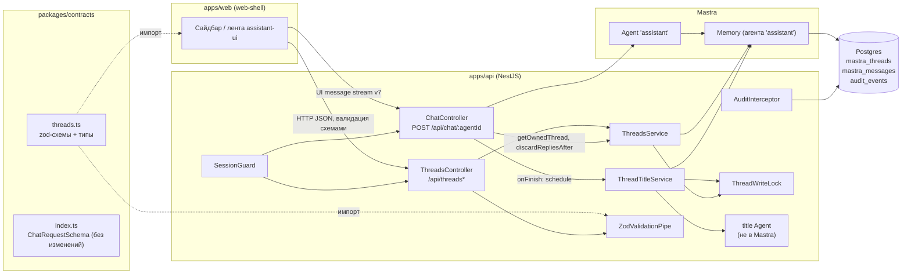
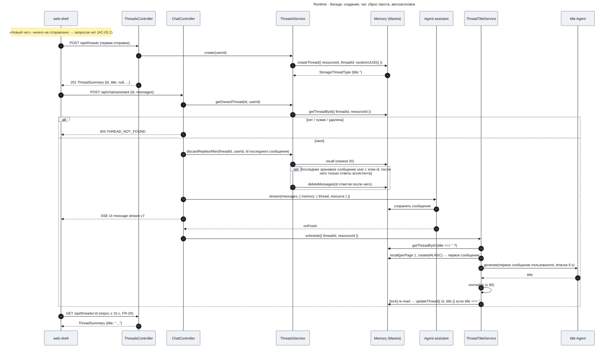
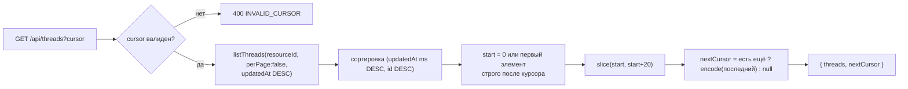
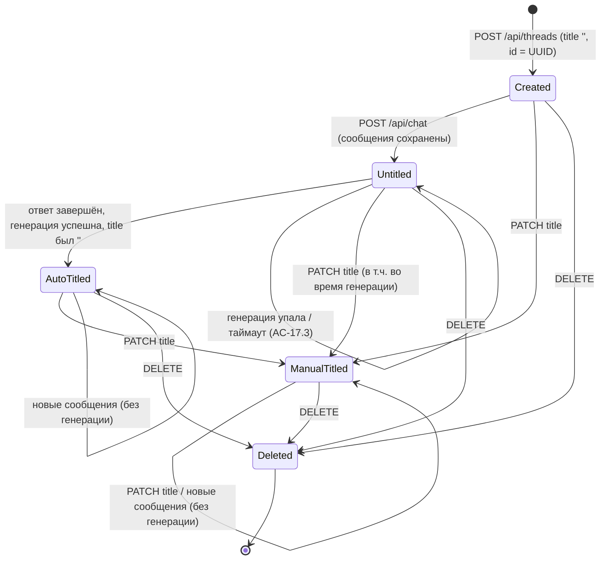

# Design Doc: Оболочка чата (chat-shell) — часть `threads-api`

| Поле | Значение |
|------|----------|
| Версия | 1.9 |
| Дата | 2026-10-30 |
| Статус | Approved |
| Фича | `chat-shell` |
| PRD | [`prd.md`](./prd.md) v1.5 (AC-14.5 — обезличенный текст ошибки инструмента, без текста ошибки модели в истории; AC-14.6 — один ответ после перегенерации ответа с ошибкой; скрытие правки/ветвления/перегенерации успешных ответов в `web-shell`) |
| UXRD | [`uxrd.md`](./uxrd.md) v1.7 (6.4 группировка, 4.10 E-8, 6.20 TH-08 Restored/Regenerating) |

## Part

- **Part**: `threads-api` — строка Delivery Parts PRD.
- **Covers**: FR-13, FR-14, FR-15, FR-16, FR-17, FR-18 (AC-13.1…13.4, AC-14.1…14.6, AC-15.1…15.3, AC-16.1…16.3, AC-17.1…17.3, AC-18.1, AC-18.3). Ключевые решения KD-1…KD-5 (раздел «Ключевые решения»). Модель персистентности на фронтенде решает `design-web-shell.md`, KD-1 (модель персистентности); здесь — только контракт для неё (`RemoteThreadListAdapter`, «Контракт для `web-shell`», п. 2).
- **Depends on**: нет — первая часть.
- **Sibling parts**: `web-shell` (FR-01…FR-12, FR-19…FR-22). Его требования здесь не проектируются; ниже только фиксируется контракт, который он потребляет (раздел «Контракт для `web-shell`»), включая то, что нужно модели персистентности `web-shell` (`design-web-shell.md`, KD-1 (модель персистентности)).

## Overview

Часть добавляет в `apps/api` тонкий слой эндпоинтов над тредами Mastra Memory (Postgres): список бесед пользователя с курсорной пагинацией по 20, явное создание беседы, карточку беседы, историю сообщений в формате AI SDK v7 `UIMessage`, переименование и удаление — все под `SessionGuard` и в пределах `resourceId = req.user.id`. Существующий `POST /api/chat/:agentId` сохраняет контракт тела (`ChatRequest`), но перестаёт неявно создавать треды: он принимает только существующую беседу текущего пользователя, иначе 404 — так удалённая беседа не воскресает (AC-16.1). Автозаголовок генерируется собственным шагом после ответа ассистента, который никогда не перезаписывает непустой заголовок. Все тела запросов и ответов описаны zod-схемами в `packages/contracts`.

## Design Summary (Meta)

```yaml
design_type: "extension"
risk_level: "medium"
complexity_level: "medium"
complexity_rationale: >
  (1) AC-16.1 (не воскрешать удалённую беседу) и flow нового чата (KD-4) связаны: при клиентских id
  сервер не может отличить «новую» беседу от «удалённой» без хранения надгробий, поэтому меняется поведение
  существующего POST /api/chat/:agentId; AC-17.2 требует сериализации ручного переименования и асинхронной
  записи автозаголовка; AC-13.2/13.2a требуют пагинации без дублей при постоянном переупорядочивании
  списка (D-11, удаление); поднятая во время обхода беседа подбирается перечитыванием первой страницы. (2) Ограничения: без миграций (PRD Out of Scope), Mastra API без проверки
  владельца в updateThread/deleteThread, ChatRequest неизменен (AC-18.3), формат истории должен совпадать
  с живым стримом v7.
main_constraints:
  - "Все эндпоинты под SessionGuard; чужая и несуществующая беседа неразличимы (404)"
  - "ChatRequestSchema байт-в-байт (AC-18.3); zod-схемы только в packages/contracts"
  - "Без новых таблиц и миграций: система записи — mastra_threads / mastra_messages"
  - "Размер страницы списка 20 (решение пользователя 2026-10-28)"
  - "Поведение AuditInterceptor сохраняется (одна запись на запрос)"
biggest_risks:
  - "Переход POST /api/chat/:agentId на «только существующая беседа» ломает текущий прототип apps/web до появления web-shell — снят: обе части разрабатываются на ветке feature/chat-shell и сливаются в main вместе (решение пользователя 2026-10-28)"
  - "Перегенерация ответа, завершившегося ошибкой модели, склеивает частичный ответ с новым в одно хранимое сообщение (подтверждено проверкой AC-14.6); снимается серверной мерой «сброс хвоста» — ThreadsService.discardRepliesAfter в ChatController.chat до agent.stream (ThreadsService, Data Contract discardRepliesAfter)"
  - "Mastra дописывает ответ перегенерации в то же хранимое сообщение и хранит отброшенные ветки правки (подтверждено EVP); перегенерацию закрывает «сброс хвоста», правку и ветвление — скрытие в web-shell (PRD, Won't Have); истории, созданные до релиза, остаются как есть"
  - "Ошибка модели посреди стрима хранится частью {type:'error'} с сырым текстом ошибки; в истории такая часть удаляется (AC-14.5), иначе история не проходит safeValidateUIMessages и раскрывает сырой текст"
  - "Mastra фиксирует свою копию @ai-sdk/provider точно и отстаёт от ai: apps/api держит ai ровно 7.0.148, apps/web — ^7.0.155 (две копии ai в монорепо)"
unknowns:
  - "Соответствие языка/длины автозаголовка AC-17.1 на реальной модели (проверяется прогоном 20 бесед, метрика № 7)"
```

## Background and Context

### Prerequisite ADRs

- Каталога `docs/adr/` нет; ни одного ADR, в том числе `ADR-COMMON-*`, не существует.
- Общие технические области, которых касается дизайн (валидация входа, формат ошибок API), проверены трёхчастным тестом `documentation-criteria` (см. «ADR-тест» ниже) и общего ADR не требуют: решения локальны и обратимы в пределах монорепо. **Расхождение инструкций:** процесс «Common ADR» агента предписывает создавать `ADR-COMMON-*` при отсутствии, а `documentation-criteria` — писать ADR только при прохождении теста; применён более строгий критерий `documentation-criteria`, ADR не создан.

### Applicable Standards

| Standard | Type | Source | Impact on Design |
|----------|------|--------|-----------------|
| TypeScript `strict: true`, `module/moduleResolution: nodenext` — относительные импорты с суффиксом `.js` | explicit | `apps/api/tsconfig.json` | Все новые файлы `apps/api/src/threads/*` импортируют друг друга как `./x.js`; без `any`-обходов в сигнатурах сервисов |
| oxlint type-aware, `typescript/no-floating-promises: error` | explicit | `apps/api/.oxlintrc.json`, `apps/api/package.json` (`lint`) | Фоновая генерация заголовка запускается через сервис, который сам ловит ошибки и хранит промис; вызов из контроллера — `void`-выражение или синхронный метод `schedule()` |
| Prettier | explicit | `apps/api/.prettierrc`, скрипт `format` | Форматирование нового кода |
| Vitest: unit `**/*.spec.ts`, e2e `**/*.e2e-spec.ts` (отдельный конфиг), `globals: true` | explicit | `apps/api/vitest.config.ts`, `apps/api/vitest.config.e2e.ts` | Unit-тесты рядом с кодом (`*.spec.ts`), e2e в `apps/api/test/*.e2e-spec.ts` |
| Turborepo `build`/`test` зависят от `^build`; `@agent-os/contracts` — ESM, публикуется из `dist` | explicit | `turbo.json`, `packages/contracts/package.json` | Новые схемы попадают в `apps/*` только после сборки contracts; прямой запуск vitest в `apps/api` требует предварительного `pnpm --filter @agent-os/contracts build` |
| Глобальный префикс `api`, CORS `FRONTEND_ORIGIN` + credentials, глобальный `ValidationPipe({ whitelist, transform })` | explicit | `apps/api/src/app.setup.ts` (`configureApp`) | Контроллер `@Controller('threads')` обслуживается как `/api/threads`; zod-валидация — параметрными пайпами, совместимыми с глобальным `ValidationPipe` |
| PRD Security: валидация входа zod-схемами из `packages/contracts`, нет IDOR, нет утечки внутренних сообщений | explicit | `prd.md`, NFR Security | Отдельный `ZodValidationPipe`; проверка владельца в одном методе сервиса; 404 одинаков для чужих и несуществующих |
| Nest-модуль на фичу: `@Module({ controllers })`, guard на маршруте через `@UseGuards(SessionGuard)` | implicit — подтверждён пользователем 2026-10-28 | `apps/api/src/chat/chat.module.ts`, `chat.controller.ts:30-31` | Новый `ThreadsModule`; `@UseGuards(SessionGuard)` на уровне класса контроллера |
| Доступ к Mastra только через DI-токен `MASTRA` (`@Global` `MastraModule`) | implicit — подтверждён пользователем 2026-10-28 | `apps/api/src/mastra/mastra.constants.ts`, `mastra.module.ts` | Memory берётся из `MASTRA` фабрикой провайдера, а не создаётся заново |
| Ошибки — исключения Nest (`NotFoundException`, `BadRequestException`), внутренние ошибки логируются `Logger` класса и не уходят клиенту | implicit — подтверждён пользователем 2026-10-28 | `chat.controller.ts:26,42,45,73-77` | Все ветки 404/400 — `HttpException` с `errorCode`; ошибки хранилища → 500 без деталей |
| Пара «`XxxSchema` + `type Xxx = z.infer<...>`» в contracts | implicit — подтверждён пользователем 2026-10-28 | `packages/contracts/src/index.ts` | Все новые схемы следуют этой паре имён |

Gate: 7 explicit, 4 implicit — порог (3/2) выполнен. Все 4 implicit-стандарта подтверждены пользователем как стандарты проекта на остановке утверждения дизайна (2026-10-28).

### Agreement Checklist

#### Scope
- [x] Эндпоинты бесед: список, создание, карточка, сообщения, переименование, удаление → раздел «Contract Definitions»
- [x] Автозаголовок (FR-17) → «ThreadTitleService»
- [x] zod-контракты в `packages/contracts` (FR-18) → «Contract Definitions»
- [x] Поведение `POST /api/chat/:agentId` для удалённой/чужой/несуществующей беседы (KD-5, AC-16.1) → «ChatController: проверка беседы»
- [x] Ключевые решения KD-1…KD-5 → «Ключевые решения»

#### Non-Scope (Explicitly not changing)
- [x] `ChatRequestSchema` — без изменений (AC-18.3); `ChatDto` — без изменения полей и типов, добавлено только ограничение длины `id` и `threadId` (Security Considerations)
- [x] Стриминг (`toAISdkStream` v7, `sendReasoning`), `res.on('close')`-отмена, лог `usage` — без изменений; тексты, которые возвращает `onError`, не меняются — правило выносится в общую функцию `toStreamErrorText` (`apps/api/src/common/stream-error-text.ts`), чтобы история использовала тот же источник
- [x] `assistant.agent.ts` — не меняется (штатный `generateTitle` остаётся выключенным; см. KD-2)
- [x] `SessionGuard`, `AuditService` — без изменений
- [x] Требования `web-shell` (FR-01…FR-12, FR-19…FR-22) — только как потребитель контракта
- [x] Схема Postgres — без миграций и новых таблиц

#### Constraints
- [x] Parallel operation: нет (одна версия API)
- [x] Backward compatibility: тело `ChatRequest` совместимо; **поведение** `POST /api/chat/:agentId` для неизвестного `threadId` меняется (auto-create → 404) — единственный потребитель `apps/web/src/components/assistant.tsx` заменяется `web-shell` (см. Risks)
- [x] Performance measurement: требуется (AC-13.4, AC-14.4 — замер в Vitest e2e)
- [x] Все эндпоинты под `SessionGuard`, `resourceId = req.user.id`, чужое → 404
- [x] Размер страницы 20; `AuditInterceptor` пишет одну запись на запрос, как раньше
- [x] Версия `ai`: `apps/api` — точно `7.0.148` (без `^`), `apps/web` — `^7.0.155`; mock-модели тестов — `MockLanguageModelV4` из `ai/test`, без `as`-приведений → «Зависимости версий `ai`»; Risks; Verification

#### Решения пользователя на остановке утверждения (2026-10-28)
- [x] Переименование и автозаголовок сдвигают `updatedAt` (беседа поднимается в начало / «Сегодня») — **принято**; `web-shell` оставляет элемент на месте до перезагрузки списка (заметку к UXRD D-11 ведёт `web-shell`) → «Контракт для `web-shell`», п. 4; Open Questions, п. 1
- [x] Обе части (`threads-api`, `web-shell`) разрабатываются на одной ветке `feature/chat-shell` и сливаются в `main` вместе; шаг 8 может попасть на ветку раньше `web-shell`, `main` никогда не получает нерабочий чат → «Technical Dependencies», шаг 8; Risks
- [x] 4 implicit-стандарта подтверждены как стандарты проекта → «Applicable Standards»
- [x] Источник автозаголовка — **первое** сообщение пользователя (PRD FR-17, ревью I002 вариант a) → AC-17.1, «ThreadTitleService»
- [x] `ai` в `apps/api` фиксируется на `7.0.148` до выхода `@mastra/core` с `@ai-sdk/provider-v7` ≥ 4.0.34 → «Зависимости версий `ai`»

#### Решения по итогам ранней точки проверки
- [x] Ошибки инструментов в истории маскируются так же, как в живом стриме: `ThreadsService.listMessages` заменяет `errorText` частей инструментов в состоянии `output-error` строкой `AGENT_ERROR_TEXT` (`'Agent error'`) из общего модуля, который использует и `onError` чата → AC-14.5; «Общий текст ошибки стрима»; Data Contract `listMessages`; «Контракт для `web-shell`», п. 6
- [x] Отсутствие `id` у части `reasoning` и `state` у части `text` в истории — допустимое расхождение (`loss_risk: low`, не отображается) → Field Propagation Map; Output Comparison
- [x] Правка, переключение веток и перегенерация обычных ответов в `web-shell` скрыты (PRD, Won't Have); перегенерация остаётся только у ответа, завершившегося ошибкой (AC-08.5) → AC-14.6; Risks
- [x] Перегенерация ответа с ошибкой без серверной меры склеивает ответы в хранении (находка 14), поэтому «сброс хвоста» обязателен — для ошибки модели и для обрыва сети одинаково — `ThreadsService.discardRepliesAfter` в `ChatController.chat` до `agent.stream`, признак — по хранимому состоянию → AC-14.6; «ThreadsService»; Data Contract `discardRepliesAfter`; Verification; Risks
- [x] Части `error` (ошибка модели посреди стрима) в истории не возвращаются, как и сырой текст ошибки инструмента → AC-14.5; «`maskHistoryErrors`»; Data Contract `listMessages`; «Контракт для `web-shell`», п. 6

Противоречий между дизайном и договорённостями нет. Единственное изменение поведения существующего эндпоинта прямо предписано AC-16.1 и решением KD-5.

### Problem to Solve

Беседы уже сохраняются Mastra Memory (`mastra_threads`, `mastra_messages`), но клиент не может их получить, переименовать или удалить; заголовков нет; удаление отсутствует, поэтому нет и гарантии, что удалённый `id` не будет молча создан заново при следующем `POST /api/chat`.

### Current Challenges

- `ChatController.chat` берёт `threadId = body.threadId ?? body.id`, а Mastra при отсутствии треда создаёт его с пустым заголовком — удалённый `id` воскрешается (focusArea `ChatController.chat`).
- Отправка в чужой тред приводит к отказу промиса `agent.stream` (`AGENT_STREAM_FAILED`, проверено прототипом) → 500, а не 404.
- `Memory.updateThread`/`deleteThread` не принимают `resourceId` — проверка владельца лежит на вызывающем.
- `Memory.recall` с чужим/несуществующим тредом бросает обычный `Error` → 500.
- Штатный `generateTitle` не перепроверяет заголовок перед записью — ручное имя, данное во время генерации, перезаписывается (UXRD A-5).
- `listThreads` даёт только offset-пагинацию, а порядок списка меняется при каждом сообщении (D-11) и удалении.

### Requirements

#### Functional Requirements

FR-13…FR-18 PRD без изменений формулировок; AC переписаны ниже в EARS с привязкой к контракту.

#### Non-Functional Requirements

- **Performance**: список (200 бесед) p95 ≤ 300 мс; сообщения (100 шт.) p95 ≤ 500 мс — локальный Postgres, Vitest e2e. Проверка беседы в `POST /api/chat` добавляет один SELECT по PK (≪ 50 мс бюджета метрики № 10).
- **Scalability**: курсорный контракт списка не зависит от реализации; при > 2 000 бесед у пользователя реализация заменяется SQL keyset без изменения контракта (Future Extensibility).
- **Reliability**: ошибка генерации заголовка не влияет на ответ и сохранение беседы (AC-17.3); ошибки хранилища → 500 без деталей.
- **Maintainability**: формат истории для фронтенда отвязан от внутреннего формата Mastra (конвертация на сервере, схема в contracts).

## Acceptance Criteria (AC) - EARS Format

### FR-13 Список бесед

- [ ] **AC-13.1** **When** пользователь A запрашивает `GET /api/threads`, the system shall вернуть только беседы с `resourceId = A`, отсортированные по `updatedAt` по убыванию (при равенстве — по `id` по убыванию).
- [ ] **AC-13.2** **When** у пользователя 120 бесед и он последовательно запрашивает страницы, передавая `nextCursor` предыдущего ответа, the system shall вернуть 6 страниц по 20 бесед, объединение которых содержит все 120 `id` без повторов; на последней странице `nextCursor = null`.
- [ ] **AC-13.2a** (уточнение контракта) **If** между запросами страниц беседа была удалена или поднялась в начало списка, **then** the system shall продолжить выдачу со следующей за курсором позиции; беседа, поднятая или созданная во время обхода, не возвращается в последующих страницах этого обхода; каждая другая беседа, существовавшая к началу обхода и ещё не выданная, возвращается ровно один раз (удалённая — не возвращается); ни одна беседа не возвращается дважды. (Поднятую или созданную беседу клиент получает, перечитав первую страницу без `cursor`.)
- [ ] **AC-13.3** **While** `NODE_ENV=production`, the system shall отвечать 401 на любой из шести маршрутов `/api/threads*`.
- [ ] **AC-13.4** The system shall отвечать на `GET /api/threads` с p95 ≤ 300 мс при 200 беседах пользователя на локальном Postgres.

### FR-14 Сообщения беседы

- [ ] **AC-14.1** **When** запрошены `GET /api/threads/:threadId/messages` своей беседы из 12 сообщений, записанных через `POST /api/chat/:agentId`, the system shall вернуть все 12 в хронологическом порядке как AI SDK v7 `UIMessage` (роль, части `text`, `reasoning` с `state: "done"`, `tool-<name>` с `input`, `output` или `errorText` и `state`), проходящие `safeValidateUIMessages` из `ai`.
- [ ] **AC-14.2** **If** беседа принадлежит другому пользователю, **then** the system shall ответить 404 `THREAD_NOT_FOUND`.
- [ ] **AC-14.3** **If** беседы с таким `id` нет, **then** the system shall ответить 404 `THREAD_NOT_FOUND` (тело идентично AC-14.2).
- [ ] **AC-14.4** The system shall отвечать p95 ≤ 500 мс для беседы из 100 сообщений.
- [ ] **AC-14.5** (a) **If** вызов инструмента завершился ошибкой, **then** the system shall вернуть в истории часть `tool-<name>` или `dynamic-tool` в состоянии `output-error` с `errorText` = `AGENT_ERROR_TEXT` (`'Agent error'`); для ошибки без `statusCode` это тот же текст, что показал живой стрим. (b) **If** ответ модели завершился ошибкой, **then** the system shall не возвращать часть `error`, а сообщение ассистента вернуть только с частями, сохранёнными до ошибки. Исходный текст ошибки инструмента или модели в ответ не попадает. Фиксированный текст ошибки инструмента в стриме и истории показывает `web-shell` (UXRD D-15, `design-web-shell.md` AC-14.5); ошибка модели после перезагрузки показывается без текста ошибки (UXRD TH-08 «Restored»).
- [ ] **AC-14.6** **When** ответ ассистента завершился ошибкой модели или обрывом сети посреди стрима и пользователь перегенерировал его (повторная отправка того же сообщения пользователя — тот же `id`, без последнего ответа ассистента; поля `trigger` и `messageId` сервер не читает), the system shall вернуть в `GET /api/threads/:threadId/messages` после этого сообщения пользователя ровно одно сообщение ассистента, содержащее только текст перегенерированного ответа; сообщение пользователя не дублируется, текст неудавшейся попытки не возвращается и не хранится.

### FR-15 Переименование

- [ ] **AC-15.1** **When** `PATCH /api/threads/:threadId` с `title`, у которого после обрезки пробелов 1…200 символов, the system shall сохранить обрезанный заголовок, вернуть `ThreadSummary` с ним, и последующий список вернёт его же.
- [ ] **AC-15.2** **If** `title` отсутствует, пустой, состоит из пробелов или длиннее 200 символов после обрезки, **then** the system shall ответить 400 `VALIDATION_FAILED` с описанием ошибки и не менять беседу.
- [ ] **AC-15.3** **If** беседа чужая или отсутствует, **then** the system shall ответить 404 `THREAD_NOT_FOUND`, заголовок не изменится.

### FR-16 Удаление

- [ ] **AC-16.1** **When** пользователь удалил свою беседу (`DELETE` → 204), the system shall не возвращать её в списке, отвечать 404 на `GET /api/threads/:id`, `GET /api/threads/:id/messages`, **и отвечать 404 `THREAD_NOT_FOUND` на `POST /api/chat/:agentId` с этим `id`**, не создавая беседу (выбран вариант «404», KD-5, UXRD E-8).
- [ ] **AC-16.2** **If** беседа чужая, **then** the system shall ответить 404 и не удалять её.
- [ ] **AC-16.3** **When** беседа удаляется повторно, the system shall ответить 404 (не 500).

### FR-17 Автозаголовок

- [ ] **AC-17.1** **When** завершился ответ ассистента в беседе с пустым заголовком, the system shall не позднее 10 с записать заголовок длиной 1…80 символов без кавычек и переводов строк, сгенерированный по первому сообщению пользователя на его языке (PRD FR-17).
- [ ] **AC-17.2** **If** у беседы уже есть непустой заголовок (ручной или ранее сгенерированный), **then** the system shall не запускать генерацию; **if** ручное переименование пришло во время генерации, **then** сгенерированный заголовок не записывается.
- [ ] **AC-17.3** **If** генерация упала или превысила таймаут, **then** the system shall оставить заголовок пустым (`title: null` в API), записать предупреждение в лог с `threadId` и причиной, при этом ответ ассистента и сообщения уже сохранены и не затронуты; если заголовок всё ещё пуст, генерация повторяется после следующего ответа ассистента.

### FR-18 Контракты

- [ ] **AC-18.1** Для каждого из шести маршрутов в `packages/contracts` экспортированы схема ответа и (для `PATCH`, query списка, параметра `:threadId`) схема входа вместе с типами.
- [ ] **AC-18.3** `ChatRequestSchema` в `packages/contracts/src/index.ts` не изменён; существующие e2e `test/app.e2e-spec.ts` проходят без правок.

## Existing Codebase Analysis

### Implementation Path Mapping

| Type | Path | Description |
|------|------|-------------|
| Existing | `apps/api/src/chat/chat.controller.ts` | `POST /api/chat/:agentId`; меняется разрешение треда и `onFinish`; после проверки владельца и до `agent.stream` — `ThreadsService.discardRepliesAfter` («сброс хвоста»); `onError` возвращает `toStreamErrorText(error)` |
| Existing | `apps/api/src/chat/chat.module.ts` | Импортирует `ThreadsModule` |
| Existing | `apps/api/src/audit/audit.interceptor.ts` | `threadId` из `params.threadId`; id из тела — только для маршрутов с `params.agentId` и не длиннее 255 символов |
| Existing | `apps/api/src/main.ts` | Настройка приложения выносится в `configureApp` |
| Existing | `apps/api/src/chat/chat.dto.ts` | `@MaxLength(255)` на `id` и `threadId` |
| Existing | `apps/api/src/app.module.ts` | `imports` дополняется `ThreadsModule` (Integration Point 5) |
| Existing | `packages/contracts/src/index.ts` | Добавляется одна строка `export * from './threads.js'` |
| Existing (unchanged) | `apps/api/src/mastra/agents/assistant.agent.ts`, `mastra.provider.ts`, `auth/session.guard.ts`, `audit/audit.service.ts` | Используются как есть |
| New | `packages/contracts/src/threads.ts` | zod-схемы и типы бесед; `ChatMessageRefSchema` — структурная схема последнего элемента `body.messages` для «сброса хвоста» |
| New | `apps/api/src/threads/threads.module.ts` | Модуль: контроллер, сервисы, провайдеры |
| New | `apps/api/src/threads/threads.controller.ts` | Шесть маршрутов `/api/threads*` |
| New | `apps/api/src/threads/threads.service.ts` | Владение, список, CRUD, история; `discardRepliesAfter` — «сброс хвоста» перед перегенерацией |
| New | `apps/api/src/threads/thread-memory.provider.ts` | Токен `THREAD_MEMORY` → экземпляр `Memory` агента `assistant` |
| New | `apps/api/src/threads/thread-cursor.ts` | Кодирование курсора и выбор страницы (чистые функции) |
| New | `apps/api/src/threads/thread.mapper.ts` | `StorageThreadType` → `ThreadSummary`; `maskHistoryErrors` — маскирование `errorText` частей инструментов и удаление частей `error` в истории |
| New | `apps/api/src/common/stream-error-text.ts` | `AGENT_ERROR_TEXT`, `toStreamErrorText(error)` — единственный источник текстов ошибок, видимых клиенту в стриме и истории |
| New | `apps/api/src/threads/threads.errors.ts` | `threadNotFound()`, `isMastraUserError()` — единственный источник тела 404 `THREAD_NOT_FOUND` |
| New | `apps/api/src/threads/thread-write-lock.ts` | Сериализация записей заголовка по `threadId` |
| New | `apps/api/src/threads/thread-title.service.ts` | Фоновая генерация и запись автозаголовка |
| New | `apps/api/src/threads/thread-title.agent.ts` | Отдельный (не зарегистрированный в Mastra) агент заголовков, инструкции, нормализация |
| New | `apps/api/src/common/zod-validation.pipe.ts` | Пайп валидации по zod-схеме из contracts |
| New | `apps/api/src/app.setup.ts` | `configureApp(app)`: префикс, CORS, `ValidationPipe` — общий для `main.ts` и e2e |
| New | `apps/api/test/support/*` | Тестовое приложение, mock-модели, сидирование; `db.ts` — прямое чтение `mastra_messages` через `pg` |
| New | `apps/api/test/threads.e2e-spec.ts`, `chat-threads.e2e-spec.ts`, `threads.perf.e2e-spec.ts` | e2e на реальном Postgres |

### Integration Point Map

```yaml
Integration Point 1:
  Existing Component: ChatController.chat (apps/api/src/chat/chat.controller.ts)
  Integration Method: Call Addition — ThreadsService.getOwnedThread, затем ThreadsService.discardRepliesAfter перед agent.stream; ThreadTitleService.schedule в onFinish
  Impact Level: High (Process Flow Change — неизвестный/чужой/удалённый threadId → 404 вместо auto-create/500; повторно присланное последнее сообщение пользователя удаляет хранимый ответ после него)
  Required Test Coverage: существующие e2e (404 unknown agent, 400 без id) без изменений; новый e2e — стрим в свою беседу работает, 404 для удалённой/чужой/несуществующей; e2e AC-14.6 и характеризация перегенерации/правки; обычные отправки AC-14.1 сохраняют все 12 сообщений

Integration Point 2:
  Existing Component: Mastra Memory агента 'assistant' (mastra.getAgent('assistant').getMemory())
  Integration Method: Data Reference — listThreads/getThreadById/createThread/updateThread/deleteThread/recall/deleteMessages
  Impact Level: Medium (Data Usage — запись title, удаление тредов, удаление ответа перед перегенерацией)
  Required Test Coverage: e2e на реальном Postgres: изоляция по resourceId, каскад удаления сообщений

Integration Point 3:
  Existing Component: AuditInterceptor.intercept
  Integration Method: Data Reference — threadId = params.threadId ?? (params.agentId ? body.threadId ?? body.id : undefined)
  Impact Level: Low (Read-Only + лог)
  Required Test Coverage: unit — для /chat/:agentId поведение прежнее (body.threadId ?? body.id), для /threads/:threadId берётся параметр маршрута, для POST /threads с телом {id} threadId не пишется

Integration Point 4:
  Existing Component: bootstrap (apps/api/src/main.ts)
  Integration Method: Refactor — вынос setGlobalPrefix/enableCors/useGlobalPipes в configureApp
  Impact Level: Low
  Required Test Coverage: e2e-приложение использует configureApp и обращается к /api/...; ручной старт `pnpm --filter api dev` отвечает на /api/chat

Integration Point 5:
  Existing Component: AppModule / ChatModule
  Integration Method: Module import — AppModule импортирует ThreadsModule; ChatModule импортирует ThreadsModule (экспорт ThreadsService, ThreadTitleService)
  Impact Level: Low
  Required Test Coverage: загрузка AppModule в e2e

Integration Point 6:
  Existing Component: packages/contracts (index.ts)
  Integration Method: Re-export нового модуля threads.ts
  Impact Level: Low (ChatRequestSchema не меняется)
  Required Test Coverage: AC-18.3 — app.e2e-spec.ts без правок; сборка contracts
```

### Code Inspection Evidence

#### What Was Examined
- `apps/api/src/chat/chat.controller.ts:ChatController.chat` — точка интеграции, разрешение `threadId`, `onFinish`.
- `apps/api/src/auth/session.guard.ts:SessionGuard` — источник `req.user.id`, поведение в production.
- `apps/api/src/audit/audit.interceptor.ts:AuditInterceptor.intercept` — откуда берётся `threadId` аудита.
- `apps/api/src/mastra/*` — где живёт `Memory`, как наследуется хранилище.
- `apps/api/src/main.ts`, `apps/api/test/app.e2e-spec.ts`, `vitest.config*.ts`, `infra/docker-compose.yml` — HTTP-поверхность и тестовая инфраструктура.
- `packages/contracts/src/index.ts`, `package.json` — формат контрактов, сборка.
- `apps/web/src/components/assistant.tsx` — единственный потребитель `POST /api/chat/:agentId`.
- Установленные пакеты: `@mastra/memory` 1.39.1 (`dist/index.d.ts`), `@mastra/core` 1.80.0 (`agent-b2Y5GsZg.js` — `createThread` :22298, `#executeOnFinish` :64437–64540), `@mastra/pg` 1.33.0, `@mastra/ai-sdk` 1.11.2 (`./ui` export, `convert-messages.d.ts`), `ai` 7.0.148 в `apps/api` и 7.0.155 в `apps/web` (`safeValidateUIMessages`, `ai/test` `MockLanguageModelV4`), `@ai-sdk/provider` 3.0.19 и `@ai-sdk/provider-v7` 4.0.29 (зависимости `@mastra/core` 1.80.0), `zod` 4.6.7, `@nestjs/common` 12.3.2 (`HttpExceptionOptions.errorCode`), `cors` 2.8.6.

#### Key Findings

Источник: fact gathering `codebase-analyzer` (без LSP, чтение файлов и текстовый поиск по скомпилированным `node_modules`) + собственные проверки этого дизайна. Список потребителей `POST /api/chat`, `ChatRequest`, `AuditInterceptor`, `ChatModule` получен текстовым поиском по `git ls-files apps packages` (*resolvedBy: grep — кандидатный список*, в репозитории 1 коммит и ~40 TS-файлов; LSP не применялся): `ChatRequest` — только `chat.dto.ts`; `AuditInterceptor` — только `audit.module.ts`; `/api/chat` — только `apps/web/src/components/assistant.tsx`.

Прототипы, выполненные для этого дизайна (скрипты в scratchpad, запуск из `apps/api` против `infra-postgres-1`):

1. **Конвертация истории (KD-3) — подтверждена.** Реальная беседа из БД (`cache-test-1793206218`, Anthropic thinking `display: summarized`): `Memory.recall({ perPage: false })` → `toAISdkMessages(msgs, { version: 'v7' })` из `@mastra/ai-sdk/ui` даёт `reasoning`-часть с текстом, `state: "done"` и `providerMetadata.anthropic.signature`; `providerMetadata.mastra` содержит только `createdAt`.
2. **Инструменты — подтверждено на реальном пути записи.** Агент Mastra с mock-моделью из `ai/test` (прототип запускался без проверки типов; тестовая обвязка использует `MockLanguageModelV4`, см. находку 10), двумя инструментами (успешный и бросающий) и памятью на `PostgresStore`: в `mastra_messages` записаны `tool-invocation` со `state: "result"` и `state: "output-error", errorText: "boom"`; после конвертации — `tool-getWeather` `state: "output-available"` с `input/output` и `tool-failing` `state: "output-error"` с `errorText`. Все сообщения проходят `safeValidateUIMessages` (`ai` 7.0.155).
3. **Отличие от живого стрима:** первая часть `step-start` шага с инструментами в сохранённой версии отсутствует (есть только у второго шага). На отображение assistant-ui не влияет (части `step-start` не рендерятся), фиксируется как `loss_risk: low`.
4. **Чужой тред:** `agent.stream(..., { memory: { thread, resource: 'intruder' } })` отклоняет промис (`AGENT_STREAM_FAILED`) → сегодня 500.
5. **Mastra Memory:** `getThreadById({ threadId, resourceId: чужой })` → `null`; `recall` по несуществующему → `Error("No thread found with id …")`; `deleteThread` дважды — без ошибки; `updateThread` по отсутствующему → `MastraError` (category `USER`) «Thread … not found»; `updateThread` сдвигает `updatedAt`; `createThread` без `title` сохраняет `''`.
6. **Отдельный агент заголовков:** `new Agent({ model })` без регистрации в `Mastra` выполняет `generate()` (mock-модель); строковая модель через роутер Mastra требует ключ провайдера из окружения (тот же механизм, что у `assistant`).
7. **Nest 12:** `new NotFoundException('Thread not found', { errorCode: 'THREAD_NOT_FOUND' }).getResponse()` → `{"message":"Thread not found","error":"Not Found","statusCode":404,"errorCode":"THREAD_NOT_FOUND"}`. `cors` 2.8.6 по умолчанию разрешает `GET,HEAD,PUT,PATCH,POST,DELETE`.
8. **zod 4.6.7:** `z.looseObject`, `z.iso.datetime()`, `z.string().trim().min(1).max(200)` работают как ожидается (пробельная строка отклоняется, обрезка применяется до проверки длины).
9. **Автозаголовок (чтение установленных `dist`):** `Memory.recall` (`@mastra/memory` 1.39.1) с явным `orderBy` и числовым `perPage` вызывает `listMessages` с этими параметрами без разворота; `MessageHistory.processOutputResult` (`@mastra/core` 1.80.0) сохраняет `get.input.db()` + `get.response.db()` до `options.onFinish`; при сработавшем `abortSignal` цикл агента эмитит чанк `abort`, `generate` разрешается с `finishReason: 'aborted'` без ошибки.
10. **Совместимость mock-моделей с `Agent` Mastra (автономные пробы `tsc`):** `MockLanguageModelV3` из `ai` 7.x не присваивается `model` агента ни при какой версии: слот V3 Mastra типизирован бандлом `@ai-sdk/provider` 3.0.19 (изменяемый `JSONValue`), а `ai` 7 определяет V3 внутри `@ai-sdk/provider` 4.x (`readonly JSONValue`). `MockLanguageModelV4` присваивается только при `ai` ≤ 7.0.148 (`@ai-sdk/provider` ≤ 4.0.31): с 7.0.149 (4.0.32) `LanguageModelV4FinishReason` получает значение `'interrupted'`, которого нет в точно зафиксированном у `@mastra/core` 1.80.0 `@ai-sdk/provider-v7` 4.0.29; 1.80.0 — последний релиз, его `main` фиксирует ту же 4.0.29. `@mastra/ai-sdk` 1.11.2 не зависит от `ai` хоста во время выполнения (`toAISdkStream`/`toAISdkMessages` с `'v7'` забандлены). `apps/web` требует `ai` ≥ 7.0.153 (`@assistant-ui/ai-sdk` 0.0.16 → `@ai-sdk/react` фиксирует `ai` точно); перечисление чанка UI `finish` в 7.0.148 — подмножество 7.0.155, парсер web его принимает.
11. **Ранняя точка проверки — сравнение «живой стрим ↔ история»** (e2e на реальном Postgres, `threads.e2e-spec.ts`, сценарий reasoning + успешный и падающий инструмент). Сверх `step-start` и `providerMetadata` история расходится со стримом в трёх полях: (а) `tool-failing.errorText` — в стриме `"Agent error"` (маскирует `onError` `ChatController`), в истории `"boom"` (сырое сообщение из `mastra_messages`); (б) у части `reasoning` в истории нет `id` (в стриме `"reasoning-1"`); (в) у части `text` в истории нет `state` (в стриме `"done"` ставит `readUIMessageStream` на `text-end`). `id` и `role` сообщений, порядок типов частей, тексты, `toolCallId`, `state`, `input`, `output` совпадают — потерь содержимого нет.
12. **Ранняя точка проверки — характеризация перегенерации и правки** (`chat-threads.e2e-spec.ts`, тела как у транспорта AI SDK). Перегенерация (`messages` = то же сообщение пользователя): `[user 'Вопрос'] [assistant 'Ответ 1', 'Ответ 2']` — новый ответ дописан второй частью `text` в то же хранимое сообщение ассистента (тот же `id`), строк в `mastra_messages` 2. Правка (новое сообщение пользователя): прежняя ветка остаётся, правленое сообщение и ответ дописаны после неё, строк 4. Поля `trigger` и `messageId` срезает `ValidationPipe({ whitelist: true })` — сервер их не видит.
13. **Маскирование ошибок в `toAISdkStream`** (`@mastra/ai-sdk` 1.11.2, `convertFullStreamChunkToUIMessageStream`; `@mastra/core` 1.80.0, `deserializeToolError`, `commitToolResult`). Один и тот же `onError` вызывается для чанка `tool-error` (→ `tool-output-error.errorText`) и для чанка `error` (→ `error.errorText`); тип чанка в `onError` не передаётся. Правило `ChatController` выбирает текст только по форме ошибки: `Error` со свойством `statusCode` → `Model provider error (<statusCode>)`, иначе `Agent error`. Ошибка инструмента приходит как исходный `Error` или его копия с собственными полями, поэтому обычный `throw new Error(...)` в инструменте даёт `Agent error`, а ошибка со `statusCode` (например, HTTP-ошибка внутри инструмента) — `Model provider error (<n>)`. В `mastra_messages` сохраняется только `reifiedError.message` (`toolInvocation.errorText`); `statusCode` не хранится.
14. **Проверка AC-14.6 — ошибка модели посреди стрима и перегенерация** (`chat-threads.e2e-spec.ts`, mock-модель: `'Частичный'`, затем ошибка стрима, вторым вызовом `'Ответ 2'`). После ошибки без перегенерации хранимое состояние **частичное**: сообщение пользователя сохранено, строк `mastra_messages` 2, `/messages` = `[['user', ['Вопрос']], ['assistant', ['Частичный']]]`, `id` ответа ассистента равен `messageId` чанка SSE `start`. Сырые части хранимого ответа: `text 'Частичный'`, затем `{ type: 'error', error: { name: 'Error', message: 'mock stream failure' } }`. После перегенерации (то же сообщение пользователя, без ответа) `/messages` = `[['user', ['Вопрос']], ['assistant', ['Частичный', 'Ответ 2']]]` — новый ответ дописан в то же хранимое сообщение (тот же `id`), строк 2: склейка. Повторно присланное сообщение пользователя с тем же `id` не дублируется (`mastra_messages` хранит клиентский `id`).
15. **API удаления и формат истории.** `Memory.deleteMessages(input: MessageDeleteInput)` (`@mastra/memory` 1.39.1; `MessageDeleteInput = string[] | { id: string }[]`, `@mastra/core` 1.80.0) принимает только `id`, без `threadId` и `resourceId`; пустой массив — без запроса. `PostgresStore.deleteMessages` (`@mastra/pg` 1.33.0) в одной транзакции удаляет строки по `id` и сдвигает `updatedAt` их бесед. `Memory.recall` с `createdAt DESC` и `perPage: 20` выбирает 20 самых новых строк, но возвращает их пересортированными по возрастанию `createdAt` через `MessageList` (`@mastra/core` 1.80.0, `message-list-CU8EUoKq.js`, `sortMessages`), то есть от старых к новым. `toAISdkMessages(…, { version: 'v7' })` передаёт хранимую часть `error` в историю как есть; в `UIMessagePart` `ai` 7.0.148 такого типа нет, и `safeValidateUIMessages` отклоняет сообщение с частью `error` и с сырым, и с замаскированным текстом, а без неё (в том числе с пустым `parts`) принимает.

#### How Findings Influence Design
- Находки 1–2 → история отдаётся как готовый v7 `UIMessage[]` через `toAISdkMessages`; собственного конвертера нет; PRD-риск «потеря рассуждений/инструментов» снят для текущей версии Mastra.
- Находки 4–5 → любой маршрут с `:threadId` и `POST /api/chat` сначала вызывает `getOwnedThread` (`getThreadById` с `resourceId`) и бросает 404 до обращения к `recall`/`updateThread`/`deleteThread`/`agent.stream`.
- Находка 5 (`updateThread` сдвигает `updatedAt`) → переименование поднимает беседу в списке (зафиксировано в контракте; поведение принято пользователем 2026-10-28).
- Находка 5 (`updateThread` по отсутствующему → `MastraError` category `USER`) → в `rename` 404 только для этой ошибки или при `null` повторного чтения; прочие ошибки пробрасываются как есть.
- Находка 6 → автозаголовок генерирует отдельный агент, не зарегистрированный в `Mastra` (иначе он стал бы доступен как `POST /api/chat/<id>`).
- Находка 7 → коды ошибок через `errorCode` штатного тела Nest, без собственного фильтра исключений; тело 404 строится только в `threads.errors.ts` (`threadNotFound()`).
- Находка 9 → `ThreadTitleService` читает первое сообщение из `Memory` (контракт `web-shell` не обязан передавать полную историю в `body.messages`); после `generate` вызывается `signal.throwIfAborted()`, чтобы таймаут логировался как `reason=TimeoutError`, а не как пустой результат.
- Находка 2 (mock-модель `ai/test` работает с Mastra Agent) → e2e используют mock-модели, без сети и стоимости.
- Находка 10 → `apps/api` фиксирует `ai` ровно на `7.0.148`, обвязка тестов использует `MockLanguageModelV4` без `as`-приведений (раздел «Зависимости версий `ai`»).
- Находки 11 и 13 → `listMessages` заменяет `errorText` каждой части инструмента в `output-error` на `AGENT_ERROR_TEXT` из `apps/api/src/common/stream-error-text.ts`; `onError` чата берёт текст из того же модуля (AC-14.5). Отсутствие `reasoning.id` и `text.state` принято как `loss_risk: low`; Output Comparison исключает эти поля и требует совпадения `errorText`.
- Находка 12 → правка и ветвление скрыты в `web-shell`; перегенерация обычных ответов там тоже скрыта, но сервер обрабатывает её тем же «сбросом хвоста», что и перегенерацию ответа с ошибкой (признак не различает их).
- Находка 14 → «сброс хвоста» обязателен (AC-14.6): удалить хранимый ответ ассистента после повторно присланного последнего сообщения пользователя до `agent.stream`.
- Находка 15 → `maskHistoryErrors` удаляет части `error`, а не маскирует их текст: такой части нет в AI SDK v7 `UIMessage`, и `safeValidateUIMessages` отклоняет её при любом тексте; `discardRepliesAfter` передаёт в `Memory.deleteMessages` только id из собственного `recall` беседы владельца.

### Data Representation Decision

| Data Structure | Decision | Rationale |
|---|---|---|
| Беседа в хранилище | **Reuse** `mastra_threads` / `StorageThreadType` без изменений | Покрывает все поля FR-13 (`id`, `title`, `createdAt`, `updatedAt`, владелец `resourceId`); новая таблица — миграция и изменение PRD |
| `ThreadSummary` (API) | **New** DTO-схема в contracts, проекция `StorageThreadType` | Проекция, а не повторное использование: `resourceId` и `metadata` не должны уходить клиенту; даты — ISO-строки; `title: ''` → `null` |
| История сообщений (API) | **Reuse** формат AI SDK v7 `UIMessage` (структурная zod-схема `HistoryMessageSchema`) | Тот же формат, что фронтенд получает в живом стриме (`toAISdkStream` v7); формат Mastra (`MastraDBMessage`) наружу не выходит (NFR Scalability) |
| Курсор списка | **New** непрозрачная строка (base64url JSON `{u, i}`) | В Mastra нет keyset-API; непрозрачность позволяет сменить реализацию без изменения контракта |
| `ThreadListResponse`, `RenameThreadRequest`, `ThreadMessagesResponse`, `ApiError` | **New** схемы contracts | Новые HTTP-тела; `ApiError` описывает уже существующий формат Nest (`statusCode`, `message`, `error`, `errorCode`) |
| Текст ошибки инструмента в истории | **Reuse** существующая строка `onError` чата (`'Agent error'`), вынесенная в константу `AGENT_ERROR_TEXT` | Тот же текст, что стрим показывает для ошибки инструмента без `statusCode`; одна константа на оба пути |
| Ошибка модели в истории (часть `error`) | **Не возвращается** — часть удаляется при чтении | В AI SDK v7 `UIMessage` нет такого типа части; живой стрим передаёт ошибку чанком вне `parts` |
| Ссылка на сообщение в теле чата (`ChatMessageRefSchema`) | **New** структурная схема contracts: `id` — непустая строка, `role` — строка, прочие поля допускаются | `ChatRequestSchema.messages` — `unknown[]` и не меняется (AC-18.3); полная схема `UIMessage` принадлежит `ai` |
| Флаг «переименовано вручную» | **Не вводится** | AC-17.2 обеспечивается правилом «автозаголовок пишется только в пустой заголовок» + сериализацией записи (Minimal Surface, Element 4) |

### Field Propagation Map

```yaml
fields:
  - name: "title (ручной)"
    origin: "API Request PATCH /api/threads/:threadId"
    transformations:
      - layer: "Controller"
        type: "RenameThreadRequest"
        validation: "ZodValidationPipe(RenameThreadRequestSchema): trim, 1..200"
      - layer: "ThreadsService.rename"
        type: "string"
        transformation: "без изменений; запись под ThreadWriteLock"
      - layer: "Memory.updateThread → PostgresStore"
        type: "StorageThreadType.title"
        transformation: "mastra_threads.title; updatedAt = now()"
    destination: "mastra_threads.title → ThreadSummary.title (GET list / GET :id / PATCH response)"
    loss_risk: "none"

  - name: "title (автозаголовок)"
    origin: "Ответ модели заголовков (ThreadTitleService) на первое сохранённое сообщение пользователя (Memory.recall, createdAt ASC, perPage 1)"
    transformations:
      - layer: "thread-title.agent.ts normalizeGeneratedTitle"
        type: "string"
        transformation: "удаление <think>…</think>, первая непустая строка, снятие обрамляющих кавычек «»\"'`, схлопывание пробелов, обрезка до 80 символов по границе символа, trim"
      - layer: "ThreadTitleService.persist"
        type: "string"
        transformation: "запись только если текущий title === '' (под ThreadWriteLock)"
    destination: "mastra_threads.title"
    loss_risk: "low"
    loss_risk_reason: "заголовок > 80 символов обрезается; пустой результат нормализации не записывается (остаётся плейсхолдер)"

  - name: "title (в ответах API)"
    origin: "mastra_threads.title (NOT NULL text)"
    transformations:
      - layer: "thread.mapper.ts toThreadSummary"
        type: "ThreadSummary.title: string | null"
        transformation: "'' → null; иначе как есть"
    destination: "web-shell: «Новая беседа» при null"
    loss_risk: "none"

  - name: "createdAt / updatedAt"
    origin: "mastra_threads.createdAt[Z] / updatedAt[Z]"
    transformations:
      - layer: "PostgresStore"
        type: "Date"
        transformation: "COALESCE(<field>Z, <field>)"
      - layer: "thread.mapper.ts"
        type: "string (ISO 8601 UTC, z.iso.datetime)"
        transformation: "Date.toISOString() — миллисекундная точность"
    destination: "ThreadSummary.createdAt/updatedAt; курсор {u: updatedAt ms}"
    loss_risk: "low"
    loss_risk_reason: "микросекунды Postgres усекаются до мс; порядок страниц вычисляется в JS по тем же мс + id, поэтому согласован"

  - name: "message parts (reasoning, tool-*, text, file, source-*, data-*)"
    origin: "mastra_messages.content (JSON, format 2)"
    transformations:
      - layer: "Memory.recall(perPage: false, orderBy createdAt ASC)"
        type: "MastraDBMessage[]"
        transformation: "фильтрация system-reminder сигналов (поведение Mastra по умолчанию)"
      - layer: "toAISdkMessages(…, { version: 'v7' })"
        type: "V7UIMessage[]"
        transformation: "reasoning → {type:'reasoning', text, state:'done', providerMetadata}; tool-invocation → tool-<name> с input/output/errorText/state"
      - layer: "ThreadsService.listMessages"
        type: "ThreadMessagesResponse"
        transformation: "ThreadMessagesResponseSchema.parse на границе (V7UIMessage не присваивается свободному типу контракта; никогда не `as`)"
      - layer: "thread.mapper.ts maskHistoryErrors"
        type: "HistoryMessage[]"
        transformation: "errorText частей инструментов в state 'output-error' → AGENT_ERROR_TEXT; части type 'error' удаляются; прочие части без изменений"
    destination: "web-shell → история assistant-ui"
    loss_risk: "low"
    loss_risk_reason: "не хранятся Mastra и не отображаются assistant-ui: первая step-start-часть шага с инструментом, id части reasoning, state части text; устаревшая форма state:'result'+isError (не пишется текущей Mastra) превращается в output-available"

  - name: "errorText (ошибка инструмента)"
    origin: "Ошибка, брошенная инструментом при выполнении агента"
    transformations:
      - layer: "Mastra (commitToolResult) → PostgresStore"
        type: "string"
        transformation: "сохраняется reifiedError.message (сырой текст ошибки) в mastra_messages; statusCode не хранится"
      - layer: "toAISdkMessages(…, { version: 'v7' })"
        type: "tool-<name>.errorText"
        transformation: "сырой текст как есть"
      - layer: "thread.mapper.ts maskHistoryErrors"
        type: "string"
        transformation: "заменяется на AGENT_ERROR_TEXT ('Agent error') для каждой части в state 'output-error'"
    destination: "GET /api/threads/:threadId/messages → web-shell"
    loss_risk: "low"
    loss_risk_reason: "сырой текст ошибки намеренно не отдаётся клиенту (тот же принцип, что onError стрима); ошибка инструмента со statusCode показывалась в стриме как 'Model provider error (<n>)', в истории — 'Agent error' (statusCode не сохраняется)"

  - name: "часть error (ошибка модели посреди стрима)"
    origin: "Ошибка стрима модели после частичного ответа"
    transformations:
      - layer: "Mastra → PostgresStore"
        type: "{ type: 'error', error: { name, message } }"
        transformation: "сохраняется последней частью хранимого ответа ассистента с сырым message"
      - layer: "toAISdkMessages(…, { version: 'v7' })"
        type: "часть type 'error'"
        transformation: "как есть"
      - layer: "thread.mapper.ts maskHistoryErrors"
        type: "—"
        transformation: "часть удаляется; остальные части сообщения сохраняются"
    destination: "не доходит до клиента; сырой текст остаётся в mastra_messages и серверном логе стрима"
    loss_risk: "none"
    loss_risk_reason: "намеренное удаление: живой стрим показывает ошибку чанком error вне parts, восстановленный ответ показывается по UXRD TH-08 «Restored»"

  - name: "id последнего сообщения тела чата (сброс хвоста)"
    origin: "ChatRequest body.messages[последний].id"
    transformations:
      - layer: "ChatController.chat"
        type: "ChatMessageRef"
        transformation: "ChatMessageRefSchema.safeParse; не разобран или role не 'user' → мера не применяется"
      - layer: "ThreadsService.discardRepliesAfter"
        type: "string"
        transformation: "только сравнивается с id последнего хранимого сообщения пользователя беседы владельца; в deleteMessages не передаётся"
    destination: "решение об удалении хвоста; удаляются id из recall"
    loss_risk: "none"

  - name: "threadId (чат)"
    origin: "ChatRequest body.threadId ?? body.id"
    transformations:
      - layer: "ChatController.chat"
        type: "string"
        transformation: "ThreadsService.getOwnedThread(threadId, req.user.id) — 404 если нет/чужой"
    destination: "agent.stream memory.thread; AuditEvent.threadId"
    loss_risk: "none"
```

### Fact Disposition Table

| Fact ID | Focus Area | Disposition | Rationale | Evidence | Related Files |
|---------|------------|-------------|-----------|----------|---------------|
| apps/api/src/chat/chat.controller.ts:ChatController.chat | Chat endpoint thread binding and auto-creation (deleted-thread resurrection) | transform | Перед `agent.stream` вызывается `ThreadsService.getOwnedThread(threadId, req.user.id)`: нет беседы / чужая / удалена → 404 `THREAD_NOT_FOUND`; Mastra больше не создаёт треды неявно (создание — только `POST /api/threads`). Порядок проверок «агент → наличие id → беседа» сохранён, поэтому существующие e2e не меняются. `onFinish` дополнительно вызывает `ThreadTitleService.schedule`. Между проверкой владельца и `agent.stream` — `ThreadsService.discardRepliesAfter` (AC-14.6). Тело `ChatRequest` не меняется | existingElements[name='ChatController.chat'] | apps/api/src/chat/chat.controller.ts, apps/api/src/chat/chat.dto.ts, packages/contracts/src/index.ts, apps/web/src/components/assistant.tsx |
| apps/api/src/mastra/agents/assistant.agent.ts:createAssistantAgent | Memory instance location and access path for a NestJS service | preserve | Файл не меняется. `ThreadsService` получает тот же экземпляр `Memory` через провайдер `THREAD_MEMORY` = `await mastra.getAgent('assistant').getMemory()` с проверкой `instanceof Memory` при старте (fail fast). Треды не привязаны к агенту в хранилище; константа `THREADS_MEMORY_AGENT_ID = 'assistant'` | existingElements[name='createAssistantAgent'] | apps/api/src/mastra/agents/assistant.agent.ts, apps/api/src/mastra/mastra.provider.ts, apps/api/src/mastra/mastra.module.ts, apps/api/src/mastra/mastra.constants.ts, apps/api/src/chat/chat.controller.ts |
| @mastra/memory/dist/index.d.ts:Memory.listThreads | Thread list API, sorting and pagination semantics (FR-13) | transform | Offset-пагинация Mastra не используется: `listThreads({ filter: { resourceId }, perPage: false, orderBy: updatedAt DESC })`, затем канонический порядок (updatedAt мс DESC, id DESC) и выбор страницы по непрозрачному keyset-курсору в JS; ответ `{ threads[≤20], nextCursor }` — совместим с `RemoteThreadListAdapter.list({ after }) → nextCursor` | @mastra/pg/dist/index.js:12343 | @mastra/core/dist/storage/types.d.ts, @mastra/pg/dist/index.js, @assistant-ui/core/dist/runtimes/remote-thread-list/types.d.ts |
| @mastra/memory/dist/index.d.ts:Memory.recall | Message history retrieval and conversion to AI SDK v7 UIMessage (FR-14) | transform | Вызывается только после проверки владельца (иначе plain Error → 500); `perPage: false` (все сообщения, не `lastMessages: 20`), `orderBy createdAt ASC`; конвертация `toAISdkMessages(…, { version: 'v7' })` — прототипом подтверждено сохранение reasoning и tool (в т.ч. `output-error`); `errorText` частей в `output-error` маскируется `AGENT_ERROR_TEXT`, как в стриме, части `error` удаляются (AC-14.5); `recall` (`createdAt DESC`, `perPage: 20` — 20 самых новых, возвращаются от старых к новым) также источник id для «сброса хвоста» (AC-14.6) | @mastra/memory/dist/src-CLQXrKvR.js:43057 | @mastra/memory/dist/src-CLQXrKvR.js, @mastra/ai-sdk/dist/convert-messages.d.ts, @mastra/ai-sdk/dist/ui.js, @mastra/core/dist/agent/message-list/state/types.d.ts, ai/dist/index.d.ts |
| @assistant-ui/core/dist/adapters/thread-history.d.ts:ThreadHistoryAdapter | Frontend history adapter contract the FR-14 response must feed | out-of-scope | Адаптер — `web-shell` (FR-02, `design-web-shell.md`, KD-1 (модель персистентности)). Контракт гарантирует то, что ему нужно: линейная хронологическая последовательность `UIMessage` с уникальными `id`, поэтому `{ parentId: messages[i-1]?.id ?? null, message }` строится без потерь; `append` серверу не нужен (сообщения пишет `POST /api/chat`). См. «Контракт для web-shell» | @assistant-ui/core/dist/adapters/thread-history.d.ts:11-82 | @assistant-ui/core/dist/adapters/thread-history.d.ts, @assistant-ui/ai-sdk/dist/runtime/useExternalHistory.js, @assistant-ui/ai-sdk/dist/runtime/useAISDKRuntime.js, assistant-cloud/dist/ai-sdk/index.js, apps/web/src/components/assistant.tsx |
| @mastra/core/dist/memory/types.d.ts:generateTitle | Built-in auto-title semantics (FR-17, AC-17.1..17.3) | preserve | Штатный `generateTitle` остаётся выключенным (`assistant.agent.ts` не меняется): он записывает заголовок без перепроверки (гонка с ручным переименованием, UXRD A-5) и не ограничивает длину. Вместо него — `ThreadTitleService` (перепроверка под блокировкой, таймаут, нормализация ≤ 80, явная инструкция о языке) | @mastra/core/dist/agent-b2Y5GsZg.js:64484 | @mastra/core/dist/memory/types.d.ts, @mastra/core/dist/agent-b2Y5GsZg.js, apps/api/src/mastra/agents/assistant.agent.ts, apps/api/src/mastra/models.ts |
| @mastra/memory/dist/index.d.ts:Memory.updateThread | Rename semantics and side effects (FR-15) | transform | Обёрнут в `ThreadsService.rename`: проверка владельца → 404; запись под `ThreadWriteLock`; `MastraError` category `USER` «not found» или `null` при повторном чтении (удаление между проверкой и записью) → 404, любая другая ошибка пробрасывается исходной. Побочный эффект `updatedAt = now()` принят пользователем 2026-10-28: переименованная беседа поднимается в начало списка | @mastra/pg/dist/index.js:12489 | @mastra/memory/dist/src-CLQXrKvR.js, @mastra/core/dist/agent-b2Y5GsZg.js, @mastra/pg/dist/index.js |
| @mastra/memory/dist/index.d.ts:Memory.deleteThread | Delete semantics (FR-16) | transform | Обёрнут в `ThreadsService.delete`: проверка владельца → 404 для чужой и повторного удаления (AC-16.2/16.3); каскад сообщений — штатный (транзакция PG). Невоскрешение (AC-16.1) обеспечивается не надгробием, а тем, что ни один путь больше не создаёт тред с клиентским `id` | @mastra/pg/dist/index.js:12549 | @mastra/memory/dist/src-CLQXrKvR.js, @mastra/pg/dist/index.js |
| @mastra/core/dist/memory/types.d.ts:StorageThreadType | Thread record shape and storage of extra flags (KD-1) | preserve | Система записи — только `mastra_threads`/`mastra_messages`; новых таблиц, колонок и ключей `metadata` не вводится; миграций нет | @mastra/core/dist/constants-Dhc0KaxD.js:3839 | @mastra/core/dist/memory/types.d.ts, @mastra/core/dist/constants-Dhc0KaxD.js, @mastra/pg/dist/index.js |
| apps/api/src/auth/session.guard.ts:SessionGuard | Auth scoping and resourceId isolation for all new endpoints | preserve | Guard не меняется; `@UseGuards(SessionGuard)` на классе `ThreadsController`. Единственная точка проверки владельца — `ThreadsService.getOwnedThread` (`getThreadById({ threadId, resourceId })` фильтрует в SQL); список — `filter.resourceId`. e2e с двумя `x-user-id` на каждый маршрут | existingElements[name='SessionGuard'] | apps/api/src/auth/session.guard.ts, apps/api/src/auth/auth.types.ts, apps/api/src/auth/auth.module.ts, apps/api/src/chat/chat.controller.ts |
| packages/contracts/src/index.ts:ChatRequestSchema | Contracts package build/consumption (FR-18) | preserve | `ChatRequestSchema` не трогается; новые схемы — в `packages/contracts/src/threads.ts`, в `index.ts` добавляется одна строка re-export. `apps/api` получает прямую зависимость `zod` (`^4.6.7`, та же установленная 4.6.7) для типа пайпа; валидация через схемы из contracts | existingElements[name='ChatRequestSchema'] | packages/contracts/src/index.ts, packages/contracts/package.json, packages/contracts/tsconfig.json, apps/api/src/chat/chat.dto.ts, apps/api/src/audit/audit.service.ts, apps/api/package.json, apps/web/package.json, turbo.json |
| apps/api/src/main.ts:bootstrap | HTTP surface: prefix, CORS, validation, error mapping | transform | Наблюдаемое поведение не меняется; настройка выносится в `configureApp(app)` (`app.setup.ts`), которую используют `main.ts` и новые e2e — тесты бьют в реальные пути `/api/...`. Ошибки: `HttpException` с `errorCode`; прочее → штатный 500 Nest без деталей | existingElements[name='bootstrap'] | apps/api/src/main.ts, apps/api/test/app.e2e-spec.ts, apps/web/src/components/assistant.tsx |
| apps/api/src/audit/audit.interceptor.ts:AuditInterceptor | Audit of new thread endpoints | transform | `threadId: params.threadId ?? (params.agentId ? body.threadId ?? body.id : undefined)` — для `/threads/:threadId` пишется id из маршрута (не подменяемый телом), для `/chat/:agentId` поведение прежнее, для маршрутов без этих параметров (`GET`/`POST /api/threads`) id из тела не читается. Одна запись на запрос сохраняется. `POST /api/threads` пишется без `threadId` (id появляется в обработчике) — принятое ограничение | existingElements[name='AuditInterceptor'] | apps/api/src/audit/audit.interceptor.ts, apps/api/src/audit/audit.service.ts, apps/api/src/audit/audit.module.ts, packages/contracts/src/index.ts |
| apps/api/test/app.e2e-spec.ts:ChatController (e2e) | Test infrastructure for API endpoints | transform | Существующий файл не меняется (AC-18.3). Добавляются `test/support/`: `createTestApp()` (AppModule + `configureApp` + override `MASTRA` тестовым Mastra с `MockLanguageModelV4` и override `THREAD_TITLE_AGENT`), сидирование через `Memory`, уникальные `resourceId` на тест. Нужен живой Postgres (`pnpm db:up`) | apps/api/test/app.e2e-spec.ts:8 | apps/api/test/app.e2e-spec.ts, apps/api/vitest.config.ts, apps/api/vitest.config.e2e.ts, apps/api/package.json, infra/docker-compose.yml, apps/api/.env.example, apps/api/src/mastra/models.spec.ts |

### Cross-Layer Assumptions

Нет: часть первая, предшествующих Design Doc нет. Предположения о потребителе (`web-shell`) перечислены в «Контракт для `web-shell`» как требования, которые проверяет его Design Doc.

## Ключевые решения

| ID | Вопрос | Решение | Почему (что не выполняют альтернативы) |
|---|-----------|---------|----------------------------------------|
| KD-1 | Система записи для списка бесед | **Только таблицы Mastra** (`mastra_threads`, `mastra_messages`). Без таблицы приложения, без ключей в `metadata` | Все поля FR-13 уже есть; AC-17.2 решается правилом «пишем автозаголовок только в пустой» (флаг не нужен); отдельная таблица = миграция = изменение PRD. Порядок — по `updatedAt` Mastra |
| KD-2 | Автозаголовок: штатный `generateTitle` или свой шаг | **Свой шаг** `ThreadTitleService`, запускаемый из `onFinish` `POST /api/chat`; штатный остаётся выключенным | Штатный записывает заголовок без перепроверки (`agent-b2Y5GsZg.js:64496-64503`) → ручное имя, данное во время генерации, перезаписывается (нарушение AC-17.2, UXRD A-5); не ограничивает длину (AC-17.1); нет таймаута. Свой шаг: пропуск при непустом заголовке, перепроверка под блокировкой, таймаут 8 с, нормализация ≤ 80, инструкция «на языке пользователя», отдельная настраиваемая модель `TITLE_MODEL` |
| KD-3 | Конвертация хранимых сообщений → AI SDK v7 `UIMessage` | **`toAISdkMessages(messages, { version: 'v7' })` из `@mastra/ai-sdk/ui`** на сервере; ответ — `UIMessage[]` | Проверено прототипом на реальной беседе с рассуждением и на реальном пути записи инструментов (успех и ошибка); результат проходит `safeValidateUIMessages`. Своя конвертация дублировала бы `MessageList` Mastra |
| KD-4 | Flow нового чата: клиентский id или явное создание | **Явное создание `POST /api/threads`**, id генерирует сервер (`crypto.randomUUID()`); клиент вызывает его **в момент первой отправки** (не при нажатии «Новый чат») | При клиентских id сервер не отличает новую беседу от удалённой без хранимых надгробий (новая таблица/миграция или soft-delete в `mastra_threads` с невозможностью отфильтровать список через `metadata @>`). Явное создание: удалённый id никогда не переиспользуется, AC-16.1 выполняется без нового состояния; совпадает с `RemoteThreadListAdapter.initialize() → remoteId`, который assistant-ui вызывает при первой отправке (AC-03.2 — пустые беседы не появляются) |
| KD-5 | `POST /api/chat/:agentId` в удалённую беседу | **404 `THREAD_NOT_FOUND`**, беседа не создаётся | Следует из KD-4: чат принимает только существующую беседу пользователя. Совпадает с UXRD E-8 (вариант «404»); тот же ответ закрывает чужую беседу (сегодня 500) |

## Design

### Change Impact Map

```yaml
Change Target: Эндпоинты бесед /api/threads* + разрешение треда в ChatController.chat
Direct Impact:
  - apps/api/src/chat/chat.controller.ts (проверка беседы перед agent.stream; schedule заголовка в onFinish)
  - apps/api/src/chat/chat.module.ts (imports: [ThreadsModule])
  - apps/api/src/app.module.ts (imports: ThreadsModule)
  - apps/api/src/audit/audit.interceptor.ts (threadId из params.threadId; id из тела длиннее 255 символов не пишется)
  - apps/api/src/chat/chat.dto.ts (@MaxLength(255) на id и threadId)
  - apps/api/src/main.ts (вызов configureApp)
  - apps/api/package.json (dependency zod ^4.6.7)
  - apps/api/.env.example (TITLE_MODEL)
  - packages/contracts/src/index.ts (одна строка re-export)
  - apps/api/src/threads/threads.errors.ts (новый: threadNotFound(), isMastraUserError(); используется getOwnedThread и rename)
  - apps/api/src/common/stream-error-text.ts (новый: AGENT_ERROR_TEXT, toStreamErrorText(); потребители — onError в ChatController.chat и maskHistoryErrors в thread.mapper.ts)
  - apps/api/src/threads/thread.mapper.ts (maskToolErrorText переименован в maskHistoryErrors и удаляет части error; потребители по текстовому поиску — ThreadsService.listMessages и thread.mapper.spec.ts)
  - новые файлы apps/api/src/threads/*, apps/api/src/common/zod-validation.pipe.ts, apps/api/src/app.setup.ts, packages/contracts/src/threads.ts
  - packages/contracts/src/threads.ts (ChatMessageRefSchema, тип ChatMessageRef — структурная схема последнего элемента body.messages)
  - apps/api/src/threads/threads.service.ts (ThreadsService.discardRepliesAfter через Memory.recall и Memory.deleteMessages)
  - apps/api/src/chat/chat.controller.ts (вызов discardRepliesAfter в ChatController.chat после getOwnedThread и до agent.stream)
  - apps/api/test/chat-threads.e2e-spec.ts (характеризационный кейс перегенерации и правки: ветка перегенерации меняет литералы — ответ заменяется, а не дописывается)
Indirect Impact:
  - apps/web/src/components/assistant.tsx — отправка с клиентским id получит 404 THREAD_NOT_FOUND (поведенческое изменение; файл заменяется web-shell)
  - audit_events — для маршрутов /api/threads/:threadId заполняется thread_id; больше событий от GET (опрос заголовка FR-20)
  - mastra_threads.title — начинает заполняться; updatedAt сдвигается при переименовании и записи заголовка
  - Расход токенов: один короткий вызов модели заголовков на беседу; виден строкой usage agent=thread-title в логе (строка usage чата не меняется)
  - mastra_messages — повторная отправка последнего сообщения пользователя удаляет хранимый ответ после него; один дополнительный recall (проверка владельца и выборка ≤ 20 строк) на каждую отправку
  - Контекст модели при перегенерации — без текста неудачной попытки (хвост удалён до загрузки истории агентом)
No Ripple Effect:
  - ChatRequestSchema; поля и типы ChatDto (добавлено только ограничение длины id и threadId)
  - Стриминг: toAISdkStream v7, sendReasoning, отмена по res.on('close'), лог usage; тексты onError-маскирования те же (правило вынесено в toStreamErrorText без изменения результатов)
  - История до этого релиза: хранимые данные не меняются; маскирование применяется при чтении, поэтому распространяется и на старые беседы
  - Обычная отправка (новое сообщение пользователя с новым id) и правка (новый id): хранимые сообщения не удаляются
  - SessionGuard, AuditService (формат события, батчинг), MastraLifecycle, mastra.provider.ts, assistant.agent.ts, models.ts
  - Существующие тесты: test/app.e2e-spec.ts, src/mastra/models.spec.ts
  - apps/web (кроме поведенческого эффекта выше) — покрыто текстовым поиском по apps/web/src (единственное обращение к API — assistant.tsx)
```

### Interface Change Matrix

| Existing Operation | New Operation | Conversion Required | Adapter Required | Compatibility Method |
|-------------------|---------------|-------------------|------------------|---------------------|
| `POST /api/chat/:agentId` с неизвестным `threadId` → Mastra создаёт тред | Тот же маршрут и тело; неизвестный/чужой/удалённый `threadId` → 404 `THREAD_NOT_FOUND` | Да — клиент сначала создаёт беседу `POST /api/threads` | Нет (реализует `web-shell`) | Тело `ChatRequest` без изменений; новые беседы создаются явно; обе части сливаются в `main` вместе (ветка `feature/chat-shell`) |
| `POST /api/chat/:agentId` со своей существующей беседой | Без изменений + фоновый автозаголовок | Нет | Нет | — |
| `POST /api/chat/:agentId` с чужой беседой → 500 (`AGENT_STREAM_FAILED`) | 404 `THREAD_NOT_FOUND` | Нет | Нет | Исправление (неразличимость) |
| `AuditInterceptor`: `threadId = body.threadId ?? body.id` | `params.threadId ?? (params.agentId ? body.threadId ?? body.id : undefined)` | Нет | Нет | Для `/chat/:agentId` результат тот же |
| `bootstrap()` с инлайн-настройкой | `configureApp(app)` + listen | Нет | Нет | Поведение идентично |
| `onError` в `ChatController.chat` с инлайн-правилом текста | `onError` логирует ошибку и возвращает `toStreamErrorText(error)` | Нет | Нет | Тексты идентичны: `Model provider error (<n>)` / `Agent error` |
| `POST /api/chat/:agentId` с тем же последним сообщением пользователя (перегенерация) → ответ дописывается в хранимый | Тот же маршрут и тело; хранимый ответ после этого сообщения удаляется до `agent.stream`, новый ответ — отдельное сообщение | Нет | Нет | Тело и поток без изменений; меняется только хранимая история |
| `maskToolErrorText(messages)` | `maskHistoryErrors(messages)` — та же сигнатура, дополнительно удаляет части `error` | Нет | Нет | Переименование; потребители — `ThreadsService.listMessages` и его unit-тест |
| — | `GET /api/threads`, `POST /api/threads`, `GET /api/threads/:threadId`, `GET /api/threads/:threadId/messages`, `PATCH /api/threads/:threadId`, `DELETE /api/threads/:threadId` | — | — | Новые маршруты |

### Minimal Surface Alternatives

#### Element 1: Явное создание беседы `POST /api/threads` + «чат только в существующую беседу»

**Step 1 — Fixed Requirements**
- AC-16.1: удалённая беседа не воскресает незаметно; отправка в удалённый id → 404 или новая беседа с новым id.
- AC-03.2 (контракт для `web-shell`): пустая беседа без отправки не появляется в списке.
- PRD Out of Scope: без миграций схемы.
- AC-18.3: `ChatRequest` не меняется.

**Steps 2–3 — Alternatives Compared**

| Alternative | Requirements covered | New persistent state | New concept / mode / flag | Crosses boundary | Breaking change or migration | Subjective cost notes |
|---|---|---|---|---|---|---|
| A. Явное создание + чат требует существующую беседу (выбрано) | AC-16.1, AC-03.2, AC-18.3, без миграции | 0 | 1 маршрут | да (контракт web) | поведенческое изменение `POST /api/chat` для неизвестных id, без миграции | +1 запрос при первой отправке (~INSERT по PK) |
| B. Клиентский id + таблица надгробий удалённых id | AC-16.1, AC-03.2 | 1 таблица | 1 понятие (tombstone) | да | миграция → изменение PRD | Рост таблицы; проверка на каждом сообщении |
| C. Клиентский id + soft-delete в `mastra_threads` (`metadata.deletedAt`, удалить сообщения) | AC-16.1 частично | 0 таблиц, 1 ключ metadata | 1 флаг | да | нет | `listThreads` не умеет исключать по `metadata` (только `@>`) → фильтрация в JS, «удалённые» строки копятся, ломается семантика «удалить вместе с беседой» |
| D. Ничего не менять (Mastra auto-create) | — | 0 | 0 | нет | нет | Нарушает AC-16.1 |

**Step 4 — Selected Alternative and Rationale**
- **Selected**: A.
- **Rationale**: D не выполняет AC-16.1. Среди выполняющих A — наименьшая по приоритету 1 (новое постоянное состояние: 0 у A против 1 таблицы у B и ключа + накапливающихся строк у C); C к тому же не выполняет «удаление вместе с сообщениями» как наблюдаемый инвариант списка без доработки `listThreads`.

**Step 5 — Rejected Alternatives Log**
- B: требует миграции (Out of Scope PRD), а проверка надгробия — то же обращение к БД, что и проверка существования в A.
- C: смешивает удалённые и живые записи в таблице Mastra, которую фильтровать по «не удалён» API не позволяет.
- D: AC-16.1.

#### Element 2: `GET /api/threads/:threadId` (карточка беседы)

**Step 1 — Fixed Requirements**
- UXRD A-7, UX-04, AC-04.2: шапка и вкладка показывают название беседы, открытой по прямой ссылке, даже если её нет в загруженных страницах списка.
- FR-20 / AC-20.1 (Should, `web-shell`): заголовок появляется без перезагрузки ≤ 15 с.
- `RemoteThreadListAdapter.fetch` (контракт для `web-shell`, п. 2) возвращает метаданные одной беседы.

**Steps 2–3**

| Alternative | Requirements covered | New persistent state | New concept / mode / flag | Crosses boundary | Breaking change or migration | Subjective cost notes |
|---|---|---|---|---|---|---|
| A. Отдельный `GET /api/threads/:threadId` → `ThreadSummary` (выбрано) | A-7, UX-04, FR-20, `fetch` | 0 | 1 маршрут | да | нет | Дёшевый опрос заголовка (1 SELECT по PK) |
| B. Включить `thread` в ответ `/messages` | A-7, UX-04 | 0 | 0 маршрутов, +1 поле | да | нет | Опрос заголовка (FR-20) тянет всю историю; `fetch` адаптера тянет историю |
| C. Только список | — | 0 | 0 | — | — | Не покрывает A-7 (беседа вне первой страницы) |

**Step 4**: **Selected** A. B меньше на один маршрут, но для FR-20 и `RemoteThreadListAdapter.fetch` заставляет читать до сотен сообщений ради одного заголовка; C не выполняет A-7.

**Step 5**: B — отклонён из-за стоимости опроса; C — не выполняет A-7.

#### Element 3: Непрозрачный keyset-курсор списка

**Step 1 — Fixed Requirements**
- AC-13.2: страницы по 20 без дублей и пропусков; AC-13.2a: при удалении/подъёме во время обхода — без дублей, беседа, поднятая или созданная во время обхода, не возвращается в последующих страницах этого обхода (клиент получает её перечитыванием первой страницы).
- UXRD D-11/A-8 (беседа поднимается при отправке), Flow 4 (удаление) — порядок меняется между запросами страниц.
- AC-19.1 (`web-shell`): порядок групп сохраняется при подгрузке.

**Steps 2–3**

| Alternative | Requirements covered | New persistent state | New concept / mode / flag | Crosses boundary | Breaking change or migration | Subjective cost notes |
|---|---|---|---|---|---|---|
| A. Курсор `{u: updatedAt ms, i: id}` (base64url), страница вычисляется в JS по полному отсортированному списку пользователя (выбрано) | AC-13.2 + AC-13.2a (без дублей при удалении/подъёме; поднятая беседа — через перечитывание первой страницы) | 0 | 1 (cursor) | да | нет | O(n) на страницу; приемлемо для «сотен» бесед (PRD Assumptions) |
| B. Offset `page` через `listThreads({ page, perPage: 20 })` | AC-13.2 только для неизменного списка | 0 | 1 (page) | да | нет | Удаление беседы со страницы 1 сдвигает выдачу → беседа пропущена до перезагрузки; подъём беседы снизу → дубль |
| C. SQL keyset напрямую по `mastra_threads` | как A | 0 | 1 | да | нет | Привязка к внутренним колонкам Mastra (`updatedAtZ`), обход Storage API (NFR Security) |

**Step 4**: **Selected** A. B меньше по реализации, но не выполняет AC-13.2 в сценариях UXRD D-11/Flow 4, которые происходят штатно. C равен A по контракту, но связывает код с внутренней схемой Mastra; остаётся путём оптимизации без смены контракта.

**Step 5**: B — пропуски/дубли при удалении/подъёме; C — отложен (Future Extensibility).

#### Element 4: `ThreadWriteLock` (сериализация записи заголовка по `threadId`)

**Step 1 — Fixed Requirements**
- AC-17.2 + UXRD A-5: ручное имя, данное во время генерации, побеждает.

**Steps 2–3**

| Alternative | Requirements covered | New persistent state | New concept / mode / flag | Crosses boundary | Breaking change or migration | Subjective cost notes |
|---|---|---|---|---|---|---|
| A. Перепроверка `title === ''` + in-process мьютекс по `threadId` для `rename` и записи автозаголовка (выбрано) | AC-17.2 детерминированно в одном процессе | 0 | 1 (внутренний класс) | нет | нет | ~20 строк; не защищает при нескольких экземплярах API |
| B. Только перепроверка без мьютекса | AC-17.2, кроме окна в несколько мс между чтением и записью | 0 | 0 | нет | нет | Гонку нельзя детерминированно протестировать |
| C. Флаг `metadata.titlePinned` | AC-17.2 только вместе с A или B | 0 таблиц, 1 ключ | 1 флаг | нет | нет | Без условной записи в Mastra флаг сам гонку не закрывает |

**Step 4**: **Selected** A. B меньше на один внутренний класс, но оставляет недетерминированное окно гонки, которое AC-17.2 запрещает; C не закрывает гонку и добавляет хранимый флаг.

**Step 5**: B — окно гонки; C — избыточен (правило «только в пустой заголовок» уже отличает ручное имя), см. Future Extensibility о `titlePinned` при включении Observational Memory.

#### Element 5: `TITLE_MODEL` (переменная окружения)

**Step 1**: PRD Risks «генерация заголовка увеличивает расход» → «Design Doc выбирает модель для заголовков»; AC-17.1 ≤ 10 с.

| Alternative | Requirements covered | New persistent state | New concept / mode / flag | Crosses boundary | Breaking change or migration | Subjective cost notes |
|---|---|---|---|---|---|---|
| A. `TITLE_MODEL`, по умолчанию — `ASSISTANT_MODEL` (выбрано) | Риск стоимости, AC-17.1 | 0 | 1 env | нет | нет | Можно указать дешёвую быструю модель (например, `anthropic/claude-haiku-5-5`, уже встречается в БД разработки) |
| B. Всегда модель ассистента | AC-17.1 (вероятно) | 0 | 0 | нет | нет | Opus на каждую беседу — стоимость; нельзя снизить без изменения кода |

**Step 4**: **Selected** A — B не даёт выполнить митигацию риска стоимости из PRD без изменения кода; значение по умолчанию сохраняет работоспособность без новой настройки.

#### Element 6: `ZodValidationPipe` и прямая зависимость `zod` в `apps/api`

**Step 1**: PRD Security — вход валидируется zod-схемами из `packages/contracts`; FR-18 — одна схема для обеих сторон.

| Alternative | Requirements covered | New persistent state | New concept | Crosses boundary | Breaking/migration | Notes |
|---|---|---|---|---|---|---|
| A. Пайп `ZodValidationPipe(schema)` на параметрах + `zod` в зависимостях api (выбрано) | Security, FR-18 | 0 | 1 пайп | нет | нет | ~25 строк |
| B. class-validator DTO, повторяющие zod-схемы | Security частично | 0 | N DTO | нет | нет | Две копии правил (нарушает FR-18 «одна схема») |
| C. `safeParse` вручную в каждом обработчике | Security, FR-18 | 0 | 0 | нет | нет | Повтор кода в 4 местах (Rule of Three) |

**Step 4**: **Selected** A. C меньше на один класс, но повторяет обработку ошибок валидации в 4 обработчиках (третий повтор — порог Rule of Three); B нарушает единственность схемы.

#### Element 7: `configureApp(app)` (`app.setup.ts`)

**Step 1**: NFR Security «тестируется каждый эндпоинт»; e2e должны проходить через тот же префикс и пайпы, что production (focusArea `bootstrap`).

| Alternative | Requirements covered | New persistent state | New concept | Crosses boundary | Breaking/migration | Notes |
|---|---|---|---|---|---|---|
| A. Вынести настройку в функцию, вызвать в `main.ts` и `createTestApp` (выбрано) | e2e на реальных путях | 0 | 1 функция | нет | нет | — |
| B. Повторить `setGlobalPrefix`/`useGlobalPipes` в тестовом хелпере | то же | 0 | 0 | нет | нет | Дрейф настройки между тестом и production |

**Step 4**: **Selected** A — B допускает расхождение тестовой и боевой настройки, которое и привело к тому, что текущие e2e бьют в `/chat` без префикса.

#### Element 8: «Сброс хвоста» (`ThreadsService.discardRepliesAfter`, `ChatMessageRefSchema`)

**Step 1**: AC-14.6 требует одного ответа после перегенерации ответа с ошибкой (AC-08.5); Mastra дописывает новый ответ в хранимый (находка 14); `trigger` и `messageId` до сервера не доходят, а `ChatRequestSchema` не меняется (AC-18.3).

| Alternative | Requirements covered | New persistent state | New concept | Crosses boundary | Breaking/migration | Notes |
|---|---|---|---|---|---|---|
| A. Удалить хранимый ответ после повторно присланного последнего сообщения пользователя до `agent.stream`; признак — по хранимому состоянию (выбрано) | AC-14.6, AC-08.5 | 0 | 1 метод, 1 структурная схема | нет | нет | Модель тоже не видит текст неудачной попытки |
| B. Признак по `trigger: 'regenerate-message'` и `messageId` | AC-14.6 | 0 | поля тела | да — контракт тела чата | да — меняется `ChatRequestSchema` | Нарушает AC-18.3; поля срезает `ValidationPipe({ whitelist: true })` |
| C. Фильтровать склеенный ответ при чтении в `listMessages` | AC-14.6 частично | 0 | правило разбора частей | нет | нет | Хранимое сообщение одно: граница попыток внутри `parts` не хранится; модель продолжает видеть неудачный текст |
| D. Скрыть перегенерацию и для ответа с ошибкой | — | 0 | 0 | нет | нет | Противоречит AC-08.5 |

**Step 4**: **Selected** A — единственный вариант, который выполняет AC-14.6 без изменения контракта тела и исправляет само хранение, а не его отображение.

### Architecture Overview



### Data Flow





### Integration Points List

| Integration Point | Location | Old Implementation | New Implementation | Switching Method |
|-------------------|----------|-------------------|-------------------|------------------|
| Разрешение беседы в чате | `ChatController.chat` | `threadId` передаётся в Mastra; отсутствующий тред создаётся | `ThreadsService.getOwnedThread` → 404 до `agent.stream` | Прямой вызов (DI через `ChatModule.imports: [ThreadsModule]`) |
| Автозаголовок | `ChatController.chat` → `onFinish` | Нет | `ThreadTitleService.schedule(...)` | Прямой вызов, фоновая задача |
| Доступ к памяти | `THREAD_MEMORY` provider | Нет | `await mastra.getAgent('assistant').getMemory()` + `instanceof Memory` | Async factory provider |
| Аудит | `AuditInterceptor.intercept` | `body.threadId ?? body.id` | `params.threadId ?? (params.agentId ? body.threadId ?? body.id : undefined)` | Правка выражения |
| Настройка HTTP | `main.ts` | Инлайн | `configureApp(app)` | Функция |
| Тексты ошибок стрима | `ChatController.chat` → `onError` | Инлайн-правило | `toStreamErrorText(error)` из `stream-error-text.ts` | Замена выражения, тексты те же |
| Маскирование истории | `ThreadsService.listMessages` | Нет | `maskHistoryErrors(...)` после `ThreadMessagesResponseSchema.parse` | Прямой вызов |
| Сброс хвоста перегенерации | `ChatController.chat` | Нет (Mastra дописывает ответ в хранимый) | `ThreadsService.discardRepliesAfter(...)` после `getOwnedThread`, до `agent.stream` | Прямой вызов |
| Контракты | `packages/contracts/src/index.ts` | 2 схемы | + `export * from './threads.js'` | Re-export |

### Main Components

#### ThreadsController (`apps/api/src/threads/threads.controller.ts`)

- **Responsibility**: HTTP-слой шести маршрутов; валидация входа пайпами; коды ответа.
- **Interface**: `@Controller('threads') @UseGuards(SessionGuard)`; методы `list`, `create` (201), `get`, `messages`, `rename`, `remove` (`@HttpCode(204)`). Параметр `threadId` — `@Param('threadId', new ZodValidationPipe(ThreadIdSchema))`; query — `@Query(new ZodValidationPipe(ThreadListQuerySchema))`; тело PATCH — `@Body(new ZodValidationPipe(RenameThreadRequestSchema))`. Пользователь — `@Req() req: AuthedRequest` → `req.user.id`.
- **Dependencies**: `ThreadsService`.

#### ThreadsService (`apps/api/src/threads/threads.service.ts`)

- **Responsibility**: единственная точка проверки владельца; список с курсором; создание; карточка; история; переименование; удаление.
- **Interface**:
  - `getOwnedThread(threadId: string, userId: string): Promise<StorageThreadType>` — `getThreadById({ threadId, resourceId: userId })`; `null` → `throw threadNotFound()` (`threads.errors.ts`, единственный источник тела 404).
  - `list(userId: string, cursor?: string): Promise<ThreadListResponse>`
  - `create(userId: string): Promise<ThreadSummary>`
  - `get(threadId, userId): Promise<ThreadSummary>`
  - `listMessages(threadId, userId): Promise<ThreadMessagesResponse>`
  - `rename(input: RenameThreadInput): Promise<ThreadSummary>`, где `type RenameThreadInput = { threadId: string; userId: string; title: string }` (внутренний тип `threads.service.ts`; объектный параметр вместо трёх позиционных)
  - `delete(threadId, userId): Promise<void>`
  - `discardRepliesAfter` — один объектный параметр `DiscardRepliesInput` (внутренний тип `threads.service.ts`; поля `threadId`, `userId`, `userMessageId` — Data Contract `discardRepliesAfter`), результата не возвращает
- **Пустой `userId`**: `list` и `getOwnedThread` отклоняют его до обращения к хранилищу — `PostgresStore.listThreads` при ложном `resourceId` не применяет фильтр владельца (Security Considerations).
- **Dependencies**: `THREAD_MEMORY` (`Memory` из `@mastra/memory`), `ThreadWriteLock`, `toAISdkMessages` (`@mastra/ai-sdk/ui`), `thread-cursor.ts` (`sortThreadsForList`, `selectThreadPage`, курсор), `thread.mapper.ts` (`toThreadSummary`, `maskHistoryErrors`), `threads.errors.ts`.
- **`listMessages`**: проверка владельца → `recall` (`perPage: false`, `createdAt ASC`) → `toAISdkMessages(…, { version: 'v7' })` → `ThreadMessagesResponseSchema.parse` → `maskHistoryErrors`. Маскирование выполняется после разбора схемой: части уже имеют тип контракта (`{ type: string }` со свободными полями), поэтому проверка `type` и `state` типобезопасна без `as`.
- **`discardRepliesAfter` («сброс хвоста», AC-14.6)** — вызывается только из `ChatController.chat`, после `getOwnedThread` и до `agent.stream`:
  1. `ChatController` разбирает последний элемент `body.messages` схемой `ChatMessageRefSchema` (`safeParse`, без `as`). Не разобран, `role` не `'user'` или массив пуст — метод не вызывается, отправка обычная.
  2. `recall` беседы владельца (`threadId` и `resourceId` = `userId` из Data Contract), страница 0 по 20 сообщений, `orderBy` `createdAt` по убыванию, без подсчёта общего числа (`includeTotal: false`). `recall` возвращает 20 самых новых сообщений беседы, упорядоченных от старых к новым (находка 15).
  3. Самое новое сообщение пользователя — последнее сообщение с ролью `user` в этом списке; хвост — все сообщения после него.
  4. Хвост удаляется (`Memory.deleteMessages` с `id` хвоста) только когда одновременно: `id` этого сообщения равен `userMessageId`; хвост не пуст; каждое сообщение хвоста имеет роль `assistant`. Иначе ничего не удаляется.
  5. Ошибка `recall` или `deleteMessages` пробрасывается: чат отвечает 500 до начала стрима, удаление транзакционное (находка 15).
- **Когда хвост не трогается**: обычная отправка (новое сообщение с новым `id` — такого нет в хранилище); правка (новый `id`); повтор более раннего сообщения пользователя (не самое новое); нет ответа после сообщения; самое новое сообщение пользователя дальше 20 последних. Мера не различает перегенерацию ответа с ошибкой и успешного ответа — обе заменяют хранимый ответ, `web-shell` показывает только первую.
- **Обрыв сети посреди стрима** обрабатывается тем же правилом: перегенерация повторно присылает то же последнее сообщение пользователя. Хранимое состояние после обрыва — того же класса, что после ошибки модели: сообщение пользователя и, если Mastra успела записать, ответ с частями до обрыва (без части `error`). Частичный ответ удаляется как хвост; если ответа нет, хвост пуст и отправка идёт обычным путём — в обоих случаях после неё один ответ. Фактическое состояние после обрыва проверяется на шаге 8 (Verification, Certainty).
- **Владение и IDOR**: `Memory.deleteMessages` не проверяет беседу и владельца, поэтому в него передаются только `id` из шага 2 — `recall` с `threadId` и `resourceId` после `getOwnedThread`. `id` из тела запроса только сравнивается и никогда не удаляется.

#### Общий текст ошибки стрима (`apps/api/src/common/stream-error-text.ts`)

- **Responsibility**: единственный источник текстов ошибок, которые клиент видит в живом стриме и в истории.
- **Interface**: `AGENT_ERROR_TEXT = 'Agent error'`; `toStreamErrorText(error: unknown): string` — `Error` со свойством `statusCode` → `Model provider error (<statusCode>)`, иначе `Agent error`. Чистая функция без логирования и без `as`.
- **Потребители**: `onError` в `ChatController.chat` (логирует ошибку `Logger.error` и возвращает `toStreamErrorText(error)`; приведение `error as Error` в логе не нужно — `Logger.error` принимает `unknown`); `maskHistoryErrors` (`thread.mapper.ts`) — только константа `AGENT_ERROR_TEXT`.

Соответствие «ошибка → текст» (находка 13):

| Источник ошибки | Чанк | Текст в живом стриме | Текст в истории |
|---|---|---|---|
| Инструмент бросил ошибку без `statusCode` | `tool-output-error.errorText` | `Agent error` | `Agent error` (маскирование) |
| Инструмент бросил ошибку со `statusCode` | `tool-output-error.errorText` | `Model provider error (<n>)` | `Agent error` (`statusCode` не хранится) |
| Провайдер модели (`APICallError` со `statusCode`) | `error.errorText` | `Model provider error (<n>)` | Части нет — хранимая часть `error` удаляется |
| Прочая ошибка стрима | `error.errorText` | `Agent error` | Части нет — хранимая часть `error` удаляется |

#### `maskHistoryErrors` (`apps/api/src/threads/thread.mapper.ts`)

- **Interface**: `maskHistoryErrors(messages: HistoryMessage[]): HistoryMessage[]` — чистая функция, единственное место, где история освобождается от сырого текста ошибок (AC-14.5):
  - часть, у которой `type` начинается с `tool-` или равен `dynamic-tool`, а `state === 'output-error'`, → копия с `errorText: AGENT_ERROR_TEXT`;
  - часть с `type === 'error'` (ошибка модели посреди стрима) → удаляется;
  - остальные части и сообщения — без изменений; сообщение не удаляется, даже если `parts` стал пустым.
- **Почему удаление, а не маскирование части `error`**: в AI SDK v7 `UIMessage` нет такого типа части, и `safeValidateUIMessages` отклоняет её при любом тексте (находка 15) — замаскированная часть ломала бы AC-14.1 и проверку истории в `web-shell`. Живой стрим тоже не кладёт ошибку в `parts`, поэтому без неё история совпадает с тем, что собрал клиент. Других частей с сырым текстом ошибки AI SDK v7 не содержит.

#### ThreadTitleService (`apps/api/src/threads/thread-title.service.ts`)

- **Responsibility**: фоновая генерация автозаголовка после ответа, запись только в пустой заголовок, изоляция ошибок; ожидание незавершённых задач при остановке.
- **Interface**:
  - `schedule(input: { threadId: string; resourceId: string }): void` — синхронный; создаёт промис, хранит его в `Set` до завершения, все ошибки ловит и логирует. Текст первого сообщения читается из `Memory`, а не из тела запроса чата — сервис не зависит от того, какую часть истории клиент передал в `body.messages`.
  - `beforeApplicationShutdown(): Promise<void>` — `Promise.allSettled(pending)` (каждая задача ограничена таймаутом генерации).
- **Dependencies**: `THREAD_MEMORY`, `THREAD_TITLE_AGENT` через структурный интерфейс `ThreadTitleGenerator`, `THREAD_TITLE_TIMEOUT_MS` (токен в `thread-title.service.ts`; `ThreadsModule` даёт `useValue: 8_000`, unit-тест — малое значение), `ThreadWriteLock`, `Logger`.
- **Алгоритм**:
  1. `thread = getThreadById({ threadId, resourceId })`; `null` или `thread.title !== ''` → выход (AC-17.2, без чтения истории и без вызова модели).
  2. `const { messages: [first] } = await memory.recall({ threadId, resourceId, perPage: 1, page: 0, orderBy: { field: 'createdAt', direction: 'ASC' }, includeTotal: false })` — **первое** сохранённое сообщение беседы (PRD FR-17). `first` отсутствует или `first.role !== 'user'` → `debug`, выход. `userText = extractUserText(first)` — конкатенация `first.content.parts` с `type === 'text'`, `trim`, обрезка до 2 000 символов; пусто → выход. Проверено по установленным пакетам (`@mastra/memory` 1.39.1, `@mastra/core` 1.80.0): при явном `orderBy` и числовом `perPage` `recall` передаёт в `listMessages` именно этот порядок и размер страницы (без «newest + reverse»), с `resourceId` — проверяет владельца; пользовательское сообщение сохраняет `MessageHistory.processOutputResult` (`get.input.db()` + `get.response.db()`), который выполняется до вызова `options.onFinish`, поэтому к моменту `schedule` оно видно.
  3. Сигнал таймаута `AbortSignal.timeout` на `THREAD_TITLE_TIMEOUT_MS`; `titleAgent.generate` с текстом пользователя и этим сигналом; сразу после разрешения `generate` — `log`-строка «usage agent=thread-title thread=<id> input=<n> output=<n>», где input и output — входные и выходные токены из общего расхода (total usage) результата `generate`, 0 при отсутствии, как в строке `usage` чата. Так расход модели заголовков виден в логе `usage` (PRD, риск стоимости заголовков). Затем `signal.throwIfAborted()`; затем `normalizeGeneratedTitle` от текста результата; пусто → `warn` с `reason=EmptyTitle`, выход. `throwIfAborted` обязателен: установленный `@mastra/core` 1.80.0 при сработавшем `abortSignal` не отклоняет `generate`, а превращает прерывание в чанк `abort` и возвращает результат с `finishReason: 'aborted'` и пустым текстом; `throwIfAborted()` бросает `signal.reason` — `DOMException` с `name === 'TimeoutError'` (так `AbortSignal.timeout` помечает истечение времени; `AbortError` — только для ручного `abort()`). Если провайдер или другая версия Mastra вместо этого **отклоняет** `generate` после прерывания (обёрнутой ошибкой с иным `name`), причину определяет шаг 5 по `signal.aborted`, а не по `error.name`.
  4. `lock.run(threadId, async () => { const t = await getThreadById({ threadId, resourceId }); if (!t || t.title !== '') return; await memory.updateThread({ id: threadId, title }); })`.
  5. Любая ошибка → `logger.warn('Title generation failed thread=<id> reason=<reason> [statusCode=<n>] [code=<c>]')`, где `reason = signal.aborted ? 'TimeoutError' : error.name` (сигнал создаётся до `generate` и виден в `catch`; до шага 3 сигнала нет — `reason = error.name`). Так таймаут логируется как `TimeoutError` и тогда, когда `generate` отклоняется обёрнутой ошибкой после прерывания; `statusCode`/`code` добавляются, когда присутствуют у ошибки; `error.message`, текст сообщений и текст заголовка в лог не пишутся (PII).
  6. Повтор: если генерация не записала заголовок (ошибка, таймаут, пустой результат), заголовок остаётся `''`, и шаги 1–5 выполняются заново при следующем `onFinish` той же беседы (AC-17.3) — отдельного механизма повторов нет.

- **`ThreadTitleGenerator` и `ThreadTitleResult`** (`thread-title.service.ts`): сервис зависит только от метода `generate(message, { abortSignal })`, который возвращает `ThreadTitleResult` — `text` и `totalUsage` с необязательными `inputTokens`/`outputTokens`. Mastra `Agent` удовлетворяет интерфейсу; это проверяется на уровне типов при внедрении `THREAD_TITLE_AGENT`, без приведений.

#### Title Agent (`apps/api/src/threads/thread-title.agent.ts`)

- **Responsibility**: инструкции, модель, нормализация.
- **Interface**: `createThreadTitleAgent(model: ModelId): Agent` (`id: 'thread-title'`, **не** регистрируется в `Mastra`, без памяти и инструментов, без `providerOptions` рассуждений); `THREAD_TITLE_INSTRUCTIONS`; `normalizeGeneratedTitle(text: string): string`.
- Инструкции: «Сформулируй короткий заголовок беседы по сообщению пользователя: до 6 слов и не длиннее 80 символов, на том же языке, что и сообщение. Не повторяй сообщение дословно. Без кавычек, двоеточий, эмодзи и точки в конце. Ответь только заголовком.»
- Провайдер `THREAD_TITLE_AGENT`: `useFactory: createThreadTitleAgentFromConfig` — именованная функция `createThreadTitleAgentFromConfig(config: ConfigService): Agent`, которая вызывает `createThreadTitleAgent` с `parseModelId` от `TITLE_MODEL`, а при его отсутствии — от `ASSISTANT_MODEL` (оператор `??`). Модель разрешается лениво, без сетевых вызовов при старте.

#### ThreadWriteLock (`apps/api/src/threads/thread-write-lock.ts`)

- **Responsibility**: последовательное выполнение асинхронных функций с одним ключом в пределах процесса.
- **Interface**: `run<T>(key: string, fn: () => Promise<T>): Promise<T>`; хвост цепочки по ключу удаляется после завершения (без утечки памяти). `isHeld(key: string): boolean` — только чтение: выполняется ли или ждёт задача этого ключа; нужен тестам, на поведение не влияет.

#### thread-cursor.ts

- `sortThreadsForList(threads: StorageThreadType[]): StorageThreadType[]` — копия в каноническом порядке списка: `updatedAt` (мс) по убыванию, затем `id` по убыванию; её результат — вход `sorted` для `selectThreadPage`.
- `encodeThreadCursor(t: { updatedAt: Date; id: string }): string` — base64url(`JSON.stringify({ u: t.updatedAt.getTime(), i: t.id })`).
- `decodeThreadCursor(s: string): { u: number; i: string }` — ошибка разбора/формы → `BadRequestException('Invalid cursor', { errorCode: 'INVALID_CURSOR' })`.
- `selectThreadPage(input: { sorted: StorageThreadType[]; cursor?: { u: number; i: string }; size?: number })` — чистая функция, `size` по умолчанию `THREAD_PAGE_SIZE`; `isAfter(t, c) = t.u < c.u || (t.u === c.u && t.i < c.i)`. Беседа, чей `updatedAt` сдвинулся выше курсора, оказывается «до» курсора и в этом обходе не выдаётся (AC-13.2a).

#### THREAD_MEMORY (`apps/api/src/threads/thread-memory.provider.ts`)

- `resolveThreadMemory(mastra: AgentMemorySource): Promise<Memory>` — `Memory` агента `assistant`; если это не `Memory` из `@mastra/memory`, инициализация модуля падает.
- `AgentMemorySource` — структурная часть `Mastra`, которая нужна провайдеру (`getAgent('assistant').getMemory()`); реальный `Mastra` ей удовлетворяет. Фабрика провайдера получает `MASTRA` и вызывает `resolveThreadMemory`.

#### ThreadsModule (`apps/api/src/threads/threads.module.ts`)

- Экспортирует `THREAD_MEMORY`, `ThreadsService` и `ThreadTitleService`.

#### ZodValidationPipe (`apps/api/src/common/zod-validation.pipe.ts`)

- `class ZodValidationPipe<T extends ZodType> implements PipeTransform` — `schema.safeParse(value)`; успех → `result.data`; ошибка → `BadRequestException({ statusCode: 400, error: 'Bad Request', errorCode: 'VALIDATION_FAILED', message: issues.map(i => `${i.path.join('.') || '(root)'}: ${i.message}`) })`.

### Contract Definitions

Новые маршруты (с глобальным префиксом), все под `SessionGuard`:

| Метод и путь | Вход | Успех | Ошибки |
|---|---|---|---|
| `GET /api/threads?cursor=<string>` | `ThreadListQuerySchema` | 200 `ThreadListResponse` | 400 `INVALID_CURSOR` / `VALIDATION_FAILED`; 401 (production) |
| `POST /api/threads` | тело не требуется (игнорируется) | 201 `ThreadSummary` | 401 |
| `GET /api/threads/:threadId` | `ThreadIdSchema` | 200 `ThreadSummary` | 400 `VALIDATION_FAILED`; 404 `THREAD_NOT_FOUND`; 401 |
| `GET /api/threads/:threadId/messages` | `ThreadIdSchema` | 200 `ThreadMessagesResponse` | 400; 404 `THREAD_NOT_FOUND`; 401 |
| `PATCH /api/threads/:threadId` | `ThreadIdSchema`, `RenameThreadRequestSchema` | 200 `ThreadSummary` | 400 `VALIDATION_FAILED`; 404 `THREAD_NOT_FOUND`; 401 |
| `DELETE /api/threads/:threadId` | `ThreadIdSchema` | 204 без тела | 400; 404 `THREAD_NOT_FOUND`; 401 |
| `POST /api/chat/:agentId` (существующий) | `ChatRequest` без изменений | 200 SSE | 404 `Unknown agent` (как раньше, без `errorCode`); 400 без id (как раньше); **404 `THREAD_NOT_FOUND` (новое)**; 401 |

Любая непредвиденная ошибка — 500 `{ statusCode: 500, message: 'Internal server error' }` (штатный обработчик Nest), детали только в логе сервера.

`packages/contracts/src/threads.ts`:

```ts
import { z } from 'zod';

/** Page size of GET /api/threads (user decision 2026-10-28). */
export const THREAD_PAGE_SIZE = 20;
/** Max length of a manually set thread title (FR-15). */
export const THREAD_TITLE_MAX_LENGTH = 200;
/** Max length of a generated thread title (AC-17.1). */
export const GENERATED_THREAD_TITLE_MAX_LENGTH = 80;

/** Thread id as it appears in /api/threads/:threadId and /chat/:threadId. */
export const ThreadIdSchema = z.string().min(1).max(255);
export type ThreadId = z.infer<typeof ThreadIdSchema>;

/** A thread as shown in the sidebar and header. `title: null` = not titled yet ("Новая беседа"). */
export const ThreadSummarySchema = z.object({
  id: ThreadIdSchema,
  title: z.string().min(1).nullable(),
  createdAt: z.iso.datetime(),
  updatedAt: z.iso.datetime(),
});
export type ThreadSummary = z.infer<typeof ThreadSummarySchema>;

/** Query of GET /api/threads. `cursor` is opaque: pass `nextCursor` of the previous page as is. */
export const ThreadListQuerySchema = z.object({
  cursor: z.string().min(1).max(512).optional(),
});
export type ThreadListQuery = z.infer<typeof ThreadListQuerySchema>;

/** Response of GET /api/threads: newest `updatedAt` first, at most THREAD_PAGE_SIZE items. */
export const ThreadListResponseSchema = z.object({
  threads: z.array(ThreadSummarySchema).max(THREAD_PAGE_SIZE),
  nextCursor: z.string().min(1).nullable(),
});
export type ThreadListResponse = z.infer<typeof ThreadListResponseSchema>;

/** Body of PATCH /api/threads/:threadId. Surrounding whitespace is trimmed before the length check. */
export const RenameThreadRequestSchema = z.object({
  title: z.string().trim().min(1).max(THREAD_TITLE_MAX_LENGTH),
});
export type RenameThreadRequest = z.infer<typeof RenameThreadRequestSchema>;

/**
 * One part of an AI SDK v7 UIMessage. Validated structurally only (`type` is required);
 * the full part shape is owned by the `ai` package (use its validateUIMessages for deep checks).
 */
export const HistoryMessagePartSchema = z.looseObject({ type: z.string().min(1) });

/** An AI SDK v7 UIMessage restored from thread history (same shape as the live v7 stream). */
export const HistoryMessageSchema = z.looseObject({
  id: z.string().min(1),
  role: z.enum(['system', 'user', 'assistant']),
  metadata: z.unknown().optional(),
  parts: z.array(HistoryMessagePartSchema),
});
export type HistoryMessage = z.infer<typeof HistoryMessageSchema>;

/** Response of GET /api/threads/:threadId/messages: every message, oldest first, one linear branch. */
export const ThreadMessagesResponseSchema = z.object({
  messages: z.array(HistoryMessageSchema),
});
export type ThreadMessagesResponse = z.infer<typeof ThreadMessagesResponseSchema>;

/** Machine-readable error codes of the threads API. */
export const ThreadsErrorCodeSchema = z.enum(['THREAD_NOT_FOUND', 'VALIDATION_FAILED', 'INVALID_CURSOR']);
export type ThreadsErrorCode = z.infer<typeof ThreadsErrorCodeSchema>;

/** Error body produced by NestJS HttpException (errorCode is set by the threads API). */
export const ApiErrorSchema = z.object({
  statusCode: z.number().int(),
  message: z.union([z.string(), z.array(z.string())]),
  error: z.string().optional(),
  errorCode: z.string().optional(),
});
export type ApiError = z.infer<typeof ApiErrorSchema>;
```

`packages/contracts/src/index.ts` — существующий текст не меняется, в конец добавляется:

```ts
export * from './threads.js';
```

Ключевые фрагменты сервера (образец, соответствует стандартам: strict TS, `.js`-импорты, исключения Nest):

```ts
// apps/api/src/threads/threads.service.ts (фрагмент)
async getOwnedThread(threadId: string, userId: string): Promise<StorageThreadType> {
  const thread = await this.memory.getThreadById({ threadId, resourceId: userId });
  if (!thread) throw threadNotFound(); // single source of the 404 body (threads.errors.ts)
  return thread;
}

async rename({ threadId, userId, title }: RenameThreadInput): Promise<ThreadSummary> {
  return this.lock.run(threadId, async () => {
    await this.getOwnedThread(threadId, userId);
    try {
      return toThreadSummary(await this.memory.updateThread({ id: threadId, title }));
    } catch (error) {
      // Deleted between the ownership check and the write; any other failure keeps its original error.
      if (isMastraUserError(error)) throw threadNotFound();
      // A failing re-read must not replace the original error.
      const stillExists = await this.memory.getThreadById({ threadId, resourceId: userId }).catch(() => undefined);
      if (stillExists === null) throw threadNotFound();
      throw error;
    }
  });
}

// apps/api/src/threads/threads.errors.ts — MastraError/ErrorCategory from '@mastra/core/error'
export const isMastraUserError = (error: unknown): boolean =>
  error instanceof MastraError && error.category === ErrorCategory.USER;
export const threadNotFound = (): NotFoundException =>
  new NotFoundException('Thread not found', { errorCode: 'THREAD_NOT_FOUND' });
```

```ts
// apps/api/src/chat/chat.controller.ts (изменённый участок; остальное без изменений)
const threadId = body.threadId ?? body.id;
if (!threadId) throw new BadRequestException('threadId or id is required');
await this.threads.getOwnedThread(threadId, req.user.id); // 404 for missing, foreign or deleted threads
// ...
onFinish: ({ totalUsage: u }) => {
  this.logger.log(/* usage line unchanged */);
  this.titles.schedule({ threadId, resourceId: req.user.id }); // first user message is read from Memory
},
```

Фрагменты выше не показывают «сброс хвоста». Его контракт — таблица ниже и Data Contract `discardRepliesAfter`; в `ChatController.chat` вызов стоит сразу после `getOwnedThread` и до `agent.stream`.

`ChatMessageRefSchema` (`packages/contracts/src/threads.ts`, тип `ChatMessageRef`) — структурная ссылка на элемент `body.messages`, `z.looseObject`:

| Поле | Тип | Правило | Назначение |
|---|---|---|---|
| `id` | строка | непустая | Сравнивается с `id` самого нового хранимого сообщения пользователя |
| `role` | строка | обязательна | Мера применяется только к `'user'` |
| прочие поля | любые | допускаются | Полную форму `UIMessage` проверяет Mastra |

### Data Contract

#### ThreadsService.list

```yaml
Input:
  Type: { userId: string (из SessionGuard), cursor?: string (ThreadListQuerySchema) }
  Preconditions: userId непустой
  Validation: ZodValidationPipe + decodeThreadCursor (400 INVALID_CURSOR)
Output:
  Type: ThreadListResponse
  Guarantees:
    - все threads[].id принадлежат userId
    - порядок: updatedAt (мс) DESC, затем id DESC
    - threads.length ≤ 20; nextCursor = null ⇔ после последнего элемента нет бесед
    - последовательный обход по nextCursor выдаёт каждую существующую на момент обхода и не изменявшуюся беседу ровно один раз
    - беседа, поднятая или созданная во время обхода, не возвращается в последующих страницах этого обхода; каждая другая беседа, существовавшая к началу обхода и ещё не выданная, возвращается ровно один раз (удалённая — не возвращается); ни одна беседа не возвращается дважды (AC-13.2a)
  On Error: 400 при неверном курсоре; ошибка хранилища → 500
Invariants:
  - курсор не содержит и не раскрывает данных другого пользователя (ресурс берётся из сессии)
```

#### ThreadsService.create

```yaml
Input: { userId }
Output:
  Type: ThreadSummary (201)
  Guarantees: id = crypto.randomUUID() (никогда не совпадает с ранее удалённым); title = null; createdAt = updatedAt
  On Error: 500
Invariants:
  - создание беседы — единственный путь появления треда (POST /api/chat больше не создаёт)
```

#### ThreadsService.listMessages

```yaml
Input: { threadId (ThreadIdSchema), userId }
Preconditions: беседа существует и принадлежит userId, иначе 404 THREAD_NOT_FOUND
Output:
  Type: ThreadMessagesResponse
  Guarantees:
    - все сообщения беседы (без лимита lastMessages), по createdAt ASC
    - каждое сообщение проходит safeValidateUIMessages (ai 7)
    - reasoning-части с текстом и state 'done'; tool-<name> с input и output или errorText
    - часть tool-* / dynamic-tool в state 'output-error' → errorText = AGENT_ERROR_TEXT ('Agent error'); часть type 'error' (ошибка модели) не возвращается; все остальные части без изменений; исходный текст ошибки инструмента или модели не возвращается (AC-14.5)
    - ответ, прерванный ошибкой модели и не перегенерированный, возвращается частичным: сохранённые до ошибки части, тот же id, что в чанке SSE start
    - части reasoning без id, части text без state; step-start первого шага с инструментом может отсутствовать (loss_risk low, не отображается)
    - id сообщений уникальны → web строит линейную цепочку parentId
    - после перегенерации ответа, завершившегося ошибкой модели или обрывом сети, за сообщением пользователя следует ровно одно сообщение ассистента с текстом нового ответа (AC-14.6) — обеспечивается discardRepliesAfter в POST /api/chat
    - тип ответа — ThreadMessagesResponse: ThreadMessagesResponseSchema.parse на границе (V7UIMessage не присваивается свободному типу контракта), затем maskHistoryErrors; без `as`
  On Error: 404; хранилище → 500
Invariants:
  - история возвращает все хранимые реплики; беседы, созданные до релиза с видимыми правкой и перегенерацией, могут содержать склеенные ответы перегенерации и отброшенные ветки правки
```

#### ThreadsService.discardRepliesAfter

```yaml
Input: DiscardRepliesInput { threadId, userId, userMessageId } — userMessageId = id последнего элемента body.messages, разобранного ChatMessageRefSchema с role 'user'
Preconditions: вызывается из ChatController.chat после getOwnedThread (беседа существует и принадлежит userId) и до agent.stream
Output: void (синхронно для запроса, до начала стрима)
Guarantees:
  - recall (perPage 20, page 0, createdAt DESC, includeTotal false) возвращает 20 самых новых сообщений беседы, упорядоченных от старых к новым; самое новое сообщение пользователя — последнее сообщение user в этом списке, хвост — все сообщения после него
  - удаляет хвост, только если id самого нового сообщения пользователя = userMessageId и все сообщения хвоста — assistant
  - обрыв сети посреди стрима обрабатывается тем же правилом (перегенерация присылает то же последнее сообщение пользователя)
  - в остальных случаях ничего не удаляет (обычная отправка, правка, повтор не самого нового сообщения, нет ответа)
  - удаляются только id, полученные recall этой беседы с resourceId = userId; id из тела запроса в deleteMessages не передаётся
  - сообщение пользователя не удаляется и не дублируется: Mastra сохраняет повторно присланное сообщение с тем же id без новой строки
On Error: ошибка recall или deleteMessages пробрасывается → 500 до SSE; удаление транзакционное, частично удалённого хвоста нет
Invariants:
  - после успешного стрима перегенерации за сообщением пользователя ровно одно сообщение ассистента (AC-14.6)
```

#### ThreadsService.rename

```yaml
Input: RenameThreadInput { threadId, userId, title: string (trim, 1..200) } — один объектный параметр
Output: ThreadSummary с новым title; updatedAt = время записи
On Error: 400 (пайп), 404 (нет/чужая; удалена во время записи — MastraError category USER или null при повторном чтении), иначе исходная ошибка → 500
Invariants:
  - запись сериализована с записью автозаголовка той же беседы (ThreadWriteLock)
```

#### ThreadsService.delete

```yaml
Input: { threadId, userId }
Output: void (204)
Guarantees: беседа и её сообщения удалены одной транзакцией (PostgresStore.deleteThread)
On Error: 404 (нет/чужая/уже удалена), 500
```

#### ThreadTitleService.schedule

```yaml
Input: { threadId, resourceId } (тело ChatRequest не передаётся)
Preconditions: вызывается из onFinish успешного стрима
Output: void (фоновая задача)
Guarantees:
  - заголовок записывается только если на момент записи title === '' (под ThreadWriteLock)
  - длина записанного заголовка 1..80, без переводов строк и обрамляющих кавычек
  - источник — первое сохранённое сообщение беседы (Memory.recall: createdAt ASC, perPage 1), если его role 'user' (PRD FR-17); не зависит от содержимого body.messages
  - генерация ограничена THREAD_TITLE_TIMEOUT_MS (8 000 мс); таймаут → reason=TimeoutError (всегда, когда signal.aborted === true, независимо от error.name отклонения); иная ошибка → warn-лог «Title generation failed thread=<id> reason=<error.name>» (statusCode/code при наличии; без message и текста), без исключения наружу
  - если заголовок остался пустым, генерация повторяется после следующего ответа ассистента
  - после каждого разрешённого generate — log-строка «usage agent=thread-title thread=<id> input=<n> output=<n>»
On Error: поглощается (AC-17.3)
```

### Контракт для `web-shell`

Требования, которые `web-shell` получает как готовый контракт (его Design Doc ссылается на этот раздел):

1. **Схемы.** Импортировать схемы из `@agent-os/contracts` и валидировать ими ответы (`ThreadListResponseSchema`, `ThreadSummarySchema`, `ThreadMessagesResponseSchema`, ошибки — `ApiErrorSchema`). Для передачи в assistant-ui `HistoryMessage[]` можно дополнительно прогнать `validateUIMessages` из `ai` (глубокая проверка частей) — схема contracts проверяет только структуру.
2. **Новый чат.** На `/` ничего не создаётся. При первой отправке: `POST /api/threads` → `ThreadSummary.id`; затем `POST /api/chat/assistant` с `id` (или `threadId`) = этот id; URL → `/chat/<id>`. В модели `RemoteThreadList` это `initialize()` → `{ remoteId: id }`. Клиентский id AI SDK как id беседы не использовать — сервер ответит 404. Соответствие `RemoteThreadListAdapter` (подходит любому варианту модели персистентности `web-shell`): `list` ↔ `GET /api/threads?cursor`, `initialize` ↔ `POST /api/threads`, `fetch` ↔ `GET /api/threads/:id`, `rename` ↔ `PATCH`, `delete` ↔ `DELETE`; `generateTitle` не нужен — заголовок генерирует сервер, клиент перечитывает беседу. `ThreadHistoryAdapter.load` ↔ `GET /api/threads/:id/messages` (п. 6).
3. **Отправка в удалённую беседу (E-8).** `POST /api/chat/:agentId` отвечает `404` с телом `{ errorCode: 'THREAD_NOT_FOUND' }` до начала стрима → вариант UXRD «404»: TH-07 «Беседа удалена». Транспорт должен уметь прочитать статус/тело ответа до SSE.
4. **Список.** Первая страница — без `cursor`; следующая — `cursor = nextCursor` как есть; `nextCursor: null` — конец. Сортировка по `updatedAt` DESC, время — ISO 8601 UTC (группировка по датам — в часовом поясе браузера). Беседа, поднятая или созданная во время обхода, не возвращается в последующих страницах этого обхода; каждая другая беседа, существовавшая к началу обхода и ещё не выданная, возвращается ровно один раз (удалённая — не возвращается); ни одна беседа не возвращается дважды. Чтобы получить поднятые и созданные беседы, `web-shell` перечитывает первую страницу (без `cursor`). Переименование и приход автозаголовка **сдвигают `updatedAt`** (беседа поднимается в начало / в «Сегодня» при следующей загрузке списка) — поведение принято пользователем 2026-10-28; `web-shell` оставляет элемент на месте до перезагрузки списка (заметку к UXRD D-11 ведёт `web-shell`).
5. **Заголовок.** `title: null` ⇒ «Новая беседа». Автозаголовок появляется не позднее 10 с после окончания ответа; для FR-20 клиент перечитывает `GET /api/threads/:id` (или первую страницу списка) после завершения стрима до появления `title` или 15 с. События заголовка в потоке чата нет.
6. **История.** `GET /api/threads/:id/messages` — одна линейная ветка в хронологическом порядке; для `ThreadHistoryAdapter.withFormat(...).load()` цепочка строится как `parentId = messages[i-1]?.id ?? null`, `headId = последний id`. `append` на сервер не нужен — сообщения сохраняет `POST /api/chat`. Отличия от живого стрима, которые клиент не должен обрабатывать: `errorText` частей инструментов в состоянии `output-error` замаскирован сервером из того же источника, что и в живом стриме (`'Agent error'`, AC-14.5), — исходный текст ошибки инструмента клиенту не приходит никогда; клиент может не использовать `errorText` и показывать собственный фиксированный текст; части `error` (ошибка модели) в истории нет — ни с сырым, ни с замаскированным текстом; у частей `reasoning` нет `id`, у частей `text` нет `state`, первая `step-start` шага с инструментом может отсутствовать.
   **Ответ после ошибки модели.** Ответ, прерванный ошибкой модели посреди стрима и не перегенерированный, хранится **частичным**: сообщение пользователя сохранено, за ним — сообщение ассистента с частями, полученными до ошибки, и тем же `id`, что в чанке SSE `start` (находка 14). Статуса ошибки у него в истории нет; `web-shell` показывает его по UXRD TH-08 «Restored». Сообщение ассистента без единой части сервер тоже возвращает — `web-shell` его не рендерит.
   **Перегенерация и правка.** Mastra хранит отброшенные ветки правки, поэтому `web-shell` не показывает правку, переключатель веток и перегенерацию обычных ответов (PRD, Won't Have). Перегенерация остаётся только у ответа, завершившегося ошибкой модели или обрывом сети (AC-08.5): она отправляет то же сообщение пользователя с тем же `id` (`regenerate()` AI SDK) последним элементом `body.messages`, без прежнего ответа. Сервер удаляет прежний ответ до стрима («сброс хвоста») и гарантирует ровно один ответ после этого сообщения в истории (AC-14.6). Поля `trigger` и `messageId` сервер не читает. Беседы, созданные до релиза, могут содержать склеенные ответы и отброшенные ветки — история показывает их как есть.
7. **Удаление.** `204` — успех; `404` на повторное удаление — тоже «уже удалена» (UXRD DLG-01 «Already deleted»). Отмену стрима при удалении беседы с идущей генерацией (UXRD A-4) выполняет клиент.
8. **Переименование.** Клиент обрезает пробелы и не отправляет пустое значение (AC-05.3); сервер повторно валидирует (400 `VALIDATION_FAILED`). Ответ — актуальный `ThreadSummary`.
9. **Ошибки.** 404 одинаков для чужой, несуществующей и удалённой беседы (TH-06); 5xx и сетевые → TH-07/SB-09.

### State Transitions and Invariants



```yaml
System Invariants:
  - Беседа видна и изменяема только пользователем, чей id равен её resourceId; для остальных — 404, неотличимый от отсутствия
  - Ни один путь API не создаёт тред с id, пришедшим от клиента (создание — только POST /api/threads с UUID сервера)
  - Deleted — терминальное состояние: все маршруты с этим id → 404, включая POST /api/chat
  - Автозаголовок записывается только при title === '' в момент записи; ManualTitled никогда не переходит в AutoTitled
  - Ошибка генерации заголовка не меняет ни сообщений, ни ответа стрима
```

### Error Handling

| Ситуация | Где обнаруживается | Ответ / действие |
|---|---|---|
| Нет беседы / чужая / удалена | `ThreadsService.getOwnedThread` | 404 `THREAD_NOT_FOUND`, одинаковое тело |
| Удаление между проверкой и `updateThread` | `rename` catch: `MastraError` category `USER` или `null` при повторном чтении | 404 `THREAD_NOT_FOUND`; любая другая ошибка `updateThread` пробрасывается исходной → 500, в том числе когда само повторное чтение упало (его ошибка не подменяет исходную) |
| Неверный параметр/тело/query | `ZodValidationPipe` | 400 `VALIDATION_FAILED`, `message: string[]` |
| Неразбираемый курсор | `decodeThreadCursor` | 400 `INVALID_CURSOR` |
| Ошибка хранилища (PG недоступен и т. п.) | любой метод | Пробрасывается → штатный 500 Nest; лог через `ExceptionsHandler` |
| Ошибка/таймаут генерации заголовка | `ThreadTitleService` | Поглощается, `warn`-лог (AC-17.3) |
| Ошибка инструмента в хранимой истории | `maskHistoryErrors` в `listMessages` | `errorText` = `AGENT_ERROR_TEXT`; сырой текст остаётся только в `mastra_messages` и в серверном логе стрима |
| Ошибка модели в хранимой истории (часть `error`) | `maskHistoryErrors` в `listMessages` | Часть удаляется; сообщение ассистента возвращается с частями до ошибки |
| Ошибка `recall`/`deleteMessages` при «сбросе хвоста» | `ThreadsService.discardRepliesAfter` | Пробрасывается → штатный 500 до начала стрима; транзакция не оставляет частично удалённый хвост |
| Беседа удалена между `getOwnedThread` и `recall` «сброса хвоста» | `Memory.recall` (обычный `Error`) | 500 до начала стрима; `web-shell` показывает TH-07 |
| Ошибка модели или прочая ошибка стрима | `onError` в `ChatController.chat` → `toStreamErrorText` | `Model provider error (<n>)` или `Agent error` в чанке `error`; полная ошибка — в `Logger.error` |
| `getMemory()` агента не `Memory` | фабрика `THREAD_MEMORY` при старте | Исключение при инициализации модуля (fail fast) |
| Production | `SessionGuard` | 401 (без изменений) |

Фоллбэков, возвращающих значения по умолчанию при ошибке, нет; единственное поглощение ошибки — фоновая генерация заголовка, предписанное AC-17.3 и залогированное.

### Logging and Monitoring

- `ThreadTitleService`: `warn` при ошибке/таймауте/пустом результате: `Title generation failed thread=<id> reason=<reason>`: `TimeoutError`, когда `signal.aborted === true` (в том числе при отклонении `generate` обёрнутой ошибкой после прерывания), иначе `error.name`; пустой результат — `EmptyTitle`, плюс `statusCode=<n>` и `code=<c>`, когда они есть у ошибки (ошибки провайдера модели); `debug` при пропуске (title уже есть). `error.message`, текст сообщений и заголовков в лог не пишутся.
- Аудит: каждый запрос к `/api/threads*` — событие `type: "<METHOD> /api/threads[/:threadId[/messages]]"`, `threadId` из маршрута; для `GET`/`POST /api/threads` `threadId` не пишется (id из тела читается только при `params.agentId`).
- Лог `usage` чата — без изменений. `ThreadTitleService` после каждого разрешённого `generate` пишет `log`-строку `usage agent=thread-title thread=<id> input=<n> output=<n>` в том же формате — расход модели заголовков виден в логе `usage` (митигация риска стоимости из PRD).

## Implementation Plan

### Implementation Approach

**Selected Approach**: Hybrid — короткий горизонтальный фундамент (контракты, пайп, `configureApp`, тестовая обвязка с mock-моделями), затем вертикальные срезы по эндпоинтам, начиная с самого рискованного (история сообщений), и последним — изменение поведения `POST /api/chat`.

**Selection Reason**: Phase 1 (анализ): слой тонкий, все срезы делят один сервис проверки владельца и одну тестовую обвязку — их нужно сделать первыми (horizontal). Phase 3 (риски): самый рискованный элемент — формат истории (PRD-риск № 1) — проверяется первым срезом (risk-driven); поведенческое изменение чата ломает текущий прототип web — поэтому идёт последним. Phase 4 (ограничения): без миграций и без сети в тестах — mock-модели Mastra проверены прототипом.

### Technical Dependencies and Implementation Order

1. **Контракты `threads.ts` + сборка** — от них зависят пайп, сервис и `web-shell`. L3 (сборка) + unit-тесты схем.
2. **`configureApp`, `ZodValidationPipe`, `zod` в api, `test/support` (createTestApp, mock-модели, сидирование)** — основа всех e2e. L3/L2.
3. **`THREAD_MEMORY`, `ThreadsService.getOwnedThread`, mapper, `GET /api/threads/:id`, `GET /api/threads/:id/messages`** — ранняя точка проверки (см. Verification). L2 (e2e на Postgres). Включает `stream-error-text.ts` (`AGENT_ERROR_TEXT`, `toStreamErrorText`; `onError` чата переводится на него), `maskHistoryErrors` в `listMessages` и e2e AC-14.6; сравнение со стримом проходит после маскирования. e2e AC-14.6 остаётся красным до шага 8 (Verification, находка 14).
4. **Список с курсором** (`thread-cursor.ts` + `GET /api/threads`). L2.
5. **`POST /api/threads`, `PATCH`, `DELETE`, `ThreadWriteLock`**. L2.
6. **`AuditInterceptor`: `params.threadId`**. L2 (unit).
7. **`ThreadTitleService` + агент заголовков + вызов в `onFinish`**. L2 (e2e с mock-моделью заголовков).
8. **Проверка беседы в `ChatController`** (поведенческое изменение) — последней, вместе с e2e AC-16.1; сюда же — «сброс хвоста» (`ChatMessageRefSchema`, `ThreadsService.discardRepliesAfter`, вызов в `ChatController.chat` после `getOwnedThread`): e2e AC-14.6 становится зелёным с литералом из Test Strategy, ветка перегенерации характеризационного кейса получает новые литералы. L2; L1 — после слияния с `web-shell`. Обе части разрабатываются на ветке `feature/chat-shell` и сливаются в `main` вместе (решение пользователя 2026-10-28): шаг 8 может попасть на ветку раньше `web-shell`, но `main` никогда не получает нерабочий чат.
9. **Замеры производительности и QA** (AC-13.4, AC-14.4; lint, format, все тесты).

### Зависимости версий `ai`

| Пакет | Версия | Почему |
|---|---|---|
| `ai` в `apps/api` | ровно `7.0.148` (без `^`) | Последняя версия, где `MockLanguageModelV4` присваивается агенту Mastra 1.80 |
| `ai` в `apps/web` | `^7.0.155` | `@ai-sdk/react` (через `@assistant-ui/ai-sdk` 0.0.16) требует ≥ 7.0.153 |
| Mock-модель тестов `apps/api` | `MockLanguageModelV4` из `ai/test` | V3 из `ai` 7.x несовместим с V3 Mastra |
| Приведения типов mock-модели | запрещены (`as`) | Несовместимость должна ломать `tsc`, а не скрываться |

Основание — находка 10 в «Code Inspection Evidence».

- **Совместимость стрима:** `@mastra/ai-sdk` 1.11.2 бандлит свой v7-конвертер и не использует `ai` хоста; чанк `finish` от 7.0.148 — подмножество перечисления 7.0.155, web разбирает стрим api без изменений.
- **Условие снятия фиксации:** выход `@mastra/core`, у которого `dependencies['@ai-sdk/provider-v7']` ≥ 4.0.34. Проверка: `npm view @mastra/core dependencies.@ai-sdk/provider-v7`. После снятия `apps/api` возвращается на `^` той же версии, что `apps/web`.
- **Подъём версий:** `ai` в `apps/api` поднимается только вместе с `@mastra/core` и проверкой «Проверка версий `ai`» (Verification Strategy).

### Integration Points

**Integration Point 1: ThreadsController → ThreadsService → Memory → Postgres**
- Verification: e2e с двумя `x-user-id` на каждый маршрут; каскад удаления — после `DELETE` запрос `SELECT count(*) FROM mastra_messages WHERE thread_id = $1` через клиент `pg` (прямая зависимость `apps/api`) на `DATABASE_URL` возвращает литерал `0` (`memory.recall` не годится: он бросает на отсутствующем треде и не видит осиротевших строк).

**Integration Point 2: POST /api/chat → ThreadsService.getOwnedThread → Agent (mock) → Memory → GET /messages**
- Verification: e2e: создать беседу, отправить сообщение через mock-модель с reasoning и инструментами, получить историю, `safeValidateUIMessages` успешен, части совпадают с ожидаемыми литералами.

**Integration Point 2a: POST /api/chat (перегенерация) → ThreadsService.discardRepliesAfter → Memory.deleteMessages → Agent (mock) → GET /messages**
- Verification: e2e AC-14.6 (Test Strategy): после ошибки модели и перегенерации история — `[['user', ['Вопрос']], ['assistant', ['Ответ 2']]]`, строк `mastra_messages` 2.

**Integration Point 3: onFinish → ThreadTitleService → title Agent (mock) → Memory**
- Verification: e2e: после стрима `GET /api/threads/:id` возвращает заголовок ≤ 10 с (опрос 100 мс).

**Integration Point 4: AuditInterceptor**
- Verification: unit-тест перехватчика: для `/threads/:threadId` записан id маршрута, тело с `id` его не подменяет; для `/chat/:agentId` — `body.threadId ?? body.id`; для `POST /api/threads` с телом `{ id: 'x' }` — `threadId` не записан (`undefined`).

### Migration Strategy

Миграций схемы нет. Данные: существующие треды разработки (созданы прототипом с клиентскими id, `title ''`) остаются валидными — отображаются как «Новая беседа» и доступны всеми маршрутами (id проходят `ThreadIdSchema`). Поведенческая миграция клиента — переход на `POST /api/threads` — выполняется `web-shell`; обе части сливаются в `main` вместе с ветки `feature/chat-shell` (см. Risks).

## Test Strategy

### Basic Test Design Policy

Каждый AC из раздела EARS имеет минимум один тест; ожидаемые значения — литералы (id, заголовки, количества), не вычисленные реализацией.

### Unit Tests (`apps/api/src/**/*.spec.ts`, без БД и сети)

- `thread-cursor.spec.ts`: кодирование/декодирование, мусорный курсор → 400 `INVALID_CURSOR`; `selectThreadPage` на 120 элементах — 6 страниц, объединение = 120 уникальных id (AC-13.2); граница ровно 20 на 6-й странице → `nextCursor: null`; AC-13.2a: между страницами 2 и 3 удалить элемент страницы 1 и «поднять» (`updatedAt` = максимум + 1 мс) элемент страницы 5 → литерально: поднятый id отсутствует в страницах 3–6; объединение страниц 1–6 равно 119 id (все 120, кроме поднятого; удалённый id присутствует только на странице 1, выданной до удаления) без повторов; страницы 3–6 содержат ровно 79 оставшихся id (позиции 41–120 исходного порядка без поднятого) и не содержат удалённый id; страница 6 содержит 19 элементов и `nextCursor: null`.
- `thread.mapper.spec.ts`: `title ''` → `null`; даты → ISO с `Z`. `maskHistoryErrors` (AC-14.5): часть `tool-failing` `output-error` с `errorText: 'boom'` → `'Agent error'`; часть `dynamic-tool` `output-error` → `'Agent error'`; ответ с частями `text 'Частичный'` и `{ type: 'error', error: { name: 'Error', message: 'mock stream failure' } }` → те же `id` и `role`, части — только `text 'Частичный'`; ответ из одной части `error` → тот же `id`, `parts: []`; `tool-getWeather` `output-available` и части `text`/`reasoning` возвращаются без изменений (`toEqual` с литералами).
- `stream-error-text.spec.ts`: `new Error('boom')` → `'Agent error'`; ошибка со `statusCode: 529` → `'Model provider error (529)'`; не-`Error` значение (`'x'`) → `'Agent error'`.
- `thread-title.agent.spec.ts` (`normalizeGeneratedTitle`): кавычки «» и `"`, `<think>`-блоки, многострочный ответ, 120 символов → 80, только пробелы → `''`.
- `thread-title.service.spec.ts` (фейковые `Memory` и агент): источник — первое сохранённое сообщение: `recall` вызван с `{ threadId: 't-1', resourceId: 'u-1', perPage: 1, page: 0, orderBy: { field: 'createdAt', direction: 'ASC' }, includeTotal: false }`, фейковый `recall` возвращает сообщение `user` «План отпуска на Байкал в августе» → в модель передан этот литеральный текст (AC-17.1); первое сообщение не `user` или без текстовых частей → модель не вызвана; пропуск при непустом title без вызова модели; запись при `''`; фейковый агент возвращает `totalUsage` `{ inputTokens: 12, outputTokens: 5 }` → `log` вызван ровно с `'usage agent=thread-title thread=t-1 input=12 output=5'` (риск стоимости PRD); ошибка модели → нет записи, `warn` вызван с `threadId`, `statusCode`/`code` ошибки при наличии и без `error.message` (AC-17.3); **таймаут (AC-17.3)**: `THREAD_TITLE_TIMEOUT_MS = 20`, фейковый агент ведёт себя как установленный `@mastra/core` 1.80.0 — ждёт события `abort` на переданном `abortSignal` и **разрешается** `{ text: '', finishReason: 'aborted' }` → `warn` вызван ровно с `'Title generation failed thread=t-1 reason=TimeoutError'`, `updateThread` не вызван; **таймаут с обёрнутой ошибкой (AC-17.3)**: `THREAD_TITLE_TIMEOUT_MS = 20`, фейковый агент ждёт события `abort` на переданном `abortSignal` и **отклоняется** `new Error('wrapped')` → `warn` вызван ровно с `'Title generation failed thread=t-1 reason=TimeoutError'`, `updateThread` не вызван; после ошибки следующий `schedule` той же беседы снова вызывает модель и записывает заголовок (повтор, AC-17.3); **гонка AC-17.2**: генерация блокируется отложенным промисом, выполняется `rename` через тот же `ThreadWriteLock`, промис разрешается → итоговый заголовок ручной.
- `thread-write-lock.spec.ts`: задачи одного ключа выполняются последовательно, разных — параллельно; ключ очищается.
- `zod-validation.pipe.spec.ts`: успех возвращает преобразованные данные (trim); ошибка → 400 с `errorCode: 'VALIDATION_FAILED'` и путями полей.
- `contracts.spec.ts` (в `apps/api`, импорт из `@agent-os/contracts`): `RenameThreadRequestSchema` — `'   '`, `''`, 201 символ отклонены, 200 принят; `ThreadSummarySchema` принимает `title: null`; `ChatRequestSchema` принимает/отклоняет те же фикстуры, что и раньше.
- `audit.interceptor.spec.ts` (новый): источники `threadId` (Integration Point 4), включая случай `POST /api/threads` с телом `{ id: 'x' }` → `threadId` не записан.
- `threads.service.spec.ts` (фейковый `Memory`): `rename` — `updateThread` бросает `MastraError` category `USER` → 404; бросает прочую ошибку при существующей беседе → пробрасывается та же ошибка (не 404); повторное чтение вернуло `null` → 404; `updateThread` бросает `new Error('db down')`, а повторное `getThreadById` отклоняется (`new Error('re-read failed')`) → выброшен исходный объект ошибки `updateThread` (`toBe`), не 404 и не ошибка повторного чтения; `getOwnedThread` при `null` → `NotFoundException` с телом, равным `threadNotFound().getResponse()`. `discardRepliesAfter` (AC-14.6, таблица случаев; фейковый `recall` отдаёт сообщения от старых к новым, как установленный Mastra): `[user u1, assistant a1]` и `userMessageId: 'u1'` → `deleteMessages(['a1'])`; `[user u1, assistant a1, assistant a2]` и `'u1'` → `deleteMessages(['a1', 'a2'])`; `[user u1, assistant a1]` и `'u-new'` (обычная отправка) → не вызван; `[user u0, assistant a0, user u1]` и `'u1'` (ответа нет) → не вызван; `[user u0, assistant a0, user u1, assistant a1]` и `'u0'` (не самое новое) → не вызван; ни одного `user` среди 20 → не вызван. `recall` вызван с `{ threadId: 't-1', resourceId: 'u-1', perPage: 20, page: 0, orderBy: { field: 'createdAt', direction: 'DESC' }, includeTotal: false }`.

Покрытие нового кода в `apps/api/src/threads` и `common` ≥ 80 % (`pnpm --filter api test:cov`).

### Integration / E2E Tests (`apps/api/test/*.e2e-spec.ts`, реальный Postgres)

**Нужен ли реальный Postgres — да.** Проверяемые свойства — поведение `PostgresStore` (фильтр `resourceId` в SQL, порядок по `COALESCE(updatedAtZ, updatedAt)`, каскад удаления, сдвиг `updatedAt`, формат `content` format 2) — моки проверили бы наши предположения, а не библиотеку. Используется существующий `infra/docker-compose.yml` (`pnpm db:up`, `postgres:16`, `agent/agent/agent_os`, порт `${POSTGRES_PORT:-5432}`) и `DATABASE_URL` из `apps/api/.env` (его читает `ConfigModule`). Отдельной тестовой БД не вводится: изоляция — уникальный `resourceId = 'e2e-' + randomUUID()` на тест; `afterAll` удаляет беседы этих ресурсов через `ThreadsService`/`Memory`.

**Обвязка `test/support/`:**
- `createTestApp({ assistantModel, titleModel })`: `Test.createTestingModule({ imports: [AppModule] }).overrideProvider(MASTRA).useFactory(...)` — тестовый `Mastra` с агентом `id: 'assistant'`, `Memory({ options: { lastMessages: 20 } })`, хранилище `PostgresStore` из `DATABASE_URL`, модель `MockLanguageModelV4` из `ai/test` (присваивается `model` агента без `as`-приведений; возможно только при `ai` 7.0.148, см. «Зависимости версий `ai`»); `.overrideProvider(THREAD_TITLE_AGENT)` — агент с mock-моделью; `configureApp(app)`; запросы идут на `/api/...`.
- `mockModels.ts`: сценарии стрима (текст; reasoning + 2 инструмента, один бросает; ошибка модели), модель заголовков (успех «План отпуска на Байкал», ошибка, задержка).
- `seed.ts`: создание N бесед с заданными `updatedAt` и M сообщений format 2 через `Memory.saveThread`/`saveMessages`.

**`threads.e2e-spec.ts`** (по одному или более тесту на AC):
- AC-13.1: A — 3, B — 2 беседы → A видит ровно свои 3 в порядке `updatedAt` DESC (литеральные id).
- AC-13.2: 120 бесед → 6 страниц по 20, объединение = 120 без повторов, `nextCursor` последней — `null`; 13.2a: между запросами страниц 2 и 3 удалить беседу из страницы 1 и поднять беседу со страницы 5 (переименование → `updatedAt = now()`) → литерально: id поднятой беседы отсутствует в страницах 3–6; объединение страниц 1–6 равно 119 id (все 120, кроме поднятого; удалённый id присутствует только на странице 1) без повторов; страницы 3–6 содержат ровно 79 оставшихся id и не содержат удалённый id; страница 6 содержит 19 элементов и `nextCursor: null`; следующий запрос первой страницы без `cursor` возвращает поднятую беседу первой.
- AC-13.3: приложение с `NODE_ENV=production` (override `ConfigService`) → 401 на все шесть маршрутов.
- AC-14.1: беседа из 12 сообщений через `POST /api/chat` (6 обменов mock-модели, один с reasoning и инструментами) → 12 сообщений по порядку; `safeValidateUIMessages` успешен; литеральная проверка частей `reasoning`, `tool-getWeather` (`output-available`, `output`), `tool-failing` (`output-error`, `errorText: 'Agent error'`).
- AC-14.1 / AC-14.5 (сравнение со стримом): история последнего ответа совпадает с `UIMessage`, собранным из SSE (`readUIMessageStream`), по правилу Output Comparison; `tool-failing.errorText` в обоих — `'Agent error'`, а в `mastra_messages` той же беседы хранится `'boom'` (сырой текст не утёк через историю).
- AC-14.2/14.3, 15.3, 16.2: IDOR — B обращается к беседе A по всем маршрутам с `:threadId` → 404, тело совпадает с ответом на несуществующий id; состояние беседы A не изменилось.
- AC-15.1/15.2: заголовок с пробелами по краям сохраняется обрезанным; `''`, `'   '`, 201 символ → 400 `VALIDATION_FAILED`, заголовок прежний.
- AC-16.1/16.3: беседа с сообщениями → `DELETE` → 204; список без неё; `GET :id`, `GET :id/messages` → 404; `SELECT count(*) FROM mastra_messages WHERE thread_id = $1` (клиент `pg` на `DATABASE_URL`) = `0`; повторный `DELETE` → 404.
- `POST /api/threads` → 201, `title: null`, id формата UUID, появляется в списке первой.

**`chat-threads.e2e-spec.ts`:**
- AC-16.1 (выбранный вариант): удалить беседу → `POST /api/chat/assistant` с её id → 404 `THREAD_NOT_FOUND`; беседа не появилась в списке; `getThreadById` → `null`.
- Чужая беседа → 404 (было 500); несуществующий клиентский id → 404; своя → 200 SSE, сообщения сохранены.
- AC-17.1: mock-модель заголовков получает текст первого сохранённого сообщения пользователя; после стрима в беседе с пустым заголовком `GET /api/threads/:id` возвращает «План отпуска на Байкал» в течение 10 с (опрос 100 мс), длина ≤ 80, не равен тексту сообщения.
- AC-17.2: `PATCH` «Отчёт Q3» → следующее сообщение → заголовок остаётся «Отчёт Q3», mock-модель заголовков не вызвана.
- AC-17.3: модель заголовков бросает ошибку → стрим 200 и завершён, сообщения сохранены, `title: null`, `Logger.warn` вызван с `threadId`; модель переключена на успех → следующее сообщение, причём `body.messages` содержит **только** новое сообщение пользователя (без истории) → mock-модель заголовков получила литеральный текст первого сообщения беседы, заголовок «План отпуска на Байкал» записан (повтор после следующего ответа; источник не зависит от `body.messages`).
- AC-18.3: `test/app.e2e-spec.ts` остаётся без изменений и проходит.
- Перегенерация и правка обычного ответа (после шага 8): перегенерация (то же сообщение `'Вопрос'`) → `[['user', ['Вопрос']], ['assistant', ['Ответ 2']]]`, строк 2; затем правка (новое сообщение `'Вопрос (изменён)'`) → `[['user', ['Вопрос']], ['assistant', ['Ответ 2']], ['user', ['Вопрос (изменён)']], ['assistant', ['Ответ 3']]]`, строк 4. Ветка правки фиксирует принятое ограничение Mastra и краснеет при его смене; ветка перегенерации подтверждает, что «сброс хвоста» не различает ответ с ошибкой и успешный.
- AC-14.6 (ошибка модели → перегенерация): mock-модель первым ответом выдаёт часть текста `'Частичный'` и затем ошибку стрима, вторым — `'Ответ 2'`. Шаг 1: отправка `'Вопрос'` (`trigger: 'submit-message'`) → SSE содержит чанк `error` с `'Agent error'`; `/messages` = `[['user', ['Вопрос']], ['assistant', ['Частичный']]]`, `id` ответа равен `messageId` чанка SSE `start`, строк в `mastra_messages` — 2 (хранимое состояние «частичное», контракт `web-shell` п. 6); типы частей ответа ассистента равны литералу `['text']` (сырые части находки 14 без удалённой части `error`); `safeValidateUIMessages` для `/messages` успешен; сериализованное тело `/messages` не содержит `'mock stream failure'` (AC-14.5). Шаг 2: отправка с `trigger: 'regenerate-message'`, `messageId` = id ответа из шага 1, `messages = [то же сообщение 'Вопрос']` → `/messages` равно литералу `[['user', ['Вопрос']], ['assistant', ['Ответ 2']]]`, строк в `mastra_messages` — 2. Вариант «обрыв сети» (новая беседа): mock-модель выдаёт `'Частичный'` и не завершает поток, клиент обрывает SSE, затем та же перегенерация → тот же литерал шага 2, строк 2. Приёмка — литерал шага 2.

**`threads.perf.e2e-spec.ts`** (AC-13.4, AC-14.4): сидирование 200 бесед / 100 сообщений; 5 прогревочных + 50 последовательных запросов; p95 (по отсортированным длительностям, индекс `ceil(0.95·n)−1`) ≤ 300 / ≤ 500 мс. Запускается тем же `test:e2e`; при нестабильности на медленной машине выносится в отдельный скрипт `test:perf` (решение плана работ).

### E2E Tests (пользовательские сценарии)

Сквозные сценарии через UI (Flow 1–5 UXRD) — в объёме `web-shell` (Playwright/ручная приёмка). Для `threads-api` L1-проверка — ручной прогон с реальной моделью (см. Verification Strategy).

### Performance Tests

См. `threads.perf.e2e-spec.ts`; метрика № 10 (первый токен) — ручное сравнение до/после на одном промпте, 5 прогонов: добавлен один SELECT по PK.

## Security Considerations

- **Authentication & Authorization**: все шесть маршрутов — `@UseGuards(SessionGuard)` на классе; в production — 401 (как чат). Авторизация — владение: `resourceId === req.user.id` проверяется в единственном методе `getOwnedThread` (SQL-фильтр `getThreadById`), до вызова `recall`/`updateThread`/`deleteThread`/`agent.stream`, у которых своей проверки нет. Список — `filter.resourceId`. Пустой `userId` отклоняется в `ThreadsService.list` и `getOwnedThread` до обращения к хранилищу: `PostgresStore.listThreads` при ложном `resourceId` не применяет фильтр и вернул бы беседы всех пользователей. Чужое и отсутствующее неразличимы: одинаковый статус, сообщение и `errorCode`. Курсор не подписан: подмена меняет только позицию в собственном списке пользователя. Агент заголовков не регистрируется в `Mastra`, поэтому недоступен через `POST /api/chat/:agentId`.
- **Input Validation**: `:threadId` (`ThreadIdSchema`, 1…255), `cursor` (≤ 512, затем строгий разбор), тело PATCH (`trim`, 1…200) — zod-схемы из contracts через `ZodValidationPipe`; лишние поля тела отбрасываются (`z.object` по умолчанию). `ChatDto.id` и `ChatDto.threadId` — `@MaxLength(255)`, как `ThreadIdSchema`; `AuditInterceptor` не пишет в аудит id из тела длиннее 255 символов. Идентификаторы попадают в БД только через параметризованные запросы `PostgresStore`. Текст пользователя в промпте заголовка обрезается до 2 000 символов; ответ модели нормализуется и ограничивается 80 символами; заголовок — недоверенный текст и выводится `web-shell` как текст, не HTML (NFR Security PRD). Prompt injection в заголовок может повлиять только на текст заголовка этой же беседы.
- **Sensitive Data Handling**: ответы не содержат `resourceId` и `metadata` треда. История содержит `providerMetadata` (подпись рассуждения Anthropic — непрозрачный токен, не секрет; `mastra.createdAt`) — те же данные, что пользователь получает в живом стриме. Сырой текст ошибок инструментов и модели, хранимый Mastra, в историю не попадает: `errorText` заменяется тем же `AGENT_ERROR_TEXT`, что скрывает его в стриме, а часть `error` удаляется (AC-14.5). «Сброс хвоста» удаляет только сообщения беседы владельца: `Memory.deleteMessages` своей проверки не имеет, поэтому получает лишь `id` из `recall` с `resourceId` после `getOwnedThread`; `id` из тела запроса только сравнивается. Логи генерации заголовка не содержат текста сообщений и заголовков. Ошибки хранилища возвращаются как 500 без деталей. Аудит фиксирует `threadId` из маршрута (не из подменяемого тела).
- **Known limitations**: ограничения частоты запросов и лимита бесед нет; это и другие известные ограничения — «Future Extensibility», «Known limitations (technical debt)».

## Test Boundaries

### Mock Boundary Decisions

| Component/Dependency | Mock? | Rationale |
|---------------------|-------|-----------|
| Postgres / `PostgresStore` | Нет (e2e) / Да — фейк `Memory` (unit) | Поведение хранилища — предмет проверки в e2e; unit-тесты сервисов проверяют только ветвление |
| LLM ассистента | Да — `MockLanguageModelV4` (`ai/test`) | Детерминизм, без сети и стоимости; проверено прототипом, что Mastra пишет reasoning/tool-части как при реальной модели |
| LLM заголовков | Да — mock через `THREAD_TITLE_AGENT` | Детерминированные AC-17.1…17.3; язык/качество — ручная проверка |
| `@mastra/ai-sdk` `toAISdkMessages` | Нет | Внутренняя логика конвертации — то, что проверяем |
| `SessionGuard` | Нет | Реальный guard, разные `x-user-id` |
| `AuditService` | Нет (e2e) | Пишет в `audit_events` реальной БД; не мешает |

### Data Layer Testing Strategy

- **Schema dependencies**: `mastra_threads`, `mastra_messages` (определения `@mastra/core/dist/constants-Dhc0KaxD.js:3839, 3866`; создаются `PostgresStore`), `audit_events` (`apps/api/src/audit/audit.service.ts:23`).
- **Test data approach**: реальная БД из docker compose; сидирование через API `Memory` (`saveThread`, `saveMessages` с `content.format = 2`) и через `POST /api/chat` с mock-моделью; уникальный `resourceId` на тест, очистка в `afterAll`.
- **Mock limitations acknowledged**: mock-модель не воспроизводит реальную задержку и язык заголовков (AC-17.1 «на языке пользователя», ≤ 10 с на реальной модели) — проверяется вручную; тела перегенерации и правки воспроизводятся вручную по формату транспорта AI SDK (`trigger`, `messageId`, клиентские id), а не самим assistant-ui (характеризация и AC-14.6 — Verification).

### Integration Verification Points

- Реальный путь записи сообщений Mastra → чтение историей (Integration Point 2).
- SQL-изоляция по `resourceId` для всех маршрутов (Integration Point 1).
- Фоновая запись заголовка параллельно с `PATCH` на реальной БД (дополняет unit-тест гонки).

## Verification Strategy

### Correctness Proof Method

- **Correctness definition**: (а) каждый AC из раздела EARS проходит автоматический тест на реальном Postgres; (б) история, возвращаемая `/messages`, эквивалентна тому, что пользователь видел в живом стриме v7 (те же типы и содержимое частей `text`, `reasoning`, `tool-*`, включая замаскированный `errorText`), за исключением зафиксированных `loss_risk: low`; (в) ни один маршрут не раскрывает и не изменяет беседу другого `resourceId`.
- **Verification method**: e2e с mock-моделями; сравнение «живой стрим ↔ история» — в e2e собрать `UIMessage` из SSE-ответа (`readUIMessageStream` из `ai`) и сравнить части с ответом `/messages` по правилу Output Comparison; ручная L1-проверка с реальной моделью.
- **Verification timing**: (а)–(в) — на шаге 3 плана (ранняя точка), затем по каждому срезу; L1 — после слияния с `web-shell`.

### Early Verification Point

- **First verification target**: срез «`GET /api/threads/:id/messages`» (шаг 3) на реальном Postgres с mock-моделью ассистента, выдающей reasoning + успешный и падающий инструмент.
- **Success criteria**: ответ проходит `ThreadMessagesResponseSchema` и `safeValidateUIMessages`; части совпадают с литералами; чужой и несуществующий id → одинаковый 404; сравнение со SSE-стримом по правилу Output Comparison совпадает полностью, `errorText` — `'Agent error'` с обеих сторон.
- **Failure response**: если конвертация теряет данные, видимые в стриме, — остановиться, зафиксировать потерю и вынести на пользователя как изменение PRD (митигация из таблицы рисков PRD), не писать собственный конвертер без согласования.

**Исход первого прогона** (находки 11–12):

| Гейт | Результат | Решение |
|---|---|---|
| Сравнение «стрим ↔ история» | Потерь содержимого нет; три расхождения сверх `step-start`/`providerMetadata`: `errorText` (`'Agent error'` ↔ `'boom'`), нет `reasoning.id`, нет `text.state` | `errorText` маскируется в истории (AC-14.5); `reasoning.id`, `text.state` исключены правилом Output Comparison |
| Перегенерация и правка обычного ответа | Ответ перегенерации дописан в то же хранимое сообщение; ветка правки остаётся | Принято как ограничение Mastra; `web-shell` скрывает правку, ветвление и перегенерацию обычных ответов |
| Ошибка модели посреди стрима, без перегенерации (находка 14) | Хранимое состояние частичное: сообщение пользователя и ответ `'Частичный'` (тот же `id`, что в SSE `start`), строк 2; в истории — часть `error` с сырым `'mock stream failure'` | Состояние записано в контракт `web-shell` п. 6; часть `error` удаляется в истории (AC-14.5) |
| Ошибка модели → перегенерация (AC-14.6, находка 14) | **Не пройдено**: `[['user', ['Вопрос']], ['assistant', ['Частичный', 'Ответ 2']]]`, строк 2 — склейка | «Сброс хвоста» обязателен (шаг 8); приёмка — литерал шага 2 e2e AC-14.6 `[['user', ['Вопрос']], ['assistant', ['Ответ 2']]]` |

**Отдельные проверки с пониженной уверенностью** (на шаге 3, «сброс хвоста» — на шаге 8):

| Пункт | Certainty | Проверка | Если не подтвердилось |
|---|---|---|---|
| «Сброс хвоста» даёт ровно один ответ после перегенерации: Mastra загружает историю агента после удаления и пишет новый ответ отдельным сообщением | medium (удаление и `recall` проверены по `dist`; поведение `MessageList` после удаления — по находкам 12 и 14) | e2e AC-14.6 на шаге 8 | Стоп и эскалация пользователю с литералами `/messages` и числом строк `mastra_messages` |
| Хранимое состояние после обрыва сети (отмена стрима по `res.on('close')`) того же класса, что после ошибки модели: сообщение пользователя и, возможно, частичный ответ без части `error`, записанный до повторной отправки | low (прогоном не проверено; может отличаться от ошибки модели — ответ не записан или записан позже повторной отправки) | e2e AC-14.6, вариант «обрыв сети», на шаге 8 | Стоп и эскалация пользователю с литералами `/messages` и числом строк `mastra_messages` после обрыва и после перегенерации |
| `onFinish` вызывается после сохранения входного и ответного сообщений, и `recall` в `ThreadTitleService` видит первое сообщение | high (по коду `@mastra/core` 1.80.0: `MessageHistory.processOutputResult` → затем `options.onFinish`) | e2e AC-17.1 / AC-17.3 | Перенести запуск после `pipeUIMessageStreamToResponse` |
| Реальная модель заголовков укладывается в 8 с и пишет на языке сообщения | medium | Ручной прогон 20 бесед (метрика № 7), рус./англ. | Сменить `TITLE_MODEL` на более быструю; уточнить инструкции |
| `Memory.recall` принимает `orderBy: { field: 'createdAt', direction: 'ASC' }` (прототип подтвердил для реальной беседы) | high | e2e AC-14.1 | Убрать `orderBy` — порядок по умолчанию тоже хронологический |

**Стоимость «сброса хвоста»**: проверка владельца в `recall` и одна выборка до 20 строк по индексу беседы на каждую отправку (≪ 50 мс бюджета метрики № 10); `deleteMessages` — только при перегенерации. Правило признака и удаления — «ThreadsService», `discardRepliesAfter`.

### Проверка версий `ai`

Выполняется на шаге 2 плана и после любого изменения версий `ai` или `@mastra/core`.

| Проверка | Ожидаемый результат |
|---|---|
| `pnpm why -r ai` | `apps/api` — `ai` 7.0.148, `apps/web` — `ai` 7.0.155 |
| `pnpm --filter api exec tsc --noEmit` (`tsconfig.json` включает `test/`) | Без ошибок по `test/support`; mock-модель передаётся агенту без `as` |
| Ручная проверка чата из web (`pnpm dev`, реальная модель) | Ответ стримится до конца, reasoning и инструменты видны, после перезагрузки история совпадает |

### Output Comparison

- **Comparison input**: одна беседа, записанная `POST /api/chat` (mock-модель, reasoning + инструменты).
- **Expected output fields**: для каждого сообщения — `id`, `role`, последовательность `parts[].type`; для `text`/`reasoning` — `text`; для `tool-*` — `toolCallId`, `state`, `input`, `output`/`errorText`. `errorText` должен совпадать (`'Agent error'` с обеих сторон).
- **Diff method**: поле-за-полем JSON после исключения частей `step-start`, всех полей `providerMetadata`, поля `id` частей `reasoning` и поля `state` частей `text`; остальные поля — без исключений.
- **Transformation pipeline coverage**: pipeline 1 (`ChatController.chat`: guard → ValidationPipe → audit → thread → `agent.stream` → `toAISdkStream`) — источник «живой» стороны; pipeline 2 (`recall` → `toAISdkMessages` → web) — «исторической»; шаг 3 pipeline 2 (assistant-ui `useExternalHistory`) — в `web-shell`.

## Future Extensibility

- **Deferred possibilities**:
  - SQL keyset-пагинация вместо полной выборки — когда у пользователя > 2 000 бесед (PRD Assumptions: сотни); контракт курсора не меняется.
  - Поиск по заголовку (FR-23, Could, отложен PRD) — параметр `q` у `GET /api/threads`; не вводится.
  - Пагинация истории сообщений — FR-14 требует все сообщения; не вводится.
  - `metadata.titlePinned` — понадобится, если включат Observational Memory (она соблюдает только этот флаг): тогда `rename` будет его ставить.
  - Событие `data-thread-title` в потоке чата для FR-20 — не нужно при опросе; заголовок пишется после конца стрима.
  - Межпроцессная сериализация записи заголовка (advisory lock Postgres) — при запуске нескольких экземпляров API.
- **Intentional limitations**:
  - Треды не привязаны к агенту: список общий для всех агентов (агент один — `assistant`; выбор агента — Won't).
  - Аудит `POST /api/threads` без `threadId` (id появляется в обработчике).
  - Неизвестные поля тела `POST /api/threads` игнорируются (тело не нужно).
- **Known limitations (technical debt)** — фиксируются, здесь не проектируются:
  - Нет ограничения частоты запросов и лимита числа бесед на пользователя; добавить до подключения настоящего OIDC-guard (например, `@nestjs/throttler`).
  - Mastra `saveMessages` делает upsert по `id` сообщения и при конфликте переназначает `thread_id` и `resourceId` — поведение Mastra, существовавшее до этого изменения.
  - Mastra `ConsoleLogger` при ошибках провайдера печатает объект `APICallError` целиком.
  - `TITLE_MODEL`, заданный пустой строкой, даёт модель по умолчанию, а не `ASSISTANT_MODEL`: `??` не заменяет пустую строку. `.env.example` предупреждает не оставлять переменную пустой.

## Alternative Solutions

### Alternative 1: Штатный `generateTitle` Mastra

- **Overview**: включить `generateTitle: { model, instructions }` в `Memory` агента.
- **Advantages**: ноль своего кода генерации; опциональное событие `data-thread-title` в стриме.
- **Disadvantages**: запись без перепроверки → гонка с ручным переименованием (AC-17.2, UXRD A-5); нет ограничения длины и таймаута; правка `assistant.agent.ts`.
- **Reason for Rejection**: не выполняет AC-17.2 в сценарии A-5.

### Alternative 2: Клиентский id + надгробия удалённых бесед

- **Overview**: оставить auto-create, хранить удалённые id в таблице приложения, отвергать их.
- **Advantages**: ноль новых маршрутов для создания.
- **Disadvantages**: новая таблица и миграция (изменение PRD); проверка на каждом сообщении.
- **Reason for Rejection**: Minimal Surface Element 1.

### Alternative 3: Offset-пагинация Mastra

- **Overview**: `GET /api/threads?page=N`.
- **Reason for Rejection**: пропуски/дубли при удалении и подъёме бесед (Element 3).

### Alternative 4: Отдавать `MastraDBMessage` и конвертировать на клиенте

- **Overview**: сервер возвращает формат хранения, `web-shell` конвертирует.
- **Reason for Rejection**: привязывает фронтенд к внутреннему формату Mastra (NFR Scalability PRD) и тянет `@mastra/*` в браузерный бандл.

## ADR-тест

| Решение | Дорого откатить? | Обязывает вне фичи? | Были альтернативы? | Итог |
|---|---|---|---|---|
| Таблицы Mastra — система записи бесед (KD-1) | Нет — нового хранимого состояния не вводится, откатывать нечего; добавление таблицы позже не требует переноса данных из Mastra | Частично | Да | Нет ADR |
| Явное создание беседы + чат только в существующую (KD-4, KD-5) | Нет — единственный потребитель в том же монорепо, изменение координируется одним PR, данных не мигрирует | Да (будущие клиенты API) | Да | Нет ADR (не выполнено условие 1) |
| История в формате AI SDK v7 `UIMessage` (KD-3) | Нет — та же причина (один потребитель в монорепо) | Да | Да | Нет ADR |
| Свой шаг автозаголовка (KD-2) | Нет — локальная замена | Нет | Да | Нет ADR |
| zod-валидация через `ZodValidationPipe` (общая область) | Нет — пайп на параметре, заменяется по месту | Да (новые эндпоинты) | Да | Нет ADR |
| Маскирование ошибок инструментов и удаление частей `error` в истории | Нет — при чтении, хранимые данные не меняются | Частично (будущие пути вывода ошибок) | Да | Нет ADR |
| «Сброс хвоста» перед перегенерацией | Нет — удаляется только неудачный ответ, который пользователь заменяет; правило снимается правкой одного метода, контракты не меняются | Нет — правило одного эндпоинта чата | Да (Minimal Surface, Element 8) | Нет ADR |

**Итог: ADR не пишется** — ни одно решение не проходит условие «дорого откатить». Обоснования зафиксированы в этом документе (разделы «Ключевые решения» и Minimal Surface Alternatives).

## Open Questions

Все вопросы закрыты.

1. **Подъём беседы при переименовании и автозаголовке** — *закрыт.* `Memory.updateThread` всегда ставит `updatedAt = now()`, поэтому переименованная беседа (и беседа, получившая автозаголовок) поднимается в начало списка и в группу «Сегодня». Решение: **приемлемо**. `web-shell` оставляет элемент на месте до перезагрузки списка; заметку к UXRD D-11 ведёт `web-shell`. Отражено: «Контракт для `web-shell`», п. 4; Risks.
2. **Порядок слияния частей** — *закрыт.* Обе части разрабатываются на одной ветке `feature/chat-shell` и сливаются в `main` вместе. Шаг 8 (чат принимает только существующую беседу владельца) может попасть на ветку раньше `web-shell`; `main` никогда не получает нерабочий чат. Отражено: «Technical Dependencies», шаг 8; Interface Change Matrix; Migration Strategy; Risks.
3. **Implicit-стандарты** — *закрыт.* Все 4 (модуль Nest на фичу с `@UseGuards(SessionGuard)`; Mastra только через токен `MASTRA`; ошибки — `HttpException` Nest + `Logger`; пары `XxxSchema` + `z.infer` в contracts) подтверждены как стандарты проекта. Отражено: «Applicable Standards».
4. **Источник автозаголовка** — *закрыт.* По PRD FR-17 — **первое** сообщение пользователя (ревью I002, вариант a). Отражено: AC-17.1, «ThreadTitleService» шаг 2 (чтение из `Memory`, v1.2), Data Contract, тесты.
5. **Номера AC ошибок инструментов и перегенерации после ошибки** — *закрыт.* PRD задаёт AC-14.5 (маскирование ошибок инструментов) и AC-14.6 (один ответ после перегенерации ответа с ошибкой); дизайн ссылается на эти номера.
6. **Ранняя точка проверки** — *закрыт.* Ошибки инструментов в истории маскируются, как в стриме (AC-14.5); `reasoning.id` и `text.state` — допустимое расхождение; правка, ветвление и перегенерация обычных ответов скрыты в `web-shell`. Без серверной меры перегенерация ответа с ошибкой склеивает ответы (находка 14), поэтому «сброс хвоста» обязателен. Отражено: AC, «ThreadsService», Data Contract, «Контракт для `web-shell`» п. 6, Verification, Risks.
7. **Хранимое состояние после ошибки модели без перегенерации** — *закрыт.* Частичное: сообщение пользователя и ответ с частями до ошибки, тот же `id`, что в SSE `start` (находка 14). Сырая часть `error` в истории удаляется (AC-14.5). Отражено: «Контракт для `web-shell`» п. 6, Verification.

## Risks and Mitigation

| Risk | Impact | Probability | Mitigation |
|------|--------|-------------|------------|
| После шага 8 текущий прототип `apps/web/src/components/assistant.tsx` (клиентский id) получает 404 на каждую отправку до появления `web-shell` | Medium — dev-UI на ветке нерабочий между шагом 8 и переходом `web-shell` | Low (только на ветке) | Решено пользователем 2026-10-28: обе части разрабатываются на ветке `feature/chat-shell` и сливаются в `main` вместе; шаг 8 может попасть на ветку раньше `web-shell`, `main` никогда не получает нерабочий чат |
| Перегенерация обычного ответа склеивает новый ответ с прежним в одно хранимое сообщение; правка оставляет отброшенную ветку (подтверждено ранней точкой) | High для доверия к истории | Подтверждено | `web-shell` скрывает правку, переключатель веток и перегенерацию обычных ответов (PRD, Won't Have); характеризационный e2e фиксирует поведение Mastra |
| Перегенерация ответа, завершившегося ошибкой модели или обрывом сети, склеивает частичный ответ с новым (AC-14.6, AC-08.5) | High — единственный оставшийся путь перегенерации | Подтверждено (находка 14) | «Сброс хвоста» в `ChatController.chat` до `agent.stream` (шаг 8); e2e AC-14.6 с литералом краснеет при возврате склейки |
| «Сброс хвоста» удаляет ответ, когда клиент повторно отправляет то же последнее сообщение не для перегенерации (повтор после сетевого сбоя, две вкладки) | Low — прежний ответ заменяется новым, история остаётся линейной | Low | Принято; `web-shell` повторно шлёт последнее сообщение только при перегенерации |
| Ошибка модели раскрывает сырой текст в истории или ломает её проверку (`safeValidateUIMessages`) | Medium — расхождение со стримом, `web-shell` отклонит историю | Подтверждено (находки 14, 15) | `maskHistoryErrors` удаляет части `error` (AC-14.5); unit-тест на литерал хранимого ответа; e2e AC-14.6, шаг 1: сериализованное тело `/messages` не содержит `'mock stream failure'`, `safeValidateUIMessages` успешен |
| Беседы, созданные до релиза, содержат склеенные ответы перегенерации и отброшенные ветки правки | Low — только беседы периода разработки | Подтверждено | Принято: история показывает все хранимые реплики; очистки и миграции нет |
| Ошибка инструмента со `statusCode` показывалась в стриме как `Model provider error (<n>)`, а в истории — `Agent error` | Low — оба текста замаскированы, сырой текст не раскрывается | Low — нужен инструмент, бросающий ошибку со `statusCode` | `web-shell` показывает один фиксированный текст ошибки инструмента в стриме и в истории (UXRD D-15, `design-web-shell.md` AC-14.5) — так PRD AC-14.5 выполняется и в этом случае; сервер берёт тексты из одного модуля `stream-error-text.ts` (`statusCode` Mastra не хранит) |
| Тексты ошибок стрима и истории расходятся при будущей правке одного из путей | Medium — история снова покажет не то, что видел пользователь | Low | Единственный источник `AGENT_ERROR_TEXT`/`toStreamErrorText`; e2e сравнения со стримом требует совпадения `errorText` |
| Удаление беседы в другой вкладке за миллисекунды между проверкой `getOwnedThread` и `agent.stream`: до `recall` «сброса хвоста» → 500 до SSE (`web-shell`: TH-07); после него — прежний исход: Mastra создаст тред с тем же id (тот же владелец) | Low — беседа появится снова с новыми сообщениями | Very low | Принято; при необходимости — держать `ThreadWriteLock` на время старта стрима (отложено) |
| Ответ, дописанный после удаления (стрим не остановлен клиентом), создаёт «осиротевшие» строки `mastra_messages` без треда | Low — место в БД, не видно пользователю | Low (UXRD A-4: клиент останавливает генерацию) | Принято; очистка — вне объёма |
| Переименование сдвигает `updatedAt` → беседа поднимается в «Сегодня» | Low — неожиданный порядок | High | Принято пользователем 2026-10-28; зафиксировано в контракте (п. 4); `web-shell` оставляет элемент на месте до перезагрузки списка |
| Опрос заголовка (FR-20) множит события аудита | Low | Medium | Опрос `GET /api/threads/:id` ≤ 15 с с интервалом, выбранным `web-shell` (рекомендация ≥ 1 с) |
| Несколько экземпляров API: `ThreadWriteLock` не межпроцессный | Low (сейчас один экземпляр) | Low | Future Extensibility (advisory lock) |
| Стоимость заголовков при модели ассистента по умолчанию (Opus) | Low | High | `TITLE_MODEL` в `.env.example` с рекомендацией быстрой модели; расход виден строкой `usage agent=thread-title` |
| Mastra фиксирует `@ai-sdk/provider-v7` точно и отстаёт от `ai`: следующий подъём `ai` в `apps/api` снова ломает присваивание модели агенту | Medium — `tsc` по `test/support` падает, e2e не собираются | High — повторяется при каждом релизе `ai`, опережающем Mastra | Точная фиксация `7.0.148`; подъём только вместе с `@mastra/core` и «Проверкой версий `ai`»; снятие — при `@ai-sdk/provider-v7` ≥ 4.0.34 |
| Две копии `ai` в монорепо (api 7.0.148, web 7.0.155) расходятся в протоколе UI-стрима | Medium — web не разберёт чанк стрима api | Low — `finish` 7.0.148 — подмножество 7.0.155; `toAISdkStream` забандлен в `@mastra/ai-sdk` | Ручная проверка чата из web после подъёма любой копии; типы `ai` между `apps/api` и `apps/web` не передаются — только zod-схемы `packages/contracts` |
| `apps/api` теряет обработку `'interrupted'` из `ai` 7.0.149+ | Low — путь чата идёт через Mastra, его `provider-v7` 4.0.29 это значение не порождает | Low | Принято; пересматривается при снятии фиксации |
| Устаревший `dist` contracts при прямом запуске vitest | Low | Medium | Скрипты тестов через turbo (`^build`) или явный `pnpm --filter @agent-os/contracts build`; указано в плане |

## References

Первичная проверка API выполнена по установленным пакетам (`node_modules`, версии в «Code Inspection Evidence») и прототипами против локального Postgres; ссылки ниже — сопроводительная документация.

- [Mastra: Memory class reference](https://mastra.ai/reference/memory/memory-class) — `listThreads`, `getThreadById`, `updateThread`, `deleteThread`, `recall`.
- [Mastra: Threads and resources](https://mastra.ai/docs/memory/threads-and-resources) — модель `thread`/`resource`, генерация заголовков.
- [Mastra: Memory overview](https://mastra.ai/docs/memory/overview) — `generateTitle`, `lastMessages`.
- [AI SDK: Chatbot message persistence](https://ai-sdk.dev/docs/ai-sdk-ui/chatbot-message-persistence) — хранение и восстановление `UIMessage`, `validateUIMessages`.
- [assistant-ui: Threads](https://www.assistant-ui.com/docs/runtimes/concepts/threads), [Persistence adapters](https://www.assistant-ui.com/docs/api-reference/adapters/persistence), [Custom thread list](https://www.assistant-ui.com/docs/runtimes/custom/custom-thread-list) — `RemoteThreadListAdapter`, `ThreadHistoryAdapter`.
- [NestJS: Pipes](https://docs.nestjs.com/pipes) — параметрные пайпы, schema-based validation.
- [NestJS: Exception filters](https://docs.nestjs.com/exception-filters) — встроенные `HttpException` и тело ответа.
- [Zod 4 API](https://zod.dev/api) — `z.looseObject`, `z.iso.datetime`, `.trim()`.

## Update History

| Date | Version | Changes | Author |
|------|---------|---------|--------|
| 2026-10-28 | 1.0 | Первая версия: решения PRD п. 1–5, контракт для `web-shell` (п. 6), прототипы конвертации истории и инструментов | technical-designer |
| 2026-10-28 | 1.1 | **Утверждён пользователем.** Внесены условия ревью: I001 — AC-13.2a, Data Contract `list` и контракт `web-shell` п. 4: поднятая во время обхода беседа не возвращается в последующих страницах, остальные — ровно один раз, без дублей; `web-shell` перечитывает первую страницу; литеральные проверки в unit/e2e 13.2a (поднятый id отсутствует в страницах 3–6, остальные 118 id полностью и без повторов). I002 — автозаголовок по **первому** сообщению пользователя (AC-17.1, `extractFirstUserText`), повтор генерации после следующего ответа при пустом заголовке (AC-17.3). I003 — каскад удаления проверяется `SELECT count(*) FROM mastra_messages WHERE thread_id = $1` = 0 через `pg`. I004 — единая формулировка «выполняется на шаге 3, до реализации шагов 7–8». I005 — аудит: `params.threadId ?? (params.agentId ? body.threadId ?? body.id : undefined)` + случай в `audit.interceptor.spec.ts`. I006 — `rename(input)` и `selectThreadPage(input)` с объектными параметрами; 404 в `rename` только для `MastraError` category `USER` или `null` при повторном чтении, иначе исходная ошибка. I007 — лог ошибки заголовка с `statusCode`/`code` при наличии, без `message` и текста. I008 — результат `toAISdkMessages` присваивается `ThreadMessagesResponse`, при несовместимости — `ThreadMessagesResponseSchema.parse`, без `as`. Ответы пользователя: подъём беседы при переименовании принят; обе части сливаются в `main` вместе с ветки `feature/chat-shell`; 4 implicit-стандарта подтверждены. Open Questions закрыты | technical-designer |
| 2026-10-28 | 1.2 | Условия ревью N001–N006 (дизайн остаётся утверждённым). N001 — литералы 13.2a в `thread-cursor.spec.ts` и `threads.e2e-spec.ts`: объединение страниц 1–6 = 119 id (удалённый — только на странице 1), страницы 3–6 — ровно 79 id без удалённого, страница 6 — 19 элементов и `nextCursor: null`. N002 (вариант 2) — `ThreadTitleService` читает первое сообщение из `Memory.recall` (`perPage: 1`, `createdAt ASC`), `schedule` без `messages`; проверено по `@mastra/memory` 1.39.1 / `@mastra/core` 1.80.0 (порядок и видимость сообщения к `onFinish`); межчастевая зависимость от полноты `body.messages` снята. N003 — формулировка «поднятая или созданная… существовавшая к началу обхода» в AC-13.2a, Data Contract, контракте `web-shell` п. 4. N004 — `reason=<error.name>` (`TimeoutError`), единый префикс `Title generation failed`, `signal.throwIfAborted()` после `generate` (Mastra 1.80.0 разрешает прерванный `generate` с `finishReason: 'aborted'`), токен `THREAD_TITLE_TIMEOUT_MS`, unit-тест таймаута с литеральной строкой лога. N005 — `threads.errors.ts` в Implementation Path Mapping и Change Impact Map; `getOwnedThread` бросает `threadNotFound()`. N006 — повторное чтение в `rename` защищено `.catch(() => undefined)`; кейс в `threads.service.spec.ts` | technical-designer |
| 2026-10-28 | 1.4 | Решение пользователя по эскалации T1.3 (дизайн остаётся утверждённым): `ai` в `apps/api` ровно `7.0.148`, `apps/web` — `^7.0.155`; тестовая обвязка — `MockLanguageModelV4` вместо `MockLanguageModelV3`, без `as`; находка 10; раздел «Зависимости версий `ai`» с условием снятия фиксации; три риска; «Проверка версий `ai`» в Verification | technical-designer |
| 2026-10-28 | 1.3 | Рекомендации последнего утверждённого ревью (дизайн остаётся утверждённым). R001 — Minimal Surface Alternatives, Element 3, Step 1: формулировка AC-13.2a «беседа, поднятая или созданная во время обхода, не возвращается в последующих страницах этого обхода (клиент получает её перечитыванием первой страницы)». R002 — `ThreadTitleService` шаги 3 и 5, Data Contract `schedule`, Logging: в `catch` шага 5 `reason=TimeoutError` при `signal.aborted === true`, иначе `error.name` (провайдер/Mastra, отклоняющие `generate` обёрнутой ошибкой после прерывания); unit-кейс в `thread-title.service.spec.ts`: фейковый агент отклоняется `new Error('wrapped')` после `abort` → лог ровно `'Title generation failed thread=t-1 reason=TimeoutError'` | technical-designer |
| 2026-10-29 | 1.5 | Итоги ранней точки проверки и решения пользователя (дизайн остаётся утверждённым): находки 11–13; маскирование `errorText` ошибок инструментов в истории единым источником `stream-error-text.ts` (AC-14.5, PRD v1.3); `reasoning.id`, `text.state` — допустимое расхождение, новое правило Output Comparison; исход перегенерации/правки принят как ограничение, скрытие в `web-shell`; проверка «ошибка → перегенерация» (AC-14.1a) с серверной мерой «сброс хвоста»; Data Contract, контракт `web-shell` п. 6, Risks, Open Questions | technical-designer |
| 2026-10-29 | 1.6 | Согласование с PRD v1.4: AC-14.1a переименован в AC-14.6 (AC PRD); ссылки на удалённый список проектных решений PRD заменены собственными ID KD-1…KD-6, раздел переименован в «Ключевые решения»; ссылки на версию PRD обновлены; номер AC-14.5 подтверждён, Open Question 5 закрыт; провал проверки AC-14.6 — стоп и эскалация пользователю, «сброс хвоста» — подготовленный вариант по выбору пользователя; контракт `web-shell` п. 6: гарантия сервера — замаскированный `errorText` в `output-error`, клиент вправе показывать свой фиксированный текст; удалены продублированные строки таблицы Certainty: low под «сбросом хвоста». Поведение и контракты без изменений | technical-designer |
| 2026-10-29 | 1.7 | Удалён код маскирования из фрагментов; уточнены AC-14.5, AC-14.6, условность гарантии AC-14.6; KD-6 заменён ссылками на `design-web-shell.md`; условные строки меры «сброс хвоста» в картах путей и влияния; лог `usage` модели заголовков; тексты `toStreamErrorText` и формат строки `usage` словами; `dynamic-tool` в AC-14.5; исходы ошибки модели в `web-shell` по TH-08; ссылка на UXRD v1.6 и E-8 вместо UXQ-2. Поведение и контракты без изменений | technical-designer |
| 2026-10-29 | 1.8 | «Сброс хвоста» обязателен по итогу проверки AC-14.6; части ошибки модели удаляются из истории (AC-14.5, `maskHistoryErrors`); частичное хранимое состояние после ошибки записано в контракт `web-shell`; по итогу проверки AC-14.6 выбран вариант «оставить действие с исправлением хранения»; `recall` «сброса хвоста» — 20 самых новых сообщений от старых к новым, `includeTotal: false`, строки unit-таблицы в этом порядке; e2e AC-14.6 проверяет типы частей, `safeValidateUIMessages` и отсутствие сырого текста ошибки; обрыв сети (PRD v1.5) — тем же «сбросом хвоста», состояние после обрыва — Certainty на шаге 8; AC-14.5 разведён на ошибку инструмента и ошибку модели; удаление беседы до `recall` «сброса хвоста» — 500 до SSE; ссылки на PRD без версии, UXRD v1.7 | technical-designer |
| 2026-10-30 | 1.9 | Источник настройки HTTP — `app.setup.ts`; названы мелкие дополнения реализации; усиление безопасности (пустой `userId`, длина id чата и аудита); известные ограничения. Поведение без изменений | technical-designer |
