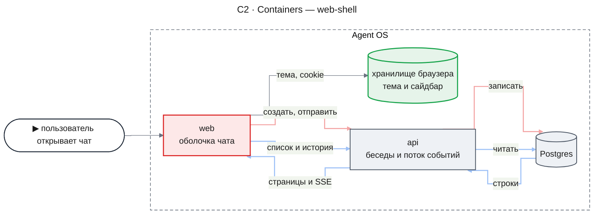
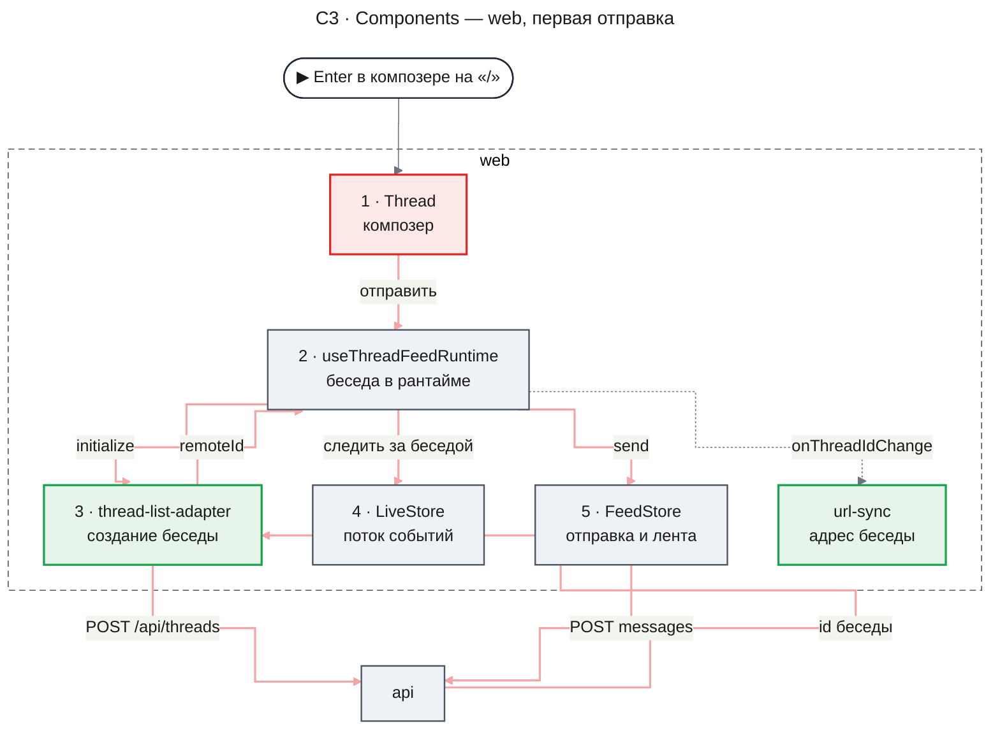
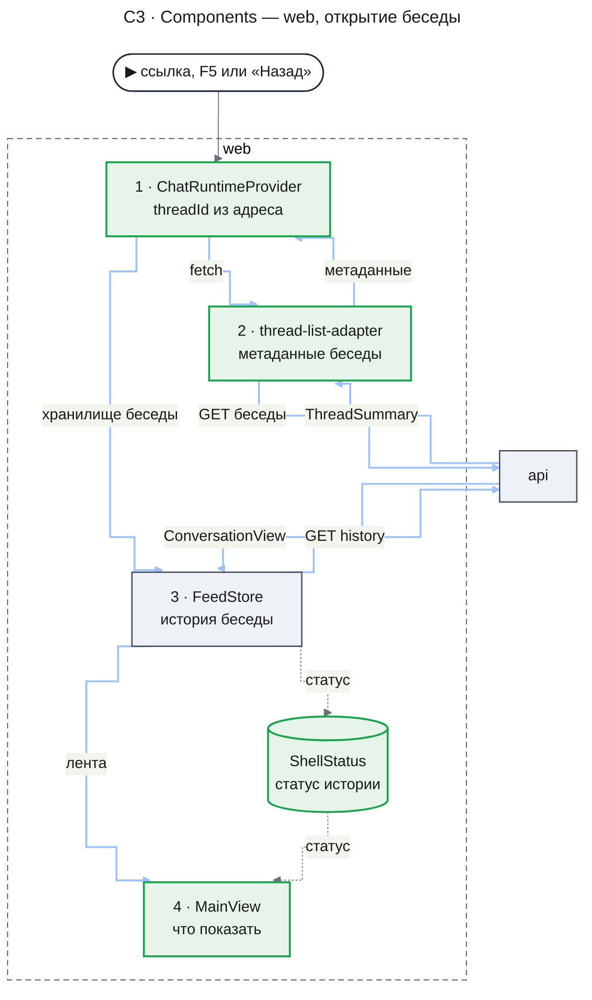
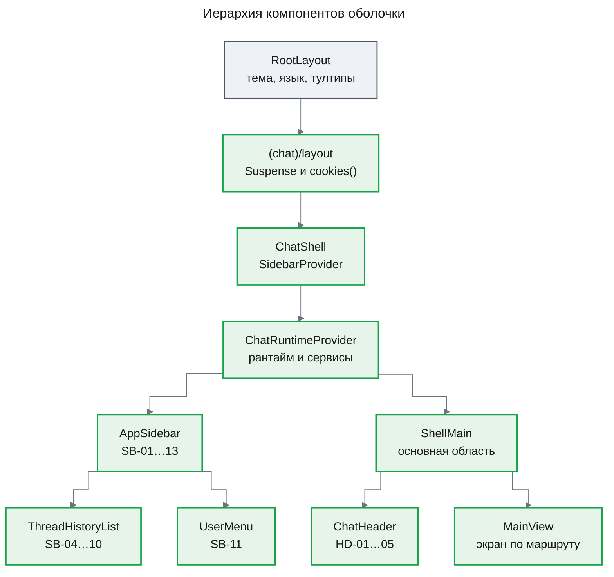
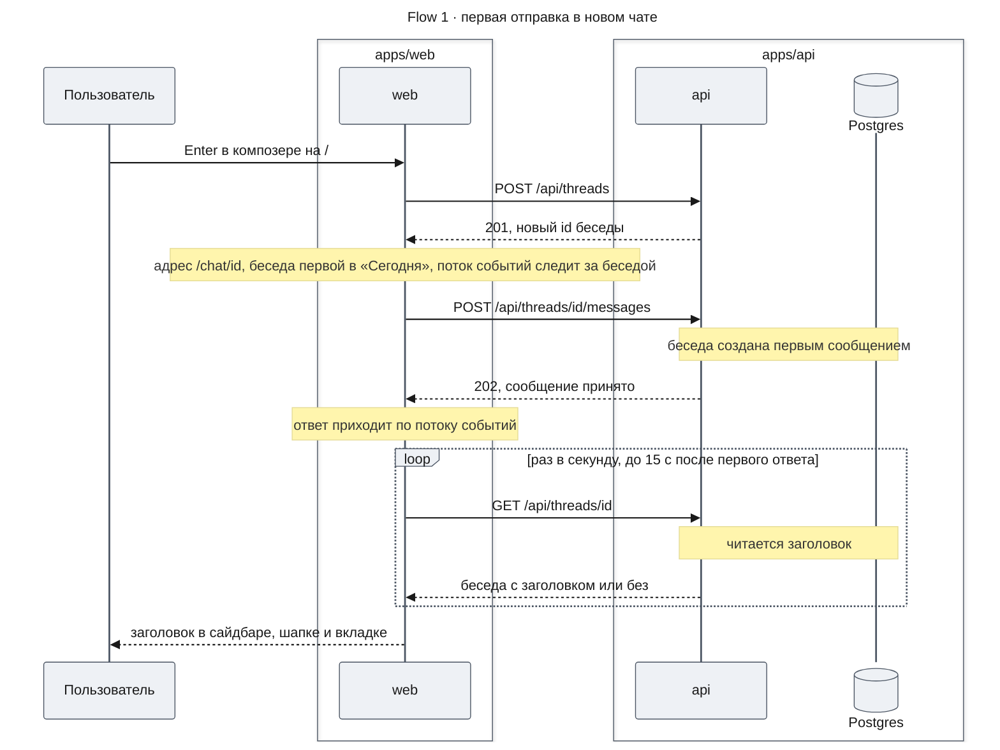
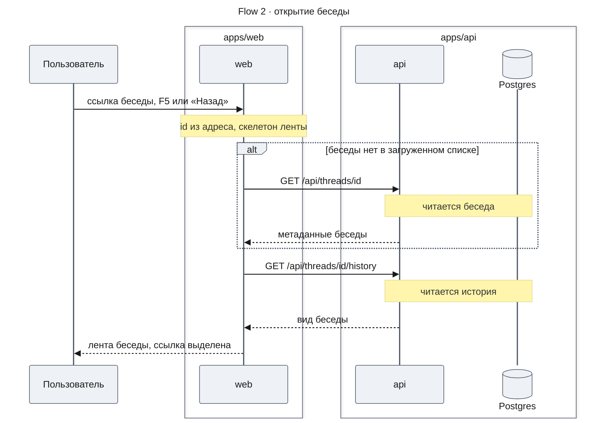
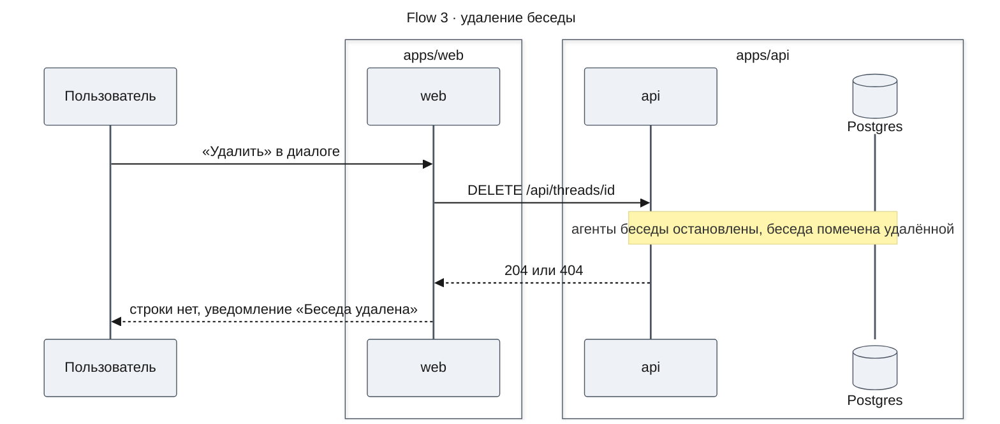
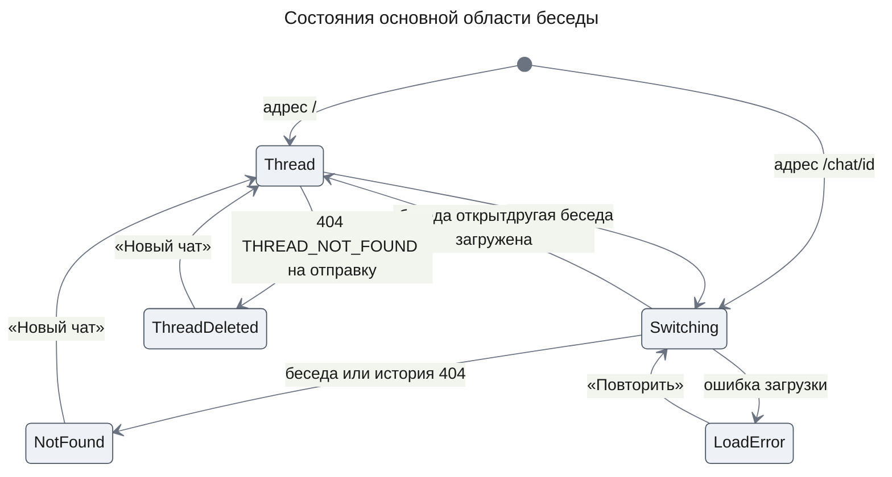

# Оболочка чата (chat-shell) Design Document — web-shell

**Status:** Approved · **Date:** 2026-11-22 · **PRD:** [prd.md](./prd.md) · **UXRD:** [uxrd.md](./uxrd.md) · **Depends on:** [agent-platform design-chat.md](../agent-platform/design-chat.md#contract-definitions), [agent-platform design-web.md](../agent-platform/design-web.md#contract-definitions)

## Snapshot

**Overview.** Веб-приложение `apps/web` — оболочка чата в стиле ChatGPT: слева сайдбар с историей бесед по датам, «Новый чат» и меню пользователя с темой, справа шапка, лента беседы и сворачиваемая правая панель; на узком экране сайдбар становится шторкой. Весь интерфейс живёт в layout группы `(chat)`, поэтому одна модель чата (рантайм assistant-ui) монтируется один раз и переживает переходы между беседами. Список бесед рантайм ведёт через собственный адаптер к API бесед, а ленту каждой беседы — через её хранилище ленты, которое описывает [agent-platform design-web.md](../agent-platform/design-web.md). Беседа появляется на сервере только с первым сообщением, адрес страницы становится адресом беседы без перезагрузки, а заголовок приходит опросом.

- **Does not change**: API бесед и потока событий — часть их только потребляет ([design-chat.md](../agent-platform/design-chat.md#contract-definitions)); лента, композер, карточки хода и блок ошибки ответа принадлежат [agent-platform design-web.md](../agent-platform/design-web.md); содержимое правой панели («Схема», «Задачи») — [deep-agents design-agent-types.md](../deep-agents/design-agent-types.md).
- **Biggest risk**: список бесед держится на API `unstable_`/experimental библиотеки (`useRemoteThreadListRuntime` с `runtimeHook`); версия `@assistant-ui/react` закреплена точно, интеграция собрана в двух модулях (KD-1).
- **Open questions**: нет.

### Key Decisions

#### KD-1: Список бесед — `useRemoteThreadListRuntime` с собственным адаптером, лента — хранилище беседы через `runtimeHook`

Рантайм assistant-ui в клиентском режиме держит список бесед, открытую беседу и состояние каждого её элемента. Список он читает и пишет через `RemoteThreadListAdapter` из [`thread-list-adapter.ts`](../../../apps/web/src/lib/threads/thread-list-adapter.ts), который ходит в `/api/threads*`. Для каждой беседы `runtimeHook` вызывает `useThreadFeedRuntime`: он берёт хранилище ленты этой беседы и отдаёт его рантайму как внешнее хранилище (`useExternalStoreRuntime`, KD-1 в [agent-platform design-web.md](../agent-platform/design-web.md#key-decisions)). Так у оболочки один источник правды о списке — рантайм, а у ленты — её хранилище; второго менеджера состояния бесед нет.

Пустая беседа не создаётся: `initialize()` элемента списка, то есть `POST /api/threads`, вызывается только при первой отправке (AC-03.2). Адрес связан с беседой через controlled `threadId` и `onThreadIdChange`, который получает только устоявшийся remote id (AC-04.1, AC-04.4). Интеграция с библиотекой собрана в [`chat-runtime-provider.tsx`](../../../apps/web/src/components/shell/chat-runtime-provider.tsx) и `lib/threads/*`, версия `@assistant-ui/react` закреплена точно.

#### KD-2: `ShellStatus` — один vanilla-стор для фактов, которых нет в рантайме

Библиотека глотает ошибки загрузки следующей страницы списка и не знает, загружена ли история беседы, ждёт ли беседа заголовка и когда в ней было последнее действие. Эти факты хранит стор `ShellStatus` ([`shell-status-store.ts`](../../../apps/web/src/lib/threads/shell-status-store.ts), паттерн [shell-store.md](../../code-system/patterns/shell-store.md)): статус истории по `remoteId` (`loading`, `ready`, `not_found`, `load_failed`, `deleted`), `loadMoreFailed`, `titleWaiting`, `activityAt` и отказ первого сообщения новой беседы (`newThreadSendFailure`). Пишут его адаптер списка, опрос заголовка и хранилища лент вне React через `getState()`; читают компоненты через `useShellStatus(selector)`. Стор не дублирует данные рантайма: список, заголовки, сообщения и открытая беседа живут только там.

#### KD-3: Весь UI — в layout группы `(chat)`, адрес — единственный вход выбора беседы

Страницы `app/(chat)/page.tsx` и `app/(chat)/chat/[threadId]/page.tsx` возвращают `null` и не читают `params`; оболочка, рантайм и поток событий монтируются один раз в `app/(chat)/layout.tsx`. Под `cacheComponents` (Next 16) страницам поэтому не нужны `Suspense` и `generateStaticParams`. Какой экран показать, решает `parseShellRoute(usePathname())` ([shell-route.md](../../code-system/patterns/shell-route.md)): `/` и `/chat/<id>` — беседа, остальные пути оболочки (`/agents`, `/library`, `/admin`, `/account`) — экраны других фич в той же основной области.

#### KD-4: `Thread` получает от оболочки проп `historyPending` и слот `DeletedNotice`

Пока беседа из адреса разрешается или её история грузится, вместо ленты виден скелетон, а композер остаётся на месте и не отправляет (AC-02.2). Это состояние знает только оболочка (`resolveMainView`), поэтому `Thread` получает необязательный проп `historyPending`: тот же элемент на той же позиции, и поле ввода не перемонтируется, когда история пришла. Беседу, удалённую в другой вкладке, оболочка узнаёт по 404 `THREAD_NOT_FOUND` на отправку и передаёт в `Thread` слот `DeletedNotice`: лента остаётся, уведомление встаёт на место композера (AC-08.5e).

#### KD-5: `setOpen(value, { persist })` в скопированном `ui/sidebar.tsx`

Правая панель на узком десктопе временно сворачивает сайдбар, и это сворачивание не должно перезаписать сохранённое состояние (AC-21.1). Поэтому `setOpen` скопированного компонента shadcn принимает необязательный `{ persist: false }`, который не пишет cookie `sidebar_state`.

## Terms

- **рантайм assistant-ui** — библиотечная модель чата: список бесед, открытая беседа и примитивы ленты.
- **`useRemoteThreadListRuntime`, адаптер списка** — часть рантайма, которая ведёт список бесед через `RemoteThreadListAdapter`; адаптер пишет приложение.
- **`runtimeHook`** — функция, которой рантайм списка строит рантайм одной беседы; выполняется внутри ресурсов tap библиотеки.
- **хранилище ленты (`FeedStore`)** — данные одной беседы и команды отправки; его владелец — [agent-platform design-web.md](../agent-platform/design-web.md).
- **поток событий (`LiveStore`)** — один SSE-поток вкладки, который следит за открытым экраном и вызывает перечитывание ([agent-platform design-web.md](../agent-platform/design-web.md#key-decisions), KD-2).
- **`ShellStatus`** — стор фактов оболочки, которых нет в рантайме (KD-2).
- **cacheComponents, Activity** — режим Next 16, в котором параметры маршрута — данные времени выполнения, а скрытые страницы сохраняет компонент `Activity`.
- **FOUC** — вспышка неправильной темы на первом кадре.
- **L1-сценарий** — проверка в реальном браузере против реального API.
- **U, C, I** — уровни автотестов: unit (Vitest), компонентный (React Testing Library) и интеграционный (RTL, MSW и реальный рантайм).
- **коды UXRD** (`SB-`, `TH-`, `HD-`, `DLG-`, `WS-`, `D-`, `E-`, `A-`) — элементы, состояния и решения в `uxrd.md`.

## Part

- **Part**: `web-shell` — часть Delivery Parts в `prd.md`.
- **Covers**: Must — FR-01…FR-12; Should — FR-19…FR-22; в пределах, перечисленных в Acceptance Criteria.
- **Depends on**: API бесед и потока событий — [design-chat.md, Contract Definitions](../agent-platform/design-chat.md#contract-definitions); лента, отправка, поток событий и блок ошибки ответа — [design-web.md, Contract Definitions](../agent-platform/design-web.md#contract-definitions). Оба контракта потребляются как написаны.

**Out of scope**

- Поиск по истории (FR-23) и индикатор идущего ответа в сайдбаре (FR-24) — Could, не сделаны.
- Рендер сообщений, рассуждений, инструментов и markdown — поведение каркаса assistant-ui и [agent-platform design-web.md](../agent-platform/design-web.md); здесь только политика ссылок и изображений (раздел «Недоверенный markdown») и состав action bar.
- Содержимое меню пользователя, кроме группы «Тема»: имя, «Мой доступ», «Панель администратора» и «Выйти» — [enterprise-access design-admin.md](../enterprise-access/design-admin.md), расход за месяц — FR-29 в [agent-platform design-web.md](../agent-platform/design-web.md).
- Пункты «Агенты» и «Библиотека» сайдбара и их экраны — фичи `agent-platform` и `custom-agents`; содержимое правой панели — `deep-agents`.
- Синхронизации списка между вкладками нет.

**Constraints**

- Единственный источник правды о списке бесед — рантайм assistant-ui, о ленте — её хранилище; `ShellStatus` хранит только то, чего нет у них (KD-1, KD-2).
- Next 16 с `cacheComponents`: страницы группы `(chat)` возвращают `null` и не читают `params` (KD-3).
- `@assistant-ui/react` закреплён точно (0.15.37), потому что API списка — `unstable_`.
- Тексты интерфейса — из каталогов next-intl на двух языках ([i18n design-web.md](../i18n/design-web.md)); в компонентах только семантические токены ([foundations.md](../../design-system/foundations.md)); уровень доступности — WCAG 2.1 AA.
- Ошибка списка, истории или операции не ломает композер и «Новый чат».
- Презентационные компоненты списка и шапки не знают о рантайме и тестируются по props.

## Building-block Inventory

| Блок | Паттерн | Решение | Что искали |
|---|---|---|---|
| Разбор адреса оболочки (`parseShellRoute`, `threadPath`) | [shell-route.md](../../code-system/patterns/shell-route.md) | reused | одна функция строит и разбирает каждый путь оболочки |
| `ShellStatus`, стор правой панели | [shell-store.md](../../code-system/patterns/shell-store.md) | reused | vanilla zustand вне React |
| Клиент API бесед (`threadsApiClient` над `apiRequest`) | [web-api-client.md](../../code-system/patterns/web-api-client.md) | reused | общий `apiRequest` с zod-схемой и классификацией ошибки |
| Сборка сервисов оболочки (`createShellServices`) | [composition-root.md](../../code-system/patterns/composition-root.md) | reused | одна сборка зависимостей без React |
| Адаптер списка, опрос заголовка, `url-sync`, `resolveMainView` | — | new | в библиотеке нет адаптера к нашему API; решения KD-1, KD-2 |
| Тексты | [interface-text.md](../../code-system/patterns/interface-text.md) | reused | каталоги next-intl |
| Логи | [logging.md](../../code-system/patterns/logging.md) | reused | обёртка `logger` из `packages/common` |

## Acceptance Criteria

В скобках — где реализуется и чем проверяется: **U** — unit, **C** — компонентный тест, **I** — интеграционный тест, **L1** — сценарий в браузере (Test Strategy).

### FR-01: Сайдбар с историей по датам

- **AC-01.1** **When** открывается `/` и у пользователя есть беседы с активностью сегодня, вчера, 5 и 40 дней назад, the system shall показать ровно группы «Сегодня», «Вчера», «Предыдущие 7 дней», «Старше» в этом порядке без пустых групп; внутри группы — по убыванию времени активности. (`groupThreadsByDate`; U, C)
- **AC-01.2** **While** открыт `/chat/<id>` и беседа есть среди загруженных, the system shall выделить её элемент и поставить `aria-current="page"` на ссылку. (C, L1-1)
- **AC-01.3** **While** первая страница списка загружается, the system shall показывать скелетон SB-09 с `role="status"`. (C)
- **AC-01.4** **If** список пуст, **then** the system shall показать «Пока нет бесед» и подсказку. (C)
- **AC-01.5** **If** запрос первой страницы завершился ошибкой, **then** the system shall показать «Не удалось загрузить беседы» и «Повторить», которая перезапрашивает первую страницу. (C, I)
- **AC-01.6** **If** название не помещается, **then** the system shall обрезать его многоточием в одну строку и показать полное в тултипе. (C)
- **AC-01.7** **If** ответ `GET /api/threads` не проходит `ThreadListResponseSchema`, **then** the system shall перевести список в состояние AC-01.5, а композер и «Новый чат» останутся работоспособны. (адаптер; U, I)

### FR-02: Открытие беседы

- **AC-02.1** **When** пользователь открывает беседу, the system shall показать её историю в исходном порядке так, как её строит лента ([agent-platform design-web.md](../agent-platform/design-web.md), KD-3). (L1-4)
- **AC-02.2** **While** беседа из адреса разрешается или её история грузится, the system shall показывать скелетон ленты, а не приветствие; композер виден, отправка доступна только после загрузки. (`resolveMainView` → `historyPending`; U, I)
- **AC-02.3** **When** в открытой беседе пользователь отправляет сообщение, the system shall отправить его в эту беседу (`POST /api/threads/:id/messages`) и показать ответ в её ленте. (L1-4)
- **AC-02.4** **When** открыта беседа с длинным markdown (таблица, код 80+ строк), the system shall отрендерить его как в живом ответе; «Копировать» у блока кода работает. (каркас; L1-4)
- **AC-02.5** **If** ответ истории не проходит `ConversationViewSchema` или запрос упал, **then** the system shall показать TH-07 с «Повторить» и «Новый чат», а сайдбар и шапка останутся работоспособны. (статус истории `load_failed`; I)
- **AC-02.6** **While** в беседе X идёт ответ, **when** пользователь открывает Y, the system shall не показывать ответ X в Y, а при возврате в X показать завершённый или продолжающийся ответ: ответ идёт на сервере, а лента X перечитывается при возврате. (L1-6)

### FR-03: Новый чат

- **AC-03.1** **When** нажата «Новый чат» (кнопка или `Ctrl/⌘+Shift+O`), the system shall перейти на `/` и показать приветствие; фокус — в композер при `(pointer: fine)`, иначе на `h1` шапки. (`focusAfterNewChat`; U, C, L1-1, L1-3)
- **AC-03.2** **If** пользователь открыл «Новый чат» и ушёл, ничего не отправив, **then** the system shall не создавать беседу (запросов `POST /api/threads` нет). (I)
- **AC-03.3** **When** отправлено первое сообщение нового чата, the system shall сразу показать новую беседу первой в «Сегодня», активной, с «Новая беседа». (I, L1-1)
- **AC-03.4** **While** в X идёт ответ, **when** нажата «Новый чат», the system shall открыть `/` с приветствием; ответ X в новый чат не попадает. (L1-6)

### FR-04: URL на беседу

- **AC-04.1** **When** первое сообщение отправлено с `/`, the system shall заменить адрес на `/chat/<id>` (id из `POST /api/threads`) без перезагрузки и без новой записи истории. (`syncUrlWithThread`; U, I, L1-1)
- **AC-04.2** **When** на `/chat/<id>` нажата F5, the system shall показать ту же беседу и выделить её, если она в загруженной странице. (L1-5)
- **AC-04.3** **If** `/chat/<id>` чужой или несуществующей беседы, **then** the system shall показать TH-06 «Беседа не найдена» с «Новый чат», фокус на `h1` экрана. (U, I, L1-7)
- **AC-04.4** **When** пользователь переключал беседы кликами, the system shall переключать их кнопками «Назад/Вперёд» браузера в обратном порядке. (`ShellLink` + controlled `threadId`; L1-5)

### FR-05: Переименование

- **AC-05.1** **When** выбрано «Переименовать», введено «Отчёт Q3» и нажат Enter, the system shall показать новое название в сайдбаре, шапке и вкладке без перезагрузки; после F5 оно сохранено. (C, L1-2)
- **AC-05.2** **When** во время редактирования нажат Esc, the system shall вернуть прежнее название. (C)
- **AC-05.3** **If** после обрезки пробелов поле пусто и нажат Enter, **then** the system shall не отправлять запрос и оставить поле открытым с `aria-invalid="true"` и текстом «Введите название». (C)
- **AC-05.4** **If** `PATCH` завершился ошибкой, **then** the system shall вернуть прежнее название и показать уведомление «Не удалось переименовать беседу. Попробуйте ещё раз.». (адаптер + оптимистичный откат библиотеки; U)

### FR-06: Удаление

- **AC-06.1** **When** выбрано «Удалить», the system shall открыть `alertdialog` «Удалить беседу?» с названием, кнопками «Отмена» (фокус) и «Удалить»; если у беседы есть агенты, — абзац о том, что они будут удалены, а работающие остановлены. (C)
- **AC-06.2** **When** подтверждено удаление открытой беседы, the system shall убрать её из списка, заменить адрес на `/` без новой записи истории и показать приветствие; фокус — по правилу указателя. (I, L1-2)
- **AC-06.3** **When** подтверждено удаление не открытой беседы, the system shall убрать её; открытая беседа и адрес не меняются, фокус — на следующую ссылку списка. (C, L1-2)
- **AC-06.4** **When** после удаления открыт старый `/chat/<id>`, the system shall показать TH-06. (L1-7)

### FR-07: Шапка

- **AC-07.1** **When** нажата кнопка сворачивания сайдбара (≥ 768 px), the system shall свернуть сайдбар до полосы 48 px и выставить `aria-expanded="false"`. (C, L1-1)
- **AC-07.2** **While** у открытой беседы нет заголовка, the system shall показывать «Новая беседа», с мерцанием, пока идёт опрос заголовка. (C)
- **AC-07.3** **While** открыт `/`, the system shall не показывать название (для скринридера `h1` — скрытое «Новый чат»). (C)

### FR-08: Колонка, приветствие, композер

- **AC-08.1** **While** ширина окна 1440 px, the system shall держать сообщения и композер в колонке 768 px по центру. (L1-1)
- **AC-08.2** **While** беседа пуста, the system shall показать «Чем могу помочь?», подзаголовок и 4 подсказки (2×2 при ≥ 640 px); клик отправляет текст подсказки. (C, L1-1)
- **AC-08.3** **While** в беседе есть сообщения, the system shall скрыть приветствие, прижать композер к низу и показывать «К последнему сообщению» при отрыве. (каркас; L1-4)
- **AC-08.5** **If** ответ не получен, **then** the system shall показать под репликой блок ошибки с фиксированным текстом по причине отказа, без текста сервера и модели и без кнопки повтора; текст и причины задаёт [agent-platform design-web.md](../agent-platform/design-web.md). (C)
- **AC-08.5e** **If** отправка получила 404 `THREAD_NOT_FOUND` (беседу удалили в другой вкладке), **then** the system shall оставить ленту видимой и показать вместо композера уведомление «Беседа удалена» с кнопкой «Новый чат» (UXRD E-8). (слот `DeletedNotice`; C, I, L1-7)
- **AC-08.6** **While** в ленте есть сообщения пользователя и завершённые ответы, the system shall показывать у каждого из них единственную кнопку «Копировать», достижимую по Tab без наведения (видна у последнего сообщения всегда, при грубом указателе — у всех, у остальных — при наведении или фокусе внутри реплики), и после копирования объявлять «Скопировано» через `role="status"`. У ответа, который сейчас пишется, и у ответа без текста кнопки нет. (C `message-actions.test.tsx`, L1-10)

### FR-09: Тема

- **AC-09.1** **When** в меню пользователя выбрано «Тёмная», the system shall применить тёмные токены ко всему интерфейсу без перезагрузки. (C, L1-8)
- **AC-09.2** **When** страница перезагружается с сохранённой темой, the system shall отрисовать первый кадр уже в ней (production-сборка, CPU ×4). (L1-8)
- **AC-09.3** **While** выбрана «Системная», **when** ОС меняет тему, the system shall следовать за ОС. (L1-8)

### FR-10: Мобильная шторка

- **AC-10.1** **While** ширина 375 px, the system shall скрыть сайдбар (CSS, до гидратации) и показать в шапке «Меню» и «Новый чат», без горизонтального скролла. (L1-3)
- **AC-10.2** **When** нажато «Меню», the system shall открыть модальную шторку со списком, «Новый чат» и блоком пользователя, фокус на «Новый чат»; Esc, затемнение, «×» и свайп влево закрывают её, фокус возвращается на «Меню». (L1-3)
- **AC-10.3** **When** в шторке выбрана беседа, the system shall закрыть шторку и открыть беседу, фокус — на `h1` шапки. (L1-3)
- **AC-10.4** **While** ширина 360 px и в беседе блок кода 120 символов, the system shall прокручивать горизонтально только блок кода. (L1-3)

### FR-11: Правая панель

- **AC-11.1** **When** загружается `/` или `/chat/<id>` на десктопе, the system shall не показывать правую панель. (I, L1-1)
- **AC-11.2** **When** нажата кнопка панели в шапке (≥ 1024 px), the system shall раскрыть панель на 40 % основной области; перетаскивание ограничено: панель ≥ 360 px, лента ≥ 480 px. (L1-1)
- **AC-11.3** **When** нажата та же кнопка или «×», the system shall скрыть панель, фокус — на кнопку в шапке. (I)

### FR-12: Тестовая инфраструктура

- **AC-12.1** **When** выполняется `pnpm --filter web test`, the system shall выполнить тесты группировки по датам, состояний сайдбара (загрузка, пусто, ошибка, список), переключения темы и шапки с заголовком. (Test Strategy)
- **AC-12.2** The system shall выполнять тесты в режиме `vitest run` без запущенного API (MSW).

### FR-19: Подгрузка (Should)

- **AC-19.1** **When** список прокручен до «Показать ещё» (за 200 px) или нажата кнопка, the system shall подгрузить следующую страницу с индикатором в конце, сохранив порядок групп; **if** подгрузка упала, **then** — «Не удалось загрузить ещё беседы» и «Повторить», загруженные остаются. (U, C)

### FR-20: Заголовок без перезагрузки (Should)

- **AC-20.1** **When** в новой беседе появился первый ответ модели, the system shall опрашивать `GET /api/threads/:id` раз в 1 с до непустого `title` или 15 с и заменить «Новая беседа» в сайдбаре, шапке и вкладке. (опрос заголовка; U, L1-1)

### FR-21: Состояние сайдбара (Should)

- **AC-21.1** **When** пользователь свернул сайдбар и перезагрузил страницу, the system shall отрисовать его свёрнутым на первом кадре; временное сворачивание при открытии правой панели сохранённое состояние не меняет. (cookie + `cookies()`; L1-1)

### FR-22: Горячие клавиши (Should)

- **AC-22.1** **When** нажато `Ctrl/⌘+Shift+O` / `Ctrl/⌘+B`, the system shall открыть новый чат / переключить сайдбар (на мобильном — шторку); сочетания показаны в тултипах с символом платформы; не срабатывают при открытом модальном окне или меню (кроме `Ctrl/⌘+B`, закрывающего шторку) и в поле переименования. (U, C)
- **AC-22.2** **When** фокус на ссылке беседы и нажаты ↑/↓ (Home/End), the system shall перевести фокус на предыдущую/следующую (первую/последнюю) загруженную беседу через границы групп. (C)

## Design

### Architecture (C1–C4)

#### C2 · Containers

- `web` (`apps/web`) — оболочка: маршруты группы `(chat)`, рантайм assistant-ui с адаптером списка, сайдбар, шапка, тема и тесты.
- `web` ходит в `api` только по своему адресу: `/api/*` того же origin, а Next переписывает эти запросы на `API_INTERNAL_URL`, заданный при сборке. Сессия — cookie, поэтому браузер шлёт её сам.
- `api` (`apps/api`) отдаёт беседы (`/api/threads*`) и поток событий (`/api/events`, SSE) по контракту [design-chat.md](../agent-platform/design-chat.md#contract-definitions); Postgres хранит беседы как корневые сессии агентов.
- Хранилище браузера держит тему (`localStorage['theme']`, next-themes) и cookie `sidebar_state`, которую читает серверный layout группы `(chat)`.

#### C3 · Components: web

**Первая отправка в новом чате**

- У элемента нового чата ещё нет `remoteId`, поэтому `useThreadFeedRuntime` сначала вызывает `initialize()` элемента. Адаптер списка делает `POST /api/threads`, ставит беседе статус истории `ready` (истории у неё нет) и возвращает id.
- Затем поток событий переключается на `thread:<id>`, чтобы первые части ответа не потерялись, и только после этого хранилище ленты отправляет сообщение. Рантайм сообщает id в `url-sync`, и адрес становится `/chat/<id>` через `history.replaceState`.
- Если сервер не принял первое сообщение, беседа пуста: элемент удаляется без уведомления (`markEmpty`), а текст и причина отказа возвращаются в композер нового чата (`newThreadSendFailure`).
- `FeedStore` и `LiveStore` — блоки [agent-platform design-web.md](../agent-platform/design-web.md); оболочка их только создаёт (`createShellServices`) и подключает.

**Открытие беседы**

- Адаптер списка запрашивает метаданные (`fetch`) только для беседы, которой нет в загруженном списке; 404 рантайм превращает в `switchError`.
- Хранилище ленты беседы создаётся один раз на вкладку (`feeds.forThread`), загружает историю и пишет её статус в `ShellStatus`.
- `MainView` решает по маршруту, `switchError` рантайма и статусу истории (`resolveMainView`), что показать: ленту, её скелетон, TH-06 или TH-07.

#### Иерархия компонентов

`ShellMain` ставит рядом с колонкой чата правую панель: `WorkspacePanel` в `ResizablePanelGroup` от 1024 px, `WorkspaceDrawer` на более узком экране. Контейнеры `ThreadHistoryList` и `ChatHeader` читают рантайм и передают данные презентационным `ThreadHistoryListView` и `ChatHeaderView`.

#### Владение состоянием

| Состояние | Владелец | Как читается |
|---|---|---|
| Список бесед, метаданные (`title`, `lastMessageAt`), открытая беседа | рантайм assistant-ui | `useAuiState`, `useAui` |
| Лента беседы, отправка, отказ отправки | `FeedStore` беседы ([agent-platform design-web.md](../agent-platform/design-web.md)) | `useFeedRuntime` внутри рантайма |
| Какая беседа открыта | адрес → controlled `threadId` | `parseShellRoute(usePathname())` |
| Сайдбар развёрнут, шторка открыта | `SidebarProvider` + cookie `sidebar_state` | `useSidebar()` |
| Тема | next-themes (`localStorage['theme']`) | `useTheme()` |
| Правая панель открыта и её вкладка | `WorkspaceStore` в сервисах оболочки; ширина — `useState` в `ShellMain` | `useStore(workspace)` |
| Статус истории, `loadMoreFailed`, `titleWaiting`, `activityAt`, отказ первого сообщения | `ShellStatus` (KD-2) | `useShellStatus(selector)` |

`ChatRuntimeProvider` один раз на монтирование создаёт `ShellServices` ([`shell-services.ts`](../../../apps/web/src/lib/threads/shell-services.ts)): клиент API, `ShellStatus`, поток событий, хранилища лент, адаптер списка и сторы других фич. `ShellActionsProvider` раздаёт компонентам `newChat`, `leaveTo`, `retryHistory` и `retrySwitch`.

#### Маршрутизация и синхронизация URL

- **Layout группы** (серверный): `Suspense` с фоном `ShellFallback` вокруг компонента, который читает `cookies()` и передаёт `defaultSidebarOpen` в `ChatShell`. Чтение cookie делает группу динамической; корневой layout (шрифты, тема, скрипт theme-color) остаётся статическим.
- **Путь беседы — одна функция.** `threadPath(id)` строит путь для ссылок, `replaceState` и сравнения адресов; `parseShellRoute` разбирает его обратно, а некорректная %-последовательность остаётся сырой, и сервер отвечает 404 → TH-06.
- **Адрес → беседа.** `threadId` берётся из `usePathname()`, а не из `useParams`: после `history.replaceState` дерево маршрутов Next прежнее, а `usePathname` следует за адресом.
- **Беседа → адрес** (`syncUrlWithThread` из `onThreadIdChange`, только на путях беседы): устоявшийся `remoteId` заменяет текущую запись своим путём, поэтому первая отправка не оставляет в истории пустой чат; уход рантайма с беседы на `/chat/…` (удалена открытая беседа) — `router.replace('/')`.
- **Переходы между беседами** — ссылки `ShellLink` (запись в истории, AC-04.4). «Назад/Вперёд» меняют `pathname`, а с ним controlled `threadId`.
- **«Новый чат»** на `/` только ставит фокус; иначе `router.push('/')` и фокус после смены маршрута. Сети не нужно: беседа появится с первым сообщением.
- **Заголовок вкладки** (`DocumentTitle`): «{Название} — Agent OS», «Новый чат — Agent OS», «Новая беседа — Agent OS», «Беседа не найдена — Agent OS»; пока беседа из адреса разрешается, прежний заголовок остаётся.

#### Основные компоненты

- **`ChatShell`** — раскладка SH-01 (`SidebarProvider`, корень `h-dvh`), обработчик 401 → `/login`, глобальные сочетания, skip link, закрытие шторки при переходе на ≥ 768 px. Его `ShellMain` открывает правую панель: если основная область уже 840 px, сайдбар сворачивается через `setOpen(false, { persist: false })` и разворачивается обратно, когда панель закрыта (KD-5).
- **`ChatRuntimeProvider`** — единственное место, где создаются рантайм и поток событий; передаёт `threadId`, `runtimeHook` и подсказки приветствия. Поток событий следует за экраном: `thread:<id>` на открытой беседе, `agent:<id>` на странице агента, ничего на `/`.
- **`ThreadListAdapter`** — `list`, `initialize`, `fetch`, `rename`, `delete`, `generateTitle` поверх `threadsApiClient` (Contract Definitions).
- **Опрос заголовка** (`createTitlePollStream`) — после первого ответа модели беседа просит заголовок один раз; опрос — не чаще раза в 1 000 мс и не дольше 15 000 мс, `titleWaiting` стоит только на время опроса. Пустого заголовка сервер не хранит, поэтому достаточно проверки `title !== null`.
- **`AppSidebar`** — марка, «Новый чат», пункты разделов, `nav` истории со списком, `UserMenu`. В шторке фокус после закрытия зависит от причины: после выбора беседы или «Нового чата» его ставит само действие, после Esc, «×», затемнения или свайпа — кнопка «Меню».
- **`ThreadHistoryList`** — группы по датам из метаданных рантайма и `activityAt`; автоподгрузка — `IntersectionObserver` на «Показать ещё» с запасом 200 px; ↑/↓/Home/End — обработчик на контейнере; при возврате во вкладку перечитывает первую страницу, только если загружена одна страница. Удаление вызывает `delete()` элемента рантайма; после него поток событий получает локальную заметку `tree`, чтобы дерево агентов и счётчики перечитались.
- **`ThreadHistoryItem`** — ссылка `ShellLink` и меню «⋯» с «Переименовать» и «Удалить»; переименование на месте (`ThreadTitleField`). Оба пункта действуют из `onClick` элемента меню, а не после анимации закрытия, иначе символы, введённые за время анимации, терялись.
- **`DeleteThreadDialog`** — `alertdialog`; при открытии читает агентов беседы (`GET /api/threads/:id/agents`) и показывает абзац об их удалении.
- **`ChatHeader`** — «Меню» (до 768 px) и «Боковая панель» (от 768 px), `h1` с названием, кнопка правой панели (только на беседе), «Новый чат» (до 768 px). Название выводится из того же `useMainViewState()`, что и `MainView`; на прочих маршрутах заголовок даёт экран своей фичи. Граница снизу появляется, когда лента прокручена.
- **`MainView`** — экран по маршруту; для беседы — `Thread` (`historyPending` в `switching` и пока на `/chat/<id>` тело беседы грузится; `DeletedNotice` при статусе `deleted`) или `ThreadNotice` (TH-06, TH-07).
- **`UserMenu`** — группа «Тема» (`light`, `dark`, `system`); остальное содержимое меню — Out of scope.

### Runtime Flows

#### Flow 1: первая отправка в новом чате

**Starts when:** пользователь на `/` отправляет первое сообщение (AC-03.2, AC-03.3, AC-04.1, AC-20.1).

`POST /api/threads` ничего не пишет: он только выдаёт id, а беседа появляется на сервере с первым сообщением ([design-chat.md](../agent-platform/design-chat.md#key-decisions), KD-1).

**Failure handling:**

- Ошибка `POST /api/threads` → композер получает текст обратно, адрес остаётся `/`.
- Сервер не принял первое сообщение → пустая беседа удаляется без уведомления, адрес возвращается на `/`, текст и причина отказа остаются в композере нового чата.
- Опрос заголовка: 404 прекращает опрос, прочие ошибки пишутся предупреждением, и опрос продолжается до конца окна.

#### Flow 2: открытие беседы по ссылке, F5 или «Назад»

**Starts when:** пользователь открывает `/chat/<id>` кликом, перезагрузкой или кнопками истории (AC-02.1, AC-02.2, AC-02.5, AC-04.2–AC-04.4).

**Failure handling:**

- Метаданные: 404 → TH-06 «Беседа не найдена», фокус на `h1`; прочая ошибка → TH-07 с «Повторить» (`switchToThread`).
- История: 404 → TH-06; невалидный ответ, 5xx или сеть → TH-07, «Повторить» загружает историю снова (`retryHistory`).

#### Flow 3: удаление беседы

**Starts when:** пользователь подтверждает удаление в `DeleteThreadDialog` (AC-06.1–AC-06.3).

Работающих агентов беседы останавливает сервер ([design-chat.md](../agent-platform/design-chat.md), Flow 6). Клиент после удаления забывает хранилище ленты беседы и её статусы; при удалении открытой беседы адрес заменяется на `/` без новой записи истории.

**Failure handling:** 404 — успех (беседы уже нет); прочая ошибка — элемент возвращается в список, уведомление «Не удалось удалить беседу. Попробуйте ещё раз.».

### Contract Definitions

**Потребляемый API.** Маршруты, формы и ошибки задаёт [design-chat.md, Contract Definitions](../agent-platform/design-chat.md#contract-definitions). Оболочка вызывает их через `threadsApiClient` ([`threads-api-client.ts`](../../../apps/web/src/lib/threads/threads-api-client.ts)):

- `GET /api/threads?cursor` — страница списка, `ThreadListResponseSchema`; `nextCursor: null` — конец списка.
- `POST /api/threads` — новый id беседы, `ThreadSummarySchema`.
- `GET /api/threads/:id` — метаданные беседы; `PATCH /api/threads/:id` с `{ title }` — переименование; `DELETE /api/threads/:id` — удаление, 204.
- `GET /api/threads/:id/agents` — агенты беседы для абзаца диалога удаления.
- История (`GET /api/threads/:id/history`) и отправка (`POST /api/threads/:id/messages`) идут через хранилище ленты ([design-web.md, Contract Definitions](../agent-platform/design-web.md#contract-definitions)).

Каждый ответ проходит zod-схему из `@agent-os/contracts` внутри `apiRequest`. Ошибка — `ApiRequestError` с `kind` (`not_found`, `invalid_response`, `http`, `network`), статусом и `errorCode` тела. Ответ 401 до вызывающего уходит в обработчик оболочки, который ведёт на `/login`.

**`ThreadListAdapter`** (`createThreadListAdapter`):

- `list({ after? })` возвращает до одной страницы метаданных: `title: null` становится `undefined`, `lastMessageAt` — дата `updatedAt`. Ошибка пробрасывается; при `after` адаптер ещё ставит `loadMoreFailed`.
- `initialize()` создаёт беседу, ставит её статусу истории `ready` и возвращает `{ remoteId }`.
- `fetch(threadId)` возвращает метаданные беседы из адреса; ошибка становится `switchError` рантайма.
- `rename(remoteId, title)` получает уже обрезанное название; при ошибке показывает уведомление и бросает, а библиотека откатывает заголовок.
- `delete(remoteId)`: 204 и 404 — успех, хранилище ленты и статусы беседы забываются, уведомление «Беседа удалена»; иначе уведомление об ошибке и исключение. Беседу, помеченную `markEmpty`, адаптер удаляет без уведомления.
- `archive()` отклоняется: архива нет.
- `generateTitle(remoteId, messages)` возвращает поток опроса заголовка.

**`Thread`** (`thread.aui.tsx`) получает от оболочки `components.Welcome`, необязательный слот `components.DeletedNotice` и проп `historyPending` (KD-4); без них — обычная лента.

**`setOpen(value, { persist })`** скопированного `ui/sidebar.tsx`: `persist` по умолчанию `true`; `false` не пишет cookie (KD-5).

### State Transitions and Invariants

**Invariants**

1. Список бесед, их заголовки и открытая беседа живут только в рантайме; `ShellStatus` их не дублирует.
2. Адрес — единственный вход выбора беседы; рантайм пишет в адрес только устоявшийся remote id.
3. Беседа создаётся на сервере только первым сообщением; «Новый чат» сетевых запросов не делает.
4. На `/chat/<id>` основная область не показывает приветствие, пока беседа не открыта и её сообщения не пришли: видны скелетон и композер без отправки.
5. Ответы API используются только после zod-валидации; невалидный ответ — состояние ошибки, а не исключение в рендере.
6. Заголовок беседы рендерится как текст React, никогда через `dangerouslySetInnerHTML`.

### State × Display Matrix

| Компонент | default | loading | empty | error | partial |
|---|---|---|---|---|---|
| `ThreadHistoryList` (SB-04, SB-09) | группы с `h2` и `ul` | скелетон, `role="status"` | «Пока нет бесед» | «Не удалось загрузить беседы» в `role="alert"` + «Повторить» | SB-10 «Показать ещё» |
| SB-10 «Показать ещё» | кнопка | скелетон, `role="status"` | не рендерится | «Не удалось загрузить ещё беседы» + «Повторить» | — |
| `ThreadHistoryItem` | название, «⋯» | — | — | откат операции + уведомление | «Новая беседа» с мерцанием при опросе заголовка |
| `ChatHeader` HD-03 | название | скелетон | `/`: скрытое «Новый чат» | TH-06, TH-07: пустой `h1` | «Новая беседа» с мерцанием |
| `MainView` (беседа) | лента; на пустой — приветствие и подсказки | скелетон ленты, композер без отправки | приветствие | TH-06, TH-07; `DeletedNotice` вместо композера | — |
| `DeleteThreadDialog` | заголовок, название, кнопки | — | — | после закрытия: уведомление и возврат строки | абзац об агентах беседы |

### Action bar

- У сообщения пользователя и у завершённого ответа — только «Копировать»; рядом постоянно смонтирован скрытый `role="status"`, в который после копирования попадает «Скопировано».
- Action bar рендерится всегда и скрывается только прозрачностью, чтобы кнопка оставалась в порядке Tab: у последнего сообщения видна всегда, при `pointer: coarse` — у всех, у остальных — при наведении или фокусе внутри реплики.
- У ответа, который сейчас пишется, и у ответа без видимого текста кнопки нет; ответ без единой части строкой не показывается.

### Тема, шрифт, токены

- **Тема.** `ThemeProvider` (обёртка next-themes) в `RootLayout`: `attribute="class"`, `defaultTheme="system"`, `enableSystem`, `enableColorScheme`, `disableTransitionOnChange`. Скрипт next-themes ставит класс до первой отрисовки (AC-09.2); FOUC проверяется только на production-сборке.
- **theme-color.** Статический inline-скрипт в `<head>` держит `<meta name="theme-color">` равным вычисленному `--background`.
- **Сайдбар без «прыжка».** Cookie `sidebar_state` читается сервером и задаёт `defaultOpen`, поэтому первый кадр уже в нужном состоянии.
- **Мобильный первый кадр и шторка.** Десктопный сайдбар — `hidden md:block`; кнопки шапки различаются брейкпоинтами CSS. Шторка — base-ui `Drawer` со `swipeDirection="left"`: модальность, Esc, затемнение и закрытие свайпом.
- **Вьюпорт.** `viewportFit: 'cover'`, `interactiveWidget: 'resizes-content'`; корень оболочки — `h-dvh`, подвал композера учитывает `safe-area-inset-bottom`.
- **Шрифт.** Geist и Geist Mono с подмножествами `latin` и `cyrillic`.
- **Токены.** Цвета, кольцо фокуса, `--destructive-foreground` и движение — [foundations.md](../../design-system/foundations.md); размеры оболочки в `globals.css`: `--thread-max-width: 48rem`, `--header-height: 3.5rem`.

### Доступность

**Фокус** (`lib/focus.ts`): `focusAfterNewChat()` ставит фокус в композер при точном указателе, иначе на `h1` шапки.

| Событие | Куда фокус |
|---|---|
| «Новый чат» | правило указателя после перехода |
| Открытие беседы кликом, точный указатель | композер |
| Открытие касанием или из шторки | `h1` шапки |
| Шторка закрыта без действия | кнопка «Меню» |
| Холодная загрузка `/` | композер, только при точном указателе |
| TH-06, TH-07 появились | `h1` экрана |
| Удаление открытой беседы | правило указателя, когда маршрут стал `/` |
| Удаление не открытой беседы | следующая ссылка, иначе предыдущая, иначе «Новый чат» (вычисляется до удаления) |
| Сохранение или отмена переименования | ссылка этой беседы |
| Закрытие меню, «Отмена» диалога | вызвавший элемент |
| Закрытие правой панели | кнопка панели в шапке |

**Клавиатура** (`lib/keyboard-shortcuts.ts`): сочетания распознаются по `event.code`, поэтому раскладка не мешает. `isShortcutBlocked` молчит внутри `[data-shortcuts-blocked]` (поле переименования) и при открытых `alertdialog`, меню и модальном диалоге; открытая шторка не блокирует `Ctrl/⌘+B`, который её закрывает. Символ в тултипах — «⌘» на Apple, иначе «Ctrl».

**Роли и имена** — по таблице UXRD «Роли и имена»: `nav` истории, `role="status"` у загрузки и `role="alert"` у ошибок списка, группы — `h2` + `ul`, `aria-current="page"` у активной ссылки, «⋯» с именем «Действия с беседой «{название}»», `aria-expanded`/`aria-controls`/`aria-keyshortcuts` у кнопок шапки, шторка — модальный `dialog`, правая панель — `aside`, skip link — первый в Tab. Переходы отключаются при `prefers-reduced-motion`.

### Error Handling

| Ситуация | Где обнаруживается | Поведение |
|---|---|---|
| Первая страница: сеть, 5xx, невалидно | `list` → `threads.loadError` | SB-09 Error + «Повторить»; композер и «Новый чат» работают |
| Следующая страница | `list({ after })` | `loadMoreFailed` → SB-10 Error; загруженное остаётся |
| Беседа по адресу не найдена | `fetch` 404 → `switchError` | TH-06, фокус на `h1` |
| Беседа по адресу: прочая ошибка | `switchError` | TH-07 + «Повторить» + «Новый чат» |
| История: 404 / прочая ошибка | хранилище ленты → статус истории | TH-06 / TH-07 + «Повторить» |
| Отправка в удалённую беседу | 404 `THREAD_NOT_FOUND` → статус `deleted` | `DeletedNotice` вместо композера, лента видна |
| Создание беседы | `initialize` | текст возвращается в композер, адрес `/` |
| Переименование, удаление | адаптер | откат библиотеки + уведомление |
| Ошибка рендера оболочки | `app/error.tsx` | «Что-то пошло не так» + «Обновить страницу» в теме приложения; в лог — только `digest` |
| Ссылка с опасной схемой, изображение не по `https` | политика markdown | текст без `href`; вместо картинки — ссылка или заглушка |

Граница ошибок стоит в корневом сегменте: `app/error.tsx` находится внутри корневого layout (тема, шрифты и стили действуют) и снаружи `(chat)/layout.tsx`, поэтому ловит ошибки и `ChatShell`, и серверной части layout группы.

### Logging and Monitoring

Оболочка пишет логи только через `logger` ([logging.md](../../code-system/patterns/logging.md)), без текста сообщений, заголовков и тел ответов. Классификацию ошибки даёт `describeApiError` — `kind`, метод, путь, статус, код. Контекст записи: загрузка страницы списка — `nextPage`; создание, переименование, удаление и опрос заголовка — `remoteId`; удаление из списка — `threadId`.

## Test Strategy

Каждый AC закрыт автотестом (U, C, I) или L1-сценарием; тесты проверяют наблюдаемое поведение через роли и тексты. Окружение тестов: Vitest 4 в jsdom, зона `Europe/Berlin` (с переходом на летнее время), MSW с `onUnhandledRequest: 'error'`; запуск — `pnpm test` из корня или `pnpm --filter web test`.

### Main Use Cases

- **Группировка по датам** — covers AC-01.1, AC-19.1: `group-threads-by-date.test.ts` — четыре группы, границы 2/7/8/30/31 день, сутки 23 и 25 часов, склейка двух страниц.
- **Состояния сайдбара** — covers AC-01.3–AC-01.6, AC-12.1, AC-19.1, AC-22.2: `thread-history-list.test.tsx`, `thread-history-item.test.tsx`.
- **Первая отправка** — covers AC-03.2, AC-03.3, AC-04.1: `shell.new-chat.int.test.tsx` — без отправки нет `POST /api/threads`; отправка создаёт беседу, ждёт поток событий, отправляет, заменяет адрес и ставит беседу первой; отказ первого сообщения удаляет пустую беседу без уведомления и оставляет текст в композере.
- **Открытие беседы** — covers AC-02.2, AC-02.5, AC-04.3: `shell.open-thread.int.test.tsx` — скелетон вместо приветствия по ссылке и после F5, 404 → «Беседа не найдена», невалидная история → «Повторить».
- **Ошибка списка** — covers AC-01.5, AC-01.7: `shell.list.int.test.tsx`.
- **Удаление** — covers AC-06.1, AC-06.2: `delete-thread-dialog.test.tsx`, `shell.delete-open-thread.int.test.tsx` — `router.replace('/')`, приветствие, фокус по указателю.
- **Удалённая беседа** — covers AC-08.5e: `shell.deleted-thread.int.test.tsx`, `thread-notice.test.tsx`.
- **Шапка и тема** — covers AC-07.1–AC-07.3, AC-09.1, AC-12.1: `chat-header.test.tsx`, `user-menu.test.tsx`.
- **Приветствие и action bar** — covers AC-08.2, AC-08.6: `thread-welcome.test.tsx`, `message-actions.test.tsx`.
- **Правая панель** — covers AC-11.1, AC-11.3: `shell.workspace.int.test.tsx`.
- **Адрес, фокус, сочетания, заголовок** — covers AC-03.1, AC-04.1, AC-05.4, AC-20.1, AC-22.1: `url-sync.test.ts`, `shell-route.test.ts`, `resolve-main-view.test.ts`, `focus.test.ts`, `keyboard-shortcuts.test.ts`, `title-poller.test.ts`, `thread-list-adapter.test.ts`, `threads-api-client.test.ts`.

L1-сценарии в браузере (production-сборка против реального API):

- **L1-1** десктоп 1440 px: колонка 768 px, первая отправка, адрес, заголовок ≤ 15 с, правая панель, `Ctrl+B`, F5 со свёрнутым сайдбаром — AC-01.2, AC-03.1, AC-03.3, AC-04.1, AC-07.1, AC-08.1, AC-08.2, AC-11.1, AC-11.2, AC-20.1, AC-21.1.
- **L1-2** переименование и удаление открытой и не открытой беседы — AC-05.1, AC-06.2, AC-06.3.
- **L1-3** мобильный 375 px: шторка, свайп, фокус, блок кода, переход через 768 px — AC-03.1, AC-10.1–AC-10.4.
- **L1-4** восстановленная беседа и недоверенный markdown — AC-02.1, AC-02.3, AC-02.4, AC-08.3.
- **L1-5** F5 и «Назад/Вперёд» — AC-04.2, AC-04.4.
- **L1-6** ответ в X, переход в Y, в новый чат и обратно — AC-02.6, AC-03.4.
- **L1-7** удалённая и несуществующая беседа, удаление в другой вкладке — AC-04.3, AC-06.4, AC-08.5e.
- **L1-8** тёмная тема без FOUC, шрифт для кириллицы, контраст — AC-09.1–AC-09.3.
- **L1-9** только клавиатура и reduced motion — AC-22.1, AC-22.2.
- **L1-10** «Копировать» по Tab, при грубом указателе и во время ответа — AC-08.6.

### Error and Edge Use Cases

- Ошибка `PATCH` → откат и уведомление (AC-05.4); `DELETE` 404 → успех: `thread-list-adapter.test.ts`.
- Опрос заголовка: без ответа модели запросов нет, окно 15 с, 404 останавливает: `title-poller.test.ts`.
- Блок ошибки ответа без текста сервера (AC-08.5): тесты ленты `agent-platform`.
- Опасные ссылки и изображения не по `https`: `markdown-policy.test.ts`, `markdown-text.test.tsx`.

### Non-Functional Use Cases

Замеры ручные, на production-сборке: LCP беседы ≤ 2,5 с (5 прогонов Lighthouse); CLS ≤ 0,1 при открытии и закрытии панелей; Lighthouse Accessibility ≥ 95 на `/` и `/chat/<id>` в обеих темах — PRD NFR Performance и Accessibility.

## Security Considerations

- **Authentication & Authorization**: доступ решает `api` ([auth-boundary.md](../../code-system/patterns/auth-boundary.md)); клиент шлёт cookie сессии на тот же origin, а 401 ведёт на `/login`. Чужая беседа неотличима от несуществующей: TH-06 одинаков.
- **Input Validation**: каждый ответ API проходит zod-схему до использования; `threadId` в путях запросов кодируется `encodeURIComponent`; название беседы обрезается и ограничивается 200 символами и повторно проверяется сервером.
- **Заголовки ответа** (`next.config.ts`, все маршруты): `Content-Security-Policy: frame-ancestors 'none'`, `X-Frame-Options: DENY`, `X-Content-Type-Options: nosniff`, `Referrer-Policy: strict-origin-when-cross-origin`.
- **Sensitive Data Handling**: секретов в `apps/web` нет; заголовки и сообщения рендерятся как текст; `dangerouslySetInnerHTML` — только в статических inline-скриптах темы, theme-color и языка без пользовательских данных.

### Недоверенный markdown

Текст ответа модели — недоверенный ввод: его может задать пользователь, документ из инструмента или prompt injection.

- Сырой HTML не исполняется: `rehype-raw` не подключён, штатный `urlTransform` react-markdown сохранён; политика ниже — второй слой поверх него.
- **Ссылки** (`linkPolicy` в `lib/markdown-policy.ts` поверх `safeHref()`): опасная схема или не-URL → текст без `href`; `#фрагмент` → переход внутри документа; `mailto:` → без `target`; остальные, включая пути того же origin, → новая вкладка с `rel="noopener noreferrer"`. Переход в той же вкладке выгрузил бы оболочку с открытой беседой, а путь из ответа модели может вести за пределы группы `(chat)`.
- **Изображения** (`isRenderableImageSrc`): `img` только для абсолютного `https:` с `referrerPolicy="no-referrer"`; иначе запроса нет, вместо картинки — ссылка «Изображение: {alt}» или заглушка.

## Risks and Mitigation

- **Обновление `@assistant-ui/react` ломает `unstable_`/experimental API списка** — влияние: High; вероятность: Medium. Точная версия; интеграция в двух модулях; интеграционные тесты `shell.*.int.test.tsx` как сигнал регрессии.
- **Утечка данных через `https`-изображение в ответе модели** (prompt injection кладёт данные в URL картинки) — влияние: Medium; вероятность: Low–Medium. `https`-only и `no-referrer` сужают канал, но не закрывают его; прокси изображений или показ по клику вне объёма.
- **Действие из меню base-ui после анимации закрытия теряет ввод** — влияние: Medium (AC-05.1). Поле и диалог открываются из `onClick` пункта меню.

**Известные ограничения**

- Строка беседы, удалённой в другой вкладке, остаётся в списке до перезагрузки: открытие даёт TH-06, отправка — «Беседа удалена».
- Полного CSP для скриптов нет: нужны хэши inline-скриптов темы, theme-color и языка.
- Список не перечитывается после каждого ответа: беседа поднимается локально по `activityAt`, заголовки приходят опросом, первая страница перечитывается по «Повторить» и при возврате во вкладку с одной загруженной страницей.

## Open Questions

Нет.

## Update History

| Version | Date | Change |
|---|---|---|
| 1.0–1.14 | 2026-10-28 – 2026-11-01 | Первая версия и правки до утверждения: список бесед на `useRemoteThreadListRuntime`, маршрутизация под cacheComponents, тема без FOUC, доступность, тесты |
| 2.0 | 2026-11-22 | Приведён к коду: лента и отправка — хранилище беседы и поток событий `agent-platform`, API бесед — `design-chat.md` |
