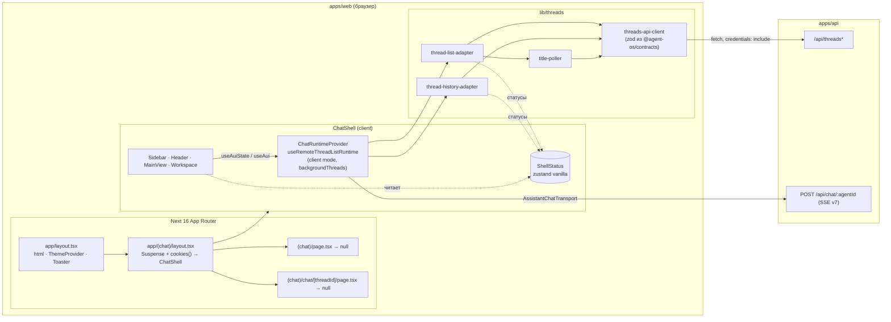
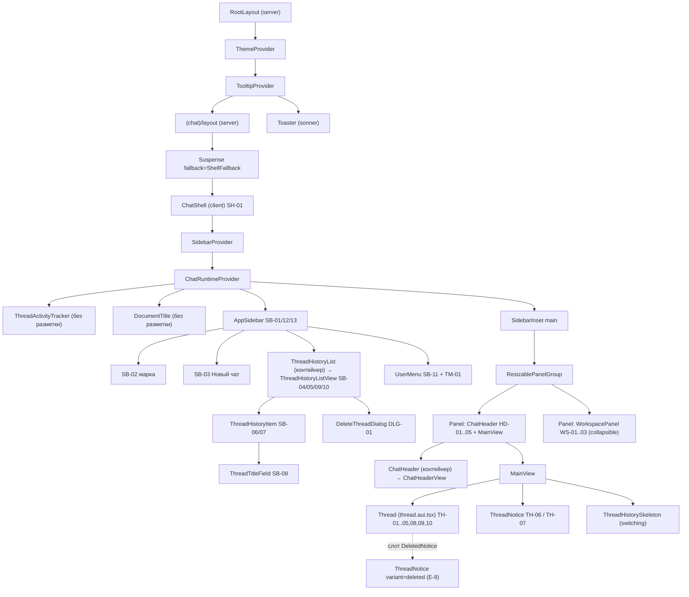
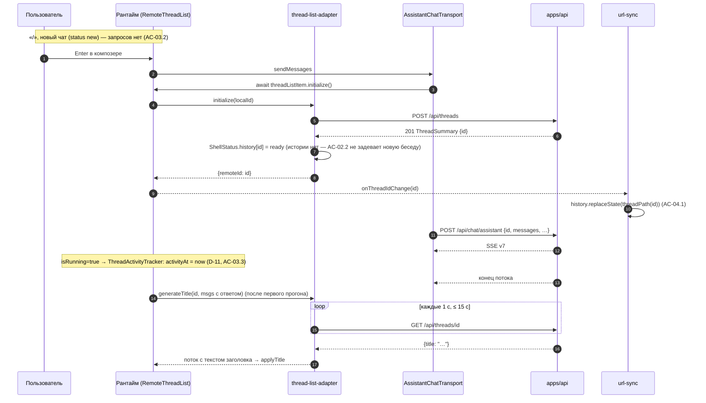
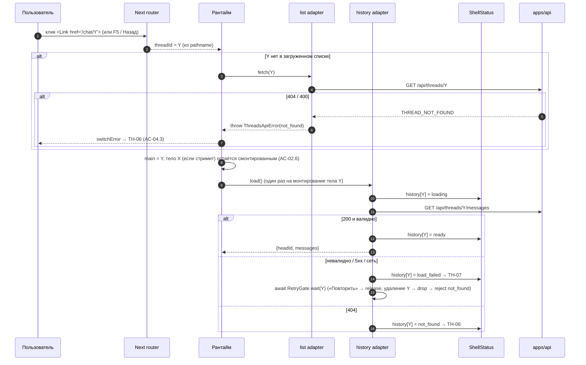
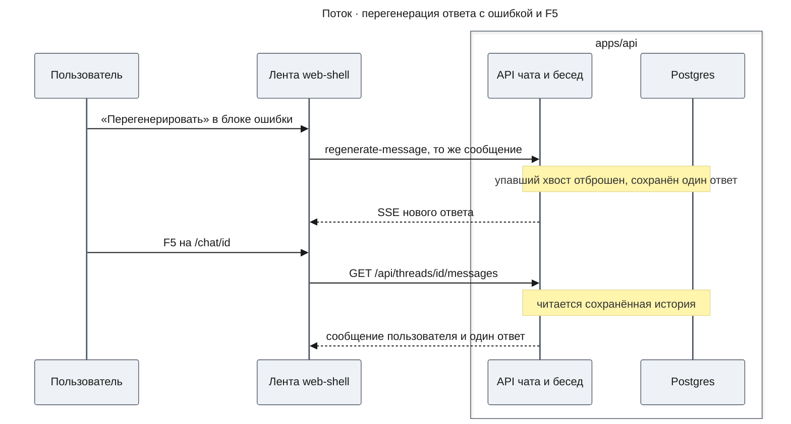
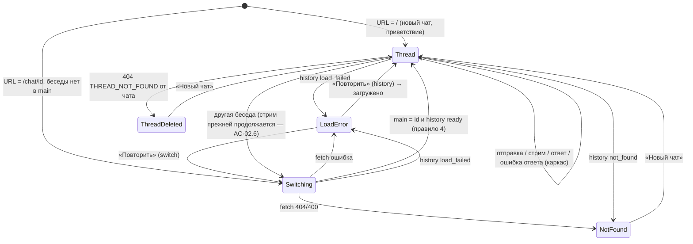

# Design Doc: Оболочка чата (chat-shell) — часть `web-shell`

| Поле | Значение |
|------|----------|
| Версия | 1.6 |
| Дата | 2026-10-30 |
| Статус | Approved |
| Фича | `chat-shell` |
| PRD | [`prd.md`](./prd.md) v1.5 |
| UXRD | [`uxrd.md`](./uxrd.md) v1.7 (D-13, D-14, D-15, TH-08, TH-10) |
| Upstream | [`design-threads-api.md`](./design-threads-api.md) v1.10 (Approved), раздел «Контракт для `web-shell`», п. 1–9; схемы `packages/contracts/src/threads.ts` — раздел Contract Definitions |
| Факты UI | `facts-web-shell.json` (ui-analyzer, 14 focusAreas + 12 runtimeApiFacts = 26 fact_id; ai-chatbot @ `c2f8235e1f3ea903ad8b7f61447c4f74164b5c58`) |

## Part

- **Part**: `web-shell` — строка Delivery Parts PRD v1.5.
- **Covers**: Must — FR-01…FR-12; Should — FR-19, FR-20, FR-21, FR-22. Включая AC-01.7 и AC-02.5 (клиентская zod-валидация), AC-02.6 и AC-03.4 (фоновый стриминг при переключении), AC-03.1 (фокус по типу указателя), AC-08.5 (перегенерация только у последнего ответа с ошибкой), AC-08.6 (только «Копировать» у сообщений), AC-22.2 (стрелки по списку). Клиентская сторона AC-14.5 — фиксированный текст ошибки инструмента (UXRD D-15). Модель персистентности на фронтенде — решение этого дизайна KD-1. UXQ-3 UXRD (кириллица в шрифте).
- **Depends on**: [`design-threads-api.md`](./design-threads-api.md) — контракт потребляется как написан (схемы `packages/contracts/src/threads.ts`, коды ошибок, `POST /api/threads` при первой отправке, 404 `THREAD_NOT_FOUND` до SSE из `POST /api/chat/:agentId`, страница 20 с непрозрачным курсором, перечитывание первой страницы, элемент на месте после переименования, опрос заголовка ≤ 15 с, текст ошибок инструментов в истории замаскирован сервером, а части ошибки модели из истории удалены (AC-14.5), после ошибки модели без перегенерации сохранены сообщение пользователя и частичный ответ, повторную отправку последнего сообщения пользователя (тот же `id`, ответа после него нет) сервер распознаёт как перегенерацию и отбрасывает упавший хвост, не читая `trigger`, — в истории ровно один ответ, AC-14.6; удаление беседы с идущим ответом сервер обрабатывает сам — прерывает прогон, ждёт сохранения ответа Mastra и только затем удаляет, `DELETE` остаётся 204/404, а подключённый стрим заканчивается чанком `abort` без чанка `error`, контракт п. 7).
- **Sibling parts**: `threads-api` (FR-13…FR-18, в т. ч. AC-14.6 — серверный исход перегенерации после ошибки). Здесь его требования не проектируются; недостаточность контракта — только как Cross-Layer Assumption.
- **Не входит**: FR-23 (поиск) и FR-24 (индикатор стриминга) — отложены PRD (Could).

## Overview

Часть превращает одностраничный прототип `apps/web` в оболочку в стиле ChatGPT: маршруты `/` и `/chat/[threadId]` под общим layout-ом группы `(chat)`, в котором один раз монтируется рантайм assistant-ui на базе `useRemoteThreadListRuntime` (клиентский режим, `backgroundThreads`) с собственными адаптерами списка и истории поверх контракта `threads-api`. Вокруг ленты добавляются shadcn-сайдбар с группировкой по датам, шапка, меню пользователя с темой (next-themes, без FOUC), мобильная шторка, скрытая по умолчанию рабочая область и тестовая инфраструктура Vitest + RTL + MSW. Существующая лента `thread.aui.tsx` сохраняет поведение рендера; меняются ширина колонки, тексты на русском, скрытые вложения, слот замены композера и action bar сообщений: у всех сообщений остаётся только «Копировать», «Перегенерировать» переезжает в блок ошибки последнего ответа, ошибка инструмента показывается фиксированным текстом.

## Design Summary (Meta)

```yaml
design_type: "extension"
risk_level: "high"
complexity_level: "high"
complexity_rationale: >
  (1) AC-02.6/AC-03.4 (фоновый стриминг при переключении), AC-04.1/AC-04.4 (URL ↔ беседа без перезагрузки,
  Назад/Вперёд), AC-03.2 (пустой чат не создаётся), AC-01.7/AC-02.5 (невалидный ответ → состояние ошибки),
  AC-04.3 (404 по прямой ссылке), AC-20.1 (заголовок ≤ 15 с) сходятся в одной точке — композиции рантайма
  assistant-ui; библиотека (core 0.3.32) глотает ошибки загрузки истории и следующей страницы
  (console.error), поэтому часть состояний приходится выводить из собственных адаптеров. (2) Ограничения:
  Next 16.4.3 с cacheComponents (страницы скрываются через Activity, параметры маршрута — runtime-данные),
  unstable_/experimental API списка тредов, хуки runtimeHook исполняются внутри ресурсов tap (обычные
  хуки React там запрещены), FOUC темы и «прыжок» сайдбара при SSR, контраст токенов (UXRD 7.6).
main_constraints:
  - "Единственный источник правды о беседах, сообщениях и стриминге — рантайм assistant-ui; второго менеджера состояния чата нет"
  - "Контракт threads-api потребляется как есть; ChatRequest не меняется; страница 20"
  - "Next 16.4.3: cacheComponents=true остаётся; params — runtime-данные; Activity сохраняет до 3 маршрутов"
  - "Версии @assistant-ui/react 0.15.32, @assistant-ui/ai-sdk 0.0.16, ai 7.0.155 фиксируются точно (unstable_ API)"
  - "Все строки — на русском; только семантические токены; WCAG 2.1 AA"
biggest_risks:
  - "Фоновый стриминг при переключении беседы (backgroundThreads) не подтверждён запуском — Certainty: low, спайк S-1 до основной работы"
  - "Синхронизация URL ↔ беседа через history.replaceState и controlled threadId под cacheComponents — Certainty: low, спайк S-2"
  - "Библиотека глотает ошибки загрузки истории → без статус-стора лента показала бы приветствие вместо TH-06/TH-07"
unknowns:
  - "Стабильность идентичности клиента aui внутри runtimeHook (кэш адаптера истории) — спайк S-3"
```

## Background and Context

### Prerequisite ADRs

- Каталога `docs/adr/` нет; ADR, в том числе `ADR-COMMON-*`, не существует.
- Общие области этой части (паттерн обработки ошибок API на клиенте, тема, тестовая инфраструктура) проверены трёхчастным тестом `documentation-criteria` (раздел «ADR-тест») и общего ADR не требуют. **Расхождение инструкций** (как и в `design-threads-api.md`): процесс «Common ADR» агента предписывает создавать `ADR-COMMON-*` при отсутствии, `documentation-criteria` — только при прохождении теста; применён более строгий критерий, ADR не создан.

### Applicable Standards

| Standard | Type | Source | Impact on Design |
|----------|------|--------|-----------------|
| TypeScript `strict: true`, `moduleResolution: bundler`, алиас `@/*` → `src/*` | explicit | `apps/web/tsconfig.json` | Без `any`; внешние данные — `unknown` + zod; импорты через `@/` |
| ESLint `eslint-config-next` (core-web-vitals + typescript) | explicit | `apps/web/eslint.config.mjs` | Новый код проходит `pnpm --filter web lint`; `@next/next/no-img-element` выключен только списком `files` в `eslint.config.mjs`: три файла вложений + `src/components/markdown-text.tsx` (изображения markdown с произвольных https-хостов); inline-отключений правила нет |
| Next 16.4.3 — читать `node_modules/next/dist/docs` перед кодом; `cacheComponents: true`, `partialPrefetching: true` | explicit | `apps/web/AGENTS.md`, `apps/web/next.config.ts` | Маршрутизация, Suspense вокруг `cookies()`, inline-скрипты до гидратации — по встроенным документам (References) |
| shadcn `style: base-nova` на `@base-ui/react` 1.9.0 (prop `render`, не `asChild`), алиасы `ui/hooks/lib` | explicit | `apps/web/components.json` | Новые компоненты добавляются `pnpm --filter web exec shadcn add …`; композиция ссылок — `render={<Link …/>}` |
| Tailwind 4, токены в `globals.css`, тёмная тема — класс `.dark` на предке (`@custom-variant dark`) | explicit | `apps/web/src/app/globals.css:6` | Тема через `attribute="class"`; новые токены — только семантические |
| Turborepo: `test` и `build` зависят от `^build` | explicit | `turbo.json` | Тесты web видят собранный `@agent-os/contracts` (схемы `threads.ts` из `threads-api`) |
| Vitest в монорепо — `vitest ^4.1.2` (установлен 4.1.12), Vite 8, `resolve.tsconfigPaths` | explicit | `apps/api/package.json`, `apps/api/vitest.config.ts` | web берёт ту же мажорную линию Vitest 4 и Vite 8 |
| Обёртки assistant-ui — файлы `*.aui.tsx` в `components/assistant-ui/elements` | implicit — подтверждён пользователем 2026-10-28 | `apps/web/src/components/assistant-ui/elements/*` | Изменения ленты — в `thread.aui.tsx`; новые компоненты оболочки — в `components/shell/*.tsx` (без суффикса `.aui`); общая клиентская обёртка темы — `components/theme-provider.tsx` (как в ai-chatbot) |
| Стиль: файлы приложения — одинарные кавычки и `;` (`assistant.tsx`, `page.tsx`); файлы shadcn `ui/*` — как генерирует CLI (двойные, без `;`), `cn` из пакета `cn` в `ui/*`, из `@/lib/utils` в остальных | implicit — подтверждён пользователем 2026-10-28 | `apps/web/src/components/assistant.tsx`, `apps/web/src/components/ui/button.tsx`, `apps/web/src/lib/utils.ts` | Образцы кода в этом документе — в стиле файлов приложения; правка существующего файла сохраняет его стиль (`markdown-text.tsx`, `utils/href.ts` — двойные кавычки без `;`, как их сгенерировал реестр) |
| Классы поверхностей и движения — из `components/surfaces.tsx` (`pressable`, `ShimmerLabel`, кривая `collapsePanel`) | implicit — подтверждён пользователем 2026-10-28 | `apps/web/src/components/surfaces.tsx`, UXRD 3 | Нажатия — `pressable`; мерцание «Новая беседа» — `ShimmerLabel`; кривая панелей — токен `--ease-panel` |

Gate: 7 explicit, 3 implicit — порог (3/2) выполнен. Три implicit-стандарта **подтверждены пользователем** на остановке утверждения дизайна (2026-10-28) и обязательны для реализации.

### Agreement Checklist

#### Scope
- [x] Маршруты `/` и `/chat/[threadId]`, оболочка в layout группы `(chat)` → «Маршрутизация и синхронизация URL»
- [x] Рантайм: список бесед, история, новый чат, фоновый стриминг → «KD-1 — модель персистентности», «Композиция рантайма»
- [x] Действия над сообщением: только «Копировать» у ответов и сообщений пользователя, «Перегенерировать» — только в блоке ошибки последнего ответа, фиксированный текст ошибки инструмента (AC-08.5, AC-08.6, AC-14.5) → «Action bar и ошибки в ленте»
- [x] Сайдбар по датам, переименование, удаление, подгрузка, состояния → «Компоненты», «State × Display Matrix»
- [x] Шапка, рабочая область, мобильная шторка → «Компоненты»
- [x] Тема без FOUC, кириллица в шрифте (UXQ-3), исправления контраста (UXRD 7.6) → «Тема, шрифт, токены»
- [x] Доступность (7.2–7.4), горячие клавиши FR-22, локализация (UXRD 10.2 + найденное сверх) → соответствующие разделы
- [x] Vitest + RTL + MSW в `apps/web` (FR-12) → «Test Strategy»
- [x] L1-сценарии проверки в реальном браузере (Claude-in-Chrome) → «Verification Strategy»

#### Non-Scope (Explicitly not changing)
- [x] Рендер сообщений, рассуждений, инструментов, markdown — поведение каркаса без изменений (матрица паритета PRD); меняются только ширина, тексты, вложения, слот замены композера. **Намеренные исключения**: политика ссылок и изображений в markdown ответа модели (раздел «Недоверенный markdown»); состав action bar, кнопка в блоке ошибки и текст ошибки инструмента (раздел «Action bar и ошибки в ленте»; PRD Won't Have — правка, перегенерация успешного ответа, ветки)
- [x] Требования `threads-api` (FR-13…FR-18), эндпоинты и схемы `packages/contracts` — только потребление
- [x] `ChatRequestSchema` и `POST /api/chat/:agentId` — используются как есть
- [x] Выбор модели, видимость, загрузка вложений (кнопки скрыты), выход/аккаунт, голосование — не реализуются (Won't)
- [x] Содержимое рабочей области (Tool-UI) — только плейсхолдер
- [x] FR-23, FR-24 — отложены; `isRunning` элемента доступен, но индикатор не рендерится
- [x] Цели касания action bar (24 px) — вне объёма (PRD Out of Scope)
- [x] `tool-fallback.aui.tsx` — перевод строк, ветвление `ToolFallbackImpl` по `isError` и фиксированный текст ошибки в `ToolFallbackError` (D-15); его локальный `pressable` не трогается
- [x] Перегенерация успешного ответа, правка сообщения пользователя, переключатель веток, «Ещё» / «Экспорт в Markdown» — не показываются (PRD Won't Have)

#### Constraints
- [x] Parallel operation: нет (старый `assistant.tsx` удаляется в той же ветке)
- [x] Backward compatibility: не требуется — обе части разрабатываются на ветке `feature/chat-shell` и сливаются в `main` вместе (решение пользователя 2026-10-28)
- [x] Performance measurement: требуется вручную на production-сборке (PRD NFR Performance, метрики № 2, 5, 6, 10)

#### Решения пользователя, связывающие дизайн
- [x] Одна ветка, слияние вместе с `threads-api` → «Implementation Plan», «Migration Strategy»
- [x] Vitest + React Testing Library в `apps/web` → «Test Strategy»
- [x] Добавить `next-themes` и нужные shadcn-компоненты → «Тема», «Existing Component Reuse Map»
- [x] Нет выбора модели, видимости, загрузки вложений (кнопки скрыты), выхода → Non-Scope, D-04
- [x] Страница списка — 20 → контракт `THREAD_PAGE_SIZE`
- [x] Готовый UI проверяется в реальном браузере через Claude-in-Chrome; L1-сценарии: десктоп развёрнут/свёрнут, мобильный 375 px со шторкой, тёмная тема, F5 на `/chat/[id]`, удалённая беседа, стриминг + переключение → «L1-сценарии»
- [x] Ссылки из ответа модели: внешние `http(s)` — новая вкладка с `rel="noopener noreferrer"`; опасные схемы (`javascript:`, `data:`, `vbscript:` …) — без рабочего `href` через существующий `safeHref()` (`apps/web/src/utils/href.ts`); ссылки на тот же origin — тоже новая вкладка (фоновые стримы не обрываются), `#фрагмент` — внутри документа (2026-10-28) → «Недоверенный markdown»
- [x] Изображения из ответа модели: рендерятся только `https`-источники с `referrerPolicy="no-referrer"`; прочие — ссылка или заглушка; остаточный риск утечки снижен, но не устранён (2026-10-28) → «Недоверенный markdown»
- [x] Три implicit-стандарта (суффикс `*.aui.tsx` и `components/shell`; одинарные кавычки + `;` в файлах приложения при CLI-стиле `ui/*`; классы движения и нажатия из `surfaces.tsx`) подтверждены (2026-10-28) → Applicable Standards
- [x] Action bar: у ответа ассистента и у сообщения пользователя — только «Копировать», достижимая по Tab у любого сообщения; «Перегенерировать» — только в блоке ошибки последнего ответа (AC-14.6 гарантирует сервер) → «Action bar и ошибки в ленте»
- [x] Ошибка инструмента — фиксированный текст на клиенте независимо от `errorText` → «Action bar и ошибки в ленте»

Противоречий между дизайном и договорённостями нет. Три уточнения UXRD, найденные при проектировании, вынесены в Open Questions (п. 1–3) как заметки к UXRD, а не как отклонения от AC.

### Problem to Solve

`apps/web` — одна страница с рантаймом `useChatRuntime` без адаптеров: список тредов в памяти, клиентские id (сервер после шага 8 `threads-api` ответит 404), беседа теряется при F5, нет сайдбара, шапки, темы, URL на беседу, тестов.

### Current Challenges

- `useChatRuntime` всегда подставляет облачный адаптер списка — собственный адаптер требует своего `useRemoteThreadListRuntime` (fact `aui:useChatRuntime`).
- Ошибки загрузки истории (`useExternalHistory`: `console.error("Failed to load message history")` → лента «загружена» пустой) и следующей страницы (`loadMore` → `console.error`) не попадают в состояние библиотеки (fact `list:loadMore-error`; `@assistant-ui/ai-sdk/dist/runtime/useExternalHistory.js:141-144`).
- `runtimeHook` выполняется внутри ресурсов tap: обычные хуки React (`useMemo`, `useContext`) там недоступны (`@assistant-ui/tap/dist/react-shim/index.js`: хуки диспетчеризуются в tap, если `peekResourceFiber() !== null`).
- Порядок элементов списка — только порядок страниц адаптера; поднятия беседы при отправке (D-11) и группировки по датам нет (fact `list:ordering-D11`).
- `globals.css`: `--font-sans: var(--font-sans)` (самоссылка), Geist только `latin` (UXQ-3); кольцо фокуса 50 %, светлый `--ring` 0.708, нет сплошной destructive-кнопки (UXRD 7.6).
- Нет механизма темы, уведомлений, сайдбара, шторки, меню, поля ввода, тестов.

### Requirements

#### Functional Requirements

FR-01…FR-12, FR-19…FR-22 PRD v1.5 без изменения формулировок; AC переписаны ниже в EARS с привязкой к компонентам и тестам.

#### Non-Functional Requirements

- **Performance**: восстановленная беседа 50 сообщений ≤ 1,5 с (p95); LCP `/chat/<id>` ≤ 2,5 с на `next build && next start`; панели ≤ 200 мс, CLS ≤ 0,1; первый токен — без регрессии (+ ≤ 50 мс). Клиент добавляет к отправке в новом чате один `POST /api/threads` (единственный дополнительный запрос на пути первого токена).
- **Scalability**: группировка O(n log n) по загруженным элементам (сотни), мемоизирована; страницы по 20; опрос заголовка — не чаще 1 запроса в секунду и не дольше 15 с на беседу.
- **Reliability**: ошибка списка, истории или операции не ломает композер и «Новый чат»; переключение беседы не прерывает стрим (AC-02.6); закрытие вкладки по-прежнему прерывает генерацию.
- **Maintainability**: интеграция с `unstable_`/experimental API assistant-ui изолирована в `src/lib/threads/*` и `components/shell/chat-runtime-provider.tsx`; версии `@assistant-ui/*` и `ai` фиксируются точно; презентационные компоненты не знают о рантайме (тестируются по props).

## KD-1 — модель персистентности на фронтенде

Решение этого дизайна (Key Decision KD-1); остальные разделы ссылаются на него по ID.

| Вариант | Что это | AC-02.6 / AC-03.4 (фон) | AC-03.2 (без пустых бесед) | AC-04.1/04.4 (URL) | Ошибки AC-01.7/02.5/04.3 | Стоимость |
|---|---|---|---|---|---|---|
| **A. `useRemoteThreadListRuntime` (клиентский режим, `backgroundThreads`) + собственные `RemoteThreadListAdapter` и `ThreadHistoryAdapter` (выбрано)** | Библиотека держит список, текущую беседу, тела всех посещённых бесед, `isRunning` по элементу; адаптеры ходят в `threads-api` | Механизм библиотеки: каждое посещённое тело остаётся смонтированным, стрим продолжается (fact `aui:backgroundThreads`) — проверяется спайком S-1 | `initialize()` вызывается транспортом при первой отправке (fact `aui:transport-initialize`) = `POST /api/threads` | `threadId` (controlled) + `onThreadIdChange` (только устоявшийся remote id) | Список — `loadError`; переход — `switchError`; история и `loadMore` — собственный статус-стор (библиотека их глотает) | Маппинг `ThreadSummary ↔ RemoteThreadMetadata`; обязательные `archive`/`generateTitle`; experimental API |
| B. Собственный список (SWR/zustand) + один `useChatRuntime` с `ThreadHistoryAdapter`, переключение — сменой ключа | Список и текущая беседа — свой стор; рантайм пересоздаётся на беседу | Не выполняется: при смене ключа `Chat` размонтируется; фон требует собственной карты экземпляров `Chat` и их жизненного цикла — повтор того, что уже делает A | Да (создание при первой отправке — своё) | Свой | Свои | Второй менеджер состояния чата (список + текущая беседа + карта стримов) |
| C. Собственный список + `RemoteThreadList` только для тела текущей беседы (без `backgroundThreads`) | Гибрид | Не выполняется — без `backgroundThreads` монтируется только главное тело | Да | Да | Частично | Два источника правды о списке |

**Решение: A.** B и C не выполняют AC-02.6/AC-03.4 без повторения механизма библиотеки и создают второй источник правды о беседах. A принимает риск `unstable_`/experimental API: версии фиксируются точно, интеграция изолирована в одном модуле, поведение закреплено тестами FR-12 и L1-сценариями. Если спайк S-1 опровергнет фоновый стриминг — стоп и эскалация пользователю (Early Verification Point), без тихого перехода на B.

## Acceptance Criteria (AC) - EARS Format

В скобках — где реализуется и чем проверяется: **U** — unit (Vitest), **C** — компонентный тест (RTL), **I** — интеграционный тест (RTL + MSW + реальный рантайм assistant-ui), **L1** — сценарий в реальном браузере (раздел «L1-сценарии»).

### FR-01 Сайдбар с историей по датам

- [ ] **AC-01.1** **When** открывается `/` и у пользователя есть беседы с `updatedAt` сегодня, вчера, 5 и 40 дней назад, the system shall показать ровно группы «Сегодня», «Вчера», «Предыдущие 7 дней», «Старше» в этом порядке без пустых групп; внутри группы — по убыванию времени активности. (`groupThreadsByDate`; U, C)
- [ ] **AC-01.2** **While** открыт `/chat/<id>` и беседа есть среди загруженных, the system shall выделить её элемент фоном и начертанием и поставить `aria-current="page"` на ссылку. (`ThreadHistoryItem`; C, L1-1)
- [ ] **AC-01.3** **While** первая страница списка загружается, the system shall показывать скелетон SB-09 с `role="status"` «Загружаем беседы…». (C)
- [ ] **AC-01.4** **If** список пуст, **then** the system shall показать «Пока нет бесед» / «Начните новый чат — он появится здесь.». (C)
- [ ] **AC-01.5** **If** запрос первой страницы завершился ошибкой, **then** the system shall показать «Не удалось загрузить беседы» и «Повторить», нажатие которой перезапрашивает первую страницу. (C, I)
- [ ] **AC-01.6** **If** название не помещается, **then** the system shall обрезать его многоточием в одну строку и показать полное в тултипе (наведение 500 мс или фокус с клавиатуры). (C)
- [ ] **AC-01.7** **If** ответ `GET /api/threads` не проходит `ThreadListResponseSchema`, **then** the system shall перевести список в состояние AC-01.5, а композер и «Новый чат» останутся работоспособны. (адаптер; U, I)

### FR-02 Открытие беседы

- [ ] **AC-02.1** **When** пользователь открывает беседу из 12 сообщений с рассуждением и инструментом, the system shall показать все 12 в исходном порядке; рассуждение свёрнуто и раскрывается; инструмент — с результатом. (адаптер истории + каркас; U, L1-4)
- [ ] **AC-02.2** **While** история загружается (или ещё разрешается беседа по прямой ссылке), the system shall показывать скелетон ленты, а не приветствие. (`resolveMainView` `switching`, в т. ч. правило 4 «история беседы из URL ещё не загружена» — F5 при `threads.isLoading`; U, I)
- [ ] **AC-02.3** **When** в восстановленной беседе из `N` сообщений пользователь отправляет сообщение, the system shall стримить ответ в ту же беседу (`body.id` = её id), и после завершения в ленте `N+2` сообщения. (L1-4)
- [ ] **AC-02.4** **When** открыта беседа с длинным markdown (таблица, код 80+ строк), the system shall отрендерить его как при живом стриме, «Копировать» у блока кода работает. (каркас; L1-4)
- [ ] **AC-02.5** **If** ответ `GET /api/threads/:id/messages` не проходит `ThreadMessagesResponseSchema` или `safeValidateUIMessages`, **then** the system shall показать TH-07 с «Повторить» и «Новый чат», а сайдбар и шапка останутся работоспособны. (адаптер истории + статус-стор; U, I)
- [ ] **AC-02.6** **While** в беседе X идёт стрим, **when** пользователь открывает Y, the system shall продолжать генерацию X в фоне, не показывать её ответ в Y, а при возврате в X показать завершённый или продолжающийся ответ. (`backgroundThreads`; спайк S-1, L1-6 — намеренно без автотеста, обоснование — «Integration Tests»)

### FR-03 Новый чат

- [ ] **AC-03.1** **When** нажата «Новый чат» (кнопка или `Ctrl/⌘+Shift+O`), the system shall перейти на `/`, показать приветствие; фокус — в композер при `(pointer: fine)`, иначе на `h1` шапки (HD-03) без всплытия клавиатуры. (`focusAfterNewChat`; U, C, L1-1, L1-3)
- [ ] **AC-03.2** **If** пользователь открыл «Новый чат» и ушёл в другую беседу, ничего не отправив, **then** the system shall не создавать беседу и не показывать её в списке (запросов `POST /api/threads` нет). (I)
- [ ] **AC-03.3** **When** отправлено первое сообщение нового чата, the system shall сразу показать новую беседу первой в «Сегодня», активной, с «Новая беседа». (`ThreadActivityTracker` + группировка; I, L1-1)
- [ ] **AC-03.4** **While** в X идёт стрим, **when** нажата «Новый чат», the system shall открыть `/` с приветствием, стрим X продолжится и в новый чат не попадёт. (S-1, L1-6 — намеренно без автотеста, как AC-02.6)

### FR-04 URL на беседу

- [ ] **AC-04.1** **When** первое сообщение отправлено с `/`, the system shall заменить URL на `/chat/<id>` (id из `POST /api/threads`) без перезагрузки и без нового запроса страницы. (`syncUrlWithThread`; U, S-2, L1-1)
- [ ] **AC-04.2** **When** на `/chat/<id>` нажата F5, the system shall показать ту же беседу с теми же сообщениями и выделить её, если она в загруженной странице. (L1-5)
- [ ] **AC-04.3** **If** `/chat/<id>` чужой или несуществующей беседы, **then** the system shall показать TH-06 «Беседа не найдена» с «Новый чат», фокус на `h1` экрана. (`switchError`/статус `not_found`; U, I, L1-7)
- [ ] **AC-04.4** **When** пользователь переключал беседы кликами, the system shall переключать их кнопками «Назад/Вперёд» браузера в обратном порядке. (`Link` + controlled `threadId`; S-2, L1-5)

### FR-05 Переименование

- [ ] **AC-05.1** **When** выбрано «Переименовать», введено «Отчёт Q3» и нажат Enter, the system shall показать новое название в сайдбаре, шапке и вкладке без перезагрузки; после F5 оно сохранено. (C, L1-2)
- [ ] **AC-05.2** **When** во время редактирования нажат Esc, the system shall вернуть прежнее название. (C)
- [ ] **AC-05.3** **If** после обрезки пробелов поле пусто и нажат Enter, **then** the system shall не отправлять запрос, оставить поле открытым с `aria-invalid="true"` и текстом «Введите название». (C)
- [ ] **AC-05.4** **If** `PATCH` завершился ошибкой, **then** the system shall вернуть прежнее название и показать уведомление «Не удалось переименовать беседу. Попробуйте ещё раз.». (адаптер + оптимистичный откат библиотеки; U, S-6)

### FR-06 Удаление

- [ ] **AC-06.1** **When** выбрано «Удалить», the system shall открыть `alertdialog` «Удалить беседу?» с названием в «ёлочках», кнопками «Отмена» (фокус) и «Удалить»; при идущей генерации — дополнительный абзац A-4. (C)
- [ ] **AC-06.2** **When** подтверждено удаление открытой беседы, the system shall убрать её из списка, заменить URL на `/` (без новой записи истории), показать приветствие, фокус — по правилу указателя. (`shell.delete-open-thread.int.test.tsx`; I, L1-2)
- [ ] **AC-06.3** **When** подтверждено удаление не открытой беседы, the system shall убрать её, текущая беседа и URL не меняются, фокус — на следующую ссылку списка. (C, L1-2)
- [ ] **AC-06.4** **When** после удаления открыт старый `/chat/<id>`, the system shall показать TH-06. (L1-7)

### FR-07 Шапка

- [ ] **AC-07.1** **When** нажата кнопка сворачивания сайдбара (≥ 768 px), the system shall свернуть сайдбар до полосы 48 px, расширить ленту и выставить `aria-expanded="false"`. (`chat-header.test.tsx`; C, L1-1)
- [ ] **AC-07.2** **While** у открытой беседы нет заголовка, the system shall показывать «Новая беседа» (мерцание, пока идёт ответ и ещё до 15 с после). (C)
- [ ] **AC-07.3** **While** открыт `/`, the system shall не показывать название (для скринридера `h1` — скрытое «Новый чат»). (C)

### FR-08 Колонка, приветствие, композер

- [ ] **AC-08.1** **While** ширина окна 1440 px, the system shall держать сообщения и композер в колонке 768 px по центру свободной области. (L1-1)
- [ ] **AC-08.2** **While** беседа пуста, the system shall показать «Чем могу помочь?», подзаголовок и 4 подсказки (2×2 при ≥ 640 px); клик отправляет склеенный текст подсказки. (C, L1-1)
- [ ] **AC-08.3** **While** в беседе есть сообщения, the system shall скрыть приветствие, прижать композер к низу, показывать «К последнему сообщению» при отрыве. (каркас; L1-4)
- [ ] **AC-08.4** **While** идёт стрим, the system shall показывать «Остановить» вместо «Отправить». (каркас; L1-6)
PRD AC-08.5 (ответ с ошибкой и его перегенерация) раскрыт пятью пунктами ниже: AC-08.5 и AC-08.5a…AC-08.5d. Пункт AC-08.5e — уведомление об удалённой беседе на месте блока ошибки (UXRD E-8, TH-07 «Deleted while open»).

- [ ] **AC-08.5** **If** стрим ответа ассистента завершился ошибкой модели или обрывом сети, **then** the system shall показать под репликой блок ошибки (`MessageError`) с фиксированным текстом «Не удалось получить ответ. Попробуйте перегенерировать.» (`role="alert"`, без текста сервера), а сайдбар и шапка останутся работоспособны. (`MessageError`; C `message-error.test.tsx` случай 1, L1-10)
- [ ] **AC-08.5a** **While** ответ с ошибкой — последний в беседе, the system shall показывать внутри блока ошибки текстовую кнопку «Перегенерировать» (доступное имя = подпись, `aria-describedby` → текст ошибки), доступную по Tab и Enter/Space; **when** она нажата, the system shall повторно сгенерировать ответ (`trigger: 'regenerate-message'`), заменить им упавший без переключателя вариантов и перенести фокус по правилу указателя. (`MessageError`, `ActionBarPrimitive.Reload`; C `message-error.test.tsx` случаи 2–3, L1-10)
- [ ] **AC-08.5b** **When** после ответа с ошибкой пользователь отправил новое сообщение, the system shall убрать у упавшего ответа блок ошибки целиком вместе с кнопкой и показывать только его частичный текст, если он был, — как после F5. **When** пользователь вернулся в той же вкладке в беседу, где упавший ответ остаётся последним, the system shall снова показывать блок ошибки с кнопкой. (I `shell.message-error.int.test.tsx`, L1-10)
- [ ] **AC-08.5c** **When** беседа с неперегенерированным ответом с ошибкой открыта заново (F5), the system shall показать сохранённый частичный текст ответа (подтверждённый исход `threads-api`: сохранены сообщение пользователя и частичный ответ) как обычную реплику без блока ошибки, без кнопки и без текста ошибки модели (AC-14.5); ответ без единой части не показывается строкой (защитный случай). (C `message-error.test.tsx` случай 5, L1-10)
- [ ] **AC-08.5d** **If** аварийный выключатель `regenerateAfterError` переведён в `false` (откат действия без изменения компонентов), **then** the system shall показывать в блоке ошибки только «Не удалось получить ответ.» без кнопки и без `aria-describedby` (UXRD TH-08 Rollback). Поставляемое значение — `true`. (`lib/config.ts`; C `message-error.test.tsx` случай 4)
- [ ] **AC-08.5e** **If** отправка получила 404 `THREAD_NOT_FOUND` (беседу удалили в другой вкладке), **then** the system shall оставить ленту видимой, показать под сообщением пользователя вместо блока ошибки уведомление «Беседа удалена» / «Её удалили в другой вкладке или окне.» с кнопкой «Новый чат» и без «Перегенерировать» и скрыть композер (UXRD E-8, TH-07 «Deleted while open»). (`MessageError`, слот `DeletedNotice`; C `message-error.test.tsx` случай 6, I `shell.deleted-thread.int.test.tsx`, L1-7)
- [ ] **AC-08.6** **While** в ленте есть сообщения пользователя и завершённые ответы ассистента, the system shall показывать у каждого из них единственную кнопку «Копировать» (`AssistantActionBar`, `UserActionBar`), достижимую по Tab без наведения (видна у последнего сообщения всегда, при грубом указателе — у всех, у остальных — при наведении или фокусе внутри реплики), и после копирования объявлять «Скопировано» через `role="status"`. **While** идёт стрим ответа, the system shall скрывать action bar только у ответа, который сейчас генерируется (статус сообщения `running`), а у всех прежних сообщений оставлять «Копировать» видимой по тому же правилу и в порядке Tab. У ответа без текстовой части кнопки нет (ответ только с инструментом или рассуждением показывается без неё), а ответ без единой части не показывается строкой — у заглушки ответа с ошибкой остаётся только блок ошибки; кнопок «Изменить», «Перегенерировать», «Ещё», «Экспорт в Markdown» и переключателя вариантов «‹ 1/2 ›» (`BranchPicker`) нет. (C `message-actions.test.tsx`, L1-10)

### AC-14.5 — клиентская сторона

FR-14 принадлежит `threads-api`; здесь — только отображение ошибок инструмента и модели в ленте. Ошибка инструмента показывается одним и тем же фиксированным текстом и в живом стриме, и после перезагрузки (пункт ниже).

- [ ] **AC-14.5** **If** часть инструмента в ленте пришла с `isError: true` (состояние `output-error` AI SDK — в живом стриме и в восстановленной истории) или со статусом `incomplete` с причиной, отличной от отмены, **then** the system shall показать подпись триггера неудавшегося инструмента, «Ошибка:» и фиксированный текст «Не удалось выполнить инструмент.» независимо от `errorText`, не показывать раздел результата и исходный текст ошибки (ни текст, ни `{"error": …}`) и не объявлять блок как `alert`. (`ToolFallbackImpl`, `ToolFallbackError`; C `tool-fallback-error.test.tsx`, L1-10)

Для ошибки модели (в том числе обрыва сети) исходный текст не показывается никогда: в живом стриме — фиксированный текст блока ошибки (AC-08.5), после перезагрузки — только сохранённый частичный текст ответа (AC-08.5c). Частей ошибки модели в истории нет — `threads-api` удаляет их при чтении (контракт п. 6, `maskHistoryErrors`); в `UIMessage` AI SDK 7 такого типа нет, и `safeValidateUIMessages` отклонил бы историю целиком (TH-07). Ошибка модели видна только блоком TH-08 из состояния рантайма, с фиксированным текстом; `errorText` не выводится нигде.

### FR-09 Тема и пользователь

- [ ] **AC-09.1** **When** в меню пользователя выбрано «Тёмная», the system shall применить тёмные токены ко всему интерфейсу без перезагрузки. (C, L1-8)
- [ ] **AC-09.2** **When** страница перезагружается с сохранённой темой, the system shall отрисовать первый кадр уже в ней (production-сборка, CPU ×4). (L1-8)
- [ ] **AC-09.3** **While** выбрана «Системная», **when** ОС меняет тему, the system shall следовать за ОС. (L1-8)
- [ ] **AC-09.4** The system shall показывать в меню пользователя «dev-user», «Режим разработки» и группу «Тема» без «Выйти»/«Настройки». (C)

### FR-10 Мобильная шторка

- [ ] **AC-10.1** **While** ширина 375 px, the system shall скрыть сайдбар (CSS, до гидратации), показать в шапке «Меню» и «Новый чат», без горизонтального скролла. (L1-3)
- [ ] **AC-10.2** **When** нажато «Меню», the system shall открыть модальную шторку со списком, «Новый чат» и блоком пользователя, фокус на «Новый чат»; Esc, затемнение, «×» закрывают, фокус возвращается на «Меню». (L1-3)
- [ ] **AC-10.3** **When** в шторке выбрана беседа, the system shall закрыть шторку, открыть беседу, фокус — на `h1` шапки. (L1-3)
- [ ] **AC-10.4** **While** ширина 360 px и в беседе блок кода 120 символов, the system shall прокручивать горизонтально только блок кода. (L1-3)

### FR-11 Рабочая область

- [ ] **AC-11.1** **When** загружается `/` или `/chat/<id>` на десктопе, the system shall не показывать рабочую область. (`shell.workspace.int.test.tsx`; I, L1-1)
- [ ] **AC-11.2** **When** нажата «Рабочая область» (≥ 1024 px), the system shall раскрыть панель 40 % основной области; перетаскивание ограничено: панель ≥ 360 px, лента ≥ 480 px (при 1280 px). (L1-1)
- [ ] **AC-11.3** **When** нажата та же кнопка или «×», the system shall скрыть панель, фокус — на кнопку в шапке. (`shell.workspace.int.test.tsx`; I)
- [ ] **AC-11.4** **While** ширина < 1024 px, the system shall скрыть кнопку и панель; при возврате ≥ 1024 px открытая ранее панель вернётся. (L1-1)

### FR-12 Тестовая инфраструктура

- [ ] **AC-12.1** **When** выполняется `pnpm --filter web test`, the system shall выполнить ≥ 8 тестов, покрывающих группировку по датам, состояния сайдбара (загрузка/пусто/ошибка/список), переключение темы и рендер шапки с заголовком. (раздел Test Strategy)
- [ ] **AC-12.2** The system shall выполнять тесты в режиме `vitest run` без запущенного API (MSW). 

### FR-19 Подгрузка (Should)

- [ ] **AC-19.1** **When** 120 бесед и список прокручен до «Показать ещё» (за 200 px) или нажата кнопка, the system shall подгрузить следующие 20 с индикатором в конце, сохранив монотонный порядок групп; **if** подгрузка упала, **then** — «Не удалось загрузить ещё беседы» + «Повторить», загруженные остаются. (U, C)

### FR-20 Заголовок без перезагрузки (Should)

- [ ] **AC-20.1** **When** первый ответ новой беседы завершён, the system shall опрашивать `GET /api/threads/:id` раз в 1 с до непустого `title` или 15 с и заменить «Новая беседа» в сайдбаре, шапке и вкладке. (`generateTitle`-опросчик; U, L1-1)

### FR-21 Состояние сайдбара (Should)

- [ ] **AC-21.1** **When** пользователь свернул сайдбар и перезагрузил страницу, the system shall отрисовать его свёрнутым на первом кадре без анимации раскрытия; временное сворачивание при открытии рабочей области сохранённое состояние не меняет. (cookie + `cookies()`; L1-1)

### FR-22 Горячие клавиши (Should)

- [ ] **AC-22.1** **When** фокус в композере, ленте или сайдбаре и нажато `Ctrl/⌘+Shift+O` / `Ctrl/⌘+B`, the system shall открыть новый чат / переключить сайдбар (на мобильном — шторку); сочетания показаны в тултипах с символом платформы; не срабатывают при открытом модальном окне/меню (кроме `Ctrl/⌘+B` для закрытия шторки) и в поле переименования. (U, C)
- [ ] **AC-22.2** **When** фокус на ссылке беседы и нажаты ↑/↓ (Home/End), the system shall перевести фокус на предыдущую/следующую (первую/последнюю) загруженную беседу через границы групп; Enter открывает беседу, фокус остаётся на ссылке. (C)

## Existing Codebase Analysis

### Implementation Path Mapping

| Type | Path | Description |
|------|------|-------------|
| Existing → delete | `apps/web/src/app/page.tsx` | Сплит 40/60; заменяется `app/(chat)/page.tsx` |
| Existing → delete | `apps/web/src/components/assistant.tsx` | `useChatRuntime` без адаптеров; заменяется `components/shell/chat-runtime-provider.tsx` |
| Existing → modify | `apps/web/src/app/layout.tsx` | Шрифты latin+cyrillic, `ThemeProvider` (из `components/theme-provider.tsx`), `Toaster`, theme-color, `suppressHydrationWarning`, `viewport` (`viewportFit: 'cover'`, `interactiveWidget: 'resizes-content'`), `preconnect` к `apiBaseUrl`, метаданные на русском |
| Existing → modify | `apps/web/src/app/globals.css` | `--font-sans`, кольцо фокуса, `--destructive-foreground`, токены оболочки и движения |
| Existing → modify | `apps/web/src/components/assistant-ui/elements/thread.aui.tsx` | 48rem, тексты, вложения скрыты, подсказки 2×2, приветствие, слот `DeletedNotice`, экспорт `ThreadHistorySkeleton`; action bar (раздел «Action bar и ошибки в ленте»): `AssistantActionBar` без `Reload`/`More`/`ExportMarkdown`, `UserActionBar` — `Copy` вместо `Edit`, оба без `autohide` (видимость — CSS `:hover`/`:focus-within`, всегда при `pointer: coarse`), «Копировать» только при видимом тексте, удаление `BranchPicker` и `EditComposer`, `MessageError` с кнопкой «Перегенерировать» у последнего ответа по флагу `regenerateAfterError`, ответ без частей не рендерит строку (у заглушки ошибки — только блок ошибки) |
| Existing → modify | `apps/web/src/components/assistant-ui/elements/tool-fallback.aui.tsx` | `ToolFallbackImpl`: ветвление по `isError` части (статус ошибки для триггера и `ToolFallbackError`, без `ToolFallbackResult`); `ToolFallbackError`: фиксированный текст ошибки (D-15); строки — раздел «Локализация» |
| Existing → modify (строки) | `attachment.aui.tsx`, `reasoning.tsx`, `tool-group.aui.tsx`, `ui/dialog.tsx`, `image.tsx`, `file.tsx`, `media-player.tsx` | Локализация (раздел «Локализация») |
| Existing → modify | `apps/web/src/components/markdown-text.tsx` | «Копировать»; переопределения `a` и `img` по политике «Недоверенный markdown» — **намеренное изменение поведения каркаса** (решение пользователя 2026-10-28) |
| Existing → modify | `apps/web/src/components/ui/button.tsx` | Непрозрачное кольцо фокуса; вариант `destructive` — сплошная заливка (вариант нигде не используется) |
| Existing → modify | `apps/web/eslint.config.mjs` | **Изменение реализации**: `src/components/markdown-text.tsx` добавлен в существующий список `files` переопределения `@next/next/no-img-element: "off"` (комментарий блока дополняется: изображения ответов модели с произвольных https-хостов); inline `eslint-disable` в `markdown-text.tsx` не используется |
| Existing → modify | `apps/web/package.json` | Зависимости, скрипты `test`, `test:watch`; точные версии `@assistant-ui/*`, `ai` |
| Existing (unchanged) | `next.config.ts`, `components.json`, `surfaces.tsx`, `utils/href.ts` (`safeHref` — переиспользуется политикой ссылок), `tooltip-icon-button.tsx`, `ui/{avatar,skeleton,tooltip,resizable,textarea}.tsx`, `follow-up-suggestions.aui.tsx`, `reasoning.aui.tsx`, `tool-group.aui.tsx` (кроме строки) | Используются как есть |
| New (shadcn add) | `apps/web/src/components/ui/{sidebar,sheet,dropdown-menu,alert-dialog,input,separator,sonner}.tsx`, `apps/web/src/hooks/use-mobile.ts` | base-nova; после добавления в `sidebar.tsx` вносятся правки из раздела «Правки скопированных компонентов» |
| New | `apps/web/src/app/(chat)/layout.tsx` | Серверный layout: `<Suspense>` + чтение cookie `sidebar_state` → `ChatShell` |
| New | `apps/web/src/app/(chat)/page.tsx`, `apps/web/src/app/(chat)/chat/[threadId]/page.tsx` | Возвращают `null` (UI живёт в layout) |
| New | `apps/web/src/app/(chat)/error.tsx` | `'use client'` граница ошибок Next группы `(chat)`: «Что-то пошло не так» + «Обновить страницу», `console.error` с `digest` |
| New | `apps/web/src/components/theme-provider.tsx` | `'use client'` обёртка `NextThemesProvider` с `scriptProps` по шаблону `InlineScript` (раздел «Тема, шрифт, токены») |
| New | `apps/web/src/hooks/{use-media-query,use-now,use-global-shortcuts}.ts` | `useMediaQuery(query)` (`useSyncExternalStore` над `matchMedia`; рабочая область ≥ 1024 px), `useNow()` (метка «сейчас» для группировки: обновляется при возврате во вкладку и в полночь — A-6), `useGlobalShortcuts()` (`Ctrl/⌘+Shift+O` с охраной `isShortcutBlocked`) |
| New | `apps/web/src/components/shell/*.tsx` | `chat-shell`, `chat-runtime-provider`, `shell-actions` (`ShellActionsProvider`, `useShellActions`), `shell-welcome` (`ShellWelcome` — TH-02/TH-03 для слота `Welcome`), `app-sidebar`, `thread-history-list`, `thread-history-item`, `thread-title-field`, `delete-thread-dialog`, `user-menu`, `chat-header`, `main-view`, `thread-notice` (`ThreadNotice` и `DeletedNotice` — обёртка `variant="deleted"` для слота `DeletedNotice`), `workspace-panel`, `thread-activity-tracker`, `document-title`, `shell-fallback` |
| New | `apps/web/src/lib/threads/*.ts` | `threads-api-client`, `threads-api-error`, `thread-list-adapter`, `thread-history-adapter`, `retry-gate`, `title-poller`, `group-threads-by-date`, `resolve-main-view`, `route-thread-id` (`parseRouteThreadId`, `threadPath`), `url-sync`, `shell-status-store`, `shell-services` (`createShellServices`) |
| New | `apps/web/src/lib/{config,focus,keyboard-shortcuts,dev-user,welcome-suggestions,markdown-policy}.ts`, `apps/web/src/lib/i18n/plural-ru.ts` | Конфигурация (`apiBaseUrl`, аварийный выключатель `regenerateAfterError`), фокус по указателю, сочетания, заглушка пользователя, подсказки, политика ссылок и изображений markdown, плюрализация |
| New | `apps/web/vitest.config.ts`, `apps/web/src/test/{setup.ts,msw-server.ts,fixtures.ts,render-with-runtime.tsx}` | Тестовая инфраструктура |

### Integration Point Map

```yaml
Integration Point 1:
  Existing Component: POST /api/chat/:agentId (apps/api/src/chat/chat.controller.ts) через AssistantChatTransport
  Integration Method: Call — транспорт ждёт threadListItem.initialize() и шлёт body.id = remoteId
  Impact Level: High (Data Flow Change — новый чат создаётся POST /api/threads до первой отправки)
  Required Test Coverage: I — первая отправка: POST /api/threads, затем POST /api/chat/assistant с id из ответа; 404 THREAD_NOT_FOUND → вариант «Беседа удалена»

Integration Point 2:
  Existing Component: /api/threads* (design-threads-api.md, Contract Definitions)
  Integration Method: Data Reference — thread-list-adapter и thread-history-adapter через threads-api-client, валидация схемами @agent-os/contracts
  Impact Level: High (новый источник данных оболочки)
  Required Test Coverage: U (MSW) — маппинг, невалидные ответы, 404 → not_found, DELETE 404 → успех, опрос заголовка

Integration Point 3:
  Existing Component: Thread (thread.aui.tsx) и слоты ThreadComponents
  Integration Method: Props / slot — Welcome (существует), DeletedNotice (новый слот: скрывает композер и заменяет блок ошибки), autoFocus=false; внутренние AssistantActionBar, UserActionBar, MessageError меняют состав кнопок; action bar без autohide (видимость — CSS)
  Impact Level: Medium (рендер ленты без изменений; action bar сокращён до «Копировать», перегенерация — только из блока ошибки)
  Required Test Coverage: C — приветствие и подсказки, замена композера, состав action bar и его достижимость по Tab, блок ошибки в обоих вариантах флага; I — блок ошибки снимается после нового сообщения (реальный рантайм); L1 — ленты с рассуждениями/инструментами, ошибка → перегенерация → F5

Integration Point 4:
  Existing Component: RootLayout (app/layout.tsx)
  Integration Method: Обёртка — ThemeProvider, Toaster, шрифты
  Impact Level: Medium
  Required Test Coverage: L1-8 (нет FOUC), C — переключение темы

Integration Point 5:
  Existing Component: globals.css токены и ui/button.tsx
  Integration Method: Изменение значений токенов и классов
  Impact Level: Medium (визуально затрагивает все кнопки и кольца фокуса)
  Required Test Coverage: L1 — замер контраста кольца и кнопки «Удалить» в обеих темах

Integration Point 6:
  Existing Component: Next router (usePathname, Link, history.replaceState)
  Integration Method: Controlled threadId из pathname; onThreadIdChange → replaceState / router.replace('/')
  Impact Level: High
  Required Test Coverage: U — parseRouteThreadId, threadPath (round-trip), syncUrlWithThread; S-2; L1-5

Integration Point 7:
  Existing Component: MarkdownText (components/markdown-text.tsx) — рендер текста ответа модели
  Integration Method: Переопределение компонентов a и img (политика lib/markdown-policy.ts поверх utils/href.ts safeHref)
  Impact Level: Medium (намеренное изменение поведения каркаса: новая вкладка, нерабочие опасные ссылки, только https-изображения)
  Required Test Coverage: U — markdown-policy; C — markdown-text.test.tsx; L1-4 — ссылка javascript: без рабочего href

Integration Point 8:
  Existing Component: ToolFallbackImpl и ToolFallbackError (tool-fallback.aui.tsx); часть инструмента от конвертера @assistant-ui/ai-sdk (output-error → isError true, result { error }) и маскирование errorText в GET /api/threads/:id/messages (контракт п. 6)
  Integration Method: Рендер — ToolFallbackImpl ветвится по isError части; фиксированный текст ошибки без чтения errorText и без раздела результата
  Impact Level: Low (только отображение)
  Required Test Coverage: C — часть с isError true и result { error } через рантайм даёт фиксированный текст без исходного текста и без "error"; L1-10 — стрим и F5 показывают один текст
```

### Code Inspection Evidence

#### What Was Examined
- `apps/web/src/app/{layout,page}.tsx`, `components/assistant.tsx`, `components/assistant-ui/elements/thread.aui.tsx` (`ThreadRoot`, `Composer`, `ThreadSuggestions`, `MessageError`), `components/ui/button.tsx`, `components/surfaces.tsx`, `app/globals.css`, `next.config.ts`, `components.json`, `eslint.config.mjs`, `tsconfig.json`, `package.json` — точки интеграции и стандарты.
- `@assistant-ui/core` 0.3.32: `react/runtimes/useRemoteThreadListRuntime.js`, `react/client/RemoteThreadList.js` (`selectThread` :719-760 → `adapter.fetch`, `switchError` :700-708, `loadMore` :602-630, `reload` :520-590, `generateTitle` :1195-1260, удаление :1160-1190, фоновые тела :132-330), `runtimes/remote-thread-list/{types.d.ts,title.js,title-generation.js,remote-thread-state.js}`, `store/scopes/{threads,thread-list-item}.d.ts`, `adapters/thread-history.d.ts`.
- Action bar и ошибки ленты: `thread.aui.tsx` — `MessageError` :566, `AssistantMessage` (футер с `BranchPicker` и `AssistantActionBar`) :669-677, `AssistantActionBar` :683-713 (`Copy`, `Reload`, `ActionBarMorePrimitive` с `ExportMarkdown`), `UserMessage` :743-769, `UserActionBar` :771-781 (`Edit`), `EditComposer` :783, `BranchPicker` :805; `tool-fallback.aui.tsx` — `ToolFallbackError` :309-340 (выводит `status.error`); `@assistant-ui/react` `ActionBarReload.js` (работает в контексте сообщения, выключен при идущем прогоне), `@assistant-ui/ai-sdk` `useAISDKRuntime.js:648` (`regenerate`).
- `@assistant-ui/ai-sdk` 0.0.16: `runtime/useChatRuntime.js`, `runtime/useExternalHistory.js` (загрузка один раз на монтирование, ошибка → `console.error`), `transport/AssistantChatTransport.js`.
- `@assistant-ui/tap` (react-shim): хуки внутри ресурсов tap; `assistant-cloud` 0.2.9 `aiSDKV6FormatAdapter`; `assistant-stream` 0.3.55 `createAssistantStream`.
- `ai` 7.0.155 `dist/index.js:20244-20293` — ненулевой статус ответа чата → `APICallError` со `statusCode` и `responseBody` до разбора SSE.
- `react-resizable-panels` 4.15.0 `dist/react-resizable-panels.d.ts` — единицы `px`/`%`, `collapsible`, `panelRef`.
- Next 16.4.3 docs: `preventing-flash-before-hydration.md`, `preserving-ui-state.md`, `single-page-applications.md` (pushState/replaceState), `03-file-conventions/dynamic-routes.md` (params под cacheComponents).
- npm registry (2026-10-28): `next-themes` 0.4.6 (`scriptProps`, `enableColorScheme`), `sonner` 2.0.8, `msw` 2.15.0 / 3.0.3, `jsdom` 29.1.1 (node ≥ 24.0) vs 30.x (node ≥ 24.15), `@vitejs/plugin-react` 5.2.0/6.1.2, `vitest` 4.1.12.

#### Key Findings

Источник: `facts-web-shell.json` (ui-analyzer: чтение файлов и текстовый поиск, LSP не применялся — *resolvedBy: grep*, кандидатные списки) + собственное чтение `dist` установленных пакетов в этом дизайне. Репозиторий — один коммит, ~40 TS-файлов в `apps/web/src`; повторный запуск `code-explorer` не потребовался: вопросы переиспользования закрыты списком файлов `components/**` (раздел «Existing Component Reuse Map») и grep по `zustand`, `surfaces`, `variant="destructive"` (0 потребителей `destructive`).

1. `useChatRuntime` вложенный в `useRemoteThreadListRuntime` становится сквозным (`allowNesting`), принимает `adapters.history`, `transport`, `onError` (fact `aui:useChatRuntime`, `aui:ChatThreadOptions`).
2. Клиентский режим (`adapter.unstable_Provider` отсутствует) ⇒ `backgroundThreads: true`: тела всех посещённых бесед смонтированы, `isRunning` элемента живой, свежая беседа сама вызывает `generateTitle` (fact `aui:backgroundThreads`).
3. Переход на controlled `threadId`, которого нет в списке, вызывает `adapter.fetch(threadId)`; отказ → `threads.switchError {threadId, error}`, повтор при `online`/видимости вкладки (RemoteThreadList.js:719-728, 700-708; threads.d.ts:11-15).
4. `generateTitle` вызывается автоматически дважды: после «устаканивания» первого сообщения (сообщения без ответа ассистента) и после конца первого прогона, если заголовка всё ещё нет; поток может оставаться открытым, пока бэкенд готовит заголовок; `rename` после потока библиотека вызывает только при гонке с ручным переименованием (title-generation.js). Значит, FR-20 реализуется опросом внутри `generateTitle`, без собственного таймера в UI.
5. `reload()` с тем же адаптером заменяет `threadIds` первой страницей, но сохраняет `threadData` и тела — открытая беседа и фоновые стримы не теряются, загруженные страницы 2+ из списка пропадают (remote-thread-state.js:146-164).
6. `rename()`/`delete()` элемента возвращают `void`; ошибки адаптера откатывают оптимистичное изменение (`store.optimisticUpdate`) и наружу не возвращаются — уведомления (AC-05.4, E-7) нужно поднимать из адаптера.
7. Хуки внутри `runtimeHook` исполняются в tap: React-хуки (`useMemo`, `useContext`) там не работают; `useAui()` и `useChatRuntime()` — работают (шим).
8. `ThreadListItemPrimitive.Root` ставит `aria-current="true"` и `Trigger` — `<button>`; shadcn base-nova `sidebar.tsx` не реализует ↑/↓ (fact `aui:ThreadListItem-aria`, `shadcn:sidebar-registry`).
9. shadcn sidebar на десктопе рендерит контейнер `hidden md:block` — на < 768 px он скрыт CSS до гидратации, поэтому `useIsMobile() === false` на SSR не даёт вспышки десктоп-сайдбара на телефоне (ai-chatbot использует тот же компонент).
10. ai-chatbot держит чат в layout группы маршрутов, страницы возвращают `null`; состояние сайдбара читает `cookies()` внутри `Suspense`; тема — next-themes `attribute="class"`, `disableTransitionOnChange`; при смене беседы ai-chatbot **останавливает** стрим (`shell.tsx:61-70`) — противоположно D-07, поэтому этот фрагмент ориентира не берётся.
11. Удаление элемента по умолчанию (`RemoteThreadList.deleteThread`: `ensureNotMain` → оптимистичное удаление → `adapter.delete` → освобождение тела после успеха) стрим браузера не останавливает — проверено запуском в браузере (спайк S-5).

#### How Findings Influence Design
- 1–2 → KD-1 = вариант A; `ChatRuntimeProvider` вызывает `useRemoteThreadListRuntime` сам и вкладывает `useChatRuntime`.
- 3 → TH-06/TH-07 при прямой ссылке выводятся из `switchError`; повтор — повторный `switchToThread`.
- 4 → `generateTitle` адаптера = опросчик `GET /api/threads/:id` (≤ 15 с, шаг 1 с) только когда среди сообщений есть ответ ассистента; первый вызов (без ответа) — пустой поток.
- 5 → `reload()` вызывается только для «Повторить» SB-09 и при возврате во вкладку, если загружена лишь первая страница (Open Questions, п. 2).
- 6 → адаптер получает колбэки `onRenameFailed`/`onDeleted`/`onDeleteFailed` (DI), провайдер показывает уведомления.
- 11 → удаление идёт только через `ShellActions.deleteThread`: сначала явная отмена прогона, затем `delete()` элемента (раздел «Удаление беседы с идущим ответом»).
- 7 → `runtimeHook` вызывает только `useAui` и `useChatRuntime`; адаптер истории берётся из `WeakMap` по клиенту `aui` (без React-хуков).
- 8 → элементы списка — собственные `li > a` (`next/link`) с `aria-current="page"`; ↑/↓ — собственный обработчик.
- 9–10 → layout группы `(chat)` с `Suspense` + `cookies()`; next-themes; стрим при переключении не останавливается.

### Data Representation Decision

| Data Structure | Decision | Rationale |
|---|---|---|
| Беседа в UI | **Reuse** `ThreadListItemState` рантайма (`id`, `remoteId`, `title`, `lastMessageAt`, `status`, `isRunning`) | Единственный источник правды; `ThreadSummary` маппится в `RemoteThreadMetadata` в адаптере и наружу не хранится |
| `ThreadSummary`, `ThreadListResponse`, `ThreadMessagesResponse`, `ApiError`, `THREAD_PAGE_SIZE`, `THREAD_TITLE_MAX_LENGTH` | **Reuse** из `@agent-os/contracts` | Контракт `threads-api`; локальных копий типов нет |
| Сообщения истории | **Reuse** `UIMessage` из `ai` (после `safeValidateUIMessages`) | Тот же формат, что в живом стриме v7 |
| `ThreadListEntry`, `ThreadGroup` | **New** — производная проекция для рендера (не хранится) | Группировка по датам и эффективному времени активности (D-11) — вычисляется на рендере |
| `ShellStatus` (статус-стор) | **New** — zustand vanilla store, только факты, которых нет в рантайме | Ошибки истории и подгрузки, ожидание заголовка, локальное время активности — библиотека их не хранит или глотает (Minimal Surface, Element 1) |
| `MainView` | **New** — дискриминированное объединение, вычисляется `resolveMainView` | Одна функция решает, что показать в основной области (TH-05/06/07/лента) |
| `ThreadsApiError` | **New** — класс ошибки с `kind` | Типизированная классификация ответов для состояний UI |

### Field Propagation Map

```yaml
fields:
  - name: "title"
    origin: "API GET /api/threads | GET /api/threads/:id (ThreadSummary.title: string | null)"
    transformations:
      - layer: "threads-api-client"
        type: "ThreadSummary"
        validation: "ThreadSummarySchema / ThreadListResponseSchema.safeParse; провал → ThreadsApiError('invalid_response')"
      - layer: "thread-list-adapter (toRemoteMetadata)"
        type: "RemoteThreadMetadata.title: string | undefined"
        transformation: "null → undefined"
      - layer: "ThreadHistoryItem / ChatHeader / DocumentTitle"
        type: "string"
        transformation: "undefined → «Новая беседа»; React-текст (не HTML)"
    destination: "SB-06, HD-03, document.title"
    loss_risk: "none"

  - name: "title (ручной)"
    origin: "User Input SB-08"
    transformations:
      - layer: "ThreadTitleField"
        type: "string"
        validation: "trim; 1..THREAD_TITLE_MAX_LENGTH (maxLength=200 на input); пусто + Enter → aria-invalid"
      - layer: "threadListItem.rename(title) → adapter.rename"
        type: "RenameThreadRequest"
        transformation: "оптимистично в рантайме; PATCH; ошибка → откат + уведомление"
    destination: "PATCH /api/threads/:id"
    loss_risk: "none"

  - name: "updatedAt → время активности"
    origin: "ThreadSummary.updatedAt (ISO 8601 UTC)"
    transformations:
      - layer: "thread-list-adapter"
        type: "RemoteThreadMetadata.lastMessageAt: Date"
        transformation: "new Date(updatedAt)"
      - layer: "ThreadActivityTracker"
        type: "ShellStatus.activityAt[itemId]: number"
        transformation: "Date.now() на фронте isRunning false→true (D-11)"
      - layer: "groupThreadsByDate"
        type: "ThreadListEntry.activityAt: number"
        transformation: "max(lastMessageAt, activityAt); нет обоих → now; календарный день в TZ браузера"
    destination: "Группа SB-05 и порядок SB-06"
    loss_risk: "low"
    loss_risk_reason: "переименование и автозаголовок сдвигают updatedAt на сервере, но элемент остаётся на месте до перезагрузки списка (контракт п. 4) — намеренно"

  - name: "id беседы"
    origin: "POST /api/threads → ThreadSummary.id"
    transformations:
      - layer: "adapter.initialize"
        type: "RemoteThreadInitializeResponse.remoteId"
      - layer: "AssistantChatTransport"
        type: "ChatRequest.id"
        transformation: "body.id = remoteId"
      - layer: "onThreadIdChange → syncUrlWithThread"
        type: "pathname /chat/<id>"
        transformation: "history.replaceState"
    destination: "POST /api/chat/assistant, URL, ссылки SB-06"
    loss_risk: "none"

  - name: "messages"
    origin: "GET /api/threads/:id/messages (HistoryMessage[])"
    transformations:
      - layer: "threads-api-client"
        type: "ThreadMessagesResponse"
        validation: "ThreadMessagesResponseSchema.safeParse, затем safeValidateUIMessages (ai) → UIMessage[]; пустой messages → [] без safeValidateUIMessages (он отклоняет пустой массив)"
      - layer: "thread-history-adapter.withFormat(aiSDKV6FormatAdapter).load()"
        type: "MessageFormatRepository<UIMessage>"
        transformation: "parentId = messages[i-1]?.id ?? null; headId = последний id (контракт п. 6)"
    destination: "лента assistant-ui (useExternalHistory)"
    loss_risk: "low"
    loss_risk_reason: "первая step-start-часть шага с инструментом не хранится сервером (design-threads-api, находка 3) — не отображается"
```

### Fact Disposition Table

Строки 1–14 — `focusAreas`, строки 15–26 — `runtimeApiFacts` (у них тоже есть `fact_id`, и дизайн опирается на них).

| Fact ID | Focus Area | Disposition | Rationale | Evidence | Related Files |
|---------|------------|-------------|-----------|----------|---------------|
| apps/web/src/app/layout.tsx:RootLayout#fonts | Cyrillic font (UXQ-3) | transform | `Geist` и `Geist_Mono` получают `subsets: ['latin', 'cyrillic']`; в `@theme inline` `--font-sans: var(--font-geist-sans)` и `--font-heading: var(--font-geist-sans)` вместо самоссылки. Весь русский текст — Geist Sans; проверка L1-8: вычисленный `font-family` и `document.fonts.check('14px Geist', 'Жё')`. UXQ-3 закрыт | componentStructure[name=RootLayout]; cssLayout[globals.css @theme --font-sans L11]; externalResources.guidelines (font-data.json) | apps/web/src/app/layout.tsx, apps/web/src/app/globals.css |
| apps/web/src/app/globals.css:tokens#ring | Focus ring and destructive tokens (UXRD 7.6) | transform | Светлые `--ring`, `--sidebar-ring` → `oklch(0.556 0 0)`; `outline-ring/50` → `outline-ring`; в `Button` `ring-ring/50` → `ring-ring`; новый токен `--destructive-foreground` (светлая `oklch(0.985 0 0)`, тёмная = `--background`); вариант `destructive` → сплошная заливка `bg-destructive text-destructive-foreground`; placeholder композера — `text-muted-foreground` без прозрачности; пункт меню «Удалить» в подсветке — `bg-destructive text-destructive-foreground` | cssLayout[globals.css] | apps/web/src/app/globals.css, apps/web/src/components/ui/button.tsx |
| apps/web/src/components/assistant.tsx:Assistant#runtime | Runtime composition: thread list + chat + history + URL | remove | Файл удаляется; его роль переходит в `ChatRuntimeProvider`: `useRemoteThreadListRuntime` (клиентский режим, свой адаптер) + вложенный `useChatRuntime` с `AssistantChatTransport` (тот же `api`, `credentials: 'include'`, `sendAutomaticallyWhen` сохранены) и адаптером истории; клиентские id больше не отправляются (контракт п. 2) | runtimeApiFacts[aui:useChatRuntime, aui:RemoteThreadListOptions, aui:backgroundThreads, aui:history-format, aui:transport-initialize] | apps/web/src/components/assistant.tsx, apps/web/src/app/page.tsx |
| contract:RemoteThreadMetadata-vs-ThreadSummary | Adapter ↔ contract mapping | transform | `toRemoteMetadata`: `{ status: 'regular', remoteId: id, title: title ?? undefined, lastMessageAt: new Date(updatedAt) }`; `list({after})` → `?cursor=after`, `nextCursor: null` → `undefined`; `archive` отклоняется (UI архивирования нет), `generateTitle` — опросчик FR-20; `DELETE` 404 = успех (AC-16.3); группировка по `lastMessageAt` (= `updatedAt`) | runtimeApiFacts[aui:RemoteThreadListAdapter]; design-threads-api.md: Contract Definitions (схемы `packages/contracts/src/threads.ts`), Data Contract «ThreadsService.delete», «Контракт для `web-shell`», п. 1–9 | packages/contracts/src/threads.ts, apps/web/src/lib/threads/thread-list-adapter.ts |
| list:loadMore-error | SB-10 pagination error state | transform | Адаптер при ошибке `list({after})` ставит `ShellStatus.loadMoreFailed = true` и пробрасывает ошибку; при успехе — сбрасывает. SB-10 Error читает флаг; «Повторить» → `threads.loadMore()` | stateDisplay[Thread list].unsupportedStates | @assistant-ui/core dist/react/client/RemoteThreadList.js:602-630, apps/web/src/lib/threads/shell-status-store.ts |
| list:ordering-D11 | Move thread to top of 'Сегодня' at send (D-11) and regroup (A-6) | transform | `ThreadActivityTracker` пишет `activityAt[itemId] = Date.now()` при фронте `isRunning` false→true любой беседы; `groupThreadsByDate` сортирует по `max(lastMessageAt, activityAt)` — поднятие мгновенно, порядок групп монотонен по построению (AC-19.1); `now` пересчитывается при фокусе вкладки и в полночь (A-6) | stateDisplay[Thread list].unsupportedStates | @assistant-ui/core dist/react/client/RemoteThreadList.js:95-98, apps/web/src/components/shell/thread-activity-tracker.tsx, apps/web/src/lib/threads/group-threads-by-date.ts |
| apps/web/src/components/assistant-ui/elements/thread.aui.tsx:ThreadRoot | Thread column, Welcome, suggestions, composer (TH-01..TH-04) | transform | `--thread-max-width: 48rem`; `Welcome` — TH-02; подсказки из `Suggestions(...)` в сетке 2×2 (≥ 640 px) без «>»; кнопка вложений удалена, `AttachmentDropzone` заменён обычным `div`, `addAttachmentOnPaste={false}`; `autoFocus={false}` (фокус — политика указателя); новый слот `DeletedNotice`; на < 768 px композер внизу и в пустой беседе (D-10); экспорт `ThreadHistorySkeleton`; задержка скелетона 150 мс сохраняется | componentStructure[name=Thread], [name=ThreadWelcome], [name=ThreadSuggestions], [name=Composer] | apps/web/src/components/assistant-ui/elements/thread.aui.tsx |
| i18n:scaffold-strings | Localisation of scaffold strings (UXRD 10.2) | transform | Все строки UXRD 10.2 + найденные сверх: `reasoning.tsx` « (N с)», `tool-group.aui.tsx` плюрализация через `Intl.PluralRules('ru-RU')`, строки `tool-fallback.aui.tsx`, «Копировать» в `markdown-text.tsx`, «Закрыть» в `ui/dialog.tsx`, aria-строки `image/file/media-player`, `metadata.description`, «Боковая панель» вместо «Toggle Sidebar» в `ui/sidebar.tsx` | i18n.localeGaps | thread.aui.tsx, attachment.aui.tsx, reasoning.tsx, tool-group.aui.tsx, tool-fallback.aui.tsx, markdown-text.tsx, ui/dialog.tsx, image.tsx, file.tsx, media-player.tsx, layout.tsx |
| theme:no-provider | Theme (FR-09, AC-09.2 no FOUC) | transform | `next-themes` 0.4.6: `attribute="class"`, `defaultTheme="system"`, `enableSystem`, `disableTransitionOnChange`, `enableColorScheme`, `scriptProps` по шаблону `InlineScript` из документации Next — внутри клиентской обёртки `components/theme-provider.tsx` (в серверном компоненте `typeof window` всегда `'undefined'`, и клиент получил бы `text/javascript`); `<script>` next-themes 0.4.6 уже несёт `suppressHydrationWarning` (проверено по `dist/index.mjs`), поэтому расхождение `type` принимается; `<html suppressHydrationWarning>`; inline-скрипт `theme-color`; cookies для темы не читаются (корневой layout остаётся статическим) | externalResources.guidelines (preventing-flash-before-hydration.md); externalResources.designSystem (sonner requires next-themes); componentStructure[name=RootLayout] | apps/web/src/app/layout.tsx, apps/web/src/components/theme-provider.tsx, apps/web/package.json |
| next:cacheComponents | Routing /chat/[threadId] under Cache Components | transform | `cacheComponents`/`partialPrefetching` сохраняются. Новая группа `(chat)`: layout — серверный, `<Suspense>` вокруг чтения `cookies()`; обе страницы возвращают `null` и не читают `params` (нет требования Suspense для params, нет `generateStaticParams`); id беседы клиент берёт из `usePathname()`; Activity скрывает пустые страницы — дублирования рантайма нет (он в layout) | externalResources.guidelines; apps/web/next.config.ts:5-6 | apps/web/next.config.ts, apps/web/src/app/page.tsx, apps/web/src/app/(chat)/layout.tsx, apps/web/src/app/(chat)/chat/[threadId]/page.tsx |
| shadcn:sidebar-registry | Sidebar/sheet/menu/dialog/input/toast components | transform | Добавляются `sidebar, sheet, dropdown-menu, alert-dialog, input, separator, sonner` (+ `use-mobile`). Правки скопированного `sidebar.tsx`: русские подписи, `setOpen(value, { persist })` (временное сворачивание без записи cookie), охрана сочетаний `isShortcutBlocked`, кривая `--ease-panel`. Состояние на первом кадре — cookie `sidebar_state` через `cookies()` (FR-21). ↑/↓ — собственный обработчик (shadcn его не даёт) | externalResources.designSystem | apps/web/components.json, apps/web/src/components/ui/*, apps/web/src/hooks/use-mobile.ts |
| aui:ThreadListItem-aria | Active item semantics and link behavior (SB-06, AC-01.2) | transform | `ThreadListItemPrimitive.Root/Trigger` не используются: элемент — `li > SidebarMenuButton render={<Link href="/chat/<id>">}` с `aria-current="page"`; Ctrl/⌘/средний клик — новая вкладка; состояние берётся из `useAuiState(s => s.threads.threadItems)` | accessibility[ThreadListItemPrimitive.Root] | @assistant-ui/react dist/primitives/threadListItem/ThreadListItemRoot.js, ThreadListItemTrigger.js, apps/web/src/components/shell/thread-history-item.tsx |
| surfaces:unused-exports | Motion tokens reuse (pressable, collapsePanel, ShimmerLabel) | preserve | `surfaces.tsx` не меняется; получает первых потребителей: `ShimmerLabel` (плейсхолдер в ожидании заголовка), `pressable` (SB-03, HD-кнопки, карточки подсказок); кривая `collapsePanel` выносится в токен `--ease-panel` для сайдбара/шторки/рабочей области. Локальный `pressable` в `tool-fallback.aui.tsx` — вне объёма (рендер инструментов не меняется) | componentStructure[name=surfaces utilities] | apps/web/src/components/surfaces.tsx, apps/web/src/components/assistant-ui/elements/tool-fallback.aui.tsx |
| tests:tooling | Test infrastructure (FR-12) | transform | `vitest` ^4.1.12 (та же линия, что `apps/api`), `vite` ^8.0.0, `@vitejs/plugin-react` ^6.1.2, `jsdom` ^29.1.1 (не 30.x: локальный Node 24.11 < 24.15), `@testing-library/react` ^16.3.3, `@testing-library/dom` ^10.4.2, `@testing-library/jest-dom` ^7.0.1, `@testing-library/user-event` ^14.6.8, `msw` ^2.15.0 (3.x — мажор месячной давности, не берётся). Скрипты `test: vitest run`, `test:watch: vitest` | analysisScope.uiConventions.testRunner; npm registry query 2026-10-28 | apps/web/package.json, apps/api/package.json, apps/api/vitest.config.ts, turbo.json |
| aui:useChatRuntime | Вложенный `useChatRuntime` без своего адаптера | transform | `ChatRuntimeProvider` вызывает `useRemoteThreadListRuntime({ adapter, runtimeHook })`; внутри `runtimeHook` — `useChatRuntime(...)` (сквозной благодаря `allowNesting`) | apps/web/node_modules/@assistant-ui/ai-sdk/dist/runtime/useChatRuntime.{d.ts,js} | apps/web/src/components/shell/chat-runtime-provider.tsx |
| aui:ChatThreadOptions | Опции потока: `adapters.history`, `onError`, `sendAutomaticallyWhen` | preserve | Используются как есть: `history` — адаптер истории, `onError` — классификация 404 `THREAD_NOT_FOUND`, `sendAutomaticallyWhen` — как в каркасе | ai-sdk/dist/runtime/useChatThread.d.ts | apps/web/src/components/shell/chat-runtime-provider.tsx |
| aui:RemoteThreadListAdapter | Обязательные методы адаптера | transform | Реализуются все обязательные: `list`, `rename`, `archive` (отклоняет), `delete`, `initialize`, `generateTitle`, `fetch`; `unstable_Provider` и `unstable_useAdapters` не задаются (клиентский режим, история — через `adapters.history`) | node_modules/.pnpm/@assistant-ui+core@0.3.32*/.../dist/runtimes/remote-thread-list/types.d.ts:37-100 | apps/web/src/lib/threads/thread-list-adapter.ts |
| aui:RemoteThreadListOptions | Controlled `threadId` / `onThreadIdChange` | transform | `threadId = parseRouteThreadId(pathname)`; `onThreadIdChange` → `syncUrlWithThread` (`replaceState` на устоявшийся id, `router.replace('/')` на `undefined`); адаптер стабилен (`useState`) | core types.d.ts:101-140 | apps/web/src/components/shell/chat-runtime-provider.tsx, apps/web/src/lib/threads/url-sync.ts |
| aui:backgroundThreads | Механизм фонового стриминга | preserve | Принимается как механизм AC-02.6/AC-03.4; подтверждается спайком S-1 до основной работы; при удалении беседы прогон сначала отменяется явно — `ShellActions.deleteThread` (A-4, спайк S-5) | core dist/react/client/RemoteThreadList.d.ts:24-34 and dist/react/runtimes/remote-thread-list-client/RemoteThreadListRuntimeThreads.js:95 | apps/web/src/components/shell/chat-runtime-provider.tsx |
| aui:generateTitle-noop | Пустой поток in-memory адаптера | transform | Вместо пустого потока — `createAssistantStream` из `assistant-stream` (прямая зависимость, точная версия 0.3.55 = версия в lock-файле): опрос заголовка при наличии ответа ассистента, иначе немедленное закрытие | core dist/runtimes/remote-thread-list/adapter/in-memory.js:75-79 | apps/web/src/lib/threads/title-poller.ts, apps/web/package.json |
| aui:threadsState | Состояние `threads` | preserve | Используются `isLoading`, `loadError`, `switchError`, `isLoadingMore`, `hasMore`, `threadItems`, `mainThreadId`; методы `switchToThread`, `reload`, `loadMore`; `reloadMainThread` не используется (у AI SDK-рантайма нет `unstable_refetchThread`) | core dist/store/scopes/threads.d.ts:4-60 | apps/web/src/components/shell/thread-history-list.tsx, main-view.tsx |
| aui:ThreadListPrimitives | Примитивы списка | out-of-scope | Не используются: нужны `li > a`, `aria-current="page"`, группировка и собственные состояния (см. `aui:ThreadListItem-aria`); `ThreadListItemMorePrimitive` заменён shadcn `dropdown-menu` | apps/web/node_modules/@assistant-ui/react/dist/primitives/{threadList,threadListItem,threadListItemMore}.d.ts | — |
| aui:history-format | Формат адаптера истории | transform | `withFormat(fa)` с проверкой `fa.format === 'ai-sdk/v6'`; `load()` → `{ headId, messages: [{ parentId, message }] }` по контракту п. 6; `append` — no-op (сервер сохраняет через `POST /api/chat`); `update`/`delete` не задаются | core dist/adapters/thread-history.d.ts; ai-sdk dist/runtime/useExternalHistory.js:81-82; assistant-cloud@0.2.9 dist/ai-sdk/index.js:4-15 | apps/web/src/lib/threads/thread-history-adapter.ts |
| aui:transport-initialize | `initialize()` при первой отправке | preserve | Используется как механизм контракта п. 2: `initialize` адаптера = `POST /api/threads`; `body.id` = `remoteId` | ai-sdk dist/transport/AssistantChatTransport.js:35-62 | apps/web/src/lib/threads/thread-list-adapter.ts |
| ai:non-ok-response | 404 чата до SSE | transform | `onError` потока: `APICallError.isInstance(e) && e.statusCode === 404 && errorCode === 'THREAD_NOT_FOUND'` (разбор `responseBody` через `ApiErrorSchema`) → статус беседы `deleted` → слот `DeletedNotice`: «Беседа удалена» на месте блока ошибки под сообщением пользователя, композер скрыт (E-8); `responseBody` в ленту не попадает | node_modules/.pnpm/ai@7.0.155_zod@4.6.7/node_modules/ai/dist/index.js:20244-20253,20290-20293 | apps/web/src/components/shell/chat-runtime-provider.tsx, thread.aui.tsx |
| aui:legacy-reload | Повтор после ошибки в legacy-режиме | out-of-scope | Legacy-режим (`unstable_Provider`) не используется; в клиентском режиме повтор controlled-перехода при `online`/видимости вкладки — штатный и используется для TH-07 по прямой ссылке | core dist/react/runtimes/useRemoteThreadListRuntime.js:77-92 | — |

### Cross-Layer Assumptions

Контракт `threads-api` достаточен; переопределений нет. Предположения, которые дизайн принимает и где они проверяются:

1. **`POST /api/chat/:agentId` принимает тело `AssistantChatTransport`** (`id`, `messages`, `trigger`, `messageId`, `metadata`, а также `callSettings/system/config/tools` из контекста модели): лишние поля отбрасываются `ValidationPipe({ whitelist })` без ошибки. Обоснование: текущий прототип уже шлёт это тело и работает. Проверка: спайк S-1 (стрим в созданную беседу).
2. **Сервер не прерывает генерацию, пока клиент читает поток в фоне.** Обоснование: сервер прерывает только по `res.on('close')`; фоновое тело продолжает чтение. Проверка: S-1, L1-6 (ответ X дописан после возврата).
3. **Заголовок пишется ≤ 10 с после конца ответа** (AC-17.1), поэтому окно опроса 15 с после конца первого прогона его покрывает. Проверка: L1-1; при нарушении — ручная проверка метрики № 7 `threads-api`.
4. **История после перегенерации и правки — закрыто.** Правка сообщения, перегенерация успешного ответа и переключатель веток не показываются (PRD Won't Have, AC-08.6), поэтому отброшенных веток из этого клиента не возникает. Единственная перегенерация — у последнего ответа с ошибкой (AC-08.5); что после неё хранится ровно один ответ, гарантирует и проверяет `threads-api`: перед перегенерацией сервер отбрасывает упавший хвост беседы, распознавая повторную отправку последнего сообщения пользователя (тот же `id`, ответа после него нет), а не по `trigger` (AC-14.6, контракт п. 6). `web-shell` показывает историю как линейную цепочку и сам ничего не удаляет; беседы, созданные до релиза, показываются как есть. Проверка на стороне клиента: L1-10 (ошибка → «Перегенерировать» → F5 — один ответ).
5. **CORS** разрешает `PATCH`, `DELETE` и preflight для `content-type: application/json` с `credentials` для `FRONTEND_ORIGIN` (design-threads-api, находка 7). Проверка: L1-2.
6. **Опрос `GET /api/threads/:id` раз в секунду допустим** (рекомендация `threads-api` ≥ 1 с; поток аудита растёт ≤ 15 событий на новую беседу). Проверка: не требуется.
7. **400 на `:threadId` (`ThreadIdSchema`, `VALIDATION_FAILED`) трактуется клиентом как TH-06 — контракт не меняется.** `threads-api` отвечает 400 на id вне `ThreadIdSchema` (`design-threads-api.md`, Contract Definitions — таблица маршрутов: `ThreadIdSchema`, 400 `VALIDATION_FAILED`); для пользователя такой URL неотличим от несуществующей беседы, поэтому клиент (`treatBadRequestAsNotFound` в `getThread`/`getThreadMessages`) показывает «Беседа не найдена». Это интерпретация на стороне клиента, а не требование к серверу. Проверка: U (`threads-api-client.test.ts`), L1-7.
8. **Ошибки инструмента и модели не зависят от `errorText`.** Сервер маскирует текст ошибок инструментов в истории, а частей ошибки модели в истории нет — сервер удаляет их при чтении (контракт п. 6, AC-14.5). Упавший инструмент приходит завершённой частью с `isError: true` и результатом `{ error: errorText }`, а `ToolFallbackImpl` по `isError` показывает фиксированный текст D-15 и не рендерит результат. Контракт не меняется: клиент лишь не использует поле для отображения. Проверка: C `tool-fallback-error.test.tsx`, L1-10.
9. **Стрим, прерванный удалением беседы, — это отмена, а не ошибка.** Удаление во время ответа (в этой вкладке, в фоновом теле или в другой вкладке) сервер обрабатывает сам: прерывает прогон, ждёт сохранения ответа Mastra и удаляет; `DELETE` отвечает 204/404, подключённый стрим заканчивается UI-чанком `abort` без чанка `error` (контракт п. 7). Клиент показывает такой ответ как отменённый: частичный текст без блока ошибки и без «Перегенерировать». Корректность на сервере не зависит от клиентской отмены; она нужна для мгновенной реакции интерфейса и чтобы не сохранялся длинный частичный ответ. Проверка: Early Verification, п. 5; другая вкладка — серверная проверка `threads-api` (AC-16.1 b).

## Design

### Change Impact Map

```yaml
Change Target: Оболочка apps/web (маршруты, рантайм, сайдбар, шапка, тема, тесты)
Direct Impact:
  - apps/web/src/app/page.tsx (удаляется → app/(chat)/page.tsx)
  - apps/web/src/components/assistant.tsx (удаляется → components/shell/chat-runtime-provider.tsx)
  - apps/web/src/app/layout.tsx (шрифты, ThemeProvider, Toaster, theme-color)
  - apps/web/src/app/globals.css (токены шрифта, фокуса, destructive-foreground, оболочки)
  - apps/web/src/components/assistant-ui/elements/thread.aui.tsx (ширина, тексты, вложения, подсказки, слот, экспорт скелетона; AssistantActionBar, UserActionBar (без autohide), MessageError, AssistantMessage изменены; BranchPicker, EditComposer удалены)
  - apps/web/src/components/assistant-ui/elements/tool-fallback.aui.tsx (ToolFallbackImpl — ветвление по isError; ToolFallbackError — фиксированный текст ошибки; строки)
  - apps/web/src/components/ui/button.tsx (кольцо фокуса, destructive)
  - строки: attachment.aui.tsx, reasoning.tsx, tool-group.aui.tsx, ui/dialog.tsx, image.tsx, file.tsx, media-player.tsx
  - apps/web/src/components/markdown-text.tsx («Копировать»; компоненты a и img — политика «Недоверенный markdown»)
  - apps/web/eslint.config.mjs (markdown-text.tsx в списке files переопределения @next/next/no-img-element)
  - apps/web/package.json (зависимости, скрипты)
  - новые: app/(chat)/** (в т. ч. error.tsx), components/theme-provider.tsx, components/shell/**, components/ui/{sidebar,sheet,dropdown-menu,alert-dialog,input,separator,sonner}.tsx, hooks/{use-mobile,use-media-query,use-now,use-global-shortcuts}.ts, lib/threads/**, lib/*.ts, vitest.config.ts, src/test/**
Indirect Impact:
  - Все кнопки ui/button: кольцо фокуса становится непрозрачным (видимое изменение для всех кнопок)
  - Все элементы с outline-ring: непрозрачный outline
  - Сеть: новый чат делает POST /api/threads перед POST /api/chat; опрос GET /api/threads/:id ≤ 15 запросов на новую беседу
  - Корневые маршруты становятся динамическими (cookies() в layout группы) — первый кадр показывает фон ShellFallback до потока динамической части
  - pnpm test (turbo) теперь выполняет тесты apps/web
  - Ответы модели: ссылки (кроме #фрагмента и mailto:) открываются в новой вкладке, опасные схемы не кликабельны, изображения не-https не загружаются — намеренное изменение каркаса
  - next build падает, если NEXT_PUBLIC_API_URL не задан или не абсолютный http(s) URL (lib/config.ts импортируется корневым layout)
  - Лента: у всех сообщений только «Копировать», всегда в порядке Tab; правка, ветки, «Ещё»/«Экспорт» и перегенерация успешного ответа недоступны; перегенерация — запрос чата с trigger regenerate-message только из блока ошибки последнего ответа
No Ripple Effect:
  - apps/api, packages/contracts (только потребление), ChatRequestSchema
  - Рендер сообщений, рассуждений, инструментов (кроме текста ошибки инструмента), markdown (кроме политики ссылок и изображений), follow-up подсказок (поведение каркаса)
  - utils/href.ts (переиспользуется без изменений), surfaces.tsx, tooltip-icon-button.tsx, ui/{avatar,skeleton,tooltip,resizable,textarea}.tsx, next.config.ts, components.json
```

### Interface Change Matrix

| Existing | New | Conversion Required | Wrapper Required | Compatibility Method |
|---|---|---|---|---|
| `<Assistant agentId="assistant" />` | `<ChatRuntimeProvider>` в `ChatShell` (агент — константа `ASSISTANT_AGENT_ID = 'assistant'`) | Да | Нет | Единственный вызов (`page.tsx`) удаляется вместе с файлом |
| `Thread` props `{ components?, autoFocus? = true }` | Те же props; `MainView` передаёт `autoFocus={false}` | Нет | Нет | Значение по умолчанию сохраняется |
| `ThreadComponents { AssistantMessage, Welcome, ToolFallback, ToolGroup, ReasoningGroup, TaskGroup, ComposerExtra }` | + `DeletedNotice?: ComponentType` | Нет | Нет | Необязательный слот; без него — прежний композер |
| `ThreadHistorySkeleton` (внутренний) | `export` | Нет | Нет | Добавление экспорта |
| `AssistantActionBar`, `UserActionBar`, `BranchPicker`, `EditComposer`, `MessageError` (внутренние) | Сокращённый состав кнопок; `autohide` снят; `BranchPicker` и `EditComposer` удалены; кнопка «Перегенерировать» в `MessageError` по флагу; `MessageError` рендерит слот `DeletedNotice`, если он задан | Нет | Нет | Не экспортируются; вызовы — только внутри `thread.aui.tsx` |
| `ToolFallbackImpl`, `ToolFallbackError` (`ToolFallback.Error`) props `{ status, className, … }` | Те же props; `ToolFallbackImpl` читает уже существующее поле `isError` части; текст ошибки фиксированный | Нет | Нет | Сигнатуры не меняются |
| `Button` `variant="destructive"` (тонированный) | Сплошной `bg-destructive text-destructive-foreground` | Нет | Нет | Вариант не используется ни одним вызовом (grep) |
| `RootLayout` | + `ThemeProvider` (клиентская обёртка `components/theme-provider.tsx`), `Toaster`, `suppressHydrationWarning`, theme-color, `viewport`, `preconnect` | Нет | Нет | — |
| `MarkdownText` `a`: `<a {...props}>` (тот же документ, любой `href`) | `a` по `linkPolicy(href)`: новая вкладка + `rel="noopener noreferrer"` / `#фрагмент` / `mailto:` / `span` без `href` | Нет | Нет | Намеренное изменение поведения (решение пользователя); props компонента не меняются |
| `MarkdownText` `img`: стандартный `` react-markdown (любой источник, пропущенный `urlTransform`) | `img` только для `https:` с `referrerPolicy="no-referrer"`; иначе ссылка или заглушка | Нет | Нет | Намеренное изменение поведения |
| shadcn `SidebarProvider.setOpen(value)` | `setOpen(value, options?: { persist?: boolean })` (по умолчанию `persist: true`) | Нет | Нет | Новый необязательный аргумент |

### Minimal Surface Alternatives

#### Element 1: `ShellStatus` — vanilla zustand store (`lib/threads/shell-status-store.ts`)

**Step 1 — Fixed Requirements**
- AC-02.5, AC-04.3 (история 404/невалидна/ошибка → TH-06/TH-07 вместо приветствия); библиотека глотает ошибку истории.
- AC-19.1 / UXRD SB-10 Error, E-2: ошибка подгрузки; библиотека глотает ошибку `loadMore`.
- D-06 / AC-20.1: мерцание, пока ждём заголовок.
- D-11 / AC-03.3: беседа поднимается в момент отправки.
- E-8: «Беседа удалена» после 404 чата.

**Steps 2–3**

| Alternative | Requirements covered | New persistent state | New concept / prop | Crosses boundary | Breaking change | Subjective cost notes |
|---|---|---|---|---|---|---|
| A. Один vanilla-стор `ShellStatus` (только факты, которых нет в рантайме), читается через `useStore` (выбрано) | все пять | 0 (в памяти вкладки) | 1 стор | нет (внутри web) | нет | Пишут адаптеры и `ThreadActivityTracker`; читают презентационные контейнеры |
| B. Хранить статусы в `custom` метаданных рантайма (`updateCustom`) | частично | 0 | 0 | да — `updateCustom` уходит в адаптер (сервер его не поддерживает) | нет | Смешивает эфемерное UI-состояние с метаданными беседы; не покрывает `loadMoreFailed` (не относится к беседе) |
| C. React-контекст с `useState` в провайдере | все | 0 | 1 контекст | нет | нет | Адаптеры живут вне React (и частично в tap) — писать в `useState` из адаптера можно только через пробрасываемые сеттеры; каждое изменение перерисовывает всё дерево провайдера |
| D. Ничего не хранить | — | 0 | 0 | — | — | Нарушает AC-02.5, AC-04.3 (приветствие вместо ошибки), SB-10, D-06, D-11 |

**Step 4**: **Selected** A. D не выполняет требования; B не покрывает флаг подгрузки и требует серверной поддержки `updateCustom`; C равен A по состоянию, но адаптеры (вне React, частично в tap) должны писать в него — vanilla-стор с `getState()/setState()` даёт это без проброса сеттеров. Инвариант: стор не дублирует данные рантайма (список, заголовки, сообщения, `isRunning`, текущая беседа).

**Step 5**: B — смешение эфемерного состояния с метаданными и межслойная зависимость; C — те же данные, дороже интеграция с адаптерами; D — требования.

#### Element 2: Слот `ThreadComponents.DeletedNotice`

**Step 1**: E-8 (UXRD 4.10, TH-07 «Deleted while open»): при 404 `THREAD_NOT_FOUND` от чата лента остаётся видимой, под сообщением пользователя вместо блока TH-08 — встроенное уведомление «Беседа удалена» / «Её удалили в другой вкладке или окне.» с «Новый чат» и без «Перегенерировать»; композер скрыт. 404 приходит в ленту как ошибка чата: `toChatError` оставляет только `code`, `message`, `statusCode` без `responseBody` (`@assistant-ui/ai-sdk` `runtime/useAISDKRuntime.js:219-226`), и рантайм кладёт её в заглушку ответа с ошибкой (`@assistant-ui/core` `runtime/utils/external-message-conversion.js:257-285`). Отличить `THREAD_NOT_FOUND` от прочего 404 можно только по классификации `onError` в оболочке (статус `deleted`).

**Steps 2–3**

| Alternative | Requirements covered | New persistent state | New props / slots | Crosses component boundary | Breaking | Notes |
|---|---|---|---|---|---|---|
| A. Один необязательный слот `DeletedNotice`: при наличии `Thread` не рендерит композер, а `MessageError` рендерит слот вместо блока TH-08 (выбрано) | E-8 полностью | 0 | 1 слот | да (Thread ↔ shell) | нет | Тот же паттерн, что `Welcome`/`ComposerExtra`; одно условие на оба эффекта |
| B. Полноэкранный TH-07 «Беседа удалена» вместо ленты | E-8 частично | 0 | 0 | нет | нет | Сообщение пользователя пропадает с экрана — нарушает «остаётся видимым, чтобы его можно было скопировать» |
| C. Два слота: замена композера и замена блока ошибки | E-8 | 0 | 2 слота | да | нет | Два входа, которые обязаны включаться вместе; лишняя поверхность |
| D. `MessageError` сам распознаёт 404 по `statusCode` | E-8 частично | 0 | 0 | нет | нет | 404 чата не отличим от прочих 404 без `responseBody`; кнопка «Новый чат» и скрытие композера всё равно требуют оболочки |

**Step 4**: **Selected** A. B не выполняет E-8 (сообщение не видно); D не различает причину 404; C даёт ту же функцию двумя входами. A — наименьшее из выполняющих.

**Step 5**: B — потеря видимости сообщения; C — лишняя поверхность; D — неверная классификация.

#### Element 3: Токен `--destructive-foreground` и сплошной вариант `destructive`

**Step 1**: UXRD 7.6, DLG-01: «Удалить» — сплошная `--destructive`, белый текст только в светлой теме, тёмный текст (`--background`) в тёмной (белый на тёмном `--destructive` — 2,89:1); PRD Dark mode — только семантические токены.

**Steps 2–3**

| Alternative | Requirements covered | New persistent state | New tokens / variants | Crosses boundary | Breaking | Notes |
|---|---|---|---|---|---|---|
| A. Новый токен `--destructive-foreground` + переопределение существующего неиспользуемого варианта `destructive` (выбрано) | 7.6, DLG-01, токены | 0 | 1 токен, 0 вариантов | нет | нет (0 потребителей варианта) | Совпадает с конвенцией shadcn `*-foreground` |
| B. Новый вариант `destructive-solid` + токен | то же | 0 | 1 токен, 1 вариант | нет | нет | Неиспользуемый тонированный вариант остаётся мёртвым кодом |
| C. Классы на месте вызова (`text-white dark:text-background`) | 7.6 | 0 | 0 | нет | нет | «Сырые» цвета (`white`) нарушают PRD Dark mode; повторяется в меню «Удалить» |

**Step 4**: **Selected** A — наименьшая новая поверхность среди выполняющих (C нарушает правило токенов).

**Step 5**: B — лишний вариант; C — сырые цвета.

#### Element 4: `setOpen(value, { persist })` в скопированном `ui/sidebar.tsx`

**Step 1**: UXRD 5.3 / Flow 8: при открытии рабочей области, если основная область < 840 px, сайдбар временно сворачивается и разворачивается при закрытии; «временное сворачивание не перезаписывает сохранённое состояние» (FR-21).

**Steps 2–3**

| Alternative | Requirements covered | New state | New option | Crosses boundary | Breaking | Notes |
|---|---|---|---|---|---|---|
| A. Необязательный аргумент `{ persist: false }` у `setOpen` (выбрано) | FR-21 + Flow 8 | 0 | 1 опция | нет | нет | 3 строки в скопированном компоненте |
| B. Восстанавливать cookie вручную после сворачивания | то же | 0 | 0 | нет | нет | Две записи cookie, гонка с пользовательским `Ctrl+B` во время открытой панели |
| C. Не сворачивать сайдбар автоматически | — | 0 | 0 | — | — | Нарушает Flow 8 (лента < 480 px при 1024–1095 px с развёрнутым сайдбаром) |

**Step 4**: **Selected** A (C не выполняет Flow 8; B той же поверхности, но с гонкой).

**Step 5**: B — гонка; C — требование.

#### Element 5: `ThreadsApiError` с `kind`

**Step 1**: AC-01.5/01.7, AC-02.5, AC-04.3, AC-16.3 (DELETE 404 = успех), E-2, E-8 — UI различает «не найдено», «невалидный ответ», «прочая ошибка».

**Steps 2–3**

| Alternative | Requirements covered | New state | New concept | Crosses boundary | Breaking | Notes |
|---|---|---|---|---|---|---|
| A. Один класс `ThreadsApiError { kind: 'not_found' \| 'invalid_response' \| 'http' \| 'network'; status? }` (выбрано) | все | 0 | 1 тип | нет | нет | Адаптеры обязаны бросать (контракт библиотеки) — тип нужен в `switchError.error` |
| B. `Result<T, E>` из клиента | все | 0 | 1 тип | нет | нет | Адаптеры всё равно превращают его в исключение для библиотеки — двойная обёртка |
| C. Голые `Error` и разбор `message` | — | 0 | 0 | — | — | Классификация по тексту хрупкая |

**Step 4**: **Selected** A — наименьшее среди выполняющих (B добавляет слой без пользы).

**Step 5**: B — двойная обёртка; C — хрупкость.

#### Element 6: Разделение «контейнер / вид» для списка, элемента, шапки

**Step 1**: AC-12.1 (тесты состояний сайдбара и шапки без API и без рантайма), FR-12 AC-12.2.

**Steps 2–3**

| Alternative | Requirements covered | New state | New components | Crosses boundary | Breaking | Notes |
|---|---|---|---|---|---|---|
| A. `ThreadHistoryListView` / `ChatHeaderView` — презентационные, props-driven; контейнеры читают рантайм (выбрано) | AC-12.1, AC-12.2 | 0 | 2 вида | нет | нет | Тесты состояний — по props, без рантайма |
| B. Один компонент, в тестах — полный рантайм + MSW | AC-12.1 | 0 | 0 | нет | нет | Медленные хрупкие тесты; каждое состояние требует сценария сети |

**Step 4**: **Selected** A; B по поверхности меньше, но делает тесты состояний зависимыми от сети и внутреннего тайминга рантайма (AC-12.2 «надёжно в CI»).

**Step 5**: B — стоимость тестов.

#### Element 7: Действие `ShellActions.deleteThread`

**Step 1**: AC-06.1…06.3 и UXRD A-4 — после подтверждения удаления беседы с идущим ответом генерация останавливается; путь удаления по умолчанию стрим браузера не останавливает (спайк S-5).

**Steps 2–3**

| Alternative | Requirements covered | New state | New concept | Crosses boundary | Breaking | Notes |
|---|---|---|---|---|---|---|
| A. Метод `deleteThread(threadId)` в существующем `ShellActions` (выбрано) | все | 0 | 1 метод | нет | нет | Рядом с `retrySwitch` — у провайдера уже есть `aui`; props провайдера не меняются |
| B. `delete()` элемента напрямую из `DeleteThreadDialog` | A-4 нет | 0 | 0 | — | — | Стрим браузера продолжается (S-5) |
| C. Отмена внутри `adapter.delete` | A-4 нет | 0 | 0 | да | нет | Адаптер не видит `aui` и рантайм тела |
| D. Отмена в `DeleteThreadDialog` | все | 0 | 0 | нет | нет | Логика рантайма в презентационном компоненте; тесты диалога требуют рантайма |

**Step 4**: **Selected** A — наименьшее среди выполняющих: D не добавляет имени, но переносит логику рантайма в вид и ломает props-driven тесты диалога (Element 6).

**Step 5**: B, C — не выполняют A-4; D — стоимость тестов.

### Architecture Overview



### Component Hierarchy



### File Layout

```
apps/web/
├── vitest.config.ts                                  (new; process.env.TZ = 'Europe/Berlin')
└── src/
    ├── app/
    │   ├── layout.tsx                                (modify)
    │   ├── globals.css                               (modify)
    │   ├── page.tsx                                  (delete)
    │   └── (chat)/
    │       ├── layout.tsx                            (new, server)
    │       ├── error.tsx                             (new, client — граница ошибок группы)
    │       ├── page.tsx                              (new → null)
    │       └── chat/[threadId]/page.tsx              (new → null)
    ├── components/
    │   ├── assistant.tsx                             (delete)
    │   ├── markdown-text.tsx                         (modify: «Копировать», a/img — «Недоверенный markdown»)
    │   ├── theme-provider.tsx                        (new, client — NextThemesProvider + scriptProps)
    │   ├── assistant-ui/elements/*.tsx               (modify: thread.aui + строки)
    │   ├── shell/
    │   │   ├── chat-shell.tsx                        SH-01, раскладка, рабочая область, закрытие шторки при ≥ 768 px
    │   │   ├── chat-runtime-provider.tsx             рантайм, транспорт, URL, подсказки
    │   │   ├── shell-actions.tsx                     ShellActionsProvider, useShellActions
    │   │   ├── shell-welcome.tsx                     ShellWelcome (TH-02/TH-03, слот Welcome)
    │   │   ├── app-sidebar.tsx                       SB-01/02/03/11/12/13
    │   │   ├── thread-history-list.tsx               контейнер + ThreadHistoryListView
    │   │   ├── thread-history-item.tsx               SB-06/07
    │   │   ├── thread-title-field.tsx                SB-08
    │   │   ├── delete-thread-dialog.tsx              DLG-01
    │   │   ├── user-menu.tsx                         SB-11, TM-01
    │   │   ├── chat-header.tsx                       контейнер + ChatHeaderView
    │   │   ├── main-view.tsx                         resolveMainView → Thread / ThreadNotice / skeleton
    │   │   ├── thread-notice.tsx                     ThreadNotice (TH-06, TH-07, E-8) + DeletedNotice
    │   │   ├── workspace-panel.tsx                   WS-01..03
    │   │   ├── thread-activity-tracker.tsx           D-11
    │   │   ├── document-title.tsx                    UX-04
    │   │   └── shell-fallback.tsx                    фон до потока динамической части
    │   └── ui/{sidebar,sheet,dropdown-menu,alert-dialog,input,separator,sonner}.tsx  (shadcn add)
    ├── hooks/
    │   ├── use-mobile.ts                             (shadcn add)
    │   └── use-media-query.ts  use-now.ts  use-global-shortcuts.ts   (new)
    ├── lib/
    │   ├── config.ts  focus.ts  keyboard-shortcuts.ts  dev-user.ts  welcome-suggestions.ts  markdown-policy.ts
    │   ├── i18n/plural-ru.ts
    │   └── threads/
    │       ├── threads-api-client.ts  threads-api-error.ts
    │       ├── thread-list-adapter.ts  thread-history-adapter.ts  retry-gate.ts  title-poller.ts
    │       ├── group-threads-by-date.ts  resolve-main-view.ts  route-thread-id.ts  url-sync.ts
    │       └── shell-status-store.ts  shell-services.ts
    ├── utils/href.ts                                 (unchanged — safeHref)
    └── test/  setup.ts  msw-server.ts  fixtures.ts  render-with-runtime.tsx
```

Тесты — рядом с кодом (`*.test.ts(x)`), кроме общей обвязки в `src/test/`.

### Композиция рантайма и владение состоянием

| Состояние | Единственный владелец | Как читается |
|---|---|---|
| Список бесед, метаданные (`title`, `lastMessageAt`), `isRunning`, текущая беседа, сообщения, композер, стрим | Рантайм assistant-ui (`RemoteThreadList`, клиентский режим) | `useAuiState`, `useAui`, примитивы `thread.aui.tsx` |
| Какая беседа открыта | URL (`usePathname`) → controlled `threadId` | `parseRouteThreadId(pathname)` |
| Сайдбар развёрнут/свёрнут, шторка открыта | shadcn `SidebarProvider` (+ cookie `sidebar_state`, 7 дней) | `useSidebar()` |
| Тема | next-themes (`localStorage['theme']`) | `useTheme()` |
| Рабочая область открыта (намерение пользователя), ширина | `useState` в `ChatShell` (сессия вкладки) | props `ChatHeader`, `WorkspacePanel` |
| Статус истории по `remoteId`, `loadMoreFailed`, ожидание заголовка, локальное время активности | `ShellStatus` | `useShellStatus(selector)` |
| Ожидающие повторы загрузки истории | Замыкание адаптера истории (`RetryGate`, `lib/threads/retry-gate.ts`) | `services.retryHistory(remoteId)`; при удалении беседы — `drop` |

`ChatRuntimeProvider` создаёт один раз (`useState(createShellServices)`) объект `ShellServices` — `apiClient`, `status` (стор), `listAdapter`, `history` (фабрика адаптеров истории + `retry`/`forget`), `transport`, `notify`, `auiConfig`, `handleChatError` — и передаёт его в `runtimeHook` замыканием. `createShellServices` живёт в `lib/threads/shell-services.ts` (чистая сборка зависимостей, без React; `notify` — тонкая обёртка над `toast` из `sonner`). Действия оболочки для компонентов (`newChat`, `retryHistory`, `retrySwitch`, `deleteThread`) раздаёт `ShellActionsProvider` из `components/shell/shell-actions.tsx` (контекст + хук `useShellActions()`; вне провайдера хук бросает ошибку). `runtimeHook` выполняется внутри ресурсов tap и вызывает только `useAui()` и `useChatRuntime()`; адаптер истории для тела беседы берётся из `WeakMap<AssistantClient, ThreadHistoryAdapter>` (одинаковый объект для одного тела, без React-хуков).





### Маршрутизация и синхронизация URL

- **Маршруты.** `app/(chat)/page.tsx` и `app/(chat)/chat/[threadId]/page.tsx` возвращают `null`; весь UI — в `app/(chat)/layout.tsx`, поэтому рантайм монтируется один раз и переживает переходы `/ ↔ /chat/[id]` (как ai-chatbot). Страницы не читают `params` ⇒ под `cacheComponents` им не нужен `Suspense` и `generateStaticParams`; Activity скрывает пустые страницы.
- **Layout группы** (серверный): `<Suspense fallback={<ShellFallback />}><ChatShellWithSidebarCookie>{children}</…></Suspense>`; внутренний async-компонент читает `(await cookies()).get('sidebar_state')?.value !== 'false'` → `defaultSidebarOpen`. Чтение `cookies()` делает группу динамической; корневой layout (html, шрифты, скрипт темы) остаётся статическим. `ShellFallback` — пустой `div` на `bg-background` во всю высоту (никаких предположений о ширине сайдбара, чтобы не было «прыжка»).
- **Путь беседы — одна функция.** `threadPath(id) = `/chat/${encodeURIComponent(id)}`` (`lib/threads/route-thread-id.ts`) используется везде, где путь строится или сравнивается: `href` ссылок SB-06, `history.replaceState`, сравнение с `location.pathname` в `syncUrlWithThread`. Обратная функция — `parseRouteThreadId`; `parseRouteThreadId(threadPath(id)) === id` для любого id из `ThreadIdSchema` (unit-тест round-trip).
- **URL → беседа.** `threadId = parseRouteThreadId(usePathname())` — `/chat/<id>` → `id` (декодированный `decodeURIComponent`; некорректная %-последовательность → сырой сегмент, сервер ответит 404 → TH-06), `/` → `undefined`, иное → `undefined`. Не `useParams`: после `history.replaceState` дерево маршрутов Next остаётся прежним, а `usePathname` синхронизируется (документация Next, single-page-applications).
- **Беседа → URL** (`syncUrlWithThread`, `onThreadIdChange`):
  - `remoteId` задан и `location.pathname !== threadPath(remoteId)` → `window.history.replaceState(null, '', threadPath(remoteId))` — первая отправка с `/` заменяет запись `/` (Назад ведёт к предыдущей беседе, а не в пустой чат);
  - `remoteId === undefined` и путь начинается с `/chat/` → `router.replace('/')` (библиотека сама ушла с беседы — удаление открытой беседы, UX-03 «заменяет запись»).
- **Переходы между беседами** — `next/link` (запись в истории, AC-04.4); `prefetch` по умолчанию (пустые страницы). Назад/Вперёд меняют `pathname` → controlled `threadId`.
- **«Новый чат»**: `pathname === '/'` → только фокус (A-3, A-10); иначе `router.push('/')`, затем фокус по правилу указателя.
- **Заголовок вкладки** (`DocumentTitle`): эффект `document.title = …` по UX-04 («{Название} — Agent OS» / «Новый чат — Agent OS» / «Новая беседа — Agent OS» / «Беседа не найдена — Agent OS»); `metadata.title` корня — «Agent OS» (статический шелл). Анонсер маршрутов Next читает `document.title` (UXRD 7.5).

### Main Components

#### ChatShell (`components/shell/chat-shell.tsx`, client)
- **Responsibility**: SH-01 раскладка (`SidebarProvider` с `defaultOpen`, `SidebarInset` как `main`, корень `h-dvh`), рабочая область (намерение `workspaceOpen` × `useMediaQuery('(min-width: 1024px)')` = эффективное открытие; при < 840 px основной области — `setOpen(false, { persist: false })` и обратное разворачивание при закрытии), закрытие шторки при переходе через 768 px (`useEffect`: `!isMobile && openMobile` → `setOpenMobile(false)`, UXRD 8), глобальные сочетания, skip link «Перейти к сообщению».
- **Interface**: `type ChatShellProps = { defaultSidebarOpen: boolean; children: ReactNode }`.
- **Dependencies**: `ChatRuntimeProvider`, `AppSidebar`, `ChatHeader`, `MainView`, `WorkspacePanel`, `useGlobalShortcuts` (`hooks/use-global-shortcuts.ts`), `useMediaQuery` (`hooks/use-media-query.ts`), `useSidebar`.

#### ChatRuntimeProvider (`components/shell/chat-runtime-provider.tsx`, client)
- **Responsibility**: единственное место создания рантайма; `ShellServices`; controlled `threadId`; `onThreadIdChange` → `syncUrlWithThread`; подсказки `Suggestions(WELCOME_SUGGESTIONS)` через `config` провайдера; классификация ошибок чата (E-8); уведомления операций.
- **Interface**: `type ChatRuntimeProviderProps = { children: ReactNode }`; оборачивает детей в `ShellActionsProvider` (`components/shell/shell-actions.tsx`), контекст `ShellActionsContext` → `{ newChat(source): void; retryHistory(remoteId): void; retrySwitch(threadId): void; deleteThread(threadId): Promise<void> }` (хук `useShellActions`; props `ShellActionsProvider` — `services`, `children` — не меняются).
- **Dependencies**: `@assistant-ui/react` (`useRemoteThreadListRuntime`, `AssistantRuntimeProvider`, `useAui`, `Suggestions`, `AuiConfig`), `@assistant-ui/ai-sdk` (`useChatRuntime`, `AssistantChatTransport`), `ai`, `lib/threads/*`, `sonner`.

#### Удаление беседы с идущим ответом (`ShellActions.deleteThread`)

Путь удаления по умолчанию стрим браузера не останавливает (Key Findings, п. 11), поэтому `deleteThread(threadId)` сначала отменяет прогон, затем удаляет элемент. `DeleteThreadDialog` при подтверждении вызывает это действие, а не `delete()` элемента напрямую.

1. Элемент не в прогоне (`isRunning === false`) — сразу шаг 5.
2. Открытая беседа (`mainThreadId` совпадает с id элемента) — `aui.threads.thread("main").cancelRun()` (не устаревший вызов; `aui.thread()` помечен deprecated в 0.15.32).
3. Фоновая беседа — `aui.threads.__internal_getAssistantRuntime().threads.getById(id).cancelRun()`.
4. Ожидание, пока `isRunning` элемента не станет `false`, не дольше `CANCEL_SETTLE_TIMEOUT_MS` (2 000 мс).
5. `aui.threads.item({ id }).delete()` — дальше штатный путь списка и адаптера (Data Contract, `delete`).

Фоновое тело достижимо только через внутренний API `@assistant-ui/core` 0.3.32: `aui.threads.__internal_getThreadBody` в области `threads` приложения в 0.15.32 отсутствует, потому что `AssistantRuntimeProvider` подключает `RuntimeAdapter`/`ThreadListClient` (риск — раздел «Risks and Mitigation»).

**Failure handling**
- Прогон не остановился за 2 000 мс — `console.warn` с `threadId`, удаление продолжается.
- Рантайм фонового тела недоступен — `console.warn` с `threadId`, удаление без отмены.
- В обоих случаях сервер прерывает прогон сам (Cross-Layer Assumption 9); ошибка `DELETE` — как прежде, откат элемента и уведомление (E-7).

#### ThreadListAdapter (`lib/threads/thread-list-adapter.ts`)
- **Responsibility**: `RemoteThreadListAdapter` поверх `threads-api-client`.
- **Interface**: `createThreadListAdapter(deps: ThreadListAdapterDeps): RemoteThreadListAdapter`.
- **Behaviour**: `list({after})` → страница (ошибка при `after` → `loadMoreFailed`); `initialize()` → `POST /api/threads` и `history[remoteId] = 'ready'` (у новой беседы нет истории для загрузки — правило 4 `resolveMainView` её не задевает); `fetch(id)` → `GET /api/threads/:id`; `rename(id, t)` → `PATCH` (ошибка → `notify.renameFailed()` + throw); `delete(id)` → `DELETE` (204/404 → `notify.deleted()`; иначе `notify.deleteFailed()` + throw; `history.forget(remoteId)`: `RetryGate.drop` отклоняет ожидающую загрузку и статусы беседы удаляются); `archive()` → `Promise.reject(new Error('Archive is not supported'))`; `generateTitle(id, msgs)` → `createTitlePollStream`.

#### ThreadHistoryAdapter (`lib/threads/thread-history-adapter.ts`)
- **Responsibility**: загрузка истории одного тела беседы; статусы; ожидание повтора.
- **Interface**: `createHistoryAdapterFactory(deps): { adapterFor(aui): ThreadHistoryAdapter; retry(remoteId): void; forget(remoteId): void }` (кэш `WeakMap` по клиенту `aui`).
- **Behaviour**: `withFormat(fa)` (только `fa.format === 'ai-sdk/v6'`, иначе ошибка конфигурации); `load()` — цикл «загрузить → `ready` / `not_found` (throw) / `load_failed` (ждать повтора)»; `append` — `Promise.resolve()`.

#### Title poller (`lib/threads/title-poller.ts`)
- **Interface**: `createTitlePollStream(input: { remoteId: string; messages: readonly ThreadMessage[]; deps: TitlePollDeps }): AssistantStream`; константы `TITLE_POLL_INTERVAL_MS = 1_000`, `TITLE_POLL_WINDOW_MS = 15_000`.
- **Behaviour**: нет сообщения с `role === 'assistant'` → поток закрывается сразу; иначе `titleWaiting[remoteId] = true`, опрос до непустого `title` (дописывается текстом в поток) или окна; `not_found` — прекратить; прочие ошибки опроса — `console.warn` с `remoteId` и `kind`, продолжить; `finally` — снять ожидание.

#### AppSidebar, ThreadHistoryList, ThreadHistoryItem, ThreadTitleField, DeleteThreadDialog, UserMenu
- **AppSidebar**: shadcn `Sidebar collapsible="icon"` + `SidebarRail`; `nav aria-label="История бесед"` вокруг списка; в шторке — «×» «Закрыть меню»; кнопки SB-03 (полная / иконочная в полосе). Список в полосе не рендерится (D-02).
- **ThreadHistoryList** (контейнер): `useAuiState` → `threadItems` (`status === 'regular'`), `isLoading`, `loadError`, `hasMore`, `isLoadingMore`, `mainThreadId`; `ShellStatus` → `activityAt`, `loadMoreFailed`, `titleWaiting`; `useNow()` (`hooks/use-now.ts`); тексты ошибок SB-09 и SB-10 — в `role="alert"` (UXRD 7.2, SB-09 Error), Loading — `role="status"`; группирует и отдаёт в `ThreadHistoryListView`. Автоподгрузка — `IntersectionObserver` на SB-10 с `rootMargin: '0px 0px 200px 0px'`. ↑/↓/Home/End — `onKeyDown` на контейнере списка по `a[data-thread-link]`.
- **ThreadHistoryItem**: `li > SidebarMenuButton render={<Link href={threadPath(remoteId)} …/>}` + `SidebarMenuAction` «⋯» (`DropdownMenu`, пункты «Переименовать», «Удалить»); переименование на месте (`ThreadTitleField`); удаление — `DeleteThreadDialog`, подтверждение вызывает `useShellActions().deleteThread(id)`. **Цвет текста строки (UXRD 7.6):** в состояниях hover, active (`data-active`) и открытого меню весь текст строки — название, «Новая беседа» в `ShimmerLabel` — только `text-sidebar-accent-foreground` (штатные классы `SidebarMenuButton`: `hover:text-sidebar-accent-foreground data-active:text-sidebar-accent-foreground`); `text-muted-foreground` внутри строки не используется (`--muted-foreground` / `--sidebar-accent` = 4,34:1 — Fail в светлой).
- **UserMenu**: `DropdownMenu` (side `top`), `DropdownMenuRadioGroup` «Тема» (`light`/`dark`/`system`), заголовок «dev-user» / «Режим разработки» из `DEV_USER`.

#### ChatHeader, MainView, ThreadNotice, WorkspacePanel, ThreadActivityTracker, DocumentTitle
- **ChatHeader**: HD-02 — две кнопки, различаемые CSS: `md:hidden` «Меню» (`aria-haspopup="dialog"`) и `hidden md:inline-flex` «Боковая панель» (`aria-expanded`, `aria-controls`); HD-03 `h1 tabIndex={-1}` с `data-shell-focus="page-title"`; HD-04 `hidden lg:inline-flex`; HD-05 `md:hidden`. Граница снизу при прокрутке ленты — `ThreadPrimitive.Viewport` `onScroll` → `data-scrolled`.
- **MainView**: `resolveMainView` → `Thread` (с `autoFocus={false}`, `components={{ Welcome: ShellWelcome, DeletedNotice: deleted ? DeletedNotice : undefined }}`; `ShellWelcome` — `components/shell/shell-welcome.tsx`, `DeletedNotice` — экспорт `thread-notice.tsx`), `ThreadNotice` или `ThreadHistorySkeleton`.
- **ThreadNotice**: варианты `not-found` / `load-error` / `deleted`; `h1 tabIndex={-1}`, фокус на нём при появлении. Вариант `deleted` — встроенное в ленту уведомление на месте блока TH-08: `h2` «Беседа удалена» (на странице уже есть `h1` шапки), текст «Её удалили в другой вкладке или окне.» в `role="alert"`, кнопка «Новый чат» (`newChat`), без «Перегенерировать»; фокус переносится на «Новый чат», только если он был в скрытом композере.
- **WorkspacePanel**: `aside aria-label="Рабочая область"`, шапка 56 px с WS-03 «×»; `Separator` с `aria-label="Изменить ширину рабочей области"`, `onKeyDown` ←/→ ±16 px, Shift ±64 px, Home/End — к пределам через `panelRef.resize(...)`.
- **ThreadActivityTracker**: подписка на `threadItems`, запоминает предыдущий `isRunning` по `id`, на фронте false→true — `status.bumpActivity(id, Date.now())`. Не рендерит разметку.
- **DocumentTitle**: эффект `document.title` (UX-04).

### Contract Definitions

```typescript
// lib/threads/threads-api-error.ts
export type ThreadsApiErrorKind = 'not_found' | 'invalid_response' | 'http' | 'network';

export class ThreadsApiError extends Error {
  constructor(
    readonly kind: ThreadsApiErrorKind,
    readonly status?: number,
  ) {
    super(`Threads API request failed: ${kind}${status === undefined ? '' : ` (${status})`}`);
    this.name = 'ThreadsApiError';
  }
}

export const isThreadsApiError = (value: unknown): value is ThreadsApiError =>
  value instanceof ThreadsApiError;
```

```typescript
// lib/threads/threads-api-client.ts (фрагмент)
import type { ZodType } from 'zod';
import {
  ThreadListResponseSchema,
  ThreadMessagesResponseSchema,
  ThreadSummarySchema,
  type ThreadListResponse,
  type ThreadSummary,
} from '@agent-os/contracts';
import { safeValidateUIMessages, type UIMessage } from 'ai';
import { apiBaseUrl } from '@/lib/config';
import { ThreadsApiError } from './threads-api-error';

type RequestInput = { path: string; method?: 'GET' | 'POST' | 'PATCH' | 'DELETE'; body?: unknown; treatBadRequestAsNotFound?: boolean };

async function send({ path, method = 'GET', body, treatBadRequestAsNotFound = false }: RequestInput): Promise<Response> {
  let response: Response;
  try {
    response = await fetch(`${apiBaseUrl}${path}`, {
      method,
      credentials: 'include',
      headers: body === undefined ? undefined : { 'content-type': 'application/json' },
      body: body === undefined ? undefined : JSON.stringify(body),
    });
  } catch {
    throw new ThreadsApiError('network');
  }
  if (response.status === 404 || (treatBadRequestAsNotFound && response.status === 400)) {
    throw new ThreadsApiError('not_found', response.status);
  }
  if (!response.ok) throw new ThreadsApiError('http', response.status);
  return response;
}

async function parse<T>(response: Response, schema: ZodType<T>): Promise<T> {
  let data: unknown;
  try {
    data = await response.json();
  } catch {
    throw new ThreadsApiError('invalid_response', response.status);
  }
  const result = schema.safeParse(data);
  if (!result.success) throw new ThreadsApiError('invalid_response', response.status);
  return result.data;
}

export async function listThreads(cursor?: string): Promise<ThreadListResponse> {
  const query = cursor === undefined ? '' : `?cursor=${encodeURIComponent(cursor)}`;
  return parse(await send({ path: `/api/threads${query}` }), ThreadListResponseSchema);
}

export async function getThread(threadId: string): Promise<ThreadSummary> {
  const path = `/api/threads/${encodeURIComponent(threadId)}`;
  return parse(await send({ path, treatBadRequestAsNotFound: true }), ThreadSummarySchema);
}

export async function getThreadMessages(threadId: string): Promise<UIMessage[]> {
  const path = `/api/threads/${encodeURIComponent(threadId)}/messages`;
  const { messages } = await parse(await send({ path, treatBadRequestAsNotFound: true }), ThreadMessagesResponseSchema);
  if (messages.length === 0) return []; // safeValidateUIMessages rejects an empty array
  const deep = await safeValidateUIMessages({ messages });
  if (!deep.success) throw new ThreadsApiError('invalid_response', 200);
  return deep.data;
}
// createThread(): POST /api/threads → ThreadSummarySchema
// renameThread({ threadId, title }): PATCH → ThreadSummarySchema
// deleteThread(threadId): DELETE → 204; 404 → ThreadsApiError('not_found') (адаптер трактует как успех)
```

```typescript
// lib/threads/thread-list-adapter.ts (фрагмент)
import type { RemoteThreadListAdapter } from '@assistant-ui/react';
import type { ThreadSummary } from '@agent-os/contracts';

// @assistant-ui/react re-exports the adapter type only; the metadata type is derived from it
// (@assistant-ui/core is a transitive dependency and is not imported directly).
type RemoteThreadMetadata = Awaited<ReturnType<RemoteThreadListAdapter['fetch']>>;

export type OperationNotifier = {
  renameFailed: () => void;
  deleted: () => void;
  deleteFailed: () => void;
};

export type ThreadListAdapterDeps = {
  api: ThreadsApiClient;
  status: ShellStatusStore;
  notify: OperationNotifier;
  history: { forget: (remoteId: string) => void };
};

export const toRemoteMetadata = (thread: ThreadSummary): RemoteThreadMetadata => ({
  status: 'regular',
  remoteId: thread.id,
  title: thread.title ?? undefined,
  lastMessageAt: new Date(thread.updatedAt),
});

export function createThreadListAdapter({ api, status, notify, history }: ThreadListAdapterDeps): RemoteThreadListAdapter {
  return {
    async list(params) {
      const isNextPage = params?.after !== undefined;
      try {
        const page = await api.listThreads(params?.after);
        if (isNextPage) status.getState().setLoadMoreFailed(false);
        return { threads: page.threads.map(toRemoteMetadata), nextCursor: page.nextCursor ?? undefined };
      } catch (error) {
        if (isNextPage) status.getState().setLoadMoreFailed(true);
        throw error;
      }
    },
    async initialize() {
      const thread = await api.createThread();
      // A thread created in this tab has no stored history to load: mark it ready so the
      // main view never treats it as a route thread still waiting for history.
      status.getState().setHistory(thread.id, 'ready');
      return { remoteId: thread.id };
    },
    async fetch(threadId) {
      return toRemoteMetadata(await api.getThread(threadId));
    },
    async rename(remoteId, newTitle) {
      try {
        await api.renameThread({ threadId: remoteId, title: newTitle });
      } catch (error) {
        notify.renameFailed();
        throw error;
      }
    },
    async delete(remoteId) {
      try {
        await api.deleteThread(remoteId);
      } catch (error) {
        if (!(isThreadsApiError(error) && error.kind === 'not_found')) {
          notify.deleteFailed();
          throw error;
        }
      }
      history.forget(remoteId);
      notify.deleted();
    },
    archive: () => Promise.reject(new Error('Archive is not supported')),
    async generateTitle(remoteId, messages) {
      return createTitlePollStream({ remoteId, messages, deps: { api, status } });
    },
  };
}
```

```typescript
// lib/threads/thread-history-adapter.ts (фрагмент)
import type { AssistantClient, ThreadHistoryAdapter } from '@assistant-ui/react';
import type { UIMessage } from 'ai';

export type HistoryAdapterDeps = { api: ThreadsApiClient; status: ShellStatusStore };

const toRepository = (messages: readonly UIMessage[]) => ({
  headId: messages.at(-1)?.id ?? null,
  messages: messages.map((message, index) => ({ parentId: messages[index - 1]?.id ?? null, message })),
});

export function createHistoryAdapterFactory({ api, status }: HistoryAdapterDeps) {
  const gate = createRetryGate(); // lib/threads/retry-gate.ts
  const cache = new WeakMap<AssistantClient, ThreadHistoryAdapter>();

  const loadFor = async (remoteId: string) => {
    for (;;) {
      status.getState().setHistory(remoteId, 'loading');
      try {
        const messages = await api.getThreadMessages(remoteId);
        status.getState().setHistory(remoteId, 'ready');
        return toRepository(messages);
      } catch (error) {
        if (isThreadsApiError(error) && error.kind === 'not_found') {
          status.getState().setHistory(remoteId, 'not_found');
          throw error;
        }
        console.error('[web-shell] thread history load failed', { remoteId, kind: isThreadsApiError(error) ? error.kind : 'unknown' });
        status.getState().setHistory(remoteId, 'load_failed');
        await gate.wait(remoteId);
      }
    }
  };

  const adapterFor = (aui: AssistantClient): ThreadHistoryAdapter => {
    const cached = cache.get(aui);
    if (cached) return cached;
    const getRemoteId = () => (aui.threadListItem.source ? aui.threadListItem.getState().remoteId : undefined);
    const adapter: ThreadHistoryAdapter = {
      load: () => Promise.resolve({ messages: [] }),
      append: () => Promise.resolve(),
      withFormat(formatAdapter) {
        assertAiSdkV6Format(formatAdapter); // единственное сужение обобщённого TMessage до UIMessage — с проверкой format
        return {
          load: async () => {
            const remoteId = getRemoteId();
            return remoteId === undefined ? { messages: [] } : narrowRepository(formatAdapter, await loadFor(remoteId));
          },
          append: () => Promise.resolve(),
        };
      },
    };
    cache.set(aui, adapter);
    return adapter;
  };

  return {
    adapterFor,
    retry: (remoteId: string) => gate.release(remoteId),
    forget: (remoteId: string) => {
      gate.drop(remoteId); // a parked load() rejects with ThreadsApiError('not_found')
      status.getState().forgetThread(remoteId);
    },
  };
}
```

```typescript
// lib/threads/retry-gate.ts
import { ThreadsApiError } from './threads-api-error';

export type RetryGate = {
  /** Parks a failed history load until the user retries or the thread is deleted. */
  wait: (remoteId: string) => Promise<void>;
  /** «Повторить»: resolves the parked waiter; the load loop runs again. */
  release: (remoteId: string) => void;
  /** Thread deleted: rejects the parked waiter with ThreadsApiError('not_found'). */
  drop: (remoteId: string) => void;
};

type Waiter = { resolve: () => void; reject: (error: ThreadsApiError) => void };

export function createRetryGate(): RetryGate {
  const waiters = new Map<string, Waiter>();
  const take = (remoteId: string): Waiter | undefined => {
    const waiter = waiters.get(remoteId);
    waiters.delete(remoteId);
    return waiter;
  };
  return {
    wait: (remoteId) => new Promise<void>((resolve, reject) => waiters.set(remoteId, { resolve, reject })),
    release: (remoteId) => take(remoteId)?.resolve(),
    drop: (remoteId) => take(remoteId)?.reject(new ThreadsApiError('not_found')),
  };
}
// Invariant: at most one waiter per remoteId — one mounted thread body per thread, and
// useExternalHistory calls load() once per mount. release/drop without a waiter are no-ops.
```

`drop` выбран вместо «тихого» `resolve`: после `resolve` цикл `loadFor` повторил бы `GET …/messages` для удалённой беседы (404) — лишний запрос и запись статуса `not_found` для уже забытой беседы; отказ `not_found` завершает `load()` сразу, тело беседы размонтируется библиотекой, статусы уже удалены `forgetThread`. Ожидающий промис не остаётся висеть (нет утечки замыкания).

```typescript
// components/shell/chat-runtime-provider.tsx (фрагмент)
'use client';
import { useCallback, useState, type ReactNode } from 'react';
import { usePathname, useRouter } from 'next/navigation';
import { AssistantRuntimeProvider, useAui, useRemoteThreadListRuntime } from '@assistant-ui/react';
import { useChatRuntime } from '@assistant-ui/ai-sdk';
import { lastAssistantMessageIsCompleteWithToolCalls } from 'ai';

type ChatRuntimeProviderProps = { children: ReactNode };

export function ChatRuntimeProvider({ children }: ChatRuntimeProviderProps) {
  const router = useRouter();
  const threadId = parseRouteThreadId(usePathname());
  const [services] = useState(createShellServices); // api, status, listAdapter, history factory, transport, notify

  // Runs inside assistant-ui tap resources: only assistant-ui hooks are allowed here.
  const runtimeHook = useCallback(
    function useShellThreadRuntime() {
      const aui = useAui();
      return useChatRuntime({
        transport: services.transport,
        sendAutomaticallyWhen: lastAssistantMessageIsCompleteWithToolCalls,
        adapters: { history: services.history.adapterFor(aui) },
        onError: (error) => services.handleChatError({ error, aui }),
      });
    },
    [services],
  );

  const runtime = useRemoteThreadListRuntime({
    adapter: services.listAdapter,
    threadId,
    runtimeHook,
    onThreadIdChange: (remoteId) => syncUrlWithThread({ remoteId, location: window.location, history: window.history, router }),
  });

  return (
    <AssistantRuntimeProvider runtime={runtime} config={services.auiConfig}>
      <ShellActionsProvider services={services}>{children}</ShellActionsProvider>
    </AssistantRuntimeProvider>
  );
}
```

```typescript
// lib/threads/group-threads-by-date.ts
export type DateGroupKey = 'today' | 'yesterday' | 'previous7' | 'previous30' | 'older';

export type ThreadListEntry = {
  id: string;
  remoteId: string | undefined;
  title: string | undefined;
  activityAt: number;
  isRunning: boolean;
};

export type ThreadGroup = { key: DateGroupKey; label: string; entries: ThreadListEntry[] };

export const DATE_GROUP_LABELS = {
  today: 'Сегодня',
  yesterday: 'Вчера',
  previous7: 'Предыдущие 7 дней',
  previous30: 'Предыдущие 30 дней',
  older: 'Старше',
} as const satisfies Record<DateGroupKey, string>;

/** Calendar-day difference in the browser time zone; DST-safe via rounding. */
export function groupThreadsByDate(entries: readonly ThreadListEntry[], now: Date): ThreadGroup[];
// дни = round((startOfDay(now) − startOfDay(activityAt)) / 86 400 000): ≤0 today, 1 yesterday, 2..7 previous7, 8..30 previous30, >30 older;
// сортировка по activityAt DESC (стабильно, при равенстве — исходный порядок), пустые группы не возвращаются.
```

```typescript
// lib/threads/resolve-main-view.ts
export type HistoryStatus = 'loading' | 'ready' | 'not_found' | 'load_failed' | 'deleted';

export type MainViewInput = {
  routeThreadId: string | undefined;
  mainRemoteId: string | undefined;
  switchError: { threadId: string; error: unknown } | undefined;
  historyStatus: HistoryStatus | undefined;
};

export type MainView =
  | { kind: 'thread'; deleted: boolean }
  | { kind: 'switching' }
  | { kind: 'not-found' }
  | { kind: 'load-error'; retry: 'switch' | 'history' };

export function resolveMainView(input: MainViewInput): MainView;
// 1) switchError?.threadId === routeThreadId → not_found ? not-found : load-error/switch
// 2) routeThreadId !== undefined && mainRemoteId !== routeThreadId → switching (скелетон, не приветствие — AC-02.2)
// 3) historyStatus === 'not_found' → not-found; 'load_failed' → load-error/history
// 4) routeThreadId !== undefined && (historyStatus === undefined || historyStatus === 'loading') → switching
//    F5 на /chat/<id>: пока threads.isLoading, isNewChatView каркаса (messages.length === 0 && threads.isLoading)
//    показал бы Welcome; до вызова load() статус ещё undefined, во время — 'loading'. Беседа, созданная
//    в этой вкладке, получает 'ready' в initialize() до replaceState, поэтому правило её не задевает.
// 5) иначе thread { deleted: historyStatus === 'deleted' }
```

```typescript
// lib/threads/route-thread-id.ts
const CHAT_PREFIX = '/chat/';

/** The only way a thread path is built: Link href, replaceState, pathname comparison. */
export const threadPath = (threadId: string): string => `${CHAT_PREFIX}${encodeURIComponent(threadId)}`;

export function parseRouteThreadId(pathname: string | null): string | undefined {
  if (pathname === null || !pathname.startsWith(CHAT_PREFIX)) return undefined;
  const segment = pathname.slice(CHAT_PREFIX.length);
  if (segment === '' || segment.includes('/')) return undefined;
  try {
    return decodeURIComponent(segment);
  } catch {
    // Malformed percent-encoding: keep the raw segment so the API answers 404 and the user sees TH-06.
    return segment;
  }
}
```

```typescript
// lib/config.ts
import { z } from 'zod';

// Next inlines NEXT_PUBLIC_* into the client bundle at build time only for the literal
// `process.env.NEXT_PUBLIC_API_URL` expression — no destructuring, no dynamic key.
const parsed = z.url({ protocol: /^https?$/ }).safeParse(process.env.NEXT_PUBLIC_API_URL);

if (!parsed.success) {
  throw new Error('NEXT_PUBLIC_API_URL must be an absolute http(s) URL');
}

/** Public API origin, without a trailing slash. Not a secret: it ships in the client bundle. */
export const apiBaseUrl = parsed.data.replace(/\/+$/, '');
```

`z.url(...)` — форма `z.string().url()` в zod 4 (версия `^4.6.7`, как в `@agent-os/contracts`; `zod` становится прямой зависимостью `apps/web`, раньше была только транзитивной). Проверка выполняется при загрузке модуля; `app/layout.tsx` импортирует `apiBaseUrl` для `<link rel="preconnect" href={apiBaseUrl} crossOrigin="use-credentials">`, а корневой layout пререндерится на `next build` — поэтому без переменной (или с не-URL) **падает сборка**, а не первый запрос в браузере. Значение «запекается» в бандл на сборке: смена API-адреса требует пересборки.

```tsx
// components/theme-provider.tsx
'use client';
import type { ComponentProps } from 'react';
import { ThemeProvider as NextThemesProvider } from 'next-themes';

type ThemeProviderProps = Omit<ComponentProps<typeof NextThemesProvider>, 'scriptProps'>;

// Evaluated separately on the server and in the browser: the server HTML gets an executable
// script (runs during parsing, before paint); client renders get an inert 'text/plain' one, so
// React does not warn about rendering <script>. next-themes puts suppressHydrationWarning on its
// <script>, so React accepts the differing `type` during hydration.
const scriptProps = { type: typeof window === 'undefined' ? 'text/javascript' : 'text/plain' } as const;

export function ThemeProvider({ children, ...props }: ThemeProviderProps) {
  return (
    <NextThemesProvider {...props} scriptProps={scriptProps}>
      {children}
    </NextThemesProvider>
  );
}
```

```typescript
// lib/markdown-policy.ts
import { safeHref } from '@/utils/href';

export type LinkPolicy =
  | { kind: 'unsafe' } // no usable href: javascript:, data:, vbscript:, garbage
  | { kind: 'fragment'; href: string } // #id inside the message (remark-gfm footnotes)
  | { kind: 'mail'; href: string } // mailto: handed to the mail client, document stays
  | { kind: 'new-tab'; href: string }; // http(s) and same-origin paths

export function linkPolicy(url: string | undefined): LinkPolicy {
  const href = safeHref(url);
  if (href === undefined) return { kind: 'unsafe' };
  if (href.startsWith('#')) return { kind: 'fragment', href };
  if (href.toLowerCase().startsWith('mailto:')) return { kind: 'mail', href };
  return { kind: 'new-tab', href };
}

/** Only absolute https images are fetched by the browser. */
export function isRenderableImageSrc(src: unknown): src is string {
  if (typeof src !== 'string') return false;
  try {
    return new URL(src).protocol === 'https:';
  } catch {
    return false;
  }
}
```

```tsx
// components/markdown-text.tsx (фрагмент defaultComponents; стиль файла сохранён)
a: ({ className, href, children, ...props }) => {
  const policy = linkPolicy(href)
  if (policy.kind === "unsafe") {
    return <span className={cn("aui-md-a-unsafe underline decoration-dotted", className)}>{children}</span>
  }
  const newTab = policy.kind === "new-tab"
  return (
    <a
      {...props}
      href={policy.href}
      target={newTab ? "_blank" : undefined}
      rel={newTab ? "noopener noreferrer" : undefined}
      className={cn("aui-md-a text-primary hover:text-primary/80 underline underline-offset-2", className)}
    >
      {children}
      {newTab && <span className="sr-only"> (откроется в новой вкладке)</span>}
    </a>
  )
},
img: ({ src, alt, className, ...props }) => {
  if (!isRenderableImageSrc(src)) return <MarkdownImageFallback src={src} alt={alt} />
  // no-img-element is off for this file in eslint.config.mjs: next/image needs a host allowlist
  return 
},
// MarkdownImageFallback: linkPolicy(src) === new-tab → ссылка «Изображение: {alt || "без описания"}» в новой вкладке;
// иначе — текст «[Изображение недоступно{alt ? `: ${alt}` : ""}]» (span, цвет --muted-foreground).
```

```typescript
// Props презентационных компонентов
type ThreadHistoryListViewProps = {
  state: { kind: 'loading' } | { kind: 'error'; onRetry: () => void } | { kind: 'ready'; groups: readonly ThreadGroup[] };
  activeThreadId: string | undefined;
  pagination: { hasMore: boolean; isLoadingMore: boolean; loadMoreFailed: boolean; onLoadMore: (source: 'keyboard' | 'pointer' | 'viewport') => void };
  renderItem: (entry: ThreadListEntry) => ReactNode;
};

type ThreadHistoryItemProps = {
  entry: ThreadListEntry;
  isActive: boolean;
  titlePending: boolean;
  onRename: (title: string) => void;
  onRequestDelete: () => void;
};

type HeaderTitle = { kind: 'hidden' } | { kind: 'loading' } | { kind: 'text'; text: string; pending: boolean };

type ChatHeaderViewProps = {
  title: HeaderTitle;
  workspaceOpen: boolean;
  onToggleWorkspace: () => void;
  onNewChat: () => void;
};

type DeleteThreadDialogProps = {
  open: boolean;
  threadTitle: string;
  isRunning: boolean;
  onConfirm: () => void;
  onOpenChange: (open: boolean) => void;
  finalFocus: RefObject<HTMLElement | null>;
};

type ThreadNoticeProps = { variant: 'not-found' | 'load-error' | 'deleted'; onRetry?: () => void; onNewChat: () => void };
```

### Data Contract

#### ThreadListAdapter.list

```yaml
Input:
  Type: { after?: string } (непрозрачный курсор = nextCursor предыдущей страницы)
  Preconditions: нет
  Validation: ответ — ThreadListResponseSchema.safeParse
Output:
  Type: RemoteThreadListResponse { threads: RemoteThreadMetadata[] (≤ 20), nextCursor?: string }
  Guarantees:
    - title null → undefined; lastMessageAt = Date(updatedAt)
    - nextCursor null → undefined (библиотека считает это концом списка)
  On Error: ThreadsApiError (network | http | invalid_response); при after — ShellStatus.loadMoreFailed = true
Invariants:
  - адаптер не хранит страниц: порядок и дедупликация — у рантайма
```

#### ThreadListAdapter.initialize / fetch / rename / delete

```yaml
initialize:
  Output: { remoteId: ThreadSummary.id } (POST /api/threads, 201)
  Side effect: ShellStatus.history[remoteId] = ready (до возврата remoteId, т. е. до replaceState)
  On Error: ThreadsApiError → отправка не выполняется, ошибка показывается каркасом под репликой (TH-08)
fetch:
  Input: threadId из URL
  Output: RemoteThreadMetadata
  On Error: 404/400 → ThreadsApiError(not_found) → switchError → TH-06; иное → TH-07
rename:
  Input: remoteId, newTitle (уже обрезан, 1..200 — ThreadTitleField)
  On Error: notify.renameFailed() + throw → откат оптимистичного заголовка библиотекой (AC-05.4)
delete:
  Caller: delete() элемента из ShellActions.deleteThread — после отмены прогона беседы
  Output: void; 204 или 404 → успех (AC-16.3), notify.deleted()
  On Error: notify.deleteFailed() + throw → элемент возвращается (E-7)
  Side effect: history.forget(remoteId) — RetryGate.drop отклоняет ожидающий load() с ThreadsApiError(not_found); ShellStatus.forgetThread(remoteId)
```

#### ThreadHistoryAdapter.withFormat(...).load

```yaml
Input: remoteId тела беседы (лениво из aui.threadListItem)
Preconditions: formatAdapter.format === 'ai-sdk/v6' (иначе ошибка конфигурации)
Output:
  Type: MessageFormatRepository<UIMessage>
  Guarantees:
    - сообщения в хронологическом порядке; parentId = предыдущий id; headId = последний id
    - каждое сообщение прошло ThreadMessagesResponseSchema и safeValidateUIMessages; пустая история — пустая лента без вызова safeValidateUIMessages
  On Error:
    - not_found → ShellStatus.history[id] = not_found; throw (TH-06)
    - прочее → history[id] = load_failed; промис ждёт RetryGate: release (retry) → снова loading; drop (беседа удалена) → reject ThreadsApiError(not_found) без записи статуса
Invariants:
  - append ничего не отправляет (сообщения сохраняет POST /api/chat)
```

#### TitlePoll stream

```yaml
Input: remoteId, messages (из библиотеки)
Output: AssistantStream; текстовая часть = заголовок или пусто
Guarantees:
  - нет ответа ассистента в messages → поток закрыт сразу, запросов нет
  - не более 1 запроса в 1 000 мс, не дольше 15 000 мс
  - ShellStatus.titleWaiting[remoteId] = true только во время опроса
On Error: not_found — прекратить; прочие ошибки запроса — console.warn и продолжить до окна
```

### Frontend Design

#### Existing Component Reuse Map

Поиск: список файлов `apps/web/src/components/**`, `components/ui/*`, `hooks/*`, `lib/*` (facts `componentStructure`, `absent`), чтение `thread.aui.tsx`, `surfaces.tsx`, `tooltip-icon-button.tsx`, `ui/button.tsx`; grep `zustand`, `variant="destructive"`, `surfaces`. ai-chatbot — ориентир раскладки.

| UI Element | Decision | Existing Component | Rationale |
|---|---|---|---|
| Лента, сообщения, рассуждения, инструменты, follow-up | reuse | `thread.aui.tsx`, `follow-up-suggestions.aui.tsx`, `reasoning.aui.tsx`, `tool-group.aui.tsx`, `tool-fallback.aui.tsx` | Без изменения поведения (матрица паритета) |
| Action bar сообщений TH-10 | extend (сократить) | `AssistantActionBar`, `UserActionBar`; `BranchPicker` удаляется | Только «Копировать» у ответов и сообщений пользователя, всегда в порядке Tab (D-13, TH-10) |
| Ошибка инструмента | extend | `ToolFallbackImpl`, `ToolFallbackError` | Ветвление по `isError`, фиксированный текст вместо `status.error` и результата (D-15) |
| Приветствие TH-02 | extend | слот `Welcome` (`ThreadComponents`) | Новое содержимое через существующий слот |
| Подсказки TH-03 | extend | `ThreadSuggestions` / `SuggestionPrimitive` | Сетка 2×2, без «>»; данные — `Suggestions(...)` |
| Композер TH-04 | extend | `Composer` в `thread.aui.tsx` | Тексты, контраст placeholder, без вложений, `addAttachmentOnPaste={false}` |
| Скелетон истории TH-05 | extend | `ThreadHistorySkeleton` | Экспорт для состояния `switching` |
| Ошибка ответа TH-08 | extend | `MessageError` + `ActionBarPrimitive.Reload` | Фиксированный русский текст вместо `error.message`; кнопка «Перегенерировать» у последнего ответа (D-14); выключатель `regenerateAfterError` — только для отката |
| Иконочная кнопка с тултипом | reuse | `tooltip-icon-button.tsx` | HD-02/04/05, WS-03, полоса SB-12 (размер — `className`) |
| Кнопка | extend | `ui/button.tsx` | Кольцо фокуса, сплошной `destructive` |
| Тултип, скелетон, аватар | reuse | `ui/tooltip.tsx`, `ui/skeleton.tsx`, `ui/avatar.tsx` | — |
| Нажатие, мерцание | reuse | `surfaces.tsx` `pressable`, `ShimmerLabel` | Первые потребители |
| Рабочая область | extend | `ui/resizable.tsx` + плейсхолдер из `page.tsx` | `collapsible` панель, скрыта по умолчанию |
| Сайдбар / полоса / шторка | new | shadcn `sidebar` (+ `sheet`) | В `components/ui` нет; ai-chatbot использует тот же компонент |
| Меню «⋯» и меню пользователя | new | shadcn `dropdown-menu` | `ActionBarMorePrimitive` привязан к сообщению, для сайдбара не подходит (UXRD 3) |
| Диалог удаления | new | shadcn `alert-dialog` | `ui/dialog.tsx` не даёт `role="alertdialog"`; base-ui AlertDialog даёт |
| Поле переименования | new | shadcn `input` | `textarea` многострочный |
| Уведомления | new | shadcn `sonner` | Механизма уведомлений нет |
| Шапка, список с группами, TH-06/07, блок пользователя | new | — | Аналогов нет (UXRD 11.3) |
| Группировка по датам, статус-стор, адаптеры | new | — | В `apps/web` нет ни одного обращения к API, кроме `assistant.tsx` |

#### State × Display Matrix

| Component | default | loading | empty | error | partial |
|---|---|---|---|---|---|
| ThreadHistoryList (SB-04/09) | Группы с заголовками `h2` + `ul` | 1 полоса + 7 строк-скелетонов, `role="status"` «Загружаем беседы…» (`threads.isLoading`) | «Пока нет бесед» / «Начните новый чат — он появится здесь.» | «Не удалось загрузить беседы» + «Повторить» → `threads.reload()` (`threads.loadError`, в т. ч. невалидный ответ AC-01.7) | SB-10 «Показать ещё» (`hasMore`) |
| SB-10 «Показать ещё» | Кнопка `ghost sm` | 3 строки-скелетона, `role="status"` «Загружаем ещё беседы…» (`isLoadingMore`) | N/A — при `hasMore=false` не рендерится | «Не удалось загрузить ещё беседы» + «Повторить» → `loadMore()` (`loadMoreFailed`) | — это и есть partial |
| ThreadHistoryItem (SB-06) | Название, «⋯» по hover/фокусу | N/A — существует только с данными | N/A | Операции: откат + TST-01 | Title pending: «Новая беседа» + `ShimmerLabel` при `isRunning \|\| titleWaiting` |
| ChatHeader HD-03 | Название | Скелетон 160×16 (`switching` или метаданные беседы ещё не получены) | `/`: sr-only «Новый чат» | TH-06/07: пусто | Title pending: «Новая беседа» + мерцание |
| MainView | `Thread` (лента; на пустой — приветствие и подсказки) | `switching` → `ThreadHistorySkeleton`; загрузка истории → скелетон каркаса (задержка 150 мс) | Приветствие TH-02 + TH-03 | TH-06 (`not-found`), TH-07 (`load-error`); E-8 — слот `DeletedNotice` на месте TH-08, композер скрыт; TH-08 — `MessageError` | Прерванный стрим — как в каркасе |
| UserMenu (SB-11) | Аватар «DU», «dev-user», шеврон | N/A — пользователь известен сразу | N/A | N/A | N/A |
| WorkspacePanel | Плейсхолдер | N/A | Плейсхолдер = empty | N/A | N/A |
| DeleteThreadDialog | Заголовок, текст с названием, кнопки | N/A — оптимистичное удаление | N/A | После закрытия: TST-01 + возврат элемента | Вариант A-4 при `isRunning` |

#### UI Action-API Contract Mapping

| UI Action | API Contract (design-threads-api) | Request | Response handled | Error handled |
|---|---|---|---|---|
| Открытие оболочки (первая страница списка) | `GET /api/threads` | без `cursor` | `ThreadListResponse` → `RemoteThreadMetadata[]` → группы | network/5xx/невалидно → SB-09 Error |
| «Показать ещё» / прокрутка | `GET /api/threads?cursor=` | `cursor = nextCursor` как есть | дописать страницу; `nextCursor: null` → конец | → SB-10 Error; 400 `INVALID_CURSOR` → тот же Error |
| Первая отправка в новом чате | `POST /api/threads`, затем `POST /api/chat/assistant` | тело не требуется; затем `ChatRequest` с `id` = `ThreadSummary.id` | `remoteId` → URL `/chat/<id>`; SSE v7 → лента | ошибка создания → TH-08 у реплики; 404 чата → E-8 |
| Отправка в существующую беседу | `POST /api/chat/assistant` | `ChatRequest { id, messages }` | SSE v7 | 404 `THREAD_NOT_FOUND` → статус `deleted` → «Беседа удалена» (E-8); прочее → TH-08 |
| «Перегенерировать» в блоке ошибки последнего ответа | `POST /api/chat/assistant` (контракт п. 6, AC-14.6) | тело `AssistantChatTransport` (`trigger: 'regenerate-message'`); последний элемент `messages` — то же сообщение пользователя (тот же `id`) без прежнего ответа | SSE v7 → новый ответ вместо упавшего; в истории — один ответ | новая ошибка → снова TH-08 с кнопкой; 404 → E-8 |
| Открытие беседы вне загруженного списка (F5, ссылка, Назад) | `GET /api/threads/:threadId` | `:threadId` из URL | `ThreadSummary` → метаданные (шапка, вкладка) | 404/400 → TH-06; прочее → TH-07 + «Повторить» → `switchToThread` |
| Загрузка истории | `GET /api/threads/:threadId/messages` | `:threadId` | `HistoryMessage[]` → `safeValidateUIMessages` → лента; `[]` → пустая лента без проверки | 404 → TH-06; невалидно/5xx/сеть → TH-07 + «Повторить» |
| Ожидание автозаголовка (FR-20) | `GET /api/threads/:threadId` | раз в 1 с ≤ 15 с после конца первого прогона | `title` не `null` → заголовок | 404 → прекратить; прочее → продолжить опрос |
| Переименование | `PATCH /api/threads/:threadId` | `{ title }` (обрезан, 1..200) | оптимистично; ответ не используется (элемент остаётся на месте — контракт п. 4) | любая ошибка → откат + «Не удалось переименовать беседу. Попробуйте ещё раз.» |
| Удаление | `DELETE /api/threads/:threadId` | — (прогон беседы сначала отменяется — `deleteThread`) | 204 / 404 → «Беседа удалена» | прочее → возврат элемента + «Не удалось удалить беседу. Попробуйте ещё раз.» |

Перегенерацию сервер распознаёт по последнему элементу `messages`: это повторная отправка последнего сообщения пользователя, после которого ответа нет, — и по ней сбрасывает упавший хвост. `trigger` и `messageId` сервер не читает: `ChatRequestSchema` — `{ id?, threadId?, messages }`, лишние поля отбрасываются (контракт п. 6).

### Action bar и ошибки в ленте

Состав действий над сообщением задают UXRD D-13 и TH-10 (только «Копировать», в том числе у сообщения пользователя, и её видимость), D-14 и TH-08 (перегенерация из блока ошибки) и D-15 (фиксированный текст ошибки инструмента). Все правки — в существующих компонентах `thread.aui.tsx` и `tool-fallback.aui.tsx`; новых компонентов и props нет.

| Компонент (`thread.aui.tsx`, если не указано) | Изменение | AC / UXRD |
|---|---|---|
| `AssistantActionBar` | Остаётся `ActionBarPrimitive.Copy` (подпись «Копировать») и условные кнопки отзыва каркаса (`capabilities.feedback` = false — не рендерятся); удаляются `ActionBarPrimitive.Reload`, `ActionBarMorePrimitive` и `ActionBarPrimitive.ExportMarkdown`; `autohide="not-last"` и `hideWhenRunning` снимаются (видимость — правило ниже); action bar не рендерится только у ответа в прогоне (`AuiIf` по `s.message.status?.type === 'running'`); «Копировать» рендерится только при видимом тексте ответа | AC-08.6; D-13, TH-10 |
| `UserActionBar` | `ActionBarPrimitive.Edit` заменяется на `ActionBarPrimitive.Copy` с той же иконкой ⧉/✓ и подписью «Копировать»; `hideWhenRunning` и `autohide="not-last"` снимаются; сообщение пользователя не бывает в прогоне, поэтому во время стрима его action bar не скрывается | AC-08.6; D-13, TH-10 |
| `AssistantMessage` | Ответ без частей и не в прогоне не рендерит строку (текст и подвал с action bar); у заглушки ответа с ошибкой остаётся только блок ошибки под сообщением пользователя | AC-08.6; TH-10, TH-08 |
| `BranchPicker` | Компонент и оба места вызова (`AssistantMessage`, `UserMessage`) удаляются | AC-08.6; D-13 |
| `EditComposer` и ветка `isEditing` в `ThreadMessage` | Удаляются: без `ActionBarPrimitive.Edit` режим правки недостижим | AC-08.6 |
| `MessageError` | При заданном слоте `DeletedNotice` (статус беседы `deleted` после 404 `THREAD_NOT_FOUND`) рендерит слот вместо блока TH-08; иначе фиксированный текст вместо `ErrorPrimitive.Message`; при включённом флаге `regenerateAfterError` внутри блока — текстовая кнопка «Перегенерировать» (`ActionBarPrimitive.Reload`) у последнего сообщения (`AuiIf` по `s.message.isLast`) | AC-08.5, AC-08.5a, AC-08.5d, AC-08.5e; D-14, TH-08, TH-08 Rollback, E-8 |
| `ToolFallbackImpl` (`tool-fallback.aui.tsx`) | Читает `isError` части: при `true` триггер и `ToolFallbackError` получают статус ошибки (`incomplete`, причина `error`) вместо `complete`, `ToolFallbackResult` не рендерится | AC-14.5; D-15 |
| `ToolFallbackError` (`tool-fallback.aui.tsx`) | Для статуса `incomplete` с причиной, отличной от `cancelled`, — «Ошибка:» и «Не удалось выполнить инструмент.» независимо от `status.error` (в том числе пустого или отсутствующего); отмена (`cancelled`) — прежний вывод причины под «Причина отмены:» | AC-14.5; D-15 |

**«Копировать» (оба action bar).** Доступное имя — «Копировать» (`tooltip` у `TooltipIconButton`). Рядом с кнопкой постоянно смонтирован визуально скрытый `role="status"`, в который при `s.message.isCopied` попадает «Скопировано»: живая область существует до изменения текста, поэтому скринридер объявляет его надёжно. Порядок Tab внутри реплики не меняется: содержимое → «Перегенерировать» (если есть) → «Копировать» (UXRD 7.3).

**Видимость action bar (UXRD TH-10, «Клавиатура / грубый указатель»).** Автоскрытие каркаса не подходит: `ActionBarRoot` при `autohide="not-last"` возвращает `null` у не последнего сообщения без наведения, а наведение `MessageRoot` отслеживает только событиями мыши — «Копировать» у прежних сообщений не попадала бы в порядок Tab. Поэтому оба action bar рендерятся всегда (без `autohide` и без `hideWhenRunning`) и скрываются только визуально — прозрачностью, которая не убирает кнопку ни из порядка Tab, ни из дерева доступности (`display: none` и `visibility: hidden` запрещены).

| Условие | Видимость action bar |
|---|---|
| Последнее сообщение (`s.message.isLast`) | Видна всегда |
| Не последнее, точный указатель | Проявляется при `:hover` реплики и при `:focus-within` (фокус внутри реплики, в том числе на самой кнопке) |
| Грубый указатель (`pointer: coarse`) | Видна всегда у каждого сообщения, как «⋯» в сайдбаре |
| Идёт прогон: ответ, который сейчас генерируется (`s.message.status?.type === 'running'`) | Не рендерится у этого ответа; прежние сообщения — по строкам выше |

**Прогон скрывает только своё сообщение (UXRD TH-10 «Streaming», AC-08.6).** Флаг каркаса `hideWhenRunning` не используется: в `@assistant-ui/react` 0.15.32 `useActionBarFloatStatus` скрывает action bar при `s.thread.isRunning`, то есть у каждого сообщения беседы, пока идёт стрим. С ним «Копировать» прежних сообщений пропадала бы с экрана и из порядка Tab на всё время ответа. Поэтому action bar ответа обёрнут в `AuiIf` по статусу самого сообщения `running`, а у сообщения пользователя, которое не бывает в прогоне, условия нет.

**Пустые ответы (UXRD TH-10, TH-08 Restored).** «Копировать» обёрнута в `AuiIf`: она рендерится, только если среди частей ответа есть текстовая часть с непробельными символами — без неё кнопки нет вовсе, а не неактивная; ответ только с инструментом или только с рассуждением рендерится обычно, без «Копировать». Ответ без единой части, не находящийся в прогоне, не рендерит строку — ни текстового контейнера, ни подвала с action bar; это касается и заглушки, которую рантайм добавляет при ошибке до первого токена (`createErrorAssistantMessage`: пустое содержимое, статус ошибки): от неё остаётся только блок ошибки или уведомление «Беседа удалена» под сообщением пользователя. После F5 сервер отдаёт частичный текст упавшего ответа (подтверждённый исход `threads-api`, контракт п. 6); правила для пустого сообщения и для отсутствующего ответа остаются защитными случаями.

**«Перегенерировать» в блоке ошибки.**
- Блок: рамка и иконка ⚠ — `--destructive`, фиксированный текст (вариант — по выключателю `regenerateAfterError`, таблица ниже) — `text-foreground` в обеих темах (контраст, UXRD 7.6); текст сервера или модели не выводится никогда.
- Корень блока помечен `data-slot="message-error"`; текст ошибки — элемент с `role="alert"` и `id` из `useId()`; кнопка — `Button variant="outline" size="sm"` через `render` у `ActionBarPrimitive.Reload`, класс `pressable`, высота 44 px при грубом указателе (`pointer-coarse:h-11`), `aria-describedby` → `id` текста ошибки. Видимая подпись = доступное имя.
- Клик, Enter или Space вызывают перегенерацию рантайма AI SDK (`chatHelpers.regenerate`, `@assistant-ui/ai-sdk/dist/runtime/useAISDKRuntime.js:648`): запрос чата с `trigger: 'regenerate-message'`. Блок и кнопка исчезают вместе с упавшим ответом; фокус переносится тем же правилом указателя, что `focusAfterNewChat` (композер или `h1` шапки), чтобы не остаться на `body`.
- **Только последний ответ.** Ошибка рантайма AI SDK — состояние всего чата (`chat.error`), а не сообщения: рантайм показывает её как статус ошибки только у последнего сообщения и сбрасывает при следующей отправке. Поэтому после нового сообщения пользователя упавший ответ теряет блок ошибки целиком, вместе с кнопкой, и выглядит как в восстановленной беседе — только частичный текст, если он был (UXRD TH-08 «Not last»). Пока рантайм занят, `ActionBarPrimitive.Reload` выключен.
- **Возврат в беседу в той же вкладке.** В клиентском режиме `useRemoteThreadListRuntime` (`backgroundThreads`) тело каждой посещённой беседы остаётся смонтированным до удаления беседы (`@assistant-ui/core` `react/client/RemoteThreadList.js:1458-1460`; отсоединение тела — только `detach`, оболочка его не вызывает), а с ним — экземпляр чата AI SDK и его `chat.error`. Поэтому при возврате, пока упавший ответ последний, блок ошибки с «Перегенерировать» снова виден — как у стрима, продолжающегося в фоне (UXRD A-1). После F5 беседа показывается как восстановленная (ниже). Вывод сделан по чтению кода; L1-10 подтверждает его в браузере, а расхождение фиксируется заметкой UX-владельцу.
- **Восстановленная беседа.** Ошибка стрима не сохраняется в истории: у сообщения из `GET /api/threads/:id/messages` нет статуса ошибки, поэтому `MessagePrimitive.Error` не рендерит блок. Ответ с ошибкой, который не перегенерировали, после F5 показывает только сохранённый частичный текст — без блока и без кнопки (сервер сохраняет частичный ответ, контракт п. 6); частей ошибки модели в истории нет — сервер удаляет их при чтении (раздел AC-14.5); путь восстановления — новое сообщение (UXRD TH-08 «Restored»). Ответ без единой части не рендерится строкой (правило «Пустые ответы»).
- **Кнопка поставляется; флаг — дремлющий аварийный выключатель.** Константа `regenerateAfterError` в `lib/config.ts` поставляется со значением `true`: AC-14.6 безусловен, потому что `threads-api` отбрасывает упавший хвост на сервере перед перегенерацией. Значение `false` — откат действия одной строкой без правки компонентов, если гарантия AC-14.6 сломается в эксплуатации; ветка остаётся покрытой тестом (AC-08.5d). `MessageError` читает только эту константу, поэтому текст и кнопка меняются вместе.

| `regenerateAfterError` | Текст блока | Кнопка «Перегенерировать» | `aria-describedby` |
|---|---|---|---|
| `true` (поставка) | «Не удалось получить ответ. Попробуйте перегенерировать.» | Есть у последнего ответа | У кнопки → `id` текста |
| `false` (аварийный откат, UXRD TH-08 Rollback) | «Не удалось получить ответ.» | Нет | Нет — нет кнопки |

**Ошибка инструмента.** При закреплённых версиях упавший инструмент приходит в ленту не как `incomplete`: конвертер `@assistant-ui/ai-sdk` 0.0.16 превращает часть в состоянии `output-error` в завершённую часть с `isError: true` и результатом `{ error: errorText }` (`converters/convertMessage.js:266-268`), а `@assistant-ui/core` даёт части с результатом статус `complete` (`utils/normalizePartStatus.js:39-41`). Без правки `ToolFallbackError` (он реагирует только на `incomplete`) не рендерится, а `ToolFallbackResult` показывает `{"error": …}` под «Result:». Поэтому ветвление — в `ToolFallbackImpl` по `isError` (таблица выше): «Ошибка:» и «Не удалось выполнить инструмент.», подпись триггера неудавшегося инструмента, без раздела результата; прежняя ветка `incomplete` (обрыв ответа во время вызова) и отмена сохраняются. Один и тот же путь работает для живого стрима и для истории (сервер маскирует `errorText`, контракт п. 6); отказ одобрения (`output-denied`) конвертер тоже помечает `isError` и показывается тем же текстом; блок не объявляется как `alert`.

**Starts when**: последний ответ ассистента завершился ошибкой модели или обрывом сети, пользователь нажимает «Перегенерировать».



**Outcome**: новый ответ заменил упавший без переключателя вариантов; после F5 за сообщением пользователя следует ровно один ответ ассистента (AC-14.6, `threads-api`).

**Failure handling**:
- Новая ошибка стрима → снова блок ошибки с кнопкой (ответ остаётся последним).
- 404 `THREAD_NOT_FOUND` до SSE → «Беседа удалена» на месте блока ошибки, композер скрыт (E-8).
- Ошибка загрузки истории после F5 → TH-07 + «Повторить».

### Тема, шрифт, токены

- **Тема.** `ThemeProvider` из `components/theme-provider.tsx` (`'use client'` обёртка `NextThemesProvider`, next-themes 0.4.6) в `RootLayout`: `attribute="class"`, `defaultTheme="system"`, `enableSystem`, `enableColorScheme` (нативные элементы и полосы прокрутки следуют теме — TM-01), `disableTransitionOnChange` (смена без анимации цвета). `scriptProps` задаёт только обёртка — приём `InlineScript` из документации Next (`preventing-flash-before-hydration.md`, «Understanding suppressHydrationWarning»): в HTML сервера `type="text/javascript"` (скрипт исполняется при разборе, до первой отрисовки), при клиентском рендере `type="text/plain"` (React не предупреждает о `<script>`). Выражение `typeof window` должно вычисляться в клиентском модуле: в серверном `RootLayout` оно всегда `'undefined'`, и клиент получил бы из RSC-пэйлоада `text/javascript` — предупреждение осталось бы. Расхождение атрибута `type` при гидратации принимается, потому что next-themes 0.4.6 рендерит свой `<script>` с `suppressHydrationWarning` (проверено по опубликованному `dist/index.mjs`: `createElement("script", { ...scriptProps, suppressHydrationWarning: true, … })`). Критерий L1-8: в консоли dev-сборки нет предупреждений о `<script>` и о гидратации. `<html lang="ru" suppressHydrationWarning>`. Тема хранится в `localStorage` (корневой layout не читает cookies → остаётся статическим). Скрипт next-themes в начале `<body>` (место `ThemeProvider` — первый дочерний элемент `<body>`) ставит класс до отрисовки последующего содержимого (AC-09.2); в dev Strict Mode next-themes повторно применяет класс эффектом — проверка FOUC только на production-сборке (UXRD 9.3).
- **theme-color.** Inline-скрипт в `<head>` (как ai-chatbot): `<meta name="theme-color">` синхронизируется с вычисленным `--background` по `MutationObserver` на `html.class`.
- **Сайдбар без «прыжка».** cookie `sidebar_state` (пишет shadcn при пользовательском переключении) читается сервером в layout группы → `SidebarProvider defaultOpen` — первый кадр уже в нужном состоянии (AC-21.1); временное сворачивание (рабочая область) — `setOpen(false, { persist: false })`.
- **Мобильный первый кадр.** Десктоп-контейнер сайдбара — `hidden md:block` (shadcn); кнопки шапки различаются CSS-брейкпоинтами, поэтому до гидратации на 375 px нет десктопной раскладки.
- **Шторка: закрытие свайпом (UXRD 8.2, Flow «Мобильная шторка»).** Шторка shadcn построена на base-ui `Dialog` (через `sheet`), у которого нет жестов. base-ui 1.9.0 содержит `Drawer` с `swipeDirection` (`@base-ui/react/drawer`, причина закрытия `swipe`) и теми же гарантиями модальности (ловушка фокуса, `role="dialog"`, Esc, затемнение). Решение: в мобильной ветке скопированного `ui/sidebar.tsx` `Sheet` заменяется на `Drawer.Root swipeDirection="left"` с теми же классами панели (288 px, `max-w-[85vw]`); открытие свайпом от края не добавляется (UXRD 8.2). Порог срабатывания — библиотечный, не обязательно 30 % ширины UXRD — заметка UX-владельцу (Open Questions, п. 4). Certainty: medium → S-11; запасной путь — `Sheet` + обработчик `pointerdown/pointerup` на панели: смещение влево ≥ 30 % ширины → `setOpenMobile(false)`.
- **Переход через 768 px при открытой шторке** (UXRD 8): `ChatShell` в эффекте по `isMobile` закрывает шторку `setOpenMobile(false)` при переходе на ≥ 768 px; встроенный сайдбар показывается в сохранённом состоянии (cookie). Без этого `openMobile` оставался бы `true` и шторка открылась бы сама при обратном сужении.
- **Безопасная зона и виртуальная клавиатура** (UXRD 8.2): `export const viewport` в `app/layout.tsx` — `viewportFit: 'cover'`, `interactiveWidget: 'resizes-content'` (раскладка ужимается над клавиатурой, поле ввода остаётся видимым); корень оболочки — `h-dvh` (динамический вьюпорт вместо `100vh`); подвал композера — `pb-[max(1rem,env(safe-area-inset-bottom))]`; шапка шторки — `pt-[env(safe-area-inset-top)]`.
- **Шрифт (UXQ-3 — решение).** `Geist({ variable: '--font-geist-sans', subsets: ['latin', 'cyrillic'] })`, `Geist_Mono({ variable: '--font-geist-mono', subsets: ['latin', 'cyrillic'] })`; `@theme inline { --font-sans: var(--font-geist-sans); --font-heading: var(--font-geist-sans); }`. Проверка — L1-8.
- **Токены** (`globals.css`): светлые `--ring`, `--sidebar-ring` → `oklch(0.556 0 0)`; `* { @apply border-border outline-ring; }`; `--destructive-foreground` (светлая `oklch(0.985 0 0)`, тёмная `oklch(0.145 0 0)` = `--background`) + `--color-destructive-foreground`; размеры `--thread-max-width: 48rem`, `--header-height: 3.5rem`; движение `--ease-panel: cubic-bezier(0.32, 0.72, 0, 1)`, `--ease-out: cubic-bezier(0.23, 1, 0.32, 1)`, `--duration-fast: 150ms`, `--duration-panel: 200ms`. Ширины сайдбара — константы shadcn (`16rem / 3rem / 18rem`) совпадают с UXRD 11.2; мобильная — `18rem` с `max-w-[85vw]`.
- **Кольцо фокуса.** `ui/button.tsx`: `focus-visible:ring-3 focus-visible:ring-ring` (непрозрачное); строки списка — `ring-inset`; меню «Удалить» в подсветке — `data-highlighted:bg-destructive data-highlighted:text-destructive-foreground`.
- **Текст на `--sidebar-accent` (UXRD 7.6).** Строка SB-06 в hover, active (`data-active`, `aria-current="page"`) и при открытом меню «⋯» — только `text-sidebar-accent-foreground` для всего текста (название и «Новая беседа»); `text-muted-foreground` на подсвеченной строке запрещён (4,34:1 в светлой — Fail). `--muted-foreground` остаётся для заголовков групп на `--sidebar` (4,53:1) и иконки «⋯» вне подсветки (нетекстовый элемент, ≥ 3:1). Проверка — L1-8.

### Доступность — реализация

**Политика фокуса (`lib/focus.ts`)** — правило указателя PRD AC-03.1 / UXRD 7.4:

```typescript
export const isFinePointer = (): boolean => window.matchMedia('(pointer: fine)').matches;

export type FocusTarget = 'composer' | 'page-title';

/** Focuses after the next paint so the target of the new view exists. */
export function focusShellTarget(target: FocusTarget): void;
// 'composer' → [data-shell-focus="composer"] (ComposerPrimitive.Input), 'page-title' → [data-shell-focus="page-title"] (h1, tabIndex -1)

export const focusAfterNewChat = (): void => focusShellTarget(isFinePointer() ? 'composer' : 'page-title');
```

| Событие (UXRD 7.4) | Реализация |
|---|---|
| «Новый чат» (кнопка/сочетание/HD-05/шторка) | `focusAfterNewChat()` после перехода |
| Открытие беседы кликом, точный указатель | `onClick` ссылки: `event.detail > 0 && isFinePointer()` → `focusShellTarget('composer')` |
| Открытие касанием / из шторки | `focusShellTarget('page-title')`; шторка закрывается `setOpenMobile(false)` с `finalFocus` на `h1` |
| Enter на ссылке (встроенный сайдбар) | `event.detail === 0` → фокус не трогается |
| Холодная загрузка `/` | `focusAfterNewChat()` только при точном указателе; `/chat/<id>` — не трогается |
| TH-06/TH-07 появились | `h1` экрана (`useEffect` при монтировании) |
| Удаление открытой | `focusAfterNewChat()` |
| Удаление не открытой | следующая ссылка списка; нет — предыдущая; нет — SB-03 (вычисляется до удаления) |
| Сохранение/отмена переименования | ссылка этой беседы |
| Закрытие меню / «Отмена» диалога | вызвавший элемент (`finalFocus` = «⋯») |
| Закрытие рабочей области | HD-04 |
| «Перегенерировать» в блоке ошибки нажата (кнопка исчезает) | правило указателя `focusAfterNewChat`: композер или `h1` шапки |

**Клавиатура (`lib/keyboard-shortcuts.ts`).**
- `isShortcutBlocked(event)`: `true`, если `event.target` внутри `[data-shortcuts-blocked]` (SB-08), или открыт модальный слой (`[role="alertdialog"]`, `[role="menu"]`, `[role="dialog"][aria-modal="true"]`) — для `Ctrl/⌘+B` исключение: открытая шторка закрывается.
- `Ctrl/⌘+Shift+O` (`event.code === 'KeyO'`, чтобы раскладка не мешала) → `preventDefault()` + новый чат; `Ctrl/⌘+B` — обработчик скопированного `sidebar.tsx` с той же охраной. Символ в тултипах — `navigator.platform`/`userAgentData` → «⌘» на macOS, иначе «Ctrl».
- ↑/↓/Home/End (AC-22.2): `onKeyDown` контейнера списка; если `event.target` — `a[data-thread-link]`, фокус на соседнюю/первую/последнюю ссылку в DOM-порядке (через границы групп), `preventDefault()`. Tab-порядок не меняется (ссылка → «⋯» → следующая ссылка, UXRD 7.3).

**ARIA** — по таблице UXRD 7.2: `nav aria-label="История бесед"`; SB-09 Loading — `role="status"`, SB-09 Error и SB-10 Error — текст ошибки в `role="alert"` (объявляется при появлении), кнопка «Повторить» — вне `alert`; группы — `h2` (через `render` у `SidebarGroupLabel`) + `ul`; ссылки — `aria-current="page"` у активной; «⋯» — `aria-label="Действия с беседой «{название}»"`, `aria-haspopup="menu"`; SB-08 — `input aria-label="Название беседы" maxLength={200} aria-invalid aria-describedby`; HD-02 десктоп — `aria-label="Боковая панель" aria-expanded aria-controls aria-keyshortcuts="Control+B Meta+B"`; HD-02 мобильный — `aria-label="Меню" aria-haspopup="dialog"`; SB-03/HD-05 — `aria-keyshortcuts="Control+Shift+O Meta+Shift+O"`; шторка — `role="dialog" aria-modal="true" aria-label="История бесед"`; DLG-01 — `alertdialog` с `aria-describedby`; WS-01 — `aside`; WS-02 — `separator` библиотеки (`aria-value*` в % основной области) с `aria-label`; skip link «Перейти к сообщению» — первый в Tab, видим при фокусе.

**Reduced motion.** Все переходы — `motion-reduce:transition-none`/`motion-reduce:animate-none`; `ShimmerLabel` уже учитывает; вставка/удаление элементов списка — CSS `@starting-style` с отключением при `prefers-reduced-motion`.

### Локализация

Все строки UXRD 10.1/10.2 — на русском. Дополнительно найденное (fact `i18n:scaffold-strings`), не перечисленное в UXRD 10.2:

| Файл | Сейчас | Должно быть |
|---|---|---|
| `reasoning.tsx:181,203` | `Reasoning (Ns)` | `Рассуждения (N с)` |
| `tool-group.aui.tsx:104` | `N tool call(s)` | `pluralRu(N, ['вызов инструмента', 'вызова инструментов', 'вызовов инструментов'])` (`Intl.PluralRules('ru-RU')`) |
| `tool-fallback.aui.tsx` (:160, :166, :343-350, :411-412, :432, :437, :659-660, :980-982) | `Reply queued, not sent yet`, `Cancelled tool`/`Failed tool`, `Approved by user`, `Allow`/`Always allow`/`Deny`/`Always deny`, `Answered`/`Allowed`/`Dismissed`/`Denied`, `Error:`/`Cancelled reason:` и др. | Русские эквиваленты (перечень — в задаче плана; правило: каждая строка, которую видит или озвучивает пользователь); `Error:` → «Ошибка:», `Cancelled reason:` → «Причина отмены:», текст под «Ошибка:» — фиксированный (D-15) |
| `thread.aui.tsx` action bar | `Refresh`, `More`, `Export as Markdown`, `Edit`, `Cancel`/`Update`, `Previous`/`Next` | Не переводятся — элементы удалены (D-13); `Copy` → «Копировать» у обоих action bar |
| `markdown-text.tsx:88` | `Copy` | `Копировать` |
| `ui/dialog.tsx:75,113-114` | `Close` | `Закрыть` |
| `image.tsx`, `file.tsx`, `media-player.tsx` | aria-строки (`Text file`, `Unnamed file`, `Seek`, …) | Русские эквиваленты |
| `layout.tsx:18` | `description: 'Agent OS workspace'` | `Рабочее пространство Agent OS` |
| `ui/sidebar.tsx` (после `shadcn add`) | `Toggle Sidebar` | `Боковая панель` |

Контроль: тест `i18n.test.ts` ищет в отрендеренных ключевых экранах (новый чат, беседа с инструментом из фикстуры, меню) латинские слова из стоп-списка (`Send`, `Copy`, `Close`, `Toggle`, `Loading`, `Reasoning`, `tool call`).

### Правки скопированных shadcn-компонентов

После `shadcn add` (до остальных правок, чтобы CLI не перезаписал изменения): `ui/sidebar.tsx` — русские `aria-label`/`title`/sr-only; `setOpen(value, options?: { persist?: boolean })`; глобальный `Ctrl/⌘+B` через `isShortcutBlocked`; `transition-[width,left,right]` с `ease-(--ease-panel) duration-(--duration-panel) motion-reduce:transition-none`. `ui/dropdown-menu.tsx` — без изменений API; цвет пункта «Удалить» задаётся классами на месте вызова. `ui/sonner.tsx` — `position="bottom-right"`, `closeButton`, длительности 4 000 / 6 000 мс на месте вызова.

### State Transitions and Invariants



```yaml
System Invariants:
  - Беседа, сообщения, заголовки, isRunning и текущая беседа существуют только в рантайме assistant-ui; ShellStatus их не дублирует
  - URL — единственный вход для выбора беседы (controlled threadId); рантайм пишет в URL только устоявшийся remote id
  - Беседа создаётся на сервере только при первой отправке (initialize); «Новый чат» сетевых запросов не делает
  - В тело чата не уходит клиентский id: body.id = remoteId из POST /api/threads
  - Основная область никогда не показывает приветствие для /chat/<id> до разрешения беседы (switching → скелетон)
  - Ответы API используются только после zod-валидации; невалидный ответ — состояние ошибки, не исключение в рендере
  - Заголовок беседы рендерится как текст (React), никогда через dangerouslySetInnerHTML
  - Элемент списка не перемещается при переименовании и приходе автозаголовка до перезагрузки списка
```

### Error Handling

| Ситуация | Где обнаруживается | Поведение |
|---|---|---|
| Первая страница: сеть/5xx/невалидно | адаптер `list` → `threads.loadError` | SB-09 Error + «Повторить» → `threads.reload()`; композер и «Новый чат» работают |
| Следующая страница | адаптер `list({after})` | `loadMoreFailed` → SB-10 Error + «Повторить»; загруженное остаётся |
| Беседа по URL не найдена | `fetch` 404/400 → `switchError` | TH-06, фокус на `h1`; вкладка «Беседа не найдена — Agent OS» |
| Беседа по URL: прочая ошибка | `switchError` | TH-07 + «Повторить» (`switchToThread(id)`) + «Новый чат»; библиотека сама повторяет при `online`/видимости |
| История: 404 | адаптер истории | TH-06 |
| История: невалидно/5xx/сеть | адаптер истории → `load_failed` | TH-07; «Повторить» → `retryHistory(remoteId)` |
| Отправка в удалённую беседу | `onError` чата: `APICallError` 404 + `THREAD_NOT_FOUND` | статус `deleted` → «Беседа удалена» на месте блока ошибки под сообщением пользователя, композер скрыт, лента видна (E-8) |
| Ошибка модели / сети в стриме | каркас (`MessageError`) | «Не удалось получить ответ. Попробуйте перегенерировать.» и «Перегенерировать» у последнего ответа (при аварийном откате — только «Не удалось получить ответ.»); после нового сообщения и после F5 — частичный текст без блока |
| Ошибка инструмента (стрим или история) | `ToolFallbackImpl` по `isError`, `ToolFallbackError` | «Ошибка:» + «Не удалось выполнить инструмент.»; ни `errorText`, ни раздел результата не выводятся |
| Ошибка создания беседы | `initialize` | ошибка у реплики (TH-08); URL остаётся `/` |
| Переименование/удаление | адаптер | откат библиотеки + TST-01 |
| Беседа удалена во время ответа (эта вкладка, фон, другая вкладка) | стрим заканчивается чанком `abort` без `error` | как отмена: частичный текст без блока ошибки и без «Перегенерировать» |
| Отмена прогона перед удалением не завершилась за 2 с или рантайм фонового тела недоступен | `deleteThread` | `console.warn`, удаление продолжается; сервер прерывает прогон сам |
| Ошибка рендера компонента оболочки | `app/(chat)/error.tsx` (граница ошибок Next) | «Что-то пошло не так» + «Обновить страницу»; лог `console.error` |
| `NEXT_PUBLIC_API_URL` не задан или не абсолютный `http(s)` URL | `lib/config.ts` при загрузке модуля (`z.url`) | `next build` падает на пререндере корневого layout (импорт `apiBaseUrl` для `preconnect`); в dev — ошибка при первом рендере (fail fast) |
| Ссылка из ответа модели с опасной схемой (`javascript:`, `data:`, `vbscript:` …) | `linkPolicy` (`safeHref`) | текст ссылки без `href` (`span`), не фокусируется и не кликается; не ошибка |
| Изображение из ответа модели не по `https` | `isRenderableImageSrc` | запроса нет; ссылка «Изображение: …» (если `safeHref` пропускает) или заглушка «[Изображение недоступно]» |

Фоллбэков, подменяющих данные значением по умолчанию, нет: каждая ошибка либо отображается состоянием, либо пробрасывается. Единственное ожидание без исключения — `RetryGate` истории (ждёт явного «Повторить», состояние видно как TH-07).

### Logging and Monitoring

- Клиентские логи — `console.error`/`console.warn` с контекстом `{ remoteId, kind, status }`, без текста сообщений и заголовков. Библиотека дополнительно пишет свои `console.error` (загрузка списка/истории) — не подавляются.
- L1-проверка включает чтение консоли браузера: допустимы только ожидаемые записи сценариев с ошибками (404/500, подставленные намеренно).
- Серверные метрики и аудит — `threads-api`; клиент не шлёт телеметрию.

## Implementation Plan

### Implementation Approach

**Selected Approach**: Hybrid — risk-driven спайк рантайма первым (S-1…S-5 на реальном API), затем короткий горизонтальный фундамент (зависимости, shadcn, токены/шрифт/тема, Vitest+MSW), затем вертикальные срезы по пользовательским сценариям, в конце — Should, локализация, доступность и L1-приёмка.

**Selection Reason**: Phase 1 — оболочка новая, но вся её ценность держится на одной композиции рантайма; Phase 3 — наивысший риск (фон при переключении, URL под cacheComponents, ошибки, которые глотает библиотека) проверяется до вложения в UI (risk-driven); фундамент общий для всех срезов (horizontal); пользовательские срезы независимы и проверяются L1 по мере готовности (vertical). Phase 4 — зависимость от `threads-api`: спайк требует шагов 1–5 и 8 его плана на той же ветке.

### Technical Dependencies and Implementation Order

1. **Спайк рантайма (S-1…S-5)** — `ChatRuntimeProvider` + адаптеры + `url-sync` на голой разметке. *Prerequisites*: `threads-api` шаги 1–5 и 8 на ветке (контракты собраны, эндпоинты отвечают, чат принимает только существующие беседы). *Verification*: L1 по критериям «Early Verification Point». Код спайка становится production-кодом этих модулей.
2. **Зависимости и инструменты**: `next-themes` ^0.4.6, `sonner` ^2.0.8, `assistant-stream` 0.3.55 (точно), `zustand` (уже есть), точные версии `@assistant-ui/react` 0.15.32, `@assistant-ui/ai-sdk` 0.0.16, `@assistant-ui/react-markdown` 0.14.24, `ai` 7.0.155, `zod` ^4.6.7 (как в `@agent-os/contracts`; раньше только транзитивная); dev — Vitest-стек; `shadcn add sidebar sheet dropdown-menu alert-dialog input separator sonner`; правки скопированных компонентов. L3 (build, lint) + L2 (первый тест).
3. **Тема, шрифт, токены** (`components/theme-provider.tsx`, `layout.tsx` с `viewport` и `preconnect`, `lib/config.ts`, `globals.css`, `button.tsx`). L1-8 (FOUC, шрифт, контраст, консоль без предупреждений о `<script>`).
4. **Маршруты и каркас оболочки**: `(chat)/layout` с `Suspense`+`cookies()`, `(chat)/error.tsx`, страницы `null`, `ChatShell` (+ `use-media-query`, закрытие шторки при ≥ 768 px, шторка на `Drawer` — S-11), `ChatHeader`, `AppSidebar` (без списка), `MainView`, `ThreadNotice`. L1-1 (раскладка), L1-3 (мобильный).
5. **Список**: `groupThreadsByDate`, `ThreadHistoryList(View)`, `ThreadHistoryItem`, `ThreadActivityTracker`, ↑/↓. L2 + L1-1.
6. **Открытие и новый чат**: фокус-политика, подсказки, приветствие, `DocumentTitle`. L2 + L1-1, L1-5.
7. **Переименование и удаление**: `ThreadTitleField`, `DeleteThreadDialog` (подтверждение → `deleteThread`), уведомления. L2 + L1-2.
8. **Рабочая область**. L2 (`shell.workspace.int.test.tsx`) + L1-1.
9. **Should**: FR-19 (подгрузка), FR-20 (опрос заголовка), FR-21 (уже на шаге 4 — проверка), FR-22 (сочетания). L2 + L1.
10. **Локализация каркаса, доступность и политика markdown** (строки, ARIA, контраст, reduced motion; `lib/markdown-policy.ts` + `a`/`img` в `markdown-text.tsx`). L2 (`i18n.test.ts`, `markdown-policy.test.ts`, `markdown-text.test.tsx`) + L1-4, L1-9.
10a. **Action bar и ошибки в ленте** (раздел «Action bar и ошибки в ленте»). Шаг ничего не ждёт: AC-14.6 обеспечивает `threads-api`, `regenerateAfterError` поставляется со значением `true`. L2 (`message-error.test.tsx`, `message-actions.test.tsx`, `tool-fallback-error.test.tsx`, `shell.message-error.int.test.tsx`, `shell.deleted-thread.int.test.tsx`) + L1-7; L1-10 — на стенде вместе с серверной частью `threads-api`.
11. **QA**: `pnpm --filter web lint`, `pnpm --filter web test`, `pnpm build`, полный прогон L1-сценариев на `next build && next start`, Lighthouse a11y ≥ 95 (4 конфигурации).

### Integration Points

**Integration Point 1: Первая отправка → `POST /api/threads` → `POST /api/chat` → URL**
- Components: Композер → `AssistantChatTransport` → `thread-list-adapter.initialize` → `url-sync`.
- Verification: I (MSW: порядок запросов, `body.id`); L1-1 (Network: два запроса, адресная строка `/chat/<id>`, нет запроса документа).

**Integration Point 2: Переход по ссылке / F5 → `fetch` → история**
- Components: `Link`/`usePathname` → рантайм → `fetch` → `history adapter` → лента.
- Verification: I (404 → TH-06, невалидно → TH-07); L1-5, L1-7.

**Integration Point 3: Фоновый стрим**
- Components: тело беседы X (смонтировано) ↔ main = Y.
- Verification: S-1; L1-6.

**Integration Point 4: Тема и первый кадр**
- Components: скрипт next-themes, `cookies()` сайдбара.
- Verification: L1-8 (production, CPU ×4, запись Performance/скриншоты кадров).

### Migration Strategy

Миграций данных нет. Поведенческая миграция: удаление `assistant.tsx` и `page.tsx` и переход на `POST /api/threads` выполняются на ветке `feature/chat-shell` вместе с шагом 8 `threads-api`; `main` получает обе части одним слиянием (решение пользователя). Беседы разработки с пустыми заголовками и клиентскими id из прототипа отображаются как «Новая беседа» и открываются (id проходят `ThreadIdSchema`).

## Test Strategy

### Basic Test Design Policy

Каждый AC из раздела EARS — минимум один автоматический тест (U/C/I) или L1-сценарий; ожидаемые значения — литералы (подписи групп, тексты состояний, URL, количество запросов). Тесты проверяют наблюдаемое поведение через роли и тексты (`getByRole`, `getByText`), не классы.

### Инструменты и версии (выровнены с `apps/api`)

| Пакет | Версия | Почему |
|---|---|---|
| `vitest` | ^4.1.12 | Та же линия, что `apps/api` (установлен 4.1.12); 5.x требует Node ≥ 22.12/≥ 24 и даёт расхождение версий в монорепо |
| `vite` | ^8.0.0 | Как в `apps/api`; `resolve.tsconfigPaths: true` для `@/*` |
| `@vitejs/plugin-react` | ^6.1.2 | Совместим с Vite 8, Node 24.11 |
| `jsdom` | ^29.1.1 | 30.x требует Node ≥ 24.15 (локально 24.11.0) |
| `@testing-library/react` / `dom` / `jest-dom` / `user-event` | ^16.3.3 / ^10.4.2 / ^7.0.1 / ^14.6.8 | Поддерживают React 19 |
| `msw` | ^2.15.0 | Стабильная линия; 3.x вышел 2026-09-28 |

`vitest.config.ts`: в начале модуля `process.env.TZ = 'Europe/Berlin'` (зона с переходом на летнее время; задаётся до запуска рабочих процессов Vitest, которые наследуют окружение, — зона одинакова во всех тестах и на любой машине CI); `plugins: [react()]`, `resolve: { tsconfigPaths: true }`, `test: { environment: 'jsdom', setupFiles: ['./src/test/setup.ts'], include: ['src/**/*.test.{ts,tsx}'], env: { NEXT_PUBLIC_API_URL: 'http://api.test' } }`. `setup.ts`: `@testing-library/jest-dom/vitest`; полифилы `matchMedia` (управляемый `pointer`), `ResizeObserver`, `IntersectionObserver`, `PointerEvent`, `Element.prototype.scrollIntoView`; MSW `setupServer` с `onUnhandledRequest: 'error'`, сброс обработчиков после каждого теста. Скрипты: `"test": "vitest run"`, `"test:watch": "vitest"`; запуск из корня `pnpm test` (turbo, `^build` собирает `@agent-os/contracts`).

### Unit Tests (U)

- `group-threads-by-date.test.ts` — AC-01.1 (4 группы из сегодня/вчера/5/40 дней, порядок, без пустых), границы 2/7/8/30/31 день, DST-переходы в `Europe/Berlin` (у `Europe/Moscow` перехода нет — такой тест ничего не проверял бы): 23-часовые сутки 2026-03-29 (`activityAt` = 2026-03-28 23:30, `now` = 2026-03-29 12:00 → «Вчера»; `activityAt` = 2026-03-29 00:30 → «Сегодня») и 25-часовые сутки 2026-10-25 (`activityAt` = 2026-10-24 23:30, `now` = 2026-10-25 23:30 → «Вчера»; 2026-10-18 12:00 → «Предыдущие 7 дней» ровно на границе 7), плюс страж окружения `new Date(2026, 2, 28).getTimezoneOffset() !== new Date(2026, 2, 30).getTimezoneOffset()`, сортировка по `activityAt` с локальным поднятием (D-11), монотонность групп при склейке двух страниц (AC-19.1).
- `resolve-main-view.test.ts` — все ветви таблицы `resolveMainView`, включая правило 4 (AC-02.2): `{ routeThreadId: 'x', mainRemoteId: 'x', historyStatus: undefined }` и `'loading'` → `switching`; `{ routeThreadId: 'x', mainRemoteId: 'x', historyStatus: 'ready' }` → `thread`; `{ routeThreadId: undefined, historyStatus: undefined }` → `thread` (новый чат на `/`).
- `route-thread-id.test.ts`, `url-sync.test.ts` — `/chat/a%2Fb`, `/`, `/foo`, `/chat/`, `/chat/a/b`, `/chat/%E0` (сырой сегмент); round-trip `parseRouteThreadId(threadPath(id)) === id` для `'abc'`, `'a/b'`, `'с пробелом'`, `'%'`, `'?#&'`, UUID; `replaceState(null, '', threadPath(id))` при новом id, `router.replace('/')` при `undefined`, ничего при `location.pathname === threadPath(id)` (в т. ч. для id с `/`).
- `threads-api-client.test.ts` (MSW) — 200/невалидно → `invalid_response`; 404 и 400 на `:threadId` → `not_found` (Cross-Layer Assumption 7); сеть → `network`; `safeValidateUIMessages`-провал → `invalid_response`; пустой `messages` → `[]` без ошибки (пустая беседа не уходит в TH-07).
- `thread-list-adapter.test.ts` (MSW) — маппинг `ThreadSummary` → метаданные; `initialize` → `history[id] === 'ready'` до возврата `remoteId`; `nextCursor: null` → `undefined`; `loadMoreFailed` ставится/снимается; `DELETE` 404 → успех + `deleted`; `PATCH` 500 → `renameFailed` + отказ.
- `thread-history-adapter.test.ts` (MSW) — цепочка `parentId`/`headId`; 404 → `not_found` + отказ; 500 → `load_failed`, затем `retry` → `ready` и разрешение промиса; 500 → `load_failed`, затем `forget` → промис `load()` отклонён `ThreadsApiError('not_found')`, второго запроса `/messages` нет, статус беседы удалён; не-`ai-sdk/v6` формат → ошибка конфигурации.
- `retry-gate.test.ts` — `release` разрешает ожидание; `drop` отклоняет его `ThreadsApiError` с `kind: 'not_found'`; `release`/`drop` без ожидающего — без ошибок; после `release` повторный `drop` ничего не делает.
- `markdown-policy.test.ts` — `javascript:alert(1)`, ` JAVASCRIPT:…`, `data:text/html,…`, `vbscript:…`, пустая строка → `unsafe`; `https://example.com` и `http://…` → `new-tab`; `/chat/x`, `./a`, `?q` → `new-tab`; `#user-content-fn-1` → `fragment`; `mailto:a@b.c` → `mail`; `isRenderableImageSrc`: `https://…` → `true`, `http://…`, `data:image/png;base64,…`, `/img.png`, `undefined` → `false`.
- `config.test.ts` — `vi.stubEnv` + `vi.resetModules()`: не задан, `'localhost:4000'`, `'ftp://x'` → исключение при импорте; `'http://api.test/'` → `apiBaseUrl === 'http://api.test'`.
- `title-poller.test.ts` (фейковые таймеры) — без ответа ассистента запросов нет; заголовок на 3-м запросе → поток с текстом, `titleWaiting` снят; окно 15 с → 15 запросов и пустой поток; 404 → остановка.
- `plural-ru.test.ts`, `keyboard-shortcuts.test.ts` (`isShortcutBlocked`), `focus.test.ts` (точный/грубый указатель).

### Component Tests (C, RTL, без сети)

- `thread-history-list.test.tsx` — **AC-12.1**: Loading (`role="status"` «Загружаем беседы…»), Empty, Error (`getByRole('alert')` содержит «Не удалось загрузить беседы»; клик «Повторить» вызывает `onRetry`), Ready (заголовки групп `h2`, ссылки, `aria-current="page"` у активной); SB-10 Error; ↑/↓/Home/End между группами (AC-22.2).
- `thread-history-item.test.tsx` — переименование: Enter сохраняет обрезанное, Esc отменяет, пусто + Enter → `aria-invalid` и «Введите название» без вызова `onRename`, `maxLength=200`; «Новая беседа» при `title: undefined`; тултип при обрезке.
- `delete-thread-dialog.test.tsx` — `alertdialog`, название в «ёлочках», фокус на «Отмена», вариант A-4.
- `user-menu.test.tsx` — **AC-12.1 (тема)**: внутри `ThemeProvider` выбор «Тёмная» → `document.documentElement.classList.contains('dark')`; «Системная» → класс по `matchMedia('(prefers-color-scheme: dark)')`; нет «Выйти»/«Настройки», есть «dev-user».
- `chat-header.test.tsx` — **AC-12.1 (шапка)**: `text` → `h1` с названием; `pending` → «Новая беседа»; `hidden` → sr-only «Новый чат»; `loading` → скелетон; кнопка рабочей области `aria-expanded`. **AC-07.1**: `ChatHeaderView` внутри `SidebarProvider defaultOpen` (+ `Sidebar collapsible="icon"`), `matchMedia('(min-width: 768px)')` = true: кнопка «Боковая панель» имеет `aria-expanded="true"`; клик → `aria-expanded="false"` и у сайдбара `data-state="collapsed"`, `data-collapsible="icon"` (ширина полосы 48 px — L1-1).
- `thread-notice.test.tsx` — тексты TH-06/TH-07/E-8, фокус на заголовке.
- `message-error.test.tsx` — **AC-08.5, AC-08.5a, AC-08.5c, AC-08.5d, AC-08.5e**: `Thread` на `useLocalRuntime` с адаптером модели, бросающим ошибку с английским текстом; флаг `regenerateAfterError` включён, если не сказано иное. (1, AC-08.5) Под репликой `alert` с текстом «Не удалось получить ответ. Попробуйте перегенерировать.»; исходный текст ошибки не отображается. (2, AC-08.5a) Кнопка `getByRole('button', { name: 'Перегенерировать' })` находится **внутри** блока ошибки (`within(alert.closest('[data-slot="message-error"]'))`), её `aria-describedby` указывает на `id` текста ошибки; в action bar этой реплики кнопки «Перегенерировать» нет. (3, AC-08.5a) Фокус с клавиатуры + Enter (и отдельно Space) вызывает адаптер модели повторно; после успешного ответа блока и кнопки нет, в ленте один ответ ассистента, кнопки переключения вариантов нет; при точном указателе фокус в композере. (4, AC-08.5d) **Аварийный выключатель**: флаг выключен — в `alert` ровно «Не удалось получить ответ.», текста «Попробуйте перегенерировать» и кнопки «Перегенерировать» нет, ни у одного элемента блока нет `aria-describedby`. (5, AC-08.5c) Ответ из начальных сообщений рантайма (как после F5, без статуса ошибки) — блока ошибки и кнопки нет. (6, AC-08.5e) **Удалённая беседа**: тот же `Thread` со слотом `DeletedNotice` и ошибкой ответа — под сообщением пользователя уведомление «Беседа удалена» / «Её удалили в другой вкладке или окне.» и кнопка «Новый чат», текста TH-08 и «Перегенерировать» нет, поля композера (`textbox`) нет.
- `message-actions.test.tsx` — **AC-08.6**: `Thread` на `useLocalRuntime` с начальными сообщениями «пользователь → ответ → пользователь → ответ». У каждого сообщения пользователя и каждого ответа есть кнопка с именем «Копировать» без наведения; кнопок с именами «Изменить», «Перегенерировать», «Ещё», «Экспорт в Markdown», «Предыдущий»/«Следующий» и текста вида «1 / 2» нет ни у одного сообщения; двойной клик по пузырю пользователя не открывает поле правки (`textbox` в ленте нет). **Порядок Tab**: последовательные нажатия Tab без событий мыши приводят фокус на «Копировать» первого (не последнего) сообщения пользователя и первого (не последнего) ответа ассистента. **Во время прогона**: после начальных сообщений «пользователь → ответ» отправлено новое сообщение, адаптер модели отдал первый фрагмент и не завершает поток; пока ответ генерируется, у первого сообщения пользователя и у завершённого ответа «Копировать» есть в дереве доступности и Tab без событий мыши доводит до неё фокус, а у генерируемого ответа «Копировать» нет; после завершения потока она у него появляется. Клик «Копировать» у сообщения пользователя кладёт его текст в буфер (шпион `navigator.clipboard.writeText`) и даёт `role="status"` с текстом «Скопировано»; то же для ответа ассистента. **Пустые ответы**: ответ только с частью инструмента и ответ только с рассуждением отрисованы (видны блок инструмента и «Рассуждения»), но «Копировать» у них нет; завершённый ответ без частей не даёт строки (между двумя сообщениями пользователя нет элемента `data-role="assistant"`, кнопок у него нет); ответ с ошибкой до первого токена (заглушка рантайма) показывает только блок ошибки — без «Копировать» и без пустого контейнера текста.
- `tool-fallback-error.test.tsx` — **AC-14.5 (клиент)**: `Thread` на `useLocalRuntime` с начальным ответом, содержащим часть инструмента с `isError: true` и результатом `{ error: 'boom' }` (так её отдаёт конвертер при `output-error`): видны подпись неудавшегося инструмента, «Ошибка:» и «Не удалось выполнить инструмент.»; текстов «boom», `"error"`, «Result:» и его перевода нет; роли `alert` нет. Прежняя ветка: часть со статусом `{ type: 'incomplete', reason: 'error', error: 'Agent error' }` и с пустой ошибкой → тот же фиксированный текст без «Agent error»; `reason: 'cancelled'` → «Причина отмены:» и исходная причина.
- `markdown-text.test.tsx` — сообщение с `[x](javascript:alert(1))` → `queryByRole('link', { name: 'x' })` = `null`, текст «x» виден; `[s](https://example.com)` → `target="_blank"`, `rel="noopener noreferrer"`, sr-only «(откроется в новой вкладке)»; `[f](#user-content-fn-1)` → без `target`; `` → `img` с `referrerpolicy="no-referrer"`; `` → нет `img`, есть ссылка «Изображение: a».
- `thread-welcome.test.tsx` — приветствие, 4 подсказки, клик отправляет склеенный текст (через тестовый рантайм `useLocalRuntime` с фейковым адаптером модели).

Итого для AC-12.1: ≥ 8 тестов в четырёх областях (группировка — 4+, состояния сайдбара — 4, тема — 2, шапка — 4) — метрика № 8 PRD.

### Integration Tests (I, RTL + MSW + реальный рантайм)

`render-with-runtime.tsx` монтирует `ChatRuntimeProvider` (с подменённым `next/navigation`: управляемый `pathname`, шпион `router`) и `ChatShell` на MSW-обработчиках `/api/threads*` и `/api/chat/assistant` (SSE v7, собранный из фикстуры чанков).

- `shell.list.int.test.tsx` — AC-01.5/01.7: невалидный ответ списка → SB-09 Error, композер доступен и отправка нового чата работает.
- `shell.new-chat.int.test.tsx` — AC-03.2: «Новый чат» и уход без отправки → нет `POST /api/threads`; AC-04.1/03.3: отправка → `POST /api/threads`, затем `POST /api/chat/assistant` с `id` из ответа, `replaceState('/chat/<id>')`, новый элемент первым в «Сегодня».
- `shell.open-thread.int.test.tsx` — AC-02.2: `pathname=/chat/x` до ответа `fetch` → скелетон, не приветствие; **F5-случай**: беседа `x` есть в первой странице, MSW отвечает на `/api/threads/x/messages` сразу, а на `GET /api/threads` — с задержкой, превышающей ответ истории (управляемый `deferred`); `MutationObserver` на контейнере записывает, появлялся ли текст «Чем могу помочь?» — после разрешения списка и истории запись пуста, лента показывает сообщения беседы; AC-04.3: `fetch` 404 → «Беседа не найдена»; AC-02.5: история невалидна → «Не удалось загрузить беседу», «Повторить» → история загружена.
- `shell.deleted-thread.int.test.tsx` — **AC-08.5e (E-8)**: открытая беседа, отправка → MSW отвечает на `POST /api/chat/assistant` 404 с `THREAD_NOT_FOUND` до SSE. Сообщение пользователя видно в ленте; сразу под ним — «Беседа удалена» и «Её удалили в другой вкладке или окне.» с кнопкой «Новый чат»; текста «Не удалось получить ответ» и кнопки «Перегенерировать» нет; поля композера нет; пустой строки ответа и «Копировать» у заглушки нет. Клик «Новый чат» → `/` с приветствием и композером. Прямое открытие удалённой беседы по-прежнему даёт TH-06 (покрыто `shell.open-thread.int.test.tsx`).
- `shell.message-error.int.test.tsx` — **AC-08.5b, только последний ответ**: реальный `useChatRuntime` через `renderWithRuntime`; MSW: первый `POST /api/chat/assistant` отдаёт часть текста «Частичный» и обрывает поток ошибкой, второй — успешный ответ. После первой отправки под ответом блок ошибки с «Перегенерировать»; пользователь отправляет новое сообщение → у первого ответа блока ошибки и кнопки нет, текст «Частичный» виден, в ленте нет ни одной кнопки «Перегенерировать».
- `shell.delete-open-thread.int.test.tsx` — **AC-06.2**: `pathname=/chat/a`, беседа `a` открыта; «⋯» → «Удалить» → «Удалить» в `alertdialog` → `DELETE /api/threads/a`; ссылки `a` в списке нет; вызван `router.replace('/')` (а не `push`, `history.length` не вырос); после смены `pathname` на `/` — «Чем могу помочь?»; при точном указателе фокус в композере, при грубом — на `h1` шапки; уведомление «Беседа удалена».
- `shell.workspace.int.test.tsx` — **AC-11.1/11.3**: `ChatShell` через `renderWithRuntime` (MSW: пустой список), `matchMedia('(min-width: 1024px)')` = true: после загрузки нет `complementary` «Рабочая область»; клик HD-04 → панель есть, `aria-expanded="true"`; клик «×» (WS-03) → панели нет, `document.activeElement` — HD-04; повторный клик HD-04 открывает, клик HD-04 закрывает — фокус остаётся на HD-04.

**Почему фоновый стриминг (AC-02.6, AC-03.4) проверяется спайком S-1 и L1-6, а не автотестом.** Свойство, которое нужно доказать, — «HTTP-поток беседы X не отменяется и продолжает дописывать ответ, пока смонтировано другое главное тело» — живёт на стыке трёх реальных механизмов: монтирования фоновых тел `backgroundThreads` (React + tap-ресурсы), чтения `ReadableStream` в `fetch` браузера и отмены по `AbortSignal` при размонтировании. В jsdom + MSW поток — синтетический `ReadableStream` в процессе Node без сетевого слоя, отмена не видна как «canceled» в Network, а тайминг монтирования тел зависит от планировщика jsdom; зелёный тест доказывал бы только поведение мока. Поэтому критерий приёмки — S-1 (до основной работы) и L1-6 на production-сборке с реальным API: Network показывает, что запрос X не `canceled`, а после возврата в X ответ дописан. Регрессию после обновления `@assistant-ui/*` ловит повтор L1-6 (версии зафиксированы точно, обновление — отдельная задача с полным L1-прогоном).

### L1-сценарии (реальный браузер, Claude-in-Chrome)

Окружение: `pnpm db:up`, `apps/api` на `http://localhost:4000` (dev, `dev-user`, реальная модель), `apps/web` — `pnpm --filter web build && pnpm --filter web start` (FOUC и LCP — только production); вкладка Chrome с открытыми DevTools (консоль, Network). Каждый сценарий фиксирует: скриншот(ы), записи консоли, ключевые запросы Network.

| # | Сценарий | Шаги | Ожидаемо (проверяемые признаки) |
|---|---|---|---|
| L1-1 | Десктоп 1440 px, сайдбар развёрнут, новый чат | Открыть `/` (светлая тема); проверить раскладку; кликнуть подсказку №1; дождаться ответа; ждать до 15 с; нажать HD-04; сузить окно до 1000 px и вернуть 1440; `Ctrl+B`; F5 | Колонка 768 px по центру (замер `getBoundingClientRect`), рабочая область скрыта; после отправки: Network — `POST /api/threads` → `POST /api/chat/assistant` (тело `id` = id из первого ответа), нет запроса документа; адресная строка `/chat/<id>`; в сайдбаре «Сегодня» первым — «Новая беседа» с мерцанием, активная (`aria-current="page"`); заголовок сменился ≤ 15 с после конца ответа в сайдбаре, шапке и вкладке; HD-04 → панель 40 %, лента ≥ 480 px при 1280; < 1024 px — кнопки и панели нет, при 1440 панель вернулась; `Ctrl+B` → полоса 48 px, `aria-expanded="false"`; F5 → полоса на первом кадре без анимации |
| L1-2 | Переименование и удаление | «⋯» → «Переименовать» → «Отчёт Q3» + Enter; повторно → Esc; пусто + Enter; F5; удалить **не открытую** беседу; удалить **открытую** | Название в сайдбаре/шапке/вкладке; Esc — без изменений; пусто — «Введите название», запроса `PATCH` нет; после F5 «Отчёт Q3» сохранено; удаление не открытой — URL не изменился, фокус на соседней ссылке, «Беседа удалена»; удаление открытой — URL `/` (Назад не возвращает на удалённую), приветствие |
| L1-3 | Мобильный 375 px (эмуляция устройства с тачем) | Открыть `/chat/<id>`; «Меню»; выбрать другую беседу; «Меню» → Esc; «Меню» → свайп влево по шторке (эмуляция касания); «Меню» → расширить окно до 800 px, затем сузить до 375 px; «Новый чат» из шапки; беседа с блоком кода 120 символов на 360 px; включить блокировку `GET /api/threads` (DevTools → Network request blocking) и открыть шторку | Нет горизонтального скролла (`scrollWidth === clientWidth`); шторка `role="dialog"`, фокус на «Новый чат»; выбор закрывает шторку, фокус на `h1`; Esc → фокус на «Меню»; «Новый чат» — фокус на `h1`, экранная клавиатура не всплывает (композер не в фокусе); скроллится только блок кода; свайп влево закрывает шторку, фокус на «Меню»; при 800 px шторки нет, встроенный сайдбар в сохранённом состоянии, после сужения до 375 px шторка **не** открыта; высота корня оболочки = `window.innerHeight` (`h-dvh`), `<meta name="viewport">` содержит `viewport-fit=cover, interactive-widget=resizes-content`, нижний отступ композера ≥ `env(safe-area-inset-bottom)` (вычисленный стиль); при блокировке списка — «Не удалось загрузить беседы» в элементе с `role="alert"` (дерево доступности) |
| L1-4 | Восстановленная беседа и недоверенный markdown | Открыть беседу с рассуждением, инструментом, таблицей и кодом 80+ строк; раскрыть рассуждение; «Копировать» у кода; отправить сообщение; затем отправить «Выведи дословно, без блока кода: [опасная](javascript:alert(1)) [внешняя](https://example.com) [внутренняя](/chat/x)  »; F5 | Порядок и число сообщений как до перезагрузки; рассуждение свёрнуто/раскрывается; инструмент с результатом; копирование работает; после ответа — `N+2`. Markdown (и в живом ответе, и после F5): «опасная» — не ссылка (`read_page`: нет `link` с этим именем, у элемента нет `href`), клик ничего не делает, диалога `alert` нет; «внешняя» и «внутренняя» — `target="_blank"`, `rel="noopener noreferrer"`, клик открывает новую вкладку, исходная вкладка и её стрим остаются; http-картинка — ссылка «Изображение: картинка», Network без запроса к `example.com/a.png`; https-картинка загружена, в запросе нет заголовка `Referer` |
| L1-5 | F5 и Назад/Вперёд | Открыть A, затем B, затем C кликами; F5 на C; Назад ×2; Вперёд | После F5 — та же беседа, выделена (если в первой странице); Назад: B, затем A; Вперёд: B; выделение и шапка синхронны |
| L1-6 | Стриминг + переключение | В X отправить длинный запрос; во время стрима открыть Y; затем «Новый чат»; вернуться в X (до и после завершения) | Network: запрос чата X не отменён (статус pending/200, не canceled); в Y и в новом чате ответа X нет; в X — продолжающийся стрим с «Остановить» или полный ответ; после F5 в X ответ сохранён |
| L1-7 | Удалённая и несуществующая беседа | Скопировать URL беседы, удалить её, открыть URL; открыть `/chat/does-not-exist`; во второй вкладке удалить открытую в первой беседу и отправить в первой сообщение | «Беседа не найдена», фокус на `h1`, вкладка «Беседа не найдена — Agent OS»; при отправке — сообщение видно, под ним «Беседа удалена» / «Её удалили в другой вкладке или окне.» и «Новый чат» без «Перегенерировать», композера нет |
| L1-8 | Тёмная тема, FOUC, шрифт, контраст | Меню пользователя → «Тёмная»; F5 с CPU ×4 (Performance, скриншоты кадров); «Системная» + эмуляция `prefers-color-scheme`; `getComputedStyle(document.body).fontFamily`, `document.fonts.check('14px Geist', 'Жё')`; замер контраста кольца фокуса, кнопки «Удалить» и **текста активной строки SB-06 на `--sidebar-accent`** (вычисленные `color` и `background-color` активной ссылки и строки под курсором) в обеих темах; консоль dev-сборки (`pnpm --filter web dev`) после F5 | Ни одного кадра светлой темы; «Системная» следует эмуляции; шрифт — Geist для кириллицы; кольцо ≥ 3:1, «Удалить» ≥ 4,5:1, текст активной/подсвеченной строки / `--sidebar-accent` ≥ 4,5:1 в обеих темах; в консоли нет предупреждений о рендере `<script>` и о гидратации |
| L1-9 | Клавиатура и reduced motion | Только клавиатура: skip link, ↑/↓ по списку, Enter, `Ctrl+Shift+O`, `Ctrl+B`, меню «⋯», диалог; эмуляция `prefers-reduced-motion: reduce` | Фокус всегда видим; порядок Tab — UXRD 7.3; сочетания в тултипах; панели без анимации, мерцание выключено |
| L1-10 | Действия над сообщением, ошибка → перегенерация → F5, ошибка инструмента | В беседе с несколькими обменами пройти ленту только Tab; отправить длинный запрос и, пока ответ генерируется, снова пройти ленту только Tab; затем навести мышь на сообщения пользователя и ответы; эмуляция `pointer: coarse` (устройство с тачем); «Копировать» у сообщения пользователя (скринридер-дерево DevTools Accessibility); вызвать ошибку ответа (временная ошибка провайдера модели на стенде или обрыв сети в DevTools во время стрима); открыть другую беседу и вернуться; Tab до «Перегенерировать», Enter; дождаться ответа; F5; повторить ошибку, затем отправить новое сообщение вместо перегенерации и сделать F5; вызвать инструмент, завершающийся ошибкой, и сделать F5 | У каждого сообщения только «Копировать», «Изменить», «‹ 1/2 ›», «Ещё» нет, «Скопировано» в `status`; «Копировать» прежних сообщений получает фокус по Tab без наведения и при фокусе видна; во время стрима «Копировать» прежних сообщений остаётся видимой и в порядке Tab, у генерируемого ответа её нет до завершения; при `pointer: coarse` видна у всех сообщений; у ответа без текста «Копировать» нет; после возврата в беседу блок ошибки с «Перегенерировать» снова виден (иначе — заметка UX-владельцу); блок ошибки с текстом цвета `--foreground` и кнопкой внутри, порядок Tab: содержимое → «Перегенерировать» → «Копировать»; Network — `POST /api/chat/assistant`, последний элемент `messages` — то же сообщение пользователя (тот же `id`); новый ответ на месте упавшего, фокус в композере; **после F5 за сообщением пользователя ровно один ответ** (AC-14.6); у неперегенерированного ответа сразу после нового сообщения и после F5 — только частичный текст без блока и кнопки, текста ошибки модели нет; ошибка инструмента — «Ошибка: Не удалось выполнить инструмент.» и в стриме, и после F5 |

### Performance Tests

Ручные замеры на production-сборке: метрика № 2 (≤ 1,5 с до последнего из 50 сообщений, 10 прогонов, Performance), LCP `/chat/<id>` ≤ 2,5 с (Lighthouse, 5 прогонов), CLS ≤ 0,1 при открытии/закрытии сайдбара и рабочей области, метрика № 10 (первый токен — сравнение до/после, 5 прогонов: добавлен `POST /api/threads` только для первой отправки), Lighthouse Accessibility ≥ 95 на `/` и `/chat/<id>` × обе темы × десктоп/мобильный.

## Security Considerations

- **Authentication & Authorization**: клиент не управляет доступом — все запросы с `credentials: 'include'` к `SessionGuard`-маршрутам; чужая беседа неотличима от несуществующей (TH-06 одинаков). В production до OIDC история недоступна (401 → SB-09/TH-07) — ограничение PRD.
- **Input Validation**: каждый ответ API — `unknown` → zod-схемы `@agent-os/contracts` (+ `safeValidateUIMessages` для сообщений) до использования; URL-параметр `threadId` кодируется `encodeURIComponent` в путях запросов; название беседы обрезается и ограничивается 200 символами на клиенте и повторно валидируется сервером.
- **Public configuration**: все переменные `NEXT_PUBLIC_*` встраиваются в клиентский бандл на сборке и видны любому посетителю; `NEXT_PUBLIC_API_URL` — адрес API, не секрет. Секреты (ключи модели, сессии) в `apps/web` не попадают и под префиксом `NEXT_PUBLIC_` не заводятся.
- **Sensitive Data Handling**: секретов на клиенте нет; заголовки бесед и сообщения рендерятся как текст (сгенерированный моделью заголовок — недоверенный); `dangerouslySetInnerHTML` — только в статических inline-скриптах темы/theme-color без пользовательских данных; логи клиента без текста сообщений и заголовков; сырой `responseBody` ошибок чата не выводится пользователю.

### Недоверенный markdown

Текст ответа модели — недоверенный ввод: его содержимое может задать пользователь, документ из инструмента или prompt injection. Решения пользователя 2026-10-28; это **намеренное изменение поведения каркаса** (раньше `a` рендерился как есть, `img` — стандартный элемент react-markdown).

- **Сырой HTML не исполняется.** `rehype-raw` не подключается (и сейчас не подключён): HTML в markdown остаётся текстом. `dangerouslySetInnerHTML` в рендере сообщений не используется.
- **`urlTransform` по умолчанию сохраняется.** `MarkdownTextPrimitive` не получает собственный `urlTransform`: штатный фильтр react-markdown оставляет только безопасные протоколы и относительные URL. Политика ниже — второй, независимый слой (defense in depth) поверх него.
- **Ссылки** (`linkPolicy` в `lib/markdown-policy.ts` поверх существующего `safeHref()` из `apps/web/src/utils/href.ts`):
  - опасная схема (`javascript:`, `data:`, `vbscript:` и любая не `http:`/`https:`/`mailto:`) или не-URL → `span` с текстом ссылки **без `href`**: не фокусируется, не кликается, не открывается колёсиком;
  - абсолютные `http(s)` → `target="_blank"` + `rel="noopener noreferrer"` (новая вкладка без `window.opener` и без `Referer` с адресом беседы) + sr-only «(откроется в новой вкладке)»;
  - **ссылки на тот же origin** (относительные `/…`, `./…`, `?…` и абсолютные на origin приложения) → тоже новая вкладка. Причина: обычный переход по `<a>` выгружает документ и обрывает все фоновые стримы (AC-02.6), а клиентская навигация `next/link` по произвольному пути из ответа модели может вывести из группы `(chat)` (несуществующий маршрут → 404-страница вне layout), размонтировать рантайм и тоже оборвать стримы. Новая вкладка гарантирует, что текущий документ и его стримы остаются; цена — ссылка на беседу из ответа модели открывается в отдельной вкладке;
  - `#фрагмент` (сноски remark-gfm) → переход внутри документа без `target`: документ не выгружается;
  - `mailto:` → без `target` (передаётся почтовому клиенту, документ не выгружается).
- **Изображения** (`isRenderableImageSrc`): `img` рендерится только для абсолютного `https:`-источника, с `referrerPolicy="no-referrer"`, `loading="lazy"`, `decoding="async"`. Не-`https` (`http:`, `data:`, относительный путь) → запроса нет; вместо картинки — ссылка «Изображение: {alt}» по политике ссылок (если `safeHref` её пропускает) или заглушка «[Изображение недоступно]». `next/image` не используется: он требует allowlist хостов, а хост выбирает модель.
- **Остаточный риск — снижен, но не устранён.** Загрузка `https`-картинки по-прежнему сообщает её хосту IP-адрес, время и User-Agent, а данные, которые prompt injection поместил в путь или query URL, уходят на этот хост без участия пользователя (утечка через изображение). `no-referrer` убирает адрес беседы из `Referer`, запрет `http` убирает передачу в открытом виде, но сам канал «модель → URL картинки → чужой сервер» остаётся. Полное закрытие (прокси изображений, allowlist хостов или показ только по клику) — вне объёма этой части; риск записан в «Risks and Mitigation».
- **Проверка**: U `markdown-policy.test.ts`, C `markdown-text.test.tsx`, L1-4 (сообщение с `javascript:`-ссылкой рендерится без рабочего `href`, клик не исполняет скрипт; http-картинка не запрашивается; у https-картинки нет `Referer`).

## Test Boundaries

### Mock Boundary Decisions

| Component/Dependency | Mock? | Rationale |
|---------------------|-------|-----------|
| HTTP `apps/api` | Да — MSW (U, I) / Нет (L1) | AC-12.2: тесты без API; поведение сервера — предмет `threads-api` |
| Рантайм assistant-ui | Нет (I) / Не используется (C — презентационные компоненты по props) | Интеграция с рантаймом — то, что проверяем; состояния UI — по props |
| `next/navigation` | Да (I) — управляемый `pathname`, шпион `router` | jsdom без роутера Next; реальная интеграция URL — S-2 и L1-5 |
| next-themes | Нет | Переключение класса — проверяемое поведение |
| `matchMedia` (pointer, color-scheme, ширина) | Да — управляемый полифил | Политика указателя и «Системная» тема |
| LLM | Нет в L1 (реальная модель через API); в I — SSE-фикстура | Детерминизм автотестов |

### Data Layer Testing Strategy

N/A для клиента: собственного хранилища данных нет. Эфемерные `localStorage['theme']` и cookie `sidebar_state` проверяются L1-1/L1-8. Фикстуры API (`src/test/fixtures.ts`) строятся из типов `@agent-os/contracts` и проходят их схемы. Ограничение моков: MSW не воспроизводит реальную задержку генерации заголовка и фоновую длительность стрима — L1-1, L1-6.

### Integration Verification Points

- Первая отправка: порядок запросов и `body.id` (I + L1-1).
- Переход по прямой ссылке, 404 и ошибки истории (I + L1-7).
- Фоновый стрим (S-1 + L1-6) — только реальный браузер и реальный API.

## Verification Strategy

### Correctness Proof Method

- **Correctness definition**: (а) каждый AC web-shell проходит свой автоматический тест или L1-сценарий на production-сборке против реального `threads-api`; (б) лента восстановленной беседы визуально и по составу частей совпадает с живой (качественная метрика PRD «Непрерывность»); (в) переключение беседы и «Новый чат» не прерывают генерацию.
- **Verification method**: Vitest (U/C/I) в CI; L1-сценарии через Claude-in-Chrome со скриншотами, консолью и Network; side-by-side сравнение живой и восстановленной беседы (L1-4).
- **Verification timing**: спайк — до шага 2; U/C/I — в каждом срезе; L1 — по завершении каждого среза для его сценариев и полный прогон на шаге 11.

### Early Verification Point

- **First verification target**: спайк S-1…S-5 — `ChatRuntimeProvider` + адаптеры + `url-sync` + минимальная разметка (список ссылок, `Thread`) против реального API.
- **Success criteria** (все в реальном браузере):
  1. Первая отправка с `/`: `POST /api/threads` → `POST /api/chat/assistant` с `id` из ответа; URL `/chat/<id>` через `replaceState`; layout не перемонтирован (счётчик монтирований `ChatRuntimeProvider` = 1), запроса документа или RSC-перезапроса layout нет.
  2. Во время стрима в X переход на Y (ссылка) и на `/`: запрос X не отменён, ответ X дописан; возврат в X показывает продолжающийся или полный ответ.
  3. F5 на `/chat/<id>` → история; `/chat/does-not-exist` → `switchError` с `kind: 'not_found'`; искусственный 500 на `/messages` (MSW в браузере или временный флаг API) → статус `load_failed`, «Повторить» загружает.
  4. Назад/Вперёд переключают беседы.
  5. Удаление беседы с идущим стримом останавливает генерацию (в логе API — отмена по `close`).
- **Failure response**: (1)/(4) — переключиться на `router.replace` вместо `replaceState` и повторить; (2) не подтвердилось — **стоп**, отчёт пользователю: фоновый стриминг требует варианта B (собственная карта экземпляров `Chat`) — изменение дизайна; (3) — перейти на `adapter.unstable_useAdapters` для истории; (5) — явная отмена прогона перед `delete` (`ShellActions.deleteThread`).

**Пункты с Certainty: low/medium (проверяются в спайке или при реализации среза):**

| # | Пункт | Certainty | Проверка | Если не подтвердилось |
|---|---|---|---|---|
| S-1 | `backgroundThreads` клиентского режима сохраняет стрим AI SDK-рантайма при смене main и при `switchToNewThread` | low | Early Verification, п. 2 | Стоп и эскалация (см. выше) |
| S-2 | `history.replaceState` после `initialize` синхронизирует `usePathname`, не перемонтирует layout; `Link`-переходы и Назад/Вперёд переключают controlled `threadId`; `router.push('/')` из состояния после `replaceState` работает | low | п. 1, 4 | `router.replace('/chat/<id>')` (+ один RSC-запрос пустой страницы) |
| S-3 | `useAui()` в `runtimeHook` даёт клиент с `threadListItem` тела; его идентичность стабильна (кэш `WeakMap`); `useExternalHistory` вызывает `load()` один раз на монтирование тела | medium | п. 3 + счётчик вызовов `load` | История через `adapter.unstable_useAdapters` (тот же адаптер) |
| S-4 | `generateTitle` вызывается после конца первого прогона, если заголовка нет; поток `createAssistantStream` с текстом применяет заголовок без `rename` | medium | L1-1 + Network (нет `PATCH`) | Опрос из `ThreadActivityTracker` по фронту `isRunning` true→false и `aui.threads.reload()` первой страницы |
| S-5 | Удаление беседы размонтирует тело и останавливает стрим (`stopOnClientDestroy`) | не подтвердилось | п. 5 | Применено: отмена прогона перед `delete` (`deleteThread`) |
| S-6 | Отказ адаптера `rename`/`delete` откатывает оптимистичное изменение | medium | U (адаптер) + L1-2 с временной ошибкой | Восстановление через повторный `fetch` метаданных |
| S-7 | `document.title` из эффекта не перезаписывается метаданными Next при мягких переходах | medium | L1-5 | Рендер `<title>` React 19 в `DocumentTitle` и удаление `metadata.title` из корня |
| S-8 | base-ui `AlertDialog`/`Sheet` поддерживают `initialFocus`/`finalFocus`; sonner объявляет ошибки | medium | C + L1-9 | Фокус в `onOpenChange`; ошибки — `toast.custom` с `role="alert"` |
| S-9 | `AssistantRuntimeProvider config={AuiConfig({ suggestions: Suggestions([...]) })}` наполняет `ThreadPrimitive.Suggestions` | medium | C (`thread-welcome.test.tsx`) | `useAui({ suggestions: … })` + `AuiProvider` |
| S-10 | `react-resizable-panels` 4.15: `collapsible` панель с `collapsedSize={0}`, `minSize="360px"`, `panelRef.expand()/collapse()/resize('…px')`; анимация 200 мс через CSS `flex-grow` | medium | L1-1 | Условный рендер панели без анимации (анимация — не AC) |
| S-11 | base-ui 1.9.0 `Drawer` (`swipeDirection="left"`) в мобильной ветке скопированного `ui/sidebar.tsx`: закрытие свайпом, ловушка фокуса, `finalFocus` на «Меню», совместимость с `openMobile`/`setOpenMobile` shadcn | medium | L1-3 + C (рендер шторки, Esc) | `Sheet` + собственный обработчик `pointerdown/pointerup` (смещение влево ≥ 30 % ширины → `setOpenMobile(false)`) |

**Результат S-5 (запуск в браузере).** Путь удаления по умолчанию (`ensureNotMain` → оптимистичное удаление → `adapter.delete` → освобождение тела после успеха) стрим браузера не остановил. Применён ответ (5) — `ShellActions.deleteThread`; остановка подтверждена в браузере для открытой и для фоновой беседы.

### Output Comparison

N/A для серверного вывода (новый клиент, прежнего эквивалента нет). Для ленты — качественное сравнение живой и восстановленной беседы (L1-4): одинаковые типы и порядок частей `text`/`reasoning`/`tool-*`, кроме зафиксированной `threads-api` потери первой `step-start` (не отображается).

## AC Traceability

| AC | Design section(s) | Verification |
|---|---|---|
| AC-01.1 | `groupThreadsByDate`, ThreadHistoryList | U, C |
| AC-01.2 | ThreadHistoryItem (`aria-current`) | C, L1-1 |
| AC-01.3 / 01.4 / 01.5 | State × Display (SB-09) | C; I (01.5) |
| AC-01.6 | ThreadHistoryItem (тултип) | C |
| AC-01.7 | threads-api-client → `loadError` | U, I |
| AC-02.1 / 02.4 | history adapter + каркас | U, L1-4 |
| AC-02.2 | `resolveMainView` switching (правила 2 и 4), `initialize` → `ready`, скелетон | U (`resolve-main-view.test.ts`), I (`shell.open-thread.int.test.tsx`, F5-случай с задержанным списком) |
| AC-02.3 | транспорт + history | L1-4 |
| AC-02.5 | history adapter, `ShellStatus`, TH-07 | U, I |
| AC-02.6 | KD-1 (вариант A), `backgroundThreads` | S-1, L1-6 (без автотеста — обоснование в «Integration Tests») |
| AC-03.1 | Политика фокуса | U, C, L1-1, L1-3 |
| AC-03.2 | `initialize` при первой отправке | I |
| AC-03.3 | `ThreadActivityTracker`, группировка | I, L1-1 |
| AC-03.4 | KD-1 | S-1, L1-6 (без автотеста — как AC-02.6) |
| AC-04.1 | `url-sync` (replaceState) | U, S-2, L1-1 |
| AC-04.2 | Маршрутизация, `fetch` | L1-5 |
| AC-04.3 | `switchError`/`not_found`, TH-06; 400 → TH-06 (Cross-Layer Assumption 7) | U, I, L1-7 |
| AC-04.4 | `Link` + controlled `threadId` | S-2, L1-5 |
| AC-05.1…05.3 | ThreadTitleField | C, L1-2 |
| AC-05.4 | адаптер `rename` + откат | U, S-6 |
| AC-06.1 | DeleteThreadDialog | C |
| AC-06.2 | Удаление открытой, `url-sync` (`router.replace('/')`), фокус | I (`shell.delete-open-thread.int.test.tsx`), L1-2 |
| AC-06.3 | Удаление не открытой, фокус на соседней ссылке | C, L1-2 |
| AC-06.4 | TH-06 | L1-7 |
| AC-07.1 | ChatHeader HD-02 + `SidebarProvider` | C (`chat-header.test.tsx`, переключение сайдбара), L1-1 |
| AC-07.2 / 07.3 | ChatHeader HD-03 | C (`chat-header.test.tsx`) |
| AC-08.1 | токен `--thread-max-width` | L1-1 |
| AC-08.2 | Welcome, Suggestions | C, L1-1 |
| AC-08.3 / 08.4 | каркас | L1-4, L1-6 |
| AC-08.5 (PRD AC-08.5: блок ошибки) | `MessageError` — фиксированный текст, `role="alert"` | C (`message-error.test.tsx`, случай 1), L1-10 |
| AC-08.5a (PRD AC-08.5: перегенерация) | `MessageError` + `ActionBarPrimitive.Reload` у последнего ответа | C (`message-error.test.tsx`, случаи 2–3), L1-10 |
| AC-08.5b (PRD AC-08.5: не последний ответ, возврат) | `chat.error` рантайма AI SDK, `backgroundThreads` | I (`shell.message-error.int.test.tsx`), L1-10 |
| AC-08.5c (PRD AC-08.5: после F5) | История без статуса ошибки; `AssistantMessage` без строки для пустого ответа | C (`message-error.test.tsx`, случай 5), L1-10 |
| AC-08.5d (PRD AC-08.5: аварийный откат) | Выключатель `regenerateAfterError` в `lib/config.ts`, поставка — `true` | C (`message-error.test.tsx`, случай 4) |
| AC-08.5e (UXRD E-8, TH-07) | Слот `DeletedNotice` в `MessageError` | C (`message-error.test.tsx`, случай 6), I (`shell.deleted-thread.int.test.tsx`), L1-7 |
| AC-08.6 | `AssistantActionBar`, `UserActionBar` без `autohide` и `hideWhenRunning`; скрытие только у ответа в прогоне; `AuiIf` по текстовой части; `AssistantMessage` без строки для пустого ответа; `BranchPicker`, `EditComposer` удалены | C (`message-actions.test.tsx`), L1-10 |
| AC-14.5 (клиент) | `ToolFallbackImpl` по `isError`, `ToolFallbackError` — фиксированный текст | C (`tool-fallback-error.test.tsx`), L1-10 |
| AC-14.6 | Контракт `threads-api` п. 6; клиент шлёт `regenerate-message` | Владелец `threads-api`; клиентская сторона — L1-10 |
| AC-09.1…09.4 | Тема, UserMenu | C, L1-8 |
| AC-10.1…10.4 | AppSidebar (шторка на `Drawer`, закрытие при ≥ 768 px), ChatHeader, фокус, `h-dvh`/safe-area | L1-3 |
| AC-11.1 / 11.3 | WorkspacePanel, ChatShell, фокус на HD-04 | I (`shell.workspace.int.test.tsx`), L1-1 |
| AC-11.2 / 11.4 | WorkspacePanel (размеры, брейкпоинт 1024 px) | L1-1 |
| AC-12.1 / 12.2 | Test Strategy | CI |
| AC-19.1 | SB-10, `loadMoreFailed`, группировка | U, C |
| AC-20.1 | title-poller | U, L1-1 |
| AC-21.1 | cookie + `cookies()` | L1-1 |
| AC-22.1 / 22.2 | keyboard-shortcuts, обработчик ↑/↓ | U, C, L1-9 |
| AC-23.1, AC-24.1 | — | Out of scope (PRD: Could, отложены) |

## Future Extensibility

- **Deferred possibilities**:
  - Индикатор стриминга SB-14 (FR-24) — `isRunning` элемента уже живой в `backgroundThreads`; добавляется точкой в `ThreadHistoryItem` без изменений рантайма.
  - Поиск по истории (FR-23) — фильтр по загруженным страницам или параметр сервера; решение отложено PRD.
  - Tool-UI-артефакты в рабочей области — `WorkspacePanel` рендерит детей; точка подключения — `ChatShell` (панель уже в `ResizablePanelGroup`).
  - Синхронизация списка между вкладками (BroadcastChannel) — PRD Assumptions: не требуется.
  - Пункт в сайдбар — `AppSidebar` (`SidebarGroup` перед `nav` истории).
- **Intentional limitations**:
  - Список не перечитывается после каждого ответа: поднятие — локально (D-11), заголовки — опросом; перечитывание первой страницы — только «Повторить» и возврат во вкладку при одной загруженной странице.
  - Черновик композера при уходе с беседы не сохраняется (D-12).
  - Опрос заголовка — только после первого прогона в этой вкладке.

## Alternative Solutions

### Alternative 1: Собственный список + один `useChatRuntime` (вариант B решения KD-1)
- **Overview**: SWR/zustand-список, рантайм пересоздаётся по ключу беседы.
- **Advantages**: нет `unstable_` API списка; полный контроль.
- **Disadvantages**: не выполняет AC-02.6/AC-03.4 без собственной карты экземпляров `Chat`; второй источник правды о беседах.
- **Reason for Rejection**: требования фонового стриминга и единого источника правды.

### Alternative 2: Тема и состояние сайдбара только inline-скриптом (без `cookies()`)
- **Overview**: скрипт в `<head>` ставит атрибут, React читает начальное состояние лениво.
- **Advantages**: оболочка остаётся статической.
- **Disadvantages**: SSR-разметка сайдбара (`data-state`, `aria-expanded`) расходится с клиентом — атрибутные расхождения React не исправляет при гидратации; переопределение внутренних классов shadcn CSS-ом.
- **Reason for Rejection**: риск рассинхронизации DOM и состояния; для темы (класс на `html`) тот же приём применяется через next-themes и проблемы не создаёт.

### Alternative 3: `ThreadListItemPrimitive` для элементов списка
- **Overview**: примитивы assistant-ui с встроенной навигацией стрелками.
- **Advantages**: ↑/↓ из коробки.
- **Disadvantages**: `button` вместо ссылки (нет новой вкладки по Ctrl/средней кнопке), `aria-current="true"` вместо `"page"`, нет групп.
- **Reason for Rejection**: AC-01.2, SB-06 (ссылка).

## ADR-тест

| Решение | Дорого откатить? | Обязывает вне фичи? | Были альтернативы? | Итог |
|---|---|---|---|---|
| Рантайм `RemoteThreadList` (клиентский режим) как модель персистентности (KD-1) | Нет — данных и внешних потребителей нет, замена затрагивает ~6 модулей одной части | Частично (будущие функции сайдбара строятся на `threadItems`) | Да | Нет ADR (условие 1) |
| next-themes, класс `.dark`, тема в `localStorage` | Нет — локальная замена | Нет | Да | Нет ADR |
| Чтение cookie сайдбара в layout группы (группа динамическая) | Нет | Нет | Да | Нет ADR |
| Vitest 4 + RTL + MSW в `apps/web` | Нет — инструмент тестов | Да (будущие тесты web) | Да | Нет ADR (условие 1) |
| Статус-стор `ShellStatus` | Нет | Нет | Да | Нет ADR |

**Итог: ADR не пишется** — ни одно решение не выполняет условие «дорого откатить». Обоснования — в разделах «KD-1 — модель персистентности», Minimal Surface Alternatives, Alternative Solutions.

## Open Questions

Блокирующих вопросов нет. Ниже — заметки к UXRD и к upstream-дизайну, которые ведёт `web-shell` (решения приняты здесь, вынесены для сведения владельцев).

1. **Заметка к UXRD D-11** (передана `threads-api`): переименованная беседа и беседа с пришедшим автозаголовком остаются на месте до перезагрузки списка, хотя сервер сдвигает `updatedAt`; поднимается только при отправке. Владелец: `ux-designer` (сведения).
2. **UXRD 8.3 «список обновляется при возврате фокуса во вкладку»**: реализовано как перечитывание первой страницы только если загружена одна страница; иначе — только пересчёт групп по датам (A-6). Причина: `threads.reload()` заменяет список первой страницей, и загруженные страницы 2+ пропали бы из-под прокрутки. Владелец: `ux-designer` (сведения).
3. **UXRD 7.3 / AC-22.2 «нативная roving-навигация меню shadcn»**: в shadcn base-nova её нет (fact `shadcn:sidebar-registry`) — реализуется собственным обработчиком без изменения Tab-порядка; поведение для пользователя — как в UXRD. Уведомления на < 600 px растягиваются sonner на всю ширину внизу. Владелец: `ux-designer` (сведения).
4. **UXRD 8.2 «свайп влево ≥ 30 % ширины закрывает шторку»**: шторка строится на base-ui `Drawer` (`swipeDirection="left"`), порог срабатывания — библиотечный (учитывает и скорость жеста) и может отличаться от 30 %; при несовпадении, существенном для UX-владельца, действует запасной путь S-11 с точным порогом 30 %. Владелец: `ux-designer` (сведения).
5. **Политика ссылок и изображений в ответе модели** (решение пользователя 2026-10-28, раздел «Недоверенный markdown»): UXRD её не описывает; ссылки на тот же origin открываются в новой вкладке, не-`https` изображения заменены ссылкой или заглушкой «[Изображение недоступно]». Владелец: `ux-designer` (сведения — тексты заглушек).
6. **Отказ одобрения инструмента** (`output-denied`, конвертер помечает `isError`) показывается тем же фиксированным текстом D-15, что и ошибка инструмента: одобрения инструментов в этой части не используются. Если их введут, отказу нужна отдельная микрокопия. Владелец: `ux-designer`.

UXQ-3 (кириллица) — **закрыт** этим дизайном (раздел «Тема, шрифт, токены»; проверка L1-8).

## Risks and Mitigation

| Risk | Impact | Probability | Mitigation |
|------|--------|-------------|------------|
| Фоновый стриминг `backgroundThreads` не работает с AI SDK-рантаймом как ожидается | High (AC-02.6, AC-03.4) | Medium | Спайк S-1 до основной работы; стоп и эскалация, без тихой замены варианта |
| Обновление `@assistant-ui/*` ломает `unstable_`/experimental API | Medium | Medium | Точные версии; интеграция в `chat-runtime-provider.tsx` и `lib/threads/*`; I-тесты как сигнал регрессии |
| Обновление `@assistant-ui/core` убирает или меняет внутренний `__internal_getAssistantRuntime` (отмена фонового прогона перед удалением) | Low (сервер прерывает прогон сам) | Medium | Точные версии; при обновлении — повторная проверка S-5; без рантайма `deleteThread` пишет `console.warn` и удаляет без отмены |
| `replaceState` под cacheComponents ведёт себя иначе (перемонтирование, рассинхронизация `usePathname`) | High (AC-04.1/04.4) | Low–Medium | S-2; запасной путь `router.replace` |
| Библиотека меняет порядок вызовов `generateTitle` | Low (FR-20 — Should) | Medium | U на опросчик; S-4 и запасной путь |
| Динамический layout группы показывает фон до потока динамической части | Low (визуально) | Medium | Фон в правильной теме; L1-1 с CPU ×4 подтверждает отсутствие «прыжка» сайдбара |
| Изменение кольца фокуса и `outline-ring` затрагивает все компоненты визуально | Low | High | Намеренно (UXRD 7.6); L1-8/L1-9 |
| `shadcn add` перезаписывает изменённые `ui/*` | Low | Medium | Порядок: `shadcn add` до правок; `button.tsx` правится после добавления |
| jsdom/base-ui несовместимости в тестах (порталы, pointer events) | Medium (сроки) | Medium | Полифилы в `setup.ts`; презентационные компоненты тестируются без порталов, где возможно |
| Перегенерация ответа с ошибкой оставляет в истории не один ответ (склейка или дубль) | Medium (AC-08.5a) | Low | Закрыто как риск дизайна: правка, ветки и перегенерация успешного ответа скрыты (PRD Won't Have, AC-08.6); исход перегенерации после ошибки гарантирует `threads-api` отбрасыванием упавшего хвоста на сервере (AC-14.6, Cross-Layer Assumption 4). Кнопка поставляется; при регрессии гарантии — откат выключателем `regenerateAfterError` без правки компонентов |
| Lighthouse a11y < 95 из-за каркаса (цели касания 24 px action bar — вне объёма) | Medium | Low | 24 px проходит WCAG 2.1 AA; L1 + Lighthouse на шаге 11 |
| Утечка данных через `https`-изображение в ответе модели (prompt injection кладёт данные в URL картинки) | Medium | Low–Medium | `https`-only, `referrerPolicy="no-referrer"`, `rehype-raw` не подключён, штатный `urlTransform` сохранён; риск снижен, не устранён — прокси/allowlist/показ по клику вне объёма (раздел «Недоверенный markdown») |
| Ссылки из ответа модели на тот же origin открываются в новой вкладке (непривычно) | Low | Medium | Осознанная цена сохранения фоновых стримов (решение пользователя); заметка UX-владельцу (Open Questions, п. 5) |

## References

Первичная проверка API — по установленным пакетам (`node_modules`, версии выше) и встроенной документации Next 16.4.3; ссылки ниже — сопроводительные.

- [assistant-ui: Threads & thread list](https://www.assistant-ui.com/docs/runtimes/concepts/threads) — модель списка тредов, `RemoteThreadList`.
- [assistant-ui: Custom thread list](https://www.assistant-ui.com/docs/runtimes/custom/custom-thread-list) — `useRemoteThreadListRuntime`, `RemoteThreadListAdapter`.
- [assistant-ui: Persistence adapters](https://www.assistant-ui.com/docs/api-reference/adapters/persistence) — `ThreadHistoryAdapter`, `withFormat`.
- [assistant-ui: ThreadListRuntime](https://www.assistant-ui.com/docs/api-reference/runtimes/ThreadListRuntime) — состояние и методы `threads`.
- [AI SDK: Chatbot message persistence](https://ai-sdk.dev/docs/ai-sdk-ui/chatbot-message-persistence) — восстановление `UIMessage`, `validateUIMessages`.
- Next.js 16.4.3 (встроенные документы `apps/web/node_modules/next/dist/docs/01-app/`): `02-guides/preventing-flash-before-hydration.md` (inline-скрипты, тема, cookies под Cache Components), `02-guides/preserving-ui-state.md` (Activity), `02-guides/single-page-applications.md` (pushState/replaceState и роутер), `03-api-reference/03-file-conventions/dynamic-routes.md` (params под Cache Components).
- [next-themes README](https://github.com/pacocoursey/next-themes) — `attribute`, `enableColorScheme`, `disableTransitionOnChange`, `scriptProps`; опубликованный пакет `next-themes@0.4.6` (`npm pack`, `dist/index.mjs`) — `<script>` рендерится с `{...scriptProps, suppressHydrationWarning: true}`.
- [react-markdown: Security и `urlTransform`](https://github.com/remarkjs/react-markdown#security) — сырой HTML не рендерится без `rehype-raw`, `defaultUrlTransform` пропускает только безопасные протоколы.
- [MDN: `rel="noopener"`/`noreferrer`](https://developer.mozilla.org/en-US/docs/Web/HTML/Attributes/rel/noopener), [MDN: `referrerPolicy` у `img`](https://developer.mozilla.org/en-US/docs/Web/HTML/Element/img#referrerpolicy) — политика ссылок и изображений.
- [OWASP: LLM01 Prompt Injection / LLM05 Improper Output Handling](https://genai.owasp.org/llm-top-10/) — вывод модели как недоверенный ввод, утечка через markdown-изображения.
- [Base UI: Drawer](https://base-ui.com/react/components/drawer) — `swipeDirection`, модальность; установленный `@base-ui/react` 1.9.0 `drawer/root/DrawerRoot.d.ts`.
- [Next.js: `generateViewport` / `viewport`](https://nextjs.org/docs/app/api-reference/functions/generate-viewport) — `viewportFit`, `interactiveWidget`; [Next.js: environment variables](https://nextjs.org/docs/app/guides/environment-variables) — встраивание `NEXT_PUBLIC_*` на сборке, только литеральный доступ.
- [shadcn/ui: Sidebar](https://ui.shadcn.com/docs/components/sidebar) — `collapsible="icon"`, cookie `sidebar_state`, мобильная шторка; реестр base-nova (`https://ui.shadcn.com/r/styles/base-nova/sidebar.json`).
- [Base UI: Alert Dialog](https://base-ui.com/react/components/alert-dialog), [Menu](https://base-ui.com/react/components/menu) — `initialFocus`/`finalFocus`, роли.
- [react-resizable-panels](https://github.com/bvaughn/react-resizable-panels) — v4: единицы размеров, `collapsible`, `panelRef`.
- [WAI-ARIA APG: Alert and Message Dialogs](https://www.w3.org/WAI/ARIA/apg/patterns/alertdialog/), [Disclosure Navigation](https://www.w3.org/WAI/ARIA/apg/patterns/disclosure/examples/disclosure-navigation/) — модальные диалоги и навигация.
- [Vitest](https://vitest.dev/guide/), [Testing Library: React](https://testing-library.com/docs/react-testing-library/intro/), [MSW: Node integration](https://mswjs.io/docs/integrations/node) — тестовая инфраструктура.
- Ориентир: [vercel/ai-chatbot](https://github.com/vercel/ai-chatbot) @ `c2f8235e1f3ea903ad8b7f61447c4f74164b5c58` — `app/(chat)/layout.tsx`, `components/chat/{shell,app-sidebar,sidebar-history,sidebar-history-item,sidebar-user-nav,chat-header}.tsx`, `components/theme-provider.tsx`.

## Update History

| Date | Version | Changes | Author |
|------|---------|---------|--------|
| 2026-10-28 | 1.0 | Первая версия: решение PRD п. 6 (RemoteThreadList, клиентский режим, собственные адаптеры), маршрутизация под cacheComponents, тема без FOUC, закрытие UXQ-3, тестовая инфраструктура, L1-сценарии, спайки S-1…S-10 | technical-designer-frontend |
| 2026-10-28 | 1.1 | **Утверждён пользователем.** Ответы пользователя: политика ссылок и изображений markdown (новый раздел «Недоверенный markdown», `lib/markdown-policy.ts` поверх `safeHref`, намеренное изменение каркаса); три implicit-стандарта подтверждены. Условия ревью: I001 — правило 4 `resolveMainView` (история беседы из URL не загружена → `switching`), `initialize` помечает новую беседу `ready`, тесты; I002 — подраздел «Недоверенный markdown» + проверка в L1-4; I003 — текст строки SB-06 на `--sidebar-accent` только `text-sidebar-accent-foreground`, замер в L1-8; I004 — `shell.delete-open-thread.int.test.tsx` (AC-06.2), переключение сайдбара в `chat-header.test.tsx` (AC-07.1), `message-error.test.tsx` (AC-08.5), `workspace-panel.test.tsx` (AC-11.1/11.3); I005 — `components/theme-provider.tsx` (`'use client'`, `scriptProps`), подтверждено `suppressHydrationWarning` у `<script>` next-themes 0.4.6; R001 — недостающие модули в File Layout и Implementation Path Mapping; R002 — `RetryGate.drop` отклоняет ожидание `ThreadsApiError('not_found')` + тесты; R003 — DST-тесты в `Europe/Berlin` (2026-03-29, 2026-10-25); R004 — `threadPath()` + round-trip; R005 — SB-09 Error `role="alert"`, шторка на base-ui `Drawer` (свайп, S-11), закрытие при ≥ 768 px, `h-dvh`/safe-area/`interactiveWidget`, проверки в L1-3; R006 — `lib/config.ts` (литеральный `process.env.NEXT_PUBLIC_API_URL`, `z.url`, падение `next build`), заметка о публичности `NEXT_PUBLIC_*`; R007 — обоснование проверки фонового стриминга S-1/L1-6 вместо автотеста; R008 — Cross-Layer Assumption 7 (400 на `:threadId` → TH-06). design-sync: обновлены ссылки на строки `design-threads-api.md` (схемы 752-829, контракт 980-992); `zod` — прямая зависимость | technical-designer-frontend |
| 2026-10-28 | 1.2 | Чистка по рекомендациям последнего ревью (утверждённый документ, решения не меняются). N001 — upstream `design-threads-api.md` v1.3: изменений контракта нет (только формулировки R001/R002). N002 — диаграмма состояний: `Switching --> Thread` только при `main = id` и истории `ready` (правило 4), добавлен переход `Switching --> LoadError` при `load_failed` истории. N003 — `workspace-panel.test.tsx` (C) заменён на `shell.workspace.int.test.tsx` (I: `ChatShell` через `renderWithRuntime` + MSW); AC-11.1/11.3 перетегированы в EARS и AC Traceability. N004 — `src/components/markdown-text.tsx` добавлен в список `files` переопределения `@next/next/no-img-element` в `apps/web/eslint.config.mjs` (изменение реализации), inline-отключение убрано из фрагмента; строка Applicable Standards обновлена. N005 — уточнено место скрипта next-themes: начало `<body>` (`ThemeProvider` — первый дочерний элемент), а не `<head>` | technical-designer-frontend |
| 2026-10-29 | 1.3 | Согласование с PRD v1.4, UXRD v1.4 и `design-threads-api.md` v1.6; дизайн остаётся утверждённым. AC-08.5 переписан (кнопка «Перегенерировать» внутри блока ошибки, только у последнего ответа, условна на AC-14.6; состояние после F5), новые AC-08.6 и клиентская сторона AC-14.5; новый раздел «Action bar и ошибки в ленте» с потоком «ошибка → перегенерация → F5»; action bar переведён из «reuse» в «modify» (`AssistantActionBar`, `UserActionBar` с «Копировать», удаление `BranchPicker` и `EditComposer`); `ToolFallbackError` — фиксированный текст; Cross-Layer Assumption 4 и связанный риск закрыты, добавлено предположение 8; тесты `message-error.test.tsx` (обновлён), `message-actions.test.tsx`, `tool-fallback-error.test.tsx`, L1-10, шаг 10a; ссылки «PRD п. 6» заменены на KD-1; Open Questions п. 7–8 | technical-designer-frontend |
| 2026-10-29 | 1.4 | Согласование с UXRD v1.6 и `design-threads-api.md` v1.7: ошибки инструмента и ответа, видимость «Копировать», пустые ответы, E-8, флаг перегенерации; «Копировать» прежних сообщений остаётся во время стрима (без `hideWhenRunning`, скрытие только у ответа в прогоне); AC-08.5 разбит на AC-08.5…AC-08.5e; ссылка на контракт перегенерации без версии; заметка об отказе одобрения инструмента | technical-designer-frontend |
| 2026-10-29 | 1.5 | «Перегенерировать» после ошибки поставляется безусловно (AC-14.6 — сброс хвоста на сервере), выключатель дремлет; PRD v1.5, UXRD v1.7, `design-threads-api.md` v1.8. Уточнения текста: ошибки модели удаляются из истории сервером (только инструменты маскируются), перегенерация распознаётся сервером по повторной отправке последнего сообщения пользователя без `trigger`; AC-08.5 и поток перегенерации охватывают обрыв сети; AC-14.5 различает ошибки инструмента и модели; текст аварийного отката — UXRD TH-08 Rollback; AC-08.5c и L1-10 — без текста ошибки модели после F5; закрытые Open Questions удалены, ссылки на строки upstream заменены названиями разделов; пустая история возвращается без `safeValidateUIMessages` (он отклоняет пустой массив) | technical-designer-frontend |
| 2026-10-30 | 1.6 | Upstream `design-threads-api.md` v1.10: удаление во время ответа обрабатывает сервер, прерванный стрим — отмена без блока ошибки (Cross-Layer Assumption 9); итог спайка S-5 — путь удаления по умолчанию стрим не останавливает, добавлено действие `ShellActions.deleteThread` (отмена прогона, ожидание ≤ 2 с, удаление), `DeleteThreadDialog` вызывает его; риск внутреннего API `@assistant-ui/core`; отмена открытой беседы через `aui.threads.thread("main").cancelRun()` вместо устаревшего `aui.thread()` | technical-designer-frontend |
