# Оболочка чата (chat-shell) Design Document — web-shell

**Status:** Approved · **Date:** 2026-11-01 · **PRD:** [prd.md](./prd.md) · **UXRD:** [uxrd.md](./uxrd.md) · **Depends on:** [`design-threads-api.md`](./design-threads-api.md)

## Snapshot

**Overview.** Веб-приложение было одностраничным прототипом: беседы жили в памяти вкладки и пропадали при перезагрузке, а сайдбара, шапки, темы и адреса беседы не было. Эта часть превращает его в оболочку чата в стиле ChatGPT — сайдбар с историей бесед по датам, шапка, меню пользователя с темой, мобильная шторка и рабочая область вокруг существующей ленты сообщений. Беседы, сообщения и стриминг хранит одна библиотечная модель чата (рантайм assistant-ui), смонтированная один раз на все страницы чата; список и историю она загружает из API бесед через собственные адаптеры. Беседа создаётся на сервере только при первой отправке, адрес страницы становится адресом беседы без перезагрузки, а ответ продолжает генерироваться, пока пользователь открыл другую беседу.

- **Does not change**: API бесед и чата и их контракты — часть только потребляет их; рендер сообщений, рассуждений, инструментов и markdown остаётся поведением каркаса, кроме политики ссылок и изображений, состава action bar и текстов ошибок.
- **Biggest risk**: фоновый стриминг при переключении беседы держится на экспериментальном механизме библиотеки (`backgroundThreads`); его подтверждает спайк S-1, а провал означает стоп и эскалацию, без тихой смены модели (KD-1).
- **Open questions**: блокирующих нет; заметки для владельца UXRD — в [Open Questions](#open-questions).

### Key Decisions

#### KD-1: модель персистентности на фронтенде — `useRemoteThreadListRuntime` с собственными адаптерами

Выбран вариант A: `useRemoteThreadListRuntime` в клиентском режиме с `backgroundThreads` и собственными `RemoteThreadListAdapter` и `ThreadHistoryAdapter`. Библиотека держит список, текущую беседу, тела всех посещённых бесед и `isRunning` каждого элемента, а адаптеры ходят в `threads-api`. Фоновый стрим (AC-02.6, AC-03.4) даёт механизм библиотеки: каждое посещённое тело остаётся смонтированным, и его стрим продолжается (fact `aui:backgroundThreads`, спайк S-1). Пустая беседа не создаётся (AC-03.2), потому что транспорт вызывает `initialize()` — `POST /api/threads` — только при первой отправке (fact `aui:transport-initialize`).

Адрес связан с беседой (AC-04.1, AC-04.4) через controlled `threadId` и `onThreadIdChange`, который получает только устоявшийся remote id. Ошибки списка библиотека отдаёт как `loadError`, ошибки перехода — как `switchError`, а ошибки истории и `loadMore` глотает, поэтому их ведёт собственный статус-стор (Element 1). Цена — маппинг `ThreadSummary ↔ RemoteThreadMetadata`, обязательные `archive` и `generateTitle` и зависимость от `unstable_`/experimental API: версии фиксируются точно, интеграция изолирована в одном модуле, поведение закреплено тестами FR-12 и L1-сценариями. Если спайк S-1 опровергнет фоновый стриминг, работа останавливается с эскалацией пользователю (Appendix: Evidence, «Early Verification Point»), без тихого перехода на вариант B.

- **Вариант B — собственный список (SWR или zustand) и один `useChatRuntime` с `ThreadHistoryAdapter`, переключение сменой ключа.** Даёт полный контроль и обходится без `unstable_` API списка. Не выполняет AC-02.6 и AC-03.4: при смене ключа `Chat` размонтируется, и фон потребовал бы собственной карты экземпляров `Chat` и их жизненного цикла — повтора того, что уже делает вариант A. Список, текущая беседа и карта стримов стали бы вторым менеджером состояния чата и вторым источником правды о беседах.
- **Вариант C — собственный список и `RemoteThreadList` только для тела текущей беседы, без `backgroundThreads`.** Не выполняет AC-02.6 и AC-03.4: без `backgroundThreads` монтируется только главное тело. Ошибки покрываются лишь частично, а источников правды о списке становится два.

#### Element 1: `ShellStatus` — vanilla zustand store (`lib/threads/shell-status-store.ts`)

**Step 1 — Fixed Requirements**
- AC-02.5, AC-04.3 (история 404/невалидна/ошибка → TH-06/TH-07 вместо приветствия); библиотека глотает ошибку истории.
- AC-19.1 / UXRD SB-10 Error, E-2: ошибка подгрузки; библиотека глотает ошибку `loadMore`.
- D-06 / AC-20.1: мерцание, пока ждём заголовок.
- D-11 / AC-03.3: беседа поднимается в момент отправки.
- E-8: «Беседа удалена» после 404 чата.

**Steps 2–3**

| Alternative | Requirements covered | New persistent state | New concept / prop | Crosses boundary | Breaking change | Subjective cost notes |
|---|---|---|---|---|---|---|
| A. Один vanilla-стор `ShellStatus` (только факты, которых нет в рантайме), читается через `useStore` (выбрано) | все пять | 0 (в памяти вкладки) | 1 стор | нет (внутри web) | нет | Пишут адаптеры и `ThreadActivityTracker`; читают презентационные контейнеры |
| B. Хранить статусы в `custom` метаданных рантайма (`updateCustom`) | частично | 0 | 0 | да — `updateCustom` уходит в адаптер (сервер его не поддерживает) | нет | Смешивает эфемерное UI-состояние с метаданными беседы; не покрывает `loadMoreFailed` (не относится к беседе) |
| C. React-контекст с `useState` в провайдере | все | 0 | 1 контекст | нет | нет | Адаптеры живут вне React (и частично в tap) — писать в `useState` из адаптера можно только через пробрасываемые сеттеры; каждое изменение перерисовывает всё дерево провайдера |
| D. Ничего не хранить | — | 0 | 0 | — | — | Нарушает AC-02.5, AC-04.3 (приветствие вместо ошибки), SB-10, D-06, D-11 |

**Step 4**: **Selected** A. D не выполняет требования; B не покрывает флаг подгрузки и требует серверной поддержки `updateCustom`; C равен A по состоянию, но адаптеры (вне React, частично в tap) должны писать в него — vanilla-стор с `getState()/setState()` даёт это без проброса сеттеров. Инвариант: стор не дублирует данные рантайма (список, заголовки, сообщения, `isRunning`, текущая беседа).

**Step 5**: B — смешение эфемерного состояния с метаданными и межслойная зависимость; C — те же данные, дороже интеграция с адаптерами; D — требования.

#### Element 2: Слот `ThreadComponents.DeletedNotice`

**Step 1**: E-8 (UXRD, User Flows → Error Flows; TH-07 «Deleted while open»): при 404 `THREAD_NOT_FOUND` от чата лента остаётся видимой, под сообщением пользователя вместо блока TH-08 — встроенное уведомление «Беседа удалена» / «Её удалили в другой вкладке или окне.» с «Новый чат» и без «Перегенерировать»; композер скрыт. 404 приходит в ленту как ошибка чата: `toChatError` оставляет только `code`, `message`, `statusCode` без `responseBody` (`@assistant-ui/ai-sdk` `runtime/useAISDKRuntime.js:219-226`), и рантайм кладёт её в заглушку ответа с ошибкой (`@assistant-ui/core` `runtime/utils/external-message-conversion.js:257-285`). Отличить `THREAD_NOT_FOUND` от прочего 404 можно только по классификации `onError` в оболочке (статус `deleted`).

**Steps 2–3**

| Alternative | Requirements covered | New persistent state | New props / slots | Crosses component boundary | Breaking | Notes |
|---|---|---|---|---|---|---|
| A. Один необязательный слот `DeletedNotice`: при наличии `Thread` не рендерит композер, а `MessageError` рендерит слот вместо блока TH-08 (выбрано) | E-8 полностью | 0 | 1 слот | да (Thread ↔ shell) | нет | Тот же паттерн, что `Welcome`/`ComposerExtra`; одно условие на оба эффекта |
| B. Полноэкранный TH-07 «Беседа удалена» вместо ленты | E-8 частично | 0 | 0 | нет | нет | Сообщение пользователя пропадает с экрана — нарушает «остаётся видимым, чтобы его можно было скопировать» |
| C. Два слота: замена композера и замена блока ошибки | E-8 | 0 | 2 слота | да | нет | Два входа, которые обязаны включаться вместе; лишняя поверхность |
| D. `MessageError` сам распознаёт 404 по `statusCode` | E-8 частично | 0 | 0 | нет | нет | 404 чата не отличим от прочих 404 без `responseBody`; кнопка «Новый чат» и скрытие композера всё равно требуют оболочки |

**Step 4**: **Selected** A. B не выполняет E-8 (сообщение не видно); D не различает причину 404; C даёт ту же функцию двумя входами. A — наименьшее из выполняющих.

**Step 5**: B — потеря видимости сообщения; C — лишняя поверхность; D — неверная классификация.

#### Element 3: Токен `--destructive-foreground` и сплошной вариант `destructive`

**Step 1**: UXRD, Accessibility → «Контраст», DLG-01: «Удалить» — сплошная `--destructive`, белый текст только в светлой теме, тёмный текст (`--background`) в тёмной (белый на тёмном `--destructive` — 2,89:1); PRD Dark mode — только семантические токены.

**Steps 2–3**

| Alternative | Requirements covered | New persistent state | New tokens / variants | Crosses boundary | Breaking | Notes |
|---|---|---|---|---|---|---|
| A. Новый токен `--destructive-foreground` + переопределение существующего неиспользуемого варианта `destructive` (выбрано) | контраст UXRD, DLG-01, токены | 0 | 1 токен, 0 вариантов | нет | нет (0 потребителей варианта) | Совпадает с конвенцией shadcn `*-foreground` |
| B. Новый вариант `destructive-solid` + токен | то же | 0 | 1 токен, 1 вариант | нет | нет | Неиспользуемый тонированный вариант остаётся мёртвым кодом |
| C. Классы на месте вызова (`text-white dark:text-background`) | контраст UXRD | 0 | 0 | нет | нет | «Сырые» цвета (`white`) нарушают PRD Dark mode; повторяется в меню «Удалить» |

**Step 4**: **Selected** A — наименьшая новая поверхность среди выполняющих (C нарушает правило токенов).

**Step 5**: B — лишний вариант; C — сырые цвета.

#### Element 4: `setOpen(value, { persist })` в скопированном `ui/sidebar.tsx`

**Step 1**: UXRD, Screen 1 «Desktop 1280 px — рабочая область открыта» и Flow 8: при открытии рабочей области, если основная область < 840 px, сайдбар временно сворачивается и разворачивается при закрытии; «временное сворачивание не перезаписывает сохранённое состояние» (FR-21).

**Steps 2–3**

| Alternative | Requirements covered | New state | New option | Crosses boundary | Breaking | Notes |
|---|---|---|---|---|---|---|
| A. Необязательный аргумент `{ persist: false }` у `setOpen` (выбрано) | FR-21 + Flow 8 | 0 | 1 опция | нет | нет | 3 строки в скопированном компоненте |
| B. Восстанавливать cookie вручную после сворачивания | то же | 0 | 0 | нет | нет | Две записи cookie, гонка с пользовательским `Ctrl+B` во время открытой панели |
| C. Не сворачивать сайдбар автоматически | — | 0 | 0 | — | — | Нарушает Flow 8 (лента < 480 px при 1024–1095 px с развёрнутым сайдбаром) |

**Step 4**: **Selected** A (C не выполняет Flow 8; B той же поверхности, но с гонкой).

**Step 5**: B — гонка; C — требование.

#### Element 5: `ThreadsApiError` с `kind`

**Step 1**: AC-01.5/01.7, AC-02.5, AC-04.3, AC-16.3 (DELETE 404 = успех), E-2, E-8 — UI различает «не найдено», «невалидный ответ», «прочая ошибка».

**Steps 2–3**

| Alternative | Requirements covered | New state | New concept | Crosses boundary | Breaking | Notes |
|---|---|---|---|---|---|---|
| A. Один класс `ThreadsApiError { kind: 'not_found' \| 'invalid_response' \| 'http' \| 'network'; status? }` (выбрано) | все | 0 | 1 тип | нет | нет | Адаптеры обязаны бросать (контракт библиотеки) — тип нужен в `switchError.error` |
| B. `Result<T, E>` из клиента | все | 0 | 1 тип | нет | нет | Адаптеры всё равно превращают его в исключение для библиотеки — двойная обёртка |
| C. Голые `Error` и разбор `message` | — | 0 | 0 | — | — | Классификация по тексту хрупкая |

**Step 4**: **Selected** A — наименьшее среди выполняющих (B добавляет слой без пользы).

**Step 5**: B — двойная обёртка; C — хрупкость.

#### Element 6: Разделение «контейнер / вид» для списка, элемента, шапки

**Step 1**: AC-12.1 (тесты состояний сайдбара и шапки без API и без рантайма), FR-12 AC-12.2.

**Steps 2–3**

| Alternative | Requirements covered | New state | New components | Crosses boundary | Breaking | Notes |
|---|---|---|---|---|---|---|
| A. `ThreadHistoryListView` / `ChatHeaderView` — презентационные, props-driven; контейнеры читают рантайм (выбрано) | AC-12.1, AC-12.2 | 0 | 2 вида | нет | нет | Тесты состояний — по props, без рантайма |
| B. Один компонент, в тестах — полный рантайм + MSW | AC-12.1 | 0 | 0 | нет | нет | Медленные хрупкие тесты; каждое состояние требует сценария сети |

**Step 4**: **Selected** A; B по поверхности меньше, но делает тесты состояний зависимыми от сети и внутреннего тайминга рантайма (AC-12.2 «надёжно в CI»).

**Step 5**: B — стоимость тестов.

#### Element 7: Действие `ShellActions.deleteThread`

**Step 1**: AC-06.1…06.3 и UXRD A-4 — после подтверждения удаления беседы с идущим ответом генерация останавливается; путь удаления по умолчанию стрим браузера не останавливает (спайк S-5).

**Steps 2–3**

| Alternative | Requirements covered | New state | New concept | Crosses boundary | Breaking | Notes |
|---|---|---|---|---|---|---|
| A. Метод `deleteThread(threadId)` в существующем `ShellActions` (выбрано) | все | 0 | 1 метод | нет | нет | Рядом с `retrySwitch` — у провайдера уже есть `aui`; props провайдера не меняются |
| B. `delete()` элемента напрямую из `DeleteThreadDialog` | A-4 нет | 0 | 0 | — | — | Стрим браузера продолжается (S-5) |
| C. Отмена внутри `adapter.delete` | A-4 нет | 0 | 0 | да | нет | Адаптер не видит `aui` и рантайм тела |
| D. Отмена в `DeleteThreadDialog` | все | 0 | 0 | нет | нет | Логика рантайма в презентационном компоненте; тесты диалога требуют рантайма |

**Step 4**: **Selected** A — наименьшее среди выполняющих: D не добавляет имени, но переносит логику рантайма в вид и ломает props-driven тесты диалога (Element 6).

**Step 5**: B, C — не выполняют A-4; D — стоимость тестов.

#### Element 8: Проп `Thread.historyPending`

**Step 1**: AC-02.2 и UXRD TH-05 — пока беседа разрешается или грузится её история, вместо ленты скелетон TH-05, а композер TH-04 виден; отправка становится доступна после загрузки. Состояние `switching` знает только оболочка (`resolveMainView`): библиотека блокирует отправку лишь по `isDisabled`, `canSend` и `isRunning` (`@assistant-ui/core` 0.3.32 `dist/store/primitive-predicates.js:7`), а пока идёт `fetch` беседы главным остаётся прежний тред (`dist/react/runtimes/RemoteThreadListThreadListRuntimeCore.js:526-559`).

**Steps 2–3**

| Alternative | Requirements covered | New persistent state | New props / slots | Crosses component boundary | Breaking | Notes |
|---|---|---|---|---|---|---|
| A. Необязательный проп `historyPending` у `Thread`: скелетон вместо ленты, композер прижат к низу, отправка заблокирована (выбрано) | AC-02.2, TH-05 | 0 | 1 проп | да (Thread ↔ shell) | нет | Тот же элемент на той же позиции в `MainView` — поле ввода не перемонтируется при `switching → thread` |
| B. `MainView` собирает скелетон и экспортированный `Composer` сам | AC-02.2, TH-05 | 0 | 1 экспорт | да | нет | Вторая копия каркаса ленты (корень, viewport, подвал, переменные композера); при переходе в `thread` поле перемонтируется — фокус и введённый текст теряются |
| C. Блокировать через рантайм (`thread.isDisabled`) | TH-05 частично | 0 | 0 | да (оболочка → рантайм) | нет | Отключает и поле ввода (`composerInputDisabled`); в правиле 2 главный тред — ещё прежний |
| D. Скелетон без композера | AC-02.2 | 0 | 0 | нет | нет | Нарушает UXRD TH-05 |

**Step 4**: **Selected** A — наименьшее среди выполняющих. Блокировка без изменения рантайма: кнопка «Отправить» получает `disabled` (`@assistant-ui/react` 0.15.32 `dist/utils/createActionButton.js:19` — `primitiveProps.disabled || !callback`), а `ComposerPrimitive.Root` — `onSubmit` с `preventDefault`. Enter в поле вызывает `form.requestSubmit()` (`dist/primitives/composer/ComposerInput.js:86-101`), а внутренняя отправка корня пропускается при `defaultPrevented` (`ComposerRoot.js:105`, `composeEventHandlers` из Radix).

**Step 5**: B — дублирование каркаса и потеря фокуса; C — блокирует ввод и привязан к не тому треду; D — требование.

#### Alternative 2: Тема и состояние сайдбара только inline-скриптом (без `cookies()`)
- **Overview**: скрипт в `<head>` ставит атрибут, React читает начальное состояние лениво.
- **Advantages**: оболочка остаётся статической.
- **Disadvantages**: SSR-разметка сайдбара (`data-state`, `aria-expanded`) расходится с клиентом — атрибутные расхождения React не исправляет при гидратации; переопределение внутренних классов shadcn CSS-ом.
- **Reason for Rejection**: риск рассинхронизации DOM и состояния; для темы (класс на `html`) тот же приём применяется через next-themes и проблемы не создаёт.

#### Alternative 3: `ThreadListItemPrimitive` для элементов списка
- **Overview**: примитивы assistant-ui с встроенной навигацией стрелками.
- **Advantages**: ↑/↓ из коробки.
- **Disadvantages**: `button` вместо ссылки (нет новой вкладки по Ctrl/средней кнопке), `aria-current="true"` вместо `"page"`, нет групп.
- **Reason for Rejection**: AC-01.2, SB-06 (ссылка).

#### KD-2: Постоянно видимая «Копировать» (TH-10) — у последнего видимого сообщения; скрытые пары решений не считаются

Скрытая пара решения стоит в рантайме после видимого ответа, и рантайм считает последней её реплику (`s.message.isLast` — индекс в хранилище рантайма). Без отдельного правила видимый ответ перед парой перестал бы считаться последним, и «Копировать» у него не была бы видна постоянно (TH-10).

Поэтому правило видимости action bar берёт признак последнего видимого сообщения — последнего сообщения беседы вне скрытой пары (Terms). Адаптер истории отдаёт рантайму все сообщения, включая пары, и в беседе без пар признак совпадает с `s.message.isLast`. Для TH-08 правило не нужно: блок ошибки бывает только у последнего сообщения хранилища, а ход решения сбрасывает ошибку чата, поэтому `MessageError` по-прежнему проверяет `s.message.isLast`.

Не выбраны:

- убрать пары в адаптере истории — в живой сессии ход решения всё равно кладёт пару в рантайм, и то же правило понадобилось бы второй раз;
- оставить `s.message.isLast` — видимый ответ перед парой теряет TH-10.

## Terms

- **рантайм assistant-ui** — библиотечная модель чата: хранит беседы, сообщения и состояние стрима и даёт примитивы ленты.
- **`RemoteThreadList`, `useRemoteThreadListRuntime`** — часть рантайма, которая ведёт список бесед через адаптер к серверу; в клиентском режиме адаптер пишет приложение.
- **`backgroundThreads`** — режим, в котором тело каждой посещённой беседы остаётся смонтированным, и её стрим продолжается в фоне.
- **адаптер** — объект, через методы которого рантайм читает и пишет данные: `RemoteThreadListAdapter` — список, `ThreadHistoryAdapter` — история.
- **скрытая пара решения** — то, что лента не рисует после решения по карточке ресерча. Скрыто сообщение пользователя с метаданными `researchDecision`; сообщение ассистента скрыто, только если несёт метаданные `researchDecisionReply` (реплика хода решения). Сообщение с `researchAnswer` не скрывается никогда, а сообщение решения без реплики скрывается одно. Правило задаёт [design-chat-entry.md](../deep-research/design-chat-entry.md), KD-2 и DC-7.
- **последнее видимое сообщение** — последнее сообщение беседы, не входящее в скрытую пару; по нему решается, где показать постоянно видимую «Копировать» (KD-2).
- **tap** — механизм ресурсов внутри assistant-ui; код, исполняемый в нём, не может вызывать обычные хуки React.
- **cacheComponents, Activity** — режим Next 16, в котором параметры маршрута становятся данными времени выполнения, а скрытые страницы сохраняются компонентом `Activity`.
- **FOUC** — вспышка неправильной темы на первом кадре, до применения стилей.
- **спайк (S-n)** — минимальная проверка в реальном браузере того поведения библиотеки, в котором дизайн не уверен.
- **L1-сценарий** — проверка в реальном браузере против реального API (Claude-in-Chrome).
- **U, C, I** — уровни автотестов: unit (Vitest), компонентный (React Testing Library, RTL) и интеграционный (RTL, MSW и реальный рантайм).
- **MSW** — Mock Service Worker, подмена ответов HTTP API в тестах.
- **коды UXRD** (`SB-`, `TH-`, `HD-`, `DLG-`, `D-`, `E-`, `A-`) — идентификаторы элементов, состояний и решений в `uxrd.md`.

## Part

- **Part**: `web-shell` — одна из частей Delivery Parts в `prd.md`.
- **Covers**: Must — FR-01…FR-12; Should — FR-19, FR-20, FR-21, FR-22. Включая AC-01.7 и AC-02.5 (клиентская zod-валидация), AC-02.6 и AC-03.4 (фоновый стриминг при переключении), AC-03.1 (фокус по типу указателя), AC-08.5 (перегенерация только у последнего ответа с ошибкой), AC-08.6 (только «Копировать» у сообщений), AC-22.2 (стрелки по списку) и клиентскую сторону AC-14.5 — фиксированный текст ошибки инструмента (UXRD D-15). Этот дизайн решает модель персистентности на фронтенде (KD-1) и кириллицу в шрифте (UXQ-3 в UXRD).
- **Depends on**: [`design-threads-api.md`](./design-threads-api.md), раздел «Контракт для `web-shell`» (п. 1–9) и схемы `packages/contracts/src/threads.ts` из его Contract Definitions; контракт потребляется как написан.
- **Sibling parts**: `threads-api` (FR-13…FR-18, в том числе AC-14.6 — серверный исход перегенерации после ошибки). Его требования здесь не проектируются; там, где дизайн опирается на поведение сервера сверх явного контракта, это записано как допущение в Appendix: Evidence, «Cross-Layer Assumptions».

**Out of scope**

- Поиск по истории (FR-23) и индикатор стриминга SB-14 (FR-24) отложены PRD (Could). `isRunning` элемента уже доступен, поэтому индикатор позже добавится точкой в `ThreadHistoryItem` без изменений рантайма.
- Рендер сообщений, рассуждений, инструментов и markdown сохраняет поведение каркаса (матрица паритета PRD); меняются только ширина колонки, тексты, вложения и слот замены композера. Намеренные исключения — политика ссылок и изображений в ответе модели (раздел «Недоверенный markdown»), состав action bar, кнопка в блоке ошибки и текст ошибки инструмента (раздел «Action bar и ошибки в ленте»).
- Требования `threads-api` (FR-13…FR-18), его эндпоинты и схемы `packages/contracts` эта часть только потребляет; `ChatRequestSchema` и `POST /api/chat/:agentId` используются как есть, `apps/api` не меняется.
- Выбор модели, видимость, загрузка вложений (кнопки скрыты), выход и аккаунт, голосование не реализуются (PRD Won't Have).
- Перегенерация успешного ответа, правка сообщения пользователя, переключатель веток, «Ещё» и «Экспорт в Markdown» не показываются (PRD Won't Have).
- Цели касания action bar размером 24 px не меняются (PRD Won't Have).
- Рабочая область показывает только плейсхолдер; артефакты Tool-UI позже подключаются в `WorkspacePanel`, который уже стоит в `ResizablePanelGroup` оболочки.
- В `tool-fallback.aui.tsx` меняются только перевод строк, ветвление `ToolFallbackImpl` по `isError` и фиксированный текст ошибки в `ToolFallbackError` (D-15); его локальный `pressable` не трогается.
- Без изменений остаются `utils/href.ts` (`safeHref` переиспользуется), `surfaces.tsx`, `tooltip-icon-button.tsx`, `ui/{avatar,skeleton,tooltip,resizable,textarea}.tsx`, `components.json` и рендер follow-up подсказок.
- Синхронизации списка между вкладками (BroadcastChannel) нет: PRD Assumptions её не требуют.

**Constraints**

- Единственный источник правды о беседах, сообщениях и стриминге — рантайм assistant-ui; второго менеджера состояния чата нет (KD-1), а `ShellStatus` хранит только факты, которых в рантайме нет (Element 1).
- Контракт `threads-api` потребляется как есть: `ChatRequest` не меняется, страница списка — `THREAD_PAGE_SIZE` (20).
- Next 16.4.3 сохраняет `cacheComponents`: параметры маршрута — данные времени выполнения, `Activity` сохраняет до трёх маршрутов. Поэтому страницы группы `(chat)` возвращают `null` и не читают `params`, а весь UI живёт в layout группы.
- Версии `@assistant-ui/react` 0.15.32, `@assistant-ui/ai-sdk` 0.0.16 и `ai` 7.0.155 фиксируются точно, потому что API списка — `unstable_`; интеграция с ним изолирована в `src/lib/threads/*` и `components/shell/chat-runtime-provider.tsx`.
- Все строки — на русском, в компонентах только семантические токены, уровень доступности — WCAG 2.1 AA.
- Старая и новая оболочки не работают параллельно: `assistant.tsx` и `page.tsx` удаляются в той же ветке, а обе части фичи сливаются в `main` одним слиянием, поэтому обратная совместимость не нужна. Миграций данных нет; беседы прототипа с пустыми заголовками и клиентскими id показываются как «Новая беседа» и открываются, потому что их id проходят `ThreadIdSchema`.
- Производительность держится в бюджетах PRD (NFR Performance, метрики № 2, 5, 6, 10) и измеряется вручную на production-сборке (Non-Functional Use Cases); к отправке в новом чате клиент добавляет один запрос `POST /api/threads`.
- Группировка по датам — O(n log n) по загруженным элементам (сотни) и мемоизирована; опрос заголовка укладывается в окно AC-20.1.
- Ошибка списка, истории или операции не ломает композер и «Новый чат»; переключение беседы не прерывает стрим (AC-02.6), а закрытие вкладки по-прежнему прерывает генерацию.
- Презентационные компоненты не знают о рантайме и тестируются по props (Element 6).
- Тесты `apps/web` пишутся на Vitest и React Testing Library с MSW (FR-12); тема — на `next-themes`, недостающие компоненты добавляются из shadcn.
- Готовый UI проверяется в реальном браузере через Claude-in-Chrome по L1-сценариям (Test Strategy).
- Ссылки из ответа модели открываются в новой вкладке с `rel="noopener noreferrer"`, ссылки с опасной схемой не получают рабочего `href` (`safeHref()`), `#фрагмент` работает внутри документа; изображения рендерятся только с `https` и `referrerPolicy="no-referrer"` (раздел «Недоверенный markdown»).
- Три неявных стандарта обязательны: суффикс `*.aui.tsx` и каталог `components/shell`; одинарные кавычки и `;` в файлах приложения при CLI-стиле `ui/*`; классы движения и нажатия из `surfaces.tsx` (Appendix: Evidence, «Applicable Standards»).
- У всех сообщений в ленте остаётся только «Копировать», постоянно видимая у последнего видимого сообщения (KD-2); «Перегенерировать» есть только в блоке ошибки последнего ответа, а ошибка инструмента показывается фиксированным текстом (раздел «Action bar и ошибки в ленте»).

## Acceptance Criteria

В скобках — где реализуется и чем проверяется: **U** — unit (Vitest), **C** — компонентный тест (RTL), **I** — интеграционный тест (RTL + MSW + реальный рантайм assistant-ui), **L1** — сценарий в реальном браузере (Test Strategy: Main Use Cases и Error and Edge Use Cases).

### FR-01: Сайдбар с историей по датам

- **AC-01.1** **When** открывается `/` и у пользователя есть беседы с `updatedAt` сегодня, вчера, 5 и 40 дней назад, the system shall показать ровно группы «Сегодня», «Вчера», «Предыдущие 7 дней», «Старше» в этом порядке без пустых групп; внутри группы — по убыванию времени активности. (`groupThreadsByDate`; U, C)
- **AC-01.2** **While** открыт `/chat/<id>` и беседа есть среди загруженных, the system shall выделить её элемент фоном и начертанием и поставить `aria-current="page"` на ссылку. (`ThreadHistoryItem`; C, L1-1)
- **AC-01.3** **While** первая страница списка загружается, the system shall показывать скелетон SB-09 с `role="status"` «Загружаем беседы…». (C)
- **AC-01.4** **If** список пуст, **then** the system shall показать «Пока нет бесед» / «Начните новый чат — он появится здесь.». (C)
- **AC-01.5** **If** запрос первой страницы завершился ошибкой, **then** the system shall показать «Не удалось загрузить беседы» и «Повторить», нажатие которой перезапрашивает первую страницу. (C, I)
- **AC-01.6** **If** название не помещается, **then** the system shall обрезать его многоточием в одну строку и показать полное в тултипе (наведение 500 мс или фокус с клавиатуры). (C)
- **AC-01.7** **If** ответ `GET /api/threads` не проходит `ThreadListResponseSchema`, **then** the system shall перевести список в состояние AC-01.5, а композер и «Новый чат» останутся работоспособны. (адаптер; U, I)

### FR-02: Открытие беседы

- **AC-02.1** **When** пользователь открывает беседу из 12 сообщений с рассуждением и инструментом, the system shall показать все 12 в исходном порядке; рассуждение свёрнуто и раскрывается; инструмент — с результатом. (адаптер истории + каркас; U, L1-4)
- **AC-02.2** **While** история загружается (или ещё разрешается беседа по прямой ссылке), the system shall показывать скелетон ленты, а не приветствие; композер виден, отправка доступна только после загрузки (UXRD TH-05). (`resolveMainView` `switching` → `Thread` с `historyPending`, в т. ч. правило 4 «история беседы из URL ещё не загружена» — F5 при `threads.isLoading`; на `/chat/<id>` скелетон держится и пока сообщения ещё не попали в тред рантайма — страж `MainView`; U, I)
- **AC-02.3** **When** в восстановленной беседе из `N` сообщений пользователь отправляет сообщение, the system shall стримить ответ в ту же беседу (`body.id` = её id), и после завершения в ленте `N+2` сообщения. (L1-4)
- **AC-02.4** **When** открыта беседа с длинным markdown (таблица, код 80+ строк), the system shall отрендерить его как при живом стриме, «Копировать» у блока кода работает. (каркас; L1-4)
- **AC-02.5** **If** ответ `GET /api/threads/:id/messages` не проходит `ThreadMessagesResponseSchema` или `safeValidateUIMessages`, **then** the system shall показать TH-07 с «Повторить» и «Новый чат», а сайдбар и шапка останутся работоспособны. (адаптер истории + статус-стор; U, I)
- **AC-02.6** **While** в беседе X идёт стрим, **when** пользователь открывает Y, the system shall продолжать генерацию X в фоне, не показывать её ответ в Y, а при возврате в X показать завершённый или продолжающийся ответ. (`backgroundThreads`; спайк S-1, L1-6 — намеренно без автотеста, обоснование — «Integration Tests»)

### FR-03: Новый чат

- **AC-03.1** **When** нажата «Новый чат» (кнопка или `Ctrl/⌘+Shift+O`), the system shall перейти на `/`, показать приветствие; фокус — в композер при `(pointer: fine)`, иначе на `h1` шапки (HD-03) без всплытия клавиатуры. (`focusAfterNewChat`; U, C, L1-1, L1-3)
- **AC-03.2** **If** пользователь открыл «Новый чат» и ушёл в другую беседу, ничего не отправив, **then** the system shall не создавать беседу и не показывать её в списке (запросов `POST /api/threads` нет). (I)
- **AC-03.3** **When** отправлено первое сообщение нового чата, the system shall сразу показать новую беседу первой в «Сегодня», активной, с «Новая беседа». (`ThreadActivityTracker` + группировка; I, L1-1)
- **AC-03.4** **While** в X идёт стрим, **when** нажата «Новый чат», the system shall открыть `/` с приветствием, стрим X продолжится и в новый чат не попадёт. (S-1, L1-6 — намеренно без автотеста, как AC-02.6)

### FR-04: URL на беседу

- **AC-04.1** **When** первое сообщение отправлено с `/`, the system shall заменить URL на `/chat/<id>` (id из `POST /api/threads`) без перезагрузки и без нового запроса страницы. (`syncUrlWithThread`; U, S-2, L1-1)
- **AC-04.2** **When** на `/chat/<id>` нажата F5, the system shall показать ту же беседу с теми же сообщениями и выделить её, если она в загруженной странице. (L1-5)
- **AC-04.3** **If** `/chat/<id>` чужой или несуществующей беседы, **then** the system shall показать TH-06 «Беседа не найдена» с «Новый чат», фокус на `h1` экрана. (`switchError`/статус `not_found`; U, I, L1-7)
- **AC-04.4** **When** пользователь переключал беседы кликами, the system shall переключать их кнопками «Назад/Вперёд» браузера в обратном порядке. (`Link` + controlled `threadId`; S-2, L1-5)

### FR-05: Переименование

- **AC-05.1** **When** выбрано «Переименовать», введено «Отчёт Q3» и нажат Enter, the system shall показать новое название в сайдбаре, шапке и вкладке без перезагрузки; после F5 оно сохранено. (C, L1-2)
- **AC-05.2** **When** во время редактирования нажат Esc, the system shall вернуть прежнее название. (C)
- **AC-05.3** **If** после обрезки пробелов поле пусто и нажат Enter, **then** the system shall не отправлять запрос, оставить поле открытым с `aria-invalid="true"` и текстом «Введите название». (C)
- **AC-05.4** **If** `PATCH` завершился ошибкой, **then** the system shall вернуть прежнее название и показать уведомление «Не удалось переименовать беседу. Попробуйте ещё раз.». (адаптер + оптимистичный откат библиотеки; U, S-6)

### FR-06: Удаление

- **AC-06.1** **When** выбрано «Удалить», the system shall открыть `alertdialog` «Удалить беседу?» с названием в «ёлочках», кнопками «Отмена» (фокус) и «Удалить»; при идущей генерации — дополнительный абзац A-4. (C)
- **AC-06.2** **When** подтверждено удаление открытой беседы, the system shall убрать её из списка, заменить URL на `/` (без новой записи истории), показать приветствие, фокус — по правилу указателя. (`shell.delete-open-thread.int.test.tsx`; I, L1-2)
- **AC-06.3** **When** подтверждено удаление не открытой беседы, the system shall убрать её, текущая беседа и URL не меняются, фокус — на следующую ссылку списка. (C, L1-2)
- **AC-06.4** **When** после удаления открыт старый `/chat/<id>`, the system shall показать TH-06. (L1-7)

### FR-07: Шапка

- **AC-07.1** **When** нажата кнопка сворачивания сайдбара (≥ 768 px), the system shall свернуть сайдбар до полосы 48 px, расширить ленту и выставить `aria-expanded="false"`. (`chat-header.test.tsx`; C, L1-1)
- **AC-07.2** **While** у открытой беседы нет заголовка, the system shall показывать «Новая беседа» (мерцание, пока идёт ответ и ещё до 15 с после). (C)
- **AC-07.3** **While** открыт `/`, the system shall не показывать название (для скринридера `h1` — скрытое «Новый чат»). (C)

### FR-08: Колонка, приветствие, композер

- **AC-08.1** **While** ширина окна 1440 px, the system shall держать сообщения и композер в колонке 768 px по центру свободной области. (L1-1)
- **AC-08.2** **While** беседа пуста, the system shall показать «Чем могу помочь?», подзаголовок и 4 подсказки (2×2 при ≥ 640 px); клик отправляет склеенный текст подсказки. (C, L1-1)
- **AC-08.3** **While** в беседе есть сообщения, the system shall скрыть приветствие, прижать композер к низу, показывать «К последнему сообщению» при отрыве. (каркас; L1-4)
- **AC-08.4** **While** идёт стрим, the system shall показывать «Остановить» вместо «Отправить». (каркас; L1-6)

PRD AC-08.5 (ответ с ошибкой и его перегенерация) раскрыт пятью пунктами ниже: AC-08.5 и AC-08.5a…AC-08.5d. Пункт AC-08.5e — уведомление об удалённой беседе на месте блока ошибки (UXRD E-8, TH-07 «Deleted while open»). «Последнее» в AC-08.6 — последнее видимое сообщение ленты: скрытые пары решений не считаются (KD-2).

- **AC-08.5** **If** стрим ответа ассистента завершился ошибкой модели или обрывом сети, **then** the system shall показать под репликой блок ошибки (`MessageError`) с фиксированным текстом «Не удалось получить ответ. Попробуйте перегенерировать.» (`role="alert"`, без текста сервера), а сайдбар и шапка останутся работоспособны. (`MessageError`; C `message-error.test.tsx` случай 1, L1-10)
- **AC-08.5a** **While** ответ с ошибкой — последний в беседе, the system shall показывать внутри блока ошибки текстовую кнопку «Перегенерировать» (доступное имя = подпись, `aria-describedby` → текст ошибки), доступную по Tab и Enter/Space; **when** она нажата, the system shall повторно сгенерировать ответ (`trigger: 'regenerate-message'`), заменить им упавший без переключателя вариантов и перенести фокус по правилу указателя. (`MessageError`, `ActionBarPrimitive.Reload`; C `message-error.test.tsx` случаи 2–3, L1-10)
- **AC-08.5b** **When** после ответа с ошибкой пользователь отправил новое сообщение, the system shall убрать у упавшего ответа блок ошибки целиком вместе с кнопкой и показывать только его частичный текст, если он был, — как после F5. **When** пользователь вернулся в той же вкладке в беседу, где упавший ответ остаётся последним, the system shall снова показывать блок ошибки с кнопкой. (I `shell.message-error.int.test.tsx`, L1-10)
- **AC-08.5c** **When** беседа с неперегенерированным ответом с ошибкой открыта заново (F5), the system shall показать сохранённый частичный текст ответа (подтверждённый исход `threads-api`: сохранены сообщение пользователя и частичный ответ) как обычную реплику без блока ошибки, без кнопки и без текста ошибки модели (AC-14.5); ответ без единой части не показывается строкой (защитный случай). (C `message-error.test.tsx` случай 5, L1-10)
- **AC-08.5d** **If** аварийный выключатель `regenerateAfterError` переведён в `false` (откат действия без изменения компонентов), **then** the system shall показывать в блоке ошибки только «Не удалось получить ответ.» без кнопки и без `aria-describedby` (UXRD TH-08 Rollback). Поставляемое значение — `true`. (`lib/config.ts`; C `message-error.test.tsx` случай 4)
- **AC-08.5e** **If** отправка получила 404 `THREAD_NOT_FOUND` (беседу удалили в другой вкладке), **then** the system shall оставить ленту видимой, показать под сообщением пользователя вместо блока ошибки уведомление «Беседа удалена» / «Её удалили в другой вкладке или окне.» с кнопкой «Новый чат» и без «Перегенерировать» и скрыть композер (UXRD E-8, TH-07 «Deleted while open»). (`MessageError`, слот `DeletedNotice`; C `message-error.test.tsx` случай 6, I `shell.deleted-thread.int.test.tsx`, L1-7)
- **AC-08.6** **While** в ленте есть сообщения пользователя и завершённые ответы ассистента, the system shall показывать у каждого из них единственную кнопку «Копировать» (`AssistantActionBar`, `UserActionBar`), достижимую по Tab без наведения (видна у последнего сообщения всегда, при грубом указателе — у всех, у остальных — при наведении или фокусе внутри реплики), и после копирования объявлять «Скопировано» через `role="status"`. **While** идёт стрим ответа, the system shall скрывать action bar только у ответа, который сейчас генерируется (статус сообщения `running`), а у всех прежних сообщений оставлять «Копировать» видимой по тому же правилу и в порядке Tab. У ответа без текстовой части кнопки нет (ответ только с инструментом или рассуждением показывается без неё), а ответ без единой части не показывается строкой — у заглушки ответа с ошибкой остаётся только блок ошибки; кнопок «Изменить», «Перегенерировать», «Ещё», «Экспорт в Markdown» и переключателя вариантов «‹ 1/2 ›» (`BranchPicker`) нет. (C `message-actions.test.tsx`, L1-10)

### AC-14.5 — клиентская сторона

FR-14 принадлежит `threads-api`; здесь — только отображение ошибок инструмента и модели в ленте. Ошибка инструмента показывается одним и тем же фиксированным текстом и в живом стриме, и после перезагрузки (пункт ниже).

- **AC-14.5** **If** часть инструмента в ленте пришла с `isError: true` (состояние `output-error` AI SDK — в живом стриме и в восстановленной истории) или со статусом `incomplete` с причиной, отличной от отмены, **then** the system shall показать подпись триггера неудавшегося инструмента, «Ошибка:» и фиксированный текст «Не удалось выполнить инструмент.» независимо от `errorText`, не показывать раздел результата и исходный текст ошибки (ни текст, ни `{"error": …}`) и не объявлять блок как `alert`. (`ToolFallbackImpl`, `ToolFallbackError`; C `tool-fallback-error.test.tsx`, L1-10)

Для ошибки модели (в том числе обрыва сети) исходный текст не показывается никогда: в живом стриме — фиксированный текст блока ошибки (AC-08.5), после перезагрузки — только сохранённый частичный текст ответа (AC-08.5c). Частей ошибки модели в истории нет — `threads-api` удаляет их при чтении (контракт п. 6, `maskHistoryErrors`); в `UIMessage` AI SDK 7 такого типа нет, и `safeValidateUIMessages` отклонил бы историю целиком (TH-07). Ошибка модели видна только блоком TH-08 из состояния рантайма, с фиксированным текстом; `errorText` не выводится нигде.

### FR-09: Тема и пользователь

- **AC-09.1** **When** в меню пользователя выбрано «Тёмная», the system shall применить тёмные токены ко всему интерфейсу без перезагрузки. (C, L1-8)
- **AC-09.2** **When** страница перезагружается с сохранённой темой, the system shall отрисовать первый кадр уже в ней (production-сборка, CPU ×4). (L1-8)
- **AC-09.3** **While** выбрана «Системная», **when** ОС меняет тему, the system shall следовать за ОС. (L1-8)
- **AC-09.4** The system shall показывать в меню пользователя «dev-user», «Режим разработки» и группу «Тема» без «Выйти»/«Настройки». (C)

### FR-10: Мобильная шторка

- **AC-10.1** **While** ширина 375 px, the system shall скрыть сайдбар (CSS, до гидратации), показать в шапке «Меню» и «Новый чат», без горизонтального скролла. (L1-3)
- **AC-10.2** **When** нажато «Меню», the system shall открыть модальную шторку со списком, «Новый чат» и блоком пользователя, фокус на «Новый чат»; Esc, затемнение, «×» закрывают, фокус возвращается на «Меню». (L1-3)
- **AC-10.3** **When** в шторке выбрана беседа, the system shall закрыть шторку, открыть беседу, фокус — на `h1` шапки. (L1-3)
- **AC-10.4** **While** ширина 360 px и в беседе блок кода 120 символов, the system shall прокручивать горизонтально только блок кода. (L1-3)

### FR-11: Рабочая область

- **AC-11.1** **When** загружается `/` или `/chat/<id>` на десктопе, the system shall не показывать рабочую область. (`shell.workspace.int.test.tsx`; I, L1-1)
- **AC-11.2** **When** нажата «Рабочая область» (≥ 1024 px), the system shall раскрыть панель 40 % основной области; перетаскивание ограничено: панель ≥ 360 px, лента ≥ 480 px (при 1280 px). (L1-1)
- **AC-11.3** **When** нажата та же кнопка или «×», the system shall скрыть панель, фокус — на кнопку в шапке. (`shell.workspace.int.test.tsx`; I)
- **AC-11.4** **While** ширина < 1024 px, the system shall скрыть кнопку и панель; при возврате ≥ 1024 px открытая ранее панель вернётся. (L1-1)

### FR-12: Тестовая инфраструктура

- **AC-12.1** **When** выполняется `pnpm --filter web test`, the system shall выполнить ≥ 8 тестов, покрывающих группировку по датам, состояния сайдбара (загрузка/пусто/ошибка/список), переключение темы и рендер шапки с заголовком. (раздел Test Strategy)
- **AC-12.2** The system shall выполнять тесты в режиме `vitest run` без запущенного API (MSW). 

### FR-19: Подгрузка (Should)

- **AC-19.1** **When** 120 бесед и список прокручен до «Показать ещё» (за 200 px) или нажата кнопка, the system shall подгрузить следующие 20 с индикатором в конце, сохранив монотонный порядок групп; **if** подгрузка упала, **then** — «Не удалось загрузить ещё беседы» + «Повторить», загруженные остаются. (U, C)

### FR-20: Заголовок без перезагрузки (Should)

- **AC-20.1** **When** первый ответ новой беседы завершён, the system shall опрашивать `GET /api/threads/:id` раз в 1 с до непустого `title` или 15 с и заменить «Новая беседа» в сайдбаре, шапке и вкладке. (`generateTitle`-опросчик; U, L1-1)

### FR-21: Состояние сайдбара (Should)

- **AC-21.1** **When** пользователь свернул сайдбар и перезагрузил страницу, the system shall отрисовать его свёрнутым на первом кадре без анимации раскрытия; временное сворачивание при открытии рабочей области сохранённое состояние не меняет. (cookie + `cookies()`; L1-1)

### FR-22: Горячие клавиши (Should)

- **AC-22.1** **When** фокус в композере, ленте или сайдбаре и нажато `Ctrl/⌘+Shift+O` / `Ctrl/⌘+B`, the system shall открыть новый чат / переключить сайдбар (на мобильном — шторку); сочетания показаны в тултипах с символом платформы; не срабатывают при открытом модальном окне/меню (кроме `Ctrl/⌘+B` для закрытия шторки) и в поле переименования. (U, C)
- **AC-22.2** **When** фокус на ссылке беседы и нажаты ↑/↓ (Home/End), the system shall перевести фокус на предыдущую/следующую (первую/последнюю) загруженную беседу через границы групп; Enter открывает беседу, фокус остаётся на ссылке. (C)

## Design

### Architecture (C1–C4)

#### C2 · Containers

Оболочка — единственный контейнер, который меняет эта часть; API и база остаются как есть, а в браузере появляется хранилище темы и состояния сайдбара.

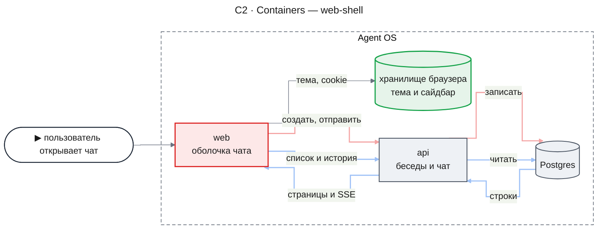

- `web` (`apps/web`) в этой части становится оболочкой чата: маршруты `/` и `/chat/[threadId]`, рантайм assistant-ui с адаптерами, сайдбар, шапка, тема и тесты.
- `api` (`apps/api`) отдаёт беседы (`/api/threads*`) и чат (`POST /api/chat/:agentId`, SSE); эта часть его не меняет.
- Postgres хранит беседы и сообщения; `web` обращается к нему только через `api`.
- Хранилище браузера держит тему (`localStorage['theme']`, next-themes) и cookie `sidebar_state`, которую читает серверный layout группы `(chat)`.

Изменение заметно во всём приложении:

- Кольцо фокуса у всех кнопок `ui/button` и у всех элементов с `outline-ring` становится непрозрачным.
- Новый чат делает `POST /api/threads` перед `POST /api/chat`, а опрос `GET /api/threads/:id` даёт не больше 15 запросов на новую беседу.
- Маршруты чата становятся динамическими (`cookies()` в layout группы), поэтому первый кадр показывает фон `ShellFallback` до потока динамической части.
- `pnpm test` (turbo) выполняет и тесты `apps/web`.
- Ссылки в ответах модели, кроме `#фрагмента` и `mailto:`, открываются в новой вкладке, опасные схемы не кликабельны, а изображения не по `https` не загружаются.
- `next build` падает, если `NEXT_PUBLIC_API_URL` не задан или не абсолютный `http(s)` URL, а в production — и если это `http` не на loopback.
- Страницы приложения нельзя встроить во фрейм (`frame-ancestors 'none'`, `X-Frame-Options: DENY`).
- В ленте у всех сообщений только «Копировать»; перегенерация — запрос чата с `trigger: 'regenerate-message'`, и только из блока ошибки последнего ответа.

#### C3 · Components: web

**web — первая отправка**

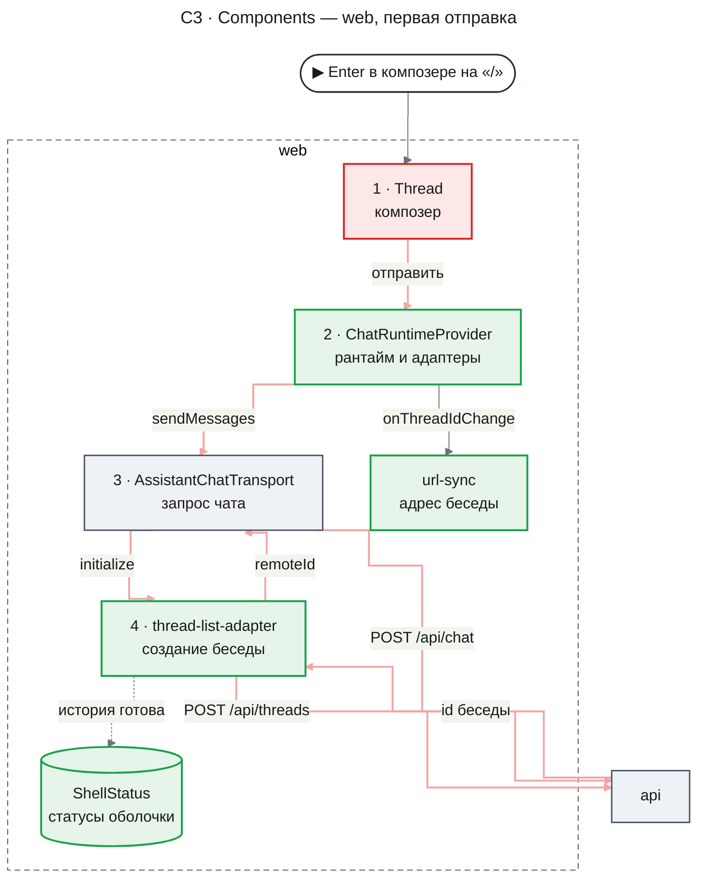

- `ChatRuntimeProvider` — единственное место, где создаётся рантайм. Транспорт вызывает `initialize()` элемента списка через рантайм, ждёт `remoteId` и только потом отправляет чат с `body.id` = `remoteId`; рантайм сообщает новый id в `url-sync` через `onThreadIdChange`.
- `thread-list-adapter` создаёт беседу через `threads-api-client` (zod-схемы `@agent-os/contracts`) и до возврата `remoteId` помечает её историю готовой в `ShellStatus`.
- `url-sync` заменяет адрес на `/chat/<id>` через `history.replaceState`, не перезагружая страницу.

**web — открытие беседы**

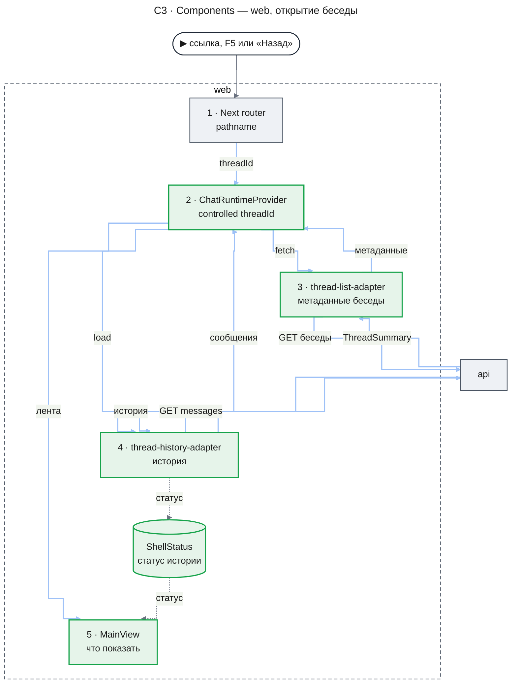

- `thread-list-adapter` запрашивает метаданные (`fetch`) только для беседы, которой нет в загруженном списке; 404 и 400 рантайм превращает в `switchError`.
- `thread-history-adapter` загружает историю один раз на монтирование тела беседы и пишет её статус в `ShellStatus`, потому что ошибки истории библиотека глотает.
- `MainView` решает по маршруту, рантайму и `ShellStatus` (`resolveMainView`), показать ленту, скелетон или экран ошибки.

#### Иерархия компонентов

Корень: `ChatRuntimeProvider` оборачивает и сайдбар, и основную область — их поддеревья на двух следующих схемах.

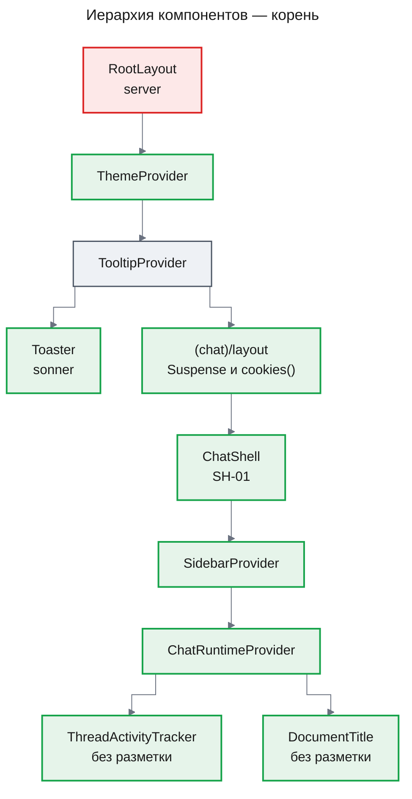

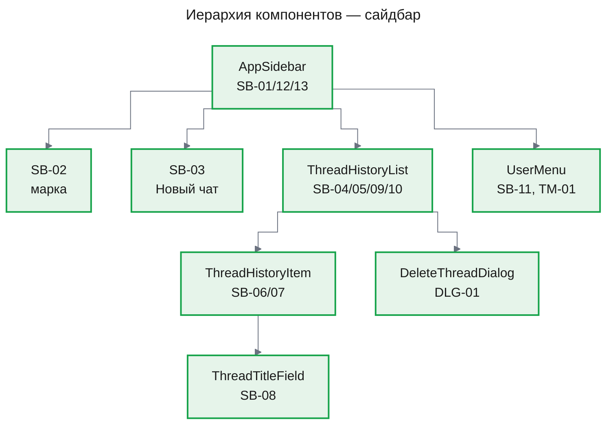

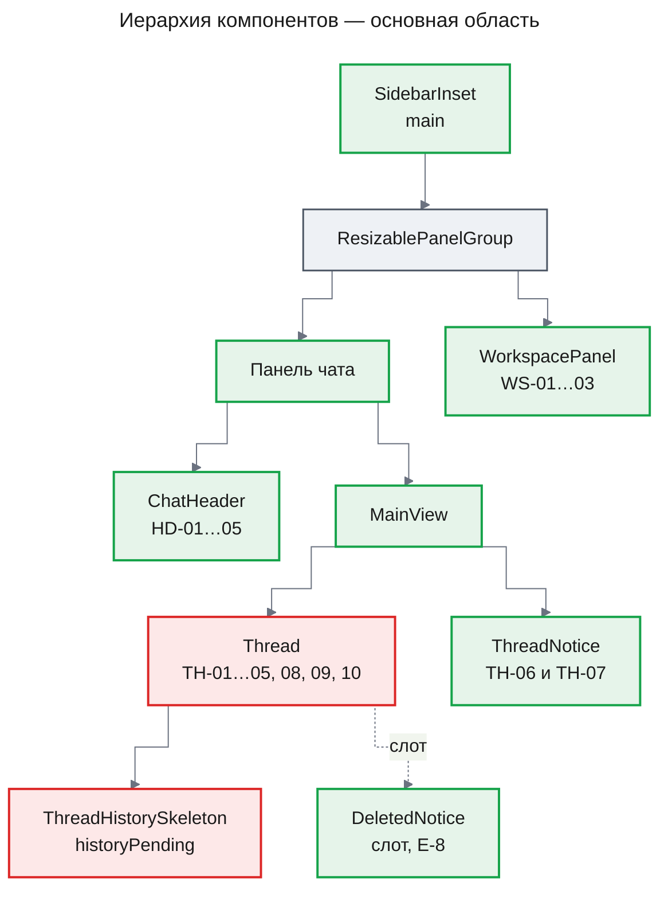

Контейнеры `ThreadHistoryList` и `ChatHeader` читают рантайм и передают данные в презентационные `ThreadHistoryListView` и `ChatHeaderView` (Element 6).

#### Композиция рантайма и владение состоянием

| Состояние | Единственный владелец | Как читается |
|---|---|---|
| Список бесед, метаданные (`title`, `lastMessageAt`), `isRunning`, текущая беседа, сообщения, композер, стрим | Рантайм assistant-ui (`RemoteThreadList`, клиентский режим) | `useAuiState`, `useAui`, примитивы `thread.aui.tsx` |
| Какая беседа открыта | URL (`usePathname`) → controlled `threadId` | `parseRouteThreadId(pathname)` |
| Сайдбар развёрнут/свёрнут, шторка открыта | shadcn `SidebarProvider` (+ cookie `sidebar_state`, 7 дней) | `useSidebar()` |
| Тема | next-themes (`localStorage['theme']`) | `useTheme()` |
| Рабочая область открыта (намерение пользователя), ширина | `useState` в `ChatShell` (сессия вкладки) | props `ChatHeader`, `WorkspacePanel` |
| Статус истории по `remoteId`, `loadMoreFailed`, ожидание заголовка, локальное время активности | `ShellStatus` | `useShellStatus(selector)` |
| Ожидающие повторы загрузки истории | Замыкание адаптера истории (`RetryGate`, `lib/threads/retry-gate.ts`) | `services.retryHistory(remoteId)`; при удалении беседы — `drop` |

`ChatRuntimeProvider` создаёт один раз (`useState(createShellServices)`) объект `ShellServices` — `apiClient`, `status` (стор), `listAdapter`, `history` (фабрика адаптеров истории + `retry`/`forget`), `transport`, `notify`, `auiConfig`, `handleChatError` — и передаёт его в `runtimeHook` замыканием. `createShellServices` живёт в `lib/threads/shell-services.ts` (чистая сборка зависимостей, без React; `notify` — тонкая обёртка над `toast` из `sonner`). Действия оболочки для компонентов (`newChat`, `retryHistory`, `retrySwitch`, `deleteThread`) раздаёт `ShellActionsProvider` из `components/shell/shell-actions.tsx` (контекст + хук `useShellActions()`; вне провайдера хук бросает ошибку). `runtimeHook` выполняется внутри ресурсов tap и вызывает только `useAui()` и `useChatRuntime()`; адаптер истории для тела беседы берётся из `WeakMap<AssistantClient, ThreadHistoryAdapter>` (одинаковый объект для одного тела, без React-хуков).

#### Маршрутизация и синхронизация URL

- **Маршруты.** `app/(chat)/page.tsx` и `app/(chat)/chat/[threadId]/page.tsx` возвращают `null`; весь UI — в `app/(chat)/layout.tsx`, поэтому рантайм монтируется один раз и переживает переходы `/ ↔ /chat/[id]` (как ai-chatbot). Страницы не читают `params` ⇒ под `cacheComponents` им не нужен `Suspense` и `generateStaticParams`; Activity скрывает пустые страницы.
- **Layout группы** (серверный): `<Suspense fallback={<ShellFallback />}><ChatShellWithSidebarCookie>{children}</…></Suspense>`; внутренний async-компонент читает `(await cookies()).get('sidebar_state')?.value !== 'false'` → `defaultSidebarOpen`. Чтение `cookies()` делает группу динамической; корневой layout (html, шрифты, скрипт темы) остаётся статическим. `ShellFallback` — пустой `div` на `bg-background` во всю высоту (никаких предположений о ширине сайдбара, чтобы не было «прыжка»).
- **Путь беседы — одна функция.** `threadPath(id) = `/chat/${encodeURIComponent(id)}`` (`lib/threads/route-thread-id.ts`) используется везде, где путь строится или сравнивается: `href` ссылок SB-06, `history.replaceState`, сравнение с `location.pathname` в `syncUrlWithThread`. Обратная функция — `parseRouteThreadId`; `parseRouteThreadId(threadPath(id)) === id` для любого id из `ThreadIdSchema` (unit-тест round-trip).
- **URL → беседа.** `threadId = parseRouteThreadId(usePathname())` — `/chat/<id>` → `id` (декодированный `decodeURIComponent`; некорректная %-последовательность → сырой сегмент, сервер ответит 404 → TH-06), `/` → `undefined`, иное → `undefined`. Не `useParams`: после `history.replaceState` дерево маршрутов Next остаётся прежним, а `usePathname` синхронизируется (документация Next, single-page-applications).
- **Беседа → URL** (`syncUrlWithThread`, `onThreadIdChange`):
  - `remoteId` задан и `location.pathname !== threadPath(remoteId)` → `window.history.replaceState(null, '', threadPath(remoteId))` — первая отправка с `/` заменяет запись `/` (Назад ведёт к предыдущей беседе, а не в пустой чат);
  - `remoteId === undefined` и путь начинается с `/chat/` → `router.replace('/')` (библиотека сама ушла с беседы — удаление открытой беседы, UX-03 «заменяет запись»).
- **Переходы между беседами** — `next/link` (запись в истории, AC-04.4); `prefetch` по умолчанию (пустые страницы). Назад/Вперёд меняют `pathname` → controlled `threadId`.
- **«Новый чат»**: `pathname === '/'` → только фокус (A-3, A-10); иначе `router.push('/')`, затем фокус по правилу указателя.
- **Заголовок вкладки** (`DocumentTitle`): эффект `document.title = …` по UX-04 («{Название} — Agent OS» / «Новый чат — Agent OS» / «Новая беседа — Agent OS» / «Беседа не найдена — Agent OS» / «Agent OS» на TH-07); `metadata.title` корня — «Agent OS» (статический шелл). Анонсер маршрутов Next читает `document.title` (UXRD, Accessibility → «Объявления»).

#### Main Components

##### ChatShell (`components/shell/chat-shell.tsx`, client)
- **Responsibility**: SH-01 раскладка (`SidebarProvider` с `defaultOpen`, `SidebarInset` как `main`, корень `h-dvh`), рабочая область (намерение `workspaceOpen` × `useMediaQuery('(min-width: 1024px)')` = эффективное открытие; при < 840 px основной области — `setOpen(false, { persist: false })` и обратное разворачивание при закрытии), закрытие шторки при переходе через 768 px (`useEffect`: `!isMobile && openMobile` → `setOpenMobile(false)`, UXRD, Responsive Behavior), глобальные сочетания, skip link «Перейти к сообщению».
- **Interface**: `type ChatShellProps = { defaultSidebarOpen: boolean; children: ReactNode }`.
- **Dependencies**: `ChatRuntimeProvider`, `AppSidebar`, `ChatHeader`, `MainView`, `WorkspacePanel`, `useGlobalShortcuts` (`hooks/use-global-shortcuts.ts`), `useMediaQuery` (`hooks/use-media-query.ts`), `useSidebar`.

##### ChatRuntimeProvider (`components/shell/chat-runtime-provider.tsx`, client)
- **Responsibility**: единственное место создания рантайма; `ShellServices`; controlled `threadId`; `onThreadIdChange` → `syncUrlWithThread`; подсказки `Suggestions(WELCOME_SUGGESTIONS)` — `AuiConfig` собирается в `useMemo` из `services.auiConfig` и передаётся в `config` провайдера; монтирует `DocumentTitle`; классификация ошибок чата (E-8); уведомления операций.
- **Interface**: `type ChatRuntimeProviderProps = { children: ReactNode }`; оборачивает детей в `ShellActionsProvider` (`components/shell/shell-actions.tsx`), контекст `ShellActionsContext` → `{ newChat(source): void; retryHistory(remoteId): void; retrySwitch(threadId): void; deleteThread(threadId): Promise<void> }` (хук `useShellActions`; props `ShellActionsProvider` — `services`, `children` — не меняются).
- **Dependencies**: `@assistant-ui/react` (`useRemoteThreadListRuntime`, `AssistantRuntimeProvider`, `useAui`, `Suggestions`, `AuiConfig`), `@assistant-ui/ai-sdk` (`useChatRuntime`, `AssistantChatTransport`), `ai`, `lib/threads/*`, `sonner`.

##### Удаление беседы с идущим ответом (`ShellActions.deleteThread`)

Путь удаления по умолчанию стрим браузера не останавливает (Key Findings, п. 11), поэтому `deleteThread(threadId)` сначала отменяет прогон, затем удаляет элемент. Подтверждение в `DeleteThreadDialog` доходит до контейнера `ThreadHistoryList` через `onDelete`, и тот вызывает это действие, а не `delete()` элемента напрямую.

1. Элемент не в прогоне (`isRunning === false`) — сразу шаг 5.
2. Открытая беседа (`mainThreadId` совпадает с id элемента) — `aui.threads.thread("main").cancelRun()` (не устаревший вызов; `aui.thread()` помечен deprecated в 0.15.32).
3. Фоновая беседа — `aui.threads.__internal_getAssistantRuntime().threads.getById(id).cancelRun()`.
4. Ожидание, пока `isRunning` элемента не станет `false`, не дольше `CANCEL_SETTLE_TIMEOUT_MS` (2 000 мс).
5. `aui.threads.item({ id }).delete()` — дальше штатный путь списка и адаптера (Data Contract, `delete`).

Фоновое тело достижимо только через внутренний API `@assistant-ui/core` 0.3.32: `aui.threads.__internal_getThreadBody` в области `threads` приложения в 0.15.32 отсутствует, потому что `AssistantRuntimeProvider` подключает `RuntimeAdapter`/`ThreadListClient` (риск — раздел «Risks and Mitigation»).

##### ThreadListAdapter (`lib/threads/thread-list-adapter.ts`)
- **Responsibility**: `RemoteThreadListAdapter` поверх `threads-api-client`.
- **Interface**: `createThreadListAdapter(deps: ThreadListAdapterDeps): RemoteThreadListAdapter`.
- **Behaviour**: `list({after})` → страница (ошибка при `after` → `loadMoreFailed`); `initialize()` → `POST /api/threads` и `history[remoteId] = 'ready'` (у новой беседы нет истории для загрузки — правило 4 `resolveMainView` её не задевает); `fetch(id)` → `GET /api/threads/:id`; `rename(id, t)` → `PATCH` (ошибка → `notify.renameFailed()` + throw); `delete(id)` → `DELETE` (204/404 → `notify.deleted()`; иначе `notify.deleteFailed()` + throw; `history.forget(remoteId)`: `RetryGate.drop` отклоняет ожидающую загрузку и статусы беседы удаляются); `archive()` → `Promise.reject(new Error('Archive is not supported'))`; `generateTitle(id, msgs)` → `createTitlePollStream`.

##### ThreadHistoryAdapter (`lib/threads/thread-history-adapter.ts`)
- **Responsibility**: загрузка истории одного тела беседы; статусы; ожидание повтора.
- **Interface**: `createHistoryAdapterFactory(deps): { adapterFor(aui): ThreadHistoryAdapter; retry(remoteId): void; forget(remoteId): void }` (кэш `WeakMap` по клиенту `aui`).
- **Behaviour**: `withFormat(fa)` (только `fa.format === 'ai-sdk/v6'`, иначе ошибка конфигурации); `load()` — цикл «загрузить → `ready` / `not_found` (throw) / `load_failed` (ждать повтора)»; `append` — `Promise.resolve()`. Сообщения истории отдаются рантайму все, включая скрытые пары решений; их не рисует лента (KD-2).

##### Title poller (`lib/threads/title-poller.ts`)
- **Interface**: `createTitlePollStream(input: { remoteId: string; messages: readonly ThreadMessage[]; deps: TitlePollDeps }): AssistantStream`; константы `TITLE_POLL_INTERVAL_MS = 1_000`, `TITLE_POLL_WINDOW_MS = 15_000`.
- **Непустой заголовок обеспечен контрактом API**: пустого заголовка сервер не хранит — нормализация автозаголовка, вернувшая `''`, ничего не пишет, и `title` остаётся `null` (`design-threads-api.md`, Appendix: Evidence, Field Propagation Map — «`title`, автозаголовок»). Поэтому проверки `title !== null` достаточно.
- **Behaviour**: нет сообщения с `role === 'assistant'` → поток закрывается сразу; иначе `titleWaiting[remoteId] = true`, опрос до `title !== null` (дописывается текстом в поток) или окна; `not_found` — прекратить; прочие ошибки опроса — `console.warn` с `remoteId`, `kind` и `status`, продолжить; `finally` — снять ожидание.

##### AppSidebar, ThreadHistoryList, ThreadHistoryItem, ThreadTitleField, DeleteThreadDialog, UserMenu
- **AppSidebar**: shadcn `Sidebar collapsible="icon"` + `SidebarRail`; `nav aria-label="История бесед"` вокруг списка; в шторке — «×» «Закрыть меню»; `finalFocus` шторки зависит от причины закрытия: после выбора беседы или SB-03 — `false` (флаг `actionOwnsFocus`), и фокус ставит само действие (`focusShellTarget('page-title')`, `focusAfterNewChat()`); после Esc, «×», затемнения или свайпа — кнопка «Меню» (`MENU_BUTTON_ATTRIBUTE`). Причина: base-ui выполняет `finalFocus` после анимации закрытия — позже фокуса действия в следующем кадре — и иначе перевёл бы фокус на «Меню»; кнопки SB-03 (полная / иконочная в полосе). Список в полосе не рендерится (D-02).
- **ThreadHistoryList** (контейнер): `useAuiState` → `threadItems` (`status === 'regular'`), `isLoading`, `loadError`, `hasMore`, `isLoadingMore`, `mainThreadId`; `ShellStatus` → `activityAt`, `loadMoreFailed`, `titleWaiting`; `useNow()` (`hooks/use-now.ts`); время активности строки — `entryActivityAt({ lastMessageAt, activityAt }, now)`; тексты ошибок SB-09 и SB-10 — в `role="alert"` (UXRD, Accessibility → «Роли и имена»; SB-09 Error), Loading — `role="status"`; группирует и отдаёт в `ThreadHistoryListView`; активную строку выбирает сам в `renderItem` (`isActive` — `entry.id === mainThreadId`), вид её не знает. Переименование — `onRename` строки вызывает `aui.threads.item({ id }).rename(title)`: отказ библиотека сама пишет в консоль (`handleRuntimeAction` → `task.catch(console.error)`), уведомление и откат названия даёт адаптер списка. Удаление — `onDelete` вида вызывает `useShellActions().deleteThread(id)`, никогда `item.delete()`; для открытой беседы контейнер запоминает это и вызывает `focusAfterNewChat()`, когда `usePathname()` стал `/`. Автоподгрузка — `IntersectionObserver` на SB-10 с `rootMargin: '0px 0px 200px 0px'`. ↑/↓/Home/End — `onKeyDown` на контейнере списка по `a[data-thread-link]`.
- **ThreadHistoryListView**: держит `DeleteThreadDialog` и правило фокуса после удаления, чтобы их можно было проверить без рантайма. `renderItem` получает вторым аргументом `onRequestDelete` строки. При подтверждении цель фокуса вычисляется до исчезновения строки: следующая ссылка, иначе предыдущая, иначе «Новый чат» (SB-03); «Отмена» и Esc возвращают фокус на «⋯» строки. Для открытой беседы (`openThreadId`) вид фокус не трогает — его ведёт смена маршрута в контейнере.
- **ThreadHistoryItem**: `li > SidebarMenuButton render={<Link href={threadPath(remoteId)} …/>}` + `SidebarMenuAction` «⋯» (`DropdownMenu`, пункты «Переименовать», «Удалить»); переименование на месте (`ThreadTitleField`); «Удалить» вызывает `onRequestDelete`, диалог открывает вид списка. Оба пункта действуют из `onClick` элемента меню, а не из `onOpenChangeComplete` у `DropdownMenu`: `useAnimationsFinished` в base-ui ждёт конца анимации закрытия попапа (около 1 с), и введённые за это время символы терялись. **Цвет текста строки (UXRD, Accessibility → «Контраст»):** в состояниях hover, active (`data-active`) и открытого меню весь текст строки — название, «Новая беседа» в `ShimmerLabel` — только `text-sidebar-accent-foreground` (штатные классы `SidebarMenuButton`: `hover:text-sidebar-accent-foreground data-active:text-sidebar-accent-foreground`); `text-muted-foreground` внутри строки не используется (`--muted-foreground` / `--sidebar-accent` = 4,34:1 — Fail в светлой).
- **UserMenu**: кнопка `aria-label="Меню пользователя dev-user"`, `Avatar` (`ui/avatar.tsx`) с инициалами — `aria-hidden` (декоративный); `DropdownMenu` (side `top`), `DropdownMenuRadioGroup` «Тема» (`light`/`dark`/`system`), заголовок «dev-user» / «Режим разработки» из `DEV_USER`.

##### ChatHeader, MainView, ThreadNotice, WorkspacePanel, ThreadActivityTracker, DocumentTitle
- **ChatHeader**: HD-02 — две кнопки, различаемые CSS: `md:hidden` «Меню» (`aria-haspopup="dialog"`) и `hidden md:inline-flex` «Боковая панель» (`aria-expanded`, `aria-controls`); HD-03 `h1 tabIndex={-1}` с `data-shell-focus="page-title"`; HD-04 `hidden lg:inline-flex`; HD-05 `md:hidden`. Граница снизу при прокрутке ленты: контейнер `ChatHeader` слушает `scroll` на `document` в фазе перехвата (событие не всплывает) и берёт только вьюпорт ленты (`[data-slot="aui_thread-viewport"]`, им владеет `Thread`); `scrollTop > 0` → проп `scrolled` → `data-scrolled` у `header` → `border-border` вместо прозрачной границы. `Thread` для этого не меняется.
- **Название HD-03 (контейнер `ChatHeader`)** выводится из того же `useMainViewState()`, что и `MainView`, поэтому шапка и основная область не расходятся. `/` → `hidden`; `not-found` и `load-error` → `empty`; `switching` или метаданные открытой беседы ещё не получены → `loading`; иначе `text` (без заголовка — «Новая беседа», `pending` при `isRunning` или ожидании заголовка).
- **MainView**: `useMainViewState()` (маршрут, рантайм, `ShellStatus` → `resolveMainView`; экспорт `main-view.tsx`, его же читает `ChatHeader`). `thread` и `switching` → один и тот же `Thread` (`autoFocus={false}`, `historyPending` — `switching` или открыт `/chat/<id>`, а тело беседы ещё грузится: `thread.isLoading` при пустом `thread.messages`, `components={{ Welcome: ShellWelcome, DeletedNotice: deleted ? DeletedNotice : undefined }}`; `ShellWelcome` — `components/shell/shell-welcome.tsx`, `DeletedNotice` — экспорт `thread-notice.tsx`); `not-found` / `load-error` → `ThreadNotice` без композера.
- **Страж от вспышки приветствия на F5**: адаптер истории ставит `history[id] = 'ready'` до того, как рантайм положил сообщения в тред, поэтому `resolveMainView` уже отдаёт `thread`, а лента ещё пуста — без стража на один кадр мелькнуло бы приветствие. Пока на `/chat/<id>` тело беседы грузится и сообщений нет, `MainView` держит `historyPending`; элемент `Thread` остаётся тем же, композер не перемонтируется. На `/` страж не действует.
- **`Thread` с `historyPending`**: в ленте только `ThreadHistorySkeleton` (без приветствия, сообщений, follow-up и подсказок), композер прижат к низу и привязан к текущему главному треду. Поле ввода доступно, кнопка «Отправить» недоступна, Enter не отправляет (Element 8). Текст, введённый, пока беседа по ссылке ещё не разрешена (правило 2), остаётся у прежнего главного треда и в открытую беседу не переносится — как черновик при уходе с беседы (UXRD D-12).
- **ThreadNotice**: варианты `not-found` / `load-error` / `deleted`; `h1 tabIndex={-1}`, фокус на нём при появлении. Вариант `deleted` — встроенное в ленту уведомление на месте блока TH-08: `h2` «Беседа удалена» (на странице уже есть `h1` шапки), текст «Её удалили в другой вкладке или окне.» в `role="alert"`, кнопка «Новый чат» (`newChat`), без «Перегенерировать»; фокус переносится на «Новый чат», только если он был в скрытом композере.
- **WorkspacePanel**: `aside aria-label="Рабочая область"`, шапка 56 px с WS-03 «×»; `ResizableHandle` (`ui/resizable.tsx`) с `aria-label="Изменить ширину рабочей области"`. В `onKeyDownCapture` (раньше процентного обработчика библиотеки) ←/→ — ±16 px, с Shift — ±64 px, End — к минимуму 360 px через `panelRef.resize(...)`. Home — штатный обработчик react-resizable-panels: панель расширяется до предела, лента сохраняет 480 px.
- **ThreadActivityTracker**: подписка на `threadItems`, запоминает предыдущий `isRunning` по `id`, на фронте false→true — `status.bumpActivity(id, Date.now())`. Не рендерит разметку.
- **DocumentTitle**: эффект `document.title` (UX-04), монтируется в `ChatRuntimeProvider`, разметки не рендерит. `/` → «Новый чат — Agent OS»; TH-06 → «Беседа не найдена — Agent OS»; TH-07 → «Agent OS» (UX-04 этот случай не задаёт); открытая беседа → «{Название} — Agent OS» или «Новая беседа — Agent OS». Пока беседа из URL разрешается, прежний заголовок остаётся.

### Runtime Flows

Все потоки нарисованы на уровне C2: пользователь, `web`, `api` и Postgres. Шаги внутри `web` показаны заметками, а их компоненты — на схемах C3.

#### Flow 1: первая отправка в новом чате

**Starts when:** пользователь на `/` отправляет первое сообщение — для того, чтобы пустая беседа не создавалась (AC-03.2), новая беседа сразу встала первой в «Сегодня» (AC-03.3), адрес сменился без перезагрузки (AC-04.1) и заголовок появился без неё (AC-20.1).

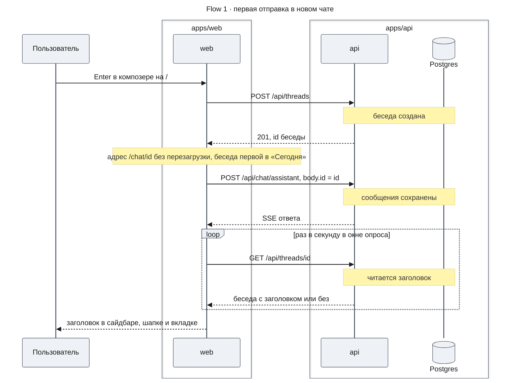

**Outcome:** беседа существует на сервере, адрес — `/chat/<id>` без новой записи истории, элемент активен и стоит первым в «Сегодня»; заголовок заменяет «Новая беседа», как только сервер его записал.

**Failure handling:**

- Ошибка `POST /api/threads` → отправка не выполняется, каркас показывает ошибку под репликой (TH-08), адрес остаётся `/`.
- 404 `THREAD_NOT_FOUND` от чата до SSE → «Беседа удалена» на месте блока ошибки, композер скрыт (E-8).
- Ошибка модели или сети в стриме → блок ошибки с «Перегенерировать» (Flow 4).
- Опрос заголовка: 404 прекращает опрос, прочие ошибки — `console.warn` и продолжение до конца окна.

#### Flow 2: открытие беседы по ссылке, F5 или «Назад»

**Starts when:** пользователь открывает `/chat/<id>` кликом, перезагрузкой или кнопками истории браузера — для показа истории (AC-02.1, AC-04.2), скелетона вместо приветствия (AC-02.2), ошибок истории и чужой беседы (AC-02.5, AC-04.3) и переходов «Назад/Вперёд» (AC-04.4).

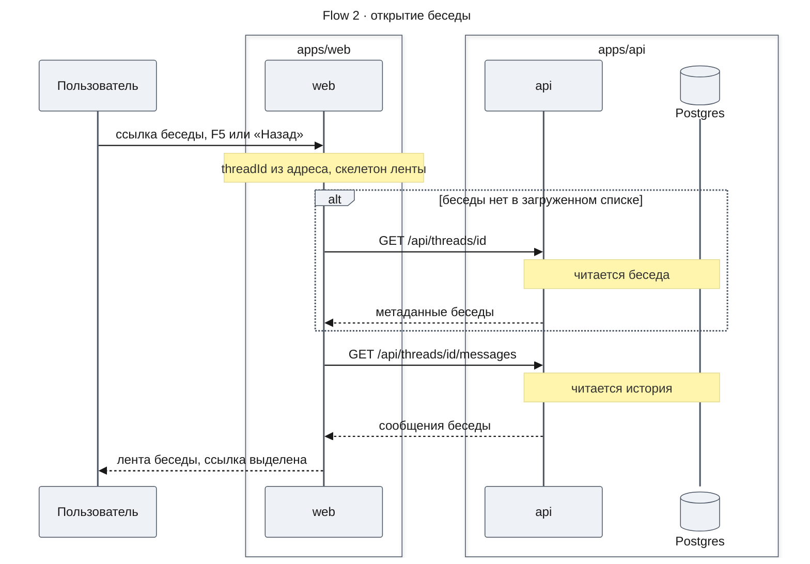

**Outcome:** лента показывает сообщения беседы в исходном порядке, ссылка получает `aria-current="page"`, шапка и вкладка — название; стрим прежней беседы продолжается в фоне (AC-02.6).

**Failure handling:**

- Метаданные: 404 или 400 → TH-06 «Беседа не найдена», фокус на `h1`; прочая ошибка → TH-07 с «Повторить» (`switchToThread`), библиотека сама повторяет при `online` и при возврате во вкладку.
- История: 404 → TH-06; невалидный ответ, 5xx или сеть → TH-07, «Повторить» отпускает `RetryGate` и загружает историю снова.

#### Flow 3: удаление беседы с идущим ответом

**Starts when:** пользователь подтверждает удаление беседы в `DeleteThreadDialog` — для удаления (AC-06.1…AC-06.3) и остановки генерации перед ним (UXRD A-4).

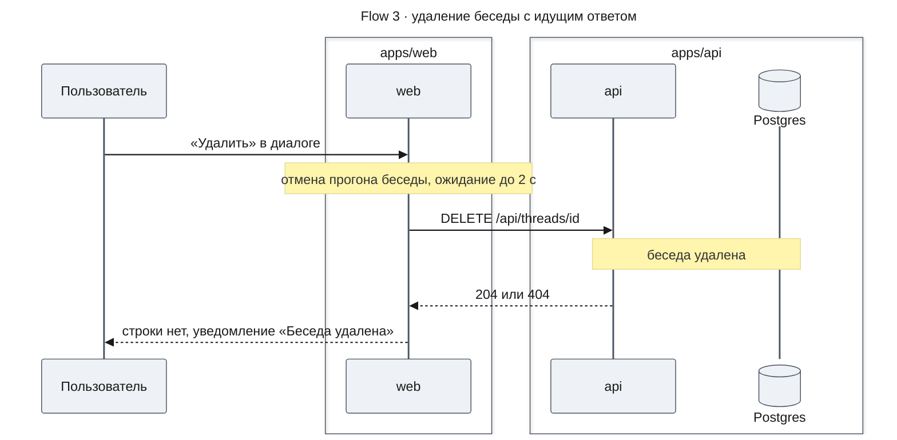

**Outcome:** генерация остановлена, беседы нет ни на сервере, ни в списке; при удалении открытой беседы адрес заменяется на `/` без новой записи истории.

**Failure handling:**

- Прогон не остановился за 2 000 мс — `console.warn` с `threadId`, удаление продолжается.
- Рантайм фонового тела недоступен — `console.warn` с `threadId`, удаление без отмены.
- В обоих случаях сервер прерывает прогон сам (Cross-Layer Assumption 9); ошибка `DELETE` — как прежде, откат элемента и уведомление (E-7).

#### Flow 4: перегенерация ответа с ошибкой и F5

**Starts when:** последний ответ ассистента завершился ошибкой модели или обрывом сети, пользователь нажимает «Перегенерировать». Поток доставляет AC-08.5a и AC-08.5c.

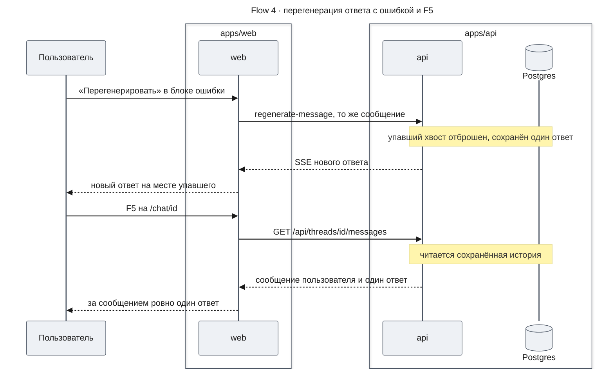

**Outcome:** новый ответ заменил упавший без переключателя вариантов; после F5 за сообщением пользователя следует ровно один ответ ассистента (AC-14.6, `threads-api`).

**Failure handling:**
- Новая ошибка стрима → снова блок ошибки с кнопкой (ответ остаётся последним).
- 404 `THREAD_NOT_FOUND` до SSE → «Беседа удалена» на месте блока ошибки, композер скрыт (E-8).
- Ошибка загрузки истории после F5 → TH-07 + «Повторить».

### Contract Definitions

```typescript
// lib/threads/threads-api-error.ts
export type ThreadsApiErrorKind = 'not_found' | 'invalid_response' | 'http' | 'network';

export class ThreadsApiError extends Error {
  constructor(
    readonly kind: ThreadsApiErrorKind,
    readonly status?: number,
  ) {
    super(`Threads API request failed: ${kind}${status === undefined ? '' : ` (${status})`}`);
    this.name = 'ThreadsApiError';
  }
}

export const isThreadsApiError = (value: unknown): value is ThreadsApiError =>
  value instanceof ThreadsApiError;

/** Log-safe description of a failure: classification only, never response bodies or user text. */
export const describeThreadsError = (
  error: unknown,
): { kind: ThreadsApiErrorKind | 'unknown'; status: number | undefined } =>
  isThreadsApiError(error) ? { kind: error.kind, status: error.status } : { kind: 'unknown', status: undefined };
```

```typescript
// lib/threads/threads-api-client.ts (фрагмент)
import type { ZodType } from 'zod';
import {
  ThreadListResponseSchema,
  ThreadMessagesResponseSchema,
  ThreadSummarySchema,
  type ThreadListResponse,
  type ThreadSummary,
} from '@agent-os/contracts';
import { safeValidateUIMessages, type UIMessage } from 'ai';
import { apiBaseUrl } from '@/lib/config';
import { ThreadsApiError } from './threads-api-error';

type RequestInput = { path: string; method?: 'GET' | 'POST' | 'PATCH' | 'DELETE'; body?: unknown; treatBadRequestAsNotFound?: boolean };

async function send({ path, method = 'GET', body, treatBadRequestAsNotFound = false }: RequestInput): Promise<Response> {
  let response: Response;
  try {
    response = await fetch(`${apiBaseUrl}${path}`, {
      method,
      credentials: 'include',
      headers: body === undefined ? undefined : { 'content-type': 'application/json' },
      body: body === undefined ? undefined : JSON.stringify(body),
    });
  } catch {
    throw new ThreadsApiError('network');
  }
  if (response.status === 404 || (treatBadRequestAsNotFound && response.status === 400)) {
    throw new ThreadsApiError('not_found', response.status);
  }
  if (!response.ok) throw new ThreadsApiError('http', response.status);
  return response;
}

async function parse<T>(response: Response, schema: ZodType<T>): Promise<T> {
  let data: unknown;
  try {
    data = await response.json();
  } catch {
    throw new ThreadsApiError('invalid_response', response.status);
  }
  const result = schema.safeParse(data);
  if (!result.success) throw new ThreadsApiError('invalid_response', response.status);
  return result.data;
}

export async function listThreads(cursor?: string): Promise<ThreadListResponse> {
  const query = cursor === undefined ? '' : `?cursor=${encodeURIComponent(cursor)}`;
  return parse(await send({ path: `/api/threads${query}` }), ThreadListResponseSchema);
}

export async function getThread(threadId: string): Promise<ThreadSummary> {
  const path = `/api/threads/${encodeURIComponent(threadId)}`;
  return parse(await send({ path, treatBadRequestAsNotFound: true }), ThreadSummarySchema);
}

export async function getThreadMessages(threadId: string): Promise<UIMessage[]> {
  const path = `/api/threads/${encodeURIComponent(threadId)}/messages`;
  const { messages } = await parse(await send({ path, treatBadRequestAsNotFound: true }), ThreadMessagesResponseSchema);
  if (messages.length === 0) return []; // safeValidateUIMessages rejects an empty array
  const deep = await safeValidateUIMessages({ messages });
  if (!deep.success) throw new ThreadsApiError('invalid_response', 200);
  return deep.data;
}
// createThread(): POST /api/threads → ThreadSummarySchema
// renameThread({ threadId, title }): PATCH → ThreadSummarySchema
// deleteThread(threadId): DELETE → 204; 404 → ThreadsApiError('not_found') (адаптер трактует как успех)
```

```typescript
// lib/threads/thread-list-adapter.ts (фрагмент)
import type { RemoteThreadListAdapter } from '@assistant-ui/react';
import type { ThreadSummary } from '@agent-os/contracts';

// @assistant-ui/react re-exports the adapter type only; the metadata type is derived from it
// (@assistant-ui/core is a transitive dependency and is not imported directly).
type RemoteThreadMetadata = Awaited<ReturnType<RemoteThreadListAdapter['fetch']>>;

export type OperationNotifier = {
  renameFailed: () => void;
  deleted: () => void;
  deleteFailed: () => void;
};

export type ThreadListAdapterDeps = {
  api: ThreadsApiClient;
  status: ShellStatusStore;
  notify: OperationNotifier;
  history: { forget: (remoteId: string) => void };
};

export const toRemoteMetadata = (thread: ThreadSummary): RemoteThreadMetadata => ({
  status: 'regular',
  remoteId: thread.id,
  title: thread.title ?? undefined,
  lastMessageAt: new Date(thread.updatedAt),
});

export function createThreadListAdapter({ api, status, notify, history }: ThreadListAdapterDeps): RemoteThreadListAdapter {
  return {
    async list(params) {
      const isNextPage = params?.after !== undefined;
      try {
        const page = await api.listThreads(params?.after);
        if (isNextPage) status.getState().setLoadMoreFailed(false);
        return { threads: page.threads.map(toRemoteMetadata), nextCursor: page.nextCursor ?? undefined };
      } catch (error) {
        console.error('[web-shell] thread list load failed', { nextPage: isNextPage, ...describeThreadsError(error) });
        if (isNextPage) status.getState().setLoadMoreFailed(true);
        throw error;
      }
    },
    async initialize() {
      const thread = await api.createThread();
      // A thread created in this tab has no stored history to load: mark it ready so the
      // main view never treats it as a route thread still waiting for history.
      status.getState().setHistory(thread.id, 'ready');
      return { remoteId: thread.id };
    },
    async fetch(threadId) {
      return toRemoteMetadata(await api.getThread(threadId));
    },
    async rename(remoteId, newTitle) {
      try {
        await api.renameThread({ threadId: remoteId, title: newTitle });
      } catch (error) {
        console.error('[web-shell] thread rename failed', { remoteId, ...describeThreadsError(error) });
        notify.renameFailed();
        throw error;
      }
    },
    async delete(remoteId) {
      try {
        await api.deleteThread(remoteId);
      } catch (error) {
        if (!(isThreadsApiError(error) && error.kind === 'not_found')) {
          console.error('[web-shell] thread delete failed', { remoteId, ...describeThreadsError(error) });
          notify.deleteFailed();
          throw error;
        }
      }
      history.forget(remoteId);
      notify.deleted();
    },
    archive: () => Promise.reject(new Error('Archive is not supported')),
    async generateTitle(remoteId, messages) {
      return createTitlePollStream({ remoteId, messages, deps: { api, status } });
    },
  };
}
```

```typescript
// lib/threads/thread-history-adapter.ts (фрагмент)
import type { AssistantClient, ThreadHistoryAdapter } from '@assistant-ui/react';
import type { UIMessage } from 'ai';

export type HistoryAdapterDeps = { api: ThreadsApiClient; status: ShellStatusStore };

const toRepository = (messages: readonly UIMessage[]) => ({
  headId: messages.at(-1)?.id ?? null,
  messages: messages.map((message, index) => ({ parentId: messages[index - 1]?.id ?? null, message })),
});

export function createHistoryAdapterFactory({ api, status }: HistoryAdapterDeps) {
  const gate = createRetryGate(); // lib/threads/retry-gate.ts
  const cache = new WeakMap<AssistantClient, ThreadHistoryAdapter>();

  const loadFor = async (remoteId: string) => {
    for (;;) {
      status.getState().setHistory(remoteId, 'loading');
      try {
        const messages = await api.getThreadMessages(remoteId);
        status.getState().setHistory(remoteId, 'ready');
        return toRepository(messages);
      } catch (error) {
        if (isThreadsApiError(error) && error.kind === 'not_found') {
          status.getState().setHistory(remoteId, 'not_found');
          throw error;
        }
        console.error('[web-shell] thread history load failed', { remoteId, ...describeThreadsError(error) });
        status.getState().setHistory(remoteId, 'load_failed');
        await gate.wait(remoteId);
      }
    }
  };

  const adapterFor = (aui: AssistantClient): ThreadHistoryAdapter => {
    const cached = cache.get(aui);
    if (cached) return cached;
    const getRemoteId = () => (aui.threadListItem.source ? aui.threadListItem.getState().remoteId : undefined);
    const adapter: ThreadHistoryAdapter = {
      load: () => Promise.resolve({ messages: [] }),
      append: () => Promise.resolve(),
      withFormat(formatAdapter) {
        assertAiSdkV6Format(formatAdapter); // единственное сужение обобщённого TMessage до UIMessage — с проверкой format
        return {
          load: async () => {
            const remoteId = getRemoteId();
            return remoteId === undefined ? { messages: [] } : narrowRepository(formatAdapter, await loadFor(remoteId));
          },
          append: () => Promise.resolve(),
        };
      },
    };
    cache.set(aui, adapter);
    return adapter;
  };

  return {
    adapterFor,
    retry: (remoteId: string) => gate.release(remoteId),
    forget: (remoteId: string) => {
      gate.drop(remoteId); // a parked load() rejects with ThreadsApiError('not_found')
      status.getState().forgetThread(remoteId);
    },
  };
}
```

```typescript
// lib/threads/retry-gate.ts
import { ThreadsApiError } from './threads-api-error';

export type RetryGate = {
  /** Parks a failed history load until the user retries or the thread is deleted. */
  wait: (remoteId: string) => Promise<void>;
  /** «Повторить»: resolves the parked waiter; the load loop runs again. */
  release: (remoteId: string) => void;
  /** Thread deleted: rejects the parked waiter with ThreadsApiError('not_found'). */
  drop: (remoteId: string) => void;
};

type Waiter = { resolve: () => void; reject: (error: ThreadsApiError) => void };

export function createRetryGate(): RetryGate {
  const waiters = new Map<string, Waiter>();
  const take = (remoteId: string): Waiter | undefined => {
    const waiter = waiters.get(remoteId);
    waiters.delete(remoteId);
    return waiter;
  };
  return {
    wait: (remoteId) => new Promise<void>((resolve, reject) => waiters.set(remoteId, { resolve, reject })),
    release: (remoteId) => take(remoteId)?.resolve(),
    drop: (remoteId) => take(remoteId)?.reject(new ThreadsApiError('not_found')),
  };
}
// Invariant: at most one waiter per remoteId — one mounted thread body per thread, and
// useExternalHistory calls load() once per mount. release/drop without a waiter are no-ops.
```

`drop` выбран вместо «тихого» `resolve`: после `resolve` цикл `loadFor` повторил бы `GET …/messages` для удалённой беседы (404) — лишний запрос и запись статуса `not_found` для уже забытой беседы; отказ `not_found` завершает `load()` сразу, тело беседы размонтируется библиотекой, статусы уже удалены `forgetThread`. Ожидающий промис не остаётся висеть (нет утечки замыкания).

```typescript
// components/shell/chat-runtime-provider.tsx (фрагмент)
'use client';
import { useCallback, useMemo, useState, type ReactNode } from 'react';
import { usePathname, useRouter } from 'next/navigation';
import { AssistantRuntimeProvider, AuiConfig, Suggestions, useAui, useRemoteThreadListRuntime } from '@assistant-ui/react';
import { useChatRuntime } from '@assistant-ui/ai-sdk';
import { lastAssistantMessageIsCompleteWithToolCalls } from 'ai';

type ChatRuntimeProviderProps = { children: ReactNode };

export function ChatRuntimeProvider({ children }: ChatRuntimeProviderProps) {
  const router = useRouter();
  const threadId = parseRouteThreadId(usePathname());
  const [services] = useState(createShellServices); // api, status, listAdapter, history factory, transport, notify
  // TH-03 starter suggestions feed ThreadPrimitive.Suggestions through the provider's root scope.
  const config = useMemo(
    () => AuiConfig({ ...services.auiConfig, suggestions: Suggestions(WELCOME_SUGGESTIONS) }),
    [services],
  );

  // Runs inside assistant-ui tap resources: only assistant-ui hooks are allowed here.
  const runtimeHook = useCallback(
    function useShellThreadRuntime() {
      const aui = useAui();
      return useChatRuntime({
        transport: services.transport,
        sendAutomaticallyWhen: lastAssistantMessageIsCompleteWithToolCalls,
        adapters: { history: services.history.adapterFor(aui) },
        onError: (error) => services.handleChatError({ error, aui }),
      });
    },
    [services],
  );

  const runtime = useRemoteThreadListRuntime({
    adapter: services.listAdapter,
    threadId,
    runtimeHook,
    onThreadIdChange: (remoteId) => syncUrlWithThread({ remoteId, location: window.location, history: window.history, router }),
  });

  return (
    <AssistantRuntimeProvider runtime={runtime} config={config}>
      <ShellActionsProvider services={services}>
        <DocumentTitle />
        {children}
      </ShellActionsProvider>
    </AssistantRuntimeProvider>
  );
}
```

```typescript
// lib/threads/group-threads-by-date.ts
export type DateGroupKey = 'today' | 'yesterday' | 'previous7' | 'previous30' | 'older';

export type ThreadListEntry = {
  id: string;
  remoteId: string | undefined;
  title: string | undefined;
  activityAt: number;
  isRunning: boolean;
};

export type ThreadGroup = { key: DateGroupKey; label: string; entries: ThreadListEntry[] };

export const DATE_GROUP_LABELS = {
  today: 'Сегодня',
  yesterday: 'Вчера',
  previous7: 'Предыдущие 7 дней',
  previous30: 'Предыдущие 30 дней',
  older: 'Старше',
} as const satisfies Record<DateGroupKey, string>;

export type ActivitySources = {
  /** Server activity time (ThreadSummary.updatedAt). */
  lastMessageAt: Date | undefined;
  /** Local lift written when a reply starts (D-11). */
  activityAt: number | undefined;
};

/** Effective activity time: the later of the available sources; a thread with neither counts as active now. */
export function entryActivityAt(sources: ActivitySources, now: Date): number;
// контейнер ThreadHistoryList вычисляет так activityAt каждой строки до groupThreadsByDate

/** Calendar-day difference in the browser time zone; DST-safe via rounding. */
export function groupThreadsByDate(entries: readonly ThreadListEntry[], now: Date): ThreadGroup[];
// дни = round((startOfDay(now) − startOfDay(activityAt)) / 86 400 000): ≤0 today, 1 yesterday, 2..7 previous7, 8..30 previous30, >30 older;
// сортировка по activityAt DESC (стабильно, при равенстве — исходный порядок), пустые группы не возвращаются.
```

```typescript
// lib/threads/resolve-main-view.ts
export type HistoryStatus = 'loading' | 'ready' | 'not_found' | 'load_failed' | 'deleted';

export type MainViewInput = {
  routeThreadId: string | undefined;
  mainRemoteId: string | undefined;
  switchError: { threadId: string; error: unknown } | undefined;
  historyStatus: HistoryStatus | undefined;
};

export type MainView =
  | { kind: 'thread'; deleted: boolean }
  | { kind: 'switching' }
  | { kind: 'not-found' }
  | { kind: 'load-error'; retry: 'switch' | 'history' };

export function resolveMainView(input: MainViewInput): MainView;
// 1) switchError?.threadId === routeThreadId → not_found ? not-found : load-error/switch
// 2) routeThreadId !== undefined && mainRemoteId !== routeThreadId → switching (скелетон, не приветствие — AC-02.2)
// 3) historyStatus === 'not_found' → not-found; 'load_failed' → load-error/history
// 4) routeThreadId !== undefined && (historyStatus === undefined || historyStatus === 'loading') → switching
//    F5 на /chat/<id>: пока threads.isLoading, isNewChatView каркаса (messages.length === 0 && threads.isLoading)
//    показал бы Welcome; до вызова load() статус ещё undefined, во время — 'loading'. Беседа, созданная
//    в этой вкладке, получает 'ready' в initialize() до replaceState, поэтому правило её не задевает.
//    'ready' ставится раньше, чем сообщения попадают в тред рантайма: этот промежуток закрывает страж MainView
//    (thread.isLoading при пустом thread.messages → historyPending), а не resolveMainView.
// 5) иначе thread { deleted: historyStatus === 'deleted' }
```

```typescript
// lib/threads/route-thread-id.ts
const CHAT_PREFIX = '/chat/';

/** The only way a thread path is built: Link href, replaceState, pathname comparison. */
export const threadPath = (threadId: string): string => `${CHAT_PREFIX}${encodeURIComponent(threadId)}`;

export function parseRouteThreadId(pathname: string | null): string | undefined {
  if (pathname === null || !pathname.startsWith(CHAT_PREFIX)) return undefined;
  const segment = pathname.slice(CHAT_PREFIX.length);
  if (segment === '' || segment.includes('/')) return undefined;
  try {
    return decodeURIComponent(segment);
  } catch {
    // Malformed percent-encoding: keep the raw segment so the API answers 404 and the user sees TH-06.
    return segment;
  }
}
```

```typescript
// lib/config.ts
import { z } from 'zod';

// Next inlines NEXT_PUBLIC_* into the client bundle at build time only for the literal
// `process.env.NEXT_PUBLIC_API_URL` expression — no destructuring, no dynamic key.
const parsed = z.url({ protocol: /^https?$/ }).safeParse(process.env.NEXT_PUBLIC_API_URL);

if (!parsed.success) {
  throw new Error('NEXT_PUBLIC_API_URL must be an absolute http(s) URL');
}

/** Public API origin, without a trailing slash. Not a secret: it ships in the client bundle. */
export const apiBaseUrl = parsed.data.replace(/\/+$/, '');
```

`z.url(...)` — форма `z.string().url()` в zod 4 (версия `^4.6.7`, как в `@agent-os/contracts`; `zod` становится прямой зависимостью `apps/web`, раньше была только транзитивной). Проверка выполняется при загрузке модуля; `app/layout.tsx` импортирует `apiBaseUrl` для `<link rel="preconnect" href={apiBaseUrl} crossOrigin="use-credentials">`, а корневой layout пререндерится на `next build` — поэтому без переменной (или с не-URL) **падает сборка**, а не первый запрос в браузере. Значение «запекается» в бандл на сборке: смена API-адреса требует пересборки.

```tsx
// components/theme-provider.tsx
'use client';
import type { ComponentProps } from 'react';
import { ThemeProvider as NextThemesProvider } from 'next-themes';

type ThemeProviderProps = Omit<ComponentProps<typeof NextThemesProvider>, 'scriptProps'>;

// Evaluated separately on the server and in the browser: the server HTML gets an executable
// script (runs during parsing, before paint); client renders get an inert 'text/plain' one, so
// React does not warn about rendering <script>. next-themes puts suppressHydrationWarning on its
// <script>, so React accepts the differing `type` during hydration.
const scriptProps = { type: typeof window === 'undefined' ? 'text/javascript' : 'text/plain' } as const;

export function ThemeProvider({ children, ...props }: ThemeProviderProps) {
  return (
    <NextThemesProvider {...props} scriptProps={scriptProps}>
      {children}
    </NextThemesProvider>
  );
}
```

```typescript
// lib/markdown-policy.ts
import { safeHref } from '@/utils/href';

export type LinkPolicy =
  | { kind: 'unsafe' } // no usable href: javascript:, data:, vbscript:, garbage
  | { kind: 'fragment'; href: string } // #id inside the message (remark-gfm footnotes)
  | { kind: 'mail'; href: string } // mailto: handed to the mail client, document stays
  | { kind: 'new-tab'; href: string }; // http(s) and same-origin paths

export function linkPolicy(url: string | undefined): LinkPolicy {
  const href = safeHref(url);
  if (href === undefined) return { kind: 'unsafe' };
  if (href.startsWith('#')) return { kind: 'fragment', href };
  if (href.toLowerCase().startsWith('mailto:')) return { kind: 'mail', href };
  return { kind: 'new-tab', href };
}

/** Only absolute https images are fetched by the browser. */
export function isRenderableImageSrc(src: unknown): src is string {
  if (typeof src !== 'string') return false;
  try {
    return new URL(src).protocol === 'https:';
  } catch {
    return false;
  }
}
```

```tsx
// components/markdown-text.tsx (фрагмент defaultComponents; стиль файла сохранён)
a: ({ className, href, children, ...props }) => {
  const policy = linkPolicy(href)
  if (policy.kind === "unsafe") {
    return <span className={cn("aui-md-a-unsafe underline decoration-dotted", className)}>{children}</span>
  }
  const newTab = policy.kind === "new-tab"
  return (
    <a
      {...props}
      href={policy.href}
      target={newTab ? "_blank" : undefined}
      rel={newTab ? "noopener noreferrer" : undefined}
      className={cn("aui-md-a text-primary hover:text-primary/80 underline underline-offset-2", className)}
    >
      {children}
      {newTab && <span className="sr-only"> (откроется в новой вкладке)</span>}
    </a>
  )
},
img: ({ src, alt, className, ...props }) => {
  if (!isRenderableImageSrc(src)) return <MarkdownImageFallback src={src} alt={alt} />
  // no-img-element is off for this file in eslint.config.mjs: next/image needs a host allowlist
  return 
},
// MarkdownImageFallback: linkPolicy(src) === new-tab → ссылка «Изображение: {alt || "без описания"}» в новой вкладке;
// иначе — текст «[Изображение недоступно{alt ? `: ${alt}` : ""}]» (span, цвет --muted-foreground).
```

```typescript
// Props презентационных компонентов
type ThreadHistoryListViewProps = {
  state: { kind: 'loading' } | { kind: 'error'; onRetry: () => void } | { kind: 'ready'; groups: readonly ThreadGroup[] };
  // добавляется в T6.1 (SB-10 «Показать ещё»)
  pagination: { hasMore: boolean; isLoadingMore: boolean; loadMoreFailed: boolean; onLoadMore: (source: 'keyboard' | 'pointer' | 'viewport') => void };
  // активную строку выбирает контейнер: renderItem передаёт ThreadHistoryItem isActive;
  // onRequestDelete открывает DLG-01 для этой строки
  renderItem: (entry: ThreadListEntry, onRequestDelete: () => void) => ReactNode;
  // открытая беседа: после её удаления фокус ведёт смена маршрута, а не список
  openThreadId: string | undefined;
  // удаление, подтверждённое в DLG-01
  onDelete: (entry: ThreadListEntry) => void;
};

type ThreadHistoryItemProps = {
  entry: ThreadListEntry;
  isActive: boolean;
  titlePending: boolean;
  onRename: (title: string) => void;
  onRequestDelete: () => void;
};

// hidden — `/`: пустой h1 со sr-only «Новый чат»; loading — скелетон, aria-busy;
// empty — TH-06/TH-07: пустой h1 без скелетона, без aria-busy и без sr-only текста; text — название или «Новая беседа».
type HeaderTitle =
  | { kind: 'hidden' }
  | { kind: 'loading' }
  | { kind: 'empty' }
  | { kind: 'text'; text: string; pending: boolean };

type ChatHeaderViewProps = {
  title: HeaderTitle;
  workspaceOpen: boolean;
  onToggleWorkspace: () => void;
  onNewChat: () => void;
  scrolled?: boolean; // лента прокручена от верха: граница снизу у шапки; по умолчанию false
};

type DeleteThreadDialogProps = {
  open: boolean;
  threadTitle: string;
  isRunning: boolean;
  onConfirm: () => void;
  onOpenChange: (open: boolean) => void;
  finalFocus: RefObject<HTMLElement | null>;
};

type ThreadNoticeProps = { variant: 'not-found' | 'load-error' | 'deleted'; onRetry?: () => void; onNewChat: () => void };
```

#### Interface Change Matrix

Как существующие точки использования продолжают работать после изменения их интерфейса:

| Existing | New | Conversion Required | Wrapper Required | Compatibility Method |
|---|---|---|---|---|
| `<Assistant agentId="assistant" />` | `<ChatRuntimeProvider>` в `ChatShell` (агент — константа `ASSISTANT_AGENT_ID = 'assistant'`) | Да | Нет | Единственный вызов (`page.tsx`) удаляется вместе с файлом |
| `Thread` props `{ components?, autoFocus? = true }` | + `historyPending?: boolean` (по умолчанию `false`); `MainView` передаёт `autoFocus={false}` и `historyPending` в `switching` | Нет | Нет | Новый необязательный проп; без него — прежний `Thread` |
| `ThreadComponents { AssistantMessage, Welcome, ToolFallback, ToolGroup, ReasoningGroup, TaskGroup, ComposerExtra }` | + `DeletedNotice?: ComponentType` | Нет | Нет | Необязательный слот; без него — прежний композер |
| `AssistantActionBar`, `UserActionBar`, `BranchPicker`, `EditComposer`, `MessageError` (внутренние) | Сокращённый состав кнопок; `autohide` снят; `BranchPicker` и `EditComposer` удалены; кнопка «Перегенерировать» в `MessageError` по флагу; `MessageError` рендерит слот `DeletedNotice`, если он задан | Нет | Нет | Не экспортируются; вызовы — только внутри `thread.aui.tsx` |
| `ToolFallbackImpl`, `ToolFallbackError` (`ToolFallback.Error`) props `{ status, className, … }` | Те же props; `ToolFallbackImpl` читает уже существующее поле `isError` части; текст ошибки фиксированный | Нет | Нет | Сигнатуры не меняются |
| `Button` `variant="destructive"` (тонированный) | Сплошной `bg-destructive text-destructive-foreground` | Нет | Нет | Вариант не используется ни одним вызовом (grep) |
| `RootLayout` | + `ThemeProvider` (клиентская обёртка `components/theme-provider.tsx`), `Toaster`, `suppressHydrationWarning`, theme-color, `viewport`, `preconnect` | Нет | Нет | — |
| `MarkdownText` `a`: `<a {...props}>` (тот же документ, любой `href`) | `a` по `linkPolicy(href)`: новая вкладка + `rel="noopener noreferrer"` / `#фрагмент` / `mailto:` / `span` без `href` | Нет | Нет | Намеренное изменение поведения; props компонента не меняются |
| `MarkdownText` `img`: стандартный `` react-markdown (любой источник, пропущенный `urlTransform`) | `img` только для `https:` с `referrerPolicy="no-referrer"`; иначе ссылка или заглушка | Нет | Нет | Намеренное изменение поведения |
| shadcn `SidebarProvider.setOpen(value)` | `setOpen(value, options?: { persist?: boolean })` (по умолчанию `persist: true`) | Нет | Нет | Новый необязательный аргумент |

#### Data Contract

- **`ThreadListAdapter.list({ after? })`** — загружает страницу списка; `after` — непрозрачный курсор, `nextCursor` предыдущей страницы, ответ проверяется `ThreadListResponseSchema.safeParse`. Возвращает `RemoteThreadListResponse` — до 20 `RemoteThreadMetadata` и необязательный `nextCursor`: `title: null` становится `undefined`, `lastMessageAt` — `Date(updatedAt)`, `nextCursor: null` — `undefined`, и библиотека считает это концом списка. Ошибки — `ThreadsApiError` (`network`, `http`, `invalid_response`); при `after` адаптер ещё ставит `ShellStatus.loadMoreFailed = true`. Адаптер не хранит страниц: порядок и дедупликация — у рантайма.
- **`ThreadListAdapter.initialize`** — создаёт беседу (`POST /api/threads`, 201) и возвращает `{ remoteId: ThreadSummary.id }`. До возврата `remoteId`, то есть до `replaceState`, ставит `ShellStatus.history[remoteId] = ready`. При ошибке бросает `ThreadsApiError`: отправка не выполняется, каркас показывает ошибку под репликой (TH-08).
- **`ThreadListAdapter.fetch(threadId)`** — загружает метаданные беседы из адреса и возвращает `RemoteThreadMetadata`. 404 и 400 → `ThreadsApiError(not_found)` → `switchError` → TH-06; прочие ошибки → TH-07.
- **`ThreadListAdapter.rename(remoteId, newTitle)`** — получает уже обрезанное название длиной 1..200 (`ThreadTitleField`). При ошибке вызывает `notify.renameFailed()` и бросает исключение, а библиотека откатывает оптимистичный заголовок (AC-05.4).
- **`ThreadListAdapter.delete(remoteId)`** — его вызывает `delete()` элемента из `ShellActions.deleteThread` после отмены прогона беседы. 204 или 404 — успех (AC-16.3) и `notify.deleted()`; иначе `notify.deleteFailed()` и исключение, элемент возвращается (E-7). Побочно `history.forget(remoteId)`: `RetryGate.drop` отклоняет ожидающий `load()` с `ThreadsApiError(not_found)`, а `ShellStatus.forgetThread(remoteId)` удаляет статусы беседы.
- **`ThreadHistoryAdapter.withFormat(...).load()`** — загружает историю тела беседы по `remoteId`, который берётся лениво из `aui.threadListItem`; требует `formatAdapter.format === 'ai-sdk/v6'`, иначе это ошибка конфигурации. Возвращает `MessageFormatRepository<UIMessage>`: сообщения в хронологическом порядке, `parentId` — предыдущий id, `headId` — последний; каждое прошло `ThreadMessagesResponseSchema` и `safeValidateUIMessages`, а пустая история даёт пустую ленту без вызова `safeValidateUIMessages`. `not_found` → `ShellStatus.history[id] = not_found` и исключение (TH-06); прочие ошибки → `load_failed`, и промис ждёт `RetryGate`: `release` (повтор) снова даёт `loading`, `drop` (беседа удалена) — отказ `ThreadsApiError(not_found)` без записи статуса. `append` ничего не отправляет: сообщения сохраняет `POST /api/chat`.
- **Поток `TitlePoll`** — получает `remoteId` и `messages` от библиотеки и возвращает `AssistantStream`, текстовая часть которого — заголовок или пусто. Без ответа ассистента в `messages` поток закрывается сразу, без запросов; опрос — не чаще 1 запроса в 1 000 мс и не дольше 15 000 мс, а `ShellStatus.titleWaiting[remoteId] = true` только на время опроса. `not_found` прекращает опрос, прочие ошибки — `console.warn` и продолжение до конца окна.

#### UI Action-API Contract Mapping

| UI Action | API Contract (design-threads-api) | Request | Response handled | Error handled |
|---|---|---|---|---|
| Открытие оболочки (первая страница списка) | `GET /api/threads` | без `cursor` | `ThreadListResponse` → `RemoteThreadMetadata[]` → группы | network/5xx/невалидно → SB-09 Error |
| «Показать ещё» / прокрутка | `GET /api/threads?cursor=` | `cursor = nextCursor` как есть | дописать страницу; `nextCursor: null` → конец | → SB-10 Error; 400 `INVALID_CURSOR` → тот же Error |
| Первая отправка в новом чате | `POST /api/threads`, затем `POST /api/chat/assistant` | тело не требуется; затем `ChatRequest` с `id` = `ThreadSummary.id` | `remoteId` → URL `/chat/<id>`; SSE v7 → лента | ошибка создания → TH-08 у реплики; 404 чата → E-8 |
| Отправка в существующую беседу | `POST /api/chat/assistant` | `ChatRequest { id, messages }` | SSE v7 | 404 `THREAD_NOT_FOUND` → статус `deleted` → «Беседа удалена» (E-8); прочее → TH-08 |
| «Перегенерировать» в блоке ошибки последнего ответа | `POST /api/chat/assistant` (контракт п. 6, AC-14.6) | тело `AssistantChatTransport` (`trigger: 'regenerate-message'`); последний элемент `messages` — то же сообщение пользователя (тот же `id`) без прежнего ответа | SSE v7 → новый ответ вместо упавшего; в истории — один ответ | новая ошибка → снова TH-08 с кнопкой; 404 → E-8 |
| Открытие беседы вне загруженного списка (F5, ссылка, Назад) | `GET /api/threads/:threadId` | `:threadId` из URL | `ThreadSummary` → метаданные (шапка, вкладка) | 404/400 → TH-06; прочее → TH-07 + «Повторить» → `switchToThread` |
| Загрузка истории | `GET /api/threads/:threadId/messages` | `:threadId` | `HistoryMessage[]` → `safeValidateUIMessages` → лента; `[]` → пустая лента без проверки | 404 → TH-06; невалидно/5xx/сеть → TH-07 + «Повторить» |
| Ожидание автозаголовка (FR-20) | `GET /api/threads/:threadId` | раз в 1 с ≤ 15 с после конца первого прогона | `title` не `null` → заголовок | 404 → прекратить; прочее → продолжить опрос |
| Переименование | `PATCH /api/threads/:threadId` | `{ title }` (обрезан, 1..200) | оптимистично; ответ не используется (элемент остаётся на месте — контракт п. 4) | любая ошибка → откат + «Не удалось переименовать беседу. Попробуйте ещё раз.» |
| Удаление | `DELETE /api/threads/:threadId` | — (прогон беседы сначала отменяется — `deleteThread`) | 204 / 404 → «Беседа удалена» | прочее → возврат элемента + «Не удалось удалить беседу. Попробуйте ещё раз.» |

Перегенерацию сервер распознаёт по последнему элементу `messages`: это повторная отправка последнего сообщения пользователя, после которого ответа нет, — и по ней сбрасывает упавший хвост. `trigger` и `messageId` сервер не читает: `ChatRequestSchema` — `{ id?, threadId?, messages }`, лишние поля отбрасываются (контракт п. 6).

### State Transitions and Invariants

Состояния основной области: что показывается для текущего адреса и как оно меняется.

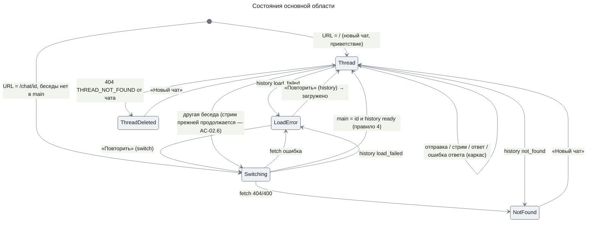

**Invariants**

1. Беседа, сообщения, заголовки, `isRunning` и текущая беседа существуют только в рантайме assistant-ui; `ShellStatus` их не дублирует.
2. Адрес — единственный вход для выбора беседы (controlled `threadId`); рантайм пишет в адрес только устоявшийся remote id.
3. Беседа создаётся на сервере только при первой отправке (`initialize`); «Новый чат» сетевых запросов не делает.
4. В тело чата не уходит клиентский id: `body.id` — `remoteId` из `POST /api/threads`.
5. Основная область никогда не показывает приветствие для `/chat/<id>`, пока беседа не разрешена и её сообщения не попали в тред рантайма: в `switching` или пока тело грузится, видны скелетон и композер без отправки.
6. Ответы API используются только после zod-валидации; невалидный ответ — состояние ошибки, а не исключение в рендере.
7. Заголовок беседы рендерится как текст React и никогда — через `dangerouslySetInnerHTML`.
8. Элемент списка не перемещается при переименовании и приходе автозаголовка до перезагрузки списка.

### State × Display Matrix

| Component | default | loading | empty | error | partial |
|---|---|---|---|---|---|
| ThreadHistoryList (SB-04/09) | Группы с заголовками `h2` + `ul` | 1 полоса + 7 строк-скелетонов, `role="status"` «Загружаем беседы…» (`threads.isLoading`) | «Пока нет бесед» / «Начните новый чат — он появится здесь.» | «Не удалось загрузить беседы» + «Повторить» → `threads.reload()` (`threads.loadError`, в т. ч. невалидный ответ AC-01.7) | SB-10 «Показать ещё» (`hasMore`) |
| SB-10 «Показать ещё» | Кнопка `ghost sm` | 3 строки-скелетона, `role="status"` «Загружаем ещё беседы…» (`isLoadingMore`) | N/A — при `hasMore=false` не рендерится | «Не удалось загрузить ещё беседы» + «Повторить» → `loadMore()` (`loadMoreFailed`) | — это и есть partial |
| ThreadHistoryItem (SB-06) | Название, «⋯» по hover/фокусу | N/A — существует только с данными | N/A | Операции: откат + TST-01 | Title pending: «Новая беседа» + `ShimmerLabel` при `isRunning \|\| titleWaiting` |
| ChatHeader HD-03 | Название | Скелетон 160×16 (`switching` или метаданные беседы ещё не получены) | `/`: sr-only «Новый чат» | TH-06/07: пустой `h1` (`empty`), без скелетона и `aria-busy` | Title pending: «Новая беседа» + мерцание |
| MainView | `Thread` (лента; на пустой — приветствие и подсказки) | `switching`, а на `/chat/<id>` и пока сообщения ещё не в треде (`thread.isLoading`, лента пуста) → `Thread` с `historyPending`: `ThreadHistorySkeleton` вместо ленты, композер TH-04 виден, «Отправить» недоступна до загрузки; скелетон проявляется с задержкой 150 мс | Приветствие TH-02 + TH-03 | TH-06 (`not-found`), TH-07 (`load-error`); E-8 — слот `DeletedNotice` на месте TH-08, композер скрыт; TH-08 — `MessageError` | Прерванный стрим — как в каркасе |
| UserMenu (SB-11) | Аватар «DU», «dev-user», шеврон | N/A — пользователь известен сразу | N/A | N/A | N/A |
| WorkspacePanel | Плейсхолдер | N/A | Плейсхолдер = empty | N/A | N/A |
| DeleteThreadDialog | Заголовок, текст с названием, кнопки | N/A — оптимистичное удаление | N/A | После закрытия: TST-01 + возврат элемента | Вариант A-4 при `isRunning` |

### Action bar и ошибки в ленте

Состав действий над сообщением задают UXRD D-13 и TH-10 (только «Копировать», в том числе у сообщения пользователя, и её видимость), D-14 и TH-08 (перегенерация из блока ошибки) и D-15 (фиксированный текст ошибки инструмента). Все правки — в существующих компонентах `thread.aui.tsx` и `tool-fallback.aui.tsx`; новых компонентов и props нет.

| Компонент (`thread.aui.tsx`, если не указано) | Изменение | AC / UXRD |
|---|---|---|
| `AssistantActionBar` | Остаётся `ActionBarPrimitive.Copy` (подпись «Копировать») и условные кнопки отзыва каркаса (`capabilities.feedback` = false — не рендерятся); удаляются `ActionBarPrimitive.Reload`, `ActionBarMorePrimitive` и `ActionBarPrimitive.ExportMarkdown`; `autohide="not-last"` и `hideWhenRunning` снимаются (видимость — правило ниже); action bar не рендерится только у ответа в прогоне (`AuiIf` по `s.message.status?.type === 'running'`); «Копировать» рендерится только при видимом тексте ответа | AC-08.6; D-13, TH-10 |
| `UserActionBar` | `ActionBarPrimitive.Edit` заменяется на `ActionBarPrimitive.Copy` с той же иконкой ⧉/✓ и подписью «Копировать»; `hideWhenRunning` и `autohide="not-last"` снимаются; сообщение пользователя не бывает в прогоне, поэтому во время стрима его action bar не скрывается | AC-08.6; D-13, TH-10 |
| `AssistantMessage` | Ответ без частей и не в прогоне не рендерит строку (текст и подвал с action bar); у заглушки ответа с ошибкой остаётся только блок ошибки под сообщением пользователя | AC-08.6; TH-10, TH-08 |
| `BranchPicker` | Компонент и оба места вызова (`AssistantMessage`, `UserMessage`) удаляются | AC-08.6; D-13 |
| `EditComposer` и ветка `isEditing` в `ThreadMessage` | Удаляются: без `ActionBarPrimitive.Edit` режим правки недостижим | AC-08.6 |
| `MessageError` | При заданном слоте `DeletedNotice` (статус беседы `deleted` после 404 `THREAD_NOT_FOUND`) рендерит слот вместо блока TH-08; иначе фиксированный текст вместо `ErrorPrimitive.Message`; при включённом флаге `regenerateAfterError` внутри блока — текстовая кнопка «Перегенерировать» (`ActionBarPrimitive.Reload`) у последнего сообщения (`AuiIf` по `s.message.isLast`) | AC-08.5, AC-08.5a, AC-08.5d, AC-08.5e; D-14, TH-08, TH-08 Rollback, E-8 |
| `ToolFallbackImpl` (`tool-fallback.aui.tsx`) | Читает `isError` части: при `true` триггер и `ToolFallbackError` получают статус ошибки (`incomplete`, причина `error`) вместо `complete`, `ToolFallbackResult` не рендерится | AC-14.5; D-15 |
| `ToolFallbackError` (`tool-fallback.aui.tsx`) | Для статуса `incomplete` с причиной, отличной от `cancelled`, — «Ошибка:» и «Не удалось выполнить инструмент.» независимо от `status.error` (в том числе пустого или отсутствующего); отмена (`cancelled`) — прежний вывод причины под «Причина отмены:» | AC-14.5; D-15 |

`SpokenActionBar` (озвучивание) — вне объёма: в оболочке недостижим. Кнопки отзыва не рендерятся (`capabilities.feedback` = false), их тултипы всё равно переводятся: «Полезный ответ» / «Неполезный ответ».

**«Копировать» (оба action bar).** Доступное имя — «Копировать» (`tooltip` у `TooltipIconButton`). Рядом с кнопкой постоянно смонтирован визуально скрытый `role="status"`, в который при `s.message.isCopied` попадает «Скопировано»: живая область существует до изменения текста, поэтому скринридер объявляет его надёжно. Порядок Tab внутри реплики не меняется: содержимое → «Перегенерировать» (если есть) → «Копировать» (UXRD, Accessibility → «Клавиатура»).

**Видимость action bar (UXRD TH-10, «Клавиатура / грубый указатель»).** Автоскрытие каркаса не подходит: `ActionBarRoot` при `autohide="not-last"` возвращает `null` у не последнего сообщения без наведения, а наведение `MessageRoot` отслеживает только событиями мыши — «Копировать» у прежних сообщений не попадала бы в порядок Tab. Поэтому оба action bar рендерятся всегда (без `autohide` и без `hideWhenRunning`) и скрываются только визуально — прозрачностью, которая не убирает кнопку ни из порядка Tab, ни из дерева доступности (`display: none` и `visibility: hidden` запрещены).

| Условие | Видимость action bar |
|---|---|
| Последнее видимое сообщение (KD-2) | Видна всегда |
| Не последнее, точный указатель | Проявляется при `:hover` реплики и при `:focus-within` (фокус внутри реплики, в том числе на самой кнопке) |
| Грубый указатель (`pointer: coarse`) | Видна всегда у каждого сообщения, как «⋯» в сайдбаре |
| Идёт прогон: ответ, который сейчас генерируется (`s.message.status?.type === 'running'`) | Не рендерится у этого ответа; прежние сообщения — по строкам выше |

**Прогон скрывает только своё сообщение (UXRD TH-10 «Streaming», AC-08.6).** Флаг каркаса `hideWhenRunning` не используется: в `@assistant-ui/react` 0.15.32 `useActionBarFloatStatus` скрывает action bar при `s.thread.isRunning`, то есть у каждого сообщения беседы, пока идёт стрим. С ним «Копировать» прежних сообщений пропадала бы с экрана и из порядка Tab на всё время ответа. Поэтому action bar ответа обёрнут в `AuiIf` по статусу самого сообщения `running`, а у сообщения пользователя, которое не бывает в прогоне, условия нет.

**Пустые ответы (UXRD TH-10, TH-08 Restored).** «Копировать» обёрнута в `AuiIf`: она рендерится, только если среди частей ответа есть текстовая часть с непробельными символами — без неё кнопки нет вовсе, а не неактивная; ответ только с инструментом или только с рассуждением рендерится обычно, без «Копировать». Ответ без единой части, не находящийся в прогоне, не рендерит строку — ни текстового контейнера, ни подвала с action bar; это касается и заглушки, которую рантайм добавляет при ошибке до первого токена (`createErrorAssistantMessage`: пустое содержимое, статус ошибки): от неё остаётся только блок ошибки или уведомление «Беседа удалена» под сообщением пользователя. После F5 сервер отдаёт частичный текст упавшего ответа (подтверждённый исход `threads-api`, контракт п. 6); правила для пустого сообщения и для отсутствующего ответа остаются защитными случаями.

**«Перегенерировать» в блоке ошибки.**
- Блок: рамка и иконка ⚠ — `--destructive`, фиксированный текст (вариант — по выключателю `regenerateAfterError`, таблица ниже) — `text-foreground` в обеих темах (UXRD, Accessibility → «Контраст»); текст сервера или модели не выводится никогда.
- Корень блока помечен `data-slot="message-error"`; текст ошибки — элемент с `role="alert"` и `id` из `useId()`; кнопка — `Button variant="outline" size="sm"` через `render` у `ActionBarPrimitive.Reload`, класс `pressable`, высота 44 px при грубом указателе (`pointer-coarse:h-11`), `aria-describedby` → `id` текста ошибки. Видимая подпись = доступное имя.
- Клик, Enter или Space вызывают перегенерацию рантайма AI SDK (`chatHelpers.regenerate`, `@assistant-ui/ai-sdk/dist/runtime/useAISDKRuntime.js:648`): запрос чата с `trigger: 'regenerate-message'`. Скрытые пары, которые другая вкладка записала после упавшего ответа, сервер удаляет вместе с хвостом (`design-threads-api.md`, KD-8); в хранилище этой вкладки за ответом с блоком ошибки пар нет. Блок и кнопка исчезают вместе с упавшим ответом; фокус переносится тем же правилом указателя, что `focusAfterNewChat` (композер или `h1` шапки), чтобы не остаться на `body`.
- **Только последний ответ.** Ошибка рантайма AI SDK — состояние всего чата (`chat.error`), а не сообщения: рантайм показывает её как статус ошибки только у последнего сообщения и сбрасывает при следующей отправке. Поэтому после нового сообщения пользователя упавший ответ теряет блок ошибки целиком, вместе с кнопкой, и выглядит как в восстановленной беседе — только частичный текст, если он был (UXRD TH-08 «Not last»). Пока рантайм занят, `ActionBarPrimitive.Reload` выключен.
- **Возврат в беседу в той же вкладке.** В клиентском режиме `useRemoteThreadListRuntime` (`backgroundThreads`) тело каждой посещённой беседы остаётся смонтированным до удаления беседы (`@assistant-ui/core` `react/client/RemoteThreadList.js:1458-1460`; отсоединение тела — только `detach`, оболочка его не вызывает), а с ним — экземпляр чата AI SDK и его `chat.error`. Поэтому при возврате, пока упавший ответ последний, блок ошибки с «Перегенерировать» снова виден — как у стрима, продолжающегося в фоне (UXRD A-1). После F5 беседа показывается как восстановленная (ниже). Вывод сделан по чтению кода; L1-10 подтверждает его в браузере, а расхождение фиксируется заметкой UX-владельцу.
- **Восстановленная беседа.** Ошибка стрима не сохраняется в истории: у сообщения из `GET /api/threads/:id/messages` нет статуса ошибки, поэтому `MessagePrimitive.Error` не рендерит блок. Ответ с ошибкой, который не перегенерировали, после F5 показывает только сохранённый частичный текст — без блока и без кнопки (сервер сохраняет частичный ответ, контракт п. 6); частей ошибки модели в истории нет — сервер удаляет их при чтении (раздел AC-14.5); путь восстановления — новое сообщение (UXRD TH-08 «Restored»). Ответ без единой части не рендерится строкой (правило «Пустые ответы»).
- **Кнопка поставляется; флаг — дремлющий аварийный выключатель.** Константа `regenerateAfterError` в `lib/config.ts` поставляется со значением `true`: AC-14.6 безусловен, потому что `threads-api` отбрасывает упавший хвост на сервере перед перегенерацией. Значение `false` — откат действия одной строкой без правки компонентов, если гарантия AC-14.6 сломается в эксплуатации; ветка остаётся покрытой тестом (AC-08.5d). `MessageError` читает только эту константу, поэтому текст и кнопка меняются вместе.

| `regenerateAfterError` | Текст блока | Кнопка «Перегенерировать» | `aria-describedby` |
|---|---|---|---|
| `true` (поставка) | «Не удалось получить ответ. Попробуйте перегенерировать.» | Есть у последнего ответа | У кнопки → `id` текста |
| `false` (аварийный откат, UXRD TH-08 Rollback) | «Не удалось получить ответ.» | Нет | Нет — нет кнопки |

**Ошибка инструмента.** При закреплённых версиях упавший инструмент приходит в ленту не как `incomplete`: конвертер `@assistant-ui/ai-sdk` 0.0.16 превращает часть в состоянии `output-error` в завершённую часть с `isError: true` и результатом `{ error: errorText }` (`converters/convertMessage.js:266-268`), а `@assistant-ui/core` даёт части с результатом статус `complete` (`utils/normalizePartStatus.js:39-41`). Без правки `ToolFallbackError` (он реагирует только на `incomplete`) не рендерится, а `ToolFallbackResult` показывает `{"error": …}` под «Result:». Поэтому ветвление — в `ToolFallbackImpl` по `isError` (таблица выше): «Ошибка:» и «Не удалось выполнить инструмент.», подпись триггера неудавшегося инструмента, без раздела результата; прежняя ветка `incomplete` (обрыв ответа во время вызова) и отмена сохраняются. Один и тот же путь работает для живого стрима и для истории (сервер маскирует `errorText`, контракт п. 6); отказ одобрения (`output-denied`) конвертер тоже помечает `isError` и показывается тем же текстом; блок не объявляется как `alert`.

### Тема, шрифт, токены

- **Тема.** `ThemeProvider` из `components/theme-provider.tsx` (`'use client'` обёртка `NextThemesProvider`, next-themes 0.4.6) в `RootLayout`: `attribute="class"`, `defaultTheme="system"`, `enableSystem`, `enableColorScheme` (нативные элементы и полосы прокрутки следуют теме — TM-01), `disableTransitionOnChange` (смена без анимации цвета). `scriptProps` задаёт только обёртка — приём `InlineScript` из документации Next (`preventing-flash-before-hydration.md`, «Understanding suppressHydrationWarning»): в HTML сервера `type="text/javascript"` (скрипт исполняется при разборе, до первой отрисовки), при клиентском рендере `type="text/plain"` (React не предупреждает о `<script>`). Выражение `typeof window` должно вычисляться в клиентском модуле: в серверном `RootLayout` оно всегда `'undefined'`, и клиент получил бы из RSC-пэйлоада `text/javascript` — предупреждение осталось бы. Расхождение атрибута `type` при гидратации принимается, потому что next-themes 0.4.6 рендерит свой `<script>` с `suppressHydrationWarning` (проверено по опубликованному `dist/index.mjs`: `createElement("script", { ...scriptProps, suppressHydrationWarning: true, … })`). Критерий L1-8: в консоли dev-сборки нет предупреждений о `<script>` и о гидратации. `<html lang="ru" suppressHydrationWarning>`. Тема хранится в `localStorage` (корневой layout не читает cookies → остаётся статическим). Скрипт next-themes в начале `<body>` (место `ThemeProvider` — первый дочерний элемент `<body>`) ставит класс до отрисовки последующего содержимого (AC-09.2); в dev Strict Mode next-themes повторно применяет класс эффектом — проверка FOUC только на production-сборке (UXRD, Flow 6, «Без вспышки»).
- **theme-color.** Inline-скрипт в `<head>` (как ai-chatbot): `<meta name="theme-color">` синхронизируется с вычисленным `--background` по `MutationObserver` на `html.class`.
- **Сайдбар без «прыжка».** cookie `sidebar_state` (пишет shadcn при пользовательском переключении) читается сервером в layout группы → `SidebarProvider defaultOpen` — первый кадр уже в нужном состоянии (AC-21.1); временное сворачивание (рабочая область) — `setOpen(false, { persist: false })`.
- **Мобильный первый кадр.** Десктоп-контейнер сайдбара — `hidden md:block` (shadcn); кнопки шапки различаются CSS-брейкпоинтами, поэтому до гидратации на 375 px нет десктопной раскладки.
- **Шторка: закрытие свайпом (UXRD, Responsive Behavior → «Особенности мобильного», Flow «Мобильная шторка»).** Шторка shadcn построена на base-ui `Dialog` (через `sheet`), у которого нет жестов. base-ui 1.9.0 содержит `Drawer` с `swipeDirection` (`@base-ui/react/drawer`, причина закрытия `swipe`) и теми же гарантиями модальности (ловушка фокуса, `role="dialog"`, Esc, затемнение). Решение: в мобильной ветке скопированного `ui/sidebar.tsx` `Sheet` заменяется на `Drawer.Root swipeDirection="left"` с теми же классами панели (288 px, `max-w-[85vw]`); открытие свайпом от края не добавляется (UXRD, Responsive Behavior → «Особенности мобильного»); `ui/sheet.tsx` после замены не используется и удаляется. Порог срабатывания — библиотечный, не обязательно 30 % ширины UXRD — заметка UX-владельцу (Open Questions, п. 4). Certainty: medium → S-11; запасной путь — `Sheet` + обработчик `pointerdown/pointerup` на панели: смещение влево ≥ 30 % ширины → `setOpenMobile(false)`.
- **Переход через 768 px при открытой шторке** (UXRD, Responsive Behavior): `ChatShell` в эффекте по `isMobile` закрывает шторку `setOpenMobile(false)` при переходе на ≥ 768 px; встроенный сайдбар показывается в сохранённом состоянии (cookie). Без этого `openMobile` оставался бы `true` и шторка открылась бы сама при обратном сужении.
- **Безопасная зона и виртуальная клавиатура** (UXRD, Responsive Behavior → «Особенности мобильного»): `export const viewport` в `app/layout.tsx` — `viewportFit: 'cover'`, `interactiveWidget: 'resizes-content'` (раскладка ужимается над клавиатурой, поле ввода остаётся видимым); корень оболочки — `h-dvh` (динамический вьюпорт вместо `100vh`); подвал композера — `pb-[max(1rem,env(safe-area-inset-bottom))]`; шапка шторки — `pt-[env(safe-area-inset-top)]`.
- **Шрифт (UXQ-3 — решение).** `Geist({ variable: '--font-geist-sans', subsets: ['latin', 'cyrillic'] })`, `Geist_Mono({ variable: '--font-geist-mono', subsets: ['latin', 'cyrillic'] })`; `@theme inline { --font-sans: var(--font-geist-sans); --font-heading: var(--font-geist-sans); }`. Проверка — L1-8.
- **Токены** (`globals.css`): светлые `--ring`, `--sidebar-ring` → `oklch(0.556 0 0)`; `* { @apply border-border outline-ring; }`; `--destructive-foreground` (светлая `oklch(0.985 0 0)`, тёмная `oklch(0.145 0 0)` = `--background`) + `--color-destructive-foreground`; размеры `--thread-max-width: 48rem`, `--header-height: 3.5rem`; движение `--ease-panel: cubic-bezier(0.32, 0.72, 0, 1)`, `--ease-out: cubic-bezier(0.23, 1, 0.32, 1)`, `--duration-fast: 150ms`, `--duration-panel: 200ms`. Ширины сайдбара — константы shadcn (`16rem / 3rem / 18rem`) совпадают с UXRD, Design System → «Размеры оболочки»; мобильная — `18rem` с `max-w-[85vw]`.
- **Кольцо фокуса.** `ui/button.tsx`: `focus-visible:ring-3 focus-visible:ring-ring` (непрозрачное); строки списка — `ring-inset`; меню «Удалить» в подсветке — `data-highlighted:bg-destructive data-highlighted:text-destructive-foreground`.
- **Текст на `--sidebar-accent` (UXRD, Accessibility → «Контраст»).** Строка SB-06 в hover, active (`data-active`, `aria-current="page"`) и при открытом меню «⋯» — только `text-sidebar-accent-foreground` для всего текста (название и «Новая беседа»); `text-muted-foreground` на подсвеченной строке запрещён (4,34:1 в светлой — Fail). `--muted-foreground` остаётся для заголовков групп на `--sidebar` (4,53:1) и иконки «⋯» вне подсветки (нетекстовый элемент, ≥ 3:1). Проверка — L1-8.

### Доступность — реализация

**Политика фокуса (`lib/focus.ts`)** — правило указателя PRD AC-03.1 / UXRD, Accessibility → «Порядок фокуса»:

```typescript
export const isFinePointer = (): boolean => window.matchMedia('(pointer: fine)').matches;

export type FocusTarget = 'composer' | 'page-title';

/** Focuses after the next paint so the target of the new view exists. */
export function focusShellTarget(target: FocusTarget): void;
// 'composer' → [data-shell-focus="composer"] (ComposerPrimitive.Input), 'page-title' → [data-shell-focus="page-title"] (h1, tabIndex -1)

export const focusAfterNewChat = (): void => focusShellTarget(isFinePointer() ? 'composer' : 'page-title');
```

| Событие (UXRD, Accessibility → «Порядок фокуса») | Реализация |
|---|---|
| «Новый чат» (кнопка/сочетание/HD-05/шторка) | `focusAfterNewChat()` после перехода; из шторки её `finalFocus` возвращает `false` |
| Открытие беседы кликом, точный указатель | `onClick` ссылки: `event.detail > 0 && isFinePointer()` → `focusShellTarget('composer')` |
| Открытие касанием / из шторки | `focusShellTarget('page-title')`; шторка закрывается `setOpenMobile(false)`, её `finalFocus` возвращает `false` — фокус остаётся за действием |
| Шторка закрыта без действия (Esc, «×», затемнение, свайп) | `finalFocus` шторки → кнопка «Меню» (`MENU_BUTTON_ATTRIBUTE`) |
| Enter на ссылке (встроенный сайдбар) | `event.detail === 0` → фокус не трогается |
| Холодная загрузка `/` | `focusAfterNewChat()` только при точном указателе; `/chat/<id>` — не трогается |
| TH-06/TH-07 появились | `h1` экрана (`useEffect` при монтировании) |
| Удаление открытой | `focusAfterNewChat()`, когда маршрут стал `/` |
| Удаление не открытой | следующая ссылка списка; нет — предыдущая; нет — SB-03 (вычисляется до удаления) |
| Сохранение/отмена переименования | ссылка этой беседы |
| Закрытие меню / «Отмена» диалога | вызвавший элемент (`finalFocus` = «⋯») |
| Закрытие рабочей области | HD-04 |
| «Перегенерировать» в блоке ошибки нажата (кнопка исчезает) | правило указателя `focusAfterNewChat`: композер или `h1` шапки |

**Клавиатура (`lib/keyboard-shortcuts.ts`).**
- `isShortcutBlocked(event)`: `true`, если `event.target` внутри `[data-shortcuts-blocked]` (SB-08), или открыт модальный слой (`[role="alertdialog"]`, `[role="menu"]`, `[role="dialog"][aria-modal="true"]`) — для `Ctrl/⌘+B` исключение: открытая шторка закрывается.
- `Ctrl/⌘+Shift+O` (`event.code === 'KeyO'`, чтобы раскладка не мешала) → `preventDefault()` + новый чат; `Ctrl/⌘+B` — обработчик скопированного `sidebar.tsx` с той же охраной. Символ в тултипах — `navigator.platform`/`userAgentData` → «⌘» на macOS, иначе «Ctrl».
- ↑/↓/Home/End (AC-22.2): `onKeyDown` контейнера списка; если `event.target` — `a[data-thread-link]`, фокус на соседнюю/первую/последнюю ссылку в DOM-порядке (через границы групп), `preventDefault()`. Tab-порядок не меняется (ссылка → «⋯» → следующая ссылка, UXRD, Accessibility → «Клавиатура»).

**ARIA** — по таблице UXRD, Accessibility → «Роли и имена»: `nav aria-label="История бесед"`; SB-09 Loading — `role="status"`, SB-09 Error и SB-10 Error — текст ошибки в `role="alert"` (объявляется при появлении), кнопка «Повторить» — вне `alert`; группы — `h2` (через `render` у `SidebarGroupLabel`) + `ul`; ссылки — `aria-current="page"` у активной; «⋯» — `aria-label="Действия с беседой «{название}»"`, `aria-haspopup="menu"`; SB-08 — `input aria-label="Название беседы" maxLength={200} aria-invalid aria-describedby`; HD-02 десктоп — `aria-label="Боковая панель" aria-expanded aria-controls aria-keyshortcuts="Control+B Meta+B"`; HD-02 мобильный — `aria-label="Меню" aria-haspopup="dialog"`; SB-03/HD-05 — `aria-keyshortcuts="Control+Shift+O Meta+Shift+O"`; шторка — `role="dialog" aria-modal="true" aria-label="История бесед"`; DLG-01 — `alertdialog` с `aria-describedby`; WS-01 — `aside`; WS-02 — `separator` библиотеки (`aria-value*` в % основной области) с `aria-label`; skip link «Перейти к сообщению» — первый в Tab, видим при фокусе; SB-11 — `aria-label="Меню пользователя dev-user"`, `Avatar` с инициалами — `aria-hidden`; поле композера — `textarea name="message"`.

Остаётся известное незачётное замечание axe `label-content-name-mismatch` у SB-11: axe считает видимым текстом инициалы «DU», хотя аватар скрыт от дерева доступности.

**Reduced motion.** Все переходы — `motion-reduce:transition-none`/`motion-reduce:animate-none`; `ShimmerLabel` уже учитывает; вставка/удаление элементов списка — CSS `@starting-style` с отключением при `prefers-reduced-motion`.

### Локализация

Все строки UXRD (Content and Microcopy) — на русском. Дополнительно найденное (fact `i18n:scaffold-strings`), не перечисленное в UXRD (Content and Microcopy):

| Файл | Сейчас | Должно быть |
|---|---|---|
| `reasoning.tsx:181,203` | `Reasoning (Ns)` | `Рассуждения (N с)` |
| `tool-group.aui.tsx:104` | `N tool call(s)` | `pluralRu(N, ['вызов инструмента', 'вызова инструментов', 'вызовов инструментов'])` (`Intl.PluralRules('ru-RU')`) |
| `tool-fallback.aui.tsx` (:160, :166, :343-350, :411-412, :432, :437, :659-660, :980-982) | `Reply queued, not sent yet`, `Cancelled tool`/`Failed tool`, `Approved by user`, `Allow`/`Always allow`/`Deny`/`Always deny`, `Answered`/`Allowed`/`Dismissed`/`Denied`, `Error:`/`Cancelled reason:` и др. | Русские эквиваленты (перечень — в задаче плана; правило: каждая строка, которую видит или озвучивает пользователь); `Error:` → «Ошибка:», `Cancelled reason:` → «Причина отмены:», текст под «Ошибка:» — фиксированный (D-15) |
| `thread.aui.tsx` action bar | `Refresh`, `More`, `Export as Markdown`, `Edit`, `Cancel`/`Update`, `Previous`/`Next` | Не переводятся — элементы удалены (D-13); `Copy` → «Копировать» у обоих action bar |
| `markdown-text.tsx:88` | `Copy` | `Копировать` |
| `ui/dialog.tsx:75,113-114` | `Close` | `Закрыть` |
| `image.tsx`, `file.tsx`, `media-player.tsx` | aria-строки (`Text file`, `Unnamed file`, `Seek`, …) | Русские эквиваленты |
| `layout.tsx:18` | `description: 'Agent OS workspace'` | `Рабочее пространство Agent OS` |
| `ui/sidebar.tsx` (после `shadcn add`) | `Toggle Sidebar` | `Боковая панель` |

Контроль: тест `i18n.test.tsx` ищет в отрендеренных ключевых экранах (новый чат, беседа с инструментом из фикстуры, меню) латинские слова — в видимом тексте и в озвучиваемых атрибутах (`aria-label`, `title`, `placeholder`, `alt`, `aria-valuetext`). Список — стоп-слова (`Send`, `Copy`, `Close`, `Toggle`, `Loading`, `Reasoning`, `tool call`) и дополнительные слова каркаса (`Stop`, `Scroll`, `Assistant`, `Resume`, `Play`, `Pause`, `Seek`, `Download`, `Preview`, `Image`, `Audio`, `Unnamed`, `attachment`).

### Правки скопированных shadcn-компонентов

После `shadcn add` (до остальных правок, чтобы CLI не перезаписал изменения): `ui/sidebar.tsx` — русские `aria-label`/`title`/sr-only; `setOpen(value, options?: { persist?: boolean })`; глобальный `Ctrl/⌘+B` через `isShortcutBlocked`; `transition-[width,left,right]` с `ease-(--ease-panel) duration-(--duration-panel) motion-reduce:transition-none`. `ui/dropdown-menu.tsx` — без изменений API; цвет пункта «Удалить» задаётся классами на месте вызова. `ui/sonner.tsx` — `position="bottom-right"`, `closeButton`, длительности 4 000 / 6 000 мс на месте вызова.

### Error Handling

| Ситуация | Где обнаруживается | Поведение |
|---|---|---|
| Первая страница: сеть/5xx/невалидно | адаптер `list` → `threads.loadError` | SB-09 Error + «Повторить» → `threads.reload()`; композер и «Новый чат» работают |
| Следующая страница | адаптер `list({after})` | `loadMoreFailed` → SB-10 Error + «Повторить»; загруженное остаётся |
| Беседа по URL не найдена | `fetch` 404/400 → `switchError` | TH-06, фокус на `h1`; вкладка «Беседа не найдена — Agent OS» |
| Беседа по URL: прочая ошибка | `switchError` | TH-07 + «Повторить» (`switchToThread(id)`) + «Новый чат»; библиотека сама повторяет при `online`/видимости |
| История: 404 | адаптер истории | TH-06 |
| История: невалидно/5xx/сеть | адаптер истории → `load_failed` | TH-07; «Повторить» → `retryHistory(remoteId)` |
| Отправка в удалённую беседу | `onError` чата: `APICallError` 404 + `THREAD_NOT_FOUND` | статус `deleted` → «Беседа удалена» на месте блока ошибки под сообщением пользователя, композер скрыт, лента видна (E-8) |
| Ошибка модели / сети в стриме | каркас (`MessageError`) | «Не удалось получить ответ. Попробуйте перегенерировать.» и «Перегенерировать» у последнего ответа (при аварийном откате — только «Не удалось получить ответ.»); после нового сообщения и после F5 — частичный текст без блока |
| Ошибка инструмента (стрим или история) | `ToolFallbackImpl` по `isError`, `ToolFallbackError` | «Ошибка:» + «Не удалось выполнить инструмент.»; ни `errorText`, ни раздел результата не выводятся |
| Ошибка создания беседы | `initialize` | ошибка у реплики (TH-08); URL остаётся `/` |
| Переименование/удаление | адаптер | откат библиотеки + TST-01 |
| Беседа удалена во время ответа (эта вкладка, фон, другая вкладка) | стрим заканчивается чанком `abort` без `error` | как отмена: частичный текст без блока ошибки и без «Перегенерировать» |
| Отмена прогона перед удалением не завершилась за 2 с или рантайм фонового тела недоступен | `deleteThread` | `console.warn`, удаление продолжается; сервер прерывает прогон сам |
| Ошибка рендера оболочки: `ChatShell` и всё под ним, серверная часть `(chat)/layout` (`cookies()`) | `app/error.tsx` — граница корневого сегмента | «Что-то пошло не так» + «Обновить страницу» (перезагрузка) в теме приложения; без текста и стека ошибки; `console.error` только с `digest` |
| Ошибка рендера корневого `app/layout.tsx` | встроенный `global-error` Next | стандартная страница Next по теме ОС; свой `global-error.tsx` не вводится |
| `NEXT_PUBLIC_API_URL` не задан, не абсолютный `http(s)` URL или в production — `http` не на loopback | `lib/config.ts` при загрузке модуля (`z.url`, проверка протокола при `NODE_ENV=production`) | `next build` падает на пререндере корневого layout (импорт `apiBaseUrl` для `preconnect`); в dev — ошибка при первом рендере (fail fast) |
| Ссылка из ответа модели с опасной схемой (`javascript:`, `data:`, `vbscript:` …) | `linkPolicy` (`safeHref`) | текст ссылки без `href` (`span`), не фокусируется и не кликается; не ошибка |
| Изображение из ответа модели не по `https` | `isRenderableImageSrc` | запроса нет; ссылка «Изображение: …» (если `safeHref` пропускает) или заглушка «[Изображение недоступно]» |

Фоллбэков, подменяющих данные значением по умолчанию, нет: каждая ошибка либо отображается состоянием, либо пробрасывается. Единственное ожидание без исключения — `RetryGate` истории (ждёт явного «Повторить», состояние видно как TH-07).

#### Граница ошибок оболочки

Граница ошибок Next (`error.tsx`) оборачивает страницы и вложенные layout-ы своего сегмента, но не `layout.tsx` того же сегмента. Поэтому граница стоит в корневом сегменте — `app/error.tsx`: она внутри корневого `app/layout.tsx` (тема, шрифты, `globals.css` действуют) и снаружи `(chat)/layout.tsx`, то есть ловит ошибки рендера `ChatShell` и серверной части layout-а группы. `app/(chat)/error.tsx` удаляется: страницы группы возвращают `null`, и вторая граница с тем же UI ничего не добавляет. Компонент, тексты и лог переносятся без изменений: без текста и стека ошибки на экране, `console.error` только с `digest`.

| Вариант | Почему не выбран |
|---|---|
| `app/global-error.tsx` | заменяет корневой layout: свои `<html>`/`<body>`, без глобальных стилей и темы; нужен только для ошибок корневого layout-а |
| граница внутри `ChatShell` (`catchError` из `next/error`) | новый компонент-обёртка; не ловит серверную часть `(chat)/layout` над `ChatShell` |
| оставить `app/(chat)/error.tsx` | не ловит ошибку самого `ChatShell` |

Проверка: при ошибке рендера в `ChatShell` пользователь видит «Что-то пошло не так» и «Обновить страницу» в текущей теме, в консоли — запись с `digest`, без стека на странице; нажатие перезагружает страницу.

### Logging and Monitoring

- Клиентские логи — `console.error`/`console.warn` без текста сообщений, заголовков и тел ответов. Классификацию ошибки даёт `describeThreadsError(error)` → `{ kind, status }` (`lib/threads/threads-api-error.ts`; не `ThreadsApiError` → `kind: 'unknown'`).
- Контекст записи: загрузка истории, переименование и удаление — `{ remoteId, kind, status }`; страница списка — `{ nextPage, kind, status }`; сбой опроса заголовка — `console.warn` с `{ remoteId, kind, status }`; неожиданный отказ `deleteThread` в контейнере списка — `{ threadId, kind, status }`. Библиотека дополнительно пишет свои `console.error` (загрузка списка/истории) — не подавляются.
- L1-проверка включает чтение консоли браузера: допустимы только ожидаемые записи сценариев с ошибками (404/500, подставленные намеренно).
- Серверные метрики и аудит — `threads-api`; клиент не шлёт телеметрию.

## Test Strategy

Каждый AC из раздела Acceptance Criteria — минимум один автоматический тест (U/C/I) или L1-сценарий; ожидаемые значения — литералы (подписи групп, тексты состояний, URL, количество запросов). Тесты проверяют наблюдаемое поведение через роли и тексты (`getByRole`, `getByText`), не классы.

### Main Use Cases

L1-сценарии выполняются в реальном браузере через Claude-in-Chrome. Окружение: `pnpm db:up`, `apps/api` на `http://localhost:4000` (dev, `dev-user`, реальная модель), `apps/web` — `pnpm --filter web build && pnpm --filter web start` (FOUC и LCP — только production); вкладка Chrome с открытыми DevTools (консоль, Network). Каждый сценарий фиксирует: скриншот(ы), записи консоли, ключевые запросы Network.

- **L1-1: Десктоп 1440 px, сайдбар развёрнут, новый чат** — covers AC-01.2, AC-03.1, AC-03.3, AC-04.1, AC-07.1, AC-08.1, AC-08.2, AC-11.1, AC-11.2, AC-11.4, AC-20.1, AC-21.1
  - Given: production-сборка против реального API, окно 1440 px, светлая тема, сайдбар развёрнут
  - When: Открыть `/` (светлая тема); проверить раскладку; кликнуть подсказку №1; дождаться ответа; ждать до 15 с; нажать HD-04; сузить окно до 1000 px и вернуть 1440; `Ctrl+B`; F5
  - Then: Колонка 768 px по центру (замер `getBoundingClientRect`), рабочая область скрыта; после отправки: Network — `POST /api/threads` → `POST /api/chat/assistant` (тело `id` = id из первого ответа), нет запроса документа; адресная строка `/chat/<id>`; в сайдбаре «Сегодня» первым — «Новая беседа» с мерцанием, активная (`aria-current="page"`); заголовок сменился ≤ 15 с после конца ответа в сайдбаре, шапке и вкладке; HD-04 → панель 40 %, лента ≥ 480 px при 1280; < 1024 px — кнопки и панели нет, при 1440 панель вернулась; `Ctrl+B` → полоса 48 px, `aria-expanded="false"`; F5 → полоса на первом кадре без анимации
- **L1-2: Переименование и удаление** — covers AC-05.1, AC-05.2, AC-05.3, AC-06.2, AC-06.3
  - Given: в списке несколько бесед, одна из них открыта
  - When: «⋯» → «Переименовать» → «Отчёт Q3» + Enter; повторно → Esc; пусто + Enter; F5; удалить **не открытую** беседу; удалить **открытую**
  - Then: Название в сайдбаре/шапке/вкладке; Esc — без изменений; пусто — «Введите название», запроса `PATCH` нет; после F5 «Отчёт Q3» сохранено; удаление не открытой — URL не изменился, фокус на соседней ссылке, «Беседа удалена»; удаление открытой — URL `/` (Назад не возвращает на удалённую), приветствие
- **L1-3: Мобильный 375 px (эмуляция устройства с тачем)** — covers AC-03.1, AC-10.1, AC-10.2, AC-10.3, AC-10.4
  - Given: эмуляция устройства с тачем, ширина 375 px
  - When: Открыть `/chat/<id>`; «Меню»; выбрать другую беседу; «Меню» → Esc; «Меню» → свайп влево по шторке (эмуляция касания); «Меню» → расширить окно до 800 px, затем сузить до 375 px; «Новый чат» из шапки; беседа с блоком кода 120 символов на 360 px; включить блокировку `GET /api/threads` (DevTools → Network request blocking) и открыть шторку
  - Then: Нет горизонтального скролла (`scrollWidth === clientWidth`); шторка `role="dialog"`, фокус на «Новый чат»; выбор закрывает шторку, фокус на `h1`; Esc → фокус на «Меню»; «Новый чат» — фокус на `h1`, экранная клавиатура не всплывает (композер не в фокусе); скроллится только блок кода; свайп влево закрывает шторку, фокус на «Меню»; при 800 px шторки нет, встроенный сайдбар в сохранённом состоянии, после сужения до 375 px шторка **не** открыта; высота корня оболочки = `window.innerHeight` (`h-dvh`), `<meta name="viewport">` содержит `viewport-fit=cover, interactive-widget=resizes-content`, нижний отступ композера ≥ `env(safe-area-inset-bottom)` (вычисленный стиль); при блокировке списка — «Не удалось загрузить беседы» в элементе с `role="alert"` (дерево доступности)
- **L1-4: Восстановленная беседа и недоверенный markdown** — covers AC-02.1, AC-02.3, AC-02.4, AC-08.3
  - Given: есть беседа с рассуждением, инструментом, таблицей и кодом 80+ строк
  - When: Открыть беседу с рассуждением, инструментом, таблицей и кодом 80+ строк; раскрыть рассуждение; «Копировать» у кода; отправить сообщение; затем отправить «Выведи дословно, без блока кода: [опасная](javascript:alert(1)) [внешняя](https://example.com) [внутренняя](/chat/x)  »; F5
  - Then: Порядок и число сообщений как до перезагрузки; рассуждение свёрнуто/раскрывается; инструмент с результатом; копирование работает; после ответа — `N+2`. Markdown (и в живом ответе, и после F5): «опасная» — не ссылка (`read_page`: нет `link` с этим именем, у элемента нет `href`), клик ничего не делает, диалога `alert` нет; «внешняя» и «внутренняя» — `target="_blank"`, `rel="noopener noreferrer"`, клик открывает новую вкладку, исходная вкладка и её стрим остаются; http-картинка — ссылка «Изображение: картинка», Network без запроса к `example.com/a.png`; https-картинка загружена, в запросе нет заголовка `Referer`
- **L1-5: F5 и Назад/Вперёд** — covers AC-04.2, AC-04.4
  - Given: есть беседы A, B и C
  - When: Открыть A, затем B, затем C кликами; F5 на C; Назад ×2; Вперёд
  - Then: После F5 — та же беседа, выделена (если в первой странице); Назад: B, затем A; Вперёд: B; выделение и шапка синхронны
- **L1-6: Стриминг + переключение** — covers AC-02.6, AC-03.4, AC-08.4
  - Given: есть беседы X и Y
  - When: В X отправить длинный запрос; во время стрима открыть Y; затем «Новый чат»; вернуться в X (до и после завершения)
  - Then: Network: запрос чата X не отменён (статус pending/200, не canceled); в Y и в новом чате ответа X нет; в X — продолжающийся стрим с «Остановить» или полный ответ; после F5 в X ответ сохранён
- **L1-8: Тёмная тема, FOUC, шрифт, контраст** — covers AC-09.1, AC-09.2, AC-09.3
  - Given: production-сборка; для проверки консоли — dev-сборка (`pnpm --filter web dev`)
  - When: Меню пользователя → «Тёмная»; F5 с CPU ×4 (Performance, скриншоты кадров); «Системная» + эмуляция `prefers-color-scheme`; `getComputedStyle(document.body).fontFamily`, `document.fonts.check('14px Geist', 'Жё')`; замер контраста кольца фокуса, кнопки «Удалить» и **текста активной строки SB-06 на `--sidebar-accent`** (вычисленные `color` и `background-color` активной ссылки и строки под курсором) в обеих темах; консоль dev-сборки (`pnpm --filter web dev`) после F5
  - Then: Ни одного кадра светлой темы; «Системная» следует эмуляции; шрифт — Geist для кириллицы; кольцо ≥ 3:1, «Удалить» ≥ 4,5:1, текст активной/подсвеченной строки / `--sidebar-accent` ≥ 4,5:1 в обеих темах; в консоли нет предупреждений о рендере `<script>` и о гидратации
- **L1-9: Клавиатура и reduced motion** — covers AC-22.1, AC-22.2
  - Given: в списке несколько бесед, мышь не используется
  - When: Только клавиатура: skip link, ↑/↓ по списку, Enter, `Ctrl+Shift+O`, `Ctrl+B`, меню «⋯», диалог; эмуляция `prefers-reduced-motion: reduce`
  - Then: Фокус всегда видим; порядок Tab — UXRD, Accessibility → «Клавиатура»; сочетания в тултипах; панели без анимации, мерцание выключено

### Error and Edge Use Cases

- **L1-7: Удалённая и несуществующая беседа** — covers AC-04.3, AC-06.4, AC-08.5e
  - Given: есть беседа, адрес которой скопирован, и вторая вкладка с той же оболочкой
  - When: Скопировать URL беседы, удалить её, открыть URL; открыть `/chat/does-not-exist`; во второй вкладке удалить открытую в первой беседу и отправить в первой сообщение
  - Then: «Беседа не найдена», фокус на `h1`, вкладка «Беседа не найдена — Agent OS»; при отправке — сообщение видно, под ним «Беседа удалена» / «Её удалили в другой вкладке или окне.» и «Новый чат» без «Перегенерировать», композера нет
- **L1-10: Действия над сообщением, ошибка → перегенерация → F5, ошибка инструмента** — covers AC-08.5, AC-08.5a, AC-08.5b, AC-08.5c, AC-08.6, AC-14.5
  - Given: беседа с несколькими обменами; на стенде можно вызвать ошибку провайдера модели или обрыв сети
  - When: В беседе с несколькими обменами пройти ленту только Tab; отправить длинный запрос и, пока ответ генерируется, снова пройти ленту только Tab; затем навести мышь на сообщения пользователя и ответы; эмуляция `pointer: coarse` (устройство с тачем); «Копировать» у сообщения пользователя (скринридер-дерево DevTools Accessibility); вызвать ошибку ответа (временная ошибка провайдера модели на стенде или обрыв сети в DevTools во время стрима); открыть другую беседу и вернуться; Tab до «Перегенерировать», Enter; дождаться ответа; F5; повторить ошибку, затем отправить новое сообщение вместо перегенерации и сделать F5; вызвать инструмент, завершающийся ошибкой, и сделать F5
  - Then: У каждого сообщения только «Копировать», «Изменить», «‹ 1/2 ›», «Ещё» нет, «Скопировано» в `status`; «Копировать» прежних сообщений получает фокус по Tab без наведения и при фокусе видна; во время стрима «Копировать» прежних сообщений остаётся видимой и в порядке Tab, у генерируемого ответа её нет до завершения; при `pointer: coarse` видна у всех сообщений; у ответа без текста «Копировать» нет; после возврата в беседу блок ошибки с «Перегенерировать» снова виден (иначе — заметка UX-владельцу); блок ошибки с текстом цвета `--foreground` и кнопкой внутри, порядок Tab: содержимое → «Перегенерировать» → «Копировать»; Network — `POST /api/chat/assistant`, последний элемент `messages` — то же сообщение пользователя (тот же `id`); новый ответ на месте упавшего, фокус в композере; **после F5 за сообщением пользователя ровно один ответ** (AC-14.6); у неперегенерированного ответа сразу после нового сообщения и после F5 — только частичный текст без блока и кнопки, текста ошибки модели нет; ошибка инструмента — «Ошибка: Не удалось выполнить инструмент.» и в стриме, и после F5

### Non-Functional Use Cases

Замеры ручные, на production-сборке.

- **Восстановленная беседа (метрика № 2)** — covers PRD NFR Performance
  - Given: беседа из 50 сообщений
  - When: открыть её 10 раз с записью Performance
  - Then: последнее сообщение видно не позже 1,5 с
- **LCP беседы** — covers PRD NFR Performance
  - Given: открыта `/chat/<id>`
  - When: 5 прогонов Lighthouse
  - Then: LCP ≤ 2,5 с
- **Сдвиг раскладки панелей** — covers PRD NFR Performance
  - Given: открыта беседа на десктопе
  - When: открыть и закрыть сайдбар и рабочую область
  - Then: CLS ≤ 0,1
- **Первый токен (метрика № 10)** — covers PRD NFR Performance
  - Given: та же модель и тот же запрос до и после изменения
  - When: 5 прогонов первой отправки
  - Then: первый токен без регрессии; добавлен только `POST /api/threads` перед первой отправкой
- **Доступность** — covers PRD NFR Accessibility
  - Given: `/` и `/chat/<id>`, обе темы, десктоп и мобильный
  - When: прогон Lighthouse Accessibility
  - Then: оценка ≥ 95 в каждой из конфигураций

### Автоматические тесты

#### Инструменты и версии (выровнены с `apps/api`)

| Пакет | Версия | Почему |
|---|---|---|
| `vitest` | ^4.1.12 | Та же линия, что `apps/api` (установлен 4.1.12); 5.x требует Node ≥ 22.12/≥ 24 и даёт расхождение версий в монорепо |
| `vite` | ^8.0.0 | Как в `apps/api`; `resolve.tsconfigPaths: true` для `@/*` |
| `@vitejs/plugin-react` | ^6.1.2 | Совместим с Vite 8, Node 24.11 |
| `jsdom` | ^29.1.1 | 30.x требует Node ≥ 24.15 (локально 24.11.0) |
| `@testing-library/react` / `dom` / `jest-dom` / `user-event` | ^16.3.3 / ^10.4.2 / ^7.0.1 / ^14.6.8 | Поддерживают React 19 |
| `msw` | ^2.15.0 | Стабильная линия; 3.x вышел 2026-09-28 |

`vitest.config.ts`: в начале модуля `process.env.TZ = 'Europe/Berlin'` (зона с переходом на летнее время; задаётся до запуска рабочих процессов Vitest, которые наследуют окружение, — зона одинакова во всех тестах и на любой машине CI); `plugins: [react()]`, `resolve: { tsconfigPaths: true }`, `test: { environment: 'jsdom', setupFiles: ['./src/test/setup.ts'], include: ['src/**/*.test.{ts,tsx}'], env: { NEXT_PUBLIC_API_URL: 'http://api.test' } }`. `setup.ts`: `@testing-library/jest-dom/vitest`; полифилы `matchMedia` (управляемый `pointer`), `ResizeObserver`, `IntersectionObserver`, `PointerEvent`, `Element.prototype.scrollIntoView`; MSW `setupServer` с `onUnhandledRequest: 'error'`, сброс обработчиков после каждого теста. Скрипты: `"test": "vitest run"`, `"test:watch": "vitest"`; запуск из корня `pnpm test` (turbo, `^build` собирает `@agent-os/contracts`).

#### Unit Tests (U)

- `group-threads-by-date.test.ts` — AC-01.1 (4 группы из сегодня/вчера/5/40 дней, порядок, без пустых), границы 2/7/8/30/31 день, DST-переходы в `Europe/Berlin` (у `Europe/Moscow` перехода нет — такой тест ничего не проверял бы): 23-часовые сутки 2026-03-29 (`activityAt` = 2026-03-28 23:30, `now` = 2026-03-29 12:00 → «Вчера»; `activityAt` = 2026-03-29 00:30 → «Сегодня») и 25-часовые сутки 2026-10-25 (`activityAt` = 2026-10-24 23:30, `now` = 2026-10-25 23:30 → «Вчера»; 2026-10-18 12:00 → «Предыдущие 7 дней» ровно на границе 7), плюс страж окружения `new Date(2026, 2, 28).getTimezoneOffset() !== new Date(2026, 2, 30).getTimezoneOffset()`, сортировка по `activityAt` с локальным поднятием (D-11), монотонность групп при склейке двух страниц (AC-19.1).
- `resolve-main-view.test.ts` — все ветви таблицы `resolveMainView`, включая правило 4 (AC-02.2): `{ routeThreadId: 'x', mainRemoteId: 'x', historyStatus: undefined }` и `'loading'` → `switching`; `{ routeThreadId: 'x', mainRemoteId: 'x', historyStatus: 'ready' }` → `thread`; `{ routeThreadId: undefined, historyStatus: undefined }` → `thread` (новый чат на `/`). Правило 4 доказывается только этими строками: в F5-случае интеграционного теста его перекрывает страж `MainView`.
- `route-thread-id.test.ts`, `url-sync.test.ts` — `/chat/a%2Fb`, `/`, `/foo`, `/chat/`, `/chat/a/b`, `/chat/%E0` (сырой сегмент); round-trip `parseRouteThreadId(threadPath(id)) === id` для `'abc'`, `'a/b'`, `'с пробелом'`, `'%'`, `'?#&'`, UUID; `replaceState(null, '', threadPath(id))` при новом id, `router.replace('/')` при `undefined`, ничего при `location.pathname === threadPath(id)` (в т. ч. для id с `/`).
- `threads-api-client.test.ts` (MSW) — 200/невалидно → `invalid_response`; 404 и 400 на `:threadId` → `not_found` (Cross-Layer Assumption 7); сеть → `network`; `safeValidateUIMessages`-провал → `invalid_response`; пустой `messages` → `[]` без ошибки (пустая беседа не уходит в TH-07).
- `thread-list-adapter.test.ts` (MSW) — маппинг `ThreadSummary` → метаданные; `initialize` → `history[id] === 'ready'` до возврата `remoteId`; `nextCursor: null` → `undefined`; `loadMoreFailed` ставится/снимается; `DELETE` 404 → успех + `deleted`; `PATCH` 500 → `renameFailed` + отказ.
- `thread-history-adapter.test.ts` (MSW) — цепочка `parentId`/`headId`; 404 → `not_found` + отказ; 500 → `load_failed`, затем `retry` → `ready` и разрешение промиса; 500 → `load_failed`, затем `forget` → промис `load()` отклонён `ThreadsApiError('not_found')`, второго запроса `/messages` нет, статус беседы удалён; не-`ai-sdk/v6` формат → ошибка конфигурации.
- `retry-gate.test.ts` — `release` разрешает ожидание; `drop` отклоняет его `ThreadsApiError` с `kind: 'not_found'`; `release`/`drop` без ожидающего — без ошибок; после `release` повторный `drop` ничего не делает.
- `markdown-policy.test.ts` — `javascript:alert(1)`, ` JAVASCRIPT:…`, `data:text/html,…`, `vbscript:…`, пустая строка → `unsafe`; `https://example.com` и `http://…` → `new-tab`; `/chat/x`, `./a`, `?q` → `new-tab`; `#user-content-fn-1` → `fragment`; `mailto:a@b.c` → `mail`; `isRenderableImageSrc`: `https://…` → `true`, `http://…`, `data:image/png;base64,…`, `/img.png`, `undefined` → `false`.
- `config.test.ts` — `vi.stubEnv` + `vi.resetModules()`: не задан, `'localhost:4000'`, `'ftp://x'` → исключение при импорте; `'http://api.test/'` → `apiBaseUrl === 'http://api.test'`; при `NODE_ENV=production` `http://` на удалённый хост → исключение, `http://localhost`, `http://127.0.0.1`, `http://[::1]` и `https://…` принимаются.
- `title-poller.test.ts` (фейковые таймеры) — без ответа ассистента запросов нет; заголовок на 3-м запросе → поток с текстом, `titleWaiting` снят; окно 15 с → 15 запросов и пустой поток; 404 → остановка.
- `plural-ru.test.ts`, `keyboard-shortcuts.test.ts` (`isShortcutBlocked`), `focus.test.ts` (точный/грубый указатель).

#### Component Tests (C, RTL, без сети)

- `thread-history-list.test.tsx` — **AC-12.1**: Loading (`role="status"` «Загружаем беседы…»), Empty, Error (`getByRole('alert')` содержит «Не удалось загрузить беседы»; клик «Повторить» вызывает `onRetry`), Ready (заголовки групп `h2`, ссылки, `aria-current="page"` у активной); SB-10 Error; ↑/↓/Home/End между группами (AC-22.2).
- `thread-history-item.test.tsx` — переименование: Enter сохраняет обрезанное, Esc отменяет, пусто + Enter → `aria-invalid` и «Введите название» без вызова `onRename`, `maxLength=200`; «Новая беседа» при `title: undefined`; тултип при обрезке.
- `delete-thread-dialog.test.tsx` — `alertdialog`, название в «ёлочках», фокус на «Отмена», вариант A-4.
- `user-menu.test.tsx` — **AC-12.1 (тема)**: внутри `ThemeProvider` выбор «Тёмная» → `document.documentElement.classList.contains('dark')`; «Системная» → класс по `matchMedia('(prefers-color-scheme: dark)')`; нет «Выйти»/«Настройки», есть «dev-user».
- `chat-header.test.tsx` — **AC-12.1 (шапка)**: `text` → `h1` с названием; `pending` → «Новая беседа»; `hidden` → sr-only «Новый чат»; `loading` → скелетон и `aria-busy="true"`; `empty` → пустой `h1` без скелетона, без `aria-busy` и без текста «Новый чат»; кнопка рабочей области `aria-expanded`. **AC-07.1**: `ChatHeaderView` внутри `SidebarProvider defaultOpen` (+ `Sidebar collapsible="icon"`), `matchMedia('(min-width: 768px)')` = true: кнопка «Боковая панель» имеет `aria-expanded="true"`; клик → `aria-expanded="false"` и у сайдбара `data-state="collapsed"`, `data-collapsible="icon"` (ширина полосы 48 px — L1-1).
- `thread-notice.test.tsx` — тексты TH-06/TH-07/E-8, фокус на заголовке.
- `message-error.test.tsx` — **AC-08.5, AC-08.5a, AC-08.5c, AC-08.5d, AC-08.5e**: `Thread` на `useLocalRuntime` с адаптером модели, бросающим ошибку с английским текстом; флаг `regenerateAfterError` включён, если не сказано иное. (1, AC-08.5) Под репликой `alert` с текстом «Не удалось получить ответ. Попробуйте перегенерировать.»; исходный текст ошибки не отображается. (2, AC-08.5a) Кнопка `getByRole('button', { name: 'Перегенерировать' })` находится **внутри** блока ошибки (`within(alert.closest('[data-slot="message-error"]'))`), её `aria-describedby` указывает на `id` текста ошибки; в action bar этой реплики кнопки «Перегенерировать» нет. (3, AC-08.5a) Фокус с клавиатуры + Enter (и отдельно Space) вызывает адаптер модели повторно; после успешного ответа блока и кнопки нет, в ленте один ответ ассистента, кнопки переключения вариантов нет; при точном указателе фокус в композере. (4, AC-08.5d) **Аварийный выключатель**: флаг выключен — в `alert` ровно «Не удалось получить ответ.», текста «Попробуйте перегенерировать» и кнопки «Перегенерировать» нет, ни у одного элемента блока нет `aria-describedby`. (5, AC-08.5c) Ответ из начальных сообщений рантайма (как после F5, без статуса ошибки) — блока ошибки и кнопки нет. (6, AC-08.5e) **Удалённая беседа**: тот же `Thread` со слотом `DeletedNotice` и ошибкой ответа — под сообщением пользователя уведомление «Беседа удалена» / «Её удалили в другой вкладке или окне.» и кнопка «Новый чат», текста TH-08 и «Перегенерировать» нет, поля композера (`textbox`) нет.
- `message-actions.test.tsx` — **AC-08.6**: `Thread` на `useLocalRuntime` с начальными сообщениями «пользователь → ответ → пользователь → ответ». У каждого сообщения пользователя и каждого ответа есть кнопка с именем «Копировать» без наведения; кнопок с именами «Изменить», «Перегенерировать», «Ещё», «Экспорт в Markdown», «Предыдущий»/«Следующий» и текста вида «1 / 2» нет ни у одного сообщения; двойной клик по пузырю пользователя не открывает поле правки (`textbox` в ленте нет). **Порядок Tab**: последовательные нажатия Tab без событий мыши приводят фокус на «Копировать» первого (не последнего) сообщения пользователя и первого (не последнего) ответа ассистента. **Во время прогона**: после начальных сообщений «пользователь → ответ» отправлено новое сообщение, адаптер модели отдал первый фрагмент и не завершает поток; пока ответ генерируется, у первого сообщения пользователя и у завершённого ответа «Копировать» есть в дереве доступности и Tab без событий мыши доводит до неё фокус, а у генерируемого ответа «Копировать» нет; после завершения потока она у него появляется. Клик «Копировать» у сообщения пользователя кладёт его текст в буфер (шпион `navigator.clipboard.writeText`) и даёт `role="status"` с текстом «Скопировано»; то же для ответа ассистента. **Пустые ответы**: ответ только с частью инструмента и ответ только с рассуждением отрисованы (видны блок инструмента и «Рассуждения»), но «Копировать» у них нет; завершённый ответ без частей не даёт строки (между двумя сообщениями пользователя нет элемента `data-role="assistant"`, кнопок у него нет); ответ с ошибкой до первого токена (заглушка рантайма) показывает только блок ошибки — без «Копировать» и без пустого контейнера текста. **Скрытая пара (KD-2)** — Given: начальные сообщения «вопрос → ответ → скрытая пара решения» (сообщение пользователя с `researchDecision` и сообщение ассистента с `researchDecisionReply`). When: лента показана. Then: «Копировать» у видимого ответа видна без наведения и без фокуса.
- `tool-fallback-error.test.tsx` — **AC-14.5 (клиент)**: `Thread` на `useLocalRuntime` с начальным ответом, содержащим часть инструмента с `isError: true` и результатом `{ error: 'boom' }` (так её отдаёт конвертер при `output-error`): видны подпись неудавшегося инструмента, «Ошибка:» и «Не удалось выполнить инструмент.»; текстов «boom», `"error"`, «Result:» и его перевода нет; роли `alert` нет. Прежняя ветка: часть со статусом `{ type: 'incomplete', reason: 'error', error: 'Agent error' }` и с пустой ошибкой → тот же фиксированный текст без «Agent error»; `reason: 'cancelled'` → «Причина отмены:» и исходная причина.
- `markdown-text.test.tsx` — сообщение с `[x](javascript:alert(1))` → `queryByRole('link', { name: 'x' })` = `null`, текст «x» виден; `[s](https://example.com)` → `target="_blank"`, `rel="noopener noreferrer"`, sr-only «(откроется в новой вкладке)»; `[f](#user-content-fn-1)` → без `target`; `` → `img` с `referrerpolicy="no-referrer"`; `` → нет `img`, есть ссылка «Изображение: a».
- `thread-welcome.test.tsx` — приветствие, 4 подсказки, клик отправляет склеенный текст (через тестовый рантайм `useLocalRuntime` с фейковым адаптером модели).

Итого для AC-12.1: ≥ 8 тестов в четырёх областях (группировка — 4+, состояния сайдбара — 4, тема — 2, шапка — 4) — метрика № 8 PRD.

#### Integration Tests (I, RTL + MSW + реальный рантайм)

`render-with-runtime.tsx` монтирует `ChatRuntimeProvider` (с подменённым `next/navigation`: управляемый `pathname`, шпион `router`) и `ChatShell` на MSW-обработчиках `/api/threads*` и `/api/chat/assistant` (SSE v7, собранный из фикстуры чанков).

- `shell.list.int.test.tsx` — AC-01.5/01.7: невалидный ответ списка → SB-09 Error, композер доступен и отправка нового чата работает.
- `shell.new-chat.int.test.tsx` — AC-03.2: «Новый чат» и уход без отправки → нет `POST /api/threads`; AC-04.1/03.3: отправка → `POST /api/threads`, затем `POST /api/chat/assistant` с `id` из ответа, `replaceState('/chat/<id>')`, новый элемент первым в «Сегодня».
- `shell.open-thread.int.test.tsx` — AC-02.2: `pathname=/chat/x` до ответа `fetch` → скелетон, не приветствие; поле «Сообщение» (`textbox`) есть, после ввода текста кнопка «Отправить» недоступна, а Enter не даёт запросов `POST /api/threads` и `POST /api/chat/assistant`; после 404 поля «Сообщение» нет, а `h1` шапки пуст (AC-04.3); **F5-случай**: беседа `x` есть в первой странице; `GET /api/threads` и `/api/threads/x/messages` удерживаются управляемыми `deferred` (ответ, отданный сразу, разрешился бы в той же задаче, что и переключение, и не оставил бы кадра для наблюдения); когда на экране скелетон «Загружаем беседу…», отпускается история, после появления сообщений — список. `MutationObserver` на контейнере записывает любое появление «Чем могу помочь?» и любой кадр без скелетона и без сообщений — обе записи пусты, лента показывает сообщения, ссылка беседы получает `aria-current="page"`. Случай ловит уход со скелетона до того, как сообщения попали в тред (страж `MainView`); правило 4 он не различает; AC-04.3: `fetch` 404 → «Беседа не найдена»; AC-02.5: история невалидна → «Не удалось загрузить беседу», «Повторить» → история загружена.
- `shell.deleted-thread.int.test.tsx` — **AC-08.5e (E-8)**: открытая беседа, отправка → MSW отвечает на `POST /api/chat/assistant` 404 с `THREAD_NOT_FOUND` до SSE. Сообщение пользователя видно в ленте; сразу под ним — «Беседа удалена» и «Её удалили в другой вкладке или окне.» с кнопкой «Новый чат»; текста «Не удалось получить ответ» и кнопки «Перегенерировать» нет; поля композера нет; пустой строки ответа и «Копировать» у заглушки нет. Клик «Новый чат» → `/` с приветствием и композером. Прямое открытие удалённой беседы по-прежнему даёт TH-06 (покрыто `shell.open-thread.int.test.tsx`).
- `shell.message-error.int.test.tsx` — **AC-08.5b, только последний ответ**: реальный `useChatRuntime` через `renderWithRuntime`; MSW: первый `POST /api/chat/assistant` отдаёт часть текста «Частичный» и обрывает поток ошибкой, второй — успешный ответ. После первой отправки под ответом блок ошибки с «Перегенерировать»; пользователь отправляет новое сообщение → у первого ответа блока ошибки и кнопки нет, текст «Частичный» виден, в ленте нет ни одной кнопки «Перегенерировать».
- `shell.delete-open-thread.int.test.tsx` — **AC-06.2**: `pathname=/chat/a`, беседа `a` открыта; «⋯» → «Удалить» → «Удалить» в `alertdialog` → `DELETE /api/threads/a`; ссылки `a` в списке нет; вызван `router.replace('/')` (а не `push`, `history.length` не вырос); после смены `pathname` на `/` — «Чем могу помочь?»; при точном указателе фокус в композере, при грубом — на `h1` шапки; уведомление «Беседа удалена».
- `shell.workspace.int.test.tsx` — **AC-11.1/11.3**: `ChatShell` через `renderWithRuntime` (MSW: пустой список), `matchMedia('(min-width: 1024px)')` = true: после загрузки нет `complementary` «Рабочая область»; клик HD-04 → панель есть, `aria-expanded="true"`; клик «×» (WS-03) → панели нет, `document.activeElement` — HD-04; повторный клик HD-04 открывает, клик HD-04 закрывает — фокус остаётся на HD-04.
- Отмена прогона перед удалением (`ShellActions.deleteThread`, Element 7, UXRD A-4) — компонентный/интеграционный тест в дополнение к L1 и спайку S-5: у беседы идёт ответ, пользователь подтверждает удаление → прогон отменён раньше, чем уходит `DELETE /api/threads/:id`, затем строка исчезает.

**Почему фоновый стриминг (AC-02.6, AC-03.4) проверяется спайком S-1 и L1-6, а не автотестом.** Свойство, которое нужно доказать, — «HTTP-поток беседы X не отменяется и продолжает дописывать ответ, пока смонтировано другое главное тело» — живёт на стыке трёх реальных механизмов: монтирования фоновых тел `backgroundThreads` (React + tap-ресурсы), чтения `ReadableStream` в `fetch` браузера и отмены по `AbortSignal` при размонтировании. В jsdom + MSW поток — синтетический `ReadableStream` в процессе Node без сетевого слоя, отмена не видна как «canceled» в Network, а тайминг монтирования тел зависит от планировщика jsdom; зелёный тест доказывал бы только поведение мока. Поэтому критерий приёмки — S-1 (до основной работы) и L1-6 на production-сборке с реальным API: Network показывает, что запрос X не `canceled`, а после возврата в X ответ дописан. Регрессию после обновления `@assistant-ui/*` ловит повтор L1-6 (версии зафиксированы точно, обновление — отдельная задача с полным L1-прогоном).

## Security Considerations

- **Authentication & Authorization**: клиент не управляет доступом — все запросы с `credentials: 'include'` к `SessionGuard`-маршрутам; чужая беседа неотличима от несуществующей (TH-06 одинаков). В production до OIDC история недоступна (401 → SB-09/TH-07) — ограничение PRD.
- **Input Validation**: каждый ответ API — `unknown` → zod-схемы `@agent-os/contracts` (+ `safeValidateUIMessages` для сообщений) до использования; URL-параметр `threadId` кодируется `encodeURIComponent` в путях запросов; название беседы обрезается и ограничивается 200 символами на клиенте и повторно валидируется сервером.
- **Public configuration**: все переменные `NEXT_PUBLIC_*` встраиваются в клиентский бандл на сборке и видны любому посетителю; `NEXT_PUBLIC_API_URL` — адрес API, не секрет. Секреты (ключи модели, сессии) в `apps/web` не попадают и под префиксом `NEXT_PUBLIC_` не заводятся. В production `NEXT_PUBLIC_API_URL` обязан быть `https`; `http` допускается только для loopback (`localhost`, `127.0.0.1`, `[::1]`), иначе `lib/config.ts` бросает при импорте и `next build` падает.
- **Заголовки ответа** (`next.config.ts`, все маршруты): `Content-Security-Policy: frame-ancestors 'none'`, `X-Frame-Options: DENY`, `X-Content-Type-Options: nosniff`, `Referrer-Policy: strict-origin-when-cross-origin`. Полного CSP для скриптов нет (раздел «Известные ограничения»).
- **Sensitive Data Handling**: секретов на клиенте нет; заголовки бесед и сообщения рендерятся как текст (сгенерированный моделью заголовок — недоверенный); `dangerouslySetInnerHTML` — только в статических inline-скриптах темы/theme-color без пользовательских данных; логи клиента без текста сообщений и заголовков; сырой `responseBody` ошибок чата не выводится пользователю.

### Недоверенный markdown

Текст ответа модели — недоверенный ввод: его содержимое может задать пользователь, документ из инструмента или prompt injection. Это **намеренное изменение поведения каркаса** (раньше `a` рендерился как есть, `img` — стандартный элемент react-markdown).

- **Сырой HTML не исполняется.** `rehype-raw` не подключается (и сейчас не подключён): HTML в markdown остаётся текстом. `dangerouslySetInnerHTML` в рендере сообщений не используется.
- **`urlTransform` по умолчанию сохраняется.** `MarkdownTextPrimitive` не получает собственный `urlTransform`: штатный фильтр react-markdown оставляет только безопасные протоколы и относительные URL. Политика ниже — второй, независимый слой (defense in depth) поверх него.
- **Ссылки** (`linkPolicy` в `lib/markdown-policy.ts` поверх существующего `safeHref()` из `apps/web/src/utils/href.ts`):
  - опасная схема (`javascript:`, `data:`, `vbscript:` и любая не `http:`/`https:`/`mailto:`) или не-URL → `span` с текстом ссылки **без `href`**: не фокусируется, не кликается, не открывается колёсиком;
  - абсолютные `http(s)` → `target="_blank"` + `rel="noopener noreferrer"` (новая вкладка без `window.opener` и без `Referer` с адресом беседы) + sr-only «(откроется в новой вкладке)»;
  - **ссылки на тот же origin** (относительные `/…`, `./…`, `?…` и абсолютные на origin приложения) → тоже новая вкладка. Причина: обычный переход по `<a>` выгружает документ и обрывает все фоновые стримы (AC-02.6), а клиентская навигация `next/link` по произвольному пути из ответа модели может вывести из группы `(chat)` (несуществующий маршрут → 404-страница вне layout), размонтировать рантайм и тоже оборвать стримы. Новая вкладка гарантирует, что текущий документ и его стримы остаются; цена — ссылка на беседу из ответа модели открывается в отдельной вкладке;
  - `#фрагмент` (сноски remark-gfm) → переход внутри документа без `target`: документ не выгружается;
  - `mailto:` → без `target` (передаётся почтовому клиенту, документ не выгружается).
- **Изображения** (`isRenderableImageSrc`): `img` рендерится только для абсолютного `https:`-источника, с `referrerPolicy="no-referrer"`, `loading="lazy"`, `decoding="async"`. Не-`https` (`http:`, `data:`, относительный путь) → запроса нет; вместо картинки — ссылка «Изображение: {alt}» по политике ссылок (если `safeHref` её пропускает) или заглушка «[Изображение недоступно]». `next/image` не используется: он требует allowlist хостов, а хост выбирает модель.
- **Остаточный риск — снижен, но не устранён.** Загрузка `https`-картинки по-прежнему сообщает её хосту IP-адрес, время и User-Agent, а данные, которые prompt injection поместил в путь или query URL, уходят на этот хост без участия пользователя (утечка через изображение). `no-referrer` убирает адрес беседы из `Referer`, запрет `http` убирает передачу в открытом виде, но сам канал «модель → URL картинки → чужой сервер» остаётся. Полное закрытие (прокси изображений, allowlist хостов или показ только по клику) — вне объёма этой части; риск записан в «Risks and Mitigation».
- **Проверка**: U `markdown-policy.test.ts`, C `markdown-text.test.tsx`, L1-4 (сообщение с `javascript:`-ссылкой рендерится без рабочего `href`, клик не исполняет скрипт; http-картинка не запрашивается; у https-картинки нет `Referer`).

## Risks and Mitigation

- **Фоновый стриминг `backgroundThreads` не работает с AI SDK-рантаймом как ожидается** — влияние: High (AC-02.6, AC-03.4); вероятность: Medium. Спайк S-1 до основной работы; стоп и эскалация, без тихой замены варианта.
- **Библиотека глотает ошибки загрузки истории и следующей страницы** — без собственного статуса лента показала бы приветствие вместо TH-06 или TH-07. Эти ошибки ведёт `ShellStatus` (Element 1).
- **Обновление `@assistant-ui/*` ломает `unstable_`/experimental API** — влияние: Medium; вероятность: Medium. Точные версии; интеграция в `chat-runtime-provider.tsx` и `lib/threads/*`; I-тесты как сигнал регрессии.
- **Обновление `@assistant-ui/core` убирает или меняет внутренний `__internal_getAssistantRuntime` (отмена фонового прогона перед удалением)** — влияние: Low (сервер прерывает прогон сам); вероятность: Medium. Точные версии; при обновлении — повторная проверка S-5; без рантайма `deleteThread` пишет `console.warn` и удаляет без отмены.
- **`replaceState` под cacheComponents ведёт себя иначе (перемонтирование, рассинхронизация `usePathname`)** — влияние: High (AC-04.1/04.4); вероятность: Low–Medium. S-2; запасной путь `router.replace`.
- **Библиотека меняет порядок вызовов `generateTitle`** — влияние: Low (FR-20 — Should); вероятность: Medium. U на опросчик; S-4 и запасной путь.
- **Динамический layout группы показывает фон до потока динамической части** — влияние: Low (визуально); вероятность: Medium. Фон в правильной теме; L1-1 с CPU ×4 подтверждает отсутствие «прыжка» сайдбара.
- **Изменение кольца фокуса и `outline-ring` затрагивает все компоненты визуально** — влияние: Low; вероятность: High. Намеренно (UXRD, Accessibility → «Контраст»); L1-8/L1-9.
- **`shadcn add` перезаписывает изменённые `ui/*`** — влияние: Low; вероятность: Medium. Порядок: `shadcn add` до правок; `button.tsx` правится после добавления.
- **jsdom/base-ui несовместимости в тестах (порталы, pointer events)** — влияние: Medium (сроки); вероятность: Medium. Полифилы в `setup.ts`; презентационные компоненты тестируются без порталов, где возможно.
- **Действие из `onOpenChangeComplete` меню base-ui ждёт анимации закрытия, ввод за это время теряется** — влияние: Medium (AC-05.1); вероятность: High при таком подключении. Поле и диалог открываются из `onClick` пункта меню; проверка в браузере (L1-2).
- **Перегенерация ответа с ошибкой оставляет в истории не один ответ (склейка или дубль)** — влияние: Medium (AC-08.5a); вероятность: Low. Закрыто как риск дизайна: правка, ветки и перегенерация успешного ответа скрыты (PRD Won't Have, AC-08.6); исход перегенерации после ошибки гарантирует `threads-api` отбрасыванием упавшего хвоста на сервере (AC-14.6, Cross-Layer Assumption 4). Кнопка поставляется; при регрессии гарантии — откат выключателем `regenerateAfterError` без правки компонентов.
- **Lighthouse a11y < 95 из-за каркаса (цели касания 24 px action bar — вне объёма)** — влияние: Medium; вероятность: Low. 24 px проходит WCAG 2.1 AA; L1-сценарии и Lighthouse (Non-Functional Use Cases).
- **Утечка данных через `https`-изображение в ответе модели (prompt injection кладёт данные в URL картинки)** — влияние: Medium; вероятность: Low–Medium. `https`-only, `referrerPolicy="no-referrer"`, `rehype-raw` не подключён, штатный `urlTransform` сохранён; риск снижен, не устранён — прокси/allowlist/показ по клику вне объёма (раздел «Недоверенный markdown»).
- **Ссылки из ответа модели на тот же origin открываются в новой вкладке (непривычно)** — влияние: Low; вероятность: Medium. Осознанная цена сохранения фоновых стримов; заметка UX-владельцу (Open Questions, п. 5).

### Известные ограничения

- **Удаление в другой вкладке**: строка удалённой беседы остаётся в списках других вкладок до перезагрузки — синхронизации между вкладками нет. Открытие такой беседы даёт TH-06, отправка в неё — «Беседа удалена» (E-8).
- **U+FFFD в сохранённом ответе**: в 1 из 84 сохранённых ответов два символа U+FFFD стоят на месте одной кириллической буквы. Источник — выше по потоку, у провайдера модели; клиент не меняется (заметки плана `threads-api/20261030-fix-threads-api-delete-title.md`).
- **Скрытое: изображения вне markdown**: части ответа ассистента с изображением или файлом (`MessageFile` → `MessageImage`, `File`) и иконки `ImageSource` пока не применяют политику изображений (`https`-only, `referrerPolicy="no-referrer"`). API сегодня таких частей не отдаёт; политику нужно применить до того, как начнёт.
- **Нет полного CSP для скриптов**: нужны хэши inline-скриптов темы (theme-color) и next-themes. Пока действуют только заголовки из раздела Security Considerations.
- **Намеренные ограничения**: список не перечитывается после каждого ответа — беседа поднимается локально (D-11), заголовки приходят опросом, а первая страница перечитывается только по «Повторить» и при возврате во вкладку с одной загруженной страницей; черновик композера при уходе с беседы не сохраняется (D-12); заголовок опрашивается только после первого прогона в этой вкладке.

## Open Questions

Блокирующих вопросов нет. Ниже — заметки к UXRD и к upstream-дизайну, которые ведёт `web-shell` (решения приняты здесь, вынесены для сведения владельцев).

1. **Заметка к UXRD D-11** (передана `threads-api`): переименованная беседа и беседа с пришедшим автозаголовком остаются на месте до перезагрузки списка, хотя сервер сдвигает `updatedAt`; поднимается только при отправке. Владелец: `ux-designer` (сведения).
2. **UXRD, Responsive Behavior → «Особенности десктопа» «список обновляется при возврате фокуса во вкладку»**: реализовано как перечитывание первой страницы только если загружена одна страница; иначе — только пересчёт групп по датам (A-6). Причина: `threads.reload()` заменяет список первой страницей, и загруженные страницы 2+ пропали бы из-под прокрутки. Владелец: `ux-designer` (сведения).
3. **UXRD, Accessibility → «Клавиатура» / AC-22.2 «нативная roving-навигация меню shadcn»**: в shadcn base-nova её нет (fact `shadcn:sidebar-registry`) — реализуется собственным обработчиком без изменения Tab-порядка; поведение для пользователя — как в UXRD. Уведомления на < 600 px растягиваются sonner на всю ширину внизу. Владелец: `ux-designer` (сведения).
4. **UXRD, Responsive Behavior → «Особенности мобильного» «свайп влево ≥ 30 % ширины закрывает шторку»**: шторка строится на base-ui `Drawer` (`swipeDirection="left"`), порог срабатывания — библиотечный (учитывает и скорость жеста) и может отличаться от 30 %; при несовпадении, существенном для UX-владельца, действует запасной путь S-11 с точным порогом 30 %. Владелец: `ux-designer` (сведения).
5. **Политика ссылок и изображений в ответе модели** (раздел «Недоверенный markdown»): UXRD её не описывает; ссылки на тот же origin открываются в новой вкладке, не-`https` изображения заменены ссылкой или заглушкой «[Изображение недоступно]». Владелец: `ux-designer` (сведения — тексты заглушек).
6. **Отказ одобрения инструмента** (`output-denied`, конвертер помечает `isError`) показывается тем же фиксированным текстом D-15, что и ошибка инструмента: одобрения инструментов в этой части не используются. Если их введут, отказу нужна отдельная микрокопия. Владелец: `ux-designer`.

UXQ-3 (кириллица) решён в разделе «Тема, шрифт, токены»; проверка — L1-8.

## Appendix: Evidence

### ADR-тест

Принятые ADR-0001…ADR-0004 касаются runtime исследований и слоя данных `apps/api`; ADR, которым следует эта часть, нет. Решения самой части проверены трёхчастным тестом `documentation-criteria`:

| Решение | Дорого откатить? | Обязывает вне фичи? | Были альтернативы? | Итог |
|---|---|---|---|---|
| Рантайм `RemoteThreadList` (клиентский режим) как модель персистентности (KD-1) | Нет — данных и внешних потребителей нет, замена затрагивает ~6 модулей одной части | Частично (будущие функции сайдбара строятся на `threadItems`) | Да | Нет ADR (условие 1) |
| next-themes, класс `.dark`, тема в `localStorage` | Нет — локальная замена | Нет | Да | Нет ADR |
| Чтение cookie сайдбара в layout группы (группа динамическая) | Нет | Нет | Да | Нет ADR |
| Vitest 4 + RTL + MSW в `apps/web` | Нет — инструмент тестов | Да (будущие тесты web) | Да | Нет ADR (условие 1) |
| Статус-стор `ShellStatus` | Нет | Нет | Да | Нет ADR |
| Последнее видимое сообщение для постоянно видимой «Копировать» (KD-2) | Нет — правило рендера ленты | Нет | Да (KD-2) | Нет ADR |

**Итог: ADR не пишется** — ни одно решение не выполняет условие «дорого откатить». Обоснования — в Key Decisions (KD-1, KD-2, Element 1–8, Alternative 2 и 3).

### Applicable Standards

| Standard | Type | Source | Impact on Design |
|----------|------|--------|-----------------|
| TypeScript `strict: true`, `moduleResolution: bundler`, алиас `@/*` → `src/*` | explicit | `apps/web/tsconfig.json` | Без `any`; внешние данные — `unknown` + zod; импорты через `@/` |
| ESLint `eslint-config-next` (core-web-vitals + typescript) | explicit | `apps/web/eslint.config.mjs` | Новый код проходит `pnpm --filter web lint`; `@next/next/no-img-element` выключен только списком `files` в `eslint.config.mjs`: три файла вложений + `src/components/markdown-text.tsx` (изображения markdown с произвольных https-хостов); inline-отключений правила нет |
| Next 16.4.3 — читать `node_modules/next/dist/docs` перед кодом; `cacheComponents: true`, `partialPrefetching: true` | explicit | `apps/web/AGENTS.md`, `apps/web/next.config.ts` | Маршрутизация, Suspense вокруг `cookies()`, inline-скрипты до гидратации — по встроенным документам (References) |
| shadcn `style: base-nova` на `@base-ui/react` 1.9.0 (prop `render`, не `asChild`), алиасы `ui/hooks/lib` | explicit | `apps/web/components.json` | Новые компоненты добавляются `pnpm --filter web exec shadcn add …`; композиция ссылок — `render={<Link …/>}` |
| Tailwind 4, токены в `globals.css`, тёмная тема — класс `.dark` на предке (`@custom-variant dark`) | explicit | `apps/web/src/app/globals.css:6` | Тема через `attribute="class"`; новые токены — только семантические |
| Turborepo: `test` и `build` зависят от `^build` | explicit | `turbo.json` | Тесты web видят собранный `@agent-os/contracts` (схемы `threads.ts` из `threads-api`) |
| Vitest в монорепо — `vitest ^4.1.2` (установлен 4.1.12), Vite 8, `resolve.tsconfigPaths` | explicit | `apps/api/package.json`, `apps/api/vitest.config.ts` | web берёт ту же мажорную линию Vitest 4 и Vite 8 |
| Обёртки assistant-ui — файлы `*.aui.tsx` в `components/assistant-ui/elements` | implicit — подтверждён пользователем | `apps/web/src/components/assistant-ui/elements/*` | Изменения ленты — в `thread.aui.tsx`; новые компоненты оболочки — в `components/shell/*.tsx` (без суффикса `.aui`); общая клиентская обёртка темы — `components/theme-provider.tsx` (как в ai-chatbot) |
| Стиль: файлы приложения — одинарные кавычки и `;` (`assistant.tsx`, `page.tsx`); файлы shadcn `ui/*` — как генерирует CLI (двойные, без `;`), `cn` из пакета `cn` в `ui/*`, из `@/lib/utils` в остальных | implicit — подтверждён пользователем | `apps/web/src/components/assistant.tsx`, `apps/web/src/components/ui/button.tsx`, `apps/web/src/lib/utils.ts` | Образцы кода в этом документе — в стиле файлов приложения; правка существующего файла сохраняет его стиль (`markdown-text.tsx`, `utils/href.ts` — двойные кавычки без `;`, как их сгенерировал реестр) |
| Классы поверхностей и движения — из `components/surfaces.tsx` (`pressable`, `ShimmerLabel`, кривая `collapsePanel`) | implicit — подтверждён пользователем | `apps/web/src/components/surfaces.tsx`, UXRD, Design System | Нажатия — `pressable`; мерцание «Новая беседа» — `ShimmerLabel`; кривая панелей — токен `--ease-panel` |

Три implicit-стандарта подтверждены пользователем и обязательны для реализации.

### Existing Codebase Analysis

#### Code Inspection Evidence

**Состояние прототипа до этой части.** `apps/web` — одна страница с рантаймом `useChatRuntime` без адаптеров: список тредов в памяти, клиентские id (сервер после шага 8 `threads-api` ответит 404), беседа теряется при F5, нет сайдбара, шапки, темы, URL на беседу, тестов.

- `useChatRuntime` всегда подставляет облачный адаптер списка — собственный адаптер требует своего `useRemoteThreadListRuntime` (fact `aui:useChatRuntime`).
- Ошибки загрузки истории (`useExternalHistory`: `console.error("Failed to load message history")` → лента «загружена» пустой) и следующей страницы (`loadMore` → `console.error`) не попадают в состояние библиотеки (fact `list:loadMore-error`; `@assistant-ui/ai-sdk/dist/runtime/useExternalHistory.js:141-144`).
- `runtimeHook` выполняется внутри ресурсов tap: обычные хуки React (`useMemo`, `useContext`) там недоступны (`@assistant-ui/tap/dist/react-shim/index.js`: хуки диспетчеризуются в tap, если `peekResourceFiber() !== null`).
- Порядок элементов списка — только порядок страниц адаптера; поднятия беседы при отправке (D-11) и группировки по датам нет (fact `list:ordering-D11`).
- `globals.css`: `--font-sans: var(--font-sans)` (самоссылка), Geist только `latin` (UXQ-3); кольцо фокуса 50 %, светлый `--ring` 0.708, нет сплошной destructive-кнопки (UXRD, Accessibility → «Контраст»).
- Нет механизма темы, уведомлений, сайдбара, шторки, меню, поля ввода, тестов.

##### What Was Examined
- `apps/web/src/app/{layout,page}.tsx`, `components/assistant.tsx`, `components/assistant-ui/elements/thread.aui.tsx` (`ThreadRoot`, `Composer`, `ThreadSuggestions`, `MessageError`), `components/ui/button.tsx`, `components/surfaces.tsx`, `app/globals.css`, `next.config.ts`, `components.json`, `eslint.config.mjs`, `tsconfig.json`, `package.json` — точки интеграции и стандарты.
- `@assistant-ui/core` 0.3.32: `react/runtimes/useRemoteThreadListRuntime.js`, `react/client/RemoteThreadList.js` (`selectThread` :719-760 → `adapter.fetch`, `switchError` :700-708, `loadMore` :602-630, `reload` :520-590, `generateTitle` :1195-1260, удаление :1160-1190, фоновые тела :132-330), `runtimes/remote-thread-list/{types.d.ts,title.js,title-generation.js,remote-thread-state.js}`, `store/scopes/{threads,thread-list-item}.d.ts`, `adapters/thread-history.d.ts`.
- Action bar и ошибки ленты: `thread.aui.tsx` — `MessageError` :566, `AssistantMessage` (футер с `BranchPicker` и `AssistantActionBar`) :669-677, `AssistantActionBar` :683-713 (`Copy`, `Reload`, `ActionBarMorePrimitive` с `ExportMarkdown`), `UserMessage` :743-769, `UserActionBar` :771-781 (`Edit`), `EditComposer` :783, `BranchPicker` :805; `tool-fallback.aui.tsx` — `ToolFallbackError` :309-340 (выводит `status.error`); `@assistant-ui/react` `ActionBarReload.js` (работает в контексте сообщения, выключен при идущем прогоне), `@assistant-ui/ai-sdk` `useAISDKRuntime.js:648` (`regenerate`).
- `@assistant-ui/ai-sdk` 0.0.16: `runtime/useChatRuntime.js`, `runtime/useExternalHistory.js` (загрузка один раз на монтирование, ошибка → `console.error`), `transport/AssistantChatTransport.js`.
- `@assistant-ui/tap` (react-shim): хуки внутри ресурсов tap; `assistant-cloud` 0.2.9 `aiSDKV6FormatAdapter`; `assistant-stream` 0.3.55 `createAssistantStream`.
- `ai` 7.0.155 `dist/index.js:20244-20293` — ненулевой статус ответа чата → `APICallError` со `statusCode` и `responseBody` до разбора SSE.
- `react-resizable-panels` 4.15.0 `dist/react-resizable-panels.d.ts` — единицы `px`/`%`, `collapsible`, `panelRef`.
- Next 16.4.3 docs: `preventing-flash-before-hydration.md`, `preserving-ui-state.md`, `single-page-applications.md` (pushState/replaceState), `03-file-conventions/dynamic-routes.md` (params под cacheComponents).
- npm registry (2026-10-28): `next-themes` 0.4.6 (`scriptProps`, `enableColorScheme`), `sonner` 2.0.8, `msw` 2.15.0 / 3.0.3, `jsdom` 29.1.1 (node ≥ 24.0) vs 30.x (node ≥ 24.15), `@vitejs/plugin-react` 5.2.0/6.1.2, `vitest` 4.1.12.

##### Key Findings

Источник: `facts-web-shell.json` (ui-analyzer: чтение файлов и текстовый поиск, LSP не применялся — *resolvedBy: grep*, кандидатные списки) + собственное чтение `dist` установленных пакетов в этом дизайне. Репозиторий — один коммит, ~40 TS-файлов в `apps/web/src`; повторный запуск `code-explorer` не потребовался: вопросы переиспользования закрыты списком файлов `components/**` (раздел «Existing Component Reuse Map») и grep по `zustand`, `surfaces`, `variant="destructive"` (0 потребителей `destructive`).

1. `useChatRuntime` вложенный в `useRemoteThreadListRuntime` становится сквозным (`allowNesting`), принимает `adapters.history`, `transport`, `onError` (fact `aui:useChatRuntime`, `aui:ChatThreadOptions`).
2. Клиентский режим (`adapter.unstable_Provider` отсутствует) ⇒ `backgroundThreads: true`: тела всех посещённых бесед смонтированы, `isRunning` элемента живой, свежая беседа сама вызывает `generateTitle` (fact `aui:backgroundThreads`).
3. Переход на controlled `threadId`, которого нет в списке, вызывает `adapter.fetch(threadId)`; отказ → `threads.switchError {threadId, error}`, повтор при `online`/видимости вкладки (RemoteThreadList.js:719-728, 700-708; threads.d.ts:11-15).
4. `generateTitle` вызывается автоматически дважды: после «устаканивания» первого сообщения (сообщения без ответа ассистента) и после конца первого прогона, если заголовка всё ещё нет; поток может оставаться открытым, пока бэкенд готовит заголовок; `rename` после потока библиотека вызывает только при гонке с ручным переименованием (title-generation.js). Значит, FR-20 реализуется опросом внутри `generateTitle`, без собственного таймера в UI.
5. `reload()` с тем же адаптером заменяет `threadIds` первой страницей, но сохраняет `threadData` и тела — открытая беседа и фоновые стримы не теряются, загруженные страницы 2+ из списка пропадают (remote-thread-state.js:146-164).
6. `rename()`/`delete()` элемента возвращают `void`; ошибки адаптера откатывают оптимистичное изменение (`store.optimisticUpdate`) и наружу не возвращаются — уведомления (AC-05.4, E-7) нужно поднимать из адаптера.
7. Хуки внутри `runtimeHook` исполняются в tap: React-хуки (`useMemo`, `useContext`) там не работают; `useAui()` и `useChatRuntime()` — работают (шим).
8. `ThreadListItemPrimitive.Root` ставит `aria-current="true"` и `Trigger` — `<button>`; shadcn base-nova `sidebar.tsx` не реализует ↑/↓ (fact `aui:ThreadListItem-aria`, `shadcn:sidebar-registry`).
9. shadcn sidebar на десктопе рендерит контейнер `hidden md:block` — на < 768 px он скрыт CSS до гидратации, поэтому `useIsMobile() === false` на SSR не даёт вспышки десктоп-сайдбара на телефоне (ai-chatbot использует тот же компонент).
10. ai-chatbot держит чат в layout группы маршрутов, страницы возвращают `null`; состояние сайдбара читает `cookies()` внутри `Suspense`; тема — next-themes `attribute="class"`, `disableTransitionOnChange`; при смене беседы ai-chatbot **останавливает** стрим (`shell.tsx:61-70`) — противоположно D-07, поэтому этот фрагмент ориентира не берётся.
11. Удаление элемента по умолчанию (`RemoteThreadList.deleteThread`: `ensureNotMain` → оптимистичное удаление → `adapter.delete` → освобождение тела после успеха) стрим браузера не останавливает — проверено запуском в браузере (спайк S-5).

##### How Findings Influence Design
- 1–2 → KD-1 = вариант A; `ChatRuntimeProvider` вызывает `useRemoteThreadListRuntime` сам и вкладывает `useChatRuntime`.
- 3 → TH-06/TH-07 при прямой ссылке выводятся из `switchError`; повтор — повторный `switchToThread`.
- 4 → `generateTitle` адаптера = опросчик `GET /api/threads/:id` (≤ 15 с, шаг 1 с) только когда среди сообщений есть ответ ассистента; первый вызов (без ответа) — пустой поток.
- 5 → `reload()` вызывается только для «Повторить» SB-09 и при возврате во вкладку, если загружена лишь первая страница (Open Questions, п. 2).
- 6 → адаптер получает колбэки `onRenameFailed`/`onDeleted`/`onDeleteFailed` (DI), провайдер показывает уведомления.
- 11 → удаление идёт только через `ShellActions.deleteThread`: сначала явная отмена прогона, затем `delete()` элемента (раздел «Удаление беседы с идущим ответом»).
- 7 → `runtimeHook` вызывает только `useAui` и `useChatRuntime`; адаптер истории берётся из `WeakMap` по клиенту `aui` (без React-хуков).
- 8 → элементы списка — собственные `li > a` (`next/link`) с `aria-current="page"`; ↑/↓ — собственный обработчик.
- 9–10 → layout группы `(chat)` с `Suspense` + `cookies()`; next-themes; стрим при переключении не останавливается.

#### Existing Component Reuse Map

Поиск: список файлов `apps/web/src/components/**`, `components/ui/*`, `hooks/*`, `lib/*` (facts `componentStructure`, `absent`), чтение `thread.aui.tsx`, `surfaces.tsx`, `tooltip-icon-button.tsx`, `ui/button.tsx`; grep `zustand`, `variant="destructive"`, `surfaces`. ai-chatbot — ориентир раскладки.

| UI Element | Decision | Existing Component | Rationale |
|---|---|---|---|
| Лента, сообщения, рассуждения, инструменты, follow-up | reuse | `thread.aui.tsx`, `follow-up-suggestions.aui.tsx`, `reasoning.aui.tsx`, `tool-group.aui.tsx`, `tool-fallback.aui.tsx` | Без изменения поведения (матрица паритета) |
| Action bar сообщений TH-10 | extend (сократить) | `AssistantActionBar`, `UserActionBar`; `BranchPicker` удаляется | Только «Копировать» у ответов и сообщений пользователя, всегда в порядке Tab (D-13, TH-10) |
| Ошибка инструмента | extend | `ToolFallbackImpl`, `ToolFallbackError` | Ветвление по `isError`, фиксированный текст вместо `status.error` и результата (D-15) |
| Приветствие TH-02 | extend | слот `Welcome` (`ThreadComponents`) | Новое содержимое через существующий слот |
| Подсказки TH-03 | extend | `ThreadSuggestions` / `SuggestionPrimitive` | Сетка 2×2, без «>»; данные — `Suggestions(...)` |
| Композер TH-04 | extend | `Composer` в `thread.aui.tsx` | Тексты, контраст placeholder, без вложений, `addAttachmentOnPaste={false}` |
| Скелетон истории TH-05 | extend | `ThreadHistorySkeleton` в `Thread` | Показывается и по пропу `historyPending` (состояние `switching`) |
| Ошибка ответа TH-08 | extend | `MessageError` + `ActionBarPrimitive.Reload` | Фиксированный русский текст вместо `error.message`; кнопка «Перегенерировать» у последнего ответа (D-14); выключатель `regenerateAfterError` — только для отката |
| Иконочная кнопка с тултипом | reuse | `tooltip-icon-button.tsx` | HD-02/04/05, WS-03, полоса SB-12 (размер — `className`) |
| Кнопка | extend | `ui/button.tsx` | Кольцо фокуса, сплошной `destructive` |
| Тултип, скелетон, аватар | reuse | `ui/tooltip.tsx`, `ui/skeleton.tsx`, `ui/avatar.tsx` | — |
| Нажатие, мерцание | reuse | `surfaces.tsx` `pressable`, `ShimmerLabel` | Первые потребители |
| Рабочая область | extend | `ui/resizable.tsx` + плейсхолдер из `page.tsx` | `collapsible` панель, скрыта по умолчанию |
| Сайдбар / полоса / шторка | new | shadcn `sidebar`; шторка — base-ui `Drawer` | В `components/ui` нет; ai-chatbot использует тот же компонент; `ui/sheet.tsx` удалён — потребителей нет |
| Меню «⋯» и меню пользователя | new | shadcn `dropdown-menu` | `ActionBarMorePrimitive` привязан к сообщению, для сайдбара не подходит (UXRD, Component Inventory) |
| Диалог удаления | new | shadcn `alert-dialog` | `ui/dialog.tsx` не даёт `role="alertdialog"`; base-ui AlertDialog даёт |
| Поле переименования | new | shadcn `input` | `textarea` многострочный |
| Уведомления | new | shadcn `sonner` | Механизма уведомлений нет |
| Шапка, список с группами, TH-06/07, блок пользователя | new | — | Аналогов нет (UXRD, Component Inventory) |
| Группировка по датам, статус-стор, адаптеры | new | — | В `apps/web` нет ни одного обращения к API, кроме `assistant.tsx` |

#### Data Representation Decision

| Data Structure | Decision | Rationale |
|---|---|---|
| Беседа в UI | **Reuse** `ThreadListItemState` рантайма (`id`, `remoteId`, `title`, `lastMessageAt`, `status`, `isRunning`) | Единственный источник правды; `ThreadSummary` маппится в `RemoteThreadMetadata` в адаптере и наружу не хранится |
| `ThreadSummary`, `ThreadListResponse`, `ThreadMessagesResponse`, `ApiError`, `THREAD_PAGE_SIZE`, `THREAD_TITLE_MAX_LENGTH` | **Reuse** из `@agent-os/contracts` | Контракт `threads-api`; локальных копий типов нет |
| Сообщения истории | **Reuse** `UIMessage` из `ai` (после `safeValidateUIMessages`) | Тот же формат, что в живом стриме v7 |
| `ThreadListEntry`, `ThreadGroup` | **New** — производная проекция для рендера (не хранится) | Группировка по датам и эффективному времени активности (D-11) — вычисляется на рендере |
| `ShellStatus` (статус-стор) | **New** — zustand vanilla store, только факты, которых нет в рантайме | Ошибки истории и подгрузки, ожидание заголовка, локальное время активности — библиотека их не хранит или глотает (Element 1) |
| `MainView` | **New** — дискриминированное объединение, вычисляется `resolveMainView` | Одна функция решает, что показать в основной области (TH-05/06/07/лента) |
| `ThreadsApiError` | **New** — класс ошибки с `kind` | Типизированная классификация ответов для состояний UI |

#### Field Propagation Map

Как ключевые поля проходят от API до экрана:

| Поле | Откуда | Преобразования | Куда | Риск потери |
|---|---|---|---|---|
| `title` | `GET /api/threads`, `GET /api/threads/:id` (`ThreadSummary.title: string \| null`) | `threads-api-client`: `ThreadSummarySchema` / `ThreadListResponseSchema.safeParse`, провал → `ThreadsApiError('invalid_response')`; `thread-list-adapter` (`toRemoteMetadata`): `null` → `undefined`; `ThreadHistoryItem`, `ChatHeader`, `DocumentTitle`: `undefined` → «Новая беседа», React-текст, не HTML | SB-06, HD-03, `document.title` | нет |
| `title` (ручной) | ввод пользователя в SB-08 | `ThreadTitleField`: trim, 1..`THREAD_TITLE_MAX_LENGTH` (`maxLength=200` у input), пусто + Enter → `aria-invalid`; `threadListItem.rename(title)` → `adapter.rename` (`RenameThreadRequest`): оптимистично в рантайме, `PATCH`, ошибка → откат и уведомление | `PATCH /api/threads/:id` | нет |
| `updatedAt` → время активности | `ThreadSummary.updatedAt` (ISO 8601 UTC) | `thread-list-adapter`: `lastMessageAt = new Date(updatedAt)`; `ThreadActivityTracker`: `ShellStatus.activityAt[itemId] = Date.now()` на фронте `isRunning` false→true (D-11); `groupThreadsByDate`: `ThreadListEntry.activityAt` = max(`lastMessageAt`, `activityAt`), нет обоих → now, календарный день в TZ браузера | группа SB-05 и порядок SB-06 | низкий: переименование и автозаголовок сдвигают `updatedAt` на сервере, но элемент намеренно остаётся на месте до перезагрузки списка (контракт п. 4) |
| id беседы | `POST /api/threads` → `ThreadSummary.id` | `adapter.initialize` → `RemoteThreadInitializeResponse.remoteId`; `AssistantChatTransport`: `ChatRequest.id` = `remoteId`; `onThreadIdChange` → `syncUrlWithThread`: `history.replaceState` на `/chat/<id>` | `POST /api/chat/assistant`, адрес, ссылки SB-06 | нет |
| `messages` | `GET /api/threads/:id/messages` (`HistoryMessage[]`) | `threads-api-client`: `ThreadMessagesResponseSchema.safeParse`, затем `safeValidateUIMessages` (ai) → `UIMessage[]`, пустой `messages` → `[]` без `safeValidateUIMessages` (он отклоняет пустой массив); `thread-history-adapter.withFormat(aiSDKV6FormatAdapter).load()` → `MessageFormatRepository<UIMessage>`: `parentId = messages[i-1]?.id ?? null`, `headId` — последний id (контракт п. 6) | лента assistant-ui (`useExternalHistory`) | низкий: первая `step-start`-часть шага с инструментом не хранится сервером (design-threads-api, находка 3) и не отображается |

#### Fact Disposition Table

Строки 1–14 — `focusAreas`, строки 15–26 — `runtimeApiFacts` (у них тоже есть `fact_id`, и дизайн опирается на них).

| Fact ID | Focus Area | Disposition | Rationale | Evidence | Related Files |
|---------|------------|-------------|-----------|----------|---------------|
| apps/web/src/app/layout.tsx:RootLayout#fonts | Cyrillic font (UXQ-3) | transform | `Geist` и `Geist_Mono` получают `subsets: ['latin', 'cyrillic']`; в `@theme inline` `--font-sans: var(--font-geist-sans)` и `--font-heading: var(--font-geist-sans)` вместо самоссылки. Весь русский текст — Geist Sans; проверка L1-8: вычисленный `font-family` и `document.fonts.check('14px Geist', 'Жё')`. UXQ-3 закрыт | componentStructure[name=RootLayout]; cssLayout[globals.css @theme --font-sans L11]; externalResources.guidelines (font-data.json) | apps/web/src/app/layout.tsx, apps/web/src/app/globals.css |
| apps/web/src/app/globals.css:tokens#ring | Focus ring and destructive tokens (UXRD, Accessibility → «Контраст») | transform | Светлые `--ring`, `--sidebar-ring` → `oklch(0.556 0 0)`; `outline-ring/50` → `outline-ring`; в `Button` `ring-ring/50` → `ring-ring`; новый токен `--destructive-foreground` (светлая `oklch(0.985 0 0)`, тёмная = `--background`); вариант `destructive` → сплошная заливка `bg-destructive text-destructive-foreground`; placeholder композера — `text-muted-foreground` без прозрачности; пункт меню «Удалить» в подсветке — `bg-destructive text-destructive-foreground` | cssLayout[globals.css] | apps/web/src/app/globals.css, apps/web/src/components/ui/button.tsx |
| apps/web/src/components/assistant.tsx:Assistant#runtime | Runtime composition: thread list + chat + history + URL | remove | Файл удаляется; его роль переходит в `ChatRuntimeProvider`: `useRemoteThreadListRuntime` (клиентский режим, свой адаптер) + вложенный `useChatRuntime` с `AssistantChatTransport` (тот же `api`, `credentials: 'include'`, `sendAutomaticallyWhen` сохранены) и адаптером истории; клиентские id больше не отправляются (контракт п. 2) | runtimeApiFacts[aui:useChatRuntime, aui:RemoteThreadListOptions, aui:backgroundThreads, aui:history-format, aui:transport-initialize] | apps/web/src/components/assistant.tsx, apps/web/src/app/page.tsx |
| contract:RemoteThreadMetadata-vs-ThreadSummary | Adapter ↔ contract mapping | transform | `toRemoteMetadata`: `{ status: 'regular', remoteId: id, title: title ?? undefined, lastMessageAt: new Date(updatedAt) }`; `list({after})` → `?cursor=after`, `nextCursor: null` → `undefined`; `archive` отклоняется (UI архивирования нет), `generateTitle` — опросчик FR-20; `DELETE` 404 = успех (AC-16.3); группировка по `lastMessageAt` (= `updatedAt`) | runtimeApiFacts[aui:RemoteThreadListAdapter]; design-threads-api.md: Contract Definitions (схемы `packages/contracts/src/threads.ts`), Data Contract «ThreadsService.delete», «Контракт для `web-shell`», п. 1–9 | packages/contracts/src/threads.ts, apps/web/src/lib/threads/thread-list-adapter.ts |
| list:loadMore-error | SB-10 pagination error state | transform | Адаптер при ошибке `list({after})` ставит `ShellStatus.loadMoreFailed = true` и пробрасывает ошибку; при успехе — сбрасывает. SB-10 Error читает флаг; «Повторить» → `threads.loadMore()` | stateDisplay[Thread list].unsupportedStates | @assistant-ui/core dist/react/client/RemoteThreadList.js:602-630, apps/web/src/lib/threads/shell-status-store.ts |
| list:ordering-D11 | Move thread to top of 'Сегодня' at send (D-11) and regroup (A-6) | transform | `ThreadActivityTracker` пишет `activityAt[itemId] = Date.now()` при фронте `isRunning` false→true любой беседы; `groupThreadsByDate` сортирует по `max(lastMessageAt, activityAt)` — поднятие мгновенно, порядок групп монотонен по построению (AC-19.1); `now` пересчитывается при фокусе вкладки и в полночь (A-6) | stateDisplay[Thread list].unsupportedStates | @assistant-ui/core dist/react/client/RemoteThreadList.js:95-98, apps/web/src/components/shell/thread-activity-tracker.tsx, apps/web/src/lib/threads/group-threads-by-date.ts |
| apps/web/src/components/assistant-ui/elements/thread.aui.tsx:ThreadRoot | Thread column, Welcome, suggestions, composer (TH-01..TH-04) | transform | `--thread-max-width: 48rem`; `Welcome` — TH-02; подсказки из `Suggestions(...)` в сетке 2×2 (≥ 640 px) без «>»; кнопка вложений удалена, `AttachmentDropzone` заменён обычным `div`, `addAttachmentOnPaste={false}`; `autoFocus={false}` (фокус — политика указателя); новый слот `DeletedNotice`; на < 768 px композер внизу и в пустой беседе (D-10); проп `historyPending` — скелетон вместо ленты, композер виден, отправка заблокирована; задержка скелетона 150 мс сохраняется | componentStructure[name=Thread], [name=ThreadWelcome], [name=ThreadSuggestions], [name=Composer] | apps/web/src/components/assistant-ui/elements/thread.aui.tsx |
| i18n:scaffold-strings | Localisation of scaffold strings (UXRD, Content and Microcopy) | transform | Все строки UXRD (Content and Microcopy) + найденные сверх: `reasoning.tsx` « (N с)», `tool-group.aui.tsx` плюрализация через `Intl.PluralRules('ru-RU')`, строки `tool-fallback.aui.tsx`, «Копировать» в `markdown-text.tsx`, «Закрыть» в `ui/dialog.tsx`, aria-строки `image/file/media-player`, `metadata.description`, «Боковая панель» вместо «Toggle Sidebar» в `ui/sidebar.tsx` | i18n.localeGaps | thread.aui.tsx, attachment.aui.tsx, reasoning.tsx, tool-group.aui.tsx, tool-fallback.aui.tsx, markdown-text.tsx, ui/dialog.tsx, image.tsx, file.tsx, media-player.tsx, layout.tsx |
| theme:no-provider | Theme (FR-09, AC-09.2 no FOUC) | transform | `next-themes` 0.4.6: `attribute="class"`, `defaultTheme="system"`, `enableSystem`, `disableTransitionOnChange`, `enableColorScheme`, `scriptProps` по шаблону `InlineScript` из документации Next — внутри клиентской обёртки `components/theme-provider.tsx` (в серверном компоненте `typeof window` всегда `'undefined'`, и клиент получил бы `text/javascript`); `<script>` next-themes 0.4.6 уже несёт `suppressHydrationWarning` (проверено по `dist/index.mjs`), поэтому расхождение `type` принимается; `<html suppressHydrationWarning>`; inline-скрипт `theme-color`; cookies для темы не читаются (корневой layout остаётся статическим) | externalResources.guidelines (preventing-flash-before-hydration.md); externalResources.designSystem (sonner requires next-themes); componentStructure[name=RootLayout] | apps/web/src/app/layout.tsx, apps/web/src/components/theme-provider.tsx, apps/web/package.json |
| next:cacheComponents | Routing /chat/[threadId] under Cache Components | transform | `cacheComponents`/`partialPrefetching` сохраняются. Новая группа `(chat)`: layout — серверный, `<Suspense>` вокруг чтения `cookies()`; обе страницы возвращают `null` и не читают `params` (нет требования Suspense для params, нет `generateStaticParams`); id беседы клиент берёт из `usePathname()`; Activity скрывает пустые страницы — дублирования рантайма нет (он в layout) | externalResources.guidelines; apps/web/next.config.ts:5-6 | apps/web/next.config.ts, apps/web/src/app/page.tsx, apps/web/src/app/(chat)/layout.tsx, apps/web/src/app/(chat)/chat/[threadId]/page.tsx |
| shadcn:sidebar-registry | Sidebar/sheet/menu/dialog/input/toast components | transform | Добавляются `sidebar, dropdown-menu, alert-dialog, input, separator, sonner` (+ `use-mobile`); пришедший зависимостью `sheet` удаляется после замены шторки на `Drawer`. Правки скопированного `sidebar.tsx`: русские подписи, `setOpen(value, { persist })` (временное сворачивание без записи cookie), охрана сочетаний `isShortcutBlocked`, кривая `--ease-panel`. Состояние на первом кадре — cookie `sidebar_state` через `cookies()` (FR-21). ↑/↓ — собственный обработчик (shadcn его не даёт) | externalResources.designSystem | apps/web/components.json, apps/web/src/components/ui/*, apps/web/src/hooks/use-mobile.ts |
| aui:ThreadListItem-aria | Active item semantics and link behavior (SB-06, AC-01.2) | transform | `ThreadListItemPrimitive.Root/Trigger` не используются: элемент — `li > SidebarMenuButton render={<Link href="/chat/<id>">}` с `aria-current="page"`; Ctrl/⌘/средний клик — новая вкладка; состояние берётся из `useAuiState(s => s.threads.threadItems)` | accessibility[ThreadListItemPrimitive.Root] | @assistant-ui/react dist/primitives/threadListItem/ThreadListItemRoot.js, ThreadListItemTrigger.js, apps/web/src/components/shell/thread-history-item.tsx |
| surfaces:unused-exports | Motion tokens reuse (pressable, collapsePanel, ShimmerLabel) | preserve | `surfaces.tsx` не меняется; получает первых потребителей: `ShimmerLabel` (плейсхолдер в ожидании заголовка), `pressable` (SB-03, HD-кнопки, карточки подсказок); кривая `collapsePanel` выносится в токен `--ease-panel` для сайдбара/шторки/рабочей области. Локальный `pressable` в `tool-fallback.aui.tsx` — вне объёма (рендер инструментов не меняется) | componentStructure[name=surfaces utilities] | apps/web/src/components/surfaces.tsx, apps/web/src/components/assistant-ui/elements/tool-fallback.aui.tsx |
| tests:tooling | Test infrastructure (FR-12) | transform | `vitest` ^4.1.12 (та же линия, что `apps/api`), `vite` ^8.0.0, `@vitejs/plugin-react` ^6.1.2, `jsdom` ^29.1.1 (не 30.x: локальный Node 24.11 < 24.15), `@testing-library/react` ^16.3.3, `@testing-library/dom` ^10.4.2, `@testing-library/jest-dom` ^7.0.1, `@testing-library/user-event` ^14.6.8, `msw` ^2.15.0 (3.x — мажор месячной давности, не берётся). Скрипты `test: vitest run`, `test:watch: vitest` | analysisScope.uiConventions.testRunner; npm registry query 2026-10-28 | apps/web/package.json, apps/api/package.json, apps/api/vitest.config.ts, turbo.json |
| aui:useChatRuntime | Вложенный `useChatRuntime` без своего адаптера | transform | `ChatRuntimeProvider` вызывает `useRemoteThreadListRuntime({ adapter, runtimeHook })`; внутри `runtimeHook` — `useChatRuntime(...)` (сквозной благодаря `allowNesting`) | apps/web/node_modules/@assistant-ui/ai-sdk/dist/runtime/useChatRuntime.{d.ts,js} | apps/web/src/components/shell/chat-runtime-provider.tsx |
| aui:ChatThreadOptions | Опции потока: `adapters.history`, `onError`, `sendAutomaticallyWhen` | preserve | Используются как есть: `history` — адаптер истории, `onError` — классификация 404 `THREAD_NOT_FOUND`, `sendAutomaticallyWhen` — как в каркасе | ai-sdk/dist/runtime/useChatThread.d.ts | apps/web/src/components/shell/chat-runtime-provider.tsx |
| aui:RemoteThreadListAdapter | Обязательные методы адаптера | transform | Реализуются все обязательные: `list`, `rename`, `archive` (отклоняет), `delete`, `initialize`, `generateTitle`, `fetch`; `unstable_Provider` и `unstable_useAdapters` не задаются (клиентский режим, история — через `adapters.history`) | node_modules/.pnpm/@assistant-ui+core@0.3.32*/.../dist/runtimes/remote-thread-list/types.d.ts:37-100 | apps/web/src/lib/threads/thread-list-adapter.ts |
| aui:RemoteThreadListOptions | Controlled `threadId` / `onThreadIdChange` | transform | `threadId = parseRouteThreadId(pathname)`; `onThreadIdChange` → `syncUrlWithThread` (`replaceState` на устоявшийся id, `router.replace('/')` на `undefined`); адаптер стабилен (`useState`) | core types.d.ts:101-140 | apps/web/src/components/shell/chat-runtime-provider.tsx, apps/web/src/lib/threads/url-sync.ts |
| aui:backgroundThreads | Механизм фонового стриминга | preserve | Принимается как механизм AC-02.6/AC-03.4; подтверждается спайком S-1 до основной работы; при удалении беседы прогон сначала отменяется явно — `ShellActions.deleteThread` (A-4, спайк S-5) | core dist/react/client/RemoteThreadList.d.ts:24-34 and dist/react/runtimes/remote-thread-list-client/RemoteThreadListRuntimeThreads.js:95 | apps/web/src/components/shell/chat-runtime-provider.tsx |
| aui:generateTitle-noop | Пустой поток in-memory адаптера | transform | Вместо пустого потока — `createAssistantStream` из `assistant-stream` (прямая зависимость, точная версия 0.3.55 = версия в lock-файле): опрос заголовка при наличии ответа ассистента, иначе немедленное закрытие | core dist/runtimes/remote-thread-list/adapter/in-memory.js:75-79 | apps/web/src/lib/threads/title-poller.ts, apps/web/package.json |
| aui:threadsState | Состояние `threads` | preserve | Используются `isLoading`, `loadError`, `switchError`, `isLoadingMore`, `hasMore`, `threadItems`, `mainThreadId`; методы `switchToThread`, `reload`, `loadMore`; `reloadMainThread` не используется (у AI SDK-рантайма нет `unstable_refetchThread`) | core dist/store/scopes/threads.d.ts:4-60 | apps/web/src/components/shell/thread-history-list.tsx, main-view.tsx |
| aui:ThreadListPrimitives | Примитивы списка | out-of-scope | Не используются: нужны `li > a`, `aria-current="page"`, группировка и собственные состояния (см. `aui:ThreadListItem-aria`); `ThreadListItemMorePrimitive` заменён shadcn `dropdown-menu` | apps/web/node_modules/@assistant-ui/react/dist/primitives/{threadList,threadListItem,threadListItemMore}.d.ts | — |
| aui:history-format | Формат адаптера истории | transform | `withFormat(fa)` с проверкой `fa.format === 'ai-sdk/v6'`; `load()` → `{ headId, messages: [{ parentId, message }] }` по контракту п. 6; `append` — no-op (сервер сохраняет через `POST /api/chat`); `update`/`delete` не задаются | core dist/adapters/thread-history.d.ts; ai-sdk dist/runtime/useExternalHistory.js:81-82; assistant-cloud@0.2.9 dist/ai-sdk/index.js:4-15 | apps/web/src/lib/threads/thread-history-adapter.ts |
| aui:transport-initialize | `initialize()` при первой отправке | preserve | Используется как механизм контракта п. 2: `initialize` адаптера = `POST /api/threads`; `body.id` = `remoteId` | ai-sdk dist/transport/AssistantChatTransport.js:35-62 | apps/web/src/lib/threads/thread-list-adapter.ts |
| ai:non-ok-response | 404 чата до SSE | transform | `onError` потока: `APICallError.isInstance(e) && e.statusCode === 404 && errorCode === 'THREAD_NOT_FOUND'` (разбор `responseBody` через `ApiErrorSchema`) → статус беседы `deleted` → слот `DeletedNotice`: «Беседа удалена» на месте блока ошибки под сообщением пользователя, композер скрыт (E-8); `responseBody` в ленту не попадает | node_modules/.pnpm/ai@7.0.155_zod@4.6.7/node_modules/ai/dist/index.js:20244-20253,20290-20293 | apps/web/src/components/shell/chat-runtime-provider.tsx, thread.aui.tsx |
| aui:legacy-reload | Повтор после ошибки в legacy-режиме | out-of-scope | Legacy-режим (`unstable_Provider`) не используется; в клиентском режиме повтор controlled-перехода при `online`/видимости вкладки — штатный и используется для TH-07 по прямой ссылке | core dist/react/runtimes/useRemoteThreadListRuntime.js:77-92 | — |

#### Cross-Layer Assumptions

Контракт `threads-api` достаточен; переопределений нет. Предположения, которые дизайн принимает и где они проверяются:

1. **`POST /api/chat/:agentId` принимает тело `AssistantChatTransport`** (`id`, `messages`, `trigger`, `messageId`, `metadata`, а также `callSettings/system/config/tools` из контекста модели): лишние поля отбрасываются `ValidationPipe({ whitelist })` без ошибки. Обоснование: текущий прототип уже шлёт это тело и работает. Проверка: спайк S-1 (стрим в созданную беседу).
2. **Сервер не прерывает генерацию, пока клиент читает поток в фоне.** Обоснование: сервер прерывает только по `res.on('close')`; фоновое тело продолжает чтение. Проверка: S-1, L1-6 (ответ X дописан после возврата).
3. **Заголовок пишется ≤ 10 с после конца ответа** (AC-17.1), поэтому окно опроса 15 с после конца первого прогона его покрывает. Проверка: L1-1; при нарушении — ручная проверка метрики № 7 PRD (Success Criteria).
4. **История после перегенерации и правки — закрыто.** Правка сообщения, перегенерация успешного ответа и переключатель веток не показываются (PRD Won't Have, AC-08.6), поэтому отброшенных веток из этого клиента не возникает. Единственная перегенерация — у последнего ответа с ошибкой (AC-08.5); что после неё хранится ровно один ответ, гарантирует и проверяет `threads-api`: перед перегенерацией сервер отбрасывает упавший хвост беседы, распознавая повторную отправку последнего сообщения пользователя (тот же `id`, ответа после него нет), а не по `trigger` (AC-14.6, контракт п. 6). `web-shell` показывает историю как линейную цепочку и сам ничего не удаляет; беседы, созданные до релиза, показываются как есть. Проверка на стороне клиента: L1-10 (ошибка → «Перегенерировать» → F5 — один ответ).
5. **CORS** разрешает `PATCH`, `DELETE` и preflight для `content-type: application/json` с `credentials` для `FRONTEND_ORIGIN` (design-threads-api, находка 7). Проверка: L1-2.
6. **Опрос `GET /api/threads/:id` раз в секунду допустим** (рекомендация `threads-api` ≥ 1 с; поток аудита растёт ≤ 15 событий на новую беседу). Проверка: не требуется.
7. **400 на `:threadId` (`ThreadIdSchema`, `VALIDATION_FAILED`) трактуется клиентом как TH-06 — контракт не меняется.** `threads-api` отвечает 400 на id вне `ThreadIdSchema` (`design-threads-api.md`, Contract Definitions — таблица маршрутов: `ThreadIdSchema`, 400 `VALIDATION_FAILED`); для пользователя такой URL неотличим от несуществующей беседы, поэтому клиент (`treatBadRequestAsNotFound` в `getThread`/`getThreadMessages`) показывает «Беседа не найдена». Это интерпретация на стороне клиента, а не требование к серверу. Проверка: U (`threads-api-client.test.ts`), L1-7.
8. **Ошибки инструмента и модели не зависят от `errorText`.** Сервер маскирует текст ошибок инструментов в истории, а частей ошибки модели в истории нет — сервер удаляет их при чтении (контракт п. 6, AC-14.5). Упавший инструмент приходит завершённой частью с `isError: true` и результатом `{ error: errorText }`, а `ToolFallbackImpl` по `isError` показывает фиксированный текст D-15 и не рендерит результат. Контракт не меняется: клиент лишь не использует поле для отображения. Проверка: C `tool-fallback-error.test.tsx`, L1-10.
9. **Стрим, прерванный удалением беседы, — это отмена, а не ошибка.** Удаление во время ответа (в этой вкладке, в фоновом теле или в другой вкладке) сервер обрабатывает сам: прерывает прогон, ждёт сохранения ответа Mastra и удаляет; `DELETE` отвечает 204/404, подключённый стрим заканчивается UI-чанком `abort` без чанка `error` (контракт п. 7). Клиент показывает такой ответ как отменённый: частичный текст без блока ошибки и без «Перегенерировать». Корректность на сервере не зависит от клиентской отмены; она нужна для мгновенной реакции интерфейса и чтобы не сохранялся длинный частичный ответ. Проверка: Early Verification, п. 5; другая вкладка — серверная проверка `threads-api` (AC-16.1 b).

#### Early Verification Point

- **First verification target**: спайк S-1…S-5 — `ChatRuntimeProvider` + адаптеры + `url-sync` + минимальная разметка (список ссылок, `Thread`) против реального API.
- **Success criteria** (все в реальном браузере):
  1. Первая отправка с `/`: `POST /api/threads` → `POST /api/chat/assistant` с `id` из ответа; URL `/chat/<id>` через `replaceState`; layout не перемонтирован (счётчик монтирований `ChatRuntimeProvider` = 1), запроса документа или RSC-перезапроса layout нет.
  2. Во время стрима в X переход на Y (ссылка) и на `/`: запрос X не отменён, ответ X дописан; возврат в X показывает продолжающийся или полный ответ.
  3. F5 на `/chat/<id>` → история; `/chat/does-not-exist` → `switchError` с `kind: 'not_found'`; искусственный 500 на `/messages` (MSW в браузере или временный флаг API) → статус `load_failed`, «Повторить» загружает.
  4. Назад/Вперёд переключают беседы.
  5. Удаление беседы с идущим стримом останавливает генерацию (в логе API — отмена по `close`).
- **Failure response**: (1)/(4) — переключиться на `router.replace` вместо `replaceState` и повторить; (2) не подтвердилось — **стоп**, отчёт пользователю: фоновый стриминг требует варианта B (собственная карта экземпляров `Chat`) — изменение дизайна; (3) — перейти на `adapter.unstable_useAdapters` для истории; (5) — явная отмена прогона перед `delete` (`ShellActions.deleteThread`).

**Пункты с Certainty: low/medium (проверяются в спайке или при реализации среза):**

| # | Пункт | Certainty | Проверка | Если не подтвердилось |
|---|---|---|---|---|
| S-1 | `backgroundThreads` клиентского режима сохраняет стрим AI SDK-рантайма при смене main и при `switchToNewThread` | low | Early Verification, п. 2 | Стоп и эскалация (см. выше) |
| S-2 | `history.replaceState` после `initialize` синхронизирует `usePathname`, не перемонтирует layout; `Link`-переходы и Назад/Вперёд переключают controlled `threadId`; `router.push('/')` из состояния после `replaceState` работает | low | п. 1, 4 | `router.replace('/chat/<id>')` (+ один RSC-запрос пустой страницы) |
| S-3 | `useAui()` в `runtimeHook` даёт клиент с `threadListItem` тела; его идентичность стабильна (кэш `WeakMap`); `useExternalHistory` вызывает `load()` один раз на монтирование тела | medium | п. 3 + счётчик вызовов `load` | История через `adapter.unstable_useAdapters` (тот же адаптер) |
| S-4 | `generateTitle` вызывается после конца первого прогона, если заголовка нет; поток `createAssistantStream` с текстом применяет заголовок без `rename` | medium | L1-1 + Network (нет `PATCH`) | Опрос из `ThreadActivityTracker` по фронту `isRunning` true→false и `aui.threads.reload()` первой страницы |
| S-5 | Удаление беседы размонтирует тело и останавливает стрим (`stopOnClientDestroy`) | не подтвердилось | п. 5 | Применено: отмена прогона перед `delete` (`deleteThread`) |
| S-6 | Отказ адаптера `rename`/`delete` откатывает оптимистичное изменение | medium | U (адаптер) + L1-2 с временной ошибкой | Восстановление через повторный `fetch` метаданных |
| S-7 | `document.title` из эффекта не перезаписывается метаданными Next при мягких переходах | medium | L1-5 | Рендер `<title>` React 19 в `DocumentTitle` и удаление `metadata.title` из корня |
| S-8 | base-ui `AlertDialog`/`Sheet` поддерживают `initialFocus`/`finalFocus`; sonner объявляет ошибки | medium | C + L1-9 | Фокус в `onOpenChange`; ошибки — `toast.custom` с `role="alert"` |
| S-9 | `AssistantRuntimeProvider config={AuiConfig({ suggestions: Suggestions([...]) })}` наполняет `ThreadPrimitive.Suggestions` | medium | C (`thread-welcome.test.tsx`) | `useAui({ suggestions: … })` + `AuiProvider` |
| S-10 | `react-resizable-panels` 4.15: `collapsible` панель с `collapsedSize={0}`, `minSize="360px"`, `panelRef.expand()/collapse()/resize('…px')`; анимация 200 мс через CSS `flex-grow` | medium | L1-1 | Условный рендер панели без анимации (анимация — не AC) |
| S-11 | base-ui 1.9.0 `Drawer` (`swipeDirection="left"`) в мобильной ветке скопированного `ui/sidebar.tsx`: закрытие свайпом, ловушка фокуса, `finalFocus` на «Меню», совместимость с `openMobile`/`setOpenMobile` shadcn | medium | L1-3 + C (рендер шторки, Esc) | `Sheet` + собственный обработчик `pointerdown/pointerup` (смещение влево ≥ 30 % ширины → `setOpenMobile(false)`) |

**Результат S-5 (запуск в браузере).** Путь удаления по умолчанию (`ensureNotMain` → оптимистичное удаление → `adapter.delete` → освобождение тела после успеха) стрим браузера не остановил. Применён ответ (5) — `ShellActions.deleteThread`; остановка подтверждена в браузере для открытой и для фоновой беседы.

### References

Первичная проверка API — по установленным пакетам (`node_modules`, версии выше) и встроенной документации Next 16.4.3; ссылки ниже — сопроводительные.

- [assistant-ui: Threads & thread list](https://www.assistant-ui.com/docs/runtimes/concepts/threads) — модель списка тредов, `RemoteThreadList`.
- [assistant-ui: Custom thread list](https://www.assistant-ui.com/docs/runtimes/custom/custom-thread-list) — `useRemoteThreadListRuntime`, `RemoteThreadListAdapter`.
- [assistant-ui: Persistence adapters](https://www.assistant-ui.com/docs/api-reference/adapters/persistence) — `ThreadHistoryAdapter`, `withFormat`.
- [assistant-ui: ThreadListRuntime](https://www.assistant-ui.com/docs/api-reference/runtimes/ThreadListRuntime) — состояние и методы `threads`.
- [AI SDK: Chatbot message persistence](https://ai-sdk.dev/docs/ai-sdk-ui/chatbot-message-persistence) — восстановление `UIMessage`, `validateUIMessages`.
- Next.js 16.4.3 (встроенные документы `apps/web/node_modules/next/dist/docs/01-app/`): `02-guides/preventing-flash-before-hydration.md` (inline-скрипты, тема, cookies под Cache Components), `02-guides/preserving-ui-state.md` (Activity), `02-guides/single-page-applications.md` (pushState/replaceState и роутер), `03-api-reference/03-file-conventions/dynamic-routes.md` (params под Cache Components), `03-api-reference/03-file-conventions/error.md` (`error.js` не оборачивает `layout.js` своего сегмента; `global-error` рендерит свои `<html>`/`<body>` без глобальных стилей и темы), `01-getting-started/02-project-structure.md` — «Component hierarchy» (`layout` → `template` → `error` → … → вложенный `layout`).
- [next-themes README](https://github.com/pacocoursey/next-themes) — `attribute`, `enableColorScheme`, `disableTransitionOnChange`, `scriptProps`; опубликованный пакет `next-themes@0.4.6` (`npm pack`, `dist/index.mjs`) — `<script>` рендерится с `{...scriptProps, suppressHydrationWarning: true}`.
- [react-markdown: Security и `urlTransform`](https://github.com/remarkjs/react-markdown#security) — сырой HTML не рендерится без `rehype-raw`, `defaultUrlTransform` пропускает только безопасные протоколы.
- [MDN: `rel="noopener"`/`noreferrer`](https://developer.mozilla.org/en-US/docs/Web/HTML/Attributes/rel/noopener), [MDN: `referrerPolicy` у `img`](https://developer.mozilla.org/en-US/docs/Web/HTML/Element/img#referrerpolicy) — политика ссылок и изображений.
- [OWASP: LLM01 Prompt Injection / LLM05 Improper Output Handling](https://genai.owasp.org/llm-top-10/) — вывод модели как недоверенный ввод, утечка через markdown-изображения.
- [Base UI: Drawer](https://base-ui.com/react/components/drawer) — `swipeDirection`, модальность; установленный `@base-ui/react` 1.9.0 `drawer/root/DrawerRoot.d.ts`.
- [Next.js: `generateViewport` / `viewport`](https://nextjs.org/docs/app/api-reference/functions/generate-viewport) — `viewportFit`, `interactiveWidget`; [Next.js: environment variables](https://nextjs.org/docs/app/guides/environment-variables) — встраивание `NEXT_PUBLIC_*` на сборке, только литеральный доступ.
- [shadcn/ui: Sidebar](https://ui.shadcn.com/docs/components/sidebar) — `collapsible="icon"`, cookie `sidebar_state`, мобильная шторка; реестр base-nova (`https://ui.shadcn.com/r/styles/base-nova/sidebar.json`).
- [Base UI: Alert Dialog](https://base-ui.com/react/components/alert-dialog), [Menu](https://base-ui.com/react/components/menu) — `initialFocus`/`finalFocus`, роли.
- [react-resizable-panels](https://github.com/bvaughn/react-resizable-panels) — v4: единицы размеров, `collapsible`, `panelRef`.
- [WAI-ARIA APG: Alert and Message Dialogs](https://www.w3.org/WAI/ARIA/apg/patterns/alertdialog/), [Disclosure Navigation](https://www.w3.org/WAI/ARIA/apg/patterns/disclosure/examples/disclosure-navigation/) — модальные диалоги и навигация.
- [Vitest](https://vitest.dev/guide/), [Testing Library: React](https://testing-library.com/docs/react-testing-library/intro/), [MSW: Node integration](https://mswjs.io/docs/integrations/node) — тестовая инфраструктура.
- Ориентир: [vercel/ai-chatbot](https://github.com/vercel/ai-chatbot) @ `c2f8235e1f3ea903ad8b7f61447c4f74164b5c58` — `app/(chat)/layout.tsx`, `components/chat/{shell,app-sidebar,sidebar-history,sidebar-history-item,sidebar-user-nav,chat-header}.tsx`, `components/theme-provider.tsx`.

## Update History

| Version | Date | Change |
|---------|------|--------|
| 1.0 | 2026-10-28 | Первая версия: `RemoteThreadList` в клиентском режиме с собственными адаптерами, маршрутизация под cacheComponents, тема без FOUC, кириллица в шрифте, тестовая инфраструктура, L1-сценарии, спайки S-1…S-10 |
| 1.1 | 2026-10-28 | Утверждён; политика ссылок и изображений markdown, три неявных стандарта; правило 4 `resolveMainView`, цвет текста строки SB-06, тесты AC-06.2, AC-07.1, AC-08.5, AC-11.1/11.3, клиентская обёртка темы, `RetryGate.drop`, DST-тесты в `Europe/Berlin`, `threadPath()`, шторка на `Drawer` (S-11), `lib/config.ts`, проверка фонового стриминга через S-1 и L1-6, 400 на `:threadId` → TH-06; `zod` — прямая зависимость |
| 1.2 | 2026-10-28 | Диаграмма состояний по правилу 4; интеграционный тест рабочей области; `markdown-text.tsx` в списке `files` правила `no-img-element`; место скрипта next-themes |
| 1.3 | 2026-10-29 | Перегенерация в блоке ошибки последнего ответа (AC-08.5), AC-08.6, клиентская сторона AC-14.5, раздел «Action bar и ошибки в ленте» с потоком перегенерации, фиксированный текст ошибки инструмента, L1-10 |
| 1.4 | 2026-10-29 | «Копировать» прежних сообщений видна во время стрима; пустые ответы, E-8, флаг перегенерации; AC-08.5 разбит на AC-08.5…AC-08.5e; отказ одобрения инструмента |
| 1.5 | 2026-10-29 | «Перегенерировать» поставляется безусловно, выключатель дремлет; ошибки модели удаляются из истории сервером, перегенерация распознаётся по повторной отправке; пустая история без `safeValidateUIMessages` |
| 1.6 | 2026-10-30 | Прерванный удалением стрим — отмена без блока ошибки; итог спайка S-5 и действие `ShellActions.deleteThread`; риск внутреннего API `@assistant-ui/core` |
| 1.7 | 2026-10-30 | Граница ошибок оболочки перенесена в `app/error.tsx` |
| 1.8 | 2026-10-30 | Пустой HD-03 на TH-06/TH-07 из общего `useMainViewState()`; проп `Thread.historyPending` (Element 8) |
| 1.9 | 2026-10-30 | Страж `MainView` от вспышки приветствия на F5; граница шапки при прокрутке ленты |
| 1.10 | 2026-10-30 | Пропы вида списка для удаления, диалог удаления и фокус в виде списка, пункты меню из `onClick` |
| 1.11 | 2026-10-30 | Выравнивание с кодом: `finalFocus` шторки, ARIA меню пользователя, контекст логов, заголовок вкладки на TH-07, удаление `ui/sheet.tsx`, клавиатура WS-02, заголовки ответа, `https` для API в production, известные ограничения |
| 1.12 | 2026-10-31 | Приведено к текущему шаблону: Snapshot, Key Decisions, Terms, Part, C2, C3 и Runtime Flows; YAML-блоки переведены в списки и таблицы; содержание плана работ (карты путей и влияния, раскладка файлов, порядок реализации, стратегия проверки, трассировка AC, границы моков) убрано из дизайна; ссылки на UXRD и PRD — по названиям разделов |
| 1.13 | 2026-10-31 | Ссылки на `design-threads-api.md` переведены на его новые разделы |
| 1.14 | 2026-11-01 | Утверждён. KD-2: постоянно видимая «Копировать» (TH-10) — у последнего видимого сообщения, скрытые пары решений `deep-research` не считаются; скрытая пара определена в Terms по метаданным `researchDecision` и `researchDecisionReply`; адаптер истории отдаёт пары рантайму; `MessageError` проверяет `s.message.isLast`; случай в `message-actions.test.tsx` |
