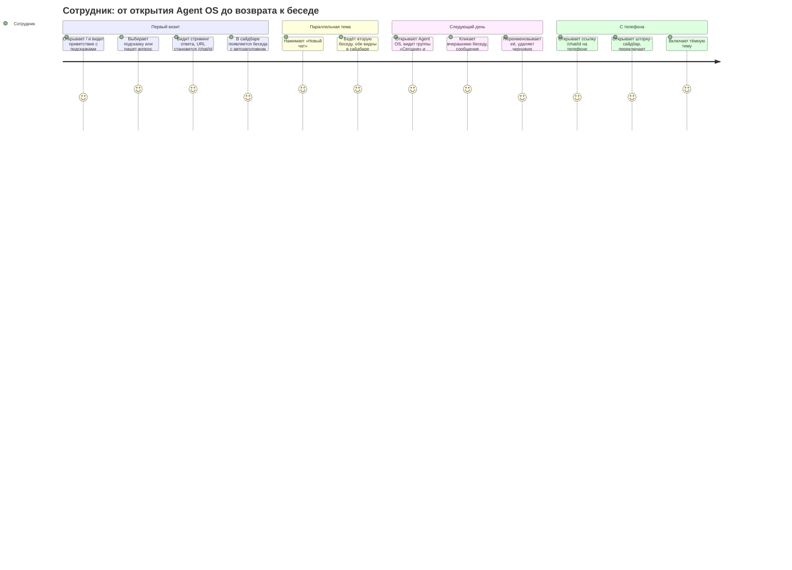
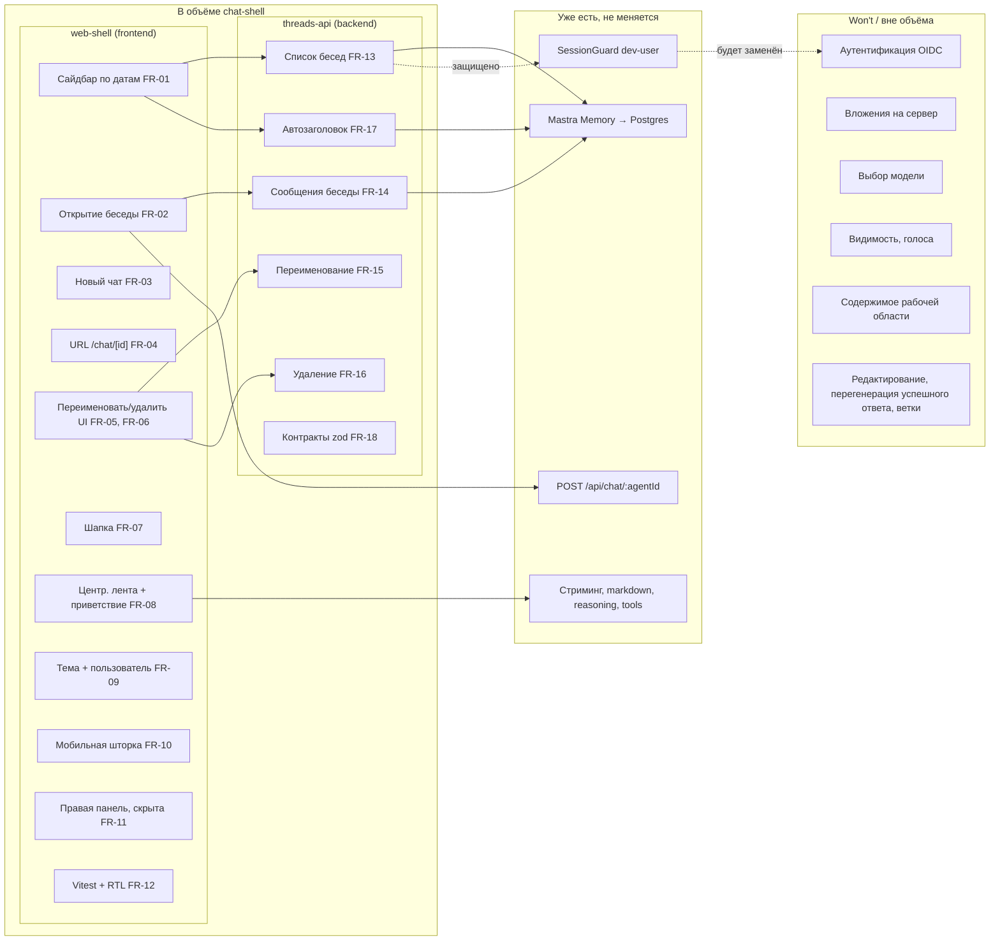
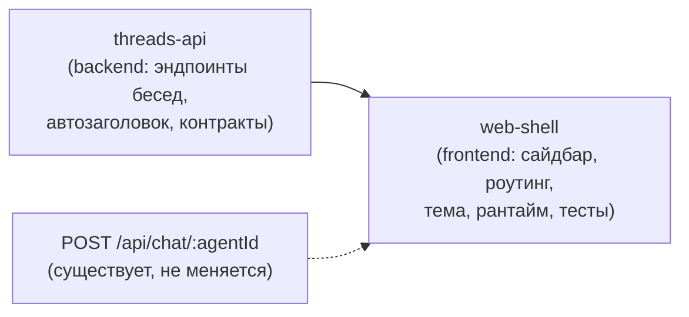

# PRD: Оболочка чата в стиле ChatGPT (chat-shell)

> **Depth**: `full` — масштаб large (решающая ось: границы web ↔ новые эндпоинты NestJS ↔ Mastra Memory/Postgres).

| Поле | Значение |
|------|----------|
| Версия | 1.5 |
| Дата | 2026-10-29 |
| Статус | Approved (v1.5) |
| Ориентиры | визуальный — [vercel/ai-chatbot](https://github.com/vercel/ai-chatbot); поведенческий — веб-клиент ChatGPT |
| Связанные документы | [uxrd.md](uxrd.md), [design-threads-api.md](design-threads-api.md), [design-web-shell.md](design-web-shell.md) |

## Snapshot

- **Что меняется**: прототип с двумя панелями становится оболочкой в стиле ChatGPT — сайдбар с историей по датам, URL на беседу, новый чат, переименование и удаление, шапка, тема, мобильная шторка; сервер получает эндпоинты бесед и автозаголовок.
- **Что не меняется**: стриминг, рассуждения, markdown, вызовы инструментов, контракт `ChatRequest`, агент и модель; миграций схемы нет.
- **Действия над сообщением**: остаётся только «Копировать»; «Перегенерировать» доступно лишь у ответа, завершившегося ошибкой. Редактирование сообщения, перегенерация успешного ответа и переключатель веток в этом релизе скрыты (Won't Have).
- **Части**: `threads-api` (backend), затем `web-shell` (frontend).
- **Главный риск**: перегенерация после ошибки может склеить неудачный и новый ответы в сохранённой истории — снимается на сервере (Design Doc `threads-api`) и проверяется AC-14.6.
- **Открытые вопросы**: нет.

---

## Overview

### One-line Summary

Превратить текущий двухпанельный прототип Agent OS в полноценную оболочку чата, узнаваемую как ChatGPT: боковая панель с историей бесед, сгруппированной по датам, отдельный URL на каждую беседу, центрированная лента сообщений, шапка, переключатель темы — поверх уже работающего стриминга через assistant-ui и Mastra.

### Background

Сейчас `apps/web` показывает одну страницу `/` с двумя панелями: слева тред assistant-ui (40 %), справа пустая «Рабочая область» (60 %). Нет боковой панели, списка бесед, кнопки «Новый чат», шапки и переключателя темы. Беседа живёт ровно до перезагрузки вкладки: сервер сохраняет сообщения в Postgres через Mastra Memory (`thread = threadId`, `resource = req.user.id`), но ни одного эндпоинта, чтобы получить список тредов или сообщения треда, нет. Заголовки тредов пусты.

Пользователь сформулировал запрос прямо: «хочу повторить интерфейс на UI как у ChatGPT, можешь посматривать в ai chat vercel». Это запрос не на новые возможности агента, а на **оболочку**: привычную модель «список бесед слева, беседа по центру», к которой пользователи приучены ChatGPT, Claude, Gemini и большинством корпоративных ассистентов. Без неё Agent OS выглядит как демо-виджет, а не как рабочий инструмент: нельзя вернуться к вчерашней беседе, нельзя отправить коллеге ссылку на тред, нельзя вести несколько тем параллельно.

**Рыночный контекст.** Боковая панель с историей бесед, сгруппированной по датам, стала стандартом де-факто: она есть во всех массовых ассистентах, а в обзорах шаблонов чат-ботов 2026 года «история бесед в сайдбаре» перечисляется как базовый критерий выбора шаблона ([thefrontkit](https://thefrontkit.com/blogs/best-ai-chatbot-templates-2026)). Шаблон Vercel [Chatbot](https://vercel.com/templates/next.js/chatbot) хранит историю в Postgres и показывает её в сайдбаре с удалением и переименованием; аналогичные стартер-киты ([supastarter](https://supastarter.dev/docs/nextjs/ai/chatbot), [shadcnspace](https://shadcnspace.com/templates/ai-chatbox)) тоже начинают с сайдбара истории, тёмной темы и мобильного sheet. Для Agent OS это означает: пользователи придут с готовыми ожиданиями, и любое отступление от паттерна (например, история без дат или без URL на беседу) будет восприниматься как недоработка, а не как «особенность».

Со стороны библиотек паттерн тоже поддержан штатно: assistant-ui предоставляет слой списка тредов (`RemoteThreadList`) и адаптер истории сообщений (`ThreadHistoryAdapter`) ([assistant-ui: threads](https://www.assistant-ui.com/docs/runtimes/concepts/threads), [persistence adapters](https://www.assistant-ui.com/docs/api-reference/adapters/persistence)); Mastra Memory умеет генерировать заголовок треда по первому сообщению пользователя после ответа агента ([Mastra: memory overview](https://mastra.ai/docs/memory/overview), [threads and resources](https://mastra.ai/docs/memory/threads-and-resources)). Фича, таким образом, — это в основном **композиция** существующих возможностей плюс тонкий слой эндпоинтов в NestJS.

---

## User Stories

### Primary Users

| Персона | Кто это | Что ей важно |
|---------|---------|--------------|
| **Сотрудник-пользователь** (основная) | Сотрудник компании, который ежедневно работает с ассистентом по рабочим вопросам; в dev-окружении — `dev-user` | Быстро вернуться к прошлой беседе, вести несколько тем параллельно, не терять контекст при перезагрузке, работать с телефона |
| **Разработчик Agent OS** | Член команды, развивающий агентов и Tool UI | Понятная точка расширения: куда встанет Tool-UI-артефакт, как добавить пункт в сайдбар, как тестировать компоненты оболочки |
| **Администратор / безопасник** (косвенная) | Отвечает за данные компании | Пользователь видит только свои беседы; история недоступна без аутентификации |

### User Stories

```
Как сотрудник
я хочу видеть список своих бесед, сгруппированный по датам (Сегодня, Вчера, …)
чтобы за секунду найти вчерашний разговор, не вспоминая его название
```

```
Как сотрудник
я хочу открыть беседу и увидеть все её сообщения — включая рассуждения и вызовы инструментов — ровно такими, какими они были
чтобы продолжить работу с того места, где остановился
```

```
Как сотрудник
я хочу, чтобы у каждой беседы был свой адрес /chat/<id>
чтобы обновление страницы не теряло беседу, а ссылку можно было сохранить в закладки или переслать коллеге
```

```
Как сотрудник
я хочу начать новый чат одной кнопкой, увидев приветствие и подсказки
чтобы не искать, куда писать, и быстро стартовать типовые задачи
```

```
Как сотрудник
я хочу переименовывать и удалять беседы
чтобы держать историю в порядке и убирать лишнее
```

```
Как сотрудник
я хочу переключать светлую и тёмную тему и видеть, под каким пользователем я работаю
чтобы интерфейс был комфортным в любом освещении и было понятно, чья это история
```

```
Как сотрудник на телефоне
я хочу, чтобы сайдбар открывался шторкой, а лента и композер занимали весь экран
чтобы пользоваться ассистентом так же удобно, как в ChatGPT на мобильном
```

```
Как разработчик Agent OS
я хочу, чтобы правая «Рабочая область» осталась, но была скрыта по умолчанию и раскрывалась по кнопке
чтобы будущие Tool-UI-артефакты имели место на экране, а чат по умолчанию выглядел как ChatGPT
```

```
Как разработчик Agent OS
я хочу тестовую инфраструктуру для web (Vitest + React Testing Library)
чтобы компоненты сайдбара, шапки и темы были покрыты тестами с первого коммита
```

### Use Cases

1. **Возвращение к беседе.** Сотрудник открывает Agent OS утром. В сайдбаре под «Вчера» видит беседу «Сверка договора с ООО „Ромашка“», кликает — лента показывает все сообщения, URL меняется на `/chat/<id>`, композер готов к вводу. Он задаёт уточняющий вопрос, ответ стримится как обычно.
2. **Новая тема посреди работы.** Во время беседы сотрудник нажимает «Новый чат». Открывается `/` с приветствием и подсказками; старая беседа остаётся в сайдбаре. После первого ответа ассистента новая беседа появляется в сайдбаре под «Сегодня» с автозаголовком, URL становится `/chat/<новый id>`.
3. **Ссылка коллеге.** Сотрудник копирует URL из адресной строки и отправляет коллеге. Коллега (в dev — тот же `dev-user`; в будущем — тот же авторизованный пользователь) открывает ссылку и видит ту же беседу. Чужой пользователь получает «Беседа не найдена».
4. **Уборка истории.** Сотрудник наводит на беседу в сайдбаре, открывает меню «…», выбирает «Переименовать», вводит имя, Enter — название обновилось в списке и в шапке. Для другой беседы выбирает «Удалить», подтверждает в диалоге — беседа исчезает из списка; если она была открыта, пользователь переходит на `/`.
5. **Работа с телефона.** На ширине 375 px сайдбар скрыт, в шапке есть кнопка-гамбургер. Нажатие открывает шторку со списком бесед; выбор беседы закрывает шторку и показывает ленту. Композер прижат к низу, горизонтального скролла нет.
6. **Тёмная тема.** Сотрудник выбирает «Тёмная» в меню пользователя внизу сайдбара. Все элементы (сайдбар, шапка, лента, композер, диалоги) переключаются без перезагрузки; при следующем открытии выбор сохранён; при первой загрузке нет вспышки светлой темы.
7. **Открытие рабочей области.** Разработчик нажимает кнопку «Рабочая область» в шапке — справа раскрывается панель с текущим плейсхолдером; лента чата сжимается, но остаётся читаемой. Повторное нажатие скрывает панель.

### User Journey Diagram *(full depth)*



---

## Functional Requirements

Каждое требование несёт приоритет MoSCoW и критерии приёмки (AC). Нумерация `FR-xx` используется в разделе Delivery Parts и далее в Design Doc. Критерии описывают **наблюдаемое поведение**, не реализацию.

Матрица паритета с ориентирами (что уже есть в каркасе, что добавляется):

| Возможность | ChatGPT / ai-chatbot | Agent OS сейчас | Эта фича |
|-------------|----------------------|-----------------|----------|
| Стриминг ответа, остановка | да | есть | без изменений |
| Рассуждения (thinking) | да | есть | без изменений |
| Markdown, код | да | есть | без изменений |
| Вызовы инструментов | да | есть | без изменений |
| Композер: автовысота, отправка/стоп | да | есть | без изменений |
| Действие над сообщением: копировать | да | есть | без изменений |
| Перегенерировать ответ, завершившийся ошибкой | да | есть | сохраняется (AC-08.5) |
| Редактировать сообщение, перегенерировать успешный ответ, ветки | да | есть | Won't — скрыто из UI |
| Слот приветствия и follow-up подсказки | да | есть (слот) | наполняется содержимым |
| Сайдбар с историей по датам | да | нет | **новое (web)** |
| Новый чат | да | нет | **новое (web)** |
| URL на беседу | да | нет | **новое (web)** |
| Переименование / удаление | да | нет | **новое (web + api)** |
| Автозаголовок беседы | да | нет | **новое (api)** |
| Шапка с переключателем сайдбара | да | нет | **новое (web)** |
| Тема светлая/тёмная | да | токены есть, переключателя нет | **новое (web)** |
| Меню пользователя | да | нет | **новое (web, плейсхолдер)** |
| Мобильная шторка | да | нет | **новое (web)** |
| Список / сообщения / удаление / переименование тредов по API | да (ai-chatbot) | нет | **новое (api)** |
| Загрузка вложений на сервер | да | кнопки без адаптера | Won't |
| Выбор модели | да | нет | Won't |
| Публичная/приватная видимость | ai-chatbot | нет | Won't |
| Голоса за/против | ai-chatbot | нет | Won't |
| Вход/выход, реальная аутентификация | да | заглушка | Won't (отдельный шаг) |

### Must Have (MVP)

#### Оболочка (frontend)

- [ ] **FR-01. Сайдбар с историей бесед, сгруппированной по дате.** Слева отображается список бесед текущего пользователя, разбитый на группы «Сегодня», «Вчера», «Предыдущие 7 дней», «Предыдущие 30 дней», «Старше». Внутри группы — по убыванию времени последнего обновления. Активная беседа визуально выделена.
  - AC-01.1: Given у пользователя есть беседы с обновлением сегодня, вчера, 5 дней назад и 40 дней назад, When открывается `/`, Then в сайдбаре видны ровно четыре группы с соответствующими заголовками в указанном порядке, а пустые группы не показываются.
  - AC-01.2: Given открыта `/chat/<id>`, Then именно эта беседа отмечена в списке как текущая — и визуально, и для скринридера.
  - AC-01.3: Given список ещё загружается, Then на месте списка показан скелетон (не пустое место и не «Нет бесед»).
  - AC-01.4: Given у пользователя нет бесед, Then показан текст «Пока нет бесед» и подсказка начать новую.
  - AC-01.5: Given запрос списка завершился ошибкой, Then показано сообщение об ошибке и кнопка «Повторить», нажатие на которую перезапрашивает список.
  - AC-01.6: Given заголовок беседы длиннее ширины сайдбара, Then он занимает одну строку, не ломая список, а полный заголовок пользователь может прочитать, не открывая беседу.
  - AC-01.7: Given ответ API списка бесед не проходит zod-валидацию по схемам из `packages/contracts` (FR-18), Then сайдбар переходит в состояние ошибки (AC-01.5), приложение не падает, композер остаётся работоспособен.

- [ ] **FR-02. Открытие беседы с восстановлением сообщений.** Клик по беседе в сайдбаре открывает её: лента показывает все сообщения беседы в исходном порядке, включая пользовательские сообщения, ответы ассистента, блоки рассуждений и вызовы инструментов.
  - AC-02.1: Given беседа из 12 сообщений с одним блоком рассуждений и одним вызовом инструмента, When пользователь открывает её, Then все 12 сообщений отображены в том же порядке, блок рассуждений свёрнут и раскрывается, вызов инструмента показан с результатом.
  - AC-02.2: Given сообщения ещё загружаются, Then в ленте показан скелетон, а не приветственный экран (`Welcome`).
  - AC-02.3: Given восстановлено `N` сообщений, When пользователь отправляет новое сообщение, Then ответ стримится в ту же беседу, и после завершения ответа в ленте ровно `N+2` сообщения (сообщение пользователя и ответ ассистента).
  - AC-02.4: Given беседа содержит длинный ответ с markdown (заголовки, список, таблица, блок кода 80+ строк), Then markdown отрендерен так же, как при живом стриминге, и кнопка «Копировать» у блока кода работает.
  - AC-02.5: Given ответ API сообщений беседы не проходит zod-валидацию по схемам из `packages/contracts` (FR-18), Then лента переходит в состояние ошибки с кнопкой «Повторить», приложение не падает, сайдбар и шапка остаются работоспособны.
  - AC-02.6: Given в беседе X идёт стриминг ответа, When пользователь открывает беседу Y из сайдбара, Then генерация в X не прерывается и продолжается в фоне, ответ записывается в X и не появляется в ленте Y; When пользователь возвращается в X, Then лента показывает этот ответ — целиком, если генерация завершилась, или продолжающийся стриминг, если ещё нет (как в ChatGPT).

- [ ] **FR-03. Новый чат.** В сайдбаре (и в шапке на мобильном) есть кнопка «Новый чат». Нажатие открывает пустую беседу с приветственным экраном.
  - AC-03.1: Given открыта любая беседа, When нажата «Новый чат», Then URL становится `/`, лента пуста, показан приветственный экран; на устройстве с точным указателем пользователь может сразу печатать; на тач-устройстве экранная клавиатура сама не открывается.
  - AC-03.2: Given пользователь нажал «Новый чат», но ничего не отправил и вернулся к другой беседе, Then пустая беседа **не** появляется в списке.
  - AC-03.3: Given пользователь отправил первое сообщение в новом чате, Then не позднее завершения первого ответа в сайдбаре под «Сегодня» появляется новая беседа, и она выделена как активная.
  - AC-03.4: Given в беседе X идёт стриминг ответа, When нажата «Новый чат», Then открывается `/` с приветственным экраном, стриминг в X продолжается в фоне и его ответ записывается в X (AC-02.6), а в новом чате этот ответ не появляется.

- [ ] **FR-04. Отдельный URL на беседу `/chat/[threadId]`.** Каждая беседа доступна по собственному адресу; обновление страницы и переход по ссылке открывают ту же беседу.
  - AC-04.1: Given пользователь отправил первое сообщение с `/`, Then URL без перезагрузки страницы меняется на `/chat/<id>`, где `<id>` — идентификатор созданной беседы.
  - AC-04.2: Given открыт `/chat/<id>`, When пользователь нажимает F5, Then после загрузки отображается та же беседа с теми же сообщениями, и она выделена в сайдбаре.
  - AC-04.3: Given пользователь вставляет `/chat/<id>` чужой или несуществующей беседы, Then показан экран «Беседа не найдена» с кнопкой «Новый чат», а не пустая лента и не ошибка 500.
  - AC-04.4: Given пользователь переключает беседы кликами, Then кнопки «Назад/Вперёд» браузера переключают беседы в обратном порядке.

- [ ] **FR-05. Переименование беседы.** Из контекстного меню элемента сайдбара («…») доступно «Переименовать»: имя редактируется на месте или в диалоге.
  - AC-05.1: Given пользователь выбрал «Переименовать», ввёл «Отчёт Q3» и нажал Enter, Then название в сайдбаре и в шапке становится «Отчёт Q3» без перезагрузки, и после F5 оно сохранено.
  - AC-05.2: Given пользователь нажал Esc во время редактирования, Then название не изменилось.
  - AC-05.3: Given введено пустое название или только пробелы, Then сохранение не происходит, поле подсвечено как невалидное.
  - AC-05.4: Given сервер вернул ошибку, Then название откатывается к прежнему и показано уведомление об ошибке.

- [ ] **FR-06. Удаление беседы.** Из контекстного меню доступно «Удалить» с подтверждением.
  - AC-06.1: Given пользователь выбрал «Удалить», Then показан диалог подтверждения с названием беседы и кнопками «Отмена»/«Удалить».
  - AC-06.2: Given пользователь подтвердил удаление **открытой** беседы, Then беседа исчезает из списка, URL становится `/`, показан приветственный экран.
  - AC-06.3: Given пользователь подтвердил удаление **не открытой** беседы, Then она исчезает из списка, текущая беседа и URL не меняются.
  - AC-06.4: Given после удаления пользователь открывает старый `/chat/<id>`, Then показан экран «Беседа не найдена».

- [ ] **FR-07. Шапка.** Над лентой — шапка с кнопкой сворачивания/разворачивания сайдбара, названием текущей беседы и кнопкой раскрытия правой рабочей области (FR-11).
  - AC-07.1: Given сайдбар развёрнут, When нажата кнопка сворачивания, Then сайдбар скрывается (на десктопе — сжимается до иконок или полностью, на выбор UXRD), лента расширяется, а свёрнутое/развёрнутое состояние переключателя сообщается вспомогательным технологиям.
  - AC-07.2: Given открыта беседа без заголовка (ещё не сгенерирован), Then в шапке показан плейсхолдер «Новая беседа».
  - AC-07.3: Given открыта `/`, Then название в шапке не отображается или показано «Новая беседа».

- [ ] **FR-08. Центрированная лента, приветственный экран, композер снизу.** Лента и композер центрированы в колонке ограниченной ширины (как в ChatGPT), а не растянуты на всю панель. На пустой беседе показано приветствие и 3–4 подсказки.
  - AC-08.1: Given окно шириной 1440 px, Then сообщения и композер лежат в одной колонке шириной ≤ 800 px, выровненной по центру свободной области; точное значение в пределах этой границы фиксирует UXRD.
  - AC-08.2: Given открыта пустая беседа, Then показаны приветственный текст на русском и 3–4 кликабельных подсказки; клик по подсказке подставляет текст в композер и отправляет его.
  - AC-08.3: Given в беседе есть сообщения, Then приветствие и стартовые подсказки скрыты, композер прижат к низу ленты, лента прокручивается, кнопка «Вниз» появляется при отрыве от конца.
  - AC-08.4: Given идёт стриминг, Then композер показывает кнопку «Стоп» вместо «Отправить», и это поведение не отличается от текущего каркаса.
  - AC-08.5: Given ответ ассистента завершился ошибкой модели или обрывом сети, Then в ленте показано сообщение об ошибке с возможностью перегенерировать этот ответ, а сайдбар и шапка остаются работоспособны. Перегенерация предлагается только у ответа, завершившегося ошибкой; что беседа показывает после перегенерации и перезагрузки — AC-14.6.
  - AC-08.6: Given в ленте есть сообщения пользователя и успешно завершённые ответы ассистента, Then пользователь может скопировать текст любого из них, но не может отредактировать своё сообщение, перегенерировать успешный ответ или переключиться между вариантами ответа.

- [ ] **FR-09. Переключатель темы и плейсхолдер пользователя.** Внизу сайдбара — блок пользователя (аватар-инициалы, имя `dev-user`) с меню: «Светлая / Тёмная / Системная».
  - AC-09.1: Given выбрана «Тёмная», Then весь интерфейс (сайдбар, шапка, лента, композер, диалоги, меню) переключается на тёмные токены без перезагрузки.
  - AC-09.2: Given выбор сохранён, When страница перезагружена, Then тема применена **до первой отрисовки**: вспышки противоположной темы (FOUC) нет.
  - AC-09.3: Given выбрана «Системная», When ОС переключает тему, Then интерфейс следует за ОС.
  - AC-09.4: Given меню пользователя открыто, Then в нём **нет** пунктов «Выйти» и «Настройки аккаунта»; показано имя текущего пользователя из dev-заглушки.

- [ ] **FR-10. Мобильный вариант: сайдбар-шторка.** На узких экранах сайдбар не занимает место, а открывается шторкой поверх содержимого.
  - AC-10.1: Given ширина окна 375 px, Then сайдбар скрыт, в шапке есть кнопка «Меню», лента и композер занимают всю ширину, горизонтального скролла нет.
  - AC-10.2: Given нажата кнопка «Меню», Then открывается шторка со списком бесед, кнопкой «Новый чат» и блоком пользователя; пользователи клавиатуры и скринридера оказываются внутри шторки; Esc и клик по затемнению закрывают её.
  - AC-10.3: Given в шторке выбрана беседа, Then шторка закрывается и показывается выбранная беседа.
  - AC-10.4: Given ширина 360 px и в беседе есть блок кода шириной 120 символов, Then горизонтально прокручивается только блок кода, а не страница.

- [ ] **FR-11. Коллапсируемая правая «Рабочая область», скрытая по умолчанию.** Правая панель сохраняется как место для будущих Tool-UI-артефактов, но по умолчанию скрыта.
  - AC-11.1: Given первая загрузка `/` или `/chat/<id>` на десктопе, Then правая панель не видна, лента центрирована по всей ширине основной области.
  - AC-11.2: Given нажата кнопка «Рабочая область» в шапке, Then справа раскрывается панель с текущим плейсхолдером, ширина регулируется перетаскиванием, лента остаётся читаемой (ширина ≥ 480 px при окне 1280 px).
  - AC-11.3: Given панель раскрыта, When нажата та же кнопка или «×» на панели, Then панель скрывается.
  - AC-11.4: Given ширина окна < 1024 px, Then правая панель и её кнопка недоступны, содержимое чата не ломается.

- [ ] **FR-12. Тестовая инфраструктура web.** В `apps/web` настроены Vitest и React Testing Library; тесты запускаются командой `pnpm test` из корня (через Turborepo) и локально в `apps/web`.
  - AC-12.1: `pnpm --filter web test` проходит успешно и выполняет как минимум по одному тесту на: группировку бесед по датам, рендер сайдбара в состояниях «загрузка / пусто / ошибка / список», переключение темы, рендер шапки с заголовком.
  - AC-12.2: Тесты выполняются в CI-режиме (`--run`, без watch) и не требуют запущенного API.

#### Данные бесед (backend)

- [ ] **FR-13. Список бесед текущего пользователя.** API отдаёт беседы пользователя с полями, достаточными для группировки по дате и отображения в сайдбаре: идентификатор, заголовок (может быть пустым), время создания, время последнего обновления. Поддерживается пагинация.
  - AC-13.1: Given у пользователя A есть 3 беседы, а у пользователя B — 2, When A запрашивает список, Then возвращаются ровно 3 беседы A, отсортированные по времени обновления по убыванию.
  - AC-13.2: Given у пользователя 120 бесед и размер страницы 20, Then первый запрос возвращает 20 бесед и признак наличия следующей страницы; последовательные запросы возвращают остальные без дублей и пропусков.
  - AC-13.3: Given `NODE_ENV=production`, Then любой запрос к эндпоинтам бесед возвращает 401 (существующее поведение `SessionGuard`).
  - AC-13.4: Время ответа p95 ≤ 300 мс при 200 беседах пользователя на локальном Postgres.

- [ ] **FR-14. Сообщения беседы для восстановления.** API отдаёт сообщения беседы в формате, который фронтенд может напрямую передать в ленту assistant-ui (включая части «рассуждение» и «вызов инструмента») без потери информации, которая была видна при живом стриминге.
  - AC-14.1: Given беседа из 12 сообщений, записанных через существующий `POST /api/chat/:agentId`, When запрошены её сообщения, Then возвращены все 12 в хронологическом порядке, с ролями, текстом, рассуждениями и вызовами инструментов (имя, аргументы, результат, статус).
  - AC-14.2: Given пользователь A запрашивает сообщения беседы пользователя B, Then ответ 404 (не 403 — существование чужой беседы не раскрывается).
  - AC-14.3: Given беседы с указанным идентификатором нет, Then ответ 404.
  - AC-14.4: Время ответа p95 ≤ 500 мс для беседы из 100 сообщений на локальном Postgres.
  - AC-14.5: Сырой текст ошибки не попадает в UI ни в живом стриме, ни после перезагрузки:
    - (a) Given вызов инструмента завершился ошибкой, Then и в живом стриме, и после перезагрузки показан одинаковый обезличенный текст ошибки; сырой текст ошибки инструмента в UI не виден.
    - (b) Given ответ ассистента завершился ошибкой модели, Then сырой текст ошибки модели в UI не виден ни в живом стриме, ни после перезагрузки; после перезагрузки ответ показывает только частичный текст, сохранённый до ошибки, без текста ошибки.
  - AC-14.6: Given ответ ассистента завершился ошибкой модели или обрывом сети и пользователь перегенерировал его, When запрошены сообщения беседы, Then за этим сообщением пользователя следует ровно одно сообщение ассистента, содержащее только перегенерированный ответ; сообщение пользователя не продублировано, текст неудачной попытки не возвращается.

- [ ] **FR-15. Переименование беседы (API).** Пользователь может изменить заголовок своей беседы.
  - AC-15.1: Given непустой заголовок до 200 символов, Then заголовок сохранён и возвращается в последующем списке.
  - AC-15.2: Given пустой заголовок, заголовок из пробелов или длиннее 200 символов, Then ответ 400 с описанием ошибки валидации.
  - AC-15.3: Given попытка переименовать чужую беседу, Then ответ 404, заголовок не изменён.

- [ ] **FR-16. Удаление беседы (API).** Пользователь может удалить свою беседу вместе с её сообщениями.
  - AC-16.1: Given удаление своей беседы, Then последующий запрос списка её не содержит, запрос сообщений возвращает 404, и удалённая беседа не воскресает незаметно: отправка сообщения в удалённый `id` через `POST /api/chat/:agentId` либо возвращает 404, либо явно создаёт новую беседу с новым `id`, который отличается от удалённого. Вариант выбирается в Design Doc `threads-api` и закрепляется тестом.
  - AC-16.2: Given попытка удалить чужую беседу, Then ответ 404, беседа не удалена.
  - AC-16.3: Given повторное удаление уже удалённой беседы, Then ответ 404 (идемпотентно для клиента, без 500).

- [ ] **FR-17. Автоматический заголовок беседы.** После первого ответа ассистента у беседы появляется короткий заголовок, отражающий тему первого сообщения пользователя. Заголовок — на языке сообщения пользователя.
  - AC-17.1: Given первое сообщение пользователя «Помоги составить план отпуска на Байкал в июле», Then не позднее 10 с после завершения первого ответа у беседы в списке есть непустой заголовок длиной ≤ 80 символов, не совпадающий дословно с сообщением.
  - AC-17.2: Given пользователь переименовал беседу вручную, Then автогенерация **не** перезаписывает его заголовок при следующих сообщениях.
  - AC-17.3: Given генерация заголовка не удалась (ошибка модели), Then беседа всё равно сохранена и отображается с плейсхолдером «Новая беседа»; ошибка залогирована, стриминг ответа не затронут.

- [ ] **FR-18. Контракты в `packages/contracts`.** Все новые тела запросов и ответов (список бесед, элемент беседы, сообщения беседы, переименование) описаны zod-схемами в `packages/contracts` и используются обеими сторонами. Существующий `ChatRequestSchema` не меняется.
  - AC-18.1: Для каждого нового эндпоинта в `packages/contracts` есть схема ответа и (где есть тело) схема запроса, экспортированные вместе с типами.
  - AC-18.3: `ChatRequestSchema` байт-в-байт совпадает с текущей версией; тесты API, использующие его, проходят без изменений.

### Should Have

- [ ] **FR-19. Подгрузка следующей страницы списка.** При прокрутке сайдбара до конца (или по кнопке «Показать ещё») подгружается следующая страница бесед.
  - AC-19.1: Given 120 бесед, When пользователь прокручивает список до конца, Then подгружаются следующие 20, индикатор загрузки показан в конце списка, порядок групп по датам сохраняется (беседа не может попасть в группу «Сегодня» после «Вчера»).

- [ ] **FR-20. Обновление заголовка без перезагрузки.** Автозаголовок (FR-17) появляется в сайдбаре и шапке вскоре после первого ответа, без ручного обновления страницы. Бюджет 15 с = 10 с генерации заголовка на сервере (AC-17.1) + до 5 с на обновление клиента.
  - AC-20.1: Given новый чат, первое сообщение отправлено и ответ завершён, Then не позднее 15 с заголовок в сайдбаре и шапке меняется с «Новая беседа» на сгенерированный, без действий пользователя.

- [ ] **FR-21. Запоминание состояния сайдбара.** Свёрнут/развёрнут сайдбар — запоминается между перезагрузками на десктопе.
  - AC-21.1: Given пользователь свернул сайдбар и перезагрузил страницу, Then сайдбар открывается свёрнутым, без «прыжка» раскрытия при загрузке.

- [ ] **FR-22. Горячие клавиши.** `Ctrl/⌘+Shift+O` — новый чат, `Ctrl/⌘+B` — свернуть/развернуть сайдбар (как в ChatGPT и ai-chatbot), плюс нативная навигация стрелками по списку бесед. Других сочетаний в этом релизе нет (дополнительные предложения UXRD — в Won't Have).
  - AC-22.1: Given фокус в композере или в ленте, When нажато `Ctrl+Shift+O`, Then открывается новый чат; When нажато `Ctrl+B`, Then сайдбар переключается; пользователь может узнать каждое сочетание у соответствующей кнопки, не обращаясь к документации.
  - AC-22.2: Given фокус на беседе в списке сайдбара, When нажаты стрелки «вверх»/«вниз», Then фокус переходит на предыдущую/следующую беседу списка (в том числе через границу групп по датам), а Enter открывает беседу в фокусе.

### Could Have

- [ ] **FR-23. Поиск по истории.** Поле поиска в сайдбаре фильтрует беседы по заголовку.
  - AC-23.1: Given введено «отчёт», Then в списке остаются только беседы, в заголовке которых есть «отчёт» без учёта регистра; группы по датам сохраняются.

- [ ] **FR-24. Индикатор активного стриминга в сайдбаре.** Беседа, в которой сейчас идёт генерация, помечена индикатором.
  - AC-24.1: Given стриминг идёт в беседе X, а пользователь смотрит беседу Y, Then у X в сайдбаре виден индикатор; по завершении он исчезает.

### Won't Have (this release)

Перечислены явно, чтобы не всплыли «по умолчанию» на этапе реализации:

- **Выбор видимости беседы (публичная/приватная)** — есть в ai-chatbot; не нужен без реальных пользователей и аутентификации.
- **Голоса за/против ответов с сохранением** — есть в ai-chatbot; не входит в оболочку, отдельная фича обратной связи.
- **Загрузка вложений на сервер** — кнопки вложений в композере остаются в текущем состоянии (без адаптера загрузки или отключены — фиксирует UXRD); хранение файлов — отдельный шаг инфраструктуры.
- **Выбор модели/агента в UI** — контракт `ChatRequest` не меняется; агент `assistant` остаётся единственным.
- **Редактирование сообщения пользователя, перегенерация успешного ответа, переключатель веток** — скрыты из UI. После перегенерации или редактирования ответы брошенной ветки остаются в сохранённой истории, а при перегенерации старый и новый ответы сохраняются одним сообщением: после перезагрузки пользователь увидел бы оба ответа, склеенные вместе. Исключение — перегенерация ответа, завершившегося ошибкой (AC-08.5, AC-14.6).
- **Вход/выход, профиль, реальная аутентификация** — корпоративный OIDC запланирован отдельным шагом (README, «Что дальше», п. 1); меню пользователя — плейсхолдер.
- **Публичный шаринг ссылок на беседу** — `/chat/<id>` открывается только владельцем; «поделиться с кем угодно по ссылке» требует модели доступа, которой нет.
- **Архивирование бесед** — только удаление.
- **Папки/проекты для бесед** — не в оболочке MVP.
- **Дополнительные горячие клавиши из UXRD** — `Shift+Esc`, `Ctrl/⌘+Shift+Backspace`, `F2`, `Delete` отложены; в этом релизе только сочетания FR-22 и навигация стрелками.

### Out of Scope

Работа, не относящаяся к фиче вообще (в отличие от Won't — отложенного функционала той же фичи):

- Фича не меняет логику агента, его инструменты, промпты и модель.
- Содержимое правой «Рабочей области» (Tool-UI-артефакты) — здесь только её сворачивание/разворачивание.
- Бюджеты токенов, аудит, очередь долгих задач, Mastra Studio — пункты 2–5 README «Что дальше».
- Миграции схемы Postgres — фича опирается на таблицы, которые уже создаёт Mastra; если Design Doc `threads-api` выявит необходимость отдельной таблицы, это станет изменением PRD.
- Локализация на другие языки, кроме русского интерфейса.
- Увеличение зон касания панели действий над сообщением (сейчас 24 px; в этом релизе в ней только «Копировать» и «Перегенерировать» у ответа с ошибкой): размеры существующей панели assistant-ui не меняются.
- Исправление историй, сохранённых до этого релиза: в них могут остаться склеенные ответы перегенерации и реплики брошенных веток; они показываются как сохранены — это принятое известное ограничение.

### Scope Boundary Diagram *(full depth)*



---

## Non-Functional Requirements

### Performance

| Метрика | Цель | Как измеряется |
|---------|------|----------------|
| Отрисовка восстановленной беседы (50 сообщений) после клика в сайдбаре | ≤ 1,5 с до появления последнего сообщения (p95) | Playwright/ручной замер на dev-машине с локальным Postgres, 10 прогонов |
| Переход на `/chat/<id>` по прямой ссылке (холодная загрузка) | ≤ 2,5 с LCP на десктопе (dev build не считается; `next build && next start`) | Lighthouse, 5 прогонов |
| Открытие/закрытие сайдбара и шторки | анимация ≤ 200 мс, без layout shift ленты > 0,1 CLS | DevTools Performance |
| API списка бесед (200 бесед) | p95 ≤ 300 мс | Vitest e2e с замером |
| API сообщений беседы (100 сообщений) | p95 ≤ 500 мс | Vitest e2e с замером |
| Стриминг ответа | без регрессии относительно текущего каркаса: первый токен ≤ текущего + 50 мс | Сравнение до/после на одном промпте |

### Reliability

- Ошибка загрузки списка или сообщений не ломает композер: пользователь всегда может начать новый чат (AC-01.5, AC-02.5).
- Ошибка модели при ответе оставляет сайдбар и шапку работоспособными (AC-08.5).
- Ошибка генерации заголовка не влияет на сохранение беседы и стриминг (AC-17.3).
- Переименование и удаление — с откатом UI при ошибке сервера (AC-05.4).
- Переключение беседы или «Новый чат» во время стриминга не прерывает генерацию: ответ продолжает записываться в исходную беседу (AC-02.6, AC-03.4).
- Закрытие вкладки во время стриминга по-прежнему прерывает генерацию (существующее поведение `res.on('close')`).

### Security

- **Нет IDOR**: каждый эндпоинт списка/сообщений/переименования/удаления работает только с беседами, у которых `resourceId = req.user.id`; чужие и несуществующие беседы неразличимы для клиента (404). Покрыто e2e-тестами с двумя `x-user-id` для **каждого** эндпоинта (AC-13.1, 14.2, 15.3, 16.2).
- Все новые эндпоинты — под `SessionGuard`; в production до появления реальной аутентификации они возвращают 401, как и `POST /api/chat/:agentId`. **Следствие (ограничение, не вопрос):** история бесед недоступна в production, пока не реализован OIDC; фича принимается в dev-окружении.
- Серверные ошибки не раскрывают стек и внутренние сообщения (как в текущем `onError` контроллера чата).
- Входные данные (заголовок, параметры пагинации, идентификаторы) валидируются zod-схемами из `packages/contracts` на сервере; идентификаторы бесед не интерполируются в SQL (Mastra Storage API).
- Заголовок беседы отображается как текст, не как HTML (защита от XSS через сгенерированный моделью заголовок).

### Accessibility (WCAG 2.1 AA)

- Оболочка соответствует WCAG 2.1 AA: все её функции доступны с клавиатуры и скринридером.
- Контраст текста ≥ 4,5:1 в обеих темах.
- Lighthouse Accessibility ≥ 95 на `/` и `/chat/<id>` в светлой и тёмной теме.
- Анимации учитывают системную настройку сокращения движения.

### Responsive

- Пригодно к работе от 360 px без горизонтальной прокрутки страницы.
- На ширине телефона список бесед открывается поверх, беседа занимает всю ширину.
- Рабочая область доступна только на десктопной ширине; раскладка по брейкпоинтам — в UXRD.
- Длинные блоки кода прокручиваются внутри себя (AC-10.4).

### Dark mode

- Три режима: светлая, тёмная, системная.
- Отсутствие FOUC при загрузке (AC-09.2).

### Scalability

- Пагинация списка бесед с первого дня (FR-13), чтобы пользователь с тысячами бесед не получал весь список одним ответом.
- Формат ответа сообщений не привязан к конкретной версии внутреннего хранилища Mastra: при смене версии адаптируется сервер, контракт для фронтенда остаётся (`packages/contracts`).
- Заголовок беседы хранится вместе с беседой, а не вычисляется при каждом запросе списка.

### Localisation

- Все строки интерфейса — на русском («Сегодня», «Вчера», «Новый чат», «Переименовать», «Удалить», «Беседа не найдена»). Названия групп по датам считаются в часовом поясе браузера пользователя.

---

## Delivery Parts

Части делят фичу на независимо проектируемые срезы. У каждой части — свой Design Doc (`design-{part}.md`) и свои планы работ; проектирование и реализация идут в порядке зависимостей ниже; критерии разбиения — в `documentation-criteria`, «Parts».

| Part | Covers | Cut along | Depends on | Rationale |
|------|--------|-----------|------------|-----------|
| `threads-api` | FR-13, FR-14, FR-15, FR-16, FR-17, FR-18 | `backend` | — | Контракт данных бесед (список, сообщения, переименование, удаление, заголовок) над Mastra Memory/Postgres — отдельные проектные вопросы: формат хранимых сообщений, пагинация, изоляция по `resourceId`, генерация заголовка. Фронтенд потребляет этот контракт как готовый. |
| `web-shell` | FR-01, FR-02, FR-03, FR-04, FR-05, FR-06, FR-07, FR-08, FR-09, FR-10, FR-11, FR-12; Should: FR-19, FR-20, FR-21, FR-22 | `frontend` | `threads-api` | Оболочка Next.js: раскладка, сайдбар, маршрутизация `/chat/[threadId]`, композиция рантайма assistant-ui (список тредов + чат + адаптер истории), тема, мобильная шторка, тестовая инфраструктура. Проектные вопросы — компонентная иерархия и состояние клиента; к серверу обращается только через контракты `threads-api`. |

**Coverage**: каждое требование Must Have (FR-01…FR-18) входит ровно в одну строку. Should Have назначены `web-shell` (FR-19, FR-21, FR-22 — чисто клиентские; FR-20 — клиентское обновление после завершения ответа, опирается на FR-17 из `threads-api` без новых эндпоинтов). Could Have:

- Отложено: **FR-23** (поиск по истории) — ценность ниже стоимости в MVP; при реализации потребует решения «фильтр на клиенте по загруженным страницам vs поиск на сервере», которое лучше принимать после появления реальных объёмов истории.
- Отложено: **FR-24** (индикатор стриминга в сайдбаре) — ценность ниже стоимости в MVP.

**Шов между частями** — HTTP-контракт на беседы, описанный zod-схемами в `packages/contracts` (FR-18). `threads-api` владеет схемами и их реализацией на сервере (валидация входных данных, форма ответов); `web-shell` — единственный потребитель: он импортирует те же схемы и валидирует ими ответы API на клиенте (AC-01.7, AC-02.5), поэтому расхождение контракта проявляется как состояние ошибки сайдбара или ленты, а не как падение приложения. Существующий `POST /api/chat/:agentId` используется `web-shell` как есть и в объём `threads-api` не входит.

### Part Dependency Diagram



---

## Success Criteria

### Quantitative Metrics

| # | Метрика | Целевое значение | Метод измерения | Срок |
|---|---------|------------------|-----------------|------|
| 1 | Паритет с матрицей | 100 % строк «новое» в матрице паритета реализованы и приняты по AC | Чек-лист приёмки по AC-01…AC-18 в Design Doc/плане, прогон вручную и автотестами | При приёмке фичи |
| 2 | Возврат к беседе | ≤ 2 клика от открытия `/` до восстановленной беседы; ≤ 1,5 с (p95) до отрисовки 50 сообщений | Playwright-сценарий или ручной замер, 10 прогонов, локальный Postgres | При приёмке |
| 3 | Устойчивость URL | 100 % из 20 проверок «F5 на `/chat/<id>`» открывают ту же беседу с теми же сообщениями | Автотест или ручной прогон | При приёмке |
| 4 | Изоляция данных | 0 случаев доступа к чужой беседе; 100 % эндпоинтов бесед покрыты e2e-тестом с двумя `x-user-id` | Vitest e2e в `apps/api` | При приёмке, затем в каждом CI |
| 5 | Доступность | Lighthouse Accessibility ≥ 95 на `/` и `/chat/<id>`, обе темы, десктоп и мобильный | Lighthouse CI или ручной прогон, 4 конфигурации | При приёмке |
| 6 | Мобильная вёрстка | 0 px горизонтального скролла страницы на ширинах 360, 375, 414 px во всех состояниях (пусто, стриминг, длинный markdown, шторка открыта) | DevTools device toolbar / Playwright | При приёмке |
| 7 | Автозаголовки | ≥ 95 % новых бесед получают непустой заголовок ≤ 80 символов, видимый в сайдбаре в течение 15 с после первого ответа — 10 с генерации на сервере (AC-17.1) + до 5 с на обновление клиента (AC-20.1) — при реализации FR-20; без FR-20 критерий проверяется по логу API в пределах 10 с (AC-17.1), видимость в сайдбаре — после обновления страницы; выборка 20 бесед | Ручной прогон 20 бесед + лог API | При приёмке |
| 8 | Тесты web | `pnpm --filter web test` проходит; ≥ 8 тестов, покрывающих четыре области из AC-12.1 | CI | С первого коммита `web-shell`, затем постоянно |
| 9 | Производительность API | p95 ≤ 300 мс (список, 200 бесед), ≤ 500 мс (сообщения, 100 шт.) | Замер в e2e-тестах | При приёмке |
| 10 | Без регрессии стриминга | Время до первого токена не хуже текущего каркаса + 50 мс | Сравнение до/после на одном промпте, 5 прогонов | При приёмке |

### Qualitative Metrics

1. **Узнаваемость.** Пользователь, знакомый с ChatGPT, без подсказок находит историю, новый чат, переименование/удаление и переключатель темы за первую минуту работы (коридорный тест на 3 человеках: все три находят каждую функцию без вопросов).
2. **Непрерывность.** Пользователь не замечает разницы между «живой» беседой и восстановленной из истории: рассуждения, инструменты и markdown выглядят одинаково (подтверждается side-by-side сравнением на одной беседе).
3. **Расширяемость для разработчика.** Разработчик Agent OS по Design Doc `web-shell` понимает, куда вставить Tool-UI-артефакт в правую панель и как добавить пункт в сайдбар, не читая исходники assistant-ui (проверка — вопрос ревьюеру Design Doc).

---

## Technical Considerations *(full depth)*

Раздел фиксирует зависимости, ограничения и риски. Технический выбор (какой адаптер, какая таблица, какой хук) здесь **не** делается — это предмет Design Doc каждой части.

### Dependencies

**Существующие системы**

- `POST /api/chat/:agentId` (`apps/api/src/chat/chat.controller.ts`): пишет сообщения в Mastra Memory с `thread = body.threadId ?? body.id`, `resource = req.user.id`. Идентификатор беседы сегодня порождает клиент (AI SDK передаёт `id` чата). `web-shell` должен сохранить совместимость: URL `/chat/<id>` и `threadId`, под которым сообщения лежат в памяти, — одно и то же значение.
- `SessionGuard` (`apps/api/src/auth/session.guard.ts`): dev-пользователь `dev-user` или заголовок `x-user-id`; 401 в production. Все новые эндпоинты — под ним.
- Mastra Memory → `PostgresStore` (`apps/api/src/mastra/mastra.provider.ts`): треды и сообщения уже лежат в Postgres. Проверено в установленных пакетах (`@mastra/core` 1.80.0, `@mastra/memory` 1.39.1, `@mastra/pg` 1.33.0): класс `Memory` экспортирует `listThreads`, `updateThread`, `deleteThread`, `recall`; опция `generateTitle` доступна на верхнем уровне настроек памяти и **выключена по умолчанию** (`threads.generateTitle` объявлен устаревшим и бросает ошибку).
- assistant-ui `@assistant-ui/react` 0.15.32 / `@assistant-ui/ai-sdk` 0.0.16: слот `Welcome`, подсказки (`ThreadPrimitive.Suggestions`), состояния `thread.isLoading`/`threads.isLoading` уже учтены в `thread.aui.tsx` (там предусмотрен скелетон для «переключённый тред ещё грузит историю»).
- `globals.css`: токены `.dark` и `--sidebar-*` заданы; `@custom-variant dark (&:is(.dark *))`.
- `packages/contracts`: zod-схемы, собираются до `apps/*` (`^build` в turbo.json).

**Внешние библиотеки, которых ещё нет**

- Менеджер темы для Next.js (например, `next-themes` — не установлен) и shadcn-компоненты `sidebar`, `sheet`, `dropdown-menu`, `dialog`, `skeleton` — конкретный набор фиксирует Design Doc `web-shell`.
- Vitest, `@testing-library/react`, `@testing-library/jest-dom`, `jsdom`/`happy-dom` для `apps/web`.

### Constraints

- **История недоступна в production** до реализации OIDC: `SessionGuard` возвращает 401. Приёмка — в dev-окружении с `dev-user`/`x-user-id`. Это ограничение, а не открытый вопрос.
- `ChatRequest` не меняется: новые возможности добавляются новыми эндпоинтами, а не полями в теле чата.
- Версия UI message stream: `ai@7` на фронтенде, `version: 'v7'` в `toAISdkStream` — формат восстановленных сообщений должен совпадать с тем, что фронтенд видит при живом стриминге.
- Часть API assistant-ui для списка тредов помечена `unstable_` — риск поломки при обновлении минорных версий; версии фиксируются.
- Группировка по датам считается в часовом поясе браузера, сервер отдаёт время в ISO 8601 UTC.
- `apps/web` — Next.js 16 App Router с React 19: компонентная модель «серверные компоненты + клиентские островки» накладывает ограничения на то, где живёт состояние рантайма assistant-ui (решает Design Doc `web-shell`).

### Assumptions

- Пользователь работает в одной вкладке; синхронизация списка бесед между вкладками в реальном времени не требуется (обновление при фокусе/перезагрузке достаточно).
- Объём истории одного пользователя в обозримый период — сотни, не десятки тысяч бесед; пагинации по 20 бесед на страницу достаточно.
- Хранимые Mastra сообщения содержат достаточно информации (рассуждения, вызовы инструментов с результатами) для восстановления без потерь.
- Модель, используемая агентом, пригодна для генерации заголовков; при необходимости для заголовков может быть выбрана более дешёвая модель — решение Design Doc.
- Визуальная система — shadcn/Tailwind 4, уже принята в проекте; отдельный UXRD уточнит размеры, отступы и анимации.

### Risks and Mitigation

| Риск | Влияние | Вероятность | Митигация |
|------|---------|-------------|-----------|
| Хранимые Mastra сообщения не содержат рассуждений/результатов инструментов в форме, восстанавливаемой в UI без потерь (AC-02.1, AC-14.1) | Высокое — ядро FR-02/FR-14 | Низкое | Конвертация проверена прототипом в Design Doc `threads-api`; регрессию ловит e2e AC-14.1 |
| `unstable_` API списка тредов assistant-ui меняется в минорных версиях | Среднее — поломка сайдбара при обновлении | Среднее | Точная фиксация версий `@assistant-ui/*` в `package.json`, тесты оболочки (FR-12) как сигнал регрессии, изоляция интеграции в одном модуле рантайма |
| Автозаголовок приходит асинхронно после ответа — сайдбар показывает «Новая беседа», пользователь считает это багом | Среднее — впечатление «недоделано» | Высокое | FR-20 (Should) — обновление без перезагрузки; плейсхолдер «Новая беседа» явно спроектирован в UXRD |
| Клиентский `id` чата и `threadId` на сервере расходятся при новом чате (двойное создание, пустые беседы в списке) | Высокое — мусор в истории, AC-03.2 | Среднее | Flow нового чата зафиксирован в Design Doc `threads-api`; AC-03.2 покрыт тестом |
| Переключение беседы во время стриминга приводит к потере ответа или записи его в другую беседу | Высокое — потеря данных | Среднее | Стриминг продолжается в фоне, как в ChatGPT; ответ записывается в исходную беседу, при возврате лента показывает завершённый или ещё идущий ответ (AC-02.6, AC-03.4). Design Doc `web-shell` проектирует рантайм так, чтобы активный стрим не был привязан к отображаемой беседе; оба AC покрываются тестами |
| Перегенерация ответа с ошибкой склеивает или дублирует ответы в сохранённой истории, как обычная перегенерация (AC-08.5, AC-14.6) | Высокое — после перезагрузки пользователь видит не то, что видел вживую | Среднее | Снимается серверным сбросом неудачного хвоста (Design Doc `threads-api`); сценарий «ошибка → перегенерация → перезагрузка» покрыт AC-14.6 |
| Сохранённая история показывает сырой текст ошибки модели или инструмента, который живой стрим скрывает | Среднее — расхождение с живым стримом и раскрытие внутренних сообщений | Высокое | AC-14.5 как явный критерий; на беседах с ошибкой модели и с упавшим инструментом сырой текст не виден ни в стриме, ни после перезагрузки |
| FOUC/мигание темы при SSR в Next.js | Низкое — косметика, но заметная | Высокое без мер | AC-09.2 как явный критерий; проверка на `next build && next start` |
| Регрессия стриминга из-за дополнительных запросов при открытии беседы | Среднее | Низкое | Метрика № 10 (без регрессии первого токена), замер до/после |
| Генерация заголовка увеличивает расход токенов и стоимость | Низкое | Высокое | Design Doc выбирает модель для заголовков; расход виден в существующем логе `usage` |

---

## Undetermined Items

Открытых вопросов нет: перегенерация после ошибки сохраняется, а исправление хранения вошло в критерии AC-08.5 и AC-14.6 и в Design Doc `threads-api`.

---

## Appendix *(full depth)*

### References

- Визуальный ориентир: [vercel/ai-chatbot](https://github.com/vercel/ai-chatbot), шаблон [Chatbot на Vercel](https://vercel.com/templates/next.js/chatbot) — сайдбар с историей, Postgres для истории, тёмная тема.
- Поведенческий ориентир: веб-клиент ChatGPT — группировка истории по датам, URL на беседу, новый чат, переименование/удаление, шторка на мобильном, горячие клавиши.
- assistant-ui: [Threads & thread list](https://www.assistant-ui.com/docs/runtimes/concepts/threads), [Persistence adapters](https://www.assistant-ui.com/docs/api-reference/adapters/persistence), [Custom thread list](https://www.assistant-ui.com/docs/runtimes/custom/custom-thread-list), [ThreadListRuntime](https://www.assistant-ui.com/docs/api-reference/runtimes/ThreadListRuntime).
- Mastra: [Memory overview](https://mastra.ai/docs/memory/overview), [Threads and resources](https://mastra.ai/docs/memory/threads-and-resources), [Memory class reference](https://mastra.ai/reference/memory/memory-class), [Upgrade to v1: memory](https://mastra.ai/reference/migrations/upgrade-to-v1/memory.md).
- Рыночный контекст: [Best AI Chatbot Templates 2026](https://thefrontkit.com/blogs/best-ai-chatbot-templates-2026), [supastarter AI chatbot](https://supastarter.dev/docs/nextjs/ai/chatbot), [Nuxt AI Chatbot](https://vercel.com/templates/nuxt/nuxt-ai-chatbot).
- Репозиторий: `README.md` (решения по стеку, «Что дальше»), `apps/api/src/chat/chat.controller.ts`, `apps/api/src/auth/session.guard.ts`, `apps/api/src/mastra/agents/assistant.agent.ts`, `apps/web/src/app/page.tsx`, `apps/web/src/components/assistant-ui/elements/thread.aui.tsx`, `apps/web/src/app/globals.css`, `packages/contracts/src/index.ts`.
- Следующие документы фичи: `docs/features/chat-shell/uxrd.md` (UX-требования), `docs/features/chat-shell/design-threads-api.md`, `docs/features/chat-shell/design-web-shell.md`.

### Glossary

- **Беседа / тред (thread)** — одна переписка пользователя с ассистентом; на сервере — тред Mastra Memory с `threadId`, в UI — элемент сайдбара и страница `/chat/<threadId>`.
- **Ресурс (resource / resourceId)** — владелец тредов в Mastra Memory; в Agent OS равен `req.user.id` (в dev — `dev-user`).
- **Оболочка (shell)** — всё вокруг ленты сообщений: сайдбар, шапка, тема, маршрутизация, рабочая область.
- **Лента (thread view)** — область сообщений и композер; реализована компонентами assistant-ui (`Thread`).
- **Композер** — поле ввода сообщения с кнопками отправки/остановки и вложений.
- **Рабочая область** — правая панель для Tool-UI-артефактов; в этой фиче скрыта по умолчанию.
- **Автозаголовок** — название беседы, сгенерированное моделью по первому сообщению пользователя.
- **Шторка (sheet)** — выезжающая поверх контента панель на мобильных экранах.
- **IDOR** — доступ к чужому объекту по угаданному идентификатору; требование «нет IDOR» означает, что чужие беседы неотличимы от несуществующих.
- **FOUC** — кратковременная отрисовка страницы в неправильной теме до применения сохранённой.
- **Часть (part)** — независимо проектируемый срез фичи со своим Design Doc: `threads-api`, `web-shell`.

---

## Update History

| Версия | Дата | Изменение |
|--------|------|-----------|
| 1.0 | 2026-10-28 | Первая версия по результатам подтверждения требований |
| 1.1 | 2026-10-28 | Утверждение: разбиение на части подтверждено; фоновый стриминг при переключении беседы; клиентская валидация ответов перенесена в `web-shell`; бюджет автозаголовка 10 + 5 с; уточнены AC-02.3, AC-08.1, AC-13.3, AC-16.1 |
| 1.2 | 2026-10-28 | Страница списка — 20 бесед; фокус после «Новый чат» по типу указателя; навигация стрелками (AC-22.2), прочие сочетания — Won't; зоны касания панели действий — Out of Scope; уточнены метрики № 7 и № 8 |
| 1.3 | 2026-10-29 | Редактирование, перегенерация успешного ответа и ветки — Won't; перегенерация остаётся только у ответа с ошибкой (AC-08.5, AC-08.6); одинаковый обезличенный текст ошибки инструмента в стриме и истории (AC-14.5); известное ограничение для старых историй; Snapshot, история изменений перенесена в конец |
| 1.4 | 2026-10-29 | Серверный исход перегенерации после ошибки — AC-14.6, AC-08.5 сведён к UI; удалён список проектных решений (их фиксируют Design Doc); AC и NFR доступности и темы переписаны как наблюдаемые исходы; условный вопрос дополнен последствием для AC; номер AC-18.2 снят из текста; NFR адаптивности и AC-11.4 сведены к целевым уровням; ссылки NFR надёжности исправлены; риски конвертации и нового чата переписаны как текущее состояние |
| 1.5 | 2026-10-29 | Перегенерация после ошибки сохраняется с исправлением хранения — условный вопрос снят, AC-08.5 и AC-14.6 безусловны и покрывают обрыв сети; AC-14.5 разделён на ошибку инструмента и ошибку модели; статус и главный риск Snapshot уточнены; утверждён |
