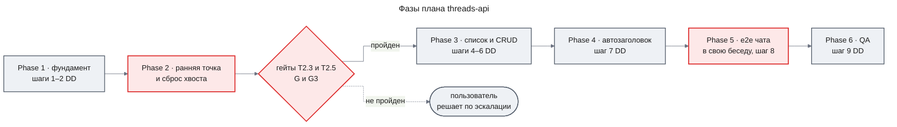
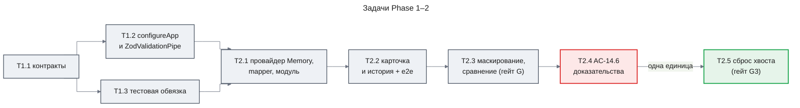
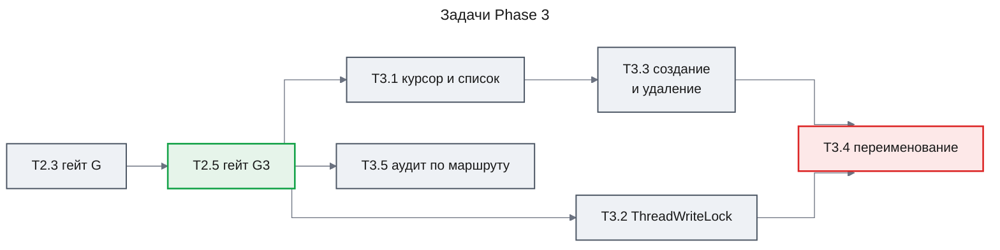
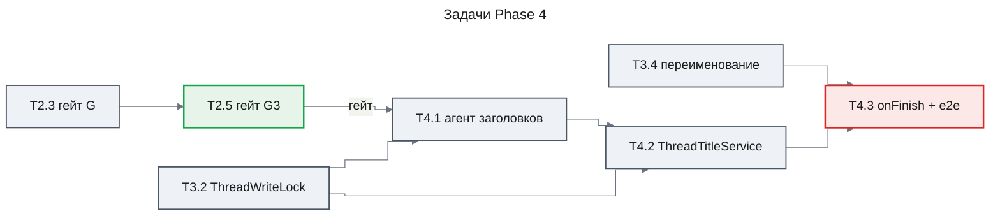
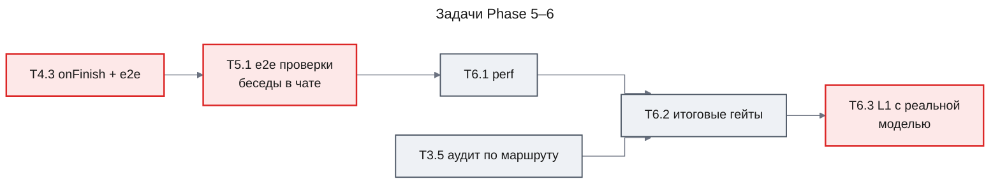

# План работ: chat-shell / `threads-api` — эндпоинты бесед, автозаголовок, контракты

Дата создания: 2026-10-28
Тип: feature
Оценка длительности: 5–7 рабочих дней (20 задач: T1.1–T1.3, T2.1–T2.5, T3.1–T3.5, T4.1–T4.3, T5.1, T6.1–T6.3; 17–18 единиц, готовых к коммиту (стратегия коммитов `manual`) — по одной на T1.1–T6.1, кроме T2.4 и T2.5, которые образуют одну общую единицу; T6.2 — только исправления, T6.3 — без изменений кода)
Оценка объёма: ~33 файла (≈ 22 новых, ≈ 8 изменённых, 3 скелета тестов наполняются)
Ветка: `feature/chat-shell` (слияние в `main` — вместе с `web-shell`)

**Frontmatter — единственный источник последовательности планов.** Часть `threads-api` планируется одним планом (`plan: 1 of 1`); `depends-on` отсутствует, так как план первый. Статус `active`: активирован после пакетного утверждения (в части других планов нет, конфликт `active` исключён).

**Стратегия коммитов фичи: `manual`.** Коммиты делает пользователь (или они создаются по его явной просьбе); исполнители задач и оркестратор сами не коммитят. Задача завершается в состоянии «готово к коммиту (manual-стратегия)»: изменения в рабочем дереве, все гейты задачи пройдены.

## Связанные документы

- PRD: `docs/features/chat-shell/prd.md` v1.5 (Approved) — FR-13…FR-18 (AC-14.5 — обезличенный текст ошибки инструмента, без текста ошибки модели в истории; AC-14.6 — один ответ после перегенерации ответа, прерванного ошибкой модели или обрывом сети), Delivery Parts: `threads-api` (dependsOn: —)
- Design Doc: `docs/features/chat-shell/design-threads-api.md` v1.8 (Approved) — ключевые решения KD-1…KD-5; ранняя точка проверки — шаг 3 (маскирование AC-14.5, правило Output Comparison, проверка AC-14.6); «сброс хвоста» (Element 8, `ThreadsService.discardRepliesAfter`, `ChatMessageRefSchema`) и удаление частей `error` в истории (`maskHistoryErrors`)
- UXRD: `docs/features/chat-shell/uxrd.md` v1.7 (Approved) — только для трассировки (A-5, A-7, D-11, E-8, TH-08 «Restored»/«Regenerating»); UI-компоненты в этой части не реализуются
- ADR: нет (см. «ADR Bindings»)
- Потребитель контракта: `docs/features/chat-shell/design-web-shell.md` v1.5 (Approved; скрывает правку, переключение веток и перегенерацию обычных ответов; перегенерация ответа с ошибкой отправляет то же сообщение пользователя; план не создан, код не написан) — в этой части не реализуется
- Скелеты тестов: `apps/api/test/threads.e2e-spec.ts` (14 `it.todo`), `apps/api/test/chat-threads.e2e-spec.ts` (7 `it.todo`), `apps/api/test/threads.perf.e2e-spec.ts` (2 `it.todo`)

## Правила выполнения (действуют для каждой задачи)

1. **Одна задача — одна единица, готовая к коммиту (manual-стратегия)** на ветке `feature/chat-shell`: исполнитель не коммитит, коммит делает пользователь или он создаётся по его явной просьбе. В сообщениях коммитов **нет** строк `Co-Authored-By`, `Claude-Session`, «Generated with Claude Code» и любых иных упоминаний Claude.
2. **Перед запуском vitest** после любой правки `packages/contracts`: `pnpm --filter @agent-os/contracts build` (dist contracts не пересобирается автоматически при прямом запуске vitest в `apps/api`).
3. **Перед e2e**: `pnpm db:up` (Postgres 16 из `infra/docker-compose.yml`), `apps/api/.env` с `DATABASE_URL`.
4. **Скелеты `it.todo`**: каждый кейс реализуется по своим комментариям Arrange/Act/Assert; превращать todo в пустую заглушку запрещено. Ожидаемые значения — литералы.
5. **Гейты качества задачи** (все — ноль ошибок): `pnpm --filter api lint` (oxlint type-aware), `pnpm --filter api exec tsc --noEmit -p tsconfig.json`, `pnpm --filter api exec prettier --check "src/**/*.ts" "test/**/*.ts"`, `pnpm --filter api test`, `pnpm --filter api test:e2e` (если задача затрагивает e2e или HTTP-поверхность), `pnpm --filter api build`.
6. **Файлы вне Target Files** задачи не меняются; если без этого задачу не выполнить — эскалация, а не расширение объёма.

## Phase Structure Diagram

Phase 2 заканчивается двумя гейтами: **G** (T2.3) — сравнение «живой стрим ↔ история» по правилу Output Comparison после маскирования (AC-14.5 (a)); **G3** (T2.5) — e2e AC-14.6 зелёный после «сброса хвоста»: ошибка модели и обрыв сети → перегенерация → ровно один ответ. Провал любого из них — стоп реализации и эскалация пользователю. «Сброс хвоста» обязателен (DD «ThreadsService», `discardRepliesAfter`). T2.4 — задача доказательств: без «сброса хвоста» перегенерация склеивает ответы (литералы в Notes); красный кейс T2.4 принадлежит T2.5, и обе задачи образуют одну единицу, готовую к коммиту, поэтому ни одна не оставляет дерево красным. Перегенерация и правка обычного ответа своего гейта не имеют: `web-shell` скрывает правку, переключение веток и перегенерацию обычных ответов (PRD Won't Have, `design-web-shell.md`); характеризационный e2e остаётся (литералы ветки перегенерации меняет T2.5). T4.1 может начаться параллельно с Phase 3 после T3.2 (см. ниже).

## Task Dependency Diagram

Ребро `гейт` — T4.1 начинается только после прохождения гейтов G (T2.3) и G3 (T2.5). Задачи Phase 3 и T4.1 зависят от T2.5 напрямую и от T2.3 — через T2.4 и T2.5. Ребро `одна единица` — T2.4 и T2.5 выполняются последовательно, но готовы к коммиту вместе. Параллельно выполнимы: T1.2 ‖ T1.3; T3.1 ‖ T3.2 ‖ T3.5; **T4.1 ‖ T3.1/T3.3–T3.5 после T3.2, только когда гейты G и G3 пройдены** (T4.1 зависит от T2.1 — `ThreadsModule` существует, транзитивно через T2.5 — и от T3.2 — общий `threads.module.ts`; файлов T3.1/T3.3–T3.5 не трогает). T2.3, T2.4 и T2.5 идут строго по порядку: G3 проверяется после G, а T2.5 исправляет то, что доказала T2.4. Прямые зависимости каждой задачи — не глубже двух уровней внутри фазы; исключение — цепочка Phase 2 T2.1 → … → T2.5, из которой T2.1–T2.4 уже выполнены, так что незавершённая часть — один уровень. Межфазная последовательность обеспечивается критериями завершения фаз, кроме явно указанного исключения T4.1.

## Verification Strategy (из Design Doc)

### Correctness Proof Method

- **Correctness definition**: (а) каждый AC из раздела EARS проходит автоматический тест на реальном Postgres; (б) история, возвращаемая `/messages`, эквивалентна тому, что пользователь видел в живом стриме v7 (те же типы и содержимое частей `text`, `reasoning`, `tool-*`, включая замаскированный `errorText`), за исключением зафиксированных `loss_risk: low`; (в) ни один маршрут не раскрывает и не изменяет беседу другого `resourceId`.
- **Verification method**: e2e с mock-моделями; сравнение «живой стрим ↔ история» — в e2e собрать `UIMessage` из SSE-ответа (`readUIMessageStream` из `ai`) и сравнить части с ответом `/messages` по правилу Output Comparison (Reference Contract Values); ручная L1-проверка с реальной моделью.
- **Verification timing**: (а)–(в) — на шаге 3 DD (ранняя точка) = **Phase 2** этого плана, затем по каждому срезу; L1 — после слияния с `web-shell` (в этой части — ручной прогон API, T6.3).

### Early Verification Point

- **First verification target**: срез «`GET /api/threads/:id/messages`» (шаг 3 DD) на реальном Postgres с mock-моделью ассистента, выдающей reasoning + успешный и падающий инструмент — **Phase 2, задачи T2.2–T2.5**. Шаг 3 включает `stream-error-text.ts` (`onError` чата переводится на него), маскирование истории в `listMessages` и проверку AC-14.6; сравнение со стримом проходит после маскирования.
- **Success criteria**: ответ проходит `ThreadMessagesResponseSchema` и `safeValidateUIMessages`; части совпадают с литералами; чужой и несуществующий id → одинаковый 404; сравнение со SSE-стримом по правилу Output Comparison совпадает полностью, `errorText` — `'Agent error'` с обеих сторон (**гейт G**, T2.3 — пройден).
- **Failure response (G)**: если конвертация теряет данные, видимые в стриме, или после маскирования остаётся расхождение вне правила Output Comparison, — остановиться, зафиксировать расхождение и вынести на пользователя как изменение PRD, не писать собственный конвертер без согласования.
- **Проверка AC-14.6** — две задачи Phase 2, обе до шагов 4–8 DD:
  - T2.4 (доказательства): ошибка модели посреди стрима → хранимое состояние «частичное» → перегенерация тем же сообщением пользователя → склейка `[['user', ['Вопрос']], ['assistant', ['Частичный', 'Ответ 2']]]` (Notes). Так ведёт себя перегенерация без «сброса хвоста»; DD требует его (DD «ThreadsService», `discardRepliesAfter`).
  - T2.5 (**гейт G3**): «сброс хвоста» (`ChatMessageRefSchema`, `ThreadsService.discardRepliesAfter`, вызов в `ChatController.chat` после `getOwnedThread` и до `agent.stream`) и удаление частей `error` в истории (`maskHistoryErrors`, AC-14.5 (b)). G3 пройден, когда e2e AC-14.6 зелёный с неизменным литералом шага 2 и новыми утверждениями шага 1, вариант «обрыв сети» зелёный, характеризационный кейс — с новыми литералами.
- **Пункты Certainty DD, проверяемые в T2.5**: «сброс хвоста» даёт ровно один ответ (medium) — e2e AC-14.6; хранимое состояние после обрыва сети того же класса, что после ошибки модели (low) — вариант «обрыв сети». Не подтвердилось — **стоп реализации**, красный кейс остаётся красным, эскалация пользователю с литералами `/messages` и числом строк `mastra_messages` после обрыва (или ошибки) и после перегенерации.
- **Перегенерация и правка обычного ответа** — своего гейта нет: `web-shell` скрывает правку, переключение веток и перегенерацию обычных ответов. Характеризационный e2e остаётся: ветка перегенерации после T2.5 подтверждает, что «сброс хвоста» не различает ответ с ошибкой и успешный; ветка правки фиксирует ограничение Mastra (отброшенная ветка остаётся) и краснеет при его смене.

### Proof Strategy

- **Источник обязательств доказательства**: аннотации скелетов (`Primary failure mode`, `@category`, `@dependency`) + основной режим отказа каждого AC + применимые категории Failure Mode Checklist.
- **Распространение на задачи**: каждая задача ниже содержит «Proof obligations» — что тест обязан опровергнуть, чтобы считаться доказательством, а не прогоном.

## Quality Assurance Mechanisms (из Design Doc)

| Mechanism | Enforces | Config/Source | Covered Files | Type |
|---|---|---|---|---|
| oxlint type-aware (`typescript/no-floating-promises: error`) | Нет висящих промисов (фоновый заголовок только через `schedule()`), типовые ошибки | `apps/api/.oxlintrc.json`, `apps/api/package.json` (`lint`) | `apps/api/src/`, `apps/api/test/` | executable_check |
| TypeScript `strict`, `nodenext`, `.js`-суффиксы импортов | Строгие типы, без `as`-обхода для `toAISdkMessages` | `apps/api/tsconfig.json`, `packages/contracts/tsconfig.json` | `apps/api/src/`, `apps/api/test/`, `packages/contracts/src/` | executable_check |
| Prettier | Форматирование | `apps/api/.prettierrc` | `apps/api/src/**/*.ts`, `apps/api/test/**/*.ts` | executable_check |
| Vitest unit (`**/*.spec.ts`) + coverage v8 | Unit-поведение; покрытие ≥ 80 % нового кода | `apps/api/vitest.config.ts`, `@vitest/coverage-v8` | `apps/api/src/threads/`, `apps/api/src/common/`, `apps/api/src/audit/` | executable_check |
| Vitest e2e (`**/*.e2e-spec.ts`) на реальном Postgres | AC на HTTP-уровне | `apps/api/vitest.config.e2e.ts`, `infra/docker-compose.yml` | `apps/api/test/` | executable_check |
| `nest build` | Сборка production-кода | `apps/api/tsconfig.build.json`, `apps/api/nest-cli.json` | `apps/api/src/` | executable_check |
| `tsc` contracts | Сборка `@agent-os/contracts` (ESM, dist) | `packages/contracts/package.json`, `turbo.json` (`^build`) | `packages/contracts/src/` | executable_check |
| AC-18.3: `ChatRequestSchema` неизменен, `test/app.e2e-spec.ts` без правок | Обратная совместимость тела чата | `packages/contracts/src/index.ts`, `apps/api/test/app.e2e-spec.ts` | эти два файла (`git diff --exit-code` по ним, кроме одной строки re-export) | passive_constraint |
| Одна точка проверки владельца (`ThreadsService.getOwnedThread`) до `recall`/`updateThread`/`deleteThread`/`deleteMessages`/`agent.stream` | Нет IDOR | DD «Security Considerations» | `apps/api/src/threads/threads.service.ts`, `apps/api/src/chat/chat.controller.ts` | passive_constraint |
| `Memory.deleteMessages` получает только `id` из `recall` беседы владельца; `id` из тела запроса только сравнивается | «Сброс хвоста» не удаляет чужие сообщения (`deleteMessages` своей проверки не имеет) | DD «ThreadsService» (`discardRepliesAfter`, «Владение и IDOR»), «Security Considerations» | `apps/api/src/threads/threads.service.ts` | passive_constraint |
| Тело 404 строится только `threadNotFound()` | Неразличимость чужой/отсутствующей беседы | DD «Error Handling», `threads.errors.ts` | `apps/api/src/threads/` | passive_constraint |
| PII в логах: без `error.message`, текста сообщений и заголовков; строка `usage agent=thread-title` — только id и числа токенов | Логи заголовков | DD «Logging and Monitoring» | `apps/api/src/threads/thread-title.service.ts` | passive_constraint |
| Единственный источник текстов ошибок, видимых клиенту (`AGENT_ERROR_TEXT`, `toStreamErrorText`) | Стрим и история показывают один текст; сырой текст ошибки инструмента или модели не уходит клиенту (AC-14.5) | DD «Общий текст ошибки стрима», `apps/api/src/common/stream-error-text.ts` | `apps/api/src/chat/chat.controller.ts` (`onError`), `apps/api/src/threads/thread.mapper.ts` (`maskHistoryErrors`) | passive_constraint |
| Без миграций и новых таблиц | Система записи — `mastra_threads`/`mastra_messages` | DD «Agreement Checklist» | project-wide | passive_constraint |

## Design-to-Plan Traceability

| Design Doc | DD Section | DD Item | Category | Covered By Task(s) | Gap Status | Notes |
|---|---|---|---|---|---|---|
| design-threads-api.md | Contract Definitions | `packages/contracts/src/threads.ts`: константы, `ThreadIdSchema`, `ThreadSummarySchema`, `ThreadListQuerySchema`, `ThreadListResponseSchema`, `RenameThreadRequestSchema`, `HistoryMessage*Schema`, `ThreadMessagesResponseSchema`, `ThreadsErrorCodeSchema`, `ApiErrorSchema` | contract-change | T1.1 | covered | AC-18.1 |
| design-threads-api.md | Contract Definitions / Data Representation Decision | `ChatMessageRefSchema` + тип `ChatMessageRef` в `threads.ts` (`z.looseObject`: `id` — непустая строка, `role` — строка, прочие поля допускаются); `ChatRequestSchema` не меняется | contract-change | T2.5 | covered | AC-14.6; без собственного теста (объявление схемы), поведение проверяется e2e AC-14.6 |
| design-threads-api.md | Contract Definitions | `index.ts`: одна строка `export * from './threads.js'` | contract-change | T1.1 | covered | AC-18.3 |
| design-threads-api.md | AC-18.3 | `ChatRequestSchema` неизменен; `app.e2e-spec.ts` проходит без правок | verification | T1.1, T5.1, T6.2 | covered | |
| design-threads-api.md | Test Strategy / Unit | `contracts.spec.ts` (200/201, `'   '`, `''`, `title: null`, фикстуры `ChatRequestSchema`) | verification | T1.1 | covered | |
| design-threads-api.md | Element 6 | `ZodValidationPipe` + `zod ^4.6.7` в `apps/api` + `zod-validation.pipe.spec.ts` | impl-target | T1.2 | covered | |
| design-threads-api.md | Element 7 / Integration Point 4 | `configureApp(app)` в `app.setup.ts`, `main.ts` использует его | connection-switching | T1.2 | covered | |
| design-threads-api.md | Test Strategy / обвязка | `test/support/`: `createTestApp`, `mockModels.ts`, `seed.ts` | prerequisite | T1.3 (MASTRA), T4.3 (THREAD_TITLE_AGENT, сценарии заголовков) | covered | |
| design-threads-api.md | Integration Point 1 | Клиент `pg` на `DATABASE_URL` для `SELECT count(*)` | prerequisite | T1.3, T3.3 | covered | |
| design-threads-api.md | Implementation Order шаг 3 | `THREAD_MEMORY` provider + `instanceof Memory` fail fast | connection-switching | T2.1 | covered | |
| design-threads-api.md | Main Components | `threads.errors.ts`: `threadNotFound()`, `isMastraUserError()` | impl-target | T2.1 | covered | |
| design-threads-api.md | Main Components | `thread.mapper.ts` + `thread.mapper.spec.ts` (`''`→`null`, ISO `Z`) | impl-target | T2.1 | covered | |
| design-threads-api.md | Main Components / Общий текст ошибки стрима | `stream-error-text.ts`: `AGENT_ERROR_TEXT`, `toStreamErrorText(error)` + `stream-error-text.spec.ts` | impl-target | T2.3 | covered | AC-14.5 |
| design-threads-api.md | Main Components / Общий текст ошибки стрима; Implementation Path Mapping | `onError` в `ChatController.chat` возвращает `toStreamErrorText(error)` (тексты прежние, логирование без `as`) | connection-switching | T2.3 | covered | |
| design-threads-api.md | Main Components / `maskHistoryErrors` | Маскирование `errorText` частей `tool-*` и `dynamic-tool` в `output-error` + кейсы `thread.mapper.spec.ts` | impl-target | T2.3 | covered | AC-14.5 (a); реализовано под именем `maskToolErrorText` |
| design-threads-api.md | Main Components / `maskHistoryErrors`; Interface Change Matrix | Переименование `maskToolErrorText` → `maskHistoryErrors` (та же сигнатура; потребители — `ThreadsService.listMessages`, `thread.mapper.spec.ts`); удаление частей `type === 'error'`; сообщение с пустым `parts` не удаляется; кейсы «`text 'Частичный'` + `error`» и «только `error`» | impl-target | T2.5 | covered | AC-14.5 (b) |
| design-threads-api.md | Integration Point 5 | `ThreadsModule`; `AppModule` импортирует его | connection-switching | T2.1 | covered | |
| design-threads-api.md | Main Components | `ThreadsService.getOwnedThread`, `get`, `listMessages` (`perPage: false`, `createdAt ASC`, `toAISdkMessages v7`, без `as`) | impl-target | T2.2 | covered | |
| design-threads-api.md | Main Components / Data Contract `listMessages` | `listMessages`: `ThreadMessagesResponseSchema.parse` → маскирование (после разбора схемой, без `as`); вызов `maskHistoryErrors` | impl-target | T2.3, T2.5 | covered | AC-14.5 |
| design-threads-api.md | Contract Definitions | `GET /api/threads/:threadId`, `GET /api/threads/:threadId/messages` | impl-target | T2.2 | covered | |
| design-threads-api.md | AC-14.1 | 12 сообщений, порядок, `safeValidateUIMessages`, литералы `reasoning`/`tool-getWeather`/`tool-failing` | verification | T2.2; литерал `errorText: 'Agent error'` — T2.3 | covered | e2e T2.2 обновляется в T2.3 вслед за маскированием |
| design-threads-api.md | AC-14.5 (a) | История: `tool-<name>`/`dynamic-tool` в `output-error` с `errorText` = `'Agent error'`; сырой текст не возвращается, в `mastra_messages` остаётся `'boom'` | verification | T2.3 | covered | unit mapper + e2e сравнения |
| design-threads-api.md | AC-14.5 (b) | История: части `error` нет, ответ ассистента — только с частями до ошибки; сырой `'mock stream failure'` не возвращается | verification | T2.5 | covered | unit mapper; e2e AC-14.6 шаг 1 (типы частей `['text']`, `safeValidateUIMessages`, нет `'mock stream failure'`) |
| design-threads-api.md | AC-14.2, AC-14.3 | Чужая/несуществующая → одинаковый 404 | verification | T2.2 | covered | |
| design-threads-api.md | Verification Strategy (б) / Output Comparison | Сравнение SSE ↔ `/messages`: исключены `step-start`, `providerMetadata`, `reasoning.id`, `text.state`; `errorText` = `'Agent error'` с обеих сторон | verification | T2.3 | covered | Гейт G |
| design-threads-api.md | AC-14.6 / Test Strategy / Integration Point 2a | Ошибка модели посреди стрима → перегенерация → ровно одно сообщение ассистента `['Ответ 2']`, 2 строки | verification | T2.4 (первый прогон — склейка, доказательства), T2.5 (зелёный после «сброса хвоста») | covered | Гейт G3 — T2.5 |
| design-threads-api.md | AC-14.6 / Test Strategy, вариант «обрыв сети»; Verification (Certainty: low) | Обрыв SSE клиентом после `'Частичный'` → перегенерация → тот же литерал, 2 строки; хранимое состояние после обрыва записывается | verification | T2.5 | covered | Иное хранимое состояние, которое «сброс хвоста» не обрабатывает, — стоп и эскалация |
| design-threads-api.md | Verification (Certainty: medium) | «Сброс хвоста» даёт ровно один ответ: Mastra загружает историю после удаления и пишет новый ответ отдельным сообщением | verification | T2.5 | covered | e2e AC-14.6 |
| design-threads-api.md | Контракт для `web-shell` п. 6 / находка 14 | Хранимое состояние после ошибки модели без перегенерации — частичное (сообщение пользователя, ответ с тем же `id`, что в SSE `start`, 2 строки) | verification | T2.4 (наблюдение в Notes), T2.5 (шаг 1 e2e AC-14.6) | covered | Записано в DD п. 6 |
| design-threads-api.md | Early Verification Point / находка 12; Test Strategy (характеризация) | Характеризация: ветка перегенерации — `[['user', ['Вопрос']], ['assistant', ['Ответ 2']]]`, 2 строки (без проверки того же `id`); ветка правки — 4 сообщения, 4 строки | verification | T2.4 (литералы находки 12), T2.5 (новые литералы) | covered | Правка и ветвление скрыты в `web-shell`; ветка правки краснеет при смене поведения Mastra |
| design-threads-api.md | Element 8 / ThreadsService `discardRepliesAfter` шаги 2–5 / Data Contract `discardRepliesAfter` | `discardRepliesAfter(input: DiscardRepliesInput)`: `recall` 20 самых новых (`createdAt DESC`, `page 0`, `includeTotal: false`, возвращаются от старых к новым) → хвост после последнего `user` → `deleteMessages` с `id` хвоста, только если `id` = `userMessageId`, хвост не пуст и весь `assistant`; ошибки пробрасываются | impl-target | T2.5 | covered | AC-14.6; IDOR — только `id` из `recall` |
| design-threads-api.md | Test Strategy / Unit `threads.service.spec.ts` | Таблица случаев `discardRepliesAfter` (6 строк, сообщения от старых к новым) + литерал аргументов `recall` | verification | T2.5 | covered | Файл создаётся в T2.5, T3.4 дополняет его кейсами `rename`/`getOwnedThread` |
| design-threads-api.md | ThreadsService шаг 1; Implementation Path Mapping; Change Impact Map; Integration Point 1 | `ChatController.chat`: `getOwnedThread` → разбор последнего элемента `body.messages` `ChatMessageRefSchema.safeParse` (без `as`; не разобран, `role` ≠ `'user'`, пустой массив → не вызывается) → `discardRepliesAfter` → `agent.stream` | connection-switching | T2.5 | covered | `getOwnedThread` в чате перенесён из T5.1 (см. Implementation Phases, «Отклонение от порядка DD»); e2e AC-16.1 — T5.1 |
| design-threads-api.md | Interface Change Matrix | `POST /api/chat/:agentId` с тем же последним сообщением пользователя: хранимый ответ удаляется до `agent.stream`, новый — отдельное сообщение; обычная отправка и правка ничего не удаляют | verification | T2.5 | covered | e2e AC-14.6, характеризация; AC-14.1 (12 сообщений) остаётся зелёным |
| design-threads-api.md | Error Handling | Ошибка `recall`/`deleteMessages` при «сбросе хвоста» → 500 до SSE; беседа удалена между `getOwnedThread` и `recall` → 500 до SSE | impl-target | T2.5 | covered | Ошибки не перехватываются; отдельного теста DD не задаёт |
| design-threads-api.md | Element 3 / thread-cursor.ts | `encodeThreadCursor`, `decodeThreadCursor` (400 `INVALID_CURSOR`), `selectThreadPage(input)` + `thread-cursor.spec.ts` | impl-target | T3.1 | covered | |
| design-threads-api.md | Element 3 Step 1 | AC-13.2a: поднятая или созданная во время обхода беседа не возвращается в последующих страницах; клиент получает её перечитыванием первой страницы | verification | T3.1 (unit), T3.4 (e2e) | covered | |
| design-threads-api.md | Contract Definitions | `GET /api/threads?cursor` | impl-target | T3.1 | covered | |
| design-threads-api.md | AC-13.1, AC-13.2 | Изоляция и порядок; 6×20 без повторов | verification | T3.1 | covered | |
| design-threads-api.md | AC-13.2a | Удаление/подъём во время обхода: литералы 119/79/19 | verification | T3.1 (unit), T3.4 (e2e) | covered | |
| design-threads-api.md | Element 4 | `ThreadWriteLock` + `thread-write-lock.spec.ts` | impl-target | T3.2 | covered | |
| design-threads-api.md | Element 1 / Data Contract create | `POST /api/threads` → 201, `crypto.randomUUID()`, `title: null`, тело игнорируется | impl-target | T3.3 | covered | |
| design-threads-api.md | Data Contract delete | `DELETE` → 204; каскад; 404 повторно/чужая | impl-target | T3.3 | covered | AC-16.1 (часть threads), 16.2, 16.3 |
| design-threads-api.md | Data Contract rename | `rename(input)` под lock; `MastraError` USER / `null` при перечитывании → 404; иначе исходная ошибка; `.catch(() => undefined)` | impl-target | T3.4 | covered | |
| design-threads-api.md | Test Strategy / Unit | `threads.service.spec.ts` (ветки `rename`, `getOwnedThread`) | verification | T3.4 | covered | Дополняет файл, созданный в T2.5 |
| design-threads-api.md | AC-15.1, AC-15.2, AC-15.3 | Обрезка, 400 `VALIDATION_FAILED`, 404 | verification | T3.4 | covered | |
| design-threads-api.md | AC-13.3 | 401 на шести маршрутах в production | verification | T3.4 | covered | |
| design-threads-api.md | Integration Point 3 | `AuditInterceptor`: `params.threadId ?? (params.agentId ? body.threadId ?? body.id : undefined)` + `audit.interceptor.spec.ts` | connection-switching | T3.5 | covered | |
| design-threads-api.md | Title Agent | `createThreadTitleAgent`, `THREAD_TITLE_INSTRUCTIONS`, `normalizeGeneratedTitle` + spec | impl-target | T4.1 | covered | |
| design-threads-api.md | Element 5 | `TITLE_MODEL` (по умолчанию `ASSISTANT_MODEL`) в провайдере и `.env.example` | impl-target | T4.1 | covered | |
| design-threads-api.md | ThreadTitleService алгоритм 1–6 | `schedule`, чтение первого сообщения из `Memory`, таймаут 8 000, `throwIfAborted`, запись под lock, лог, повтор | impl-target | T4.2 | covered | |
| design-threads-api.md | ThreadTitleService шаг 3 / Logging and Monitoring / Data Contract `schedule` | `log`-строка `usage agent=thread-title thread=<id> input=<n> output=<n>` после каждого разрешённого `generate` (total usage, 0 при отсутствии) + unit-кейс 12/5 | impl-target | T4.2 | covered | Риск стоимости PRD; Change Impact Map (Indirect) |
| design-threads-api.md | ThreadTitleService шаг 5 | `reason = signal.aborted ? 'TimeoutError' : error.name`; unit-кейс «таймаут с обёрнутой ошибкой» (`new Error('wrapped')`) | impl-target | T4.2 (код и тест) | covered | |
| design-threads-api.md | ThreadTitleService шаг 2 | Обрезка текста первого сообщения до 2 000 символов | impl-target | T4.2 (unit: 2 500 → ровно 2 000) | covered | |
| design-threads-api.md | ThreadTitleService | `beforeApplicationShutdown` → `Promise.allSettled(pending)` | impl-target | T4.2 | covered | |
| design-threads-api.md | Integration Point 1 (DD Integration Points List: автозаголовок); Integration Point 5 | `onFinish` → `ThreadTitleService.schedule`; `ChatModule.imports: [ThreadsModule]` | connection-switching | T4.3 (`schedule`), T2.5 (`ChatModule.imports`) | covered | |
| design-threads-api.md | AC-17.1, AC-17.2, AC-17.3 | e2e автозаголовка | verification | T4.3 | covered | |
| design-threads-api.md | Integration Point 1 (чат) / AC-16.1 | `getOwnedThread` перед `agent.stream`; 404 до стрима | connection-switching | T2.5 (код), T5.1 (e2e) | covered | e2e — последним (шаг 8): нужны `DELETE` и список |
| design-threads-api.md | Interface Change Matrix | Чужая беседа в чате: 500 → 404 | verification | T5.1 | covered | |
| design-threads-api.md | AC-13.4, AC-14.4 | p95 ≤ 300 / ≤ 500 мс | verification | T6.1 | covered | |
| design-threads-api.md | Test Strategy | Покрытие `apps/api/src/threads` и `common` ≥ 80 % | verification | T6.2 | covered | |
| design-threads-api.md | Проверка версий `ai` | `pnpm why -r ai` (api 7.0.148, web 7.0.155); `tsc --noEmit` по `test/support` без `as` | verification | T1.3 (выполнено), T6.2 (повтор `pnpm why -r ai`) | covered | Ручная проверка чата из web — L1 после слияния с `web-shell` |
| design-threads-api.md | Risks | Тексты ошибок стрима и истории расходятся при будущей правке одного пути | verification | T2.3 | covered | e2e сравнения требует совпадения `errorText` |
| design-threads-api.md | Performance Tests; Verification («Стоимость сброса хвоста») | Метрика № 10 (первый токен) — ручное сравнение до/после, 5 прогонов; добавлены SELECT по PK и `recall` ≤ 20 строк на отправку | verification | T6.3 | covered | «До» — `main` 83fd532 в git worktree |
| design-threads-api.md | Verification (Certainty: medium) | Реальная модель заголовков ≤ 8 с, язык сообщения — 20 бесед (метрика № 7) | verification | T6.3 | covered | |
| design-threads-api.md | Integration Verification Points | Фоновая запись заголовка параллельно с `PATCH` на реальной БД | verification | T4.3 | covered | AC-17.2 e2e + unit-гонка в T4.2 |
| design-threads-api.md | Контракт для `web-shell` п. 1–9 | Потребление контракта | — | — | gap | Вне части: реализует `web-shell`; здесь контракт обеспечивается схемами (T1.1, T2.5) и поведением (T2–T5; п. 6 — замаскированный `errorText` в T2.3, удаление частей `error` и «сброс хвоста» в T2.5) |
| design-threads-api.md | Future Extensibility | SQL keyset, `titlePinned`, advisory lock, `data-thread-title` | — | — | gap | Намеренно отложено Design Doc; задач нет |
| design-threads-api.md | Risks | Гонка удаления между `getOwnedThread` и `agent.stream`; осиротевшие сообщения после удаления; беседы до релиза со склеенными ответами и ветками правки; «сброс хвоста» при повторной отправке того же сообщения не для перегенерации (две вкладки, повтор после сбоя) | — | — | gap | Принято Design Doc как риск без задачи |

## Reference Contract Values

| Design Doc (§ Section) | Contract Type | Required Observable Value (verbatim) | Covered By Task(s) |
|---|---|---|---|
| design-threads-api.md (§ Contract Definitions, `threads.ts`) | structure-order | `export const THREAD_PAGE_SIZE = 20;` | T1.1, T3.1 |
| design-threads-api.md (§ Contract Definitions, `threads.ts`) | structure-order | `export const THREAD_TITLE_MAX_LENGTH = 200;` / `export const GENERATED_THREAD_TITLE_MAX_LENGTH = 80;` | T1.1, T3.4, T4.1 |
| design-threads-api.md (§ AC-13.1) | structure-order | «отсортированные по `updatedAt` по убыванию (при равенстве — по `id` по убыванию)» | T3.1 |
| design-threads-api.md (§ thread-cursor.ts) | derived-display | «`encodeThreadCursor(t: { updatedAt: Date; id: string }): string` — base64url(`JSON.stringify({ u: t.updatedAt.getTime(), i: t.id })`)»; «`isAfter(t, c) = t.u < c.u \|\| (t.u === c.u && t.i < c.i)`» | T3.1 |
| design-threads-api.md (§ Test Strategy, `thread-cursor.spec.ts`) | state-lifecycle-negative | «поднятый id отсутствует в страницах 3–6; объединение страниц 1–6 равно 119 id (все 120, кроме поднятого; удалённый id присутствует только на странице 1, выданной до удаления) без повторов; страницы 3–6 содержат ровно 79 оставшихся id (позиции 41–120 исходного порядка без поднятого) и не содержат удалённый id; страница 6 содержит 19 элементов и `nextCursor: null`» | T3.1 (unit), T3.4 (e2e) |
| design-threads-api.md (§ Test Strategy, `threads.e2e-spec.ts` 13.2a) | state-lifecycle-negative | «следующий запрос первой страницы без `cursor` возвращает поднятую беседу первой» | T3.4 |
| design-threads-api.md (§ AC-13.2) | structure-order | «6 страниц по 20 бесед, объединение которых содержит все 120 `id` без повторов; на последней странице `nextCursor = null`» | T3.1 |
| design-threads-api.md (§ Integration Points, Integration Point 1) | state-lifecycle-negative | «`SELECT count(*) FROM mastra_messages WHERE thread_id = $1` через клиент `pg` (прямая зависимость `apps/api`) на `DATABASE_URL` возвращает литерал `0`» | T3.3 |
| design-threads-api.md (§ Code Inspection Evidence, находка 7) | structure-order | `{"message":"Thread not found","error":"Not Found","statusCode":404,"errorCode":"THREAD_NOT_FOUND"}` | T2.1, T2.2, T3.3, T3.4, T5.1 |
| design-threads-api.md (§ Contract Definitions) | structure-order | `export const ThreadsErrorCodeSchema = z.enum(['THREAD_NOT_FOUND', 'VALIDATION_FAILED', 'INVALID_CURSOR']);` | T1.1 |
| design-threads-api.md (§ ZodValidationPipe) | derived-display | «`BadRequestException({ statusCode: 400, error: 'Bad Request', errorCode: 'VALIDATION_FAILED', message: issues.map(i => `${i.path.join('.') \|\| '(root)'}: ${i.message}`) })`» | T1.2 |
| design-threads-api.md (§ thread-cursor.ts) | derived-display | «`BadRequestException('Invalid cursor', { errorCode: 'INVALID_CURSOR' })`» | T3.1 |
| design-threads-api.md (§ Field Propagation Map) | derived-display | «`'' → null; иначе как есть`» (`ThreadSummary.title`); даты — «`Date.toISOString()` — миллисекундная точность» | T2.1 |
| design-threads-api.md (§ Contract Definitions) | structure-order | `POST /api/threads` → «201 `ThreadSummary`»; `DELETE /api/threads/:threadId` → «204 без тела» | T3.3 |
| design-threads-api.md (§ Logging and Monitoring) | derived-display | «`ThreadTitleService`: `warn` при ошибке/таймауте/пустом результате: `Title generation failed thread=<id> reason=<reason>`: `TimeoutError`, когда `signal.aborted === true` (в том числе при отклонении `generate` обёрнутой ошибкой после прерывания), иначе `error.name`; пустой результат — `EmptyTitle`, плюс `statusCode=<n>` и `code=<c>`, когда они есть у ошибки (ошибки провайдера модели); `debug` при пропуске (title уже есть). `error.message`, текст сообщений и заголовков в лог не пишутся.» | T4.2 |
| design-threads-api.md (§ Test Strategy, `thread-title.service.spec.ts`) | derived-display | «`warn` вызван ровно с `'Title generation failed thread=t-1 reason=TimeoutError'`, `updateThread` не вызван» | T4.2 |
| design-threads-api.md (§ ThreadTitleService шаг 5) | derived-display | «`reason = signal.aborted ? 'TimeoutError' : error.name` (сигнал создаётся до `generate` и виден в `catch`; до шага 3 сигнала нет — `reason = error.name`)»; Test Strategy: «фейковый агент ждёт события `abort` на переданном `abortSignal` и **отклоняется** `new Error('wrapped')` → `warn` вызван ровно с `'Title generation failed thread=t-1 reason=TimeoutError'`, `updateThread` не вызван» | T4.2 |
| design-threads-api.md (§ ThreadTitleService, шаг 3) | derived-display | «`throwIfAborted()` бросает `signal.reason` — `DOMException` с `name === 'TimeoutError'` (так `AbortSignal.timeout` помечает истечение времени; `AbortError` — только для ручного `abort()`)» | T4.2 |
| design-threads-api.md (§ ThreadTitleService, Dependencies) | structure-order | «`THREAD_TITLE_TIMEOUT_MS` … `ThreadsModule` даёт `useValue: 8_000`»; unit: «`THREAD_TITLE_TIMEOUT_MS = 20`» | T4.2 |
| design-threads-api.md (§ Test Strategy, `thread-title.service.spec.ts`) | structure-order | «`recall` вызван с `{ threadId: 't-1', resourceId: 'u-1', perPage: 1, page: 0, orderBy: { field: 'createdAt', direction: 'ASC' }, includeTotal: false }`» | T4.2 |
| design-threads-api.md (§ Title Agent) | derived-display | «Сформулируй короткий заголовок беседы по сообщению пользователя: до 6 слов и не длиннее 80 символов, на том же языке, что и сообщение. Не повторяй сообщение дословно. Без кавычек, двоеточий, эмодзи и точки в конце. Ответь только заголовком.» | T4.1 |
| design-threads-api.md (§ Field Propagation Map, автозаголовок) | derived-display | «удаление <think>…</think>, первая непустая строка, снятие обрамляющих кавычек «»\"'`, схлопывание пробелов, обрезка до 80 символов по границе символа, trim» | T4.1 |
| design-threads-api.md (§ ThreadTitleService, шаг 2) | derived-display | «конкатенация `first.content.parts` с `type === 'text'`, `trim`, обрезка до 2 000 символов» | T4.2 |
| design-threads-api.md (§ Interface Change Matrix) | derived-display | `params.threadId ?? (params.agentId ? body.threadId ?? body.id : undefined)` | T3.5 |
| design-threads-api.md (§ AC-16.1) | state-lifecycle-negative | «**и отвечать 404 `THREAD_NOT_FOUND` на `POST /api/chat/:agentId` с этим `id`**, не создавая беседу» | T5.1 |
| design-threads-api.md (§ Test Strategy, perf) | structure-order | «5 прогревочных + 50 последовательных запросов; p95 (по отсортированным длительностям, индекс `ceil(0.95·n)−1`) ≤ 300 / ≤ 500 мс» | T6.1 |
| design-threads-api.md (§ AC-17.1) | derived-display | «не позднее 10 с записать заголовок длиной 1…80 символов без кавычек и переводов строк»; e2e: ««План отпуска на Байкал» в течение 10 с (опрос 100 мс)» | T4.3 |
| design-threads-api.md (§ Test Strategy, `threads.service.spec.ts`) | state-lifecycle-negative | «`updateThread` бросает `new Error('db down')`, а повторное `getThreadById` отклоняется (`new Error('re-read failed')`) → выброшен исходный объект ошибки `updateThread` (`toBe`), не 404 и не ошибка повторного чтения» | T3.4 |
| design-threads-api.md (§ Element 3 Step 1) | state-lifecycle-negative | «беседа, поднятая или созданная во время обхода, не возвращается в последующих страницах этого обхода (клиент получает её перечитыванием первой страницы)» | T3.1 (unit), T3.4 (e2e) |
| design-threads-api.md (§ Общий текст ошибки стрима) | derived-display | «`AGENT_ERROR_TEXT = 'Agent error'`; `toStreamErrorText(error: unknown): string` — `Error` со свойством `statusCode` → `Model provider error (<statusCode>)`, иначе `Agent error`. Чистая функция без логирования и без `as`.» | T2.3 |
| design-threads-api.md (§ Test Strategy, `stream-error-text.spec.ts`) | derived-display | «`new Error('boom')` → `'Agent error'`; ошибка со `statusCode: 529` → `'Model provider error (529)'`; не-`Error` значение (`'x'`) → `'Agent error'`.» | T2.3 |
| design-threads-api.md (§ `maskHistoryErrors`) | derived-display | «`maskHistoryErrors(messages: HistoryMessage[]): HistoryMessage[]` — чистая функция, единственное место, где история освобождается от сырого текста ошибок (AC-14.5)»: «часть, у которой `type` начинается с `tool-` или равен `dynamic-tool`, а `state === 'output-error'`, → копия с `errorText: AGENT_ERROR_TEXT`»; «часть с `type === 'error'` (ошибка модели посреди стрима) → удаляется»; «остальные части и сообщения — без изменений; сообщение не удаляется, даже если `parts` стал пустым.» | T2.3 (маскирование), T2.5 (имя, удаление частей `error`) |
| design-threads-api.md (§ Test Strategy, `thread.mapper.spec.ts`) | derived-display | «`maskHistoryErrors` (AC-14.5): часть `tool-failing` `output-error` с `errorText: 'boom'` → `'Agent error'`; часть `dynamic-tool` `output-error` → `'Agent error'`; ответ с частями `text 'Частичный'` и `{ type: 'error', error: { name: 'Error', message: 'mock stream failure' } }` → те же `id` и `role`, части — только `text 'Частичный'`; ответ из одной части `error` → тот же `id`, `parts: []`; `tool-getWeather` `output-available` и части `text`/`reasoning` возвращаются без изменений (`toEqual` с литералами).» | T2.3, T2.5 |
| design-threads-api.md (§ ThreadsService, `listMessages`) | structure-order | «проверка владельца → `recall` (`perPage: false`, `createdAt ASC`) → `toAISdkMessages(…, { version: 'v7' })` → `ThreadMessagesResponseSchema.parse` → `maskHistoryErrors`.» | T2.3, T2.5 |
| design-threads-api.md (§ AC-14.5) | state-lifecycle-negative | «(b) **If** ответ модели завершился ошибкой, **then** the system shall не возвращать часть `error`, а сообщение ассистента вернуть только с частями, сохранёнными до ошибки. Исходный текст ошибки инструмента или модели в ответ не попадает.» | T2.5 |
| design-threads-api.md (§ Contract Definitions, `ChatMessageRefSchema`) | structure-order | «`ChatMessageRefSchema` (`packages/contracts/src/threads.ts`, тип `ChatMessageRef`) — структурная ссылка на элемент `body.messages`, `z.looseObject`»; поля: «`id` \| строка \| непустая»; «`role` \| строка \| обязательна \| Мера применяется только к `'user'`»; «прочие поля \| любые \| допускаются» | T2.5 |
| design-threads-api.md (§ ThreadsService, `discardRepliesAfter`) | state-lifecycle-negative | «`ChatController` разбирает последний элемент `body.messages` схемой `ChatMessageRefSchema` (`safeParse`, без `as`). Не разобран, `role` не `'user'` или массив пуст — метод не вызывается, отправка обычная.»; «Хвост удаляется (`Memory.deleteMessages` с `id` хвоста) только когда одновременно: `id` этого сообщения равен `userMessageId`; хвост не пуст; каждое сообщение хвоста имеет роль `assistant`. Иначе ничего не удаляется.»; «Ошибка `recall` или `deleteMessages` пробрасывается: чат отвечает 500 до начала стрима, удаление транзакционное (находка 15).» | T2.5 |
| design-threads-api.md (§ Data Contract `discardRepliesAfter`) | structure-order | «recall (perPage 20, page 0, createdAt DESC, includeTotal false) возвращает 20 самых новых сообщений беседы, упорядоченных от старых к новым; самое новое сообщение пользователя — последнее сообщение user в этом списке, хвост — все сообщения после него»; «удаляются только id, полученные recall этой беседы с resourceId = userId; id из тела запроса в deleteMessages не передаётся» | T2.5 |
| design-threads-api.md (§ Test Strategy, `threads.service.spec.ts`) | state-lifecycle-negative | «`discardRepliesAfter` (AC-14.6, таблица случаев; фейковый `recall` отдаёт сообщения от старых к новым, как установленный Mastra): `[user u1, assistant a1]` и `userMessageId: 'u1'` → `deleteMessages(['a1'])`; `[user u1, assistant a1, assistant a2]` и `'u1'` → `deleteMessages(['a1', 'a2'])`; `[user u1, assistant a1]` и `'u-new'` (обычная отправка) → не вызван; `[user u0, assistant a0, user u1]` и `'u1'` (ответа нет) → не вызван; `[user u0, assistant a0, user u1, assistant a1]` и `'u0'` (не самое новое) → не вызван; ни одного `user` среди 20 → не вызван. `recall` вызван с `{ threadId: 't-1', resourceId: 'u-1', perPage: 20, page: 0, orderBy: { field: 'createdAt', direction: 'DESC' }, includeTotal: false }`.» | T2.5 |
| design-threads-api.md (§ Error Handling) | state-lifecycle-negative | «Ошибка `recall`/`deleteMessages` при «сбросе хвоста» \| `ThreadsService.discardRepliesAfter` \| Пробрасывается → штатный 500 до начала стрима; транзакция не оставляет частично удалённый хвост»; «Беседа удалена между `getOwnedThread` и `recall` «сброса хвоста» \| `Memory.recall` (обычный `Error`) \| 500 до начала стрима» | T2.5 |
| design-threads-api.md (§ Test Strategy, `threads.e2e-spec.ts` AC-14.1) | derived-display | «`tool-failing` (`output-error`, `errorText: 'Agent error'`)» | T2.3 (литерал e2e T2.2) |
| design-threads-api.md (§ Output Comparison) | structure-order | Expected output fields: «`errorText` должен совпадать (`'Agent error'` с обеих сторон).»; Diff method: «поле-за-полем JSON после исключения частей `step-start`, всех полей `providerMetadata`, поля `id` частей `reasoning` и поля `state` частей `text`; остальные поля — без исключений.» | T2.3 |
| design-threads-api.md (§ Test Strategy, AC-14.1 / AC-14.5) | state-lifecycle-negative | «`tool-failing.errorText` в обоих — `'Agent error'`, а в `mastra_messages` той же беседы хранится `'boom'` (сырой текст не утёк через историю).» | T2.3 |
| design-threads-api.md (§ Test Strategy, AC-14.6) | state-lifecycle-negative | «mock-модель первым ответом выдаёт часть текста `'Частичный'` и затем ошибку стрима, вторым — `'Ответ 2'`. Шаг 1: отправка `'Вопрос'` (`trigger: 'submit-message'`) → SSE содержит чанк `error` с `'Agent error'`; `/messages` = `[['user', ['Вопрос']], ['assistant', ['Частичный']]]`, `id` ответа равен `messageId` чанка SSE `start`, строк в `mastra_messages` — 2 (хранимое состояние «частичное», контракт `web-shell` п. 6); типы частей ответа ассистента равны литералу `['text']` (сырые части находки 14 без удалённой части `error`); `safeValidateUIMessages` для `/messages` успешен; сериализованное тело `/messages` не содержит `'mock stream failure'` (AC-14.5). Шаг 2: отправка с `trigger: 'regenerate-message'`, `messageId` = id ответа из шага 1, `messages = [то же сообщение 'Вопрос']` → `/messages` равно литералу `[['user', ['Вопрос']], ['assistant', ['Ответ 2']]]`, строк в `mastra_messages` — 2. Вариант «обрыв сети» (новая беседа): mock-модель выдаёт `'Частичный'` и не завершает поток, клиент обрывает SSE, затем та же перегенерация → тот же литерал шага 2, строк 2. Приёмка — литерал шага 2.» | T2.4 (шаг 2, первый прогон), T2.5 |
| design-threads-api.md (§ AC-14.6) | state-lifecycle-negative | «(повторная отправка того же сообщения пользователя — тот же `id`, без последнего ответа ассистента; поля `trigger` и `messageId` сервер не читает), the system shall вернуть в `GET /api/threads/:threadId/messages` после этого сообщения пользователя ровно одно сообщение ассистента, содержащее только текст перегенерированного ответа; сообщение пользователя не дублируется, текст неудавшейся попытки не возвращается и не хранится.» | T2.5 |
| design-threads-api.md (§ Test Strategy, `chat-threads.e2e-spec.ts`, перегенерация и правка) | state-lifecycle-negative | «перегенерация (то же сообщение `'Вопрос'`) → `[['user', ['Вопрос']], ['assistant', ['Ответ 2']]]`, строк 2; затем правка (новое сообщение `'Вопрос (изменён)'`) → `[['user', ['Вопрос']], ['assistant', ['Ответ 2']], ['user', ['Вопрос (изменён)']], ['assistant', ['Ответ 3']]]`, строк 4.» | T2.5 |
| design-threads-api.md (§ Integration Points, Integration Point 2a) | state-lifecycle-negative | «e2e AC-14.6 (Test Strategy): после ошибки модели и перегенерации история — `[['user', ['Вопрос']], ['assistant', ['Ответ 2']]]`, строк `mastra_messages` 2.» | T2.5 |
| design-threads-api.md (§ Verification, Certainty) | state-lifecycle-negative | Обрыв сети: «e2e AC-14.6, вариант «обрыв сети», на шаге 8»; если не подтвердилось — «Стоп и эскалация пользователю с литералами `/messages` и числом строк `mastra_messages` после обрыва и после перегенерации» | T2.5 |
| design-threads-api.md (§ Logging and Monitoring) | derived-display | «`ThreadTitleService` после каждого разрешённого `generate` пишет `log`-строку `usage agent=thread-title thread=<id> input=<n> output=<n>` в том же формате — расход модели заголовков виден в логе `usage` (митигация риска стоимости из PRD).» | T4.2 |
| design-threads-api.md (§ ThreadTitleService, шаг 3) | derived-display | «где input и output — входные и выходные токены из общего расхода (total usage) результата `generate`, 0 при отсутствии, как в строке `usage` чата» | T4.2 |
| design-threads-api.md (§ Test Strategy, `thread-title.service.spec.ts`) | derived-display | «фейковый агент возвращает `totalUsage` `{ inputTokens: 12, outputTokens: 5 }` → `log` вызван ровно с `'usage agent=thread-title thread=t-1 input=12 output=5'` (риск стоимости PRD)» | T4.2 |

## Failure Mode Checklist

| Category | Applies? | Covered By Task(s) |
|---|---|---|
| same-value | yes — две беседы с одинаковым `updatedAt` в мс (порядок по `id` DESC, курсор на границе равенства); `PATCH` тем же заголовком, что уже есть (200, тот же `title`); перегенерация отправляет то же сообщение пользователя (тот же `id`) — хвост удаляется, сообщение пользователя не дублируется (AC-14.6); `id` последнего сообщения тела равен `id` самого нового хранимого сообщения пользователя → удаление, иначе нет | T3.1 (unit: равные `u`, разные `i`), T3.4 (e2e/unit: повторный `PATCH` тем же значением), T2.5 (unit-таблица `discardRepliesAfter`, e2e AC-14.6) |
| no-op | yes — `schedule` при непустом заголовке (модель не вызывается); `POST /api/threads` с телом `{ id: 'x' }` (id клиента игнорируется); повторный `DELETE` (404, без изменений); аудит `POST /api/threads` без `threadId`; маскирование не меняет части не в `output-error` (`tool-getWeather` `output-available`, `text`, `reasoning`); «сброс хвоста» ничего не удаляет при обычной отправке (новый `id`), правке, повторе не самого нового сообщения, отсутствии ответа, отсутствии `user` среди 20 | T4.2, T3.3, T3.5, T2.3, T2.5 (unit-таблица; e2e AC-14.1 — 12 сообщений сохраняются; ветка правки характеризации — 4 строки) |
| empty input | yes — пользователь без бесед (`{ threads: [], nextCursor: null }`); беседа без сообщений (`messages: []`); первое сообщение отсутствует / не `user` / без текстовых частей (модель не вызвана); ответ модели из пробелов → `EmptyTitle`; пустой `body.messages` → `discardRepliesAfter` не вызывается; ответ ассистента из одной части `error` → тот же `id`, `parts: []` (сообщение не удаляется); обрыв сети до записи ответа → хвост пуст, отправка обычная | T3.1, T2.2, T4.2, T4.1, T2.5 |
| invalid option | yes — мусорный курсор (400 `INVALID_CURSOR`), курсор 513 символов (400 `VALIDATION_FAILED`); `threadId` > 255; заголовок `''`/`'   '`/201 символ (400 `VALIDATION_FAILED`); неизвестный агент (404 как раньше); не-`Error` значение в `toStreamErrorText` (`'x'` → `'Agent error'`); последний элемент `body.messages` не разбирается `ChatMessageRefSchema` или `role` ≠ `'user'` → `discardRepliesAfter` не вызывается | T3.1, T1.2, T3.4, T5.1, T2.3, T2.5 |
| missing config | yes — `TITLE_MODEL` не задан → модель `ASSISTANT_MODEL` (а при её отсутствии `parseModelId` → `DEFAULT_MODEL`); `getMemory()` агента не `Memory` → исключение при старте модуля; приложение без ключей провайдера поднимается (`app.e2e-spec.ts`), в том числе после `ChatModule.imports: [ThreadsModule]` | T4.1, T2.1, T2.5, T5.1 |
| unavailable boundary | yes — модель заголовков бросает / таймаут (AC-17.3); ошибка `updateThread` и упавшее повторное чтение (исходная ошибка, не 404); ошибка хранилища → 500 без деталей; инструмент бросает ошибку → в истории `'Agent error'`, сырой `'boom'` только в `mastra_messages` (AC-14.5 (a)); ошибка модели посреди стрима → часть `error` удалена, `'mock stream failure'` не в теле (AC-14.5 (b)); перегенерация после ошибки модели и после обрыва сети (AC-14.6); ошибка `recall`/`deleteMessages` «сброса хвоста» → 500 до SSE | T4.2, T4.3, T3.4, T2.3, T2.5 |
| shared-state dependency | yes — `ThreadWriteLock` (последовательность по ключу, параллельность разных ключей, очистка хвоста); гонка `rename` ↔ автозаголовок; `pending`-набор `ThreadTitleService` при остановке; изоляция e2e уникальным `resourceId` и общий Postgres; **глобально уникальные id бесед на тест** (`seed` строит `${prefix}-t-${nnn}` с `prefix = randomUUID()` — параллельные e2e-файлы не сталкиваются по PK `mastra_threads.id`); общий модуль текстов ошибок у стрима и истории (`stream-error-text.ts`) — правка одного пути без другого ломает e2e сравнения; `Memory.deleteMessages` без проверки владельца — только `id` из `recall` беседы владельца; удаление беседы между `getOwnedThread` и `recall` → 500 (принято DD) | T3.2, T4.2, T4.3, T1.3, T2.3, T2.5 (unit: `deleteMessages` получает `id` из `recall`) |
| rollback-only visibility | yes — каскад удаления в одной транзакции PG (`count = 0` после коммита); первое сообщение видно `recall` к моменту `onFinish`; удаление беседы между проверкой владельца и `updateThread`; хранимое состояние после ошибки модели (частичное, 2 строки) и после обрыва сети (записан ли частичный ответ до повторной отправки); удаление хвоста транзакционное — к моменту `agent.stream` частично удалённого хвоста нет | T3.3, T4.3, T3.4, T2.4, T2.5 (вариант «обрыв сети») |
| missing-sort-key ordering | yes — `listThreads` без явного вторичного ключа → канонический порядок `(updatedAt ms DESC, id DESC)` в JS; `recall` с явным `orderBy createdAt ASC` (история, первое сообщение); усечение микросекунд до мс; `recall` «сброса хвоста» с `createdAt DESC`, `perPage: 20` возвращает 20 самых новых **от старых к новым** — хвост ищется после последнего `user` (unit-таблица в этом порядке) | T3.1, T2.2, T4.2, T2.5 |

## UXRD Component → Task Mapping

Не применяется: часть `threads-api` не реализует UI-компонентов. UXRD используется только для трассировки поведения API: A-5 (ручное имя побеждает) → T3.4/T4.2/T4.3; A-7 (карточка беседы вне страниц) → T2.2; D-11/A-8 (подъём беседы) → T3.1/T3.4; E-8 (вариант «404», DD KD-5) → T5.1; TH-08 «Restored» (хранимое частичное состояние после ошибки модели, без части `error`) → T2.4, T2.5; TH-08 «Regenerating» (один ответ после перегенерации) → T2.5. Компоненты UXRD реализует `web-shell`.

## ADR Bindings

**none** — каталога `docs/adr/` нет; Design Doc («ADR-тест») фиксирует, что ни одно решение не проходит условие «дорого откатить», ADR не создан. Структурные ограничения берутся из Design Doc (Applicable Standards) и перечислены в Quality Assurance Mechanisms.

## Connection Map

Часть первая в цепочке (`dependsOn: —`). Потребитель контракта `web-shell` **спроектирован, но не построен** — правая сторона границ HTTP указывает на его Design Doc; проверка этих границ на стороне клиента выполняется в плане `web-shell`.

| Boundary | Owner (left side) | Owner (right side) | Serialized Format | Consumer Parse Rule | Expected Signal | Covered By Task(s) |
|---|---|---|---|---|---|---|
| zod-контракты → потребители | `packages/contracts/src/threads.ts`, `packages/contracts/src/index.ts` | `apps/api/src/common/zod-validation.pipe.ts`, `apps/api/src/threads/threads.controller.ts`; `web-shell` (`docs/features/chat-shell/design-web-shell.md`, не построен) | ESM `dist/index.js` + `.d.ts` после `tsc` | импорт `@agent-os/contracts`; `turbo` `^build` | `contracts.spec.ts` зелёный; `nest build` видит типы | T1.1, T1.2 |
| Курсор списка: сервер → клиент → сервер | `apps/api/src/threads/thread-cursor.ts` (`encodeThreadCursor`) | `apps/api/src/threads/thread-cursor.ts` (`decodeThreadCursor`); клиент передаёт как есть (`design-web-shell.md`) | base64url(`JSON.stringify({ u: <ms>, i: <id> })`), query `?cursor=` (≤ 512) | строгий разбор формы `{u:number,i:string}`, иначе 400 `INVALID_CURSOR` | 6 страниц → `nextCursor: null`; мусор → 400 | T3.1 |
| Тело ошибки API | `apps/api/src/threads/threads.errors.ts`, `apps/api/src/common/zod-validation.pipe.ts`, `thread-cursor.ts` | `ApiErrorSchema` в `packages/contracts/src/threads.ts`; `web-shell` | JSON `{statusCode, message, error, errorCode}` | `ApiErrorSchema.parse` | e2e: тело 404 чужой = тело 404 несуществующей | T2.1, T2.2, T1.2 |
| История: Mastra → JSON → клиент | `apps/api/src/threads/threads.service.ts` (`recall` → `toAISdkMessages v7` → `maskHistoryErrors`) | `ThreadMessagesResponseSchema`; `web-shell` `ThreadHistoryAdapter` | JSON `{ messages: UIMessage[] }` (v7), без частей `error` | `ThreadMessagesResponseSchema` + `safeValidateUIMessages` | AC-14.1 литералы; сравнение со SSE совпадает по правилу Output Comparison, `errorText` — `'Agent error'` с обеих сторон; после ошибки модели `safeValidateUIMessages` успешен | T2.2, T2.3, T2.5 |
| Текст ошибки, видимый клиенту: стрим и история | `apps/api/src/common/stream-error-text.ts` (`AGENT_ERROR_TEXT`, `toStreamErrorText`) | `apps/api/src/chat/chat.controller.ts` (`onError` → `tool-output-error.errorText` / `error.errorText`), `apps/api/src/threads/thread.mapper.ts` (`maskHistoryErrors` → история); `web-shell` (может показывать свой фиксированный текст, DD «Контракт для `web-shell`» п. 6) | строка `errorText` в SSE-чанке и в части `tool-*`/`dynamic-tool` `output-error` | клиент не разбирает текст | unit `stream-error-text.spec.ts`; e2e сравнения: `'Agent error'` в обоих, `'boom'` только в `mastra_messages`; e2e AC-14.6: `'mock stream failure'` не в теле `/messages` | T2.3, T2.5 |
| `threadId` чата: тело → Mastra Memory | `apps/api/src/chat/chat.controller.ts` (`body.threadId ?? body.id`) | `apps/api/src/threads/threads.service.ts` (`getOwnedThread`) → `agent.stream({ memory: { thread, resource } })` | строка в JSON-теле `ChatRequest` (без изменений) | `ChatDto` (class-validator) → `getOwnedThread` | 404 `THREAD_NOT_FOUND` до SSE для чужой/удалённой | T2.5 (код), T5.1 (e2e) |
| Последнее сообщение тела чата → «сброс хвоста» → `mastra_messages` | `apps/api/src/chat/chat.controller.ts` (последний элемент `body.messages` → `ChatMessageRefSchema.safeParse`); клиент — `web-shell` (перегенерация шлёт то же сообщение пользователя последним, `design-web-shell.md`, не построен) | `apps/api/src/threads/threads.service.ts` (`discardRepliesAfter` → `Memory.recall` / `Memory.deleteMessages`) → `mastra_messages` | элемент JSON-массива `ChatRequest.messages` (`{ id, role, … }`, тело без изменений) | `ChatMessageRefSchema.safeParse` (`packages/contracts/src/threads.ts`); не разобран, `role` ≠ `'user'`, массив пуст → мера не применяется | после перегенерации — 1 ответ, 2 строки; обычная отправка ничего не удаляет (AC-14.1 — 12 сообщений) | T2.5 |
| `threadId` аудита: маршрут/тело → `audit_events` | `apps/api/src/audit/audit.interceptor.ts` | `apps/api/src/audit/audit.service.ts` → `audit_events.thread_id` | `params.threadId` (строка маршрута) / `body.threadId ?? body.id` только при `params.agentId` | выражение Interface Change Matrix | unit: id маршрута не подменяется телом | T3.5 |
| Переменная окружения модели заголовков | `apps/api/.env.example` (`TITLE_MODEL`), `apps/api/.env` | `apps/api/src/threads/threads.module.ts` (провайдер `THREAD_TITLE_AGENT`) через `apps/api/src/mastra/models.ts` (`parseModelId`) | `"<provider>/<model>"` | `parseModelId(config.get('TITLE_MODEL') ?? config.get('ASSISTANT_MODEL'))`; неверный формат → исключение | unit фабрики: fallback на `ASSISTANT_MODEL` | T4.1 |
| `onFinish` чата → фоновая запись заголовка | `apps/api/src/chat/chat.controller.ts` | `apps/api/src/threads/thread-title.service.ts` → `mastra_threads.title` | — (вызов в процессе, `{ threadId, resourceId }`) | — | e2e AC-17.1: заголовок ≤ 10 с | T4.3 |
| Тест → Postgres напрямую | `apps/api/test/support/db.ts` (клиент `pg`) | `mastra_messages` (`@mastra/pg`) | SQL `SELECT count(*) FROM mastra_messages WHERE thread_id = $1`; чтение сырого содержимого сообщений беседы (`errorText` в `content`) | `count` как строка → сравнение с `'0'`/`0` после приведения; `content` — JSON format 2 | после `DELETE` — `0`; после ошибки инструмента — `'boom'` в `content`; после AC-14.6 (ошибка модели и обрыв сети) — 2 строки | T1.3, T3.3, T2.3, T2.4, T2.5 |

## Цель

Дать клиенту (`web-shell`) серверный контракт бесед над Mastra Memory: список с курсорной пагинацией по 20, явное создание, карточку, историю в формате AI SDK v7, переименование, удаление; автозаголовок, не перезаписывающий ручное имя; и закрыть «воскрешение» удалённой беседы через `POST /api/chat/:agentId` (AC-16.1).

## Предыстория

Беседы уже сохраняются Mastra (`mastra_threads`, `mastra_messages`), но HTTP-доступа к ним нет; заголовки пустые; `POST /api/chat` создаёт тред с любым клиентским id (удалённый воскресает), чужой тред даёт 500. Текущая настройка HTTP инлайн в `main.ts`, а существующий e2e бьёт в `/chat` без префикса. В репозитории один коммит; кода `apps/api/src/threads`, `apps/api/src/common`, `apps/api/test/support` нет.

## Риски и меры

### Технические риски

- **Риск**: перегенерация ответа, завершившегося ошибкой модели или обрывом сети, склеивает частичный ответ с новым (подтверждено T2.4, находка 14).
  - **Влияние**: высокое — единственный оставшийся в UI путь перегенерации (AC-08.5 `web-shell`).
  - **Мера**: «сброс хвоста» в T2.5 до шагов 4–8; гейт G3 — e2e AC-14.6 с литералом краснеет при возврате склейки.
- **Риск**: хранимое состояние после обрыва сети отличается от состояния после ошибки модели — например, частичный ответ записывается позже повторной отправки и «сброс хвоста» его не видит (Certainty: low).
  - **Влияние**: AC-14.6 не выполняется для обрыва сети.
  - **Мера**: вариант «обрыв сети» e2e AC-14.6 в T2.5; иное состояние, которое «сброс хвоста» не обрабатывает, — стоп реализации и эскалация с литералами `/messages` и числом строк после обрыва и после перегенерации.
- **Риск**: «сброс хвоста» удаляет больше, чем нужно (ответ при обычной отправке или правке, сообщение пользователя, сообщения чужой беседы).
  - **Влияние**: потеря истории или IDOR.
  - **Мера**: unit-таблица `discardRepliesAfter` в T2.5 (6 строк, сообщения от старых к новым); `deleteMessages` получает только `id` из `recall` беседы владельца; e2e AC-14.1 (12 сообщений) и ветка правки характеризации (4 строки) остаются зелёными.
- **Риск**: перегенерация и правка обычного ответа оставляют склеенный ответ и отброшенную ветку (подтверждено первым прогоном ранней точки).
  - **Влияние**: пользователь его не видит — `web-shell` скрывает правку, переключение веток и перегенерацию обычных ответов; перегенерацию на сервере закрывает «сброс хвоста».
  - **Мера**: характеризационный e2e остаётся; ветка правки краснеет при смене поведения Mastra.
- **Риск**: `toAISdkMessages` теряет данные, видимые в стриме, или тексты ошибок стрима и истории расходятся.
  - **Влияние**: ядро FR-14; сырой текст ошибки инструмента уходит клиенту (AC-14.5).
  - **Мера**: маскирование из единого модуля `stream-error-text.ts` и e2e сравнения по правилу Output Comparison в T2.3 (гейт G); при расхождении вне правила — стоп и эскалация как изменение PRD, без собственного конвертера.
- **Риск**: результат `toAISdkMessages` не присваивается `ThreadMessagesResponse` под strict TS.
  - **Мера**: `ThreadMessagesResponseSchema.parse` на границе, никогда `as`; проверяется `tsc`/oxlint в T2.2.
- **Риск**: новые провайдеры (`THREAD_MEMORY`, `THREAD_TITLE_AGENT`) ломают загрузку `AppModule` в неизменяемом `test/app.e2e-spec.ts` (нет ключей провайдера, нет override).
  - **Мера**: фабрики не обращаются к сети при создании; `app.e2e-spec.ts` запускается в гейтах T2.1, T2.5, T4.3, T5.1.
- **Риск**: тестовый `Mastra` (override `MASTRA`) и `MastraLifecycle`/инициализация `PostgresStore` расходятся с production.
  - **Мера**: `createTestApp` использует тот же `AppModule` и `configureApp`; хранилище — `PostgresStore` на том же `DATABASE_URL`; T1.3 проверяется первым e2e в T2.2.
- **Риск**: e2e-файлы выполняются параллельно на общей БД; perf-замеры шумят.
  - **Мера**: уникальный `resourceId` на тест, `afterAll`-очистка; perf — правило T6.1 (вынос в `test:perf` с `--no-file-parallelism` при нестабильности).
- **Риск**: устаревший `dist` contracts при прямом запуске vitest.
  - **Мера**: правило выполнения № 2; в T6.2 — прогон через `pnpm test` (turbo, `^build`).

### Риски расписания и процесса

- **Риск**: после T2.5 (проверка беседы в чате перенесена из T5.1) текущий прототип `apps/web/src/components/assistant.tsx` получает 404 на каждую отправку.
  - **Влияние**: dev-UI на ветке нерабочий до `web-shell` — с Phase 3, а не с Phase 5.
  - **Мера**: обе части на `feature/chat-shell`, слияние в `main` вместе; `main` не получает нерабочий чат. Все e2e чата пишут в беседы, созданные `seed` или `POST /api/threads`, и после T2.5 остаются валидными.
- **Риск**: превышение бюджета интеграционных тестов (21 против 3 на часть) увеличивает время e2e.
  - **Мера**: все 21 сохранены (DD требует ≥ 1 теста на AC); время прогона фиксируется в T6.2; сокращение — только по решению ревью плана.

## Implementation Phases

Стратегия: **Hybrid** из Design Doc — короткий горизонтальный фундамент, затем вертикальные срезы, начиная с самого рискованного (история), смена поведения чата — последней. Unit-скелетов не передано, поэтому Phase 0 (Red unit-тестов) не выделяется: unit-тесты пишутся test-first внутри каждой задачи; интеграционные скелеты наполняются в фазе, где реализуется проверяемое поведение; perf — в финальной фазе.

**Отклонение от порядка DD (шаг 8 → T2.5)**: DD относит «сброс хвоста» и проверку беседы в `ChatController` к шагу 8 и допускает красный e2e AC-14.6 с шага 3 до шага 8. План переносит код обоих в T2.5 (Phase 2): иначе каждая задача Phase 3–4 была бы готова к коммиту с красным `test:e2e`, а пункт Certainty: low (обрыв сети) проверялся бы после всех срезов. Проверка беседы переносится вместе со «сбросом хвоста», потому что DD требует вызывать `discardRepliesAfter` только после `getOwnedThread`. e2e AC-16.1 остаётся в T5.1 (шаг 8): ему нужны `DELETE` и список (T3.1, T3.3). В `main` обе части по-прежнему попадают вместе.

Индикатор прогресса тестов: интеграционные `it.todo` — 21 (14 + 7), дополнительные e2e вне скелетов — 5 (T2.2 empty input, T2.4 AC-14.6, T2.5 AC-14.6 «обрыв сети», T3.1 курсор 513 символов, T4.3 `PATCH` во время генерации), perf — 2.

---

### Phase 1: Фундамент (шаги 1–2 DD) (оценка коммитов: 3)

**Цель**: контракты, пайп валидации, общая настройка приложения и тестовая обвязка — основа всех срезов.

#### Tasks

- [x] **T1.1 Контракты `threads.ts`, re-export, сборка и `contracts.spec.ts`** (AC-18.1, AC-18.3)
  - Target Files: `packages/contracts/src/threads.ts` (new), `packages/contracts/src/index.ts` (одна строка в конец), `apps/api/src/threads/contracts.spec.ts` (new)
  - Содержание: схемы и константы ровно по разделу Contract Definitions DD; `index.ts` — только `export * from './threads.js';`.
  - Unit-тесты (test-first): `RenameThreadRequestSchema` — `'   '`, `''`, 201 символ отклонены, 200 принят, пробелы по краям обрезаются; `RenameThreadRequestSchema.parse({ title: '  ' + 'a'.repeat(200) + '  ' })` успешен и `title.length === 200` (обрезка до проверки длины); `ThreadSummarySchema` принимает `title: null`; `ChatRequestSchema` принимает/отклоняет те же фикстуры, что и раньше; `ThreadListResponseSchema` отклоняет 21 элемент.
  - Proof obligations: тест обязан упасть, если `.trim()` стоит после `.max()` (обрезка до проверки длины), или если `ChatRequestSchema` изменена.
  - Completion: [x] `pnpm --filter @agent-os/contracts build` OK; [x] `contracts.spec.ts` зелёный; [x] `git diff packages/contracts/src/index.ts` = одна добавленная строка.

- [x] **T1.2 `configureApp`, `ZodValidationPipe`, зависимость `zod` в `apps/api`**
  - Target Files: `apps/api/src/app.setup.ts` (new), `apps/api/src/main.ts`, `apps/api/src/common/zod-validation.pipe.ts` (new), `apps/api/src/common/zod-validation.pipe.spec.ts` (new), `apps/api/package.json` (`zod: ^4.6.7`), `pnpm-lock.yaml`
  - Содержание: `configureApp(app)` — `setGlobalPrefix('api')`, `enableCors(...)`, `useGlobalPipes(new ValidationPipe({ whitelist: true, transform: true }))` — перенос без изменения поведения; `main.ts` вызывает его, `enableShutdownHooks`, `listen`, `MastraLifecycle.start()` остаются.
  - Unit-тесты: успех возвращает преобразованные данные (trim); ошибка → 400 с `errorCode: 'VALIDATION_FAILED'`, `message` — массив `'<path>: <message>'`, корневая ошибка — `'(root): …'`.
  - Зависимости: T1.1.
  - Proof obligations: тест падает, если пайп возвращает исходное значение вместо `result.data`.
  - Completion: [x] unit зелёный; [x] `test/app.e2e-spec.ts` проходит без правок; [x] ручной старт `pnpm --filter api dev` отвечает на `/api/chat` как раньше.

- [x] **T1.3 Тестовая обвязка `apps/api/test/support/`** (prerequisite всех e2e)
  - Target Files: `apps/api/test/support/createTestApp.ts` (new), `apps/api/test/support/mockModels.ts` (new), `apps/api/test/support/seed.ts` (new), `apps/api/test/support/db.ts` (new, клиент `pg` на `DATABASE_URL`)
  - Содержание:
    - `createTestApp({ assistantModel })`: `Test.createTestingModule({ imports: [AppModule] }).overrideProvider(MASTRA).useFactory(...)` — тестовый `Mastra` с агентом `id: 'assistant'`, инструментами `getWeather` (успех) и `failing` (бросает `'boom'`), `Memory({ options: { lastMessages: 20 } })`, `PostgresStore` из `DATABASE_URL`, модель `MockLanguageModelV4`; `configureApp(app)`; запросы на `/api/...`. Параметр `titleModel` добавляется в T4.3.
    - `mockModels.ts`: сценарии ассистента — текст; reasoning + 2 инструмента (один бросает); ошибка модели; очередь ответов для многоходовых бесед.
    - `seed.ts`: N бесед с заданными `updatedAt` и M сообщений format 2 через `Memory.saveThread`/`saveMessages`; id бесед — `${prefix}-t-${nnn}` (`nnn` — номер с ведущими нулями, `001`…), `prefix = randomUUID()` генерируется заново на каждый тест; `seed` возвращает карту id (номер → id), тесты сравнивают с производными литералами (`${p}-t-085`, `${p}-t-005`); `newUser()` = `'e2e-' + randomUUID()`; очистка бесед по `resourceId`.
    - `db.ts`: `countMessages(threadId)` → `SELECT count(*) FROM mastra_messages WHERE thread_id = $1`.
  - Зависимости: T1.1 (параллельно с T1.2; `configureApp` подключается после T1.2 — при параллельном выполнении T1.3 становится готовой к коммиту после T1.2).
  - Completion: [x] `tsc --noEmit` и oxlint по `test/` без ошибок; [x] два вызова `seed` с одинаковыми номерами в разных тестах дают непересекающиеся id (глобальная уникальность — проверяется первым e2e в T2.2 и параллельным прогоном `test:e2e` в T3.4); [x] обвязка используется первым e2e в T2.2 (там же — функциональная проверка); [x] `app.e2e-spec.ts` не изменён.

#### Phase Completion Criteria
- [x] T1.1–T1.3 готовы к коммиту (manual-стратегия; коммиты — без строк атрибуции)
- [x] `pnpm --filter @agent-os/contracts build`, `pnpm --filter api build`, lint, format, unit — без ошибок
- [x] `test/app.e2e-spec.ts` проходит без правок (AC-18.3, промежуточно)
- [x] Интеграционные тесты: 0/21 (фаза фундамента), perf 0/2

#### Operational Verification Procedures
1. `pnpm db:up`; `pnpm --filter @agent-os/contracts build`; `pnpm --filter api test:e2e -- app.e2e-spec` → 2 теста зелёные.
2. `pnpm --filter api dev`; `curl -X POST localhost:4000/api/chat/no-such-agent -H 'content-type: application/json' -d '{"id":"x","messages":[]}'` → 404 (поведение `configureApp` идентично прежнему).

---

### Phase 2: Ранняя точка проверки — карточка, история, «сброс хвоста» (шаг 3 DD и код шага 8) (оценка коммитов: 4)

**Цель**: на реальном Postgres доказать, что история восстанавливается без потерь, показывает те же тексты ошибок, что живой стрим, без текста ошибок инструментов и модели (AC-14.5), и изолирована по владельцу; обеспечить один ответ после перегенерации ответа с ошибкой модели или обрывом сети (AC-14.6) **до** шагов 4–8. Коммиты: T2.1, T2.2, T2.3, T2.4 + T2.5 (одна единица).

#### Tasks

- [x] **T2.1 `THREAD_MEMORY`, `threads.errors.ts`, `thread.mapper.ts`, `ThreadsModule` в `AppModule`**
  - Target Files: `apps/api/src/threads/thread-memory.provider.ts` (new), `apps/api/src/threads/threads.errors.ts` (new), `apps/api/src/threads/thread.mapper.ts` (new), `apps/api/src/threads/thread.mapper.spec.ts` (new), `apps/api/src/threads/thread-memory.provider.spec.ts` (new), `apps/api/src/threads/threads.module.ts` (new), `apps/api/src/app.module.ts`
  - Содержание: `THREAD_MEMORY` = `await mastra.getAgent('assistant').getMemory()` с проверкой `instanceof Memory` (иначе исключение при инициализации); константа `THREADS_MEMORY_AGENT_ID = 'assistant'`; `threadNotFound()` и `isMastraUserError()` по DD; `toThreadSummary`.
  - Unit-тесты: mapper — `title ''` → `null`, непустой — как есть, даты → ISO с `Z`; provider — агент без `Memory` → исключение (missing config / fail fast); `threadNotFound().getResponse()` равен литералу тела 404.
  - Зависимости: T1.2, T1.3.
  - Completion: [x] unit зелёный; [x] `AppModule` поднимается в `app.e2e-spec.ts` без правок; [x] lint/tsc/build OK.

- [x] **T2.2 `ThreadsService.getOwnedThread/get/listMessages`, `GET /api/threads/:threadId`, `GET /api/threads/:threadId/messages` + e2e** (AC-14.1, AC-14.2, AC-14.3)
  - Target Files: `apps/api/src/threads/threads.service.ts` (new), `apps/api/src/threads/threads.controller.ts` (new), `apps/api/src/threads/threads.module.ts`, `apps/api/test/threads.e2e-spec.ts`
  - Содержание: `@Controller('threads') @UseGuards(SessionGuard)`; `@Param('threadId', new ZodValidationPipe(ThreadIdSchema))`; `listMessages` — `recall({ threadId, resourceId, perPage: false, orderBy: { field: 'createdAt', direction: 'ASC' } })` → `toAISdkMessages(messages, { version: 'v7' })`, присваивание `ThreadMessagesResponse` без `as` (иначе `ThreadMessagesResponseSchema.parse`).
  - e2e (2 из скелета + 1 доп., `threads.e2e-spec.ts`): `AC-14.1: returns all 12 messages oldest-first …`; `AC-14.2/AC-14.3: GET /api/threads/:id and /messages of a foreign thread …`; плюс дополнительный кейс (вне скелета) empty input: только что засеянная беседа без сообщений → `{ messages: [] }`. **Arrange-адаптация**: `POST /api/threads` появляется в T3.3, поэтому беседа создаётся `seed` (`Memory.saveThread` с `randomUUID()`), отправка — через `POST /api/chat/assistant` с этим id (беседа существует и принадлежит пользователю — тест остаётся валидным после T5.1). Ответы проверяются `ThreadMessagesResponseSchema`, `ApiErrorSchema`.
  - Зависимости: T2.1.
  - Proof obligations: тест обязан упасть при `lastMessages`-ограничении (20) вместо `perPage: false` (поэтому 12 сообщений из 6 обменов — плюс проверка порядка), при потере `reasoning`/`tool-*` и при разных телах 404 для чужой и несуществующей беседы.
  - Completion: [x] 2 кейса скелета + 1 доп. зелёные на реальном Postgres; [x] `safeValidateUIMessages` успешен; [x] lint/tsc/format/build OK.

- [x] **T2.3 Маскирование ошибок + сравнение со стримом (гейт G)** (AC-14.1, AC-14.5 (a); Verification Strategy (б))
  - Target Files: `apps/api/src/common/stream-error-text.ts` (new), `apps/api/src/common/stream-error-text.spec.ts` (new), `apps/api/src/chat/chat.controller.ts` (только `onError`), `apps/api/src/threads/thread.mapper.ts`, `apps/api/src/threads/thread.mapper.spec.ts`, `apps/api/src/threads/threads.service.ts` (только `listMessages`), `apps/api/test/support/db.ts` (чтение сырого содержимого `mastra_messages` беседы), `apps/api/test/threads.e2e-spec.ts`
  - Содержание:
    - `stream-error-text.ts`: `AGENT_ERROR_TEXT` и `toStreamErrorText(error: unknown)` — дословно Reference Contract Values (чистая функция, без логирования и `as`).
    - `ChatController.chat` `onError`: `this.logger.error(...)` с ошибкой как `unknown` (без `error as Error`) и `return toStreamErrorText(error)`; тексты для клиента не меняются; остальной контроллер не трогается (проверка беседы — T5.1, `onFinish` — T4.3).
    - `thread.mapper.ts`: `maskToolErrorText(messages)` — для частей `tool-*` и `dynamic-tool` в `state === 'output-error'` копия с `errorText: AGENT_ERROR_TEXT`, прочие части и сообщения без изменений.
    - `ThreadsService.listMessages`: `ThreadMessagesResponseSchema.parse(...)` → `maskToolErrorText` (маскирование после разбора схемой, без `as`).
  - Unit (test-first): `stream-error-text.spec.ts` — одна таблица из трёх строк (`new Error('boom')` → `'Agent error'`; `statusCode: 529` → `'Model provider error (529)'`; `'x'` → `'Agent error'`); `thread.mapper.spec.ts` — кейсы `maskToolErrorText` из Reference Contract Values (`tool-failing` и `dynamic-tool` → `'Agent error'`; `tool-getWeather` `output-available`, `text`, `reasoning` — без изменений, `toEqual` с литералами).
  - e2e (`threads.e2e-spec.ts`, 2 существующих кейса):
    - `AC-14.1`: литерал части `tool-failing` меняется с `errorText: 'boom'` на `errorText: 'Agent error'` — следствие маскирования; остальные утверждения T2.2 не меняются.
    - Сравнение со стримом, название `AC-14.1/AC-14.5 (output comparison): history equals the live v7 stream under the Output Comparison rule`: `readUIMessageStream` из `ai`, поле-за-полем по правилу Output Comparison (исключены `step-start`, `providerMetadata`, `reasoning.id`, `text.state`; остальное — без исключений); `tool-failing.errorText` — `'Agent error'` в стриме и в истории; через `db.ts` в `mastra_messages` той же беседы — `'boom'`.
  - Зависимости: T2.2.
  - Proof obligations: `stream-error-text.spec.ts` обязан упасть, если ошибка без `statusCode` даёт не `'Agent error'`; кейсы mapper — если маскируется часть не в `output-error` или пропущен `dynamic-tool`; e2e сравнения — если `listMessages` не маскирует (`'boom'` в истории), если `onError` и история расходятся в тексте, или если сравнение исключает поля сверх правила.
  - **Гейт G — до T2.4 и Phase 3**: e2e сравнения зелёный по правилу Output Comparison → G пройден. Остаётся расхождение вне правила или потеря содержимого → **стоп**, эскалация пользователю как изменение PRD (Failure response EVP). Красный кейс остаётся в рабочем дереве красным (не `it.skip`/`it.todo`) до решения пользователя; задача не готова к коммиту.
  - Функцию `maskToolErrorText` T2.5 переименовывает в `maskHistoryErrors` и дополняет удалением частей `error`.
  - Completion: [x] unit `stream-error-text.spec.ts` и `thread.mapper.spec.ts` зелёные; [x] e2e AC-14.1 (литерал `'Agent error'`) и сравнение со стримом зелёные; [x] исход гейта G передан оркестратору (в Notes); [x] `app.e2e-spec.ts` проходит без правок; [x] lint/tsc/format/build OK.

- [x] **T2.4 Проверка AC-14.6 — доказательства и характеризация** (AC-14.6; Certainty: low)
  - Target Files: `apps/api/test/support/mockModels.ts` (сценарий «часть текста, затем ошибка стрима» — `partialTextThenErrorStep`), `apps/api/test/chat-threads.e2e-spec.ts`, `docs/features/chat-shell/threads-api/20261028-feature-threads-api.md` (Notes)
  - e2e (`chat-threads.e2e-spec.ts`):
    - Характеризация перегенерации и правки обычного ответа (существующий зелёный кейс) — без изменений в T2.4; новые литералы — T2.5.
    - **AC-14.6 (новый, вне скелета)**: `AC-14.6: regenerating a reply that failed mid-stream leaves exactly one assistant reply after the user message`. Arrange: беседа через `seed` (как в T2.2); mock-модель: первый вызов — часть текста `'Частичный'`, затем ошибка стрима; второй — `'Ответ 2'`. Act/Assert: шаг 1 — отправка `'Вопрос'` (`trigger: 'submit-message'`) → SSE содержит чанк `error`; литералы `/messages` и число строк `mastra_messages` закреплены (хранимое состояние «частичное»); шаг 2 — `trigger: 'regenerate-message'`, `messageId` = id ответа ассистента из шага 1, `messages = [то же сообщение 'Вопрос']` → `/messages` равно `[['user', ['Вопрос']], ['assistant', ['Ответ 2']]]`, строк в `mastra_messages` — 2.
  - Бюджет тестов: кейс AC-14.6 — дополнительный e2e вне скелетов; ловит дефект, который не видит ни один unit: склейку или дубли при перегенерации после ошибки на реальном пути записи Mastra в Postgres.
  - Зависимости: T2.3 (G3 проверяется после прохождения гейта G; общих файлов нет).
  - Proof obligations: e2e AC-14.6 обязан упасть, если после перегенерации остаётся `'Частичный'`, ответ склеен в одно сообщение с двумя частями `text` или сообщение пользователя продублировано.
  - **Граница с T2.5**: без «сброса хвоста» AC-14.6 показывает склейку (литералы в Notes). «Сброс хвоста» обязателен (DD «ThreadsService», `discardRepliesAfter`) и реализуется в T2.5. T2.4 завершена как задача доказательств. Её красный кейс AC-14.6 переходит во владение T2.5 и остаётся красным (не `it.skip`/`it.todo`) только до T2.5. T2.4 **не** является отдельной единицей, готовой к коммиту: её изменения в рабочем дереве (`partialTextThenErrorStep`, кейс AC-14.6) входят в общую единицу T2.4 + T2.5, гейты качества которой проверяются в T2.5. Так ни одна из двух задач не оставляет красное дерево на момент коммита.
  - **Перегенерация и правка обычного ответа** — своего гейта нет: `web-shell` скрывает эти действия; характеризационный кейс фиксирует поведение Mastra.
  - Completion: [x] e2e AC-14.6 написан и прогнан на реальном Postgres; красный исход и литералы записаны в Notes, владение кейсом передано T2.5; [x] характеризационный кейс зелёный без изменений (до T2.5); [x] хранимое состояние после ошибки модели без перегенерации (частичное, сообщение пользователя сохранено, 2 строки) записано в Notes и в DD «Контракт для `web-shell`», п. 6; [x] исходы гейтов G (из T2.3) и G3 (первый прогон) записаны в Notes; [x] решение пользователя по G3 получено; гейты качества (lint/tsc/format/build, `app.e2e-spec.ts`) — в общей единице с T2.5.

- [ ] **T2.5 «Сброс хвоста» и история без частей `error`: `ChatMessageRefSchema`, `ThreadsService.discardRepliesAfter`, проверка беседы и вызов в `ChatController.chat`, `maskHistoryErrors` + unit и e2e (гейт G3)** (AC-14.5 (b), AC-14.6; DD Element 8, Integration Point 2a)
  - Target Files: `packages/contracts/src/threads.ts` (`ChatMessageRefSchema`, тип `ChatMessageRef`), `apps/api/src/threads/thread.mapper.ts`, `apps/api/src/threads/thread.mapper.spec.ts`, `apps/api/src/threads/threads.service.ts` (`discardRepliesAfter`, `listMessages`), `apps/api/src/threads/threads.service.spec.ts` (new), `apps/api/src/chat/chat.controller.ts` (конструктор, участок между проверкой `threadId` и `agent.stream`), `apps/api/src/chat/chat.module.ts` (`imports: [ThreadsModule]`), `apps/api/test/support/mockModels.ts` (сценарий «часть текста, поток не завершается до отмены»), `apps/api/test/chat-threads.e2e-spec.ts`, `docs/features/chat-shell/threads-api/20261028-feature-threads-api.md` (Notes)
  - Содержание:
    - contracts: `ChatMessageRefSchema` — `z.looseObject`: `id` — непустая строка, `role` — строка, прочие поля допускаются; `type ChatMessageRef = z.infer<…>`. `ChatRequestSchema` и `index.ts` не меняются (re-export `threads.js` уже есть).
    - `thread.mapper.ts`: `maskToolErrorText` → `maskHistoryErrors` (та же сигнатура): маскирование `errorText` частей `tool-*`/`dynamic-tool` в `output-error` — как в T2.3; части `type === 'error'` удаляются; сообщение остаётся, даже если `parts` пуст. Потребители (поиск по репозиторию): `threads.service.ts`, `thread.mapper.spec.ts`.
    - `ThreadsService.listMessages`: `… → ThreadMessagesResponseSchema.parse → maskHistoryErrors`.
    - `ThreadsService.discardRepliesAfter(input: DiscardRepliesInput): Promise<void>` (`DiscardRepliesInput = { threadId; userId; userMessageId }` — внутренний тип `threads.service.ts`): `recall({ threadId, resourceId: userId, perPage: 20, page: 0, orderBy: { field: 'createdAt', direction: 'DESC' }, includeTotal: false })` — 20 самых новых, от старых к новым; самое новое сообщение пользователя — последнее `user` списка, хвост — всё после него; `deleteMessages(<id хвоста>)` только если `id` = `userMessageId`, хвост не пуст и каждый элемент хвоста — `assistant`; иначе ничего. Ошибки `recall`/`deleteMessages` не перехватываются (500 до SSE). В `deleteMessages` — только `id` из `recall`.
    - `ChatController.chat`: конструктор получает `ThreadsService`; порядок «агент → наличие id → беседа → сброс хвоста → стрим»: после `BadRequestException` — `await this.threads.getOwnedThread(threadId, req.user.id)`; затем последний элемент `body.messages` разбирается `ChatMessageRefSchema.safeParse` (без `as`); успех и `role === 'user'` → `await this.threads.discardRepliesAfter({ threadId, userId: req.user.id, userMessageId })`; пустой массив, неразобранный элемент или иная роль → вызова нет. Стриминг, `onError`, отмена, лог `usage` не меняются. `getOwnedThread` в чате перенесён из T5.1 (см. «Отклонение от порядка DD»).
    - `chat.module.ts`: `imports: [ThreadsModule]` (перенесено из T4.3; `ThreadsModule` уже экспортирует `ThreadsService`).
  - Unit (test-first):
    - `threads.service.spec.ts` (new, фейковый `Memory`): одна таблица `discardRepliesAfter` — 6 строк Reference Contract Values в порядке «от старых к новым»: `[user u1, assistant a1]` + `'u1'` → `deleteMessages(['a1'])`; `[user u1, assistant a1, assistant a2]` + `'u1'` → `deleteMessages(['a1', 'a2'])`; `[user u1, assistant a1]` + `'u-new'` → не вызван; `[user u0, assistant a0, user u1]` + `'u1'` → не вызван; `[user u0, assistant a0, user u1, assistant a1]` + `'u0'` → не вызван; ни одного `user` → не вызван; плюс литерал аргументов `recall`. T3.4 дополняет файл кейсами `rename`/`getOwnedThread`.
    - `thread.mapper.spec.ts`: `describe` переименован; два кейса: ответ `text 'Частичный'` + `{ type: 'error', error: { name: 'Error', message: 'mock stream failure' } }` → те же `id`/`role`, части — только `text 'Частичный'`; ответ из одной части `error` → тот же `id`, `parts: []`. Кейсы T2.3 не меняются.
  - e2e (`chat-threads.e2e-spec.ts`):
    - **AC-14.6 (красный кейс T2.4)**: литерал шага 2 и проверка 2 строк — без изменений; в шаг 1 добавляются утверждения: типы частей ответа ассистента в `/messages` равны `['text']`; `safeValidateUIMessages` для `/messages` успешен; сериализованное тело `/messages` не содержит `'mock stream failure'`. Кейс становится зелёным.
    - **AC-14.6, вариант «обрыв сети» (новый, вне скелета)**: `AC-14.6 (network drop): regenerating a reply cut off by a client disconnect leaves exactly one assistant reply after the user message`. Arrange: новая беседа через `seed`; mock-модель: первый вызов — `'Частичный'`, затем поток не завершается до отмены; второй — `'Ответ 2'`. Новый сценарий `mockModels.ts` слушает `abortSignal` вызова модели: при его срабатывании закрывает свой поток или завершает его ошибкой и разрешает промис, который ждёт тест. Act 1: отправка `'Вопрос'`; клиент обрывает HTTP-запрос после чанка `text-delta 'Частичный'`; тест ждёт промис отмены сценария — детерминированный сигнал, что сервер передал обрыв модели; промис не разрешился в пределах таймаута теста — кейс красный, это стоп и эскалация по гейту G3. Затем опрос `countMessages`, пока значение не остаётся неизменным не менее 1 000 мс (максимум 5 000 мс). Наблюдаемое хранимое состояние после обрыва — литералы `/messages` и число строк — записывается в Notes до Act 2 (характеризация). Act 2: та же перегенерация, что в основном кейсе. Assert: `/messages` равно `[['user', ['Вопрос']], ['assistant', ['Ответ 2']]]`, строк 2.
    - **Характеризация** `characterizes /messages after a regenerate-style and an edit-style resend`: ветка перегенерации → `[['user', ['Вопрос']], ['assistant', ['Ответ 2']]]`, строк 2; проверка «тот же `id`, что у первого ответа» удаляется; ветка правки → `[['user', ['Вопрос']], ['assistant', ['Ответ 2']], ['user', ['Вопрос (изменён)']], ['assistant', ['Ответ 3']]]`, строк 4.
  - Бюджет тестов: вариант «обрыв сети» — дополнительный e2e; ловит дефект, который не видят ни unit, ни кейс ошибки модели: хранимое состояние после отмены стрима по `res.on('close')` (ответ записан позже повторной отправки или не записан), с которым «сброс хвоста» не справляется. Отдельного теста на `ChatMessageRefSchema` нет: объявление схемы поведения не добавляет. Ветки контроллера (пустой массив, неразобранный элемент, роль не `user`) своего теста не имеют: ошибочная ветка ничего не удалит, потому что `discardRepliesAfter` удаляет только когда `id` совпадает с `id` самого нового хранимого сообщения пользователя (строки 3–6 unit-таблицы).
  - Зависимости: T2.4 (красный кейс AC-14.6, `partialTextThenErrorStep`, доказательства), T2.3 (`maskToolErrorText`, гейт G).
  - Единица коммита: T2.4 + T2.5 — одна единица, готовая к коммиту (manual-стратегия), после зелёного гейта G3.
  - Proof obligations: unit-таблица обязана упасть, если удаляется при несовпадении `id`, удаляется хвост с сообщением `user`, удаляется после не самого нового сообщения пользователя, список читается как «от новых к старым» (строки идут от старых к новым), или в `deleteMessages` уходит `id` из тела; кейсы mapper — если часть `error` маскируется вместо удаления или сообщение с пустым `parts` выбрасывается; e2e AC-14.6 — если остаётся `'Частичный'`, ответы склеены, есть часть `error` (`safeValidateUIMessages` падает) или сырой текст в теле; вариант «обрыв сети» — если после перегенерации два ответа или склейка, а также если сервер не передаёт обрыв модели (промис отмены сценария не разрешается); характеризация — если «сброс хвоста» не срабатывает при перегенерации обычного ответа или ветка правки что-то удаляет (не 4 строки); e2e AC-14.1 (12 сообщений) — если обычная отправка удаляет хранимые сообщения.
  - **Гейт G3 — до Phase 3 и T4.1 (стоп всей реализации)**: e2e AC-14.6 (неизменный литерал шага 2 + утверждения шага 1), вариант «обрыв сети» и характеризация с новыми литералами зелёные → G3 пройден. **Стоп и эскалация** пользователю (через оркестратора), если: вариант «обрыв сети» показывает хранимое состояние, которое «сброс хвоста» не обрабатывает (например, частичный ответ записан после повторной отправки, нет сообщения пользователя, лишние строки); или после реализации AC-14.6 остаётся красным. Доказательства — литералы `/messages` и число строк `mastra_messages` после обрыва (или ошибки) и после перегенерации. Красный кейс остаётся красным (не `it.skip`/`it.todo`); единица T2.4 + T2.5 не готова к коммиту до решения пользователя.
  - Completion: [ ] `pnpm --filter @agent-os/contracts build` OK; `git diff main -- packages/contracts/src/index.ts` — по-прежнему одна строка, `ChatRequestSchema` не изменена; [ ] unit `threads.service.spec.ts` и `thread.mapper.spec.ts` зелёные; [ ] e2e AC-14.6 зелёный с неизменным литералом и новыми утверждениями шага 1; [ ] вариант «обрыв сети» зелёный, хранимое состояние после обрыва записано в Notes; [ ] характеризационный кейс зелёный с новыми литералами; [ ] полный `pnpm --filter api test:e2e` зелёный, в том числе AC-14.1 (12 сообщений) и сравнение со стримом; [ ] `app.e2e-spec.ts` проходит без правок; [ ] нет ссылок на `maskToolErrorText` в `apps/api/src` и `apps/api/test`; [ ] исход гейта G3 записан в Notes; [ ] lint/tsc/format/build OK — единица T2.4 + T2.5 готова к коммиту.

#### Phase Completion Criteria
- [ ] Интеграционные тесты: скелеты 4/21 (`threads.e2e-spec.ts` 3/14, `chat-threads.e2e-spec.ts` 1/7) + доп. 3/5 (T2.2 empty input, T2.4 AC-14.6, T2.5 «обрыв сети»)
- [ ] Unit: `stream-error-text.spec.ts`, `thread.mapper.spec.ts` (вкл. `maskHistoryErrors`), `threads.service.spec.ts` (`discardRepliesAfter`) зелёные
- [ ] Success criteria EVP выполнены (схема + `safeValidateUIMessages`, литералы, одинаковый 404, сравнение со стримом по правилу Output Comparison, `errorText` — `'Agent error'` с обеих сторон)
- [ ] Гейты G (T2.3) и G3 (T2.5) пройдены. При провале — эскалация отправлена, Phase 2 не завершена до решения пользователя.
- [ ] Хранимое состояние после ошибки модели (T2.4) и после обрыва сети (T2.5) записано в Notes
- [ ] lint, tsc, format, unit, e2e, build — без ошибок; единицы T2.1, T2.2, T2.3, T2.4 + T2.5 готовы к коммиту

#### Operational Verification Procedures
(Integration Point 2 DD) 1. Засеять беседу, отправить через `POST /api/chat/assistant` сообщение mock-модели с reasoning и двумя инструментами. 2. `GET /api/threads/:id/messages` → `safeValidateUIMessages` успешен, части совпадают с литералами: `reasoning` (`state: "done"`), `tool-getWeather` (`output-available`, `output`), `tool-failing` (`output-error`, `errorText: 'Agent error'`). 3. Тот же запрос от другого `x-user-id` и для несуществующего id → одинаковое тело 404 `THREAD_NOT_FOUND`. 4. `UIMessage` из SSE того же ответа совпадает с историей по правилу Output Comparison; в `mastra_messages` — `'boom'`. (Integration Point 2a DD) 5. AC-14.6: ошибка модели посреди стрима → `/messages` — ответ только с частью `text 'Частичный'`, без `'mock stream failure'` → перегенерация тем же сообщением пользователя → `[['user', ['Вопрос']], ['assistant', ['Ответ 2']]]`, 2 строки. 6. То же после обрыва SSE клиентом → тот же литерал, 2 строки.

---

### Phase 3: Список, создание, переименование, удаление, аудит (шаги 4–6 DD) (оценка коммитов: 5)

**Цель**: все шесть маршрутов `/api/threads*`, курсор без дублей, сериализация записи, аудит по маршруту.

#### Tasks

- [x] **T3.1 `thread-cursor.ts` + `ThreadsService.list` + `GET /api/threads` + e2e** (AC-13.1, AC-13.2, unit AC-13.2a)
  - Target Files: `apps/api/src/threads/thread-cursor.ts` (new), `apps/api/src/threads/thread-cursor.spec.ts` (new), `apps/api/src/threads/threads.service.ts`, `apps/api/src/threads/threads.controller.ts`, `apps/api/test/threads.e2e-spec.ts`
  - Содержание: `listThreads({ filter: { resourceId }, perPage: false, orderBy: updatedAt DESC })` → сортировка `(updatedAt ms DESC, id DESC)` → `selectThreadPage({ sorted, cursor, size })`; query через `ZodValidationPipe(ThreadListQuerySchema)`.
  - Unit (test-first, `thread-cursor.spec.ts`): encode/decode; мусор → 400 `INVALID_CURSOR`; 120 элементов → 6 страниц, 120 уникальных id; граница ровно 20 на 6-й → `nextCursor: null`; **AC-13.2a — литералы из Reference Contract Values (119 / 79 / 19)**; равные `updatedAt` (same-value) — порядок по `id` DESC и курсор на границе равенства без дублей; пустой список → `{ threads: [], nextCursor: null }`.
  - e2e (3 из скелета + 1 доп.): `AC-13.1: returns only the caller's 3 threads ordered by updatedAt DESC`; `AC-13.2: 120 threads are returned as 6 pages of 20 …`; `rejects an unparsable cursor with 400 INVALID_CURSOR`; доп. (вне скелета, invalid option): `GET /api/threads?cursor=<513 символов>` → 400, `errorCode: 'VALIDATION_FAILED'` (граница `ThreadListQuerySchema` ≤ 512 срабатывает в пайпе до декодирования курсора).
  - Зависимости: T2.3 (гейт G), T2.5 (гейт G3). Параллельно с T3.2, T3.5. Формулировка AC-13.2a — DD, Element 3 Step 1.
  - Proof obligations: тест обязан упасть при offset-пагинации (дубль/пропуск при подъёме/удалении), при `isAfter` с `<=` и при утечке бесед пользователя B.
  - Completion: [x] unit + 3 e2e скелета + 1 доп. зелёные; [x] lint/tsc/format/build OK.

- [x] **T3.2 `ThreadWriteLock` + `thread-write-lock.spec.ts`** (Element 4)
  - Target Files: `apps/api/src/threads/thread-write-lock.ts` (new), `apps/api/src/threads/thread-write-lock.spec.ts` (new), `apps/api/src/threads/threads.module.ts`
  - Unit: задачи одного ключа строго последовательны; разных ключей — параллельны; после завершения (и после отказа задачи) хвост ключа удалён; отказ одной задачи не блокирует следующую.
  - Зависимости: T2.3 (гейт G), T2.5 (гейт G3). Параллельно с T3.1.
  - Completion: [x] unit зелёный; [x] провайдер зарегистрирован в `ThreadsModule`.

- [x] **T3.3 `POST /api/threads`, `DELETE /api/threads/:threadId` + e2e** (Element 1; AC-16.1 часть threads, AC-16.2, AC-16.3)
  - Target Files: `apps/api/src/threads/threads.service.ts`, `apps/api/src/threads/threads.controller.ts`, `apps/api/test/threads.e2e-spec.ts`
  - Содержание: `create` — `createThread({ resourceId, threadId: crypto.randomUUID() })`, 201, тело игнорируется; `delete` — `getOwnedThread` → `deleteThread`, `@HttpCode(204)`.
  - e2e (3): `creates a thread with a server UUID and title null that is listed first` (с телом `{ id: 'x' }` — id клиента не используется: no-op); `AC-16.1/AC-16.3: deleted thread disappears …` (`countMessages(threadId)` = `0`, повторный `DELETE` → 404); `AC-16.2: DELETE of a foreign thread answers 404 and the thread and its messages remain`.
  - Зависимости: T3.1.
  - Proof obligations: тест обязан упасть, если сообщения осиротели (count ≠ 0), если повторное удаление даёт 500 или 204, если id клиента принят.
  - Completion: [x] 3 e2e зелёные; [x] lint/tsc/format/build OK.

- [x] **T3.4 `PATCH /api/threads/:threadId` (rename под lock) + `threads.service.spec.ts` + e2e 15.x, 13.2a, 13.3** (AC-15.1, AC-15.2, AC-15.3, AC-13.2a, AC-13.3)
  - Target Files: `apps/api/src/threads/threads.service.ts`, `apps/api/src/threads/threads.service.spec.ts` (создан в T2.5 — дополняется), `apps/api/src/threads/threads.controller.ts`, `apps/api/test/threads.e2e-spec.ts`
  - Содержание: `rename({ threadId, userId, title })` по фрагменту DD (lock → `getOwnedThread` → `updateThread`; `isMastraUserError` → 404; перечитывание с `.catch(() => undefined)`, `null` → 404; иначе исходная ошибка).
  - Unit (`threads.service.spec.ts`, фейковый `Memory`): `MastraError` category `USER` → 404; прочая ошибка при существующей беседе → та же ошибка; перечитывание → `null` → 404; `new Error('db down')` + перечитывание отклонено `new Error('re-read failed')` → выброшен исходный объект (`toBe`); `getOwnedThread` при `null` → `NotFoundException` с телом `threadNotFound().getResponse()`; повторный `rename` тем же значением → тот же `title` (same-value).
  - e2e (5): `AC-15.1: saves the trimmed title …`; `AC-15.2: missing, empty, whitespace-only and 201-char titles are rejected …`; `AC-15.3: PATCH of a foreign or missing thread …`; `AC-13.2a: deleting a page-1 thread and raising a page-5 thread between pages 2 and 3 yields 119 unique ids …` (литералы Reference Contract Values; id — производные литералы от префикса `seed`: удалённая `${p}-t-005`, поднятая `${p}-t-085`; свежая первая страница начинается с `${p}-t-085` с title `'Поднятая'`); `AC-13.3: every /api/threads* route answers 401 when NODE_ENV=production` (все шесть маршрутов уже существуют).
  - Зависимости: T3.2, T3.3.
  - Proof obligations: e2e 13.2a обязан упасть при повторной выдаче поднятой беседы или пропуске любой из 79; 15.2 — при принятии 201 символа или изменении беседы после 400; 13.3 — если хотя бы один маршрут без guard.
  - Completion: [x] unit + 5 e2e зелёные; [x] lint/tsc/format/build OK.

- [x] **T3.5 `AuditInterceptor`: `threadId` из маршрута + `audit.interceptor.spec.ts`** (Integration Point 3)
  - Target Files: `apps/api/src/audit/audit.interceptor.ts`, `apps/api/src/audit/audit.interceptor.spec.ts` (new)
  - Содержание: `threadId: params.threadId ?? (params.agentId ? body.threadId ?? body.id : undefined)`; одна запись на запрос сохраняется.
  - Unit: `/threads/:threadId` — id маршрута, тело `{ id }` не подменяет; `/chat/:agentId` — `body.threadId ?? body.id` (как раньше); `POST /api/threads` с телом `{ id: 'x' }` → `threadId` `undefined`; без `req.user` → `record` не вызван.
  - Зависимости: T2.3 (гейт G), T2.5 (гейт G3). Параллельно с T3.1–T3.4.
  - Completion: [x] unit зелёный; [x] `audit.service.ts` не изменён.

#### Phase Completion Criteria
- [ ] Интеграционные тесты: скелеты 15/21 (`threads.e2e-spec.ts` 14/14, `chat-threads.e2e-spec.ts` 1/7) + доп. 4/5 (T2.2, T2.4, T2.5, T3.1)
- [ ] Unit: `thread-cursor`, `thread-write-lock`, `threads.service`, `audit.interceptor` зелёные
- [ ] lint, tsc, format, unit, e2e, build — без ошибок

#### Operational Verification Procedures
(Integration Point 1 DD) 1. e2e с двумя `x-user-id` на каждый маршрут — чужая беседа неотличима от несуществующей. 2. Каскад: после `DELETE` запрос `SELECT count(*) FROM mastra_messages WHERE thread_id = $1` через клиент `pg` на `DATABASE_URL` возвращает литерал `0`. (Integration Point 4 DD) 3. unit перехватчика: для `/threads/:threadId` записан id маршрута, тело с `id` его не подменяет; для `/chat/:agentId` — `body.threadId ?? body.id`; для `POST /api/threads` с телом `{ id: 'x' }` — `threadId` не записан (`undefined`).

---

### Phase 4: Автозаголовок (шаг 7 DD) (оценка коммитов: 3)

**Предусловие**: гейты G (T2.3) и G3 (T2.5) пройдены. Относится и к T4.1, даже если она выполняется параллельно с Phase 3.

**Цель**: заголовок по первому сообщению пользователя, никогда не перезаписывающий непустой; ошибки изолированы.

#### Tasks

- [ ] **T4.1 Агент заголовков, инструкции, `normalizeGeneratedTitle`, провайдер `THREAD_TITLE_AGENT`, `TITLE_MODEL`**
  - Target Files: `apps/api/src/threads/thread-title.agent.ts` (new), `apps/api/src/threads/thread-title.agent.spec.ts` (new), `apps/api/src/threads/threads.module.ts`, `apps/api/.env.example`
  - Содержание: `createThreadTitleAgent(model)` — `id: 'thread-title'`, **не** регистрируется в `Mastra`, без памяти, инструментов и `providerOptions`; `THREAD_TITLE_INSTRUCTIONS` — дословно (Reference Contract Values); провайдер `useFactory: (config) => createThreadTitleAgent(parseModelId(config.get('TITLE_MODEL') ?? config.get('ASSISTANT_MODEL')))`; `.env.example` — `TITLE_MODEL` с комментарием о быстрой модели.
  - Unit: нормализация — кавычки «» и `"`, `<think>`-блоки, многострочный ответ, 120 символов → 80 (по границе символа), только пробелы → `''`; фабрика — без `TITLE_MODEL` берётся `ASSISTANT_MODEL` (missing config); агент не попадает в `mastra.getAgent`.
  - Зависимости: T2.1 (`ThreadsModule` существует), T3.2 (общий `threads.module.ts` — готова к коммиту строго после T3.2), гейты G (T2.3) и G3 (T2.5). Параллельно с T3.1/T3.3–T3.5 после T3.2, только когда гейты G и G3 пройдены.
  - Completion: [ ] unit зелёный; [ ] `app.e2e-spec.ts` (без ключей провайдера) проходит; [ ] lint/tsc/build OK.

- [ ] **T4.2 `ThreadTitleService` (алгоритм 1–6 DD, вкл. лог `usage`) + `thread-title.service.spec.ts`** (AC-17.1, AC-17.2, AC-17.3 — unit; риск стоимости заголовков PRD)
  - Target Files: `apps/api/src/threads/thread-title.service.ts` (new), `apps/api/src/threads/thread-title.service.spec.ts` (new), `apps/api/src/threads/threads.module.ts`
  - Содержание: `schedule({ threadId, resourceId }): void` (промис в `Set`, все ошибки пойманы); `THREAD_TITLE_TIMEOUT_MS` токен (`useValue: 8_000`); шаги 1–4 DD; **шаг 3 — лог `usage`**: сразу после разрешения `generate` (до `signal.throwIfAborted()`) — `this.logger.log('usage agent=thread-title thread=<id> input=<n> output=<n>')`, где `input`/`output` — входные и выходные токены из total usage результата `generate`, `0` при отсутствии (как строка `usage` чата); только id и числа, без текста; **шаг 5**: в `catch` — `reason = signal.aborted ? 'TimeoutError' : error.name`, плюс `statusCode=`/`code=` при наличии; без `error.message` и текста; `EmptyTitle` при пустой нормализации; `beforeApplicationShutdown` — `Promise.allSettled(pending)`; `ThreadsModule` экспортирует `ThreadsService`, `ThreadTitleService`.
  - Unit (фейковые `Memory` и агент), все кейсы DD: `recall` вызван с литеральными аргументами; модель получила «План отпуска на Байкал в августе»; первое сообщение из 2 500 символов → фейковый агент получает ровно 2 000 символов (шаг 2: обрезка); первое не `user` / без текста → модель не вызвана; непустой title → нет `recall` и модели; запись при `''`; **лог `usage`**: фейковый агент возвращает `totalUsage` `{ inputTokens: 12, outputTokens: 5 }` → `log` вызван ровно с `'usage agent=thread-title thread=t-1 input=12 output=5'`; ошибка модели → нет записи, `warn` с `threadId` и `statusCode`/`code`, без `error.message`; **таймаут**: `THREAD_TITLE_TIMEOUT_MS = 20`, агент разрешается `{ text: '', finishReason: 'aborted' }` → `warn` ровно `'Title generation failed thread=t-1 reason=TimeoutError'`, `updateThread` не вызван; **таймаут с обёрнутой ошибкой (Test Strategy DD)**: `THREAD_TITLE_TIMEOUT_MS = 20`, агент ждёт `abort` и отклоняется `new Error('wrapped')` → `warn` ровно `'Title generation failed thread=t-1 reason=TimeoutError'`; повтор после ошибки — следующий `schedule` вызывает модель и пишет; **гонка AC-17.2**: генерация блокирована отложенным промисом, `rename` через тот же `ThreadWriteLock`, промис разрешается → заголовок ручной; `beforeApplicationShutdown` дожидается незавершённой задачи.
  - Зависимости: T3.2, T4.1.
  - Proof obligations: тест таймаута обязан упасть без `signal.throwIfAborted()` (Mastra разрешает прерванный `generate`); кейс с обёрнутой ошибкой — при логировании `reason=Error`; кейс `usage` — если строка не пишется, пишется до разрешения `generate`, берёт токены не из total usage или содержит текст; кейс 2 500 символов — при передаче модели необрезанного текста; тест гонки — без перепроверки `title === ''` под lock.
  - Completion: [ ] unit зелёный (вкл. литерал строки `usage`); [ ] oxlint `no-floating-promises` без ошибок; [ ] покрытие файла ≥ 80 %.

- [ ] **T4.3 `onFinish` → `ThreadTitleService.schedule`, обвязка заголовков, e2e 17.x** (AC-17.1, AC-17.2, AC-17.3)
  - Target Files: `apps/api/src/chat/chat.controller.ts` (только `onFinish` и конструктор — `ThreadTitleService`), `apps/api/test/support/createTestApp.ts` (`titleModel`, `.overrideProvider(THREAD_TITLE_AGENT)` — **всегда**), `apps/api/test/support/mockModels.ts` (сценарии заголовков: по умолчанию фиксированный `'Тестовый заголовок'`; успех «План отпуска на Байкал»; ошибка; задержка с параметром мс; переключаемый), `apps/api/test/chat-threads.e2e-spec.ts`
  - Содержание: в `onFinish` после строки `usage` — `this.titles.schedule({ threadId, resourceId: req.user.id })`; конструктор дополнительно получает `ThreadTitleService`; остальное в контроллере не меняется (проверка владельца и «сброс хвоста» — уже T2.5; `ChatModule.imports: [ThreadsModule]` — с T2.5). `createTestApp` **всегда** применяет `.overrideProvider(THREAD_TITLE_AGENT)` с mock-агентом, по умолчанию возвращающим `'Тестовый заголовок'`; параметр `titleModel` лишь меняет сценарий. Так ни один e2e (в т. ч. T2.x, T3.x, T5.1, perf), отправляющий `POST /api/chat/assistant`, не вызывает сетевую модель заголовков. Подключение `schedule` и override входят в одну единицу, готовую к коммиту (manual-стратегия).
  - e2e (3 из скелета + 1 доп.): `AC-17.1: an untitled thread gets the generated title within 10 s from the first user message`; `AC-17.2: a manually titled thread keeps its title and the title model is not called`; `AC-17.3: a failing title model leaves title null and logs a warning; the next reply retries from the first stored message` (второй запрос — `body.messages` содержит **только** новое сообщение). Опрос `GET /api/threads/:id` каждые 100 мс, максимум 10 000 мс.
    - Доп. (вне скелета; AC-17.2, Integration Verification Points «фоновая запись параллельно с `PATCH` на реальной БД»): `manual rename while title generation is pending wins`. Arrange: сценарий заголовка «задержка 1 500 мс» (возвращает `'Сгенерированный'`), беседа без заголовка через `seed`. Act: `POST /api/chat/assistant` в эту беседу, дождаться конца стрима; пока генерация ожидает — `PATCH /api/threads/:id { title: 'Ручной' }` (200); дождаться истечения задержки. Assert: `GET /api/threads/:id` возвращает `title: 'Ручной'` через +2 с и через +5 с после `PATCH`.
  - Proof obligations (доп.): тест обязан упасть, если фоновая запись не перепроверяет `title === ''` под `ThreadWriteLock` (заголовок станет `'Сгенерированный'`).
  - Зависимости: T4.2, T3.4 (для AC-17.2 нужен `PATCH`).
  - Proof obligations: 17.3 обязан упасть, если источник — `body.messages`, если ошибка заголовка ломает стрим, или если повтор не запускается.
  - Completion: [ ] 3 e2e скелета + 1 доп. зелёные; [ ] `app.e2e-spec.ts` проходит без правок; [ ] повторный полный прогон `pnpm --filter api test:e2e` зелёный, и ни один тест не делает сетевого вызова модели (прогон без ключей провайдеров в окружении; `createTestApp` всегда подменяет `MASTRA` и `THREAD_TITLE_AGENT`); [ ] lint/tsc/format/build OK.

#### Phase Completion Criteria
- [ ] Интеграционные тесты: скелеты 18/21 (`chat-threads.e2e-spec.ts` 4/7) + доп. 5/5 (T2.2, T2.4, T2.5, T3.1, T4.3)
- [ ] Unit `thread-title.agent`, `thread-title.service` (вкл. кейс таймаута с обёрнутой ошибкой, обрезку 2 500 → 2 000 и строку `usage agent=thread-title`) зелёные
- [ ] lint, tsc, format, unit, e2e, build — без ошибок

#### Operational Verification Procedures
(Integration Point 3 DD) 1. e2e: после стрима `GET /api/threads/:id` возвращает заголовок ≤ 10 с (опрос 100 мс). 2. `PATCH` до генерации (AC-17.2) и во время генерации (доп. e2e T4.3: задержка 1 500 мс, `'Ручной'` на +2 с и +5 с) → ручной заголовок сохраняется (Integration Verification Points: фоновая запись параллельно с `PATCH` на реальной БД). 3. Лог предупреждения содержит `Title generation failed thread=<id> reason=` и не содержит текста сообщения. 4. После генерации в логе есть строка `usage agent=thread-title thread=<id> input=<n> output=<n>`; строка `usage` чата не изменилась.

---

### Phase 5: Поведение `POST /api/chat/:agentId` — e2e проверки беседы (шаг 8 DD — последним) (оценка коммитов: 1)

**Цель**: доказать на реальном Postgres, что чат принимает только существующую беседу владельца; удалённая не воскресает (AC-16.1), чужая — 404 вместо 500. Код проверки (`getOwnedThread` в `ChatController.chat`) добавлен в T2.5 вместе со «сбросом хвоста»; e2e остаются здесь, потому что им нужны `DELETE` и список (T3.1, T3.3).

#### Tasks

- [ ] **T5.1 e2e проверки беседы в `POST /api/chat/:agentId`** (AC-16.1 вариант «404», AC-18.3)
  - Target Files: `apps/api/test/chat-threads.e2e-spec.ts`
  - Содержание: production-код не меняется. Перед e2e — проверить, что `ChatController.chat` выполняет «агент → наличие id → `getOwnedThread` → разбор последнего сообщения и `discardRepliesAfter` → `agent.stream`» (T2.5); если `getOwnedThread` в чате нет — эскалация, а не правка вне Target Files.
  - e2e (3): `AC-16.1: chat into a deleted thread answers 404 THREAD_NOT_FOUND before streaming and does not recreate it`; `own thread: 200 SSE and both messages are persisted`; `foreign thread and unknown client id both answer 404 THREAD_NOT_FOUND and nothing is written`.
  - AC-18.3: `test/app.e2e-spec.ts` проходит без правок; `git diff --exit-code apps/api/test/app.e2e-spec.ts` пуст.
  - Зависимости: T4.3 (общий `chat-threads.e2e-spec.ts`), T2.5 (код проверки), T3.3 (`DELETE`), T3.1 (список).
  - Proof obligations: тест AC-16.1 обязан упасть, если Mastra неявно создаёт тред (`getThreadById` → не `null` после запроса); foreign — если статус 500 или в чужую беседу записано сообщение. Кейсы пишутся после кода, поэтому один раз проверяются мутацией: без строки `getOwnedThread` в `ChatController.chat` оба кейса 404 краснеют.
  - Completion: [ ] 3 e2e зелёные, `app.e2e-spec.ts` зелёный; [ ] мутационная проверка выполнена; [ ] lint/tsc/format/build OK; [ ] готово к коммиту (manual-стратегия) на `feature/chat-shell` (в `main` — только вместе с `web-shell`).

#### Phase Completion Criteria
- [ ] Интеграционные тесты: скелеты 21/21 (`threads.e2e-spec.ts` 14/14, `chat-threads.e2e-spec.ts` 7/7) + доп. 5/5
- [ ] `app.e2e-spec.ts` без изменений и зелёный

#### Operational Verification Procedures
(Integration Point 2 DD) 1. Создать беседу `POST /api/threads`, отправить сообщение через mock-модель с reasoning и инструментами, получить историю — `safeValidateUIMessages` успешен, части совпадают с литералами. 2. `DELETE` беседы → `POST /api/chat/assistant` с её id → 404 `THREAD_NOT_FOUND` до SSE; `getThreadById` → `null`; беседы нет в списке. 3. Чужая беседа → 404 (раньше 500).

---

### Phase 6: Quality Assurance (шаг 9 DD, обязательна) (оценка коммитов: 1–2)

**Цель**: производительность, полный прогон, покрытие, ручная L1-проверка.

#### Tasks

- [ ] **T6.1 Perf-тесты AC-13.4, AC-14.4**
  - Target Files: `apps/api/test/threads.perf.e2e-spec.ts`; при нестабильности — `apps/api/package.json` (скрипт `test:perf`) и `apps/api/vitest.config.e2e.ts` (исключение perf из `test:e2e`)
  - e2e (2): `AC-13.4: GET /api/threads p95 <= 300 ms with 200 threads`; `AC-14.4: GET /api/threads/:threadId/messages p95 <= 500 ms with 100 messages`. Метод — Reference Contract Values (5 прогревочных + 50, `durations[47]`).
  - **Решение плана о запуске** (DD передал его плану): perf остаётся в `test:e2e`. Если perf-кейс падает хотя бы в 1 из 3 полных прогонов `test:e2e`, но проходит в изолированном прогоне — perf выносится в `test:perf` (`vitest run --config ./vitest.config.e2e.ts --no-file-parallelism test/threads.perf.e2e-spec.ts`), а `test:e2e` его исключает; запись в Notes.
  - Зависимости: T5.1.
  - Completion: [ ] perf 2/2 зелёные; [ ] решение о скрипте записано.

- [ ] **T6.2 Итоговые гейты качества и проверка всех AC**
  - Target Files: нет изменений кода (исправления — в рамках файлов уже затронутых задач, отдельной единицей, готовой к коммиту (manual-стратегия))
  - Шаги: `pnpm --filter @agent-os/contracts build`; `pnpm --filter api lint`; `pnpm --filter api exec tsc --noEmit -p tsconfig.json`; `pnpm --filter api exec prettier --check "src/**/*.ts" "test/**/*.ts"`; `pnpm --filter api exec vitest run --coverage --coverage.include='src/threads/**' --coverage.include='src/common/**' --coverage.thresholds.lines=80` — исполняемый гейт покрытия: ненулевой код выхода = гейт не пройден; `pnpm --filter api test:e2e`; `pnpm --filter api build`; `pnpm test` (turbo, `^build`); `pnpm why -r ai` — `apps/api` `ai` 7.0.148, `apps/web` 7.0.155 (Проверка версий `ai` DD); `git diff main -- packages/contracts/src/index.ts` = одна строка; проверка атрибуции по всем коммитам, существующим на ветке на момент T6.2 (при manual-стратегии их может не быть — пустой диапазон считается пройденным): `git log --format=%B main..HEAD | grep -iE '^(co-authored-by|claude-session):|generated with claude'` — вывод пуст (код выхода `grep` = 1; при отсутствии коммитов вывод тоже пуст).
  - Completion: [ ] гейт покрытия завершился с кодом 0; [ ] проверка атрибуции — пустой вывод; [ ] все AC из раздела EARS DD отмечены по результатам тестов (таблица ниже); [ ] нерешённых тестов: 0 (21/21 интеграционных из скелетов + 5/5 доп., 2/2 perf, все unit).
  - Если агрегат < 80 % из-за контроллера/сервиса, покрытых только e2e, — добавить unit-тесты `ThreadsService.list`/`listMessages`/`create`/`delete` с фейковым `Memory` (файлы T2.2/T3.x) отдельной единицей, готовой к коммиту (manual-стратегия).

- [ ] **T6.3 Ручная L1-проверка с реальной моделью** (Verification: Certainty medium; метрики № 7 и № 10)
  - Шаги: `pnpm --filter api dev` с реальными ключами; 20 бесед (рус./англ.) через `POST /api/threads` + `POST /api/chat/assistant` → заголовок ≤ 10 с, на языке сообщения, 1…80 символов (метрика № 7); при провале — сменить `TITLE_MODEL`/уточнить инструкции (через `update` плана); метрика № 10 — время до первого токена `POST /api/chat/assistant`, «до» и «после» на одном и том же промпте, по 5 прогонов на каждой стороне:
    - «До» — `main` (коммит 83fd532) в отдельном git worktree (`git worktree add <каталог вне репозитория> 83fd532`; в нём `pnpm install` и копия `apps/api/.env`); `pnpm --filter api dev` из worktree.
    - «После» — рабочее дерево `feature/chat-shell` после Phase 5; серверы запускаются по очереди на одном порту.
    - Разница измеряет всю добавленную на отправку работу: `getOwnedThread` (SELECT по PK) и `recall` ≤ 20 строк «сброса хвоста».
    - После замеров worktree удаляется (`git worktree remove`).
  - Результаты записываются в Notes плана. L1 через UI — после слияния с `web-shell` (вне этой части).
  - Completion: [ ] результаты 20 бесед записаны; [ ] 5 замеров «до» (`main` 83fd532) и 5 «после» записаны; [ ] отклонения эскалированы.

#### Проверка AC (заполняется в T6.2)

| AC | Тест(ы) | Задача |
|---|---|---|
| AC-13.1 | e2e `AC-13.1` | T3.1 |
| AC-13.2 | e2e `AC-13.2`, unit `thread-cursor.spec.ts` | T3.1 |
| AC-13.2a | e2e `AC-13.2a`, unit `thread-cursor.spec.ts` | T3.4, T3.1 |
| AC-13.3 | e2e `AC-13.3` | T3.4 |
| AC-13.4 | perf `AC-13.4` | T6.1 |
| AC-14.1 | e2e `AC-14.1`, `AC-14.1/AC-14.5 (output comparison)` | T2.2, T2.3 |
| AC-14.2 / AC-14.3 | e2e IDOR GET | T2.2 |
| AC-14.4 | perf `AC-14.4` | T6.1 |
| AC-14.5 (a) | unit `stream-error-text.spec.ts`, `thread.mapper.spec.ts`; e2e `AC-14.1`, `AC-14.1/AC-14.5 (output comparison)` | T2.3 |
| AC-14.5 (b) | unit `thread.mapper.spec.ts` (`maskHistoryErrors`: части `error`); e2e `AC-14.6`, шаг 1 | T2.5 |
| AC-14.6 | e2e `AC-14.6`, `AC-14.6 (network drop)`, характеризация (ветка перегенерации) (`chat-threads.e2e-spec.ts`); unit `threads.service.spec.ts` (`discardRepliesAfter`) | T2.4, T2.5 |
| AC-15.1 / 15.2 / 15.3 | e2e `AC-15.1`, `AC-15.2`, IDOR PATCH | T3.4 |
| AC-16.1 | e2e `AC-16.1/AC-16.3` (threads), `AC-16.1` (chat) | T3.3, T5.1 (код проверки в чате — T2.5) |
| AC-16.2 / AC-16.3 | e2e IDOR DELETE, `AC-16.1/AC-16.3` | T3.3 |
| AC-17.1 / 17.2 / 17.3 | e2e 17.x, unit `thread-title.service.spec.ts` | T4.3, T4.2 |
| AC-18.1 | `contracts.spec.ts`, сборка contracts | T1.1 |
| AC-18.3 | `app.e2e-spec.ts` без правок | T1.2, T5.1, T6.2 |

#### Operational Verification Procedures
Копия процедур Integration Points 1–4 DD (см. Phase 2, 3, 4, 5) — выполняются заново одним полным прогоном `test:e2e` и unit; плюс ручной старт `pnpm --filter api dev` отвечает на `/api/chat` и `/api/threads`.

### Quality Assurance
- [ ] Поэтапные проверки качества (ai-development-guide): format → lint → static types → build → unit → coverage → integration → final gate
- [ ] Все тесты проходят (unit, 21 интеграционный из скелетов + 5 доп., 2 perf, `app.e2e-spec.ts`)
- [ ] Static check (tsc), lint (oxlint type-aware), format (prettier) — без ошибок
- [ ] Build (`nest build`, contracts `tsc`) успешен

## Completion Criteria
- [ ] Все фазы завершены
- [ ] Операционные проверки каждой фазы выполнены
- [ ] AC Design Doc выполнены (таблица «Проверка AC»)
- [ ] Поэтапные проверки качества — ноль ошибок
- [ ] Все тесты проходят; нерешённых `it.todo`: 0
- [ ] Реализация соответствует Design Doc (маскирование AC-14.5 (a) — T2.3, удаление частей `error` AC-14.5 (b) и «сброс хвоста» AC-14.6 — T2.5, доказательства AC-14.6 — T2.4; Element 3 Step 1 — T3.1/T3.4; `ThreadTitleService` шаги 3 и 5, лог `usage` — T4.2); Notes плана содержат исходы EVP, хранимое состояние после ошибки модели и после обрыва сети, perf-решения и L1
- [ ] Коммиты без строк атрибуции; ветка `feature/chat-shell`, слияние в `main` — вместе с `web-shell`
- [ ] Утверждение пользователя

## Progress Tracking
### Phase 1
- Start:
- Complete:
- Notes:

### Phase 2
- Start:
- Complete:
- Notes: T2.1–T2.4 выполнены; T2.4 + T2.5 — одна единица коммита; исходы гейтов G и G3, хранимое состояние после ошибки модели и после обрыва сети — см. Notes

### Phase 3
- Start:
- Complete:
- Notes:

### Phase 4
- Start:
- Complete:
- Notes:

### Phase 5
- Start:
- Complete:
- Notes:

### Phase 6
- Start:
- Complete:
- Notes:

## Notes

- **Происхождение Target Files**: пути взяты из Implementation Path Mapping и Change Impact Map DD и проверены по репозиторию (`git ls-files apps/api packages`; поиск потребителей `AuditInterceptor`, `/api/chat`, `ChatRequest`, `MASTRA` — текстовый, так как это строки маршрутов и токены; кандидаты прочитаны: `AuditInterceptor` — только `audit.module.ts`, `/api/chat` — только `apps/web/src/components/assistant.tsx`). Каталогов `apps/api/src/threads`, `apps/api/src/common`, `apps/api/test/support` нет — создаются. Путь unit-теста контрактов (`apps/api/src/threads/contracts.spec.ts`), `thread-memory.provider.spec.ts` и `test/support/db.ts` в DD не указаны — выбраны планом.
- **Пересечения файлов** (последовательность, не параллель): `packages/contracts/src/threads.ts` — T1.1 → T2.5; `threads.service.ts` — T2.2 → T2.3 (`listMessages`) → T2.5 (`discardRepliesAfter`, `maskHistoryErrors`) → T3.1 → T3.3 → T3.4; `threads.service.spec.ts` — T2.5 (создание) → T3.4; `threads.controller.ts` — T2.2 → T3.1 → T3.3 → T3.4; `threads.module.ts` — T2.1 → T2.2 → T3.2 → T4.1 → T4.2; `thread.mapper.ts`/`thread.mapper.spec.ts` — T2.1 → T2.3 → T2.5; `chat.controller.ts` — T2.3 (`onError`) → T2.5 (`ThreadsService`, `getOwnedThread`, «сброс хвоста») → T4.3 (`onFinish`, `ThreadTitleService`); `chat.module.ts` — T2.5; `createTestApp.ts` — T1.3 → T4.3; `mockModels.ts` — T1.3 → T2.4 → T2.5 → T4.3; `db.ts` — T1.3 → T2.3; `threads.e2e-spec.ts` — T2.2 → T2.3 → T3.1 → T3.3 → T3.4; `chat-threads.e2e-spec.ts` — T2.4 → T2.5 → T4.3 → T5.1. T2.3 и T2.4 общих файлов не имеют; их порядок задан гейтом (G перед G3). T2.4 и T2.5 делят `mockModels.ts` и `chat-threads.e2e-spec.ts` и образуют одну единицу коммита.
- **Происхождение Target Files T2.5**: потребители `maskToolErrorText` найдены поиском по `apps/` и `packages/` и прочитаны — только `apps/api/src/threads/threads.service.ts` и `apps/api/src/threads/thread.mapper.spec.ts` (совпадает с Change Impact Map DD). В `ChatController.chat` проверки беседы пока нет (между проверкой `threadId` и `agent.stream` — только отмена по `res.on('close')`); `ChatModule` не импортирует `ThreadsModule`; `ThreadsModule` уже экспортирует `ThreadsService`; `threads.service.spec.ts` не существует; `partialTextThenErrorStep` и текст `'mock stream failure'` — в `apps/api/test/support/mockModels.ts`.
- **Отклонения Arrange от скелетов** (Assert-части не меняются):
  - в T2.2–T2.5 беседа создаётся `seed` вместо `POST /api/threads` (маршрут появляется в T3.3);
  - во всех e2e id бесед из `seed` — `${prefix}-t-${nnn}` с `prefix = randomUUID()` на тест вместо голых `'t-001'`…`'t-120'` скелетов (e2e-файлы идут параллельно на общем Postgres, а `mastra_threads.id` — глобальный PK); `seed` возвращает карту id, тесты сравнивают с производными литералами (`${p}-t-085` вместо `'t-085'`, `${p}-t-005` вместо `'t-005'`).
- **Дополнительные e2e вне скелетов** (5): T2.2 — беседа без сообщений → `{ messages: [] }`; T2.4 — AC-14.6 (ошибка модели → перегенерация → один ответ; зелёным его делает T2.5); T2.5 — AC-14.6, вариант «обрыв сети»; T3.1 — курсор 513 символов → 400 `VALIDATION_FAILED`; T4.3 — `PATCH` во время ожидающей генерации заголовка → `'Ручной'` на +2 с и +5 с.
- **Бюджет интеграционных тестов**: генератор превысил бюджет части (21 против 3), так как DD требует ≥ 1 теста на AC; все 21 сохранены — сокращение возможно только решением ревью плана.
- **Результат первого прогона EVP** (T2.3, 2026-10-28; e2e на реальном Postgres, `ai` 7.0.148, `@mastra/ai-sdk` 1.11.2, `@mastra/core` 1.80.0):
  - **Gate G — НЕ пройден, эскалирован (Phase 3 не начата); решение — ниже.** Тест `AC-14.1 (output comparison)` (`threads.e2e-spec.ts`, сценарий reasoning + 2 инструмента) красный: после удаления `step-start` и `providerMetadata` история расходится с живым стримом в трёх полях: (1) `tool-failing.errorText`: стрим `"Agent error"` (маскирует `onError` в `toAISdkStream` `ChatController`), история `"boom"` (сырое сообщение ошибки из `mastra_messages`, `toolInvocation.errorText`) — история показывает не то, что видел пользователь, и раскрывает текст ошибки, который стрим скрывает; (2) часть `reasoning`: в стриме `id: "reasoning-1"`, в истории `id` нет (Mastra не хранит id части); (3) часть `text`: в стриме `state: "done"`, в истории `state` нет. Совпадают: `id` сообщения, `role`, порядок типов `reasoning, tool-getWeather, tool-failing, text`, тексты, `toolCallId`, `state`, `input`, `output`. Потерь содержимого `text`/`reasoning`/`tool output` нет. Решение (изменение PRD/DD или правка маскировки ошибок) — за пользователем; собственный конвертер не писался.
  - **Gate G2 — отброшенная ветка остаётся; вопрос закрыт решением ниже.** Тест `characterizes /messages after a regenerate-style and an edit-style resend` (`chat-threads.e2e-spec.ts`, тела как у AI SDK transport: клиентские id, `trigger`, `messageId`) зелёный и фиксирует: (a) regenerate (`messages = [тот же user 'Вопрос']`) → `[['user', ['Вопрос']], ['assistant', ['Ответ 1', 'Ответ 2']]]` — `'Ответ 2'` дописан второй text-частью в то же сохранённое сообщение ассистента (тот же id), строк в `mastra_messages` 2; (b) edit (`messages = [новый user 'Вопрос (изменён)']`) → `[['user', ['Вопрос']], ['assistant', ['Ответ 1', 'Ответ 2']], ['user', ['Вопрос (изменён)']], ['assistant', ['Ответ 3']]]`, строк 4. Ограничение: история показывает все сохранённые реплики, включая отброшенные ветки regenerate/edit (regenerate — склеенными в одно сообщение).
- **Решения по первому прогону EVP** (DD «Решения по итогам ранней точки проверки»): G — `errorText` маскируется в истории из единого модуля `stream-error-text.ts` (AC-14.5), `reasoning.id` и `text.state` исключены правилом Output Comparison; повторный прогон — в T2.3. G2 — снят: `web-shell` скрывает правку, переключение веток и перегенерацию обычных ответов; характеризационный кейс остаётся. Добавлена проверка AC-14.6 (гейт G3).
- **Повторный прогон гейта G** (исход T2.3, записывается в T2.4): **пройден** (2026-10-29, DD v1.7). e2e `AC-14.1/AC-14.5 (output comparison)` (`threads.e2e-spec.ts`) зелёный под правилом Output Comparison v1.7 (исключены `step-start`, `providerMetadata`, `reasoning.id`, `text.state`); `tool-failing.errorText` — `'Agent error'` и в стриме, и в истории; в сыром `mastra_messages` той же беседы — `'boom'` (сырой текст не утёк через историю). Мутационная проверка T2.3: без `maskToolErrorText` в `listMessages` AC-14.1 и сравнение краснеют.
- **Проверка AC-14.6, гейт G3** (T2.4, 2026-10-29; e2e `AC-14.6: regenerating a reply that failed mid-stream leaves exactly one assistant reply after the user message`, `chat-threads.e2e-spec.ts`; `ai` 7.0.148, `@mastra/ai-sdk` 1.11.2, `@mastra/core` 1.80.0; mock-модель: `text-start` → `text-delta 'Частичный'` → стрим-часть `error` (`'mock stream failure'`), затем `'Ответ 2'`): **гейт G3 НЕ пройден — стоп реализации, эскалация пользователю.**
  - Шаг 1 (`submit-message`, `'Вопрос'`): SSE — `start (messageId=<id ассистента>)`, `start-step`, `text-start`, `text-delta 'Частичный'`, `error (errorText 'Agent error')`, `finish-step`, `finish (finishReason 'error')`. Хранимое состояние после ошибки модели без перегенерации — **частичное сообщение ассистента**: литералы `/messages` (`[role, texts]`) — `[['user', ['Вопрос']], ['assistant', ['Частичный']]]`; id сохранённого ответа ассистента равен `messageId` из SSE `start`; строк `mastra_messages`: **2**; сообщение пользователя сохранено: **да** (с клиентским id). Части сохранённого ответа в `/messages`: `text 'Частичный'` и `{ type: 'error', error: { name: 'Error', message: 'mock stream failure' } }` — сырой текст ошибки модели возвращается историей (в стриме — `'Agent error'`; маскирование AC-14.5 покрывает только `errorText` инструментов).
  - Шаг 2 (`regenerate-message`, `messageId` = id сохранённого ответа, `messages = [то же 'Вопрос']`): SSE — новый `messageId`, `'Ответ 2'`, `finish (stop)`. Исход перегенерации — **склейка**: `/messages` = `[['user', ['Вопрос']], ['assistant', ['Частичный', 'Ответ 2']]]` (части: `text 'Частичный'`, `error`, `text 'Ответ 2'` в одном сообщении с id неудавшегося ответа); строк `mastra_messages`: **2**; дубля сообщения пользователя нет. Ожидалось `[['user', ['Вопрос']], ['assistant', ['Ответ 2']]]`, 2 строки.
  - Кейс AC-14.6 оставлен красным (не `it.skip`/`it.todo`), продукт не правился. Решение было вынесено пользователю (варианты PRD v1.4; выбор — в «Решение по гейту G3» ниже): (1) оставить действие с исправлением хранения — серверная мера «сброс хвоста» DD (реализуется в T2.5); (2) скрыть и это действие; (3) принять ограничение. Наблюдение передаётся оркестратору для записи в DD «Контракт для `web-shell`», п. 6 (через `technical-designer`, `update` DD), и для закрытия UXRD UXQ-7 (D-14, AC-08.5) через `ux-designer`. При провале — стоп и эскалация (три варианта PRD Undetermined Items).
- **Решение по гейту G3** (первый прогон T2.4): выбран вариант (1) — оставить действие с исправлением хранения; DD v1.8 делает «сброс хвоста» обязательным и удаляет части `error` из истории (AC-14.5 (b)). Реализация — T2.5 в Phase 2 (не в Phase 5): см. «Отклонение от порядка DD» в Implementation Phases. Хранимое состояние после ошибки модели записано в DD «Контракт для `web-shell`», п. 6.
- **Гейт G3 после «сброса хвоста»** (T2.5, 2026-10-29; `ai` 7.0.148, `@mastra/memory` 1.39.1, `@mastra/core` 1.80.0, `@mastra/ai-sdk` 1.11.2; Postgres `localhost:5433`): **пройден.** Зелёные: e2e `AC-14.6: regenerating a reply that failed mid-stream …` — шаг 1: SSE `error` `'Agent error'`, `/messages` `[['user', ['Вопрос']], ['assistant', ['Частичный']]]`, id ответа = `messageId` SSE `start`, типы частей ответа `['text']`, `safeValidateUIMessages` успешен, в теле `/messages` нет `'mock stream failure'`, строк 2; шаг 2 (литерал без изменений): `[['user', ['Вопрос']], ['assistant', ['Ответ 2']]]`, строк 2; `AC-14.6 (network drop): …` — тот же литерал, строк 2; характеризация — перегенерация `[['user', ['Вопрос']], ['assistant', ['Ответ 2']]]`, строк 2; правка `[['user', ['Вопрос']], ['assistant', ['Ответ 2']], ['user', ['Вопрос (изменён)']], ['assistant', ['Ответ 3']]]`, строк 4. Полный `test:e2e` зелёный (AC-14.1 с 12 сообщениями, сравнение со стримом, `app.e2e-spec.ts` без правок). Мутация (вызов `discardRepliesAfter` выключен) краснит все три кейса; мутация (часть `error` не удаляется) краснит шаг 1. Phase 3 и Phase 4 (включая T4.1) разблокированы.
- **Хранимое состояние после обрыва сети** (T2.5, 2026-10-29; клиент обрывает HTTP-запрос после чанка `text-delta 'Частичный'`, mock-модель держит поток открытым до `abortSignal`): сервер передал обрыв модели (промис отмены сценария разрешился; `res.on('close')` → `abortSignal`). **После обрыва** (`countMessages` устоялся ≥ 1 000 мс; 3 прогона, одинаково): `/messages` — `[['user', ['Вопрос']], ['assistant', ['Частичный']]]`, типы частей ответа `['text']`, строк `mastra_messages` — **2**; сообщение пользователя сохранено (клиентский id); сырой `content` ответа — `{"format":2,"parts":[{"type":"text","text":"Частичный",…}],"content":"Частичный"}` (части `error` нет). Состояние того же класса, что после ошибки модели (частичный ответ записан до повторной отправки) — «сброс хвоста» его обрабатывает. **После перегенерации**: `[['user', ['Вопрос']], ['assistant', ['Ответ 2']]]`, строк **2**. Расхождения с DD «Контракт для `web-shell`», п. 6 нет.
- **Решение о `test:perf`** (заполняется в T6.1): —
- **L1 / метрики № 7, № 10** (заполняется в T6.3): —

## Change History

| Дата | Изменение | Автор |
|---|---|---|
| 2026-10-28 | Создан план 1 of 1 (draft) по Design Doc v1.2; включены рекомендации ревью R001 (T1.0) и R002 (T1.0, T4.2) | work-planner |
| 2026-10-28 | Update по ревью плана (статус draft сохранён). I001: T1.0 удалена вместе с пунктирными рёбрами — правки R001/R002 внесены в DD v1.3; план ссылается на v1.3, строки Reference Contract Values цитируют § Element 3 Step 1 и § ThreadTitleService шаг 5. I002: рёбра T2.1→T4.1, T3.2→T4.1, gate T2.3→T4.1, новая формулировка параллельности. I003: доп. e2e в T4.3 (`PATCH` во время генерации). I004: id `seed` с префиксом `randomUUID()`, отклонение Arrange, строка shared-state. I005: `createTestApp` всегда подменяет `THREAD_TITLE_AGENT`; проверка «нет сетевых вызовов модели» в T4.3. R001: счётчики задач/коммитов (18 / 16–17). R002: T2.2 «2 из скелета + 1 доп.». R003: диаграмма фаз с G и G2. R004: кейс 200 символов с пробелами в T1.1. R005: курсор 513 → 400 `VALIDATION_FAILED` (T3.1), 2 500 → 2 000 символов (T4.2). R006: исполняемый гейт покрытия в T6.2. R007: проверка атрибуции по коммитам части | work-planner |
| 2026-10-28 | Update по ревью плана (статус draft сохранён). N001: строка Reference Contract Values § Logging and Monitoring заменена дословной цитатой DD v1.3. N002: на диаграмме фаз — пунктирное ребро P3 → T4.1 (T3.2 + G2); формулировка межфазной последовательности с исключением T4.1. N003: в T6.2 — запасной шаг unit-тестов `ThreadsService` при покрытии < 80 % | work-planner |
| 2026-10-28 | Активация после пакетного утверждения пользователя: `status: draft` → `active` (других планов в части нет). Зафиксирована стратегия коммитов `manual`: формулировки «коммит после задачи» заменены на «готово к коммиту (manual-стратегия)» без изменения задач (правило № 1, шапка, T1.3, T4.1, T4.2, T5.1, T6.2); проверка атрибуции в T6.2 — по всем коммитам ветки `main..HEAD` на момент выполнения (диапазон может быть пуст) | work-planner |
| 2026-10-29 | Update по Design Doc v1.7, PRD v1.4, UXRD v1.6, `design-web-shell.md` v1.4 (статус `active` сохранён; T1.1–T2.2 не изменены). T2.3 расширена: `stream-error-text.ts` + `onError` чата, `maskToolErrorText` в `listMessages`, unit `stream-error-text.spec.ts` и кейсы mapper, литерал `'Agent error'` в e2e AC-14.1, сравнение по новому правилу Output Comparison (гейт G), новый e2e AC-14.6 (гейт G3, при провале — стоп и эскалация с тремя вариантами PRD), запись хранимого состояния после ошибки модели для DD п. 6; гейт G2 снят (скрытие в `web-shell`). T4.2: лог `usage agent=thread-title` и литеральный unit-кейс. Условная заметка о мере «сброс хвоста» в Phase 5 (не задача). Phase 4, T3.1, T4.1 — предусловие «гейт T2.3 (G и G3)». T6.2: `pnpm why -r ai`. Доп. e2e 3 → 4. Обновлены Verification Strategy, Traceability, Reference Contract Values, Failure Mode Checklist, Connection Map, риски, таблица AC. Диаграммы приведены к палитре; граф зависимостей разделён на четыре по фазам. Ссылки: UXQ-2 → UXRD E-8 / DD KD-5, версии документов. Структурная правка активного плана выполнена по запросу оркестратора с утверждением пользователя: незавершённая T2.3 и ещё не начатая T4.2 | work-planner |
| 2026-10-29 | Update по ревью плана (статус `active` сохранён; структурная правка до начала T2.3 по запросу оркестратора). T2.3 разделена: T2.3 — маскирование ошибок и сравнение со стримом (гейт G), T2.4 — проверка AC-14.6 (гейт G3), T2.4 зависит от T2.3; рёбра гейтов T3.1, T3.2, T3.5, T4.1 указывают на T2.4 (G3) и T2.3 (G). При провале гейта красный кейс остаётся красным, задача не готова к коммиту; критерий Phase 2 — гейты пройдены, при провале фаза не завершена. Уточнено, что остановка до шагов 4–8 строже таблицы Certainty DD. Передача хранимого состояния дополнена закрытием UXRD UXQ-7. Счётчики: 19 задач, 17–18 единиц, Phase 2 — 4 коммита; пересечения файлов, диаграммы, трассировка, Reference Contract Values, Failure Mode Checklist, Connection Map, таблица AC. `MockLanguageModelV4` в T1.3; отмечены выполненные пункты T1.2 и критерии Phase 1 (формулировка «закоммичены» → «готовы к коммиту»). Из тела убраны даты и ID ревью | work-planner |
| 2026-10-29 | Update по Design Doc v1.8, PRD v1.5, UXRD v1.7, `design-web-shell.md` v1.5 (статус `active` сохранён; T1.1–T2.3 не изменены по содержанию, T2.3 отмечена выполненной). Добавлена T2.5 — «сброс хвоста» (`ChatMessageRefSchema`, `ThreadsService.discardRepliesAfter`, вызов в `ChatController.chat` после `getOwnedThread` и до `agent.stream`), `maskToolErrorText` → `maskHistoryErrors` с удалением частей `error` (AC-14.5 (b)), unit `threads.service.spec.ts` и кейсы mapper, e2e AC-14.6 с утверждениями шага 1, вариант «обрыв сети», новые литералы характеризации; гейт G3 перенесён на T2.5. T2.4 завершена как задача доказательств, её красный кейс принадлежит T2.5, T2.4 + T2.5 — одна единица коммита. Код проверки беседы в чате и `ChatModule.imports` перенесены из T5.1/T4.3 в T2.5; T5.1 — только e2e с мутационной проверкой. Удалена условная заметка о «сбросе хвоста» в Phase 5. Счётчики: 20 задач, доп. e2e 5. Обновлены Verification Strategy, QA Mechanisms, Traceability, Reference Contract Values (дословно DD v1.8), Failure Mode Checklist, Connection Map, риски, зависимости T3.x/T4.1, T6.3, таблица AC, Notes, диаграммы | work-planner |
| 2026-10-29 | Update по ревью плана (статус `active` сохранён; T2.5 не начата). T6.3: «до» метрики № 10 — `main` 83fd532 в отдельном git worktree, по 5 прогонов «до» и «после», трассировка обновлена. T2.5 «обрыв сети»: сценарий `mockModels.ts` по `abortSignal` закрывает или завершает ошибкой поток и разрешает промис, который ждёт тест; затем опрос `countMessages` до неизменного значения ≥ 1 000 мс (максимум 5 000 мс); добавлено обязательство доказательства. Уточнены бюджет тестов T2.5 (ветки контроллера), критерий ссылок на `maskToolErrorText` (`src` и `test`), гейты `app.e2e-spec.ts` в рисках (+ T2.5), ссылка трассировки на «Отклонение от порядка DD». Тело приведено к текущему состоянию: «сброс хвоста» обязателен по DD, обычные перегенерация и правка скрыты в `web-shell` | work-planner |
