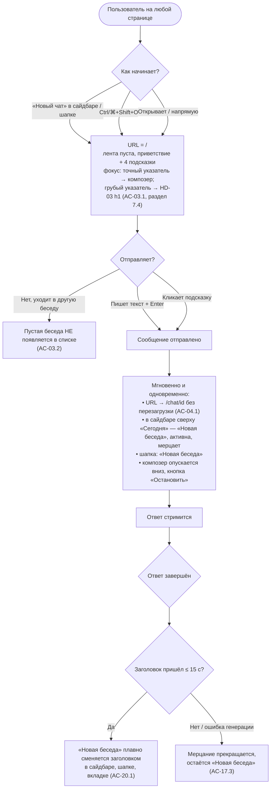
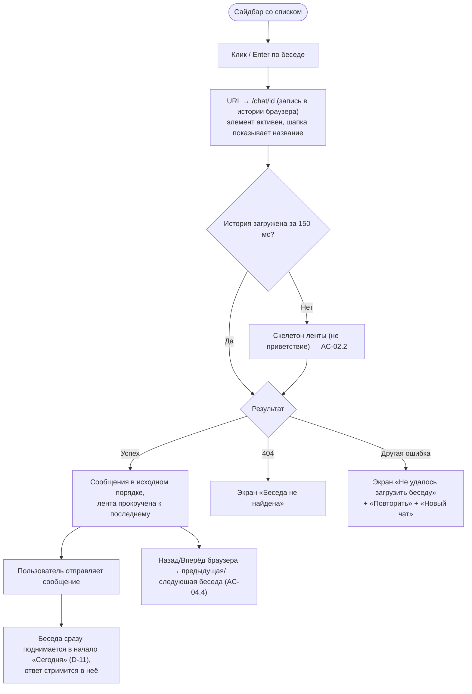
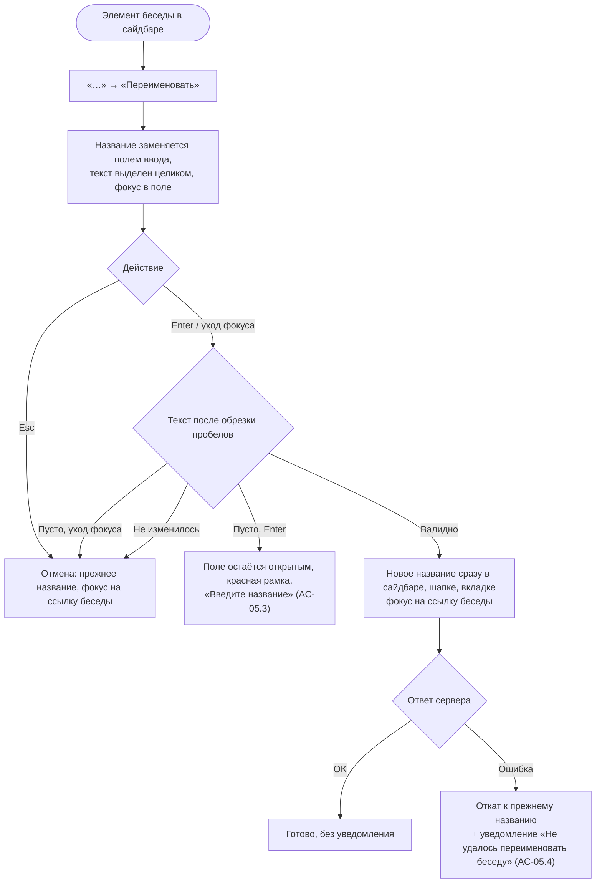
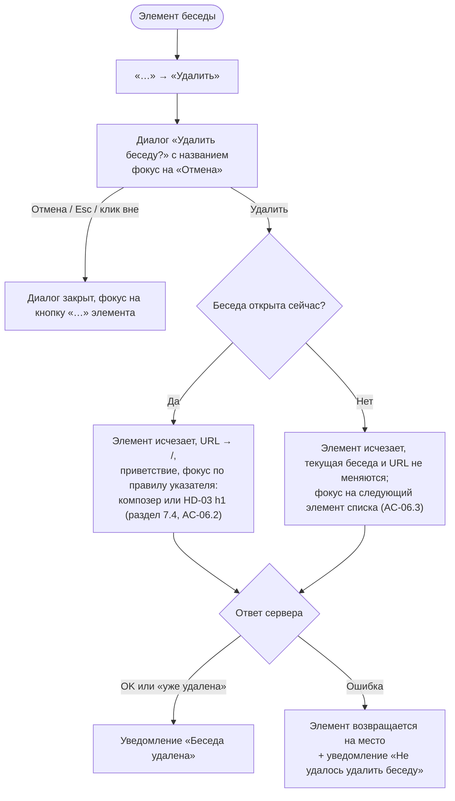
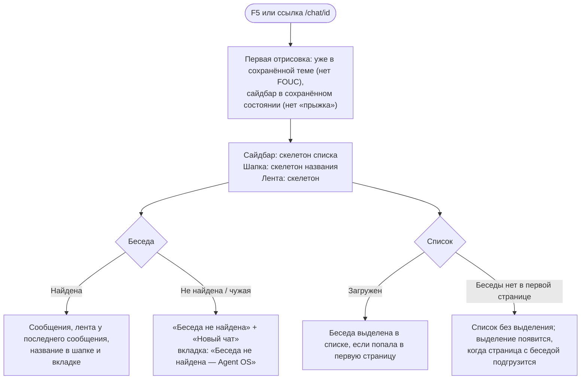
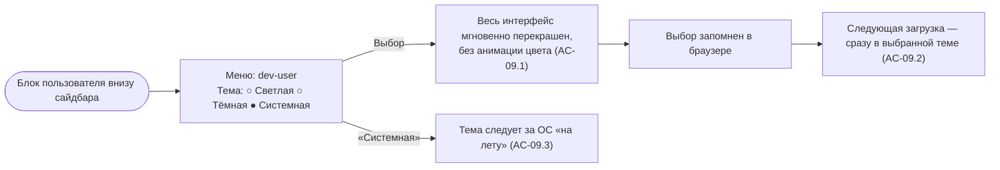
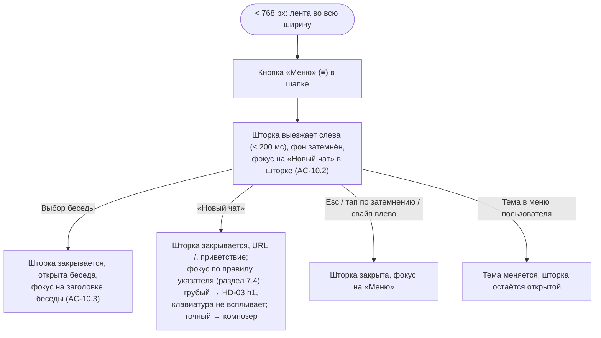
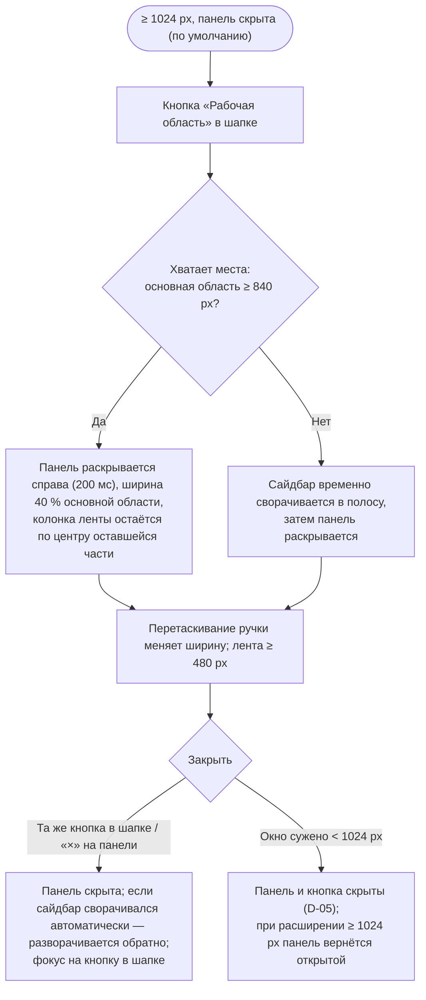
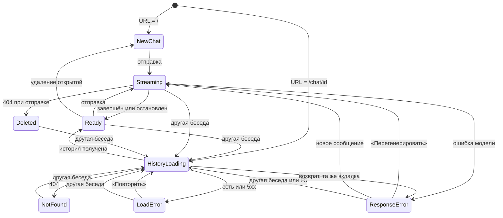

# UXRD: Оболочка чата в стиле ChatGPT (chat-shell)

| Поле | Значение |
|------|----------|
| Статус | Approved (v1.8); 2026-10-30 |
| PRD | [prd.md](./prd.md) v1.5 (depth `full`) |
| Design Docs | [`design-web-shell.md`](./design-web-shell.md) — основной потребитель; [`design-threads-api.md`](./design-threads-api.md) — читает 6.4 (группировка), 4.10 (E-8) и 6.20 (TH-08, восстановленная история) |
| Визуальный ориентир | [vercel/ai-chatbot](https://github.com/vercel/ai-chatbot), файлы — раздел 14.1 |
| Поведенческий ориентир | Веб-клиент ChatGPT |

## Snapshot

- **UX-объём**: оболочка чата — сайдбар с историей по датам, шапка, лента 768 px, рабочая область, мобильная шторка, тема; экраны `/`, `/chat/<id>`, «Беседа не найдена», «Не удалось загрузить беседу».
- **Не меняется**: рендер сообщений, стриминг, рассуждения и композер каркаса assistant-ui — только ширина, тексты и скрытые вложения.
- **Действия над сообщением**: у ответа ассистента и у сообщения пользователя — только «Копировать» (D-13); «Перегенерировать» — только в блоке ошибки ответа (D-14).
- **Ответ с ошибкой после F5**: частичный текст упавшего ответа показывается как обычная реплика — без блока ошибки, без текста ошибки и без «Перегенерировать»; восстановление — новое сообщение (TH-08, Restored). После перегенерации и F5 в беседе один ответ (AC-14.6).
- **Главный UX-риск**: после F5 оборванный ответ выглядит как обычный, и пользователь может принять обрывок за полный ответ.
- **Открытые вопросы**: нет.

### Key Decisions

Остальные решения (D-03, D-04, D-06, D-08…D-12) записаны в разделах, которыми управляют; их ID сохранены.

| ID | Decision | Why | Rejected alternative |
|----|----------|-----|----------------------|
| D-01 | Колонка ленты и композера — 768 px (48rem) по центру свободной области (AC-08.1); абзацы, заголовки, списки и цитаты — не шире 640 px (40rem), код и таблицы — на всю колонку | Строка прозы ≈ 70–78 знаков кириллицы при 16 px — без усталости при долгом чтении; коду нужна ширина | Вся проза на 768 px (≈ 82–88 знаков) |
| D-02 | Десктопный сайдбар сворачивается до иконочной полосы 48 px (AC-07.1) | «Новый чат» и меню пользователя остаются в одном клике | Полное скрытие сайдбара |
| D-05 | Ниже 1024 px «Рабочая область» недоступна: кнопки нет, открытая панель скрывается и возвращается при расширении (AC-11.4) | В панели только плейсхолдер — оверлей не даёт пользы | Оверлей панели поверх ленты на планшете |
| D-07 | Переключение беседы во время стриминга не прерывает генерацию: ответ дописывается в исходную беседу в фоне (AC-02.6, AC-03.4) | Нет потери ответа и блокировки навигации | Прервать генерацию или запретить переход |
| D-13 | Action bar любого сообщения — только «Копировать»; нет «Изменить», «‹ 1/2 ›», «Перегенерировать» у успешных ответов, «Ещё» (AC-08.6) | Восстановленная история не разойдётся с тем, что пользователь видел | Показать кнопки, историю чинить позже |
| D-14 | Ответ с ошибкой получает текстовую кнопку «Перегенерировать» внутри блока ошибки TH-08 — единственная точка перегенерации (AC-08.5) | Действие рядом с причиной, видно без наведения; после F5 в беседе один ответ (AC-14.6) | Иконка ↻ в action bar |
| D-15 | Ошибка инструмента — один фиксированный текст в живом стриме и в истории; сырой текст не показывается (AC-14.5) | Одинаковый вид до и после F5, без утечки внутренних деталей | Показывать в истории сохранённый текст ошибки |
| D-16 | Цвет, типографика, форма и движение оболочки — по дизайн-системе [`foundations.md`](../../design-system/foundations.md); у оболочки есть акцент «Петроль», выбранная беседа несёт его метку | Одна система для чата и будущих экранов агента; фон подсветки (1,04:1) не может один передавать выбор | Монохромная оболочка без акцента (прежний 9.2) |

**Обоснование ключевых решений.** Колонка 768 px (D-01) вмещает строку кода в 80–90 колонок, а проза в ней ограничена 640 px — замер длины строки в [foundations.md → Typography](../../design-system/foundations.md#typography); полоса 48 px (D-02) повторяет `collapsible="icon"` ai-chatbot и ChatGPT, и ленте почти не нужно места. Рабочую область (D-05) пересмотреть, когда появятся Tool-UI-артефакты. Сокращённый action bar (D-13) нужен потому, что после перегенерации или правки сохранённая история хранит отброшенные ответы и склеивает перегенерированные — беседа «ломалась» бы после F5. Кнопка в блоке ошибки (D-14) читается без тултипа, а action bar остаётся одинаковым у всех сообщений; иконка ↻ в action bar была бы видна только при наведении.

---

## 1. Overview

Что строится и зачем — PRD, раздел Overview; здесь — как это выглядит и ведёт себя.

---

## 2. AC Traceability

Колонка «Reference» — идентификаторы элементов из раздела 6 (`SB-*` сайдбар, `HD-*` шапка, `TH-*` лента, `WS-*` рабочая область, `DLG-*` диалоги, `TST-*` уведомления, `KB-*` клавиатура, `TM-*` тема) и UX-требования `UX-xx` из раздела 6.

| AC ID | Screen / State | Reference | Adoption Decision |
|-------|----------------|-----------|-------------------|
| AC-01.1 | Сайдбар — список | SB-04, SB-05, UX-01 | Adopted |
| AC-01.2 | Сайдбар — элемент активный | SB-06 (Active), раздел 7.2 | Adopted |
| AC-01.3 | Сайдбар — Loading | SB-09 (Loading) | Adopted |
| AC-01.4 | Сайдбар — Empty | SB-09 (Empty) | Adopted |
| AC-01.5 | Сайдбар — Error | SB-09 (Error) | Adopted |
| AC-01.6 | Сайдбар — элемент | SB-06 (Truncated) | Adopted |
| AC-01.7 | Сайдбар — Error | SB-09 (Error), E-1 | Adopted (тот же экран, что AC-01.5) |
| AC-02.1 | Лента — восстановленная беседа | TH-01, UX-05 | Adopted (рендер сообщений — каркас без изменений) |
| AC-02.2 | Лента — Loading | TH-05 | Adopted (каркас уже различает) |
| AC-02.3 | Лента — продолжение | TH-04, Flow 2 | Adopted |
| AC-02.4 | Лента — длинный ответ | TH-01 (Long content), UX-13 | Adopted |
| AC-02.5 | Лента — Load error | TH-07, E-4 | Adopted |
| AC-02.6 | Лента + сайдбар | D-07, A-1, SB-14 (Could) | Adopted |
| AC-03.1 | Новый чат | SB-03, HD-05, TH-02, раздел 7.4 | Adopted (фокус в композере при точном указателе; при грубом — на HD-03 `h1`, без клавиатуры) |
| AC-03.2 | Новый чат — без отправки | Flow 1, UX-02 | Adopted |
| AC-03.3 | Новый чат — после отправки | UX-02, D-11 | Adopted (появляется в момент отправки — раньше требуемого) |
| AC-03.4 | Новый чат | D-07, A-2 | Adopted |
| AC-04.1 | Новый чат — первая отправка | Flow 1 | Adopted |
| AC-04.2 | Холодная загрузка `/chat/<id>` | Flow 5, UX-04 | Adopted |
| AC-04.3 | Экран 404 | TH-06 | Adopted |
| AC-04.4 | Навигация | Flow 2, UX-03 | Adopted |
| AC-05.1 | Сайдбар — Editing | SB-07, SB-08, Flow 3 | Adopted (на месте, D-09) |
| AC-05.2 | Сайдбар — Editing | SB-08 | Adopted |
| AC-05.3 | Сайдбар — Editing invalid | SB-08 (Invalid), раздел 10.3 | Adopted |
| AC-05.4 | Сайдбар — Error | SB-08 (Error), TST-01 | Adopted |
| AC-06.1 | Диалог удаления | DLG-01 | Adopted |
| AC-06.2 | Flow 4 | DLG-01, раздел 7.4 | Adopted |
| AC-06.3 | Flow 4 | DLG-01, раздел 7.4 | Adopted |
| AC-06.4 | Экран 404 | TH-06 | Adopted |
| AC-07.1 | Шапка + сайдбар Collapsed | HD-02, SB-12, D-02 | Adopted (до иконочной полосы) |
| AC-07.2 | Шапка — Title pending | HD-03, D-06 | Adopted |
| AC-07.3 | Шапка на `/` | HD-03 | Adopted (вариант «не показано») |
| AC-08.1 | Лента | TH-01, D-01 (768 px) | Adopted |
| AC-08.2 | Новый чат | TH-02, TH-03 | Adopted (4 подсказки) |
| AC-08.3 | Лента с сообщениями | TH-04, TH-09 | Adopted |
| AC-08.4 | Композер — Streaming | TH-04 | Adopted (каркас без изменений) |
| AC-08.5 | Лента — ошибка ответа | TH-08, D-14 | Adopted: «Перегенерировать» внутри блока ошибки, новый ответ заменяет упавший |
| AC-08.6 | Лента — action bar ответа и сообщения пользователя | TH-10, D-13 | Adopted (D-13) |
| AC-09.1 | Меню пользователя | SB-11, TM-01 | Adopted |
| AC-09.2 | Холодная загрузка | TM-01, раздел 9.3 | Adopted |
| AC-09.3 | Меню пользователя | TM-01 | Adopted |
| AC-09.4 | Меню пользователя | SB-11 | Adopted |
| AC-10.1 | Мобильный | HD-02 (mobile), раздел 8 | Adopted |
| AC-10.2 | Мобильная шторка | SB-13, раздел 7.4 | Adopted |
| AC-10.3 | Мобильная шторка | SB-13, Flow 7 | Adopted |
| AC-10.4 | Лента мобильная | TH-01 (Long content), UX-13 | Adopted |
| AC-11.1 | Десктоп, первая загрузка | WS-01 | Adopted |
| AC-11.2 | Десктоп, рабочая область | HD-04, WS-01, WS-02 | Adopted |
| AC-11.3 | Рабочая область | HD-04, WS-03 | Adopted |
| AC-11.4 | Планшет/мобильный | D-05 | Adopted (кнопка скрыта) |
| AC-12.1 | — | — | Out of UX scope (тестовая инфраструктура). Состояния, которые тесты проверяют, определены в SB-09, TM-01, HD-03 |
| AC-12.2 | — | — | Out of UX scope |
| AC-13.1 | Сайдбар — список | SB-04 | Out of UX scope (серверное поведение); UX опирается на порядок |
| AC-13.2 | Сайдбар — подгрузка | SB-10 | Adopted (страница — 20 бесед, D-08; UX-поверхность — через AC-19.1) |
| AC-13.3 | — | — | Out of UX scope (в dev недостижимо; в production история недоступна — ограничение PRD) |
| AC-13.4 | — | — | Out of UX scope (влияет на длительность Loading SB-09) |
| AC-14.1 | Лента — восстановленная | TH-01, UX-05 | Out of UX scope (контракт); UX-05 описывает отображение незавершённых частей |
| AC-14.2 | Экран 404 | TH-06 | Adopted (UX неотличим от несуществующей) |
| AC-14.3 | Экран 404 | TH-06 | Adopted |
| AC-14.4 | — | — | Out of UX scope (влияет на TH-05) |
| AC-14.5 | Лента — блок инструмента; восстановленный ответ с ошибкой модели | TH-01 (Tool error), D-15, E-10; TH-08 (Restored) | Adopted: инструмент — один фиксированный текст в стриме и после F5; ошибка модели — сырой текст не показывается нигде, после F5 только частичный текст |
| AC-14.6 | Лента — восстановленная после перегенерации | TH-08 (Regenerating, Restored) | Out of UX scope (хранение — `threads-api`); UX опирается на один ответ после F5 (D-14) |
| AC-15.1 | Переименование | SB-08 (лимит 200) | Adopted (лимит в поле ввода) |
| AC-15.2 | Переименование | SB-08 (Invalid) | Adopted (клиент не отправляет невалидное; серверная ошибка → AC-05.4) |
| AC-15.3 | — | — | Out of UX scope (из UI недостижимо) |
| AC-16.1 | Лента — отправка в удалённую | TH-07 (Deleted while open), E-8 | Adopted (вариант 404) |
| AC-16.2 | — | — | Out of UX scope (из UI недостижимо) |
| AC-16.3 | Диалог удаления | DLG-01 (Error: already deleted) | Adopted (считается успехом для пользователя) |
| AC-17.1 | Сайдбар/шапка | SB-06, HD-03 | Adopted (обрезка в одну строку) |
| AC-17.2 | Сайдбар/шапка | UX-07 | Adopted (UI тоже не подменяет ручное имя) |
| AC-17.3 | Сайдбар/шапка | D-06, UX-07 | Adopted |
| AC-18.1 | — | — | Out of UX scope |
| AC-18.3 | — | — | Out of UX scope |
| AC-19.1 | Сайдбар — Loading more | SB-10, UX-01 | Adopted (Should) |
| AC-20.1 | Сайдбар/шапка | UX-07 | Adopted (Should) |
| AC-21.1 | Десктоп, холодная загрузка | SB-12, UX-09 | Adopted (Should) |
| AC-22.1 | Глобально | KB-01, раздел 7.3 | Adopted (Should); дополнительные сочетания отложены, не в этом релизе (раздел 7.3) |
| AC-22.2 | Сайдбар — список | SB-05, раздел 7.3 | Adopted (Should; нативная roving-навигация меню shadcn) |
| AC-23.1 | — | — | Not adopted — отложено в PRD (FR-23) |
| AC-24.1 | Сайдбар — элемент Streaming | SB-14 | On hold — FR-24 отложен в PRD (Could, не в этом релизе); SB-14 специфицирован как опциональный, чтобы реализация была единообразной |

---

## 3. Existing Component Reuse Map

Поиск выполнен по `apps/web/src/components/**` (список файлов и чтение `thread.aui.tsx`, `surfaces.tsx`, `tooltip-icon-button.tsx`, `ui/*`) и по ориентиру ai-chatbot. В `components/ui` сейчас есть только `avatar`, `button`, `dialog`, `resizable`, `skeleton`, `textarea`, `tooltip`.

| UI Element | Decision | Existing Component | Notes |
|-----------|----------|-------------------|-------|
| Лента сообщений, рассуждения, группы инструментов | Reuse | `components/assistant-ui/elements/thread.aui.tsx` | Поведение без изменений. Меняются только: ширина колонки (D-01), тексты на русском (раздел 10), кнопки вложений (D-04) |
| Action bar сообщений (TH-10) | Extend | `AssistantActionBar`, `UserActionBar`, `BranchPicker` в `thread.aui.tsx` | У ответа и у сообщения пользователя — только «Копировать» (у пользователя заменяет «Изменить»); «Перегенерировать», «Ещё» и «‹ 1/2 ›» скрыты (D-13). Автоскрытие каркаса заменено правилом видимости TH-10 |
| Блок ошибки ответа (TH-08) | Extend | `MessageError` в `thread.aui.tsx` | Русский фиксированный текст вместо текста сервера, текстовая кнопка «Перегенерировать» внутри блока (D-14), цвет текста под AA (7.6) |
| Ошибка инструмента в ленте | Extend | `ToolFallbackError` в `tool-fallback.aui.tsx` | Фиксированный текст вместо исходного текста ошибки, одинаково в стриме и истории (D-15) |
| Приветствие (`Welcome`) | Extend | Слот `Welcome` в `thread.aui.tsx` (`ThreadWelcome`) | Новое содержимое: заголовок и подзаголовок на русском (TH-02) |
| Стартовые подсказки | Extend | `ThreadSuggestions` / `SuggestionPrimitive` в `thread.aui.tsx` | Раскладка 2×2 на ≥ 640 px вместо списка с «>» (TH-03); клик отправляет — уже так |
| Follow-up подсказки | Reuse | `follow-up-suggestions.aui.tsx` | Без изменений |
| Композер (автовысота, отправка/стоп) | Reuse | `Composer` в `thread.aui.tsx` | Без изменений поведения; placeholder и `aria-label` на русском; кнопка вложений скрыта (D-04) |
| Кнопка вложений, зона перетаскивания | Extend (скрыть) | `ComposerAddAttachment`, `ComposerPrimitive.AttachmentDropzone` | Скрыты/выключены (D-04) |
| Скелетон истории треда | Reuse | `ThreadHistorySkeleton` в `thread.aui.tsx` | Подпись на русском |
| Кнопка «Вниз» | Reuse | `ThreadScrollToBottom` | Подпись на русском |
| Иконочная кнопка с тултипом | Reuse | `components/tooltip-icon-button.tsx` | Для HD-02, HD-04, HD-05, WS-03, иконок полосы SB-12 |
| Кнопка | Reuse | `components/ui/button.tsx` | Варианты `ghost`, `outline`, `default`, `destructive`. Для «Удалить» в DLG-01 нужна сплошная заливка `--destructive` с контрастным текстом в обеих темах — текущий тонированный `destructive` не проходит 4,5:1 (раздел 7.6) |
| Тултип | Reuse | `components/ui/tooltip.tsx` | Обрезанные названия (SB-06), подсказки сочетаний клавиш |
| Скелетон | Reuse | `components/ui/skeleton.tsx` | SB-09 Loading, SB-10, HD-03 Loading |
| Аватар | Reuse | `components/ui/avatar.tsx` | Инициалы `DU` в SB-11 |
| Диалог подтверждения удаления | Extend | `components/ui/dialog.tsx` (base-ui) | Нужна роль `alertdialog` и фокус на «Отмена». Если shadcn `alert-dialog` (base-ui) даёт это из коробки — Design Doc может взять его; UX-требования в DLG-01 |
| Сайдбар (развёрнут/полоса/шторка, сохранение состояния) | New | — | Искали в `components/ui` и `components/**` — нет. Берётся shadcn `sidebar` (как в ai-chatbot: `Sidebar collapsible="icon"`, `SidebarRail`, мобильная шторка встроена) |
| Шторка (мобильный сайдбар) | New | — | Нет `sheet` в `components/ui`. shadcn `sheet` (используется `sidebar` на мобильном) |
| Меню «…» элемента и меню пользователя | New | — | Нет `dropdown-menu`. В `thread.aui.tsx` есть `ActionBarMorePrimitive` — он привязан к сообщению assistant-ui и для сайдбара не подходит. shadcn `dropdown-menu` с радио-группой для темы |
| Поле переименования | New | — | Нет `input` в `components/ui` (`textarea` не подходит — однострочное поле). shadcn `input` |
| Уведомления (toast) | New | — | Нет ни одного механизма уведомлений в `apps/web`. shadcn `sonner` (как в ai-chatbot) |
| Шапка | New | — | В каркасе шапки нет; ai-chatbot `chat-header.tsx` — ориентир по высоте (56 px) и раскладке |
| Список бесед с группами по датам | New | — | Ориентир ai-chatbot `sidebar-history.tsx`; отличия: группировка по **времени обновления**, а не создания (FR-01); подписи на русском; «Показать ещё» доступна с клавиатуры |
| Экран «Беседа не найдена» | New | — | Аналога нет |
| Экран ошибки загрузки беседы | New | — | Аналога нет |
| Рабочая область (правая панель) | Extend | `components/ui/resizable.tsx`, плейсхолдер из `app/page.tsx` | Сейчас — постоянная 60 % панель. Становится скрываемой (WS-01) с ручкой (WS-02) и «×» (WS-03) |
| Раскладка страницы | Extend (заменить) | `app/page.tsx` (40/60 split) | Заменяется оболочкой SH-01 |
| Классы поверхностей и движения | Reuse | `components/surfaces.tsx` (`ghostButton`, `pressable`, `collapsePanel`, `ShimmerLabel`) | `ShimmerLabel` — для плейсхолдера в ожидании заголовка (UX-07); кривая `collapsePanel` — для всех панелей |

---

## 4. User Flows

### 4.1 Flow 1 (основной): новый чат → первое сообщение → беседа в истории

**Implements:** Use case 2 (PRD, Use Cases)



### 4.2 Flow 2: открыть прошлую беседу

**Implements:** Use case 1 (PRD, Use Cases)



### 4.3 Flow 3: переименование

**Implements:** Use case 4 (PRD, Use Cases)



### 4.4 Flow 4: удаление

**Implements:** Use case 4 (PRD, Use Cases)



### 4.5 Flow 5: обновление страницы / прямая ссылка `/chat/[id]`

**Implements:** Use case 3 (PRD, Use Cases)



### 4.6 Flow 6: смена темы

**Implements:** Use case 6 (PRD, Use Cases)



### 4.7 Flow 7: мобильная шторка

**Implements:** Use case 5 (PRD, Use Cases)



### 4.8 Flow 8: рабочая область

**Implements:** Use case 7 (PRD, Use Cases)



### 4.9 Alternative Flows

| # | Ситуация | Поведение |
|---|----------|-----------|
| A-1 | Переключение на другую беседу во время стриминга (D-07) | Генерация продолжается в фоне. Лента новой беседы показывается как обычно; композер в ней активен. В сайдбаре у исходной беседы — опциональный индикатор SB-14 (Could, FR-24). При возврате в исходную беседу: если ответ ещё идёт — видна частичная реплика, которая продолжает дописываться, и кнопка «Остановить»; если завершён — полный ответ; если упал — блок ошибки с «Перегенерировать» (TH-08, Return) |
| A-2 | «Новый чат» во время стриминга в текущей беседе | То же, что A-1: генерация в исходной беседе продолжается |
| A-3 | «Новый чат», когда уже открыт пустой `/` | URL и история браузера не меняются; фокус переходит по правилу 7.4 (композер при точном указателе, HD-03 при грубом); набранный текст в композере сохраняется |
| A-4 | Удаление беседы, в которой идёт фоновый стриминг | В диалоге DLG-01 дополнительная строка «Ответ ассистента в этой беседе ещё генерируется — он будет остановлен.» После подтверждения генерация останавливается |
| A-5 | Переименование беседы, у которой автозаголовок ещё не пришёл | Ручное имя побеждает: пришедший позже автозаголовок не подменяет его ни в сайдбаре, ни в шапке (AC-17.2) |
| A-6 | Окно остаётся открытым после полуночи | Группы пересчитываются при возврате фокуса во вкладку и при любом обновлении списка: «Сегодня» становится «Вчера» |
| A-7 | Открытая беседа не попала в загруженные страницы списка (старая, по прямой ссылке) | Выделения в списке нет; шапка и вкладка показывают название. Список не прокручивается и не подгружается принудительно |
| A-8 | Отправка сообщения в старую беседу | Беседа сразу поднимается в начало «Сегодня» (D-11); если она была в другой группе — плавно исчезает оттуда (150 мс). Фокус и прокрутка сайдбара не меняются |
| A-9 | Клик по уже активной беседе | Ничего не перезагружается; на мобильном шторка закрывается |
| A-10 | Двойной клик / повторное нажатие «Новый чат» | Идемпотентно, как A-3 |

### 4.10 Error Flows

| # | Ошибка | Где видна | Восстановление |
|---|--------|-----------|----------------|
| E-1 | Не загрузился список бесед (или ответ не прошёл валидацию — AC-01.7) | SB-09 Error внутри сайдбара | «Повторить»; «Новый чат» и композер продолжают работать |
| E-2 | Не загрузилась следующая страница | SB-10 Error в конце списка | Уже загруженные беседы остаются; «Повторить» под ними |
| E-3 | Беседа не найдена / чужая / удалена | TH-06 вместо ленты | «Новый чат»; сайдбар работает |
| E-4 | Не загрузилась история беседы (сеть, 5xx) | TH-07 вместо ленты | «Повторить», «Новый чат» |
| E-5 | Ошибка ответа модели во время стриминга | TH-08 под репликой ассистента | «Перегенерировать» внутри блока ошибки (D-14, AC-08.5) или новое сообщение в композере. При возврате к беседе в той же вкладке блок остаётся (TH-08, Return). После нового сообщения или F5 блока ошибки и «Перегенерировать» нет (TH-08, Not last и Restored) |
| E-6 | Ошибка переименования | Откат названия + TST-01 | Повторить действие вручную |
| E-7 | Ошибка удаления | Элемент возвращается + TST-01 | Повторить действие вручную |
| E-8 | Отправка в беседу, удалённую в другой вкладке (сервер отвечает 404 — `design-threads-api`, KD-5) | Ошибка чата 404 `THREAD_NOT_FOUND` показывается не блоком TH-08, а уведомлением «Беседа удалена» под сообщением пользователя (TH-07, Deleted while open); лента остаётся, композер скрыт; «Копировать» у сообщения доступна | «Новый чат»; «Перегенерировать» нет |
| E-9 | Сеть пропала при отправке | Существующее поведение каркаса: ошибка у реплики (TH-08) | «Перегенерировать» внутри блока ошибки (D-14); после F5 — как E-5 |
| E-10 | Инструмент завершился ошибкой | Блок инструмента в ленте: «Ошибка:» + «Не удалось выполнить инструмент.»; после F5 — то же самое (D-15, AC-14.5) | Отдельного действия нет; ответ ассистента продолжается как в каркасе |

---

## 5. Wireframes / Layout

Общая сетка: `[Сайдбар][Основная область: Шапка + Лента][Рабочая область]`. Шапка принадлежит основной области, не растягивается над сайдбаром и рабочей областью.

### 5.1 Desktop 1440 px — сайдбар развёрнут, беседа открыта

```
+----------------------+---------------------------------------------------------------------------------+
| ◆ Agent OS           | [◧]  Сверка договора с ООО «Ромашка»                              [▣ Рабочая обл.]|  HD-01 56px
|                      +---------------------------------------------------------------------------------+
| [✎  Новый чат      ] |                                                                                 |
|                      |                ┌──────────────────── 768 px ────────────────────┐               |
| Сегодня              |                │                         ┌──────────────────────┐│               |
| ▌Сверка договора с…⋯ |  ← active      │                         │ Сверь пункт 4.2 с…   ││  user         |
|  План отпуска на Ба… |                │                         └──────────────────────┘│               |
| Вчера                |                │ ▸ Рассуждения · 4 с                             │               |
|  Отчёт Q3            |                │ В пункте 4.2 срок оплаты указан как…            │  assistant    |
|  Новая беседа  ∙     |  ← FR-24 (*)   │ ## Расхождения                                  │               |
| Предыдущие 7 дней    |                │ | Пункт | Договор | Счёт |                      │               |
|  Регламент закупок   |                │ ⧉                                               │               |
|  …                   |                │                                                 │               |
| Предыдущие 30 дней   |                │                       (↓)                       │               |
|  …                   |                │ ┌─────────────────────────────────────────────┐ │               |
| [ Показать ещё ]     |                │ │ Спросите что-нибудь…                        │ │  TH-04        |
|                      |                │ │                                         (↑) │ │               |
+----------------------+                │ └─────────────────────────────────────────────┘ │               |
| (DU) dev-user      ⌃ |                └─────────────────────────────────────────────────┘               |
+----------------------+---------------------------------------------------------------------------------+
  SB-01 256px                                    TH-01 (центр свободной области)
```

**Layout Notes**:

- Сайдбар 256 px (16rem), фон `--sidebar`, правая граница 1 px `--sidebar-border`. Порядок сверху вниз: SB-02 (марка + «Agent OS», высота 56 px — выровнена с шапкой), SB-03 «Новый чат», SB-04 список (единственная прокручиваемая часть сайдбара), SB-11 блок пользователя (прижат к низу, верхняя граница 1 px).
- Колонка TH-01: max 768 px, горизонтальные поля 16 px внутри колонки (< 768 px) и 24 px (≥ 768 px); центрируется по **свободной** ширине основной области, а не окна.
- Композер прилипает к низу ленты; под ним 16 px (мобильный) / 24 px (≥ 768 px) + безопасная зона устройства.
- Шапка не имеет нижней границы; при прокрутке ленты под ней появляется граница 1 px `--border` (сигнал «контент ушёл под шапку»).
- (*) Точка у «Новая беседа» — индикатор стриминга SB-14 **(FR-24, Could — не в этом релизе)**. Показана только чтобы зафиксировать место, если индикатор будет реализован позже.

### 5.2 Desktop 1440 px — сайдбар свёрнут в полосу

```
+----+-------------------------------------------------------------------------------------------------+
| ◆  | [◨]  Сверка договора с ООО «Ромашка»                                            [▣ Рабочая обл.] |
|    +-------------------------------------------------------------------------------------------------+
| ✎  |                         ┌──────────────────── 768 px ────────────────────┐                      |
|    |                         │   …лента…                                       │                      |
|    |                         │                                                 │                      |
|    |                         │ ┌─────────────────────────────────────────────┐ │                      |
|    |                         │ │ Спросите что-нибудь…                    (↑) │ │                      |
| DU |                         │ └─────────────────────────────────────────────┘ │                      |
+----+-------------------------------------------------------------------------------------------------+
 48px (SB-12)
```

- Полоса 48 px: марка (ссылка на `/`), иконка «Новый чат», внизу аватар `DU` (открывает то же меню SB-11). Список бесед в полосе не показывается.
- Иконки полосы — с тултипом справа («Новый чат · Ctrl+Shift+O», «dev-user»).
- Иконка кнопки HD-02 отражает состояние (панель слева «открыта»/«закрыта»).

### 5.3 Desktop 1280 px — рабочая область открыта

```
+----------------------+-------------------------------------------+-------------------------------+
| ◆ Agent OS           | [◧]  Отчёт Q3                    [▣]●     | Рабочая область            [×] |
|                      +-------------------------------------------+-------------------------------+
| [✎  Новый чат      ] |   ┌──────────── 566 px ──────────────┐   ‖                               |
| Сегодня              |   │ …лента…                           │   ‖                               |
| ▌Отчёт Q3          ⋯ |   │                                   │   ‖   Здесь появятся артефакты     |
|  …                   |   │ ┌───────────────────────────────┐ │   ‖   инструментов: таблицы,       |
|                      |   │ │ Спросите что-нибудь…      (↑) │ │   ‖   документы, графики.          |
| (DU) dev-user      ⌃ |   │ └───────────────────────────────┘ │   ‖                               |
+----------------------+-------------------------------------------+-------------------------------+
 256 px                  основная область 614 px (≥ 480 ✓)        WS-01 410 px (40 % от 1024)
                                                                 ‖ = WS-02 ручка
```

- Ширина панели по умолчанию — 40 % основной области (окно минус сайдбар); пределы: панель ≥ 360 px, лента ≥ 480 px. Ширина, выбранная перетаскиванием, сохраняется до конца сессии вкладки.
- Если при открытии основная область < 840 px (360 + 480) — сайдбар временно сворачивается в полосу (паттерн ChatGPT canvas) и разворачивается обратно при закрытии панели. Временное сворачивание не перезаписывает сохранённое пользователем состояние сайдбара (FR-21).
- Кнопка HD-04 в нажатом состоянии (`aria-expanded="true"`, фон `--accent`).
- Шапка рабочей области — 56 px, на одной линии с основной шапкой.

### 5.4 Desktop — новый чат (`/`)

```
+----------------------+-----------------------------------------------------------------------+
| ◆ Agent OS           | [◧]                                                     [▣ Рабочая обл.]|
|                      +-----------------------------------------------------------------------+
| [✎  Новый чат      ] |                                                                       |
| Сегодня              |                     Чем могу помочь?                                  |  TH-02
|  Отчёт Q3          ⋯ |        Задайте вопрос, попросите текст или разбор задачи.              |
|  …                   |        ┌─────────────────────────────────────────────────┐             |
|                      |        │ Спросите что-нибудь…                        (↑) │             |  TH-04
|                      |        └─────────────────────────────────────────────────┘             |
|                      |        ┌──────────────────────┐ ┌──────────────────────┐               |
|                      |        │ Составь план встречи │ │ Напиши письмо        │               |  TH-03
|                      |        │ по запуску проекта   │ │ клиенту о переносе…  │               |
|                      |        ├──────────────────────┤ ├──────────────────────┤               |
|                      |        │ Объясни простыми     │ │ Предложи идеи        │               |
|                      |        │ словами, что такое…  │ │ для тимбилдинга…     │               |
|                      |        └──────────────────────┘ └──────────────────────┘               |
| (DU) dev-user      ⌃ |                                                                       |
+----------------------+-----------------------------------------------------------------------+
```

- Блок «приветствие + композер + подсказки» центрирован по вертикали (D-10). В шапке названия нет (AC-07.3).
- Подсказки исчезают, как только в композере появился текст (поведение каркаса), и возвращаются при очистке.

### 5.5 Mobile 375 px — беседа

```
+-------------------------------------+
| [≡]  Сверка договора с ООО…    [✎]  |  HD-01 56px
+-------------------------------------+
|  ┌───────────────────────────────┐  |
|  │ Сверь пункт 4.2 с …           │  |
|  └───────────────────────────────┘  |
| ▸ Рассуждения · 4 с                 |
| В пункте 4.2 срок оплаты…           |
| ┌─────────────────────────────────┐ |
| │ const x = …  ⟶ (скролл блока)   │ |  код прокручивается сам
| └─────────────────────────────────┘ |
|                (↓)                  |
| ┌─────────────────────────────────┐ |
| │ Спросите что-нибудь…        (↑) │ |  TH-04, во всю ширину − 16px×2
| └─────────────────────────────────┘ |
+-------------------------------------+  + safe-area снизу
```

- Кнопка «Рабочая область» отсутствует (D-05). Справа в шапке — «Новый чат» (FR-03).
- Нет горизонтального скролла страницы на 360/375/414 px во всех состояниях.

### 5.6 Mobile 375 px — шторка открыта

```
+---------------------------+---------+
| ◆ Agent OS            [×] |░░░░░░░░░|
| [✎  Новый чат          ]  |░░░░░░░░░|
| Сегодня                   |░ лента ░|
| ▌Сверка договора с ОО… ⋯  |░ затем- ░|
|  План отпуска на Байка… ⋯ |░ нена   ░|
| Вчера                     |░ 50 %   ░|
|  Отчёт Q3              ⋯  |░░░░░░░░░|
|  …                        |░░░░░░░░░|
+---------------------------+░░░░░░░░░|
| (DU) dev-user          ⌃  |░░░░░░░░░|
+---------------------------+---------+
  SB-13: 288 px, max 85 vw
```

- В шторке: строки 44 px; кнопка «⋯» видна всегда (на тач-устройствах нет hover); кнопка «×» закрывает шторку.
- Затемнение: `--foreground` 50 % в светлой теме / `--background` 70 % в тёмной; тап закрывает.

### 5.7 Экран «Беседа не найдена» (TH-06)

```
+----------------------+-----------------------------------------------------------------------+
| ◆ Agent OS           | [◧]                                                                   |
|                      +-----------------------------------------------------------------------+
| [✎  Новый чат      ] |                                                                       |
| Сегодня              |                         Беседа не найдена                             |
|  Отчёт Q3          ⋯ |          Возможно, её удалили или ссылка указана неверно.              |
|  …                   |                         [ ✎ Новый чат ]                               |
|                      |                                                                       |
+----------------------+-----------------------------------------------------------------------+
```

- Нет композера. В сайдбаре нет активного элемента. В шапке названия нет.

### 5.8 Элемент списка: наведение, меню, переименование

```
Default:     │  План отпуска на Байкал          │
Hover:       │▒ План отпуска на Байка…       ⋯ ▒│   фон --sidebar-accent, «⋯» появляется
Active:      │▓ Сверка договора с ООО…       ⋯ ▓│   фон --sidebar-accent, текст medium
Menu open:   │▓ Сверка договора с ООО…      [⋯]▓│
             │            ┌──────────────────┐  │
             │            │ ✎ Переименовать  │  │
             │            │ 🗑 Удалить        │  │   «Удалить» — цвет --destructive
             │            └──────────────────┘  │
Editing:     │ [Сверка договора с ООО «Ромашка»]│   поле ввода, текст выделен
Invalid:     │ [                               ]│   рамка --destructive
             │  Введите название                │   текст ошибки 12px под полем
```

### 5.9 Диалог удаления (DLG-01)

```
        ┌────────────────────────────────────────────┐
        │ Удалить беседу?                            │
        │                                            │
        │ Беседа «Отчёт Q3» и все её сообщения будут │
        │ удалены. Это действие нельзя отменить.     │
        │                                            │
        │                      [ Отмена ] [ Удалить ]│   «Удалить» — destructive
        └────────────────────────────────────────────┘
        ширина 400 px (мобильный: 100 % − 32 px), по центру
```

---

## 6. Component Behavior Specifications

### 6.0 Иерархия компонентов

```mermaid
graph TD
    SH01["SH-01 AppShell"] --> SB01["SB-01 Sidebar"]
    SH01 --> MAIN["Основная область"]
    SH01 --> WS01["WS-01 Workspace (скрыта по умолчанию)"]
    SB01 --> SB02["SB-02 Марка «Agent OS»"]
    SB01 --> SB03["SB-03 «Новый чат»"]
    SB01 --> SB04["SB-04 ThreadList"]
    SB04 --> SB05["SB-05 Заголовок группы"]
    SB04 --> SB06["SB-06 ThreadItem"]
    SB06 --> SB07["SB-07 Меню «…»"]
    SB06 --> SB08["SB-08 Поле переименования"]
    SB06 --> SB14["SB-14 Индикатор стриминга (Could)"]
    SB04 --> SB09["SB-09 Состояния списка"]
    SB04 --> SB10["SB-10 «Показать ещё»"]
    SB01 --> SB11["SB-11 Блок пользователя + тема"]
    SB01 -. "≥768 px свёрнут" .-> SB12["SB-12 Иконочная полоса"]
    SB01 -. "<768 px" .-> SB13["SB-13 Шторка"]
    MAIN --> HD01["HD-01 Шапка"]
    HD01 --> HD02["HD-02 Переключатель сайдбара / «Меню»"]
    HD01 --> HD03["HD-03 Название беседы"]
    HD01 --> HD04["HD-04 «Рабочая область» (≥1024)"]
    HD01 --> HD05["HD-05 «Новый чат» (<768)"]
    MAIN --> TH01["TH-01 Лента (каркас assistant-ui)"]
    TH01 --> TH02["TH-02 Приветствие"]
    TH01 --> TH03["TH-03 Подсказки"]
    TH01 --> TH04["TH-04 Композер"]
    TH01 --> TH05["TH-05 Скелетон истории"]
    TH01 --> TH08["TH-08 Ошибка ответа"]
    TH01 --> TH10["TH-10 Action bar сообщения"]
    TH01 --> TH09["TH-09 «Вниз»"]
    MAIN --> TH06["TH-06 «Беседа не найдена»"]
    MAIN --> TH07["TH-07 Ошибка загрузки беседы"]
    WS01 --> WS02["WS-02 Ручка ширины"]
    WS01 --> WS03["WS-03 «×»"]
    SH01 --> DLG01["DLG-01 Диалог удаления"]
    SH01 --> TST01["TST-01 Уведомления"]
```



### 6.1 Состояния представления основной области



«Новый чат» из любого состояния → NewChat (стриминг продолжается в фоне, D-07). При уходе в другую беседу стриминг тоже продолжается (A-1). Возврат в той же вкладке к беседе, чей последний ответ упал, снова показывает блок ошибки; после F5 — ответ без блока (TH-08, Restored).

### 6.2 SH-01 AppShell

| State | Visual | Behavior |
|-------|--------|----------|
| Default (≥ 1024) | Сайдбар (развёрнут или полоса) + основная область; рабочая область скрыта | Раскладка на всю высоту динамического вьюпорта; прокручиваются только список SB-04, лента TH-01 и содержимое WS-01 — страница целиком не прокручивается |
| Tablet (768–1023) | Сайдбар встроен (развёрнут или полоса), рабочей области нет | См. раздел 8 |
| Mobile (< 768) | Только основная область; сайдбар — шторка | См. раздел 8 |
| Loading (холодная загрузка) | Каркас оболочки рисуется сразу в нужной теме и с нужным состоянием сайдбара; внутри — скелетоны | Нет сдвигов раскладки (CLS ≤ 0,1) при замене скелетонов содержимым |
| Disabled / Empty / Error / Partial | N/A на уровне оболочки | Состояния принадлежат дочерним компонентам |

### 6.3 SB-03 «Новый чат» (и HD-05, иконка в SB-12)

| State | Visual | Behavior |
|-------|--------|----------|
| Default | Кнопка во всю ширину сайдбара, 36 px, обводка 1 px `--sidebar-border`, иконка ✎ (`SquarePen`) + «Новый чат»; справа приглушённо `Ctrl Shift O` (только ≥ 1024 px, только с точным указателем) | Клик → Flow 1 |
| Hover | Фон `--sidebar-accent` | — |
| Active/Pressed | `scale(0.96)` 150 мс — переиспользуется класс `pressable` из `surfaces.tsx` без изменений | — |
| Focus | Кольцо 3 px `--sidebar-ring` со смещением 2 px | Enter/Space — как клик |
| Disabled | Никогда | Новый чат доступен всегда, включая ошибки списка и стриминг (PRD Reliability) |
| Loading | N/A | Переход мгновенный |
| Empty / Error / Partial | N/A | — |

- В полосе SB-12 — иконочная кнопка 32×32 с тултипом справа. На мобильном HD-05 — иконочная кнопка 44×44 в шапке и полная кнопка в шторке.
- `aria-label` иконочных вариантов: «Новый чат». `aria-keyshortcuts="Control+Shift+O Meta+Shift+O"`.

### 6.4 SB-04 ThreadList, SB-05 заголовок группы, SB-09 состояния списка

**UX-01. Группировка.** Группы по времени **последнего обновления** беседы в часовом поясе браузера, по календарным дням:

| Группа | Условие (D — дата обновления, T — сегодня) |
|--------|-------------------------------------------|
| Сегодня | D = T |
| Вчера | D = T − 1 |
| Предыдущие 7 дней | T − 7 ≤ D ≤ T − 2 |
| Предыдущие 30 дней | T − 30 ≤ D < T − 7 |
| Старше | D < T − 30 |

Порядок групп фиксирован; пустые группы не показываются; внутри группы — по убыванию времени обновления. При подгрузке страниц группа, начатая на предыдущей странице, продолжается без повторного заголовка.

| State | Visual | Behavior |
|-------|--------|----------|
| Default | Группы: заголовок 12 px, `font-medium`, `--muted-foreground`, отступ сверху 16 px (у первой — 8 px), слева 8 px; под ним элементы SB-06 | Прокручивается только список; при прокрутке заголовок текущей группы **не** липкий (как в ChatGPT) |
| Loading | 1 полоска-заголовок 48 px + 7 строк-скелетонов высотой 36 px, ширина 44 / 72 / 56 / 88 / 64 / 48 / 76 % | Показывается сразу (часть первой отрисовки). Для скринридера — `role="status"` «Загружаем беседы…». Пульсация выключена при `prefers-reduced-motion` |
| Empty | Текст в 2 строки, 13 px, по левому краю, отступ 8 px: **«Пока нет бесед»** (`--sidebar-foreground`) / «Начните новый чат — он появится здесь.» (`--muted-foreground`) | Действия нет — кнопка «Новый чат» прямо над текстом |
| Error | Текст 13 px «Не удалось загрузить беседы» + кнопка `outline` `sm` **«Повторить»** (иконка ↻) | «Повторить» → состояние Loading (скелетон), затем результат. Фокус после повтора: остаётся на месте кнопки — при успехе переходит на первый элемент списка, если фокус был на «Повторить» |
| Partial | Загружены не все страницы | См. SB-10 |
| Hover / Active / Focus / Disabled | N/A на уровне списка | См. SB-06 |

### 6.5 SB-06 ThreadItem

Строка = ссылка на беседу (переход по `/chat/<id>`, открывается в новой вкладке по Ctrl/⌘+клику и средней кнопке — стандартное поведение ссылки) + кнопка «⋯» справа.

| State | Visual | Behavior |
|-------|--------|----------|
| Default | Высота 36 px (44 px в шторке и при грубом указателе), радиус `--radius-md`, отступы 8 px; текст 14 px `--sidebar-foreground`, одна строка | Клик → Flow 2 |
| Hover | Фон `--sidebar-accent`, текст `--sidebar-accent-foreground`; появляется «⋯» | Задержек нет |
| Active (текущая беседа) | Метка `--sidebar-primary` у левого края, текст `font-medium` `--sidebar-accent-foreground`, фон `--sidebar-accent`; «⋯» видна всегда | `aria-current="page"` (AC-01.2). Выбор несут метка и начертание; фон — дополнительный признак ([foundations.md → Color](../../design-system/foundations.md#color), D-16) |
| Pressed | Фон `--sidebar-accent` | — |
| Focus | Кольцо 3 px `--sidebar-ring` внутрь строки (inset), «⋯» становится видимой | См. раздел 7.3 |
| Truncated | Текст обрезается многоточием в одну строку; при наличии «⋯» текст заканчивается за 32 px до правого края | Тултип с полным названием справа от строки через 500 мс наведения или сразу при фокусе с клавиатуры; только если текст действительно обрезан (AC-01.6) |
| Title pending (новая беседа, ждём автозаголовок) | Текст «Новая беседа» с мерцанием (`ShimmerLabel`) | Мерцание ≤ 15 с после конца первого ответа; затем статично. См. UX-07 |
| Title updated | Старый текст растворяется, новый проявляется, 200 мс | Без перестройки высоты строки |
| Inserting (новая беседа или поднятие в «Сегодня») | Строка раскрывается по высоте 0 → 36 px + проявление, 150 мс | При `prefers-reduced-motion` — мгновенно |
| Removing (удаление) | Схлопывание по высоте + растворение, 150 мс | При ошибке — возвращается с той же анимацией |
| Streaming (Could, SB-14) | Точка 6 px `--muted-foreground` справа, пульсация 1,5 с; при наведении/фокусе её место занимает «⋯» | См. SB-14 |
| Disabled / Loading / Empty / Error / Partial | N/A | Элемент существует только с данными; ошибки — уровня списка (SB-09) или операции (SB-08, DLG-01) |

**UX-02. Появление новой беседы.** При первой отправке из `/` элемент «Новая беседа» вставляется в начало «Сегодня» (если группы не было — она появляется) **в момент отправки**, сразу активный. Пустой `/` без отправки элемента не создаёт (AC-03.2).

**D-11. Подъём беседы в момент отправки** (FR-01). Беседа поднимается в начало «Сегодня» в момент отправки сообщения, а не после ответа. Пользователь сразу видит, где теперь его беседа, и список не «прыгает» позже.

**UX-03. Навигация истории браузера.** Каждый переход между беседами кликом создаёт запись в истории браузера; «Назад/Вперёд» переключают беседы и выделение в списке (AC-04.4). «Новый чат» с `/` на `/` записи не создаёт (A-3). Удаление открытой беседы **заменяет** запись (возврат «Назад» не ведёт на удалённую беседу).

**UX-04. Заголовок вкладки браузера.** «{Название} — Agent OS»; на `/` — «Новый чат — Agent OS»; без заголовка — «Новая беседа — Agent OS»; 404 — «Беседа не найдена — Agent OS». Обновляется при переименовании и приходе автозаголовка.

### 6.6 SB-07 Меню «⋯» элемента

| State | Visual | Behavior |
|-------|--------|----------|
| Hidden | Кнопка «⋯» 24×24 (hit-area 32×32) невидима, но в порядке Tab | Становится видимой при hover строки, фокусе на строке или на ней, у активной беседы, на тач-устройствах — всегда |
| Default / Hover | Иконка `MoreHorizontal` 16 px, `--muted-foreground` → `--sidebar-foreground` при наведении | — |
| Open | Кнопка подсвечена `--sidebar-accent`; меню под кнопкой, выравнивание по правому краю, ширина ≥ 180 px; пункты: ✎ «Переименовать», 🗑 «Удалить» (`--destructive`) | Фокус на первый пункт; ↑/↓ — по пунктам; Enter — выбрать; Esc/клик вне — закрыть с возвратом фокуса на «⋯» |
| Focus | Кольцо 3 px | Enter/Space/↓ открывают меню |
| Disabled | Во время редактирования названия этой строки «⋯» скрыта | — |
| Loading / Empty / Error / Partial | N/A | — |

### 6.7 SB-08 Поле переименования (на месте)

**D-09. Переименование на месте** (FR-05). Поле ввода заменяет название в строке сайдбара; диалога нет. Как в ChatGPT — контекст не перекрывается.

| State | Visual | Behavior |
|-------|--------|----------|
| Editing | Поле на месте строки той же высоты, фон `--background`, рамка 1 px `--input`, кольцо фокуса; текущее название выделено целиком. Для беседы без заголовка — начальное значение «Новая беседа», выделено | Ввод до 200 символов (дальше ввод не принимается — FR-15). Enter — сохранить, Esc — отменить (AC-05.2), уход фокуса — сохранить, если валидно и изменилось, иначе отменить |
| Invalid | Рамка `--destructive`, под полем 12 px «Введите название» (`--destructive`), строка увеличивается по высоте | Только при Enter на пустом/пробельном значении (AC-05.3). Поле остаётся открытым. Ввод любого непробельного символа снимает ошибку |
| Saving | Поле закрыто, новое название уже показано (оптимистично) | Никаких индикаторов — операция «мгновенная» для пользователя |
| Error | Название откатывается к прежнему (растворение 200 мс) + TST-01 «Не удалось переименовать беседу. Попробуйте ещё раз.» | AC-05.4 |
| Default / Hover / Disabled / Loading / Empty / Partial | N/A | Поле существует только в режиме редактирования |

Пробелы по краям обрезаются при сохранении. После сохранения или отмены фокус возвращается на ссылку этой беседы.

### 6.8 SB-10 «Показать ещё» (Should, FR-19)

**D-08. Страница списка — 20 бесед** (FR-19, AC-13.2). Следующая страница подгружается автоматически при прокрутке к концу и по кнопке «Показать ещё». 20 строк — примерно одна высота экрана сайдбара.

| State | Visual | Behavior |
|-------|--------|----------|
| Default (есть ещё страницы) | Кнопка `ghost` `sm` во всю ширину «Показать ещё» под последней группой | Нажатие или появление кнопки в видимой области (за 200 px до края) запускает подгрузку следующих 20 (D-08) |
| Loading | Кнопка заменяется 3 строками-скелетонами; `role="status"` «Загружаем ещё беседы…» | Повторных запросов во время загрузки нет |
| Loaded | Новые элементы добавлены в конец соответствующих групп | Если подгрузку запустили с клавиатуры — фокус на первый новый элемент; при автоподгрузке прокруткой фокус не трогается |
| Error | «Не удалось загрузить ещё беседы» + «Повторить» на месте кнопки | Уже загруженные беседы остаются |
| End (страниц больше нет) | Ничего — без надписи «Это всё» | — |
| Empty / Partial / Disabled | N/A | Partial — это и есть состояние, когда кнопка видна |

### 6.9 SB-11 Блок пользователя и меню (TM-01 — тема)

| State | Visual | Behavior |
|-------|--------|----------|
| Default | Строка 48 px: аватар 28 px с инициалами **DU** (фон `--muted`), «dev-user» 14 px, справа шеврон ⌃ | Клик → меню вверх, ширина = ширине блока (≥ 220 px в полосе) |
| Hover / Focus | Фон `--sidebar-accent` / кольцо 3 px | Enter/Space/↑ открывают меню |
| Open | Меню: шапка «dev-user» + подпись «Режим разработки» (12 px, `--muted-foreground`, не интерактивна); разделитель; подпись группы «Тема»; радио-пункты ☀ «Светлая», ☾ «Тёмная», 🖥 «Системная» с отметкой ✓ у текущей; **никаких** «Выйти», «Настройки», «Аккаунт» (AC-09.4) | Выбор темы применяется мгновенно, меню закрывается, фокус возвращается на блок. ↑/↓ по пунктам, Esc закрывает |
| Collapsed (полоса SB-12) | Только аватар 32 px с тултипом «dev-user» | Меню то же, открывается вправо-вверх |
| Disabled / Loading / Empty / Error / Partial | N/A | Пользователь берётся из dev-заглушки и известен сразу |

**TM-01. Тема.** По умолчанию — «Системная». Выбор сохраняется в браузере. Переключение — без анимации цвета (все переходы цвета на время переключения отключаются, чтобы элементы не «перетекали» с разной скоростью). Цвет интерфейса браузера на мобильном (адресная строка) совпадает с `--background` текущей темы. Нативные элементы (полосы прокрутки, автозаполнение) следуют теме.

### 6.10 SB-12 Иконочная полоса и переключение сайдбара (HD-02)

**D-03. Переключатель сайдбара — только в шапке** (FR-07). Единственная кнопка — HD-02 слева в шапке; в самом сайдбаре кнопки нет. Вторая кнопка (как в ai-chatbot) дала бы две точки управления одним состоянием.

| State | Visual | Behavior |
|-------|--------|----------|
| Expanded | 256 px | HD-02: `aria-expanded="true"`, тултип «Скрыть боковую панель · Ctrl+B» |
| Collapsed | 48 px, иконки по центру | HD-02: `aria-expanded="false"`, тултип «Показать боковую панель · Ctrl+B» |
| Transition | Ширина 200 мс, `cubic-bezier(0.32, 0.72, 0, 1)`; подписи растворяются за первые 100 мс; колонка ленты плавно пересчитывает центр | При `prefers-reduced-motion` — мгновенно. Перерисовка ленты не сбрасывает прокрутку |
| Persisted (Should, FR-21) | Состояние на первой отрисовке совпадает с сохранённым | **UX-09**: без анимации раскрытия при загрузке (AC-21.1) |
| Edge rail (только мышь) | Невидимая полоса 8 px на правой кромке сайдбара, курсор `ew-resize`; клик переключает | Дополнительный путь, как `SidebarRail` в ai-chatbot; не в порядке Tab |
| Disabled / Loading / Empty / Error / Partial | N/A | — |

### 6.11 SB-13 Мобильная шторка

| State | Visual | Behavior |
|-------|--------|----------|
| Closed | Не отрисована; в шапке кнопка «Меню» (≡) 44×44 | — |
| Opening | Выезд слева 200 мс + проявление затемнения | Фокус на «Новый чат» в шторке; прокрутка страницы под шторкой заблокирована |
| Open | 288 px (max 85 vw), полная высота, содержимое как у развёрнутого сайдбара + «×» в шапке шторки | Ловушка фокуса; Esc, тап по затемнению, «×», свайп влево ≥ 30 % ширины закрывают (AC-10.2) |
| Closing | Уезжает 200 мс | Фокус: на «Меню», если закрыли без выбора; на заголовок HD-03, если выбрали беседу (AC-10.3) |
| Disabled / Loading / Empty / Error / Partial | Внутри — те же состояния SB-09/SB-10 | — |

### 6.12 SB-14 Индикатор стриминга (Could, FR-24 — опционально)

Специфицирован, чтобы реализация, если состоится, была единообразной; приёмка фичи от него не зависит.

| State | Visual | Behavior |
|-------|--------|----------|
| Streaming | Точка 6 px `--muted-foreground` в правой части строки, пульсация прозрачности 1 → 0,4 → 1 за 1,5 с | Видна у любой беседы с идущей генерацией, включая открытую. Скрытый текст для скринридера в ссылке: «— идёт ответ» |
| Finished | Точка растворяется 200 мс | Отдельного «непрочитано» нет |
| Reduced motion | Точка без пульсации | — |
| Остальные | N/A | — |

### 6.13 HD-01 Шапка, HD-02/HD-04/HD-05

| State | Visual | Behavior |
|-------|--------|----------|
| Default | Высота 56 px, фон `--background`, поля 8 px (мобильный) / 12 px; слева HD-02, затем HD-03, справа HD-04 (≥ 1024) или HD-05 (< 768) | Шапка не прокручивается вместе с лентой |
| Scrolled | Нижняя граница 1 px `--border` | Появляется, когда лента прокручена вниз от начала |
| Icon buttons | 32×32 (44×44 на мобильном), `ghost`, иконки 18 px; HD-02: `PanelLeft`/`PanelLeftOpen`, на мобильном `Menu`; HD-04: `PanelRight`; HD-05: `SquarePen` | Тултип снизу с сочетанием клавиш (на устройствах с точным указателем) |
| HD-04 Pressed | Фон `--accent`, `aria-expanded="true"` | См. WS-01 |
| Focus | Кольцо 3 px `--ring` | — |
| Disabled / Loading / Empty / Error / Partial | N/A для кнопок | — |

**HD-03 Название беседы**

| State | Visual | Behavior |
|-------|--------|----------|
| Default | 14 px `font-medium`, `--foreground`, одна строка с многоточием, занимает всё место между кнопками | Полное название — в тултипе при обрезке. Не интерактивно (переименование — только из сайдбара) |
| Title pending | «Новая беседа» (мерцание — как в SB-06) | AC-07.2 |
| New chat (`/`) | Название не отображается (AC-07.3) | Для скринридера заголовок страницы — скрытый «Новый чат» |
| Loading (холодная загрузка `/chat/<id>`) | Скелетон 160×16 px | Не показывать «Новая беседа» до того, как известно, что заголовка нет |
| Not found / Load error | Название не отображается | — |
| Empty / Partial / Disabled | N/A | — |

HD-03 — заголовок первого уровня страницы; при переключении беседы при грубом указателе фокус переводится на него (без всплытия клавиатуры), раздел 7.4.

### 6.14 TH-01 Лента и колонка

| State | Visual | Behavior |
|-------|--------|----------|
| Default | Колонка 768 px по центру свободной ширины; проза ≤ 640 px (D-01) | Рендер сообщений — каркас без изменений |
| Opened (после загрузки истории) | Лента прокручена к последнему сообщению | **UX-05**: части сообщения, сохранённые незавершёнными (например, вызов инструмента без результата после закрытия вкладки), показываются в статусе каркаса «прервано», а не с бесконечным индикатором выполнения |
| Streaming | Как в каркасе; композер — «Остановить» (AC-08.4) | — |
| Long content | Блоки кода и таблицы прокручиваются горизонтально **внутри себя**; длинные ссылки и слова без пробелов переносятся; изображения не шире колонки | **UX-13**: на 360 px нет горизонтального скролла страницы (AC-10.4) |
| Loading | TH-05 | — |
| Empty | TH-02 + TH-03 (новый чат) | — |
| Error | TH-07 (загрузка; удаление при отправке — встроенно в ленту) / TH-08 (ответ) | — |
| Partial | Частичный ответ при прерванном стриминге остаётся как есть (каркас) | — |
| Tool error | Блок инструмента в статусе ошибки: заголовок «Ошибка:» и текст «Не удалось выполнить инструмент.» цветом `--muted-foreground` (как в каркасе) | Текст один и тот же в живом стриме и в восстановленной истории; исходный текст ошибки не показывается (D-15). Не объявляется как `alert` — это часть содержимого ответа |
| Hover / Focus / Disabled | Каркас | — |

### 6.15 TH-02 Приветствие и TH-03 подсказки

| State | Visual | Behavior |
|-------|--------|----------|
| Default | Заголовок **«Чем могу помочь?»** 28 px (24 px мобильный), `font-semibold`, по центру; подзаголовок 14 px `--muted-foreground` «Задайте вопрос, попросите текст или разбор задачи.» | Проявление снизу вверх 8 px за 300 мс, подзаголовок с задержкой 80 мс |
| Suggestions | 4 карточки: сетка 2×2 (≥ 640 px), список из 4 строк (< 640 px); карточка — заголовок 14 px `--foreground` + продолжение 13 px `--muted-foreground`, рамка 1 px `--border`, радиус `--radius-xl`, высота ≥ 56 px | Клик/Enter — текст подсказки отправляется сразу (AC-08.2) → Flow 1. Каскадное проявление 40 мс между карточками |
| Hover | Фон `--accent`/50 %, рамка `--foreground` 25 % | — |
| Focus | Кольцо 3 px `--ring` | Tab по карточкам в порядке чтения |
| Hidden | В композере есть текст | Подсказки исчезают (каркас) |
| Loading / Error / Disabled / Partial | N/A | Статичное содержимое |

Тексты подсказок — раздел 10.4.

### 6.16 TH-04 Композер

**D-04. Вложения скрыты** (PRD Won't). Кнопок вложений нет, перетаскивание и вставка файлов в композер выключены. Отключённая кнопка не получает фокус — тултип «недоступно» не прочитать с клавиатуры, а кнопка без действия обещает несуществующую функцию. Вернутся вместе с загрузкой вложений.

**D-10. Композер нового чата — по центру** (FR-08). На десктопе композер стоит по центру под приветствием (как в каркасе и ChatGPT) и после первой отправки «опускается» к низу. На мобильном композер всегда внизу — зона большого пальца и место над клавиатурой.

**D-12. Черновик не сохраняется**. Непосланный текст при уходе с беседы теряется без предупреждения, как в ai-chatbot. Черновики по беседам — отдельное улучшение.

Поведение каркаса без изменений: автовысота до 192 px, далее прокрутка; Enter — отправить, Shift+Enter — новая строка; «Отправить» ↔ «Остановить» во время стриминга (AC-08.4). Изменения:

| State | Visual | Behavior |
|-------|--------|----------|
| Default | Placeholder «Спросите что-нибудь…» цветом `--muted-foreground` **без прозрачности** (сейчас 60 % — контраст 2,3:1) | Автофокус: на `/`, после «Новый чат» и при открытии беседы кликом — только при точном указателе (`pointer: fine`); при грубом указателе автофокуса нет, фокус на HD-03 (клавиатура не всплывает сама), раздел 7.4 |
| Attachments | Кнопки «+»/вложений нет; перетаскивание файла на композер ничего не подсвечивает и не принимает (D-04) | Вставка изображения из буфера не добавляет вложение |
| Empty send | «Отправить» неактивна при пустом поле | Каркас |
| Not found / Load error / Deleted while open | Композер не отображается | Начать можно через «Новый чат» |
| Mobile | Прилипает к низу с отступом безопасной зоны; при открытой клавиатуре остаётся видимым над ней | — |
| Loading / Partial | N/A | — |

### 6.17 TH-05 Скелетон истории

Каркас `ThreadHistorySkeleton`: появляется через 150 мс после начала загрузки (быстрые загрузки не мигают), подпись для скринридера «Загружаем беседу…». Композер во время загрузки виден, но отправка становится доступна после загрузки.

### 6.18 TH-06 «Беседа не найдена»

| State | Visual | Behavior |
|-------|--------|----------|
| Default | По центру основной области: заголовок 20 px `font-semibold` «Беседа не найдена», текст 14 px `--muted-foreground` «Возможно, её удалили или ссылка указана неверно.», кнопка `default` ✎ «Новый чат» | Фокус после загрузки — на заголовок экрана (`h1`), чтобы скринридер прочитал причину. Кнопка → Flow 1 |
| Остальные | N/A | Экран одинаков для чужой, несуществующей и удалённой беседы (не раскрывает существование — AC-14.2) |

### 6.19 TH-07 Ошибка загрузки беседы

| State | Visual | Behavior |
|-------|--------|----------|
| Default | Как TH-06, но: «Не удалось загрузить беседу» / «Проверьте подключение и попробуйте ещё раз.» / кнопки «Повторить» (`default`) и «Новый чат» (`outline`) | «Повторить» → TH-05 → результат. Фокус — на заголовок |
| Deleted while open (E-8) | Лента остаётся. Под сообщением пользователя, на месте блока TH-08, — встроенное уведомление: рамка 1 px `--border`, фон `--background`, радиус `--radius-md`, отступ 12 px; «Беседа удалена» 14 px `font-medium` `--foreground`, ниже «Её удалили в другой вкладке или окне.» 14 px `--muted-foreground`, под текстом через 8 px — кнопка `default` размера `sm` ✎ «Новый чат» (44 px при грубом указателе). Композер скрыт | Появляется вместо TH-08, когда отправка получает ошибку чата 404 `THREAD_NOT_FOUND`. «Перегенерировать» нет. «Копировать» у сообщения пользователя доступна (TH-10). «Новый чат» → Flow 1. Открытие уже удалённой беседы — TH-06, не это состояние |
| Остальные | N/A | — |

Уведомление «Беседа удалена» — не отдельный экран: оно живёт в ленте, чтобы отправленное сообщение осталось видимым и его можно было скопировать.

### 6.20 TH-08 Ошибка ответа

Блок каркаса `MessageError` под текстом реплики ассистента, с кнопкой «Перегенерировать» внутри (D-14). Сайдбар, шапка и композер работают (AC-08.5).

```
│ В пункте 4.2 срок оплаты указан как…            │  частичный текст (если был)
│ ┌─────────────────────────────────────────────┐ │
│ │ ⚠ Не удалось получить ответ.                │ │  TH-08, рамка --destructive
│ │   Попробуйте перегенерировать.              │ │
│ │ [ ↻ Перегенерировать ]                      │ │  кнопка outline, sm
│ └─────────────────────────────────────────────┘ │
│ ⧉                                               │  TH-10 (есть текст ответа)
```

| State | Visual | Behavior |
|-------|--------|----------|
| Default | Рамка 1 px `--destructive`, фон `--destructive` 10 % (светлая) / 5 % (тёмная), радиус `--radius-md`, отступ 12 px. Иконка ⚠ 16 px `--destructive` + текст 14 px **`--foreground`** «Не удалось получить ответ. Попробуйте перегенерировать.», до 2 строк. Под текстом через 8 px — кнопка `outline` размера `sm`: иконка ↻ 16 px + «Перегенерировать» | Текст всегда фиксированный; текст ошибки от сервера или модели не показывается. Блок появляется под уже показанным частичным текстом, частичный текст не удаляется |
| Regenerate: hover / focus / active | Hover — фон `--accent`; фокус — кольцо 3 px `--ring`, смещение 2 px; нажатие — масштаб 0,96 (`pressable`) | Enter / Space / клик — повторная генерация этого ответа |
| Regenerating | Блок ошибки и частичный текст исчезают сразу, на их месте идёт новый ответ (обычный стриминг, композер — «Остановить») | Новый ответ **заменяет** упавший: переключателя «‹ 1/2 ›» нет (D-13), после F5 в беседе один ответ — результат повторной попытки (AC-14.6). Повторное нажатие невозможно — кнопки уже нет. Новая ошибка → снова Default |
| Not last | Пользователь отправил новое сообщение вместо перегенерации | Блок ошибки исчезает целиком вместе с кнопкой; упавшая реплика выглядит как в строке Restored — только частичный текст, если он был. Перегенерировать можно только последний ответ беседы |
| Coarse pointer | Кнопка высотой 44 px | Цель касания 44×44 (8.2) |
| Return (возврат в той же вкладке) | Как Default: блок ошибки и «Перегенерировать» на месте | Пока упавший ответ — последний в беседе; чат беседы хранится в фоне, как при A-1. После F5 — Restored |
| Restored (после F5, ответ не перегенерирован) | Частичный текст упавшего ответа — как обычная реплика: без блока ошибки, без текста ошибки модели (AC-14.5) и без «Перегенерировать»; «Копировать» — есть | Восстановление — новое сообщение в композере. Защитный случай: ответ без текста или без сообщения — после сообщения пользователя ответа нет (6.26, Пустой ответ) |
| Rollback (аварийный выключатель, не поставляется) | Как Default, но текст — «Не удалось получить ответ.», кнопки «Перегенерировать» нет | Только если в `design-web-shell` выключен переключатель `regenerateAfterError`; восстановление — новое сообщение в композере; у текста нет связи `aria-describedby` (7.2) |
| Loading / Empty / Partial | N/A | Блок существует только в состоянии ошибки; частичный текст ответа — состояние ленты (TH-01) |

Action bar реплики с ошибкой — обычный TH-10: «Копировать», если у ответа есть текст; без «Перегенерировать».

### 6.21 TH-09 «Вниз»

Каркас `ThreadScrollToBottom`; подпись «К последнему сообщению». Появляется при отрыве от конца ленты (AC-08.3).

### 6.22 WS-01 Рабочая область, WS-02 ручка, WS-03 «×»

| State | Visual | Behavior |
|-------|--------|----------|
| Hidden (по умолчанию) | Не отрисована | AC-11.1. Состояние «открыта» не сохраняется между загрузками; при переключении бесед в пределах вкладки сохраняется |
| Opening / Closing | Выезд справа + изменение ширины ленты, 200 мс, кривая оболочки | При `prefers-reduced-motion` — мгновенно |
| Open | Левая граница 1 px `--border`; шапка 56 px: «Рабочая область» 14 px `font-medium` + WS-03 «×» 32×32; тело — плейсхолдер по центру: «Здесь появятся артефакты инструментов: таблицы, документы, графики.» 14 px `--muted-foreground` | Фокус остаётся на HD-04 (панель некомпозиционная, не модальная) |
| WS-02 Resizing | Ручка 1 px, зона захвата 8 px, курсор `col-resize`; при наведении/перетаскивании — полоса 2 px `--ring` | Пределы: панель ≥ 360 px, лента ≥ 480 px (AC-11.2). С клавиатуры: фокус на ручке, ←/→ — 16 px, Shift+←/→ — 64 px, Home/End — к пределам |
| Close | HD-04 повторно или WS-03 | Фокус на HD-04 (AC-11.3) |
| Unavailable (< 1024 px) | Панели и HD-04 нет | D-05 |
| Loading / Empty / Error / Partial | Empty = плейсхолдер (содержимое вне объёма фичи) | — |

### 6.23 DLG-01 Диалог удаления

| State | Visual | Behavior |
|-------|--------|----------|
| Open | Модальный, 400 px, затемнение; заголовок «Удалить беседу?»; текст с названием в «ёлочках»; кнопки «Отмена» (`outline`) и «Удалить» (сплошная `--destructive`, контраст текста — раздел 7.6) справа | Фокус на «Отмена» (безопасное действие по умолчанию); ловушка фокуса; Esc/клик вне = «Отмена» (AC-06.1) |
| Streaming variant | Дополнительный абзац (A-4) | — |
| Confirming | Диалог закрывается сразу; удаление оптимистичное (Flow 4) | — |
| Error | После закрытия: элемент возвращается + TST-01 | E-7 |
| Already deleted (AC-16.3) | Считается успехом: «Беседа удалена» | — |
| Hover / Focus | Кнопки: стандартные состояния `Button` | — |
| Loading / Empty / Partial / Disabled | N/A | — |

Длинное название в тексте диалога переносится, а не обрезается (пользователь должен понимать, что удаляет).

### 6.24 TST-01 Уведомления

Внизу по центру (мобильный) / внизу справа основной области (≥ 768 px), до 3 одновременно, 4 с для успеха, 6 с для ошибок, пауза при наведении и фокусе, закрываются «×». Успехи — `role="status"`, ошибки — `role="alert"`. Используются только для: «Беседа удалена», «Не удалось удалить беседу. Попробуйте ещё раз.», «Не удалось переименовать беседу. Попробуйте ещё раз.» Успешное переименование уведомления не порождает (результат виден на месте).

### 6.25 UX-07 Плейсхолдер и обновление заголовка

**D-06. Плейсхолдер «Новая беседа»** (AC-07.2, AC-17.3, AC-20.1). Одно слово в сайдбаре, шапке и вкладке браузера; пока ждём автозаголовок — мягкое мерцание ≤ 15 с. Мерцание отличает «ещё генерируется» от «не получилось».

1. Беседа без заголовка показывается как «Новая беседа» везде (SB-06, HD-03, вкладка) — D-06.
2. Пока ответ стримится и ещё 15 с после его завершения (бюджет PRD: 10 с сервер + 5 с клиент), плейсхолдер мерцает (`ShimmerLabel`; при `prefers-reduced-motion` — статичен).
3. Пришёл заголовок → смена текста растворением 200 мс в сайдбаре и шапке, вкладка обновляется. Скринридеру не объявляется (шум).
4. Не пришёл за 15 с → мерцание прекращается; «Новая беседа» остаётся (AC-17.3). Если заголовок придёт позже (например, при следующем обновлении списка) — он просто появится.
5. Ручное переименование отменяет ожидание: ручное имя не заменяется автозаголовком (AC-17.2).
6. Длина: заголовки до 80 символов (AC-17.1) обрезаются многоточием так же, как ручные.

### 6.26 TH-10 Action bar сообщения

Состав кнопок задаёт D-13; видимость — строка «Клавиатура / грубый указатель»; размеры и анимации — каркас.

| State | Visual | Behavior |
|-------|--------|----------|
| Ответ ассистента | Одна иконочная кнопка ⧉ «Копировать» под репликой, `--muted-foreground` | У последнего ответа видна всегда, у остальных — по правилу «Клавиатура / грубый указатель». Клик — текст ответа в буфер, иконка ⧉ → ✓ на 2 с (каркас) |
| Streaming | Скрыт | Появляется после завершения или остановки ответа (каркас) |
| Сообщение пользователя | Та же кнопка ⧉ «Копировать» на месте «Изменить» каркаса — слева от пузыря, по центру его высоты, `--muted-foreground` | Видимость — по правилу «Клавиатура / грубый указатель». Клик — текст сообщения в буфер, ⧉ → ✓ на 2 с. Правки нет; двойной клик по пузырю ничего не делает |
| Клавиатура / грубый указатель | Оболочка отменяет автоскрытие каркаса: action bar есть у каждого сообщения всегда. При точном указателе у не последних сообщений он скрыт только визуально и проявляется при наведении на сообщение или фокусе внутри него; при грубом указателе виден всегда, как «⋯» (SB-07) | «Копировать» любого сообщения, не только последнего, достижима по Tab и не требует наведения (AC-08.6, WCAG 2.1.1) |
| Ответ с ошибкой | Как «Ответ ассистента»; «Копировать» — только если есть частичный текст | Перегенерация — только из блока TH-08 (D-14) |
| Ответ без текста | Нет текстовой части: кнопки «Копировать» нет — ни скрытой, ни неактивной | Ответ только с инструментом или рассуждениями отображается как обычно, без «Копировать» |
| Пустой ответ | Нет ни одной части — ни текста, ни рассуждений, ни инструмента, в том числе ответ-заглушка с одной ошибкой: строка-реплика не отрисовывается | При живой ошибке на её месте только блок TH-08 (или уведомление TH-07 при E-8); после F5 после сообщения пользователя ответа нет (TH-08, Restored) |
| Focus | Кольцо 3 px `--ring` | Enter / Space — копировать; фокус делает кнопку видимой |
| Loading / Empty / Error / Partial | N/A | Своих состояний нет, следует за состоянием сообщения |

---

## 7. Accessibility Requirements

### 7.1 WCAG Compliance

- **Target Level**: WCAG 2.1 AA; Lighthouse Accessibility ≥ 95 на `/` и `/chat/<id>` в обеих темах, десктоп и мобильный (PRD, метрика 5).
- Дополнительно (AAA/2.2 там, где дёшево): цели касания 44×44 на мобильном (2.5.5), видимый фокус с контрастом ≥ 3:1 (2.4.11/2.4.13 из 2.2).

### 7.2 ARIA Requirements

| Component | Role / element | Accessible name | Other ARIA attributes |
|-----------|----------------|-----------------|-----------------------|
| SB-01 Сайдбар | `nav` | «История бесед» | `id` для `aria-controls` HD-02 |
| SB-04 Список | группы: `h2` (визуально 12 px) + `ul` | Текст группы | — |
| SB-06 Элемент | `li` > `a` | Название беседы (+ скрытое «— идёт ответ» при SB-14) | `aria-current="page"` у активной |
| SB-07 «⋯» | `button` | «Действия с беседой «{название}»» | `aria-haspopup="menu"`, `aria-expanded` |
| SB-07 Меню | `menu` / `menuitem` | — | Пункт «Удалить» без особой роли, цвет + текст |
| SB-08 Поле | `input type="text"` | «Название беседы» | `aria-invalid`, `aria-describedby` → текст ошибки, `maxlength=200` |
| SB-09 Loading | `role="status"` | «Загружаем беседы…» | Скелетоны `aria-hidden="true"` |
| SB-09 Error | Текст + `button` | «Повторить» | Текст ошибки в `role="alert"` при появлении |
| SB-10 | `button` | «Показать ещё беседы» | Во время загрузки `role="status"` «Загружаем ещё беседы…» |
| SB-11 Блок пользователя | `button` | «Меню пользователя dev-user» | `aria-haspopup="menu"`, `aria-expanded` |
| TM-01 Тема | `menuitemradio` ×3 в `group` «Тема» | «Светлая», «Тёмная», «Системная» | `aria-checked` |
| SB-12/HD-02 Переключатель | `button` | «Боковая панель» | `aria-expanded`, `aria-controls` → SB-01, `aria-keyshortcuts="Control+B Meta+B"` |
| HD-02 на мобильном | `button` | «Меню» | `aria-haspopup="dialog"`, `aria-expanded`, `aria-controls` → SB-13 |
| SB-13 Шторка | `dialog` | «История бесед» | `aria-modal="true"` |
| SB-13 «×» | `button` | «Закрыть меню» | — |
| SB-03 / HD-05 | `button` | «Новый чат» | `aria-keyshortcuts="Control+Shift+O Meta+Shift+O"` |
| HD-03 | `h1` | Название / скрытое «Новый чат» на `/` | `tabindex="-1"` для программного фокуса (раздел 7.4) |
| HD-04 | `button` | «Рабочая область» | `aria-expanded`, `aria-controls` → WS-01 |
| WS-01 | `aside` (`complementary`) | «Рабочая область» | — |
| WS-02 | `separator` (фокусируемый) | «Изменить ширину рабочей области» | `aria-orientation="vertical"`; `aria-valuenow` — ширина панели в % от ширины основной области (окно минус сайдбар); `aria-valuemin` / `aria-valuemax` — пределы 360 px (панель) и «основная область − 480 px» (лента), пересчитанные в % при текущей ширине; пересчитываются при изменении окна и сворачивании сайдбара |
| WS-03 | `button` | «Закрыть рабочую область» | — |
| DLG-01 | `alertdialog` | «Удалить беседу?» | `aria-describedby` → текст с названием |
| TST-01 | `status` / `alert` | — | См. 6.24 |
| TH-04 Поле | `textarea` (каркас) | «Сообщение» | — |
| TH-08 Блок ошибки | `role="alert"` на тексте ошибки | — | Объявляется один раз при появлении; иконка ⚠ `aria-hidden` |
| TH-08 «Перегенерировать» | `button` | «Перегенерировать» (видимая подпись = имя, 2.5.3) | `aria-describedby` → текст ошибки; в состоянии Rollback кнопки и связи нет, остаётся только `alert` |
| TH-10 «Копировать» (ответ и сообщение пользователя) | `button` (каркас) | «Копировать» | В порядке Tab у каждого сообщения, в том числе скрытая визуально (TH-10); после копирования — `role="status"` «Скопировано» |
| TH-06 / TH-07 | `h1` + `button` | «Беседа не найдена» / «Не удалось загрузить беседу» | `tabindex="-1"` на `h1` для программного фокуса |
| TH-07 Deleted while open | `role="alert"` на тексте уведомления + `button` | «Новый чат» | Без `h1`: уведомление в ленте; объявляется один раз при появлении; `aria-describedby` кнопки → текст уведомления |
| Landmarks | `main` вокруг шапки и ленты; `nav` — сайдбар; `aside` — рабочая область | — | Ссылка «Перейти к сообщению» (skip link) первой в Tab, видна при фокусе, ведёт в композер |

### 7.3 Keyboard Navigation

**Порядок Tab (десктоп)**: skip link → SB-02 марка → SB-03 «Новый чат» → элементы списка (ссылка → её «⋯» → следующая ссылка…) → SB-10 → SB-11 → HD-02 → HD-04 → лента (каркас; внутри **каждого** сообщения пользователя: «Копировать» TH-10; внутри **каждой** реплики ассистента: содержимое → «Перегенерировать» в TH-08, если есть → «Копировать» TH-10; скрытая визуально «Копировать» тоже в порядке Tab и проявляется при фокусе) → композер → WS-01 (если открыта: WS-02 → WS-03 → содержимое).

| Key | Context | Action |
|-----|---------|--------|
| Tab / Shift+Tab | Везде | Перемещение по порядку выше |
| ↑ / ↓ | Фокус на ссылке беседы | Предыдущая/следующая беседа (через границы групп), без открытия. Нативное поведение меню сайдбара shadcn (roving-навигация) (AC-22.2) |
| Home / End | Фокус на ссылке беседы | Первая/последняя загруженная беседа. Нативное поведение меню сайдбара shadcn, не новый объём |
| Enter | Ссылка беседы | Открыть беседу; **фокус остаётся на ссылке** (пользователь продолжает просмотр списка); Tab ведёт дальше по списку, skip link — в композер |
| Enter / Space / ↓ | «⋯», блок пользователя | Открыть меню, фокус на первый пункт |
| ↑ / ↓ / Enter / Esc | Открытое меню | Навигация / выбор / закрыть с возвратом фокуса |
| Enter / Esc | SB-08 | Сохранить / отменить |
| Esc | DLG-01, SB-13, меню, тултип | Закрыть, фокус на вызвавший элемент |
| ←/→, Shift+←/→, Home/End | WS-02 | Изменение ширины |
| Enter / Shift+Enter | Композер | Отправить / новая строка (каркас) |
| Enter / Space | «Перегенерировать» в TH-08 | Повторная генерация упавшего ответа; глобального сочетания нет |
| Enter / Space | «Копировать» в TH-10 | Копировать текст ответа или сообщения пользователя |

**Глобальные сочетания (KB-01, FR-22).** ⌘ на macOS, Ctrl — на остальных ОС; тултипы и подсказки показывают правильный символ для платформы.

| Сочетание | Действие | Статус |
|-----------|----------|--------|
| Ctrl/⌘ + Shift + O | Новый чат (фокус в композер; при грубом указателе — на HD-03, то же правило указателя, что в разделе 7.4 / AC-03.1) | Should (AC-22.1) |
| Ctrl/⌘ + B | Свернуть/развернуть сайдбар; на мобильном — открыть/закрыть шторку | Should (AC-22.1) |

Других глобальных сочетаний в этом релизе нет. Shift+Esc (фокус в композер), Ctrl/⌘+Shift+Backspace (удалить текущую беседу), F2 (переименовать) и Delete (удалить) на элементе списка — **отложены, не в этом релизе**.

Правила: сочетания работают при фокусе в композере, ленте, сайдбаре; не работают, пока открыт модальный диалог, шторка (кроме Ctrl/⌘+B для её закрытия) или меню; не работают при вводе в SB-08. Перехватываются у браузера только перечисленные сочетания.

### 7.4 Focus Management

| Событие | Куда фокус |
|---------|------------|
| «Новый чат» (кнопка или сочетание), точный указатель (`pointer: fine`) | Композер (AC-03.1) |
| «Новый чат» (SB-03, шторка, HD-05), грубый указатель | HD-03 `h1`, без всплытия клавиатуры (AC-03.1) |
| Открытие беседы кликом, точный указатель | Композер (готов к вводу, как в ChatGPT) |
| Открытие беседы касанием (грубый указатель, встроенный сайдбар или шторка) | HD-03 `h1`, без всплытия клавиатуры |
| Открытие беседы с клавиатуры (Enter), встроенный сайдбар | Остаётся на ссылке |
| Открытие беседы из шторки | HD-03 (AC-10.3) |
| Открытие шторки | «Новый чат» в шторке |
| Закрытие шторки без выбора | HD-02 «Меню» |
| Холодная загрузка `/` | Композер (только при точном указателе) |
| Холодная загрузка `/chat/<id>` | Не перемещается (страница читается с начала) |
| TH-06 / TH-07 появились | `h1` экрана |
| TH-07 Deleted while open появилось (композер скрыт) | Кнопка «Новый чат» в уведомлении |
| Закрытие меню / DLG-01 «Отмена» | Вызвавший элемент |
| Удаление открытой беседы | Точный указатель (`pointer: fine`) — композер на `/`; грубый указатель — HD-03 `h1` на `/`, без всплытия клавиатуры (AC-06.2, правило AC-03.1) |
| Удаление не открытой беседы | Следующая ссылка списка; если её нет — предыдущая; если список пуст — SB-03 |
| Сохранение/отмена переименования | Ссылка этой беседы |
| Закрытие рабочей области | HD-04 |
| «Перегенерировать» в TH-08 нажата (кнопка исчезает) | Точный указатель — композер; грубый указатель — HD-03 `h1`, без всплытия клавиатуры (то же правило, что AC-03.1) |
| Назад/Вперёд браузера | Не перемещается |

Фокус никогда не остаётся на исчезнувшем элементе (на `body`).

### 7.5 Screen Reader Considerations

- Смена беседы объявляется через заголовок вкладки (UX-04) — стандартный объявитель маршрутов Next.js читает `document.title`.
- Стриминг ответа — поведение каркаса (без изменений).
- Удаление и ошибки операций — через TST-01 (`status`/`alert`).
- Ошибка ответа TH-08 и уведомление «Беседа удалена» (TH-07, Deleted while open) объявляются один раз (`alert`); ошибка инструмента не объявляется — она читается как часть ответа.
- Приход автозаголовка не объявляется.
- Порядок чтения совпадает с визуальным: сайдбар → шапка → лента → композер → рабочая область.
- Скрытые «⋯» и «Копировать» (TH-10) остаются доступными (видимость зависит от наведения только визуально).
- Иконки декоративные (`aria-hidden`), имена — у кнопок.

### 7.6 Color and Contrast

Цветовые роли, значения обеих тем и замеры контраста — [foundations.md → Color](../../design-system/foundations.md#color) (D-16). Требования оболочки поверх них:

- Placeholder композера — `--muted-foreground` без прозрачности.
- Кольцо фокуса — непрозрачный `--ring`, 3 px.
- «Удалить» в DLG-01 и подсвеченный пункт «Удалить» в SB-07 — сплошная заливка `--destructive` с текстом `--destructive-foreground`; тонированный вариант не используется.
- На подсвеченной строке списка текст — `--sidebar-accent-foreground`.

Текст TH-08 — `--foreground`, а не `--destructive`: ошибку передают рамка и иконка `--destructive`.

Правила: новые элементы используют только семантические токены, без «сырых» цветов (PRD Dark mode); состояние не передаётся одним цветом (активная беседа — метка + начертание; ошибка поля — рамка + текст); в режиме `forced-colors` рамки кнопок и полей видимы (`surfaces.tsx` уже это учитывает).

### 7.7 Reduced Motion

См. раздел 12.2.

---

## 8. Responsive Behavior

### 8.1 Breakpoints

| Breakpoint | Width | Сайдбар | Шапка | Рабочая область | Лента |
|------------|-------|---------|-------|-----------------|-------|
| Mobile | < 768 px | Шторка SB-13 (288 px, max 85 vw) | ≡ «Меню» · название · ✎ «Новый чат» | Недоступна (D-05) | Во всю ширину, поля 16 px |
| Tablet | 768–1023 px | Встроен: 256 px или полоса 48 px; Ctrl/⌘+B | ◧ · название | Недоступна (D-05) | Колонка до 768 px по центру свободной ширины |
| Desktop | ≥ 1024 px | Встроен: 256 px или полоса 48 px | ◧ · название · ▣ | Доступна (WS-01) | Колонка 768 px; при открытой WS — сужается, ≥ 480 px |

- Минимальная поддерживаемая ширина — 360 px без горизонтального скролла страницы (PRD Responsive).
- Переход через 768 px при открытой шторке: шторка закрывается, сайдбар встраивается в сохранённом состоянии.
- Переход ниже 1024 px при открытой рабочей области: панель скрывается, при возврате ≥ 1024 px восстанавливается (D-05).

### 8.2 Mobile-Specific Behavior

- Цели касания ≥ 44×44 px для всех элементов оболочки: HD-02, HD-05, строки шторки (44 px), «⋯» (зона 44×44), блок пользователя, «×». Кнопка «Копировать» action bar (TH-10, размер каркаса) **не увеличивается** — вне объёма (WCAG 2.1 AA 44 px не требует); при грубом указателе она видна у всех сообщений без наведения (TH-10). Кнопка «Перегенерировать» в TH-08 — элемент оболочки, 44 px при грубом указателе.
- Свайп влево по шторке закрывает её; свайп от левого края экрана **не** открывает (конфликтует с жестом «Назад» в iOS/Android).
- Композер учитывает безопасную зону и виртуальную клавиатуру: поле ввода остаётся видимым над клавиатурой; высота раскладки — динамический вьюпорт.
- Портрет и альбом: одинаковая раскладка по ширине; в альбомной ориентации телефона (≥ 768 px) действует планшетная раскладка.
- Нет автофокуса композера при грубом указателе (клавиатура не всплывает сама); фокус — на HD-03 (раздел 7.4).

### 8.3 Desktop-Specific Behavior

- Hover-состояния: строки списка, «⋯» по наведению, тултипы обрезанных названий и сочетаний клавиш.
- Сочетания клавиш — 7.3.
- Ссылки бесед открываются в новой вкладке по Ctrl/⌘+клику и средней кнопкой; каждая вкладка независима (синхронизация между вкладками не требуется — PRD Assumptions); список обновляется при возврате фокуса во вкладку.
- Масштаб 200 % (1280 → эффективно 640 px): действует мобильная/планшетная раскладка, функциональность сохраняется (1.4.4, 1.4.10).

---

## 9. Theme / Dark Mode

### 9.1 Режимы

«Светлая», «Тёмная», «Системная» (по умолчанию). Управление — только из SB-11 (TM-01). Тема применяется ко всему: сайдбар, шапка, лента, композер, меню, диалоги, шторка, тултипы, уведомления, скелетоны, полосы прокрутки.

### 9.2 Токены

Компоненты используют только семантические токены дизайн-системы — [foundations.md → Color](../../design-system/foundations.md#color). Акцент оболочки — `--primary` («Петроль»): кольцо фокуса, «Отправить», ссылки, метка активной беседы (D-16).

### 9.3 Без вспышки (AC-09.2)

- Первая отрисовка любой страницы (`/`, `/chat/<id>`, 404) — уже в сохранённой или системной теме; проверка — на production-сборке, с холодным кэшем, троттлингом CPU ×4: ни один кадр не показывает противоположную тему.
- Состояние сайдбара (развёрнут/полоса) также известно на первой отрисовке (AC-21.1).
- При «Системной» и смене темы ОС во время работы — перекраска без перезагрузки и без анимации (AC-09.3).

---

## 10. Content and Microcopy

Тон: короткие нейтральные фразы на «вы», без восклицательных знаков и без «упс». Кавычки — «ёлочки». Многоточие — один символ «…».

### 10.1 UI Text

| Element | Text | Notes |
|---------|------|-------|
| Заголовок вкладки | «{Название} — Agent OS» / «Новый чат — Agent OS» / «Новая беседа — Agent OS» / «Беседа не найдена — Agent OS» | UX-04 |
| Марка в сайдбаре | «Agent OS» | Ссылка на `/` |
| Кнопка новый чат | «Новый чат» | Тултип иконочных вариантов: «Новый чат · Ctrl+Shift+O» (⌘ на macOS) |
| Nav label | «История бесед» | Для скринридера |
| Группы | «Сегодня», «Вчера», «Предыдущие 7 дней», «Предыдущие 30 дней», «Старше» | UX-01 |
| Плейсхолдер названия | «Новая беседа» | D-06 |
| Пустой список | «Пока нет бесед» / «Начните новый чат — он появится здесь.» | AC-01.4 |
| Загрузка списка (SR) | «Загружаем беседы…» | — |
| Ошибка списка | «Не удалось загрузить беседы» + «Повторить» | AC-01.5 |
| Подгрузка | «Показать ещё» (SR: «Показать ещё беседы»); загрузка: «Загружаем ещё беседы…»; ошибка: «Не удалось загрузить ещё беседы» + «Повторить» | SB-10 |
| «⋯» (SR) | «Действия с беседой «{название}»» | — |
| Пункты меню | «Переименовать», «Удалить» | — |
| Меню пользователя | «dev-user» / «Режим разработки» / группа «Тема»: «Светлая», «Тёмная», «Системная» | AC-09.4 |
| Переключатель сайдбара | Тултип: «Скрыть боковую панель · Ctrl+B» / «Показать боковую панель · Ctrl+B»; SR: «Боковая панель» | — |
| Мобильное меню | «Меню»; в шторке «Закрыть меню» | — |
| Рабочая область | Кнопка «Рабочая область»; шапка панели «Рабочая область»; плейсхолдер «Здесь появятся артефакты инструментов: таблицы, документы, графики.»; «Закрыть рабочую область» | — |
| Ручка ширины (SR) | «Изменить ширину рабочей области» | — |
| Приветствие | «Чем могу помочь?» / «Задайте вопрос, попросите текст или разбор задачи.» | TH-02 |
| Диалог удаления | Заголовок «Удалить беседу?»; текст «Беседа «{название}» и все её сообщения будут удалены. Это действие нельзя отменить.»; при фоновой генерации дополнительно «Ответ ассистента в этой беседе ещё генерируется — он будет остановлен.»; кнопки «Отмена», «Удалить» | AC-06.1 |
| Уведомления | «Беседа удалена»; «Не удалось удалить беседу. Попробуйте ещё раз.»; «Не удалось переименовать беседу. Попробуйте ещё раз.» | TST-01 |
| 404 | «Беседа не найдена» / «Возможно, её удалили или ссылка указана неверно.» / «Новый чат» | AC-04.3 |
| Ошибка загрузки беседы | «Не удалось загрузить беседу» / «Проверьте подключение и попробуйте ещё раз.» / «Повторить», «Новый чат» | TH-07 |
| Удалена в другой вкладке | «Беседа удалена» / «Её удалили в другой вкладке или окне.» / «Новый чат» | E-8; TH-07 (Deleted while open), под сообщением пользователя |
| Ошибка ответа | «Не удалось получить ответ. Попробуйте перегенерировать.» + кнопка «Перегенерировать» | TH-08; текст сервера не показывается |
| Ошибка ответа — откат (не поставляется) | «Не удалось получить ответ.», без кнопки | TH-08, Rollback; только при выключенном `regenerateAfterError` |
| Ошибка инструмента | «Ошибка:» / «Не удалось выполнить инструмент.» | D-15; одинаково в стриме и истории |
| Копирование сообщения (SR) | «Скопировано» | TH-10; ответ и сообщение пользователя |
| Skip link | «Перейти к сообщению» | 7.2 |
| SB-14 (SR) | «— идёт ответ» | Could |

### 10.2 Локализация строк каркаса

PRD (Localisation) требует русский для всех строк интерфейса: **все** строки каркаса, видимые или озвучиваемые в оболочке, переводятся — включая подтверждения инструментов `tool-fallback.aui.tsx` («Always allow», «Type your answer» и т. п.), если они появляются в ленте. Строки скрытых элементов (D-04, D-13) не переводятся. Перечень найденных строк и их переводы — раздел 14.4.

### 10.3 Validation Messages

| Field | Validation | Error Message | Success Message |
|-------|-----------|---------------|-----------------|
| Название беседы (SB-08) | После обрезки пробелов не пусто | «Введите название» | — (видно на месте) |
| Название беседы (SB-08) | ≤ 200 символов | Не показывается — поле не принимает 201-й символ | — |
| Название беседы (SB-08) | Сервер отклонил | TST-01 «Не удалось переименовать беседу. Попробуйте ещё раз.» + откат | — |

### 10.4 Placeholder Text и подсказки

| Field | Placeholder | Notes |
|-------|-------------|-------|
| Композер | «Спросите что-нибудь…» | Как в русском ChatGPT |
| Поле переименования | — | Предзаполнено текущим названием |

Стартовые подсказки (TH-03) — заголовок / продолжение; отправляется склеенный текст:

| # | Заголовок | Продолжение | Отправляемый текст |
|---|-----------|-------------|--------------------|
| 1 | Составь план встречи | по запуску нового проекта | Составь план встречи по запуску нового проекта |
| 2 | Напиши письмо | клиенту о переносе сроков | Напиши письмо клиенту о переносе сроков |
| 3 | Объясни простыми словами | что такое OKR и как их ставить | Объясни простыми словами, что такое OKR и как их ставить |
| 4 | Предложи идеи | для тимбилдинга команды из 15 человек | Предложи идеи для тимбилдинга команды из 15 человек |

---

## 11. Design System Integration

Ориентир — ai-chatbot; визуальная основа — [дизайн-система](../../design-system/README.md) (D-16): нейтральная серая база shadcn, шрифт Geist, тонкие разделители, один акцент «Петроль» для фокуса, основного действия и выбранного.

Характер интерфейса задают ритм и точность движения ([foundations.md → Motion](../../design-system/foundations.md#motion)): одна кривая замедления `--ease-panel` для всех панелей, мгновенный отклик без «пружин», никаких декоративных анимаций. Единственный «живой» элемент — мерцание плейсхолдера «Новая беседа», пока генерируется заголовок (UX-07).

### 11.1 Components from Design System

| Component | Library Component | Customization Needed |
|-----------|-------------------|----------------------|
| SB-01, SB-12, SB-13 | shadcn `sidebar` (иконочный режим, мобильная шторка, rail) | Variant: ширины из 11.2; переключатель вынесен в шапку (D-03) |
| SB-13 | shadcn `sheet` | None |
| SB-07, SB-11 | shadcn `dropdown-menu` (с `radio-group`) | None |
| SB-08 | shadcn `input` | Высота под строку списка |
| DLG-01 | shadcn `alert-dialog` или существующий `dialog` | Роль `alertdialog`, фокус на «Отмена» |
| TST-01 | shadcn `sonner` | Позиция, длительности (6.24) |
| Кнопки | `ui/button` | None |
| Тултипы | `ui/tooltip`, `tooltip-icon-button` | None |
| Скелетоны | `ui/skeleton` | None |
| Аватар | `ui/avatar` | None |
| WS-01/WS-02 | `ui/resizable` | Пределы ширины (6.22) |
| Лента, композер | assistant-ui (`thread.aui.tsx`) | Ширина, тексты, вложения (раздел 3) |

### 11.2 Design Tokens

| Token Type | Token Name (предлагаемое) | Value / Usage |
|------------|---------------------------|---------------|
| Size | `--thread-max-width` | **48rem** (768 px) — колонка ленты и композера |
| Size | `--prose-max-width` | 40rem (640 px) — абзацы, заголовки, списки и цитаты ответа (D-01) |
| Size | `--sidebar-width` | 16rem (256 px) |
| Size | `--sidebar-width-icon` | 3rem (48 px) |
| Size | `--sidebar-width-mobile` | 18rem (288 px), не более 85 vw |
| Size | `--header-height` | 3.5rem (56 px) — шапка, шапка рабочей области, строка марки в сайдбаре |
| Size | `--workspace-min-width` / `--chat-min-width` | 22.5rem (360 px) / 30rem (480 px) |
| Size | Строка списка | 2.25rem (36 px); 2.75rem (44 px) при грубом указателе |

Цвет, кольцо фокуса, кривые и длительности движения, типографика и радиусы — [foundations.md](../../design-system/foundations.md) (D-16); здесь только размеры оболочки.

### 11.3 Custom Components Required

- [ ] **ThreadList с группами по датам** (SB-04/05/06/10): shadcn `sidebar` даёт контейнер и пункты меню, но не группировку, плейсхолдер заголовка, подгрузку и переименование на месте.
- [ ] **Экраны TH-06/TH-07**: в каркасе нет экранов «не найдено»/«ошибка загрузки».
- [ ] **Шапка HD-01**: нет в каркасе.
- [ ] **Блок пользователя с темой SB-11**: композиция `dropdown-menu` + `avatar`; в ai-chatbot тема — одна кнопка-переключатель без «Системной», нам нужен выбор из трёх.

---

## 12. Animation and Transitions

### 12.1 Transitions

| Element | Trigger | Duration | Easing | Effect |
|---------|---------|----------|--------|--------|
| Сайдбар ↔ полоса (SB-12) | HD-02 / Ctrl+B | 200 мс | `--ease-panel` | Ширина; подписи растворяются за 100 мс; колонка ленты пересчитывает центр плавно |
| Шторка (SB-13) | Открыть / закрыть | 200 мс | `--ease-panel` | Сдвиг по X + затемнение 0 → 50 % |
| Рабочая область (WS-01) | Открыть / закрыть | 200 мс | `--ease-panel` | Ширина панели и ленты |
| Новый / поднятый элемент списка | Отправка | 150 мс | `--ease-out` | Высота 0 → 36 px + проявление |
| Удалённый элемент | Подтверждение | 150 мс | `--ease-out` | Схлопывание + растворение |
| Смена названия | Автозаголовок, откат | 200 мс | linear | Перекрёстное растворение |
| Плейсхолдер «Новая беседа» | Ожидание заголовка | ≤ 15 с | — | `ShimmerLabel` |
| Меню, тултип | Открыть | 150 мс | `--ease-out` | Растворение + масштаб 0,95 → 1 (каркас) |
| Диалог | Открыть / закрыть | 150 мс | `--ease-out` | Растворение + масштаб 0,96 → 1 |
| Приветствие, подсказки | Появление `/` | 300 мс, каскад 40 мс | `--ease-out` | Подъём на 8 px + проявление |
| Нажатие кнопок | Active | 150 мс | `--ease-out` | Масштаб 0,96 (`pressable`) |
| Граница шапки | Прокрутка ленты | 150 мс | linear | Проявление |
| Смена темы | Выбор | 0 мс | — | Мгновенно, переходы цвета на время смены отключены |

Кривые и длительности — [foundations.md → Motion](../../design-system/foundations.md#motion). Все анимации укладываются в ≤ 200 мс для панелей (PRD Performance), анимируются только `transform`, `opacity` и ширина панелей; ширина ленты не вызывает CLS > 0,1.

### 12.2 Motion Preferences

- **Reduced Motion** (`prefers-reduced-motion: reduce`): панели, шторка, вставка/удаление элементов — мгновенно; приветствие — без подъёма; мерцание плейсхолдера, пульсация скелетонов и индикатора SB-14 — выключены (статичное состояние); плавная прокрутка ленты — мгновенная. Смысловые изменения состояния (появление, исчезновение) сохраняются.

---

## 13. Undetermined Items

Открытых UX-вопросов нет: все решения приняты и записаны в разделах, которыми управляют.

---

## 14. Приложение

Свидетельства и справочный материал; требования — в разделах 1–13.

### 14.1 Отличия от ориентира ai-chatbot (осознанные)

Файлы ориентира (ветка `main`): `components/chat/app-sidebar.tsx`, `sidebar-history.tsx`, `sidebar-history-item.tsx`, `sidebar-user-nav.tsx`, `chat-header.tsx`, `greeting.tsx`, `suggested-actions.tsx`, `multimodal-input.tsx`, `shell.tsx`.

| ai-chatbot | Agent OS | Почему |
|------------|----------|--------|
| Группировка по дате **создания** | По дате **обновления** | FR-01; старая беседа, в которой продолжили работу, должна быть наверху (как ChatGPT) |
| Переключатель сайдбара в самом сайдбаре; шапка скрыта при свёрнутом сайдбаре на десктопе | Один переключатель — в шапке, шапка всегда видна | FR-07, D-03 |
| Тема — одна кнопка «Toggle dark/light» | Три режима с «Системной» | FR-09, AC-09.3 |
| «Delete all», «Share/Visibility», выбор модели, «Sign out», «Deploy with Vercel» | Нет | PRD Won't |
| Удаление — диалог без названия беседы («Are you absolutely sure?») | Диалог с названием | AC-06.1 |
| Только автоподгрузка при прокрутке | Автоподгрузка + кнопка «Показать ещё» | Доступность с клавиатуры |
| Текст элементов `--sidebar-foreground` 50 % | Полный `--sidebar-foreground` | Контраст AA (7.6) |
| Нет переименования (только через подсказку) | Переименование на месте | FR-05 |
| Кнопка вложений отключена при отсутствии vision | Скрыта | D-04 |
| Действия над сообщением: копирование, голоса, правка своего сообщения | Только «Копировать» у ответа и у сообщения пользователя; перегенерация — только из блока ошибки | D-13, D-14 |

### 14.2 Проверочный сценарий UX-приёмки (ручной)

1. 1440 px, светлая тема: `/` → подсказка №1 → URL `/chat/<id>`, «Новая беседа» мерцает → заголовок ≤ 15 с.
2. Ctrl+Shift+O → `/`, фокус в композере (точный указатель; при грубом — на HD-03, раздел 7.4); Ctrl+B → полоса; F5 → полоса без «прыжка».
3. Переименовать (Enter / Esc / пусто), удалить открытую и не открытую.
4. Отправить в беседу X, сразу открыть Y; вернуться в X — ответ дописан.
5. «Рабочая область» на 1280 px: лента ≥ 480 px; сузить окно до 1000 px — панель скрыта; расширить — вернулась.
6. 375 px: «Меню» → шторка → беседа → фокус на заголовке; Esc → фокус на «Меню»; блок кода 120 символов — скролл только блока.
7. Тёмная тема, F5 с троттлингом CPU ×4 — нет кадра светлой темы.
8. Только клавиатура: пройти 1–3 без мыши; фокус всегда видим (контраст ≥ 3:1).
9. `prefers-reduced-motion` — панели мгновенно, мерцание и пульсация выключены.
10. `/chat/does-not-exist` → «Беседа не найдена», фокус на заголовке.
11. Ответ ассистента: под ним только «Копировать»; у своего сообщения — только «Копировать» слева от пузыря. Без мыши Tab доходит до «Копировать» у своего сообщения и у более раннего ответа (кнопка проявляется при фокусе), Enter → «Скопировано»; на тач-устройстве «Копировать» видна у всех сообщений без наведения; «Изменить» и «‹ 1/2 ›» нигде нет. Ошибка модели → блок с «Перегенерировать» → Tab до кнопки, Enter → новый ответ на месте упавшего, без переключателя вариантов; F5 — в беседе один ответ, результат повторной попытки. Ошибка модели посреди ответа без перегенерации → F5 — частичный текст как обычная реплика, без блока ошибки, текста ошибки и «Перегенерировать».
12. Вызов инструмента с ошибкой: «Ошибка: Не удалось выполнить инструмент.»; F5 — тот же текст.

### 14.3 Glossary

- **Полоса (icon rail)** — свёрнутый сайдбар шириной 48 px с иконками «Новый чат» и пользователя.
- **Шторка (sheet)** — сайдбар на мобильном, выезжающий поверх ленты.
- **Свободная область** — ширина основной области (окно минус сайдбар и рабочая область), по центру которой лежит колонка ленты.
- **Плейсхолдер заголовка** — «Новая беседа», показывается до прихода автозаголовка и навсегда, если генерация не удалась.
- **Грубый указатель** — палец (тач-устройство); точный — мышь/тачпад.
- Остальные термины — PRD, Glossary.

### 14.4 Перечень строк каркаса для локализации

Найдено поиском по `thread.aui.tsx`, `attachment.aui.tsx`, `tool-fallback.aui.tsx`, `reasoning.aui.tsx`, `markdown-text.tsx`; требование — раздел 10.2.

| Сейчас | Должно быть |
|--------|-------------|
| How can I help you today? | Чем могу помочь? (заменяется TH-02) |
| Send a message... | Спросите что-нибудь… |
| Message input | Сообщение |
| Send message | Отправить |
| Stop generating / Cancel sending | Остановить / Отменить отправку |
| Resume generating | Продолжить генерацию |
| Voice input / Start voice input / Stop dictation / Stop voice input | Голосовой ввод / Начать голосовой ввод / Остановить диктовку |
| Scroll to bottom | К последнему сообщению |
| Loading conversation | Загружаем беседу… |
| Load earlier messages / Loading earlier messages | Показать предыдущие сообщения / Загружаем предыдущие сообщения… |
| Copy | Копировать |
| Refresh | Перегенерировать — только подпись кнопки в TH-08 (D-14); в action bar не показывается |
| More / Export as Markdown | Не показываются (D-13); перевод не требуется |
| Edit / Cancel / Update | Не показываются (D-13); перевод не требуется |
| Previous / Next | Не показываются (D-13); перевод не требуется |
| Assistant is working / Assistant is speaking | Ассистент отвечает… / Ассистент говорит |
| Voice conversation / You said / Assistant said | Голосовой разговор / Вы сказали / Ассистент сказал |
| Running tool / Waiting on tool / Used tool / Cancelled | Выполняется инструмент / Ожидание инструмента / Использован инструмент / Отменено |
| Error: / Cancelled reason: | Ошибка: / Причина отмены: (текст под «Ошибка:» — фиксированный, D-15) |
| Reasoning | Рассуждения |
| Helpful / Not helpful | Не показываются (голоса — Won't); перевод не требуется |
| Add Attachment / Remove {name} | Не показываются (D-04) |

---

## Update History

| Версия | Дата | Изменение |
|--------|------|-----------|
| 1.0 | 2026-10-28 | Первая версия |
| 1.1 | 2026-10-28 | Утверждена; закрыты вопросы о размере страницы, фокусе на тач-устройствах, сочетаниях клавиш и целях касания action bar |
| 1.2 | 2026-10-28 | Фокус после «Новый чат» и удаления — по типу указателя; навигация стрелками по списку |
| 1.3 | 2026-10-28 | Правило указателя применено ко всем описаниям фокуса |
| 1.4 | 2026-10-29 | Action bar — только «Копировать»; «Перегенерировать» — только в блоке ошибки; фиксированный текст ошибки инструмента; контраст текста ошибки |
| 1.5 | 2026-10-29 | Snapshot и Key Decisions; «Копировать» у сообщения пользователя; история после F5 для ответа с ошибкой; условность перегенерации (UXQ-7); AC-14.6 в трассировке; перечень строк каркаса и отличия от ai-chatbot — в приложении |
| 1.6 | 2026-10-29 | «Копировать» в порядке Tab и видна при грубом указателе у всех сообщений; E-8 — только вариант 404; закрыты UXQ-2 и UXQ-3; Overview сокращён до ссылки на PRD; визуальное направление — в разделе 11; переходы состояний основной области дополнены; блок ошибки снимается после нового сообщения; ответ без текста — без «Копировать» и без пустой строки; удаление при отправке — встроенное уведомление в ленте вместо экрана; ответ без текста и пустой ответ разведены; блок ошибки сохраняется при возврате в той же вкладке; диаграмма состояний упрощена, «Новый чат» — сноской |
| 1.7 | 2026-10-29 | Закрыт UXQ-7: перегенерация после ошибки безусловна, запасной UX снят; после F5 частичный текст упавшего ответа — обычная реплика без текста ошибки модели; ссылка на PRD v1.5; состояние Rollback в TH-08 — аварийный выключатель, не поставляется; AC-14.5 разводит ошибку инструмента и ошибку модели; утверждён |
| 1.8 | 2026-10-30 | D-16: оболочка следует дизайн-системе `docs/design-system/`, акцент «Петроль» вместо монохромной оболочки; метка активной беседы; 7.6, 9.2, 11 и 12.1 ссылаются на foundations.md вместо собственных значений; D-01: проза не шире 640 px, код и таблицы — на всю колонку |
