# Выполнение кода агентами — Design Document — code-execution

**Status:** Approved · **Date:** 2026-11-14 · **PRD:** [prd.md](./prd.md) · **UXRD:** [uxrd.md](./uxrd.md) · **Depends on:** [design-agents.md](../agent-platform/design-agents.md#contract-definitions)

## Snapshot

**Overview.** Агент получает встроенный инструмент `run_code`: модель пишет короткий скрипт на JavaScript, а платформа исполняет его и возвращает модели только итог. Скрипт исполняет движок QuickJS, собранный в WASM, внутри отдельного короткоживущего процесса Node: по процессу на запуск, без переменных окружения, а модель разрешений Node 26 не даёт процессу сети, записи файлов, дочерних процессов и потоков. Своих возможностей у скрипта нет: он только просит процесс API вызвать инструмент или прочитать полный результат прежнего вызова, и процесс API проверяет каждую просьбу так же, как вызов самого агента, пишет её в аудит и сам ходит к MCP-серверу. Запуск, который может что-то менять, ждёт одного подтверждения сотрудника, как изменяющее действие агента сегодня. В этом запросе платформа сама перечисляет инструменты, чьи имена написаны в скрипте, и подтверждённый запуск зовёт только их. Результаты прямых MCP-вызовов теперь хранятся целиком: модель видит срез с пометкой и идентификатором, а скрипт читает полный результат по этому идентификатору. Секреты не попадают в код: ошибку сервера скрипт получает без её текста, а известный секрет, который стоит в выводе или итоге запуска дословно, заменён маской.

- **Не меняется**: шаг агента, состояния вызова, права по серверам и запрос решения — `run_code` встаёт в них как ещё один инструмент.
- **Biggest risk**: побег из WASM в машинный код процесса исполнителя модель разрешений не останавливает — риск принят до контейнера ([Security Considerations](#security-considerations)).
- **Open questions**: блокирующих нет — три вопроса владелец решил при утверждении (KD-9, KD-10, KD-11). Владельцу открыты без срока выбор, как отличать секреты в окружении MCP-серверов от обычных настроек, и три замечания ревью после сборки: попытка читающего запуска при отказе `busy`, `readResult` вне предела вызовов, версии Node 26.x и QuickJS против известных уязвимостей ([Risks and Mitigation](#risks-and-mitigation)).

### Key Decisions

#### KD-1: Исполнитель кода — пакет `packages/code-runner`: QuickJS в WASM внутри короткоживущего процесса Node 26 с моделью разрешений

Скрипт идёт в QuickJS — маленький интерпретатор JavaScript, собранный в WASM ([quickjs-emscripten](https://github.com/justjake/quickjs-emscripten), сборка bellard, вариант `sync`). QuickJS живёт не в процессе API, а в отдельном процессе Node, который пакет запускает на каждый запуск скрипта и убивает в конце. Процесс стартует через `spawn` от `process.execPath` (не `fork`: он наследует `execArgv` родителя, в том числе `--inspect`) с флагом `--permission` и единственным разрешением — чтение собранного входа исполнителя и QuickJS из каталогов, где ни одна ссылка не ведёт наружу (Contract Definitions, пакет `code-runner`). Так получаются две преграды (NFR-05): язык без окружающих возможностей внутри WASM, а вокруг — чужой процесс без сети, записи файлов, дочерних процессов, потоков, нативных модулей и секретов. Сеть модель разрешений закрывает только с Node 25 (`--allow-net` появился в v25.0.0, в 24.x его нет, [CHANGELOG_V25](https://github.com/nodejs/node/blob/main/doc/changelogs/CHANGELOG_V25.md)); поэтому весь репозиторий переходит на Node 26 LTS одной версией (Constraints). На старой версии вторая преграда пропала бы молча: на Node 24.11.0 процесс под `--permission` открывает TCP и разрешает имена DNS. Поэтому `createCodeRunner` первым делом проверяет `process.versions.node` и под Node ниже 26 бросает ошибку «Node `<версия>` cannot run the code executor: its permission model leaves network open; Node 26 or later is required». `createAgents` собирает исполнитель при старте, и процесс API под старой версией не стартует (UC-E12). Наружу пакет отдаёт одну операцию `CodeRunner.run`: контейнер или другой движок позже встаёт за ней, и агенты этого не замечают.

Отдельный пакет, а не модуль `packages/agents`: каталог, который процесс исполнителя может читать, содержит только код исполнителя и QuickJS, а не весь собранный `agents` с его зависимостями. Не взяты: `isolated-vm` в процессе API — песочница в процессе платформы, то есть одна преграда; `worker_threads` — тот же процесс и та же память; внешняя песочница или исполнение у провайдера модели — данные уходят с сервера (PRD, Constraints). Движок, мост и API скрипта фиксирует [ADR-0011](../../adr/ADR-0011-code-runner-quickjs-process.md); запасной вариант при провале замеров скорости на реальных данных — `isolated-vm` 7.x в том же процессе исполнителя (поддерживает Node 26, [isolated-vm](https://github.com/laverdet/isolated-vm)).

#### KD-2: Каждое правило держит процесс API; процесс исполнителя только просит, а вызов из кода проверяет и исполняет `ToolRunner`

Самая вероятная атака — внедрённый текст заставляет модель написать скрипт, который бьёт в ошибку памяти QuickJS и дальше шлёт по мосту любые сообщения или выходит в JavaScript процесса исполнителя. Поэтому правило, которое живёт только в процессе исполнителя, не считается правилом. Владельца, агента, сессию, набор инструментов, класс запуска и подтверждение процесс API связывает с запуском при старте и никогда не берёт из сообщений. Процесс исполнителя присылает только просьбы — вызвать инструмент по имени с аргументами или прочитать результат по идентификатору — и итог. Размер каждого кадра проверяется до разбора, а нарушение протокола убивает процесс и заканчивает запуск ошибкой.

Просьбу «вызвать инструмент» исполняет новая операция `ToolRunner.callFromCode`: сначала фильтр кода (только MCP-инструменты), затем та же проверка, что у вызова агента, — `ToolRunner.check` (имя в наборе, `serverAllowed` на каждый вызов, разбор аргументов), которому набором служит снимок MCP-инструментов запуска (KD-8), затем фильтр класса (в запуске `read` — только инструменты с `McpTool.readOnly`), затем `McpClients.call` и полный ответ без среза. Так у исполнителя инструментов появляется второй вызывающий (PRD, Background), а правила остаются в одном месте. Просьбы исполняются по одной в порядке прихода: `Promise.all` в скрипте работает, но вызовы идут друг за другом, и в полёте у запуска не больше одного вызова. Не взяты: свой путь к MCP внутри `run_code` — вторая копия проверок; `runOutside` — он режет результат до среза; параллельные вызовы — нужен ещё один предел без требования.

Ответ сервера, который не успех, скрипт получает без текста сервера (AC-03.8, решение владельца): в тексте ошибки сервер может вернуть секрет, а скрипт напечатал бы его или вернул в итоге. При исходе `tool_error` или `transport_failure` `callFromCode` оставляет скрипту только исход и причину из закрытых списков платформы, а полный ответ сервера пишет одним предупреждением в лог запуска, где логгер `common` маскирует известные секреты. Это делает одна функция `withoutServerText` в `tool-runner.ts`. Отказы платформы несут свой текст, успешный и пустой ответ доходят до скрипта как есть, а прямой вызов агента не меняется: модель видит текст ошибки, и правило выбора кода говорит ей, что так его и смотреть. Не взяты: только маскировка по значению — она ловит известные секреты, а сервер может вернуть и неизвестный; обрезать текст в `run_code` — второе место для правила, которое держит `ToolRunner`.

#### KD-3: `run_code` есть в каждой сессии без упоминания в определении, а правило выбора кода добавляется к инструкциям каждого агента в одном месте

`sessionTools` добавляет `run_code` к набору любой сессии, поэтому инструмент получают главный чат, `general-purpose`, координатор и исполнители workflow (AC-01.2). Правило выбора между кодом и прямыми вызовами (FR-01) `ModelClient` дописывает к инструкциям каждого вызова модели рядом с `DATA_PREAMBLE` (AC-01.3). Правило велит звать из кода те же инструменты под теми же именами и с теми же аргументами, что в списке инструментов модели (KD-8). Не взяты: имя в списке `tools` каждого определения — четыре места, из них одно в JSON шаблона, и новое определение без него молча остаётся без кода; правило в тексте каждого промпта — те же четыре места.

#### KD-4: Нужно ли подтверждение, решают аргументы вызова: у `ToolConfirmation` появляется необязательное условие

Сегодня подтверждение задано инструменту целиком, а `run_code` с классом `read` идёт сразу, с классом `write` — после решения сотрудника (FR-05). `ToolConfirmation` получает необязательную функцию `required(args)`; `ToolRunner.needsConfirmation` спрашивает её, а инструмент без неё подтверждается всегда, как сегодня. Единственный внешний потребитель, `start_workflow` в `packages/workflows`, условия не задаёт и работает как раньше. У `run_code` вид запроса прежний — `agents.tool_confirmation`, а аргументы при подтверждении править нельзя (`editableArgs: false`): исполняется ровно тот код, что лежит в строке вызова. Не взяты: два инструмента `run_code_read` и `run_code_write` — модель путает имена, а PRD задаёт один инструмент с классом; подтверждать каждый запуск — ломает AC-05.1.

#### KD-5: Полный результат каждого успешного прямого MCP-вызова хранится в своей таблице, а его идентификатор — `callId` вызова

Новая таблица `agent_tool_results` держит то, что вернул сервер, в виде значения для скрипта; строку пишет транзакция итога шага вместе с закрытием вызова. Идентификатор — `callId` провайдера: он уже уникален в сессии и непрозрачен. Пометка о срезе называет его модели (AC-04.1), а `readResult` ищет строку по паре «сессия запуска и её владелец», поэтому чужой и несуществующий идентификатор неотличимы (AC-04.3). Вывод скрипта для истории — колонка `output` строки вызова `run_code`. Не взяты: колонка полного результата в `agent_tool_calls` — представление истории читает эти строки целиком, и каждый показ ленты тянул бы сотни килобайт; хранить только обрезанные результаты — тогда AC-03.5 зависит от того, был ли срез; свои идентификаторы результатов — новое понятие ради того, что `callId` уже делает.

#### KD-6: Вызовы из кода пишутся в свою таблицу аудита через `guard` до обращения к серверу

Каждая просьба «вызвать инструмент» сначала получает строку в новой таблице `agent_code_calls`, привязанную к строке запуска; строка пишется через `guard` шага (`OutsideToolInput.guard`) до обращения к MCP-серверу и закрывается исходом после ответа. `guard` пишет только из текущей попытки шага агента, которого не прервали и не остановили, поэтому после остановки ни один вызов из кода не уходит к серверу (AC-10.1), а аудит есть даже у вызова, на котором упал сервер (AC-03.2). Не взяты: строки в `agent_tool_calls` с колонкой запуска — их читают история, сообщения провайдера, счёт вызовов в отчёте и представление, и каждый читатель пришлось бы учить отбрасывать вызовы из кода; копить вызовы в памяти и писать в итоге шага — рестарт теряет аудит ровно тех вызовов, которые важнее всего разобрать.

#### KD-7: После рестарта читающий запуск исполняется заново ровно один раз по счётчику попыток, изменяющий закрывается «исход неизвестен» прежним механизмом

Строка вызова получает колонку `attempts`. Читающий запуск перед стартом процесса увеличивает её через `guard`; строка остаётся `requested`, поэтому после потери шага runtime отдаёт вызов снова, как любой открытый читающий вызов (design-agents.md DC-5). Вторая попытка идёт и пишет в лог повторное исполнение (AC-10.6); третьей нет: вызов закрывается ошибкой без запуска. Изменяющий запуск стартует только из подтверждения, после намерения `sending`, и потерянный шаг закрывает его исходом «исход неизвестен» без повтора, как любой подтверждённый вызов (AC-10.2). Не взяты: положиться на восстановление runtime — оно отдаёт потерянный шаг до трёх раз (`RUNTIME_MAX_RECOVERIES`), а не один; не повторять читающий запуск совсем — противоречит AC-10.6.

#### KD-8: Скрипт зовёт любой инструмент одной функцией `callTool` под именем из списка инструментов модели

В скрипте одна функция вызова — `callTool(name, args)`, где `name` — ровно то имя, которое модель видит в своём списке инструментов: `mcp__<server>__<tool>` (`mcpToolName`), а `args` — те же аргументы, что при прямом вызове. MCP-серверы подключаются развёртыванием и меняются без кода, поэтому одна система имён должна служить списку инструментов модели, скрипту и аудиту. Внутри песочницы под сессию ничего не создаётся: процесс API ищет имя в снимке MCP-инструментов серверов определения, снятом при старте запуска, и на каждый вызов заново проверяет права и класс; неизвестное имя получает отказ и строку аудита. Буквальные имена в коде к тому же дают список «Может вызвать» в карточке (KD-10). Не взят: объект, который строится под сессию (`tools.x(...)` или `mcp.server.tool(...)`), — второе написание тех же имён, которое надо генерировать внутри песочницы под каждый набор серверов.

#### KD-9: Скрипт со скрытыми символами отвергает `RunCodeArgsSchema`

Схема аргументов отвергает скрипт, в котором есть символ смены направления текста (U+202A–U+202E, U+2066–U+2069), символ нулевой ширины (U+200B–U+200D, U+2060, U+FEFF) или конец строки JavaScript, который браузер рисует внутри строки: U+2028, U+2029 и CR без следующего за ним LF. С ними код в карточке читается не так, как исполняется. Например, код после такого конца строки внутри комментария `//` QuickJS исполняет, а карточка показывает его частью комментария. CRLF разрешён, а одиночный CR отказ называет U+000D. Набор в `packages/contracts` записан экранированными кодами `\u`, а не самими символами. Схему проверяет `ToolRunner.check`, как аргументы любого встроенного инструмента, поэтому в любом классе запуска вызов получает отказ `invalid_arguments` до запроса решения и до старта процесса (AC-01.5). Новой причины отказа и нового пути нет. Такой символ внутри строки скрипт пишет экранированным (`\u200B`): экранирование — обычные видимые символы. Не взяты: проверка в `run_code` при старте — запрос `write` к этому времени уже показан сотруднику; молча удалять символы — исполнился бы не тот текст, что лежит в строке вызова (KD-4).

Карточка (`apps/web/src/components/agents/script-toggle.tsx`) и счётчик строк песочницы (`packages/code-runner/src/sandbox.ts`) делят текст на строки по всем концам строк JavaScript — CRLF, LF, CR, U+2028, U+2029. Поэтому строки, которые видит сотрудник, и номера строк в ошибках совпадают со строками, которые исполняет QuickJS. Правило записано в двух местах намеренно: `apps/web` и `code-runner` друг от друга не зависят.

#### KD-10: Список «Может вызвать» строится один раз, хранится в запросе решения, и по нему же фильтруется подтверждённый запуск

Список строит функция `canCallOf(script, tools)` рядом с `run_code`, когда шаг строит запрос решения изменяющего запуска. В список входит MCP-инструмент набора сессии, если его полное имя `mcp__<server>__<tool>` (KD-8) стоит в тексте скрипта отдельным словом: соседние символы — не буквы, не цифры и не `_`. Имя считается и в коде, и в строке, и в комментарии. Пункт списка — имя и пометка «меняет», если у инструмента ложно `McpTool.readOnly` (нет `readOnlyHint: true`), как решает `needsConfirmation`, иначе «читает». Порядок задаёт UXRD KD-6: сначала меняющие, затем читающие, в каждой группе — по первому упоминанию. Функции API скрипта и встроенные инструменты в список не входят: из кода их не вызвать.

Чтобы список попал в запрос, `ToolConfirmation.content` получает вторым аргументом набор инструментов сессии; `start_workflow` второй аргумент не читает и работает как раньше. `content` запроса `run_code` — объект `RunCodeConfirmationContentSchema` со списком `canCall`. Runtime хранит запрос вместе с решением, а веб получает его в поле `Confirmation.content` списка `decisions` представлений беседы и агента, который строит `agents.sessions.confirmations`. Поле `content` в коде уже есть (`ConfirmationSchema` в `packages/contracts`, `AgentConfirmation` в `agents`), и дизайн следует коду, хотя design-chat.md описывает `Confirmation` без него. Поэтому карточка показывает список в любом состоянии, в том числе после решения, а история вызова его не несёт (UXRD KD-7).

Когда сотрудник подтвердил, шаг передаёт `run_code` содержимое решённого запроса (`OutsideToolInput.confirmed`): `decisionOf` читает из запроса кроме `callId` ещё `content`, а `sendConfirmed` кладёт его во вход инструмента. `run_code` берёт из `canCall` набор разрешённых имён и передаёт его `callFromCode`: просьба с именем вне набора получает отказ `not_in_confirmed_script` (AC-03.7). Так карточка и фильтр читают один и тот же сохранённый список. Не взяты: строить список заново при старте — второй источник: MCP-сервер меняет свои инструменты и пометки без кода (KD-8), и фильтр пропустил бы инструмент, которого сотрудник не видел; разбирать скрипт в синтаксическое дерево и брать только вызовы `callTool` — парсер в процессе API ради узкого списка, а имя из комментария сотрудник и так видит в списке; колонка списка в `agent_tool_calls` — вторая копия того, что уже хранит запрос; список от модели — PRD требует, чтобы его строила платформа.

#### KD-11: Предел одновременных запусков на сотрудника держит `run_code` в памяти процесса API

Одновременно исполняются не больше `CODE_RUN_MAX_CONCURRENT_PER_USER` (2) запусков одного сотрудника, сверх общего `CODE_RUN_MAX_CONCURRENT`. Счёт держит `run_code` по `ownerId` запуска. Место берётся прямо перед `CodeRunner.run`, у читающего запуска — до записи попытки, и освобождается, когда `run` вернул исход, каким бы он ни был. Запуск `write`, который ждёт решения, места не держит: его процесс ещё не стартовал. Места нет — вызов кончается `tool_error` «превышено число одновременных запусков (2)», процесс не стартует, попытка не записана (AC-07.6). Как и общий предел, счёт свой у каждого процесса API. Не взяты: счёт в `CodeRunner` — пакет не знает сотрудников ([code system](../../code-system/README.md), `code-runner`); счёт по открытым строкам запуска в Postgres — строки процесса, который умер, остаются открытыми до следующего шага и занимали бы места сотрудника; очередь вместо отказа — FR-07 требует отказ.

## Terms

- **Процесс API** — процесс NestJS платформы, в котором работают агенты. По отношению к процессу исполнителя он родитель и держит все правила.
- **Процесс исполнителя** — короткоживущий процесс Node, в котором QuickJS исполняет один скрипт; на каждый запуск свой.
- **Мост** — канал между процессом исполнителя и процессом API через stdin и stdout. Сообщение моста — **кадр**: длина, затем JSON.
- **Просьба** — сообщение скрипта процессу API: вызвать инструмент или прочитать полный результат.
- **Модель разрешений Node** — режим `--permission`, в котором процесс Node без явного разрешения не открывает файлы, сеть, дочерние процессы, потоки и нативные модули ([Permissions](https://nodejs.org/api/permissions.html)).
- **Строка запуска** — строка `agent_tool_calls` вызова `run_code`; она же запись аудита самого запуска.
- **`runId`** — `callId` вызова `run_code`. Им помечены все записи лога запуска, в том числе решение сотрудника по запуску `write`.
- **Спайк** — короткая проверка на коде в начале работ, которая подтверждает допущение или опровергает его до того, как на нём строят.

Скрипт, запуск, класс запуска, срез, полный результат, вывод скрипта — в значении PRD, раздел Terms.

## Part

- **Part**: `code-execution` — единственная часть Delivery Parts в PRD.
- **Covers**: FR-01–FR-11; NFR-01–NFR-06.
- **Depends on**: собранная часть `agents` фичи `agent-platform` — [design-agents.md, Contract Definitions](../agent-platform/design-agents.md#contract-definitions): регистрация инструментов, `ToolRunner`, `McpClients`, запрос решения, `HistoryEntry`, исходы вызова и DC-5.
- **Prerequisite ADRs**: [ADR-0001](../../adr/ADR-0001-durable-runtime-owner.md) (состояние только в Postgres), [ADR-0003](../../adr/ADR-0003-drizzle-data-layer.md) (Drizzle, миграции вперёд), [ADR-0004](../../adr/ADR-0004-agent-framework-packages.md) в части правил пакетов.
- **ADR**: тест из трёх частей проходит только KD-1 вместе с KD-2 — расположение исполнителя и движок, а с ними мост и API скрипта, которые они задают, включая `callTool` под именами из списка модели (KD-8). Решение дорого отменить: под протокол моста и API скрипта пишутся скрипты модели и набор тестов на побег. Оно связывает будущую работу: любое исполнение недоверенного кода на сервере (например, серверный код `app-builder`) идёт через этот исполнитель. Альтернативы были настоящие (KD-1). Спайк подтвердил движок, и решение записано в [ADR-0011](../../adr/ADR-0011-code-runner-quickjs-process.md). KD-3–KD-7 и KD-9–KD-11 тест не проходят: каждое решение меняет код и таблицы одного пакета `agents` или то, что видят только модели этой фичи, и не связывает работу вне неё.
- **Sibling parts**: нет.

**Out of scope**

- Механизм шага агента, запросы решения runtime, состояния вызова и показ запросов в беседе остаются как в `agent-platform`; часть добавляет к ним инструмент, условие подтверждения и три вещи в хранении.
- Файлы, интернет, пакеты npm, `Intl` и другие пункты PRD Won't Have; контейнер вокруг исполнителя.
- Вызовы изнутри скрипта в интерфейсе не показываются: они в аудите и логах (UXRD, «Не меняется»).
- Результаты дочерних агентов и прежние результаты сессии родителя при ответвлении скрипту не видны: `readResult` ищет только в сессии своего агента.

**Constraints**

- **Node 26 на весь репозиторий одной версией.** CI (`node-version`), README, `@types/node` во всех пакетах, включая `apps/web`, переходят на 26 сразу, без совместимости с 24. Модель разрешений закрывает сеть только с Node 25 (KD-1).
  - `engines` корневого `package.json` и `apps/api/package.json` требуют `node >=26`. `engine-strict` не включён: pnpm под старым Node только предупреждает, поэтому команды, которые не строят исполнитель, работают и на системном Node 24 машины разработчика.
  - Запрет держит сам исполнитель: `createCodeRunner` отказывает под Node ниже 26, и процесс API на такой версии не стартует (KD-1, UC-E12).
- **Изоляция работает на Windows разработчика и Ubuntu CI.** Docker есть только для Postgres, поэтому преграды — процесс и модель разрешений, а не контейнер. Спайк проверил флаги на Windows 11 и Linux ([spike-node-permissions.md](./spike-node-permissions.md)).
- **PoC.** Без переключателей и параллельных версий: подтверждение по условию заменяет прежнее правило в одном месте, новые поля контрактов обязательны там, где они есть по смыслу.
- **Логи** — через логгер `common` по [logging.md](../../code-system/patterns/logging.md); процесс исполнителя сам не пишет логов, всё пишет процесс API.
- **Процесс API стартует с `--disable-sigusr1`** — в `apps/api`, в e2e и в CI: `process._debugProcess` в процессе исполнителя целится именно в процесс API, а флаг защищает только тот процесс, которому передан ([Node CLI](https://nodejs.org/api/cli.html)).
  - Скрипты `apps/api`: `start` — `nest start --exec "node --disable-sigusr1"`; `start:dev` и `dev` — `nest start --watch --exec "node --disable-sigusr1"`; `start:prod` — `node --disable-sigusr1 dist/main`. Скрипт `start:debug` не меняется.
  - Тесты, где процесс API — работник Vitest, получают флаг опцией `test.execArgv` со значением `['--disable-sigusr1']`. Опция действует на пул `forks`, а он в конфигурациях репозитория стоит по умолчанию.
  - `NODE_OPTIONS` для флага не подходит: его наследуют все дочерние процессы API, в том числе MCP-серверы по stdio, а на Windows переменная окружения в скрипте `package.json` требует `cross-env`.
- **Тесты** — немного и только критичное: набор на побег из песочницы одной таблицей на слой; замеры скорости — отдельным скриптом по запросу, не в обычном прогоне.

## Building-block Inventory

Follows the [code system](../../code-system/README.md). Новый слой «Исполнитель кода» описан в README code system.

| Building block | Pattern | Status | Note |
|---|---|---|---|
| `createCodeRunner`, `CodeRunner.run` | [composition-root.md](../../code-system/patterns/composition-root.md) | new — KD-1 | новый пакет `packages/code-runner`; искали в коде дочерние процессы: есть только транспорт MCP SDK и тестовый `fork` runtime |
| Вход процесса исполнителя и мост | — | new — KD-1, KD-2 | вход запускают только с флагами модели разрешений; рамки кадров и пределы — в пакете |
| Инструмент `run_code` | — | new — KD-3, KD-10, KD-11 | встроенный инструмент `agents` рядом с `start_agent`, режим `outside`; рядом `canCallOf`, счёт мест сотрудников, таблица всех текстов запуска для модели `runTexts` (Error handling) и маскировка итога и вывода `maskResult` (FR-11); имя — `RUN_CODE_TOOL` из `packages/contracts`, а не константа рядом с `START_AGENT_TOOL` в `definitions/definition.ts`: имя читает и веб |
| `ToolRunner` | — | extended — KD-2, KD-4, KD-10 | `callFromCode` переиспользует `check`, добавляет фильтры кода, класса и подтверждённого списка и прячет от скрипта текст сервера при сбое (`withoutServerText`, AC-03.8); `needsConfirmation` спрашивает `required(args)`; `confirmationRequest` передаёт набор сессии в `content`; срез с идентификатором; полный результат прямого вызова |
| `ToolConfirmation`, `OutsideToolInput` | — | extended — KD-4, KD-6, KD-10 | условие `required(args)`; `content` получает набор инструментов сессии; инструмент вне транзакции получает `callId`, сигнал, логгер и `guard` шага и содержимое подтверждённого запроса |
| `toolCalls.close` и `closeOpen` (`step/deliver.ts`) | — | extended — KD-6 | закрытие строки запуска закрывает и её открытые строки вызовов из кода (Invariant 4) |
| `ToolRegistry.sessionTools` | — | extended — KD-3 | добавляет `run_code` в любой набор |
| `definitionOf`, `callTargetOf` | — | extended | `definitionOf(catalog, session)` в `definitions/catalog.ts` — одно место, где шаги модели, инструментов и сжатия и `run_code` находят определение сессии; `callTargetOf(tools, name)` рядом с `callTarget` в `tool-registry.ts` даёт инструмент и сервер для строки аудита вызова из кода |
| `ModelClient` | — | extended — KD-3 | дописывает правило выбора кода к инструкциям |
| Репозитории `agent_tool_calls`, `agent_tool_results`, `agent_code_calls` | [repository-over-transaction.md](../../code-system/patterns/repository-over-transaction.md) | extended и new — KD-5, KD-6, KD-7 | новые таблицы читаются только через репозиторий, без прямых выборок по образцу `model-step.ts` |
| Логирование запуска | [logging.md](../../code-system/patterns/logging.md) | reused | дочерний логгер шага с `runId` |
| Маскировка секретов вне лога: `createSecretMasker`, `secretValuesOf` | [logging.md](../../code-system/patterns/logging.md) | extended — FR-11 | `createSecretMasker` из `packages/common` — та же маскировка по значению, что у логгера, теперь доступная и вне лога; `secretValuesOf` из `@agent-os/agents` — один список секретов, который получают логгер `apps/api`, тестовая обвязка и `run_code` |
| Настройки `CODE_RUN_*` | [composition-root.md](../../code-system/patterns/composition-root.md) | extended | `AgentsEnvSchema` и список `AGENTS_VARIABLES` в `apps/api` |
| `RUN_CODE_TOOL`, `RunCodeArgsSchema`, `RunCodeConfirmationContentSchema`, поле `output` | — | new — KD-9, KD-10 | в `packages/contracts`, общие для `agents` и веба |
| Вызов инструмента и карточка решения в вебе | — | extended | по UXRD, со списком «Может вызвать» в карточке; данные — Contract Definitions |
| MCP-фикстура | — | extended | логи за неделю, источник `tracker` с тикетами (AC-01.4) |

## Acceptance Criteria

### FR-01: Инструмент `run_code`

- From the PRD: AC-01.1, AC-01.2, AC-01.3, AC-01.4, AC-01.5.
- `run_code` есть в наборе инструментов любой сессии, даже если определение его не называет, а определение, которое называет его в `tools`, не проходит проверку каталога при старте (DC-1).
- Итог запуска модель получает так: строку — как есть; `undefined`, `null` или пустую строку — исходом «пустой результат» с пустым текстом; пустой массив или объект — исходом «пустой результат» с текстом `[]` или `{}`; любое другое значение — исходом «успех» с его JSON (DC-2).
- Значение, которое не переводится в JSON (функция, `BigInt`, цикл), заканчивает запуск ошибкой «итог не переводится в JSON» (DC-3).
- Прогон AC-01.4 записан в [ac-01-4-haiku-run.md](./ac-01-4-haiku-run.md): задача, номер попытки, с которой скрипт заработал, и верен ли итог (DC-4).

### FR-02, FR-06: Никаких окружающих возможностей, чистый лист

- From the PRD: AC-02.1, AC-02.2, AC-02.3, AC-02.4, AC-02.5, AC-06.1, AC-06.2.

### FR-03: Вызов инструментов из кода

- From the PRD: AC-03.1, AC-03.2, AC-03.3, AC-03.4, AC-03.5, AC-03.6, AC-03.7, AC-03.8.
- Вызов из кода встроенного или зарегистрированного инструмента или самого `run_code` получает отказ `not_callable_from_code` раньше `ToolRunner.check` и проверки класса запуска (DC-5).
- Инструмент сервера из определения агента, который сотруднику не разрешён, получает отказ `no_access`, а инструмент сервера вне определения — `tool_not_in_definition` (DC-6).
- Подтверждённый запуск `write` берёт разрешённые имена из списка «Может вызвать» в решённом запросе, а не строит список заново; запуск, в чьём запросе списка нет или он не читается, не стартует и кончается `tool_error` «в запросе нет списка «Может вызвать»» (DC-16).

### FR-04: Полные данные по идентификатору

- From the PRD: AC-04.1, AC-04.2, AC-04.3.
- Срез, который видит модель, кончается пометкой «результат обрезан на N байт; полный — `readResult("<callId>")` в `run_code`» (DC-7).
- У вызова, который получил отказ, ошибку или сбой связи, и у вызова встроенного инструмента полного результата нет: `readResult` отвечает «не найден» (DC-8).

### FR-05: Класс запуска и одно подтверждение

- From the PRD: AC-05.1, AC-05.2, AC-05.3, AC-05.4, AC-05.5, AC-05.6, AC-05.7.
- Аргументы запуска `write` при подтверждении править нельзя: решение с аргументами получает `INVALID_ARGUMENTS`, а исполняется код из строки вызова (DC-9).
- Изменяющий запуск, чья строка не в состоянии `sending`, не стартует (DC-10).
- В списке «Может вызвать» — MCP-инструменты набора сессии, чьё полное имя стоит в тексте скрипта отдельным словом, в коде, строке или комментарии; имя, которое длиннее имени инструмента, его не даёт (`mcp__logs__search_logs` не даёт `mcp__logs__search`), а функции API скрипта и встроенные инструменты в список не входят (DC-17).

### FR-07: Пределы и ошибки скрипта

- From the PRD: AC-07.1, AC-07.2, AC-07.3, AC-07.4, AC-07.5, AC-07.6.
- Отказ на вызов из кода тоже считается вызовом: 51-я просьба заканчивает запуск, даже если прежние получили отказ (DC-11).
- Данные, которые процесс API передал скрипту, засчитываются в предел памяти: больше 64 МиБ за запуск он не передаёт, и запуск заканчивается ошибкой «превышена память» (DC-12).
- Запуск, для которого нет свободного места в пределе одновременных запусков процесса API, сразу заканчивается ошибкой «исполнитель кода занят» (DC-13).
- Место сотрудника занято, только пока исполняется его запуск, и освобождается при любом конце запуска — итоге, ошибке, прерывании; отказ по пределу сотрудника попытку читающего запуска не тратит (DC-18).

### FR-08: Запуск виден в истории

- From the PRD: AC-08.1, AC-08.2.
- Вывод скрипта хранится не длиннее 16 КиБ; длинный вывод обрезан, и в конце стоит «[вывод обрезан]» (DC-14).

### FR-09, FR-11: Лог запуска, нет секретов

- From the PRD: AC-09.1, AC-11.1.

### FR-10: Остановка, рестарт, повторы

- From the PRD: AC-10.1, AC-10.2, AC-10.3, AC-10.4, AC-10.5, AC-10.6.
- Читающий запуск, потерянный рестартом второй раз, третий раз не исполняется: вызов закрыт ошибкой «запуск дважды прерван рестартом» (DC-15).

## Design

### Architecture (C1–C4)

#### C2 · Containers

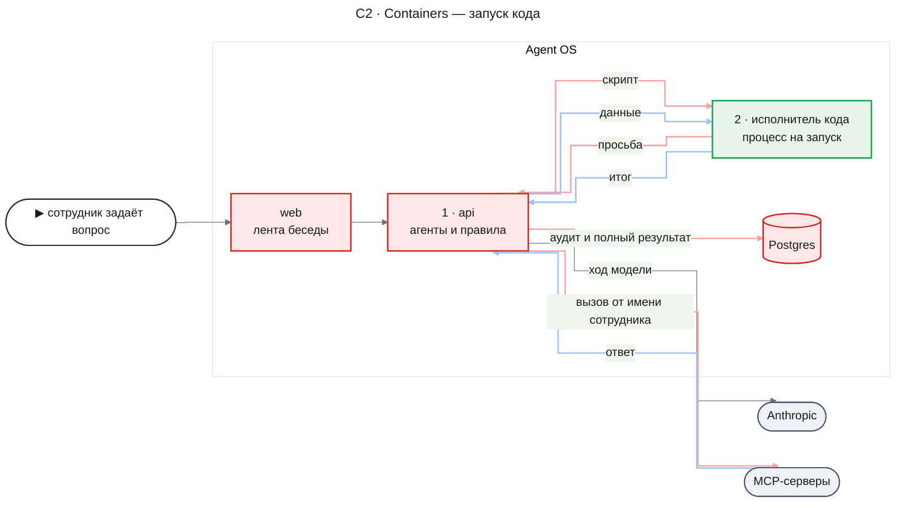

- `api` — процесс API: агент вызывает `run_code`, а процесс запускает исполнитель, проверяет и исполняет каждую его просьбу, пишет аудит и итог. Модель видит только итог.
- `исполнитель кода` — новый контейнер: процесс Node на один запуск с QuickJS внутри. Он не открывает ни сети, ни базы, ни файлов, кроме своего собранного входа и QuickJS; всё нужное получает по мосту.
- `Postgres` — две новые таблицы и две колонки в `agent_tool_calls` (Data Model).
- `web` — показывает запуск как вызов инструмента и карточку решения по UXRD.

#### C3 · Components: api

**api — запуск кода**

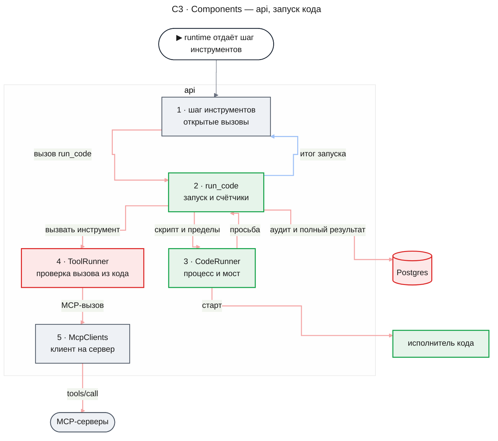

- Шаг инструментов исполняет `run_code`, как любой инструмент режима `outside`, и передаёт ему `callId` вызова, сигнал, логгер и `guard` шага; читающий запуск идёт сразу, изменяющий — после решения (KD-4).
- `run_code` связывает запуск с владельцем, сессией, снимком инструментов и классом, а запуск `write` — ещё и со списком «Может вызвать» из подтверждённого запроса (KD-10). Он держит счётчики вызовов и мест сотрудников (KD-11) и пишет аудит через `guard` (KD-6). На каждую просьбу «вызвать инструмент» он зовёт `ToolRunner.callFromCode`, на «прочитать результат» — репозиторий полных результатов.
- `CodeRunner` из пакета `code-runner` ничего не знает об агентах: он запускает процесс, держит мост с пределами кадров, таймер и убийство процесса, и отдаёт каждую просьбу обработчику, который ему передали.

**Как процесс API проверяет вызов из кода**

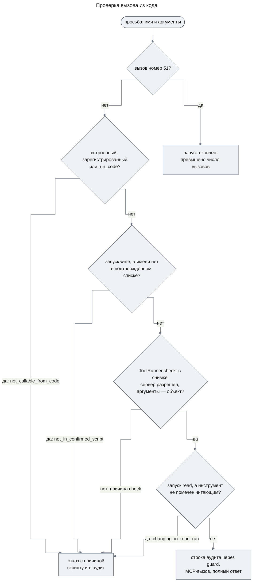

`ToolRunner.check` получает вместо набора сессии снимок MCP-инструментов серверов определения, который процесс API снял при старте запуска в форме `SessionTool`, — до фильтра прав сотрудника. Поэтому неразрешённый сервер получает `no_access` из `check`, а не `tool_not_in_definition` (DC-6). Читающим считается инструмент с `McpTool.readOnly` — его ставит `McpClients` только при `readOnlyHint: true`. В запуске `write` раньше этого имя сверяется со списком «Может вызвать» из подтверждённого запроса (KD-10). Права и класс проверяются на каждый вызов (KD-8). Полный ответ доходит до скрипта только у успеха и пустого ответа; ошибку инструмента и сбой связи скрипт получает без текста сервера (KD-2, AC-03.8).

#### C3 · Components: исполнитель кода

**исполнитель кода — один запуск**

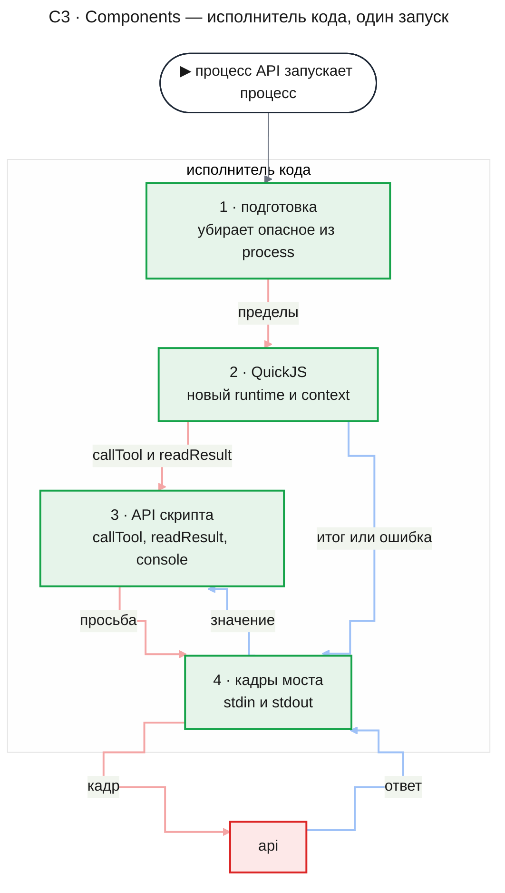

- **Подготовка** до создания QuickJS удаляет из `process` то, что модель разрешений не закрывает: `process._debugProcess` (открывает инспектор другого процесса того же пользователя ОС и не проверяется ни одной областью разрешений, [Permissions](https://nodejs.org/api/permissions.html)), а заодно `process.dlopen` и `process.binding`. Затем она ждёт первый кадр — старт запуска.
- **QuickJS** на каждый запуск получает новый runtime и context, с пределом памяти, пределом стека и обработчиком прерывания по сроку, поэтому от прежних запусков ничего не остаётся (AC-06.1). В context нет ничего, кроме встроенных средств языка: ни `console`, ни таймеров, ни `fetch`, ни модулей ([quickjs-emscripten README](https://github.com/justjake/quickjs-emscripten/blob/main/README.md)); `Intl` в сборке bellard нет вовсе.
- **API скрипта** кладёт в context одни и те же функции для любого запуска (Contract Definitions): под сессию внутри песочницы ничего не строится (KD-8). Каждая функция шлёт просьбу и возвращает обещание, которое разрешает ответ процесса API.
- **Кадры моста** читают stdin и пишут stdout. Когда stdin закрылся — процесс API умер, — процесс исполнителя выходит, как только QuickJS отдаёт управление, и не позже срока запуска.

### Runtime Flows

Во всех потоках `agents` и `runtime` — пакеты процесса API, а исполнитель кода — отдельный процесс. Postgres пишет только транзакция итога шага, `guard` или операция runtime.

#### Flow 1: Прямой вызов с обрезанным результатом

**Starts when:** шаг инструментов исполняет прямой вызов MCP-инструмента, чей ответ больше среза; for AC-04.1, DC-7.

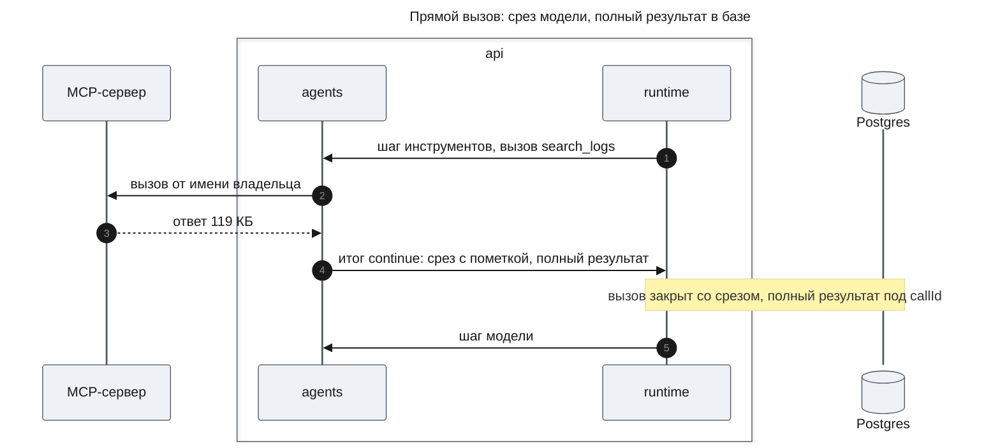

**Outcome:** в `agent_tool_calls` и в записи истории — срез до `AGENT_TOOL_RESULT_MAX_BYTES` с пометкой, где назван `callId`; в `agent_tool_results` под тем же `callId` — значение для скрипта. Модель на следующем ходу видит срез и пометку.

**Failure handling:**

- Ответ меньше среза → пометки нет, полный результат всё равно записан: скрипт может прочитать любой успешный результат (AC-03.5).
- Ошибка инструмента, сбой связи, отказ → полного результата нет (DC-8).

#### Flow 2: Читающий запуск

**Starts when:** модель вызвала `run_code` с классом `read`; for AC-01.1, AC-01.5, AC-03.1–AC-03.6, AC-03.8, AC-04.2, AC-04.3, AC-05.1, AC-05.5, AC-07.6, AC-08.1, AC-08.2, AC-09.1, DC-18.

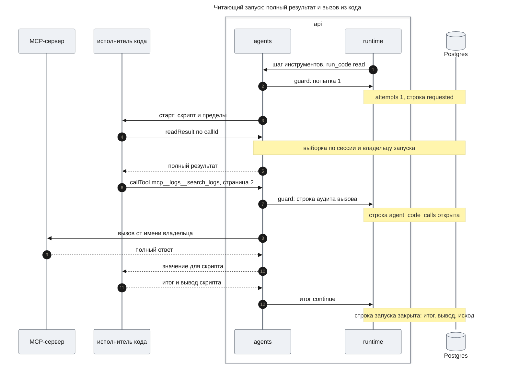

**Outcome:** модель на следующем ходу получает только итог (AC-08.2); вывод скрипта лежит в колонке `output` и в записи истории для сотрудника. На каждый вызов из кода — одна строка `agent_code_calls` с исходом, длительностью и ссылкой на строку запуска (AC-03.2). Процесс исполнителя убит после итога.

**Failure handling:**

- В скрипте есть символ смены направления, нулевой ширины или конец строки, который браузер рисует внутри строки → `ToolRunner.check` отказывает `invalid_arguments` по `RunCodeArgsSchema`, процесс исполнителя не стартует; в запуске `write` так же, и запроса сотруднику нет (AC-01.5, KD-9).
- У сотрудника уже исполняются два запуска → `tool_error` «превышено число одновременных запусков (2)» до записи попытки, процесс исполнителя не стартует (AC-07.6, KD-11).
- Просьба получила отказ (DC-5, DC-6, AC-05.5) → строка аудита с исходом «отказ» и причиной, MCP-сервер вызова не получил, а в скрипте обещание отклонено ошибкой, которая называет инструмент, причину и класс запуска. Скрипт может её поймать.
- Инструмент ответил ошибкой или сервер недоступен → строка аудита с исходом `tool_error` или `transport_failure`; в скрипте — отклонённое обещание `ToolError` с исходом и причиной, но без текста сервера; полный ответ сервера — одно предупреждение в логе запуска с замаскированными секретами (AC-03.8, KD-2).
- `readResult` с чужим или несуществующим `callId` → один и тот же ответ «результат не найден» (AC-04.3).
- `guard` строки аудита ответил `fenced` — попытка шага уже не текущая → вызов не уходит к серверу, `run_code` кончает запуск и возвращает `tool_error` «запуск прерван»: у `ToolRunResult` нет вида «прервано». Runtime отвергает итог шага, который отрезан от записи, поэтому ничего не сохраняется (Flow 4).
- Скрипт кончился исключением или синтаксической ошибкой → модель получает `tool_error` с причиной, сообщением исполнителя и строкой, в виде «исключение: `<name>`: `<message>`; строка N» (AC-07.5, AC-10.4); вывод не сохраняется в истории, но есть в логе (FR-08, FR-09).

#### Flow 3: Изменяющий запуск с подтверждением

**Starts when:** модель вызвала `run_code` с классом `write`; for AC-03.7, AC-05.2, AC-05.3, AC-05.4, AC-05.6, AC-05.7, AC-11.1, DC-9, DC-10, DC-16, DC-17.

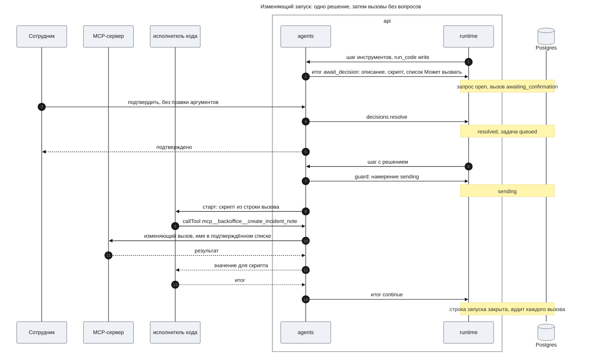

**Outcome:** до решения процесс исполнителя не запускался; после подтверждения скрипт исполнен один раз, и его изменяющие вызовы прошли без новых запросов (AC-05.3). Запрос несёт полный текст скрипта и список «Может вызвать», а веб показывает скрипт свёрнутым, а список — над кнопками по UXRD (KD-10). В логе — начало запуска с отметкой «подтверждён», хешем SHA-256 кода и `runId` (FR-11).

**Failure handling:**

- Скрипт зовёт инструмент, которого нет в подтверждённом списке, например по имени, собранному из частей → отказ `not_in_confirmed_script` с именем инструмента, строка аудита «отказ», MCP-сервер вызова не получил (AC-03.7).
- В решённом запросе нет читаемого списка → процесс исполнителя не стартует, вызов закрыт `tool_error` (DC-16).
- Сотрудник отклонил → вызов закрыт «отклонено пользователем», процесс исполнителя не запускался (AC-05.4); запись лога шага с `callId` запуска фиксирует отказ.
- Решение пришло с аргументами → `INVALID_ARGUMENTS`, запрос ждёт дальше (DC-9).
- Рестарт, пока запрос открыт → запрос ждёт, как любой (AC-05.6).
- Рестарт после намерения → «исход неизвестен» без повтора (Flow 5).
- Агента прервали или остановили после намерения → процесс исполнителя убит, строка запуска в `sending` закрыта «исход неизвестен», а не «прервано» (Flow 4).
- Агента остановили, пока запрос открыт → запрос отменён, вызов «прервано» (design-agents.md, Flow 7).

#### Flow 4: Запуск обрывается

**Starts when:** вышел срок, процесс исполнителя упал или нарушил протокол, или агента прервали либо остановили; for AC-07.1, AC-07.2, AC-07.4, AC-10.1, NFR-03.

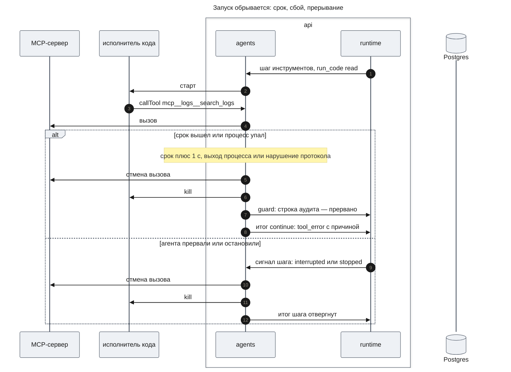

**Outcome:** запуск кончается итогом или ошибкой не позже чем через 5 с после срока (NFR-03): решает таймер процесса API, а не QuickJS. При прерывании и остановке `run_code` сам закрывает строку аудита отменённого вызова — своей короткой транзакцией, без `guard`: это запись о том, что вызов отменён, а не новое действие. Строку запуска закрывает `closeOpen` — в шаге, который возьмёт сообщение `interrupt`, а у остановленного агента в первом шаге после продолжения. Исход зависит от класса, как у любого вызова (design-agents.md, Flow 4 и Flow 7): читающий запуск — строка `requested` — получает «прервано», а подтверждённый изменяющий — строка `sending` — «исход неизвестен», потому что его вызовы могли дойти до сервера. Строку вызова из кода, которую `run_code` не успел закрыть, это закрытие закрывает вместе с ней (Invariant 4).

**Failure handling:**

- Одна функция «закончить запуск» в процессе API идёт в одном порядке: перестать принимать просьбы, отменить вызов в полёте, убить процесс, записать один исход. Второй конец того же запуска ничего не меняет.
- QuickJS сам заметил срок (обработчик прерывания) или память (предел runtime) → чистая ошибка с номером строки до того, как сработает таймер процесса API.
- 51-я просьба → запуск кончается ошибкой «превышено число вызовов» без вызова (AC-07.4).
- Кадр больше предела, неверная форма, неизвестная операция → процесс убит, запуск кончается ошибкой «нарушен протокол исполнителя», запись в лог с типом нарушения.
- Обработчик просьбы в процессе API бросил ошибку, например не записалась строка аудита → запуск кончается причиной `handler_failed`, модель получает «сбой платформы при обработке вызова из скрипта», а полная ошибка — одна запись лога `code run request handler failed`. Процесс исполнителя тут ни при чём, но убит так же.

#### Flow 5: Рестарт посреди запуска

**Starts when:** процесс API умер посреди запуска, и runtime отдал шаг инструментов снова; for AC-10.2, AC-10.6, DC-15.

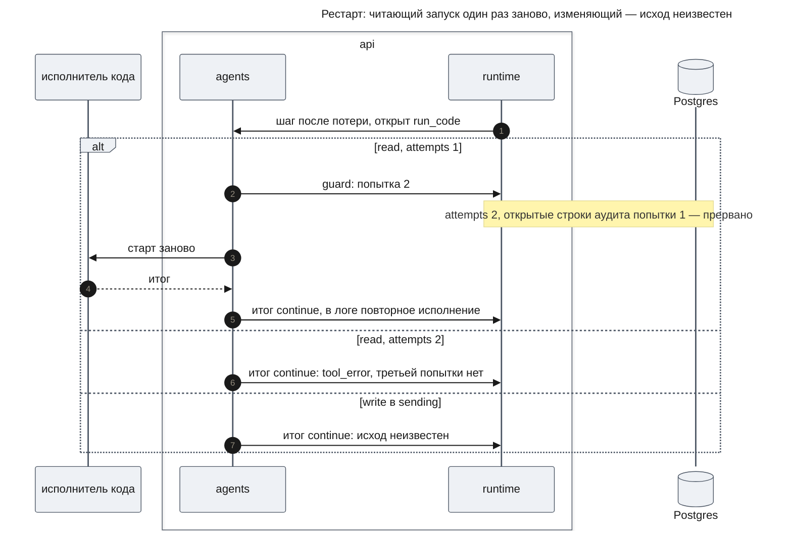

**Outcome:** читающий запуск исполнен заново ровно один раз, и агент получает его итог как от обычного запуска (AC-10.6); изменяющий не повторяется (AC-10.2). Процесс исполнителя, который пережил смерть процесса API, видит закрытый stdin и выходит; его просьбы никуда не дошли, потому что к MCP ходит только процесс API.

**Failure handling:**

- Попытка 2 записана, а шаг снова потерян → следующий шаг видит `attempts` 2 и закрывает вызов ошибкой (DC-15).
- `guard` попытки ответил `fenced` → процесс исполнителя не стартует, шаг без записей.

### Contract Definitions

#### Пакет `code-runner`

- **`createCodeRunner(options)`** — собирает исполнитель из разобранных пределов и логгера. Окружение не читает. Возвращает `CodeRunner`. Под Node ниже 26 бросает ошибку и ничего не собирает (KD-1).
- **`CodeRunner.run(request)`** — исполняет один скрипт в новом процессе исполнителя и возвращает `RunOutcome`, когда скрипт кончился, вышел срок, процесс упал или сработал сигнал. Ошибок не бросает: любой конец — значение `RunOutcome`. Вход `RunRequest`:
  - `script` — текст скрипта;
  - `limits` — срок, память, предел итога в байтах;
  - `onRequest` — обработчик просьб процесса API: получает просьбу и отвечает значением, ошибкой для скрипта или командой «закончить запуск» с причиной, без текста. Если обработчик бросил ошибку, запуск кончается причиной `handler_failed`, а ошибка пишется в лог один раз, записью `code run request handler failed`;
  - `signal` — отмена запуска; `logger` — логгер с идентификаторами запуска.
- Процесс исполнителя стартует через `spawn(process.execPath, …)` с `--permission`, малым `--max-old-space-size`, пустым `env` и тремя каналами `pipe`; слушателя SIGUSR1 под `--permission` у него и так нет. Кроме чтения, разрешений нет: ни сети, ни записи файлов, ни дочерних процессов, ни потоков, ни нативных модулей, ни WASI, ни инспектора.
- Модель разрешений проверяет путь чтения по написанию, а не по реальному пути, поэтому ссылка внутри разрешённого каталога ведёт за его пределы. Чтение разрешено только абсолютным каталогам, где ни одна ссылка не ведёт за разрешённые пути: собранному входу `packages/code-runner/dist`, в котором ссылок нет, и трём записям хранилища pnpm — `quickjs-emscripten-core`, `@jitl/quickjs-wasmfile-release-sync` и `@jitl/quickjs-ffi-types`. Запись разрешается целиком, каталогом `node_modules/.pnpm/<имя>@<версия>/node_modules`, потому что core находит `@jitl/quickjs-ffi-types` через ссылку в своей записи, а эта ссылка ведёт в другую разрешённую запись. Корень пакета `code-runner` с его `node_modules` не разрешается никогда.
- Пути записей процесс API вычисляет при старте по реальному пути пакетов, а не зашивает. Процесс исполнителя импортирует QuickJS по абсолютному пути, который ему передаёт процесс API: голое имя пакета из `dist` искало бы его в неразрешённом `packages/code-runner/node_modules`.
- Путь входа — параметр функции запуска, поэтому тесты исполняют враждебный JavaScript Node с теми же флагами; вход теста тоже лежит в каталоге без ссылок. Входы e2e-тестов собираются в `packages/code-runner/build/test-child` (не в git), вне `dist`, поэтому их нет в каталоге, который читает рабочий процесс исполнителя. Флаги и пути проверены спайком на Windows и Linux ([spike-node-permissions.md](./spike-node-permissions.md)).

**RunOutcome**

- `returned` — `value`: итог как JSON-текст не длиннее предела итога; `output`: вывод скрипта не длиннее 16 КиБ, с пометкой обрезки.
- `failed` — `reason`, `text`, `line` (номер строки скрипта, когда он есть) и `output`. `text` — только собственное сообщение скрипта у `syntax` и `exception`, у остальных причин `null`: текст причины для модели пишет `run_code` (Error handling). Причины: `syntax`, `exception`, `timeout`, `memory`, `result_too_large`, `result_not_json`, `call_limit`, `protocol`, `crashed`, `handler_failed`, `busy`, `aborted`. `result_too_large` и `result_not_json` замечает процесс исполнителя, а процесс API проверяет размер итога ещё раз. `handler_failed` ставит только процесс API: в кадре `error` исполнитель её прислать не может.

**Мост**

- Кадр — четыре байта длины, затем JSON. Длину кадра от процесса исполнителя процесс API проверяет до чтения тела: не больше 1 МиБ (или предела итога плюс 64 КиБ, если он больше), и не больше 4 МиБ за запуск всего.
- Честный процесс исполнителя в эти пределы не упирается: итог больше предела он не шлёт, а шлёт `error` с `result_too_large`; вывод после 16 КиБ он не шлёт, а последний кадр `output` несёт пометку обрезки. Пределы кадров ловят только сломанный или захваченный процесс.
- Процесс API шлёт `start` (скрипт и пределы — без секретов, без идентификаторов сотрудника и без списка инструментов) и ответы на просьбы с их номером. Ответ — значение или ошибка для скрипта: исход, причина и текст; у `tool_error` и `transport_failure` текст пустой.
- Процесс исполнителя шлёт `call` (номер, имя, аргументы), `read` (номер, идентификатор), `output` (строка вывода), `done` (итог) или `error` (причина, текст, строка; текст — сообщение скрипта у `syntax` и `exception`, иначе `null`). Любое другое сообщение — нарушение протокола.
- Аргументы одного вызова — не больше 64 КиБ, всех вызовов запуска — не больше 1 МиБ; данные, переданные скрипту, — не больше 64 МиБ за запуск (DC-12).

#### API скрипта

Скрипт — тело асинхронной функции: `await` и `return` работают на верхнем уровне, а номера строк в ошибках считаются от первой строки скрипта.

- **`callTool(name, args)`** — единственный вызов инструмента (KD-8). `name` — имя из списка инструментов модели, `mcp__<server>__<tool>`; `args` — объект аргументов, как при прямом вызове. Возвращает значение ответа: `structuredContent`, если он есть; иначе текст ответа, разобранный как JSON, или сам текст.
- **`readResult(id)`** — полный результат прямого вызова своей сессии по `callId`, в том же виде, что у вызова из кода. Нет такого — отклонённое обещание «результат не найден».
- **`console.log`**, **`console.info`**, **`console.warn`**, **`console.error`** — пишут строку в вывод скрипта.
- Отказ, ошибка инструмента, сбой связи и «результат не найден» — отклонённое обещание с ошибкой `ToolError`: `name` — `'ToolError'`, `outcome` — исход, `reason` — причина или `null`, `text` и `message` — текст.
  - Отказ платформы несёт её текст: инструмент и причину.
  - У ошибки инструмента и сбоя связи текста сервера нет (AC-03.8, KD-2): `outcome` — `tool_error` или `transport_failure`; `reason` — `null` у `tool_error`, а у `transport_failure` причина сбоя `McpFailureReason`: `timeout`, `connection_lost`, `protocol_error`, `startup_failed` или `client_error`; `text` и `message` пустые.

#### `agents`

- **Инструмент `run_code`** — встроенный, режим `outside`, заголовок «Выполнить код», подписи аргументов «Описание», «Класс запуска», «Скрипт» (UXRD MC-1, MC-2). Аргументы — `RunCodeArgs`. Возвращает итог запуска исходом `success` или `empty` (DC-2), а любой конец `failed` — исходом `tool_error` с текстом причины из таблицы `runTexts` и строкой: «причина; строка N»; у `syntax` и `exception` после причины стоит сообщение исполнителя (Error handling). Подтверждение: вид `agents.tool_confirmation`, `required` — класс `write`, `editableArgs: false`, `content` — список «Может вызвать» от `canCallOf` (KD-10). Перед стартом процесса берёт место сотрудника (KD-11). Если `guard` строки аудита ответил `fenced`, кончает запуск и возвращает `tool_error` «запуск прерван» (Flow 2).
  - **Маскировка итога и вывода** (FR-11, вторая линия после KD-2). Перед возвратом `run_code` заменяет известные секреты маской `[redacted]` в тексте итога и в выводе (`maskResult`). Поэтому маску несут и строка вызова (`agent_tool_calls.output` и текст итога, а с ними `tool_result.output` истории), и то, что получает модель.
  - Маскирует `createSecretMasker` из `packages/common` — тот же, что у логгера: значения от 8 символов, маска `[redacted]`. Он ищет секрет только дословно: значение, которое скрипт преобразовал (закодировал, разрезал, перевернул), маска не ловит. Список секретов — `secretValuesOf(config)` из `@agent-os/agents`: ключ провайдера и каждое значение `env` MCP-серверов. Тот же список `apps/api` и тестовая обвязка отдают логгеру.
  - Не маскируются данные, с которыми работает скрипт (успешные ответы `callTool`, значения `readResult`), аргументы и скрипт запуска и аргументы в аудите `agent_code_calls`.
- **`canCallOf(script, tools)`** — список «Может вызвать» по правилу KD-10 и DC-17: `tools` — набор инструментов сессии. Чистая функция: не ходит ни в базу, ни к серверам.
- **`ToolRunner.callFromCode(request, scope)`** — проверяет и исполняет просьбу «вызвать инструмент» по правилу из C3: `request` — имя и аргументы; `scope` — вызывающий агент, снимок MCP-инструментов серверов определения со старта запуска в форме `SessionTool`, класс запуска, у запуска `write` — набор имён из подтверждённого списка, имена встроенных и зарегистрированных инструментов `agentToolNames` из `ToolRegistry.toolNames()` для фильтра `not_callable_from_code`, а также `callId` запуска, сигнал и логгер. После фильтров кода и списка зовёт `check` со снимком вместо набора сессии, затем отказывает в запуске `read` инструменту без `McpTool.readOnly`. Возвращает отказ с причиной или исход MCP-вызова: у успеха и пустого ответа — полное значение ответа, у `tool_error` и `transport_failure` — исход и причину с пустым текстом (KD-2, AC-03.8). Срез не делает. Пишет в лог запись вызова `tool call finished`, как `runOutside`. У `tool_error` и `transport_failure` пишет ещё одно предупреждение (`warn`) `tool call from code failed; its response is hidden from the script` с полями `callId` (`callId` запуска), `tool`, `server`, `outcome`, `reason` и `response` — полный текст ошибки сервера без среза, у `transport_failure` пустой. Поля `runId`, `attempt` и `seq` добавляет дочерний логгер запуска, а секреты в `response` маскирует логгер `common`.
- **`ToolRunner.needsConfirmation(call)`** — MCP-инструмент без `McpTool.readOnly` или инструмент с подтверждением, чьё `required(args)` вернуло истину либо не задано.
- **`ToolRunner.confirmationRequest(call, session, tools)`** — прежний запрос; набор инструментов сессии уходит в `content` инструмента с подтверждением.
- **`ToolConfirmation.required(args)`** — необязательная функция; без неё подтверждение нужно всегда, как сегодня.
- **`ToolConfirmation.content(args, tools)`** — что показать сотруднику; второй аргумент — набор инструментов сессии. Инструмент, которому он не нужен, его не читает.
- **`OutsideToolInput.callId`, `signal`, `logger`** — `callId` вызова, сигнал и логгер шага. Сейчас вход несёт только аргументы и вызывающего; эти поля добавляются с `run_code`, их первым читателем. `ToolRunner` берёт `callId` из вызова, а сигнал и логгер — из `OutsideContext` шага, по которому он сам уже ловит прерывание и пишет лог вызова. `run_code` помечает `callId` как `runId` все записи лога запуска (FR-09), а по сигналу заканчивает запуск (AC-10.1, Flow 4).
- **`OutsideToolInput.guard`** — `guard` шага, которым инструмент вне транзакции пишет свои строки только из текущей попытки. `OutsideContext` получает `guard` из контекста шага, как его уже получает `sendConfirmed`.
- **`OutsideToolInput.confirmed`** — `content` решённого запроса, когда вызов исполняется по подтверждению; у вызова без подтверждения поля нет. `decisionOf` шага читает его из `ctx.decision.payload` вместе с `callId`, а `sendConfirmed` передаёт инструменту.
- **`ToolRegistry.sessionTools(input)`** — прежний набор и `run_code` в любом наборе. `checkCatalog` отвергает определение, которое называет `run_code` в `tools` (DC-1).
- **Пометка о срезе** — вместо прежнего хвоста «[truncated N bytes]» строка с числом обрезанных байт и вызовом `readResult` с `callId` (DC-7).
- **Правило выбора кода** — текст из FR-01, который `ModelClient` дописывает к инструкциям каждого вызова модели. Оно же говорит модели звать инструменты из кода через `callTool` под теми же именами и с теми же схемами аргументов, что в её списке инструментов, и что ошибка инструмента в скрипте несёт только исход, а текст сервера виден при прямом вызове инструмента (AC-03.8).

**RunCodeArgs** — схема `RunCodeArgsSchema` и имя `RUN_CODE_TOOL` (`run_code`) в `packages/contracts`; веб узнаёт запуск по паре «инструмент `run_code`, сервер `null`».

- `description` — описание для сотрудника, от 1 до 300 символов.
- `class` — `read` или `write`.
- `script` — текст скрипта, от 1 байта до 64 КиБ, без символов U+202A–U+202E, U+2066–U+2069, U+200B–U+200D, U+2060, U+FEFF, U+2028, U+2029 и без CR, за которым не следует LF (KD-9). Это правила аргумента, как у любого инструмента: нарушение — отказ `invalid_arguments`, а модель видит причину и исправляет скрипт.

**RunCodeConfirmationContentSchema** — `content` запроса изменяющего запуска, в `packages/contracts`.

- `canCall` — список «Может вызвать» в порядке показа (KD-10); пустой список — скрипт не называет ни одного инструмента (UXRD MC-9). Пункт: `name` — полное имя инструмента, как оно написано в скрипте; `changes` — истина для «меняет», ложь для «читает».

**HistoryEntry `tool_result`** — новое необязательное поле `output`: вывод скрипта успешного запуска `run_code`; у неуспешного — `null`, у остальных инструментов поля нет. Модель его не получает: сообщения провайдера строятся только из `text`.

**Причины отказа** — `ToolRefusalReasonSchema` получает `not_callable_from_code`, `changing_in_read_run` и `not_in_confirmed_script`. Все три встречаются только в строках аудита вызовов из кода. Текст отказа `not_in_confirmed_script` для скрипта называет инструмент и говорит, что его нет в подтверждённом коде (AC-03.7).

**Веб.** Блок вызова и карточка решения узнают запуск по `RUN_CODE_TOOL` и показывают его по UXRD (KD-1–KD-5, MC-1–MC-5): описание во второй строке заголовка, строки аргументов в порядке полей `RunCodeArgs`, а не в порядке ключей от модели, скрипт свёрнут за «Показать скрипт», вывод — из поля `output`. Аргументы, которые не прошли `RunCodeArgsSchema`, показываются обычными строками аргументов. Карточка изменяющего запуска читает список «Может вызвать» из `Confirmation.content` по `RunCodeConfirmationContentSchema`, как карточка брифа читает своё содержимое своей схемой, и показывает его в данном порядке, в любом состоянии карточки (UXRD KD-6, KD-7, MC-6–MC-9); сама она пунктов не сортирует и не меняет. Содержимое, которое схеме не отвечает, списка не даёт — такой запуск и не стартует (DC-16). Блок вызова в истории списка не показывает. Строку технического имени карточка показывает только у инструмента с сервером ([decision-card.md](../../design-system/components/decision-card.md), часть 4), поэтому её нет ни у одного встроенного инструмента, не только у `run_code`.

**Error handling**

Тексты ошибок запуска — для модели, по-русски, с номером строки, где он есть: «синтаксическая ошибка», «исключение», «превышено время (30 с)», «превышена память (512 МБ)», «итог больше предела (16384 байт)», «итог не переводится в JSON», «превышено число вызовов (50)», «нарушен протокол исполнителя», «процесс исполнителя упал», «сбой платформы при обработке вызова из скрипта», «исполнитель кода занят», «превышено число одновременных запусков (2)», «в запросе нет списка «Может вызвать»», «запуск дважды прерван рестартом», «запуск прерван». Значения в скобках — из настроек.

Все эти тексты и текст «результат не найден» для скрипта лежат в одной таблице — `runTexts` в `run_code`; `code-runner` своих текстов причин не пишет. У «синтаксической ошибки» и «исключения» к причине добавляется сообщение исполнителя: «исключение: `<name>`: `<message>`; строка N».

**Runtime settings**

Переменные читает `apps/api` и передаёт в `parseAgentsConfig`; разобранные значения `CodeRunConfig` `run_code` получает как есть (`RunCodeDeps.codeRun`).

- `CODE_RUN_TIMEOUT_MS` — default `30000`; срок запуска. Процесс API убивает процесс исполнителя через 1 с после срока.
- `CODE_RUN_MEMORY_MB` — default `512`; предел памяти QuickJS.
- `CODE_RUN_MAX_TOOL_CALLS` — default `50`; число просьб «вызвать инструмент» за запуск.
- `CODE_RUN_MAX_CONCURRENT` — default `4`; одновременных запусков в одном процессе API (DC-13).
- `CODE_RUN_MAX_CONCURRENT_PER_USER` — default `2`; одновременных запусков одного сотрудника в одном процессе API (AC-07.6, KD-11).
- Предел итога — прежний `AGENT_TOOL_RESULT_MAX_BYTES` (AC-07.3).

### Data Model

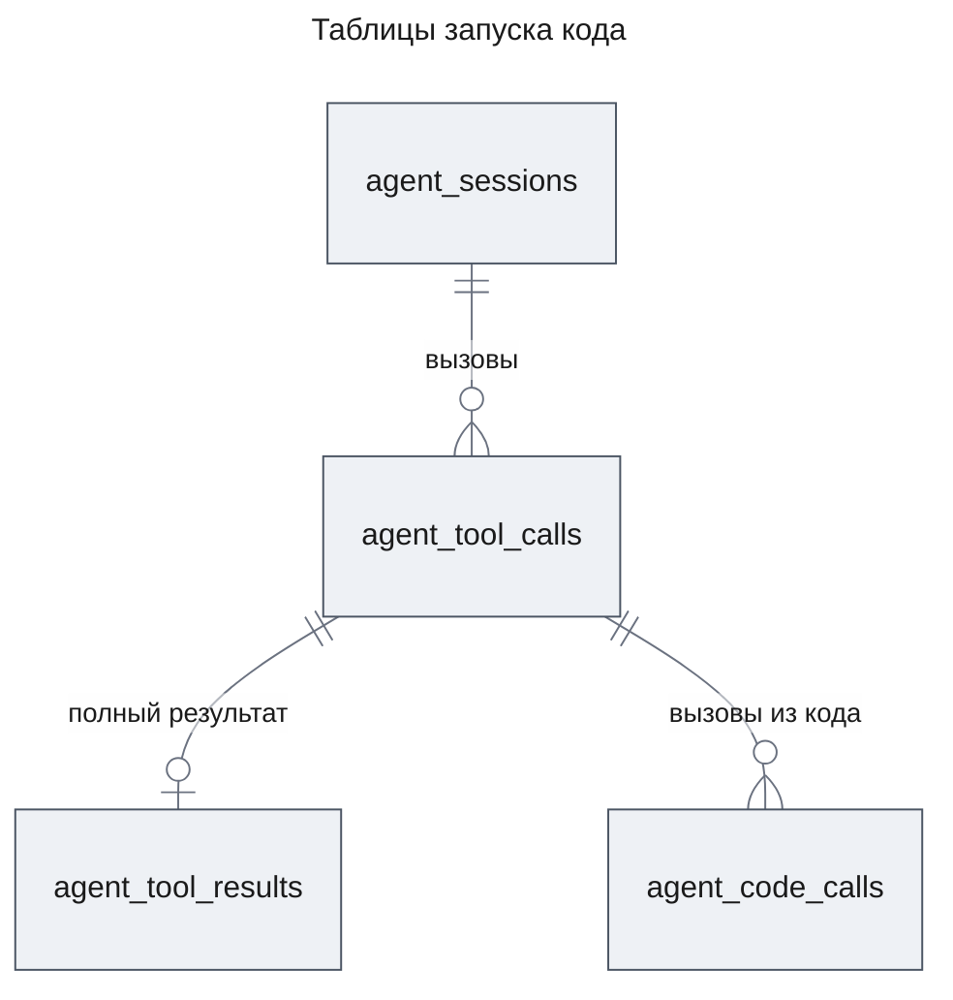

- `agent_tool_results` — полный результат успешного прямого MCP-вызова в виде значения для скрипта, ключ — сессия и `callId`. Строка появляется в той же транзакции, что закрывает вызов, и удаляется каскадом вместе с вызовом и сессией.
- `agent_code_calls` — строка на каждую просьбу «вызвать инструмент»: строка запуска, номер попытки, номер вызова в попытке, инструмент, сервер, аргументы, исход, причина отказа, время начала и конца. Результата в ней нет: его видит только скрипт. Каскад от строки запуска.
- `agent_tool_calls` получает две колонки: `attempts` — сколько раз читающий запуск начинался (KD-7), и `output` — вывод скрипта успешного запуска. Другие инструменты их не трогают.
- Читают и пишут новые таблицы только функции репозиториев `agents`; представление истории и сообщения провайдера их не видят.

### State Transitions and Invariants

Строка запуска проходит прежние состояния вызова (design-agents.md, State Transitions); новое — переходы `attempts` у читающего запуска.

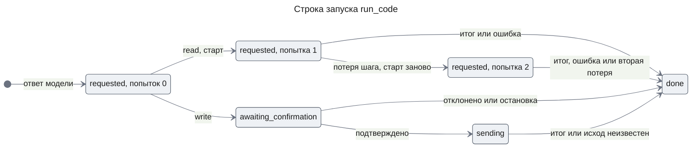

**Invariants**

1. Ни одна просьба из процесса исполнителя не меняет, от чьего имени идёт вызов, какой набор инструментов и какой класс у запуска: всё это процесс API связал с запуском при старте.
2. Ни один вызов из кода не доходит до MCP-сервера без открытой строки аудита, записанной из текущей попытки шага.
3. Изменяющий запуск исполняет код из строки вызова и только после записанного решения «подтверждено» и намерения `sending`, и вызывает только инструменты из списка «Может вызвать» этого решения; в запуске `read` ни один инструмент без `readOnlyHint` не вызывается.
4. У строки `agent_code_calls` не больше одного исхода. Исход ей пишет `run_code`, когда вызов кончился или отменён; у отменённого вызова — «исход неизвестен» в запуске `write` и «прервано» в запуске `read`, как у строки запуска. Строка, которую он не успел закрыть, потому что процесс API умер, получает тот же исход по классу, когда закрывается строка запуска или начинается следующая попытка. У остановленного агента, которого после рестарта никто не продолжил, такая строка остаётся без исхода: это вызов, исход которого неизвестен.
5. Читающий запуск исполняется не больше двух раз; изменяющий — не больше одного.
6. Процесс исполнителя живёт не дольше срока запуска плюс 1 с, а одновременно их в процессе API не больше `CODE_RUN_MAX_CONCURRENT`, и из них у одного сотрудника — не больше `CODE_RUN_MAX_CONCURRENT_PER_USER`.
7. Модель получает из запуска только итог или текст ошибки; вывод скрипта уходит только в историю для сотрудника и в лог. Дословные вхождения известных секретов в итоге и выводе заменены маской до того, как их получат история и модель.
8. Скрипт не получает текста сервера из ответа с исходом `tool_error` или `transport_failure`: только исход и причину (AC-03.8).

## Test Strategy

Тесты пишутся с задачами и запускаются один раз в конце части. Модель подменяется на границе `ModelClient` сценарием ответов; MCP — настоящий процесс фикстуры, а её журнал вызовов показывает, что дошло до сервера. Набор на побег (NFR-06) — по таблице на слой: строки в UC-E1–UC-E4. Замеры NFR-01 и NFR-02 — отдельный скрипт по запросу.

### Main Use Cases

- **UC-1: Подсчёт по полному результату** — covers AC-01.1, AC-03.2, AC-03.5, AC-04.1, AC-04.2, AC-05.1, AC-08.1, AC-08.2, AC-09.1, DC-2, DC-7
  - Given: агент сделал прямой вызов `search_logs` с ответом на 500 записей — больше среза; сценарий затем вызывает `run_code` с классом `read`, скрипт читает этот результат по `callId`, через `callTool("mcp__logs__search_logs", …)` берёт вторую страницу, печатает число записей и возвращает число ошибок по сервисам.
  - When: шаги идут до конца хода.
  - Then: модель видела срез с пометкой и `callId`; запуск прошёл без запроса сотруднику; число записей, которое насчитал скрипт, равно `totalMatched` фикстуры; модель получила только итог, а `history` отдаёт итог и `output`; в аудите одна строка запуска и одна строка вызова из кода со ссылкой на неё; в логе начало, вызов с исходом и длительностью, вывод и конец с одним `runId`.
- **UC-2: Изменяющий запуск** — covers AC-03.7, AC-05.2, AC-05.3, AC-05.4, AC-05.6, DC-9, FR-11
  - Given: сценарий вызывает `run_code` с классом `write`, скрипт трижды вызывает `mcp__backoffice__create_incident_note`; строки: подтвердить; отклонить; решение с правленными аргументами; рестарт до решения, затем подтвердить; скрипт, который после трёх вызовов зовёт `mcp__logs__search_logs` по имени, собранному из двух частей, — подтвердить.
  - When: шаги идут до запроса, затем выполняется строка.
  - Then: до решения журнал фикстуры пуст; запрос несёт агента, описание, класс, полный скрипт и список «Может вызвать» из одного пункта `mcp__backoffice__create_incident_note` — «меняет»; подтверждение — три вызова без новых запросов и итог; отклонение — ноль вызовов и «отклонено»; правка — `INVALID_ARGUMENTS`, запрос открыт; после рестарта запрос открыт и подтверждается; собранное имя — отказ `not_in_confirmed_script` с именем инструмента, строка аудита «отказ», в журнале фикстуры три вызова и ни одного `search_logs`; в логе начало запуска с отметкой «подтверждён» и хешем кода.
- **UC-3: `run_code` у каждого агента** — covers AC-01.2, AC-01.3, DC-1
  - Given: определения `general-purpose`, `chat`, координатор и исполнители шаблона `deep-research`; отдельно — определение, которое называет `run_code` в `tools`.
  - When: собирают набор инструментов и инструкции вызова модели; запускают проверку каталога.
  - Then: в каждом наборе есть `run_code`, в каждой инструкции — правило выбора кода; проверка каталога отвергает определение с `run_code`.
- **UC-4: Задачи на Haiku** — covers AC-01.4, DC-4
  - Given: собранная фича, настоящая модель класса Haiku, фикстура с логами за неделю, тикетами `tracker` и заказами со ссылкой на трассы.
  - When: владелец задаёт четыре задачи из AC-01.4.
  - Then: в [ac-01-4-haiku-run.md](./ac-01-4-haiku-run.md) для каждой задачи записаны номер удачной попытки и верность итога против подсчёта по фикстуре. Это ручной прогон, не тест CI.
  - Result: 4 из 4 задач решены верно 2026-11-14, модель `anthropic/claude-haiku-5-5`, всего 0,021 USD ([ac-01-4-haiku-run.md](./ac-01-4-haiku-run.md)).
- **UC-5: Запуск кода в вебе** — covers AC-05.2, AC-08.1
  - Given: записи истории успешного запуска с выводом и упавшего запуска; открытый запрос изменяющего запуска.
  - When: веб строит ленту и карточку.
  - Then: во второй строке заголовка — описание; строки — описание, класс словами, скрипт за «Показать скрипт»; у успешного запуска итог и «Вывод скрипта», у упавшего только исход; раскрытый скрипт совпадает с аргументом `script`.
- **UC-6: Список «Может вызвать»** — covers AC-05.7, DC-17
  - Given: `canCallOf` и набор сессии в том виде, в каком его строит `McpClients`: `mcp__logs__search_logs` с `readOnlyHint: true`, `mcp__backoffice__create_incident_note` с `readOnlyHint: false`, `mcp__backoffice__close_ticket` без пометок, `mcp__logs__search` с `readOnlyHint: true`, а также `start_agent`. Дальше инструменты названы без префикса `mcp__<server>__`, а скрипты пишут полные имена. Строки скриптов: называет `search_logs`, затем `close_ticket`, затем `create_incident_note`; называет `close_ticket` только в комментарии; называет `search_logs`, но не `search`; собирает `create_incident_note` из частей; зовёт только `readResult` и пишет `start_agent` в строке; не называет ни одного инструмента.
  - When: строится список для каждой строки.
  - Then: первая строка — `close_ticket` «меняет», `create_incident_note` «меняет», `search_logs` «читает», в этом порядке; комментарий даёт пункт `close_ticket`; `mcp__logs__search` не попадает; собранное имя не попадает; `readResult` и `start_agent` не попадают; последняя строка — пустой список. Это один табличный тест без базы.

### Error and Edge Use Cases

- **UC-E1: Скрипт против своей песочницы** — covers AC-02.1, AC-02.3, AC-02.5, AC-06.1, AC-07.5, NFR-06
  - Given: исполнитель кода без агентов, строки-скрипты: `process`, `require`, `fetch`, `import()`, `WebAssembly`, `Intl`; цепочка конструкторов `(()=>{}).constructor("return this")()` и порча прототипов `Object.prototype`; первый запуск кладёт глобальную переменную, второй читает её; синтаксическая ошибка в строке 3; исключение в строке 5.
  - When: каждый скрипт исполняется.
  - Then: каждый кончается ошибкой, которая называет недоступное средство или причину и строку; цепочка конструкторов достаёт только глобальный объект QuickJS; второй запуск переменной не видит.
- **UC-E2: Пределы** — covers AC-07.1, AC-07.2, AC-07.3, AC-07.4, AC-10.4, DC-3, DC-11, DC-12, DC-14
  - Given: короткие пределы из настроек; строки: бесконечный цикл, катастрофическое регулярное выражение, `await` обещания, которое никогда не разрешится, глубокая рекурсия, рост памяти, поток `console.log`, итог больше предела, итог-функция, 51 вызов подряд, `Promise.all` из 100 вызовов, `readResult` больших результатов сверх 64 МиБ.
  - When: каждый скрипт исполняется.
  - Then: ошибки «превышено время», «превышено время», «превышено время», «исключение», «превышена память», успех с выводом в 16 КиБ и пометкой, «итог больше предела», «итог не переводится в JSON», «превышено число вызовов» с ровно 50 строками аудита, «превышено число вызовов», «превышена память»; модель на следующем ходу видит текст ошибки, а не урезанный итог; процесс API отвечает.
- **UC-E3: Просьбы против правил** — covers AC-03.1, AC-03.3, AC-03.4, AC-03.6, AC-04.3, AC-05.5, AC-06.2, DC-5, DC-6, DC-8
  - Given: сотрудник А, которому разрешён `logs`, но не `backoffice`, в определении оба сервера; строки скриптов: `callTool("start_agent")`, `callTool("run_code")`, выдуманное имя, инструмент сервера вне определения, инструмент `backoffice`, `create_incident_note` в запуске `read`, вызов с `ownerId` сотрудника Б в аргументах, `readResult` с `callId` сессии Б, с `callId` другого агента А, с выдуманным id и с `callId` вызова, кончившегося ошибкой, `readResult` во время второго одновременного запуска.
  - When: скрипты исполняются.
  - Then: отказы `not_callable_from_code`, `not_callable_from_code`, `tool_not_in_definition`, `tool_not_in_definition`, `no_access`, `changing_in_read_run` с именем инструмента и классом; у каждого строка аудита «отказ», журнал фикстуры пуст; вызов с чужим `ownerId` записан от А и дал тот же ответ, что прямой вызов; все `readResult` дали один и тот же ответ «результат не найден».
- **UC-E4: Враждебный JavaScript Node в процессе исполнителя** — covers AC-02.1, AC-02.2, AC-02.4, NFR-05, NFR-06
  - Given: функция запуска исполнителя с производственными флагами и входом, который после той же подготовки исполняет враждебный код Node; рядом слушают TCP-порт и именованный канал.
  - When: код пробует прочитать `apps/api/.env`, вывести `process.env`, открыть TCP, `http`, `fetch`, `dns.lookup`, `dgram`, именованный канал, `child_process.spawn`, `Worker`, `process.dlopen`, `process.binding`, `inspector`, `process._debugProcess` на pid процесса API, записать файл.
  - Then: каждая попытка отклонена, в окружении нет ключей платформы и MCP-серверов, слушатели не получили соединений, инспектор процесса API не открылся.
- **UC-E5: Сломанный процесс исполнителя** — covers NFR-03
  - Given: вход исполнителя, который виснет без ответа; который падает сразу; который шлёт кадр больше 1 МиБ; который шлёт неизвестную операцию.
  - When: идёт запуск.
  - Then: каждый запуск кончился ошибкой не позже чем через 5 с после срока; процесса исполнителя нет; процесс API работает.
- **UC-E6: Прерывание и остановка посреди запуска** — covers AC-10.1
  - Given: читающий скрипт, который вызывает `search_logs` в цикле, а фикстура держит вызов; отдельной строкой — подтверждённый изменяющий скрипт, который вызывает `create_incident_note`, а фикстура держит вызов.
  - When: агента прерывают; отдельной строкой — останавливают.
  - Then: после команды журнал фикстуры не получил ни одного нового вызова; процесса исполнителя нет; читающий запуск и его открытая строка аудита — «прервано», изменяющий запуск и его открытая строка аудита — «исход неизвестен».
- **UC-E7: Рестарт посреди запуска** — covers AC-10.2, AC-10.6, DC-15
  - Given: строки: читающий запуск, процесс убит во время вызова из кода; тот же запуск, убитый дважды; подтверждённый изменяющий запуск, процесс убит после первого вызова из кода.
  - When: второй экземпляр продолжает.
  - Then: читающий исполнен ещё раз ровно один раз, в логе одна запись повторного исполнения, агент получил итог; дважды убитый — ошибка «запуск дважды прерван рестартом»; изменяющий — «исход неизвестен», журнал фикстуры содержит не больше вызовов, чем до рестарта.
- **UC-E8: Повтор после ошибки** — covers AC-10.3
  - Given: сценарий модели: `run_code` с синтаксической ошибкой, затем исправленный.
  - When: агент работает.
  - Then: оба запуска исполнены, второй успешен; отказа по числу попыток нет.
- **UC-E9: Секреты** — covers AC-03.8, AC-11.1, AC-02.2; INT-1 row D в `packages/agents/test/code-execution.int.e2e-spec.ts`
  - Given: у MCP-сервера в файле серверов переменная окружения с учётными данными, и на вызов `search_logs` сервер отвечает ошибкой инструмента, в тексте которой эти данные; у развёртывания есть ключ провайдера. Первый скрипт печатает всё, что может достать о своём окружении, вызывает этот инструмент, ловит ошибку и печатает и возвращает её исход, причину и текст; второй кончается исключением, текст которого перечисляет его глобальные имена.
  - When: оба запуска идут.
  - Then: скрипт получил ошибку с исходом `tool_error`, причиной `null` и пустым текстом; в логе запуска ровно одно предупреждение `tool call from code failed; its response is hidden from the script` с полным ответом сервера, где учётные данные заменены `[redacted]`; ни в записях лога запуска, ни в выводе, ни в итоге, ни в истории, ни у модели нет значения переменной и ключа провайдера модели, а текста сервера нет нигде, кроме этого предупреждения.
- **UC-E10: Скрытые символы в скрипте** — covers AC-01.5
  - Given: вызовы `run_code` с классом `read` и с классом `write`; строки скриптов: с U+202E, U+2067, U+200B, U+2060, U+FEFF внутри строкового литерала; тот же скрипт с экранированием `\u202E` вместо символа; комментарий `//`, за которым следуют одиночный CR, U+2028 или U+2029 и строка кода; тот же скрипт с CRLF.
  - When: каждый вызов проходит `ToolRunner.check`.
  - Then: каждый скрипт с символом или с концом строки внутри строки в обоих классах — отказ `invalid_arguments`, поэтому ни запроса, ни запуска нет (KD-9); скрипт с экранированием и скрипт с CRLF проходят. Это один табличный тест без базы.
- **UC-E11: Одновременные запуски сотрудника** — covers AC-07.6, DC-18
  - Given: `run_code` с подменённым `CodeRunner`, который держит каждый запуск до команды теста; `CODE_RUN_MAX_CONCURRENT_PER_USER` 2, `CODE_RUN_MAX_CONCURRENT` 4.
  - When: строки: у сотрудника А исполняются два читающих запуска, А начинает третий, затем Б начинает свой; у А исполняются два запуска, один кончается ошибкой, А начинает ещё один.
  - Then: третий запуск А — `tool_error` «превышено число одновременных запусков (2)», подменённый `CodeRunner` его скрипта не получил, `attempts` не вырос; запуск Б исполняется; после конца одного запуска А следующий его запуск исполняется.
- **UC-E12: Node без сетевой преграды** — covers NFR-05; `packages/code-runner/src/code-runner.spec.ts`
  - Given: версия Node, которую видит `createCodeRunner`; строки: 24.11.0, 25.9.0, 26.0.0.
  - When: собирают исполнитель.
  - Then: на 24.11.0 и 25.9.0 сборка бросает ошибку, которая называет версию; на 26.0.0 исполнитель собран. Процесс исполнителя при сборке не стартует. Это один табличный тест из трёх строк.

### Non-Functional Use Cases

- **UC-N1: 5 МБ за срок** — covers NFR-01
  - Given: 21 000 записей лога фикстуры, около 5 МБ, по страницам `search_logs`.
  - When: скрипт проходит все страницы и группирует ошибки по сервису.
  - Then: итог верен, запуск уложился в 30 с.
  - Замер гейта: 2130 мс на 21 000 записей, 5 014 309 байт, 42 страницы (предел 30 000 мс).
- **UC-N2: Пустой скрипт** — covers NFR-02
  - Given: машина разработчика.
  - When: 50 раз подряд исполняют пустой скрипт.
  - Then: p95 от вызова `run` до итога не больше 2 с.
  - Замер гейта: p95 пустого скрипта 90 мс на 50 запусках (предел 2000 мс).
- **UC-N3: Сервер отвечает, пока запуск у предела** — covers NFR-04, AC-10.5
  - Given: сотрудник А запускает скрипт с бесконечным циклом и второй — с ростом памяти.
  - When: сотрудник Б в это время читает список бесед и пишет в чат.
  - Then: ответы Б укладываются в бюджеты раздела «Performance Requirements» в `.claude/skills/project-context/SKILL.md`.
  - Замер гейта под нагрузкой: список бесед — p95 7 мс (бюджет 300 мс), сообщение — p95 23 мс (бюджет 500 мс).

## Security Considerations

- **Authentication & Authorization**: новых входов снаружи нет. Владельца, агента, сессию и набор инструментов процесс API берёт из шага и связывает с запуском до старта процесса; просьбы их не несут (Invariant 1). Вызов из кода проходит ту же проверку прав, что вызов агента, с перечтением прав на каждый вызов; изменяющий запуск — только после решения сотрудника и только к инструментам из списка «Может вызвать», который сотрудник видел (Invariant 3, KD-10). `readResult` ищет по сессии и владельцу запуска.
- **Input Validation**: скрипт — недоверенный ввод. Скрипт с символами смены направления и нулевой ширины и с концами строк, которые браузер рисует внутри строки (U+2028, U+2029, одиночный CR), отвергает `RunCodeArgsSchema` до запроса и до запуска (KD-9). Первая преграда — QuickJS в WASM без окружающих возможностей. Вторая — процесс Node 26 с моделью разрешений; под Node ниже 26 `createCodeRunner` отказывает, и процесс API не стартует, потому что на Node 24 модель разрешений оставляет TCP и DNS открытыми (KD-1, UC-E12). Процесс исполнителя работает без сети (TCP, UDP, DNS, именованные каналы), записи файлов, дочерних процессов, потоков, нативных модулей и WASI, с чтением только собранного входа и QuickJS из каталогов, где ни одна ссылка не ведёт наружу (Contract Definitions, пакет `code-runner`), с пустым окружением. На Windows libuv сам добавляет в окружение ребёнка системные переменные родителя: `HOMEDRIVE`, `HOMEPATH`, `LOGONSERVER`, `PATH`, `SYSTEMDRIVE`, `SYSTEMROOT`, `TEMP`, `USERDOMAIN`, `USERNAME`, `USERPROFILE`, `WINDIR`. Секретов среди них нет, `NODE_OPTIONS` не наследуется, а на Linux окружение ребёнка пустое ([libuv, process.c](https://github.com/libuv/libuv/blob/v1.x/src/win/process.c), спайк). Мост — кадры с длиной, проверенной до разбора, и закрытый набор сообщений.
- **Sensitive Data Handling**: процесс исполнителя не получает ни секретов, ни идентификаторов сотрудника; процесс API пишет лог через логгер `common`, который прячет ключ провайдера и переменные MCP-серверов по значению. Вывод скрипта — 16 КиБ, ровно столько, сколько логгер пишет в одно поле целиком. Секрет, который MCP-сервер сам вернул в ответе, держат две линии (FR-11):
  - Первая — ответ с ошибкой инструмента или сбоем связи скрипт получает без текста сервера, а полный ответ уходит одним предупреждением в лог, где его маскирует логгер (KD-2, AC-03.8).
  - Вторая — `run_code` маскирует известные секреты в выводе и итоге запуска до записи в историю и до модели: тот же `createSecretMasker` и тот же список `secretValuesOf`, что у логгера (Contract Definitions, `run_code`). Маска ловит только дословное вхождение известного секрета. Секрет, который пришёл скрипту в успешном ответе, остаётся в данных скрипта, в его аргументах и в аудите `agent_code_calls`. В вывод, итог, историю и лог он дословно не попадает, а преобразованный скриптом — например закодированный в base64 — попадает.
- **Принятый риск — побег в машинный код.** Ошибка в V8 или WASM, которая даёт машинный код в процессе исполнителя, обходит модель разрешений: она проверяет вызовы API Node, а не системные вызовы, и сама документация называет её «ремнём безопасности», а не защитой от злонамеренного кода ([Permissions](https://nodejs.org/api/permissions.html)). Такой код может открыть сокет к локальному Postgres с учётными данными из `infra/docker-compose.yml`, к API с подменой `x-user-id`, которому доверяет `SessionGuard`, прочитать файлы и открыть инспектор процесса API того же пользователя ОС. Риск принят до контейнера вокруг исполнителя: PRD откладывает его в [Won't Have](./prd.md#wont-have), а [Constraints](./prd.md#constraints) оставляет исполнитель заменимым контейнером без изменений у агентов.

## Risks and Mitigation

- **Ссылка внутри разрешённого каталога ведёт за его пределы** — высокое влияние, низкая вероятность после выбора путей. Модель разрешений проверяет путь чтения по написанию, а не по реальному пути, и на Windows (junction), и на Linux (symlink) ([Permissions](https://nodejs.org/api/permissions.html)). Спайк на Windows 11 и Linux прочитал так файл `.env` вне разрешённых каталогов, а с выбранными каталогами получил отказ; остальные флаги повели себя по документации ([spike-node-permissions.md](./spike-node-permissions.md)). Чтение разрешено только каталогам, где ни одна ссылка не ведёт наружу (Contract Definitions, пакет `code-runner`), а UC-E4 повторяет пробы спайка в CI на Linux.
- **QuickJS в WASM слишком медленный для 5 МБ или для старта** — среднее влияние, низкая вероятность. Спайк намерил p95 пустого скрипта 73 мс (NFR-02) и 0,21 с на 21 000 записей фикстуры, 6,4 МБ (NFR-01). Гейт на собранной фиче намерил 2130 мс на 21 000 записей и 42 страницы при пределе 30 000 мс (UC-N1) и p95 пустого скрипта 90 мс при пределе 2000 мс (UC-N2); запасной `isolated-vm` 7.x не понадобился (KD-1).
- **Маскировка прячет и не секреты** — малое влияние, высокая вероятность. `secretValuesOf` считает секретом каждое значение `env` MCP-серверов от 8 символов. Поэтому обычная настройка в `env` тоже маскируется в выводе и итоге запуска: у фикстуры разработки `FIXTURE_SOURCE: "backoffice"`, и текст отказа, который скрипт вернул, называет инструмент `mcp__[redacted]__create_incident_note`. Открыто для владельца: пометить ключи-секреты в файле серверов или держать несекретные настройки вне `env`.
- **Длинная встроенная операция QuickJS не проверяет срок** — малое влияние, средняя вероятность: обработчик прерывания срабатывает внутри интерпретатора и регулярных выражений, но, вероятно, не внутри `Array.prototype.fill` или `join` на огромных данных. Решает таймер процесса API: срок плюс 1 с, затем `kill` (NFR-03).
- **Память WASM не ограничена пределом V8** — малое влияние, низкая вероятность: `--max-old-space-size` не считает память WASM, а сборка quickjs-emscripten растёт до 2 ГБ. Предел QuickJS ловит честный скрипт; взломанный ограничен 2 ГБ и сроком.
- **Модель путает классы и пишет изменяющий вызов в запуске `read`** — малое влияние, средняя вероятность. Отказ называет инструмент и класс, модель исправляет класс на следующем ходу (FR-10).
- **Сотрудник подтверждает изменяющий запуск, не раскрыв скрипт** — высокое влияние, средняя вероятность; риск принят (PRD, Risks; UXRD KD-1). Без раскрытия сотрудник видит класс словами, описание и список «Может вызвать», который строит платформа; подтверждённый запуск зовёт только инструменты из этого списка (KD-10), а скрипт со скрытыми символами до запроса не доходит (KD-9). Что скрипт передаст этим инструментам, видно только в раскрытом коде.

**Открыто для владельца после ревью безопасности и архитектуры.** Это замечания без решения; дизайн их не меняет.

- **Отказ `busy` тратит попытку читающего запуска.** `run_code` записывает попытку до `CodeRunner.run`, а тот отказывает `busy`, когда занят общий предел `CODE_RUN_MAX_CONCURRENT`. Такой запуск уже потратил одну из двух попыток (KD-7). Не тратит попытку только отказ по пределу сотрудника (DC-18).
- **`readResult` не ограничен.** Просьбы `readResult` не входят в `CODE_RUN_MAX_TOOL_CALLS`: их число держат только срок и 64 МиБ данных за запуск (DC-12). Полные результаты в `agent_tool_results` хранятся без предела размера.
- **Версии Node и QuickJS не сверены с уязвимостями.** `engines` требует любой Node 26, без минимальной исправленной версии 26.x. QuickJS в `@jitl/quickjs-wasmfile-release-sync` 0.32.0 собран из коммита 2025-09-13+f1139494 ([ADR-0011](../../adr/ADR-0011-code-runner-quickjs-process.md)); его никто не сверял с ошибками памяти QuickJS, опубликованными в конце 2025 года.

## Appendix: Fact Disposition

| Fact | Disposition | Handled in |
|------|-------------|------------|
| Инструмент вне транзакции получает только аргументы и вызывающего (`packages/agents/src/tools/tool.ts:OutsideToolInput`); сигнал и логгер шага есть только у `ToolRunner` (`tool-runner.ts:OutsideContext`) | transform | вход получает `callId`, `signal`, `logger`, `guard` и `confirmed`; зависимости `run_code` получает замыканием (KD-6, Contract Definitions) |
| Подтверждение задано инструменту целиком (`packages/agents/src/tools/tool-runner.ts:needsConfirmation`) | transform | условие `required(args)` (KD-4) |
| Содержимое карточки строится только из аргументов (`packages/agents/src/tools/tool.ts:ToolConfirmation`), а шаг читает из решения только `callId` (`packages/agents/src/step/tool-step.ts:decisionOf`) | transform | `content(args, tools)` со списком «Может вызвать», `OutsideToolInput.confirmed` (KD-10) |
| Неподтверждённый вызов после потери шага исполняется снова до предела восстановлений, без счёта попыток (`packages/agents/src/step/tool-step.ts:createToolStep`) | transform | счётчик `attempts` у запуска (KD-7, Flow 5) |
| Строка `agent_tool_calls` — единственная запись аудита, без связи с запуском (`packages/agents/src/store/tool-calls.repository.ts:toolCalls`) | transform | `agent_code_calls`, колонки `attempts` и `output` (KD-6, Data Model) |
| Срез до 16 КиБ, полный ответ нигде не хранится (`packages/agents/src/mcp/mcp-outcome.ts:toOutcome`) | transform | `agent_tool_results`, пометка с `callId` (KD-5, Flow 1) |
| Инструмент попадает в набор, только если определение его называет (`packages/agents/src/tools/tool-registry.ts:ToolRegistry`) | transform | `run_code` в любом наборе, правило в инструкциях (KD-3) |
| Одна проверка вызова — поиск в наборе, `no_access` по `serverAllowed`, разбор аргументов — и единственный путь к MCP (`packages/agents/src/tools/tool-runner.ts:check`) | transform | `callFromCode` зовёт тот же `check` со снимком инструментов запуска и добавляет фильтры кода (KD-2, KD-8) |
| Читающий MCP-инструмент — только с `readOnlyHint: true` (`packages/agents/src/mcp/mcp-clients.ts:McpTool.readOnly`) | reuse | фильтр класса, `needsConfirmation` и пометка в списке «Может вызвать» читают одно поле (KD-2, KD-10) |
| Карточка решения получает содержимое запроса в `content` (`packages/contracts/src/chat.ts:ConfirmationSchema`, `packages/agents/src/operations/agent-sessions.ts:AgentConfirmation`) и читает его схемой своего вида (`apps/web/src/components/agents/decision-card.tsx`) | reuse | список «Может вызвать» в `content` запроса `run_code` (KD-10, Contract Definitions, «Веб») |
| Веб показывает аргументы строками, а результат одной строкой текста (`apps/web/src/components/agents/decision-card.tsx:DecisionCard`) | transform | `RunCodeArgs`, поле `output`, показ по UXRD (Contract Definitions, «Веб») |
| Фикстура: логи за два дня, нет тикетов (`packages/mcp-fixture/src/versions.ts:DATASET_PARAMS`) | transform | логи за неделю, источник `tracker` (Building-block Inventory, UC-4) |
| Соглашения пакета, Node 24, нет дочерних процессов в исходниках (`packages/agents/package.json:@agent-os/agents`) | transform | пакет `code-runner`, Node 26 (KD-1, Constraints) |
| Логгер режет строку поля на 16 КиБ, секреты прячет по значению (`packages/common/src/logger.ts:createLogger`) | transform | вывод скрипта не длиннее 16 КиБ, лог запуска через логгер шага; маскировка логгера `createSecretMasker` применяется и к итогу и выводу запуска (DC-14, Contract Definitions `run_code`, Security Considerations) |
| Модель получает текст с префиксом исхода, у «отклонено» и «исход неизвестен» текста нет (`packages/agents/src/model/provider-messages.ts:toolResultOf`) | transform | ошибки запуска — текстом `tool_error`; «отклонено» и «исход неизвестен» — прежние исходы без текста (Error handling, Flow 3, Flow 5) |
| Закрытые наборы исходов и причин с CHECK в базе (`packages/contracts/src/agents.ts:ToolOutcomeSchema`) | transform | две новые причины отказа, исходы прежние (Contract Definitions) |
| Две прямые выборки `agent_tool_calls` мимо репозитория (`docs/code-system/README.md:conformance`) | out-of-scope | новые таблицы — только через репозиторий; прежние выборки остаются (Building-block Inventory) |

Дизайн сохраняет без изменений шаг агента, состояния вызова и намерение `sending` для изменяющего запуска (`tool-step.ts`), права по серверам (`tool-access.ts`), конверт `<data>` и `DATA_PREAMBLE` (`provider-messages.ts`), запрос решения runtime и `confirmations` (`agent-sessions.ts`).

## Update History

| Version | Date | Change |
|---------|------|--------|
| 1.0 | 2026-11-14 | Первая версия |
| 1.1 | 2026-11-14 | Утверждён владельцем. Три открытых вопроса решены по PRD 1.8 и UXRD 1.3: отказ скрипту со скрытыми символами (KD-9, AC-01.5); список «Может вызвать» в запросе и фильтр подтверждённого запуска по нему же (KD-10, AC-03.7, AC-05.7, DC-16, DC-17); не больше двух одновременных запусков на сотрудника (KD-11, AC-07.6, DC-18). Новые UC-6, UC-E10, UC-E11, UC-2 расширен; раздел Open Questions снят |
| 1.2 | 2026-11-14 | Сверка с кодом после чистки `packages/agents`, `contracts`, `apps/web`; решения KD-1–KD-11 прежние. Проверку вызова из кода делает `ToolRunner.check` вместо удалённого `gateCall` (KD-2, DC-5, схема проверки); `OutsideToolInput` получает `callId`, `signal` и `logger` вместе с `guard` и `confirmed`; читающий инструмент назван по `McpTool.readOnly`; `Confirmation.content` взят из кода, расхождение с design-chat.md отмечено (KD-10). Строка запуска при прерывании и остановке: читающий — «прервано», изменяющий в `sending` — «исход неизвестен», так же строки вызовов из кода (Flow 3, Flow 4, Invariant 4, UC-E6) |
| 1.3 | 2026-11-14 | Уточнения по спайку на Windows и Linux; решения KD-1–KD-11 прежние. Чтение разрешено только `packages/code-runner/dist` и трём записям QuickJS в хранилище pnpm, QuickJS импортируется по абсолютному пути (KD-1, Contract Definitions, Security Considerations); точный список переменных окружения Windows; формы `--disable-sigusr1` для скриптов `apps/api` и опция Vitest `test.execArgv` (Constraints); ссылка на ADR-0011, который записывает KD-1, KD-2 и API скрипта из KD-8 (KD-1, Part); риски флагов Windows и скорости QuickJS переписаны по замерам |
| 1.4 | 2026-11-14 | Запись собранного кода по PRD 1.9; решения KD-1–KD-11 прежние. Секреты не попадают в код: ошибку инструмента и сбой связи скрипт получает как `ToolError` без текста сервера, полный ответ — предупреждением в лог запуска (KD-2, AC-03.8, контракт API скрипта и `callFromCode`, правило выбора кода, Flow 2, Invariant 8, UC-E9); `run_code` маскирует известные секреты в выводе и итоге (`maskResult`, `createSecretMasker`, `secretValuesOf`; Building-block Inventory, Security Considerations), побочный эффект для несекретных значений `env` — новый риск, открытый для владельца. `fenced` во время запуска — `tool_error` «запуск прерван»; строки технического имени нет у любого встроенного инструмента в карточке. Числа гейта для UC-N1–UC-N3; ссылки на спайк ведут в `docs/features/code-execution/spike-node-permissions.md`; ссылка на контейнер в PRD — Won't Have и Constraints |
| 1.5 | 2026-11-14 | Запись исправлений после ревью безопасности и архитектуры собранного кода; решения KD-1–KD-11 прежние. `createCodeRunner` отказывает под Node ниже 26, процесс API на такой версии не стартует, `engines` без `engine-strict` (KD-1, Constraints, Security Considerations, UC-E12). KD-9 отвергает ещё U+2028, U+2029 и одиночный CR, CRLF разрешён; карточка и счётчик строк песочницы делят строки одинаково (KD-9, Flow 2, `RunCodeArgs`, UC-E10). Тексты причин — одна таблица `runTexts`: `RunOutcome.failed.text` и `ErrorMessage.text` несут только сообщение скрипта или `null`, у «закончить запуск» текста нет; у синтаксической ошибки и исключения в тексте для модели стоит сообщение исполнителя. Новая причина `handler_failed` (Flow 4, Error handling). Входы e2e-тестов `code-runner` — в `build/test-child`, вне `dist`; `scope` у `callFromCode` дополнен; `definitionOf` и `callTargetOf` в Building-block Inventory. Маскировка описана как дословная (Snapshot, Contract, Invariant 7, Security Considerations). Три замечания ревью открыты для владельца (Risks and Mitigation) |
| 1.5.1 | 2026-11-14 | UC-4: результат ручного прогона AC-01.4 (4 из 4) и ссылка на его запись [ac-01-4-haiku-run.md](./ac-01-4-haiku-run.md) |
