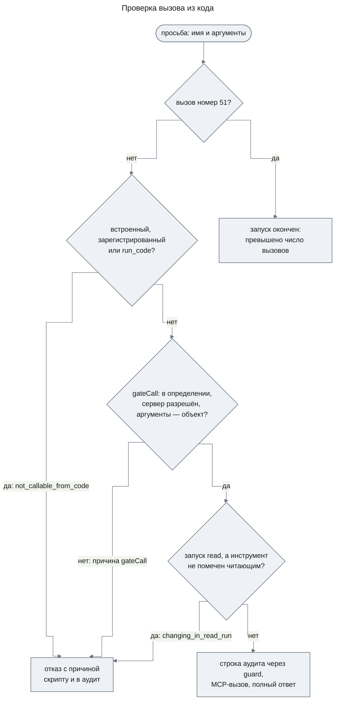
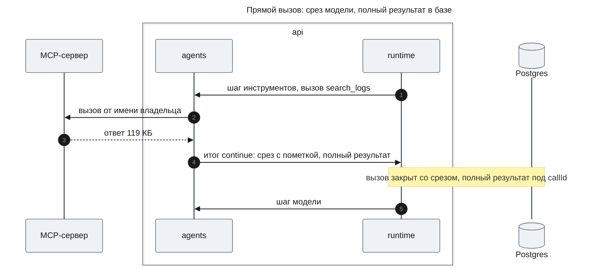
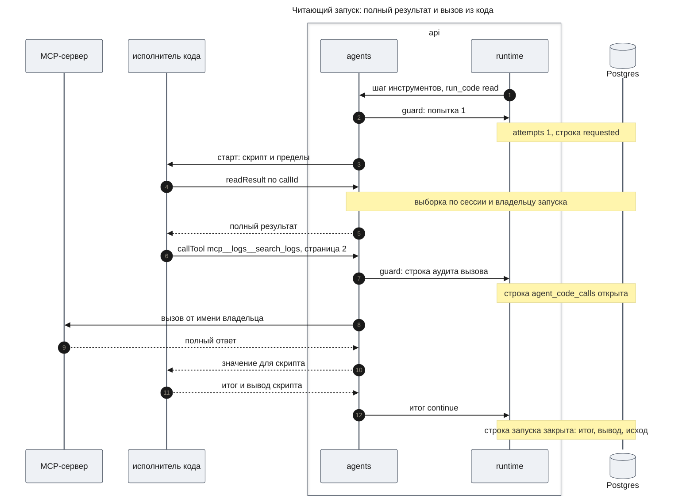
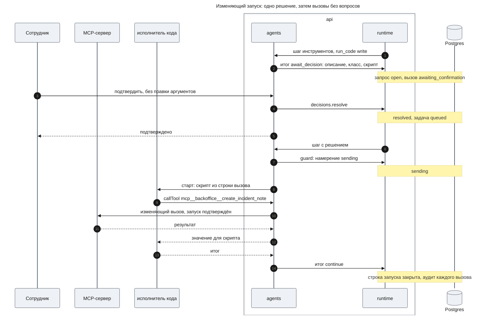
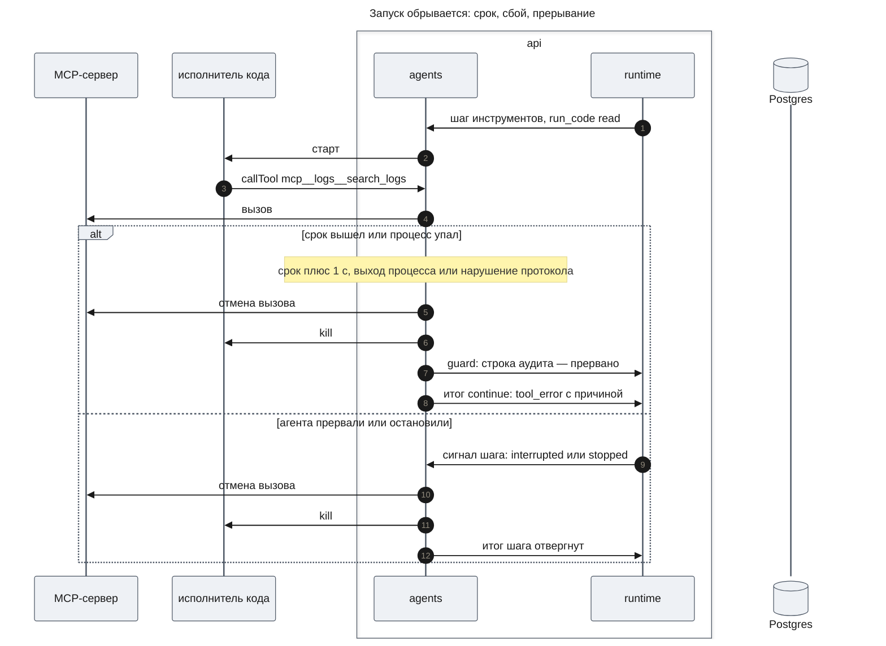
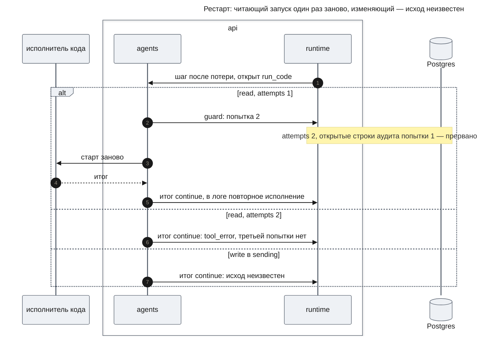
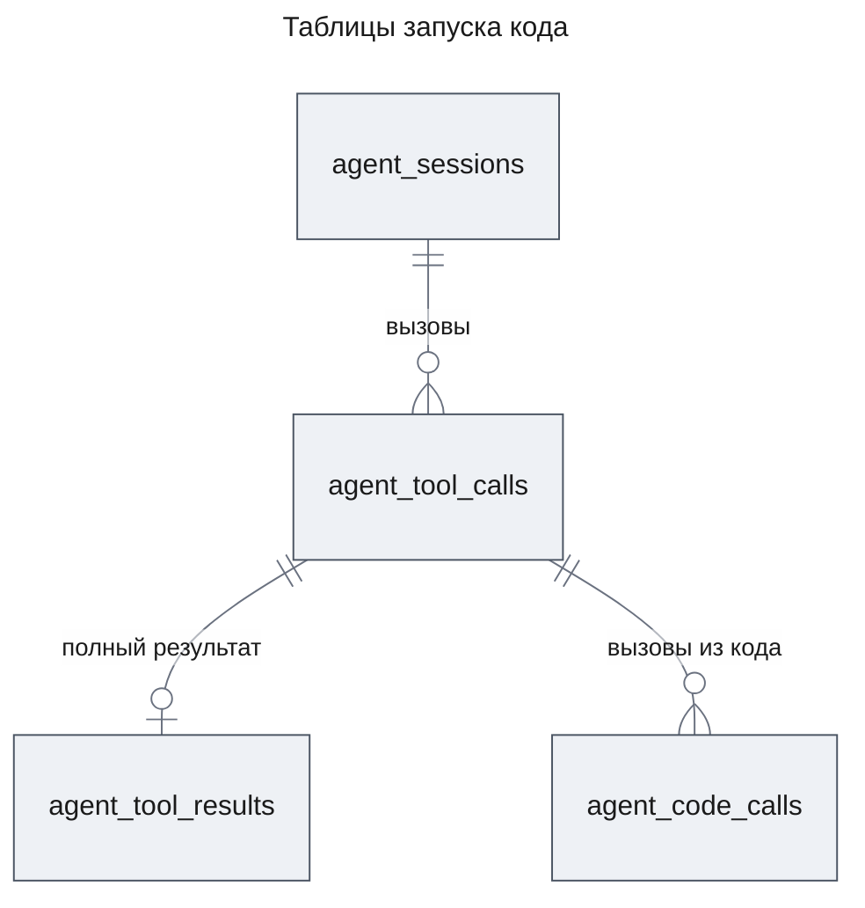
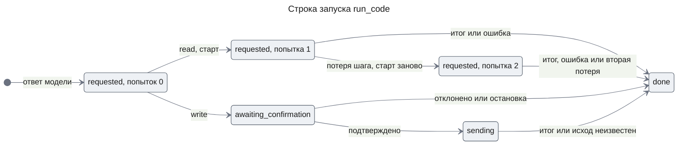

# Выполнение кода агентами — Design Document — code-execution

**Status:** На утверждении · **Date:** 2026-11-14 · **PRD:** [prd.md](./prd.md) · **UXRD:** [uxrd.md](./uxrd.md) · **Depends on:** [design-agents.md](../agent-platform/design-agents.md#contract-definitions)

## Snapshot

**Overview.** Агент получает встроенный инструмент `run_code`: модель пишет короткий скрипт на JavaScript, а платформа исполняет его и возвращает модели только итог. Скрипт исполняет движок QuickJS, собранный в WASM, внутри отдельного короткоживущего процесса Node: по процессу на запуск, без переменных окружения, а модель разрешений Node 26 не даёт процессу сети, записи файлов, дочерних процессов и потоков. Своих возможностей у скрипта нет: он только просит процесс API вызвать инструмент или прочитать полный результат прежнего вызова, и процесс API проверяет каждую просьбу так же, как вызов самого агента, пишет её в аудит и сам ходит к MCP-серверу. Запуск, который может что-то менять, ждёт одного подтверждения сотрудника, как изменяющее действие агента сегодня. Результаты прямых MCP-вызовов теперь хранятся целиком: модель видит срез с пометкой и идентификатором, а скрипт читает полный результат по этому идентификатору.

- **Не меняется**: шаг агента, состояния вызова, права по серверам и запрос решения — `run_code` встаёт в них как ещё один инструмент.
- **Biggest risk**: побег из WASM в машинный код процесса исполнителя модель разрешений не останавливает — риск принят до контейнера ([Security Considerations](#security-considerations)).
- **Open questions**: три предложения сверх PRD ждут решения владельца ([Open Questions](#open-questions)).

### Key Decisions

#### KD-1: Исполнитель кода — пакет `packages/code-runner`: QuickJS в WASM внутри короткоживущего процесса Node 26 с моделью разрешений

Скрипт идёт в QuickJS — маленький интерпретатор JavaScript, собранный в WASM ([quickjs-emscripten](https://github.com/justjake/quickjs-emscripten), сборка bellard, вариант `sync`). QuickJS живёт не в процессе API, а в отдельном процессе Node, который пакет запускает на каждый запуск скрипта и убивает в конце. Процесс стартует через `spawn` от `process.execPath` (не `fork`: он наследует `execArgv` родителя, в том числе `--inspect`) с флагом `--permission` и единственным разрешением — чтение каталога исполнителя. Так получаются две преграды (NFR-05): язык без окружающих возможностей внутри WASM, а вокруг — чужой процесс без сети, записи файлов, дочерних процессов, потоков, нативных модулей и секретов. Сеть модель разрешений закрывает только с Node 25 (`--allow-net` появился в v25.0.0, в 24.x его нет, [CHANGELOG_V25](https://github.com/nodejs/node/blob/main/doc/changelogs/CHANGELOG_V25.md)); поэтому весь репозиторий переходит на Node 26 LTS одной версией (Constraints). Наружу пакет отдаёт одну операцию `CodeRunner.run`: контейнер или другой движок позже встаёт за ней, и агенты этого не замечают.

Отдельный пакет, а не модуль `packages/agents`: каталог, который процесс исполнителя может читать, содержит только код исполнителя и QuickJS, а не весь собранный `agents` с его зависимостями. Не взяты: `isolated-vm` в процессе API — песочница в процессе платформы, то есть одна преграда; `worker_threads` — тот же процесс и та же память; внешняя песочница или исполнение у провайдера модели — данные уходят с сервера (PRD, Constraints). Движок фиксирует ADR после спайка в начале работ (см. Part, «ADR»); запасной вариант при провале замеров скорости — `isolated-vm` 7.x в том же процессе исполнителя (поддерживает Node 26, [isolated-vm](https://github.com/laverdet/isolated-vm)).

#### KD-2: Каждое правило держит процесс API; процесс исполнителя только просит, а вызов из кода проверяет и исполняет `ToolRunner`

Самая вероятная атака — внедрённый текст заставляет модель написать скрипт, который бьёт в ошибку памяти QuickJS и дальше шлёт по мосту любые сообщения или выходит в JavaScript процесса исполнителя. Поэтому правило, которое живёт только в процессе исполнителя, не считается правилом. Владельца, агента, сессию, набор инструментов, класс запуска и подтверждение процесс API связывает с запуском при старте и никогда не берёт из сообщений. Процесс исполнителя присылает только просьбы — вызвать инструмент по имени с аргументами или прочитать результат по идентификатору — и итог. Размер каждого кадра проверяется до разбора, а нарушение протокола убивает процесс и заканчивает запуск ошибкой.

Просьбу «вызвать инструмент» исполняет новая операция `ToolRunner.callFromCode`: та же проверка, что у вызова агента (`gateCall`, `serverAllowed` на каждый вызов), затем фильтр кода (только MCP-инструменты) и фильтр класса (в запуске `read` — только читающие), затем `McpClients.call` и полный ответ без среза. Так у исполнителя инструментов появляется второй вызывающий (PRD, Background), а правила остаются в одном месте. Просьбы исполняются по одной в порядке прихода: `Promise.all` в скрипте работает, но вызовы идут друг за другом, и в полёте у запуска не больше одного вызова. Не взяты: свой путь к MCP внутри `run_code` — вторая копия проверок; `runOutside` — он режет результат до среза; параллельные вызовы — нужен ещё один предел без требования.

#### KD-3: `run_code` есть в каждой сессии без упоминания в определении, а правило выбора кода добавляется к инструкциям каждого агента в одном месте

`sessionTools` добавляет `run_code` к набору любой сессии, поэтому инструмент получают главный чат, `general-purpose`, координатор и исполнители workflow (AC-01.2). Правило выбора между кодом и прямыми вызовами (FR-01) `ModelClient` дописывает к инструкциям каждого вызова модели рядом с `DATA_PREAMBLE` (AC-01.3). Правило велит звать из кода те же инструменты под теми же именами и с теми же аргументами, что в списке инструментов модели (KD-8). Не взяты: имя в списке `tools` каждого определения — четыре места, из них одно в JSON шаблона, и новое определение без него молча остаётся без кода; правило в тексте каждого промпта — те же четыре места.

#### KD-4: Нужно ли подтверждение, решают аргументы вызова: у `ToolConfirmation` появляется необязательное условие

Сегодня подтверждение задано инструменту целиком, а `run_code` с классом `read` идёт сразу, с классом `write` — после решения сотрудника (FR-05). `ToolConfirmation` получает необязательную функцию `required(args)`; `ToolRunner.needsConfirmation` спрашивает её, а инструмент без неё подтверждается всегда, как сегодня. Единственный внешний потребитель, `start_workflow` в `packages/workflows`, условия не задаёт и работает как раньше. У `run_code` вид запроса прежний — `agents.tool_confirmation`, а аргументы при подтверждении править нельзя (`editableArgs: false`): исполняется ровно тот код, что лежит в строке вызова. Не взяты: два инструмента `run_code_read` и `run_code_write` — модель путает имена, а PRD задаёт один инструмент с классом; подтверждать каждый запуск — ломает AC-05.1.

#### KD-5: Полный результат каждого успешного прямого MCP-вызова хранится в своей таблице, а его идентификатор — `callId` вызова

Новая таблица `agent_tool_results` держит то, что вернул сервер, в виде значения для скрипта; строку пишет транзакция итога шага вместе с закрытием вызова. Идентификатор — `callId` провайдера: он уже уникален в сессии и непрозрачен. Пометка о срезе называет его модели (AC-04.1), а `readResult` ищет строку по паре «сессия запуска и её владелец», поэтому чужой и несуществующий идентификатор неотличимы (AC-04.3). Вывод скрипта для истории — колонка `output` строки вызова `run_code`. Не взяты: колонка полного результата в `agent_tool_calls` — представление истории читает эти строки целиком, и каждый показ ленты тянул бы сотни килобайт; хранить только обрезанные результаты — тогда AC-03.5 зависит от того, был ли срез; свои идентификаторы результатов — новое понятие ради того, что `callId` уже делает.

#### KD-6: Вызовы из кода пишутся в свою таблицу аудита через `guard` до обращения к серверу

Каждая просьба «вызвать инструмент» сначала получает строку в новой таблице `agent_code_calls`, привязанную к строке запуска; строка пишется через `ctx.guard` runtime до обращения к MCP-серверу и закрывается исходом после ответа. `guard` пишет только из текущей попытки шага агента, которого не прервали и не остановили, поэтому после остановки ни один вызов из кода не уходит к серверу (AC-10.1), а аудит есть даже у вызова, на котором упал сервер (AC-03.2). Не взяты: строки в `agent_tool_calls` с колонкой запуска — их читают история, сообщения провайдера, счёт вызовов в отчёте и представление, и каждый читатель пришлось бы учить отбрасывать вызовы из кода; копить вызовы в памяти и писать в итоге шага — рестарт теряет аудит ровно тех вызовов, которые важнее всего разобрать.

#### KD-7: После рестарта читающий запуск исполняется заново ровно один раз по счётчику попыток, изменяющий закрывается «исход неизвестен» прежним механизмом

Строка вызова получает колонку `attempts`. Читающий запуск перед стартом процесса увеличивает её через `guard`; строка остаётся `requested`, поэтому после потери шага runtime отдаёт вызов снова, как любой открытый читающий вызов (design-agents.md DC-5). Вторая попытка идёт и пишет в лог повторное исполнение (AC-10.6); третьей нет: вызов закрывается ошибкой без запуска. Изменяющий запуск стартует только из подтверждения, после намерения `sending`, и потерянный шаг закрывает его исходом «исход неизвестен» без повтора, как любой подтверждённый вызов (AC-10.2). Не взяты: положиться на восстановление runtime — оно отдаёт потерянный шаг до трёх раз (`RUNTIME_MAX_RECOVERIES`), а не один; не повторять читающий запуск совсем — противоречит AC-10.6.

#### KD-8: Скрипт зовёт любой инструмент одной функцией `callTool` под именем из списка инструментов модели

В скрипте одна функция вызова — `callTool(name, args)`, где `name` — ровно то имя, которое модель видит в своём списке инструментов: `mcp__<server>__<tool>` (`mcpToolName`), а `args` — те же аргументы, что при прямом вызове. MCP-серверы подключаются развёртыванием и меняются без кода, поэтому одна система имён должна служить списку инструментов модели, скрипту и аудиту. Внутри песочницы под сессию ничего не создаётся: процесс API ищет имя в снимке MCP-инструментов серверов определения, снятом при старте запуска, и на каждый вызов заново проверяет права и класс; неизвестное имя получает отказ и строку аудита. Буквальные имена в коде к тому же оставляют возможным список «Может вызвать: …» в карточке (Open Questions). Не взят: объект, который строится под сессию (`tools.x(...)` или `mcp.server.tool(...)`), — второе написание тех же имён, которое надо генерировать внутри песочницы под каждый набор серверов.

## Terms

- **Процесс API** — процесс NestJS платформы, в котором работают агенты. По отношению к процессу исполнителя он родитель и держит все правила.
- **Процесс исполнителя** — короткоживущий процесс Node, в котором QuickJS исполняет один скрипт; на каждый запуск свой.
- **Мост** — канал между процессом исполнителя и процессом API через stdin и stdout. Сообщение моста — **кадр**: длина, затем JSON.
- **Просьба** — сообщение скрипта процессу API: вызвать инструмент или прочитать полный результат.
- **Модель разрешений Node** — режим `--permission`, в котором процесс Node без явного разрешения не открывает файлы, сеть, дочерние процессы, потоки и нативные модули ([Permissions](https://nodejs.org/api/permissions.html)).
- **Строка запуска** — строка `agent_tool_calls` вызова `run_code`; она же запись аудита самого запуска.
- **`runId`** — `callId` вызова `run_code`. Им помечены все записи лога запуска, в том числе решение сотрудника по запуску `write`.
- **Спайк** — короткая проверка на коде в начале работ, которая подтверждает допущение или опровергает его до того, как на нём строят.

Скрипт, запуск, класс запуска, срез, полный результат, вывод скрипта — в значении PRD, раздел Terms.

## Part

- **Part**: `code-execution` — единственная часть Delivery Parts в PRD.
- **Covers**: FR-01–FR-11; NFR-01–NFR-06.
- **Depends on**: собранная часть `agents` фичи `agent-platform` — [design-agents.md, Contract Definitions](../agent-platform/design-agents.md#contract-definitions): регистрация инструментов, `ToolRunner`, `McpClients`, запрос решения, `HistoryEntry`, исходы вызова и DC-5.
- **Prerequisite ADRs**: [ADR-0001](../../adr/ADR-0001-durable-runtime-owner.md) (состояние только в Postgres), [ADR-0003](../../adr/ADR-0003-drizzle-data-layer.md) (Drizzle, миграции вперёд), [ADR-0004](../../adr/ADR-0004-agent-framework-packages.md) в части правил пакетов.
- **ADR**: тест из трёх частей проходит только KD-1 вместе с KD-2 — расположение исполнителя и движок. Решение дорого отменить: под протокол моста и API скрипта пишутся скрипты модели и набор тестов на побег. Оно связывает будущую работу: любое исполнение недоверенного кода на сервере (например, серверный код `app-builder`) идёт через этот исполнитель. Альтернативы были настоящие (KD-1). ADR пишется после утверждения дизайна и после спайка, который подтвердит движок. KD-3–KD-8 тест не проходят: каждое решение меняет код и таблицы одного пакета `agents` или API скрипта, который виден только моделям этой фичи, и не связывает работу вне неё.
- **Sibling parts**: нет.

**Out of scope**

- Механизм шага агента, запросы решения runtime, состояния вызова и показ запросов в беседе остаются как в `agent-platform`; часть добавляет к ним инструмент, условие подтверждения и три вещи в хранении.
- Файлы, интернет, пакеты npm, `Intl` и другие пункты PRD Won't Have; контейнер вокруг исполнителя.
- Вызовы изнутри скрипта в интерфейсе не показываются: они в аудите и логах (UXRD, «Не меняется»).
- Результаты дочерних агентов и прежние результаты сессии родителя при ответвлении скрипту не видны: `readResult` ищет только в сессии своего агента.

**Constraints**

- **Node 26 на весь репозиторий одной версией.** CI (`node-version`), README, `@types/node` во всех пакетах, включая `apps/web`, переходят на 26 сразу, без совместимости с 24. Модель разрешений закрывает сеть только с Node 25 (KD-1).
- **Изоляция работает на Windows разработчика и Ubuntu CI.** Docker есть только для Postgres, поэтому преграды — процесс и модель разрешений, а не контейнер. Что именно флаги делают на Windows, первым делом проверяет спайк (Risks and Mitigation).
- **PoC.** Без переключателей и параллельных версий: подтверждение по условию заменяет прежнее правило в одном месте, новые поля контрактов обязательны там, где они есть по смыслу.
- **Логи** — через логгер `common` по [logging.md](../../code-system/patterns/logging.md); процесс исполнителя сам не пишет логов, всё пишет процесс API.
- **Процесс API стартует с `--disable-sigusr1`** — в `apps/api`, в e2e и в CI: `process._debugProcess` в процессе исполнителя целится именно в процесс API, а флаг защищает только тот процесс, которому передан ([Node CLI](https://nodejs.org/api/cli.html)).
- **Тесты** — немного и только критичное: набор на побег из песочницы одной таблицей на слой; замеры скорости — отдельным скриптом по запросу, не в обычном прогоне.

## Building-block Inventory

Follows the [code system](../../code-system/README.md). Новый слой «Исполнитель кода» описан в README code system.

| Building block | Pattern | Status | Note |
|---|---|---|---|
| `createCodeRunner`, `CodeRunner.run` | [composition-root.md](../../code-system/patterns/composition-root.md) | new — KD-1 | новый пакет `packages/code-runner`; искали в коде дочерние процессы: есть только транспорт MCP SDK и тестовый `fork` runtime |
| Вход процесса исполнителя и мост | — | new — KD-1, KD-2 | вход запускают только с флагами модели разрешений; рамки кадров и пределы — в пакете |
| Инструмент `run_code` | — | new — KD-3 | встроенный инструмент `agents` рядом с `start_agent`, режим `outside` |
| `ToolRunner` | — | extended — KD-2, KD-4 | `callFromCode`; `needsConfirmation` спрашивает `required(args)`; срез с идентификатором; полный результат прямого вызова |
| `ToolConfirmation`, `OutsideToolInput` | — | extended — KD-4, KD-6 | условие `required(args)`; инструмент вне транзакции получает `guard` шага |
| `toolCalls.close` и `closeOpen` | — | extended — KD-6 | закрытие строки запуска закрывает и её открытые строки вызовов из кода (Invariant 4) |
| `ToolRegistry.sessionTools` | — | extended — KD-3 | добавляет `run_code` в любой набор |
| `ModelClient` | — | extended — KD-3 | дописывает правило выбора кода к инструкциям |
| Репозитории `agent_tool_calls`, `agent_tool_results`, `agent_code_calls` | [repository-over-transaction.md](../../code-system/patterns/repository-over-transaction.md) | extended и new — KD-5, KD-6, KD-7 | новые таблицы читаются только через репозиторий, без прямых выборок по образцу `model-step.ts` |
| Логирование запуска | [logging.md](../../code-system/patterns/logging.md) | reused | дочерний логгер шага с `runId` |
| Настройки `CODE_RUN_*` | [composition-root.md](../../code-system/patterns/composition-root.md) | extended | `AgentsEnvSchema` и список `AGENTS_VARIABLES` в `apps/api` |
| `RUN_CODE_TOOL`, `RunCodeArgsSchema`, поле `output` | — | new | в `packages/contracts`, общие для `agents` и веба |
| Вызов инструмента и карточка решения в вебе | — | extended | по UXRD; данные — Contract Definitions |
| MCP-фикстура | — | extended | логи за неделю, источник `tracker` с тикетами (AC-01.4) |

## Acceptance Criteria

### FR-01: Инструмент `run_code`

- From the PRD: AC-01.1, AC-01.2, AC-01.3, AC-01.4.
- `run_code` есть в наборе инструментов любой сессии, даже если определение его не называет, а определение, которое называет его в `tools`, не проходит проверку каталога при старте (DC-1).
- Итог запуска модель получает так: строку — как есть; `undefined`, `null` или пустую строку — исходом «пустой результат» с пустым текстом; пустой массив или объект — исходом «пустой результат» с текстом `[]` или `{}`; любое другое значение — исходом «успех» с его JSON (DC-2).
- Значение, которое не переводится в JSON (функция, `BigInt`, цикл), заканчивает запуск ошибкой «итог не переводится в JSON» (DC-3).
- Прогон AC-01.4 записан в файл анализа плана части: задача, номер попытки, с которой скрипт заработал, и верен ли итог (DC-4).

### FR-02, FR-06: Никаких окружающих возможностей, чистый лист

- From the PRD: AC-02.1, AC-02.2, AC-02.3, AC-02.4, AC-02.5, AC-06.1, AC-06.2.

### FR-03: Вызов инструментов из кода

- From the PRD: AC-03.1, AC-03.2, AC-03.3, AC-03.4, AC-03.5, AC-03.6.
- Вызов из кода встроенного или зарегистрированного инструмента или самого `run_code` получает отказ `not_callable_from_code` раньше проверок `gateCall` и класса запуска (DC-5).
- Инструмент сервера из определения агента, который сотруднику не разрешён, получает отказ `no_access`, а инструмент сервера вне определения — `tool_not_in_definition` (DC-6).

### FR-04: Полные данные по идентификатору

- From the PRD: AC-04.1, AC-04.2, AC-04.3.
- Срез, который видит модель, кончается пометкой «результат обрезан на N байт; полный — `readResult("<callId>")` в `run_code`» (DC-7).
- У вызова, который получил отказ, ошибку или сбой связи, и у вызова встроенного инструмента полного результата нет: `readResult` отвечает «не найден» (DC-8).

### FR-05: Класс запуска и одно подтверждение

- From the PRD: AC-05.1, AC-05.2, AC-05.3, AC-05.4, AC-05.5, AC-05.6.
- Аргументы запуска `write` при подтверждении править нельзя: решение с аргументами получает `INVALID_ARGUMENTS`, а исполняется код из строки вызова (DC-9).
- Изменяющий запуск, чья строка не в состоянии `sending`, не стартует (DC-10).

### FR-07: Пределы и ошибки скрипта

- From the PRD: AC-07.1, AC-07.2, AC-07.3, AC-07.4, AC-07.5.
- Отказ на вызов из кода тоже считается вызовом: 51-я просьба заканчивает запуск, даже если прежние получили отказ (DC-11).
- Данные, которые процесс API передал скрипту, засчитываются в предел памяти: больше 64 МиБ за запуск он не передаёт, и запуск заканчивается ошибкой «превышена память» (DC-12).
- Запуск, для которого нет свободного места в пределе одновременных запусков процесса API, сразу заканчивается ошибкой «исполнитель кода занят» (DC-13).

### FR-08: Запуск виден в истории

- From the PRD: AC-08.1, AC-08.2.
- Вывод скрипта хранится не длиннее 16 КиБ; длинный вывод обрезан, и в конце стоит «[вывод обрезан]» (DC-14).

### FR-09, FR-11: Лог запуска, нет секретов

- From the PRD: AC-09.1, AC-11.1.

### FR-10: Остановка, рестарт, повторы

- From the PRD: AC-10.1, AC-10.2, AC-10.3, AC-10.4, AC-10.5, AC-10.6.
- Читающий запуск, потерянный рестартом второй раз, третий раз не исполняется: вызов закрыт ошибкой «запуск дважды прерван рестартом» (DC-15).

## Design

### Architecture (C1–C4)

#### C2 · Containers

- `api` — процесс API: агент вызывает `run_code`, а процесс запускает исполнитель, проверяет и исполняет каждую его просьбу, пишет аудит и итог. Модель видит только итог.
- `исполнитель кода` — новый контейнер: процесс Node на один запуск с QuickJS внутри. Он не открывает ни сети, ни базы, ни файлов, кроме своего каталога; всё нужное получает по мосту.
- `Postgres` — две новые таблицы и две колонки в `agent_tool_calls` (Data Model).
- `web` — показывает запуск как вызов инструмента и карточку решения по UXRD.

#### C3 · Components: api

**api — запуск кода**

- Шаг инструментов исполняет `run_code`, как любой инструмент режима `outside`, под сигналом шага; читающий запуск идёт сразу, изменяющий — после решения (KD-4).
- `run_code` связывает запуск с владельцем, сессией, снимком инструментов и классом, держит счётчики вызовов и пишет аудит через `guard` (KD-6). На каждую просьбу «вызвать инструмент» он зовёт `ToolRunner.callFromCode`, на «прочитать результат» — репозиторий полных результатов.
- `CodeRunner` из пакета `code-runner` ничего не знает об агентах: он запускает процесс, держит мост с пределами кадров, таймер и убийство процесса, и отдаёт каждую просьбу обработчику, который ему передали.

**Как процесс API проверяет вызов из кода**

Имя ищется в снимке MCP-инструментов серверов определения, который процесс API снял при старте запуска, — до фильтра прав сотрудника, поэтому неразрешённый сервер получает `no_access`, а не «нет в определении» (DC-6). Права и класс проверяются на каждый вызов (KD-8).

#### C3 · Components: исполнитель кода

**исполнитель кода — один запуск**

- **Подготовка** до создания QuickJS удаляет из `process` то, что модель разрешений не закрывает: `process._debugProcess` (открывает инспектор другого процесса того же пользователя ОС и не проверяется ни одной областью разрешений, [Permissions](https://nodejs.org/api/permissions.html)), а заодно `process.dlopen` и `process.binding`. Затем она ждёт первый кадр — старт запуска.
- **QuickJS** на каждый запуск получает новый runtime и context, с пределом памяти, пределом стека и обработчиком прерывания по сроку, поэтому от прежних запусков ничего не остаётся (AC-06.1). В context нет ничего, кроме встроенных средств языка: ни `console`, ни таймеров, ни `fetch`, ни модулей ([quickjs-emscripten README](https://github.com/justjake/quickjs-emscripten/blob/main/README.md)); `Intl` в сборке bellard нет вовсе.
- **API скрипта** кладёт в context одни и те же функции для любого запуска (Contract Definitions): под сессию внутри песочницы ничего не строится (KD-8). Каждая функция шлёт просьбу и возвращает обещание, которое разрешает ответ процесса API.
- **Кадры моста** читают stdin и пишут stdout. Когда stdin закрылся — процесс API умер, — процесс исполнителя выходит, как только QuickJS отдаёт управление, и не позже срока запуска.

### Runtime Flows

Во всех потоках `agents` и `runtime` — пакеты процесса API, а исполнитель кода — отдельный процесс. Postgres пишет только транзакция итога шага, `guard` или операция runtime.

#### Flow 1: Прямой вызов с обрезанным результатом

**Starts when:** шаг инструментов исполняет прямой вызов MCP-инструмента, чей ответ больше среза; for AC-04.1, DC-7.

**Outcome:** в `agent_tool_calls` и в записи истории — срез до `AGENT_TOOL_RESULT_MAX_BYTES` с пометкой, где назван `callId`; в `agent_tool_results` под тем же `callId` — значение для скрипта. Модель на следующем ходу видит срез и пометку.

**Failure handling:**

- Ответ меньше среза → пометки нет, полный результат всё равно записан: скрипт может прочитать любой успешный результат (AC-03.5).
- Ошибка инструмента, сбой связи, отказ → полного результата нет (DC-8).

#### Flow 2: Читающий запуск

**Starts when:** модель вызвала `run_code` с классом `read`; for AC-01.1, AC-03.1–AC-03.6, AC-04.2, AC-04.3, AC-05.1, AC-05.5, AC-08.1, AC-08.2, AC-09.1.

**Outcome:** модель на следующем ходу получает только итог (AC-08.2); вывод скрипта лежит в колонке `output` и в записи истории для сотрудника. На каждый вызов из кода — одна строка `agent_code_calls` с исходом, длительностью и ссылкой на строку запуска (AC-03.2). Процесс исполнителя убит после итога.

**Failure handling:**

- Просьба получила отказ (DC-5, DC-6, AC-05.5) → строка аудита с исходом «отказ» и причиной, MCP-сервер вызова не получил, а в скрипте обещание отклонено ошибкой, которая называет инструмент, причину и класс запуска. Скрипт может её поймать.
- Инструмент ответил ошибкой или сервер недоступен → строка аудита с исходом `tool_error` или `transport_failure`, в скрипте — отклонённое обещание с текстом сервера.
- `readResult` с чужим или несуществующим `callId` → один и тот же ответ «результат не найден» (AC-04.3).
- `guard` строки аудита ответил `fenced` → вызов не уходит к серверу, запуск кончается как прерванный (Flow 4).
- Скрипт кончился исключением или синтаксической ошибкой → модель получает `tool_error` с причиной и строкой (AC-07.5, AC-10.4); вывод не сохраняется в истории, но есть в логе (FR-08, FR-09).

#### Flow 3: Изменяющий запуск с подтверждением

**Starts when:** модель вызвала `run_code` с классом `write`; for AC-05.2, AC-05.3, AC-05.4, AC-05.6, AC-11.1, DC-9, DC-10.

**Outcome:** до решения процесс исполнителя не запускался; после подтверждения скрипт исполнен один раз, и его изменяющие вызовы прошли без новых запросов (AC-05.3). Запрос несёт полный текст скрипта, а веб показывает его свёрнутым по UXRD. В логе — начало запуска с отметкой «подтверждён», хешем SHA-256 кода и `runId` (FR-11).

**Failure handling:**

- Сотрудник отклонил → вызов закрыт «отклонено пользователем», процесс исполнителя не запускался (AC-05.4); запись лога шага с `callId` запуска фиксирует отказ.
- Решение пришло с аргументами → `INVALID_ARGUMENTS`, запрос ждёт дальше (DC-9).
- Рестарт, пока запрос открыт → запрос ждёт, как любой (AC-05.6).
- Рестарт после намерения → «исход неизвестен» без повтора (Flow 5).
- Агента остановили, пока запрос открыт → запрос отменён, вызов «прервано» (design-agents.md, Flow 7).

#### Flow 4: Запуск обрывается

**Starts when:** вышел срок, процесс исполнителя упал или нарушил протокол, или агента прервали либо остановили; for AC-07.1, AC-07.2, AC-07.4, AC-10.1, NFR-03.

**Outcome:** запуск кончается итогом или ошибкой не позже чем через 5 с после срока (NFR-03): решает таймер процесса API, а не QuickJS. При прерывании и остановке `run_code` сам закрывает строку аудита отменённого вызова исходом «прервано» — своей короткой транзакцией, без `guard`: это запись о том, что вызов отменён, а не новое действие. Строку запуска закрывает исходом «прервано» шаг, который возьмёт сообщение `interrupt`, а у остановленного агента — первый шаг после продолжения (`closeOpen`); строку вызова из кода, которую `run_code` не успел закрыть, это закрытие закрывает вместе с ней (Invariant 4).

**Failure handling:**

- Одна функция «закончить запуск» в процессе API идёт в одном порядке: перестать принимать просьбы, отменить вызов в полёте, убить процесс, записать один исход. Второй конец того же запуска ничего не меняет.
- QuickJS сам заметил срок (обработчик прерывания) или память (предел runtime) → чистая ошибка с номером строки до того, как сработает таймер процесса API.
- 51-я просьба → запуск кончается ошибкой «превышено число вызовов» без вызова (AC-07.4).
- Кадр больше предела, неверная форма, неизвестная операция → процесс убит, запуск кончается ошибкой «нарушен протокол исполнителя», запись в лог с типом нарушения.

#### Flow 5: Рестарт посреди запуска

**Starts when:** процесс API умер посреди запуска, и runtime отдал шаг инструментов снова; for AC-10.2, AC-10.6, DC-15.

**Outcome:** читающий запуск исполнен заново ровно один раз, и агент получает его итог как от обычного запуска (AC-10.6); изменяющий не повторяется (AC-10.2). Процесс исполнителя, который пережил смерть процесса API, видит закрытый stdin и выходит; его просьбы никуда не дошли, потому что к MCP ходит только процесс API.

**Failure handling:**

- Попытка 2 записана, а шаг снова потерян → следующий шаг видит `attempts` 2 и закрывает вызов ошибкой (DC-15).
- `guard` попытки ответил `fenced` → процесс исполнителя не стартует, шаг без записей.

### Contract Definitions

#### Пакет `code-runner`

- **`createCodeRunner(options)`** — собирает исполнитель из разобранных пределов и логгера. Окружение не читает. Возвращает `CodeRunner`.
- **`CodeRunner.run(request)`** — исполняет один скрипт в новом процессе исполнителя и возвращает `RunOutcome`, когда скрипт кончился, вышел срок, процесс упал или сработал сигнал. Ошибок не бросает: любой конец — значение `RunOutcome`. Вход `RunRequest`:
  - `script` — текст скрипта;
  - `limits` — срок, память, предел итога в байтах;
  - `onRequest` — обработчик просьб процесса API: получает просьбу и отвечает значением, ошибкой для скрипта или командой «закончить запуск с ошибкой»;
  - `signal` — отмена запуска; `logger` — логгер с идентификаторами запуска.
- Процесс исполнителя стартует через `spawn(process.execPath, …)` с `--permission`, разрешением чтения только каталога исполнителя и пакета QuickJS, малым `--max-old-space-size`, пустым `env` и тремя каналами `pipe`; слушателя SIGUSR1 под `--permission` у него и так нет. Других разрешений нет: ни сети, ни записи файлов, ни дочерних процессов, ни потоков, ни нативных модулей, ни WASI, ни инспектора. Путь входа — параметр функции запуска, поэтому тесты исполняют враждебный JavaScript Node с теми же флагами. Точный список флагов и путей подтверждает спайк.

**RunOutcome**

- `returned` — `value`: итог как JSON-текст не длиннее предела итога; `output`: вывод скрипта не длиннее 16 КиБ, с пометкой обрезки.
- `failed` — `reason`, текст причины, `line` (номер строки скрипта, когда он есть) и `output`. Причины: `syntax`, `exception`, `timeout`, `memory`, `result_too_large`, `result_not_json`, `call_limit`, `protocol`, `crashed`, `busy`, `aborted`. `result_too_large` и `result_not_json` замечает процесс исполнителя, а процесс API проверяет размер итога ещё раз.

**Мост**

- Кадр — четыре байта длины, затем JSON. Длину кадра от процесса исполнителя процесс API проверяет до чтения тела: не больше 1 МиБ (или предела итога плюс 64 КиБ, если он больше), и не больше 4 МиБ за запуск всего.
- Честный процесс исполнителя в эти пределы не упирается: итог больше предела он не шлёт, а шлёт `error` с `result_too_large`; вывод после 16 КиБ он не шлёт, а последний кадр `output` несёт пометку обрезки. Пределы кадров ловят только сломанный или захваченный процесс.
- Процесс API шлёт `start` (скрипт и пределы — без секретов, без идентификаторов сотрудника и без списка инструментов) и ответы на просьбы с их номером.
- Процесс исполнителя шлёт `call` (номер, имя, аргументы), `read` (номер, идентификатор), `output` (строка вывода), `done` (итог) или `error` (причина, текст, строка). Любое другое сообщение — нарушение протокола.
- Аргументы одного вызова — не больше 64 КиБ, всех вызовов запуска — не больше 1 МиБ; данные, переданные скрипту, — не больше 64 МиБ за запуск (DC-12).

#### API скрипта

Скрипт — тело асинхронной функции: `await` и `return` работают на верхнем уровне, а номера строк в ошибках считаются от первой строки скрипта.

- **`callTool(name, args)`** — единственный вызов инструмента (KD-8). `name` — имя из списка инструментов модели, `mcp__<server>__<tool>`; `args` — объект аргументов, как при прямом вызове. Возвращает значение ответа: `structuredContent`, если он есть; иначе текст ответа, разобранный как JSON, или сам текст.
- **`readResult(id)`** — полный результат прямого вызова своей сессии по `callId`, в том же виде, что у вызова из кода. Нет такого — отклонённое обещание «результат не найден».
- **`console.log`**, **`console.info`**, **`console.warn`**, **`console.error`** — пишут строку в вывод скрипта.
- Отказ, ошибка инструмента и сбой связи — отклонённое обещание с объектом ошибки, у которого есть исход, причина и текст.

#### `agents`

- **Инструмент `run_code`** — встроенный, режим `outside`, заголовок «Выполнить код», подписи аргументов «Описание», «Класс запуска», «Скрипт» (UXRD MC-1, MC-2). Аргументы — `RunCodeArgs`. Возвращает итог запуска исходом `success` или `empty` (DC-2), а любой конец `failed` — исходом `tool_error` с текстом «причина; строка N». Подтверждение: вид `agents.tool_confirmation`, `required` — класс `write`, `editableArgs: false`.
- **`ToolRunner.callFromCode(request, scope)`** — проверяет и исполняет просьбу «вызвать инструмент» по правилу из C3: `request` — имя и аргументы; `scope` — вызывающий агент, снимок MCP-инструментов серверов определения со старта запуска и класс запуска. Возвращает отказ с причиной или исход MCP-вызова с полным значением ответа. Срез не делает. Пишет в лог запись вызова, как `runOutside`.
- **`ToolRunner.needsConfirmation(call)`** — MCP-инструмент без `readOnlyHint` или инструмент с подтверждением, чьё `required(args)` вернуло истину либо не задано.
- **`ToolConfirmation.required(args)`** — необязательная функция; без неё подтверждение нужно всегда, как сегодня.
- **`OutsideToolInput.guard`** — `guard` шага, которым инструмент вне транзакции пишет свои строки только из текущей попытки.
- **`ToolRegistry.sessionTools(input)`** — прежний набор и `run_code` в любом наборе. `checkCatalog` отвергает определение, которое называет `run_code` в `tools` (DC-1).
- **Пометка о срезе** — вместо прежнего хвоста «[truncated N bytes]» строка с числом обрезанных байт и вызовом `readResult` с `callId` (DC-7).
- **Правило выбора кода** — текст из FR-01, который `ModelClient` дописывает к инструкциям каждого вызова модели. Оно же говорит модели звать инструменты из кода через `callTool` под теми же именами и с теми же схемами аргументов, что в её списке инструментов.

**RunCodeArgs** — схема `RunCodeArgsSchema` и имя `RUN_CODE_TOOL` (`run_code`) в `packages/contracts`; веб узнаёт запуск по паре «инструмент `run_code`, сервер `null`».

- `description` — описание для сотрудника, от 1 до 300 символов.
- `class` — `read` или `write`.
- `script` — текст скрипта, от 1 байта до 64 КиБ. Это предел аргумента, как у любого инструмента: длиннее — отказ `invalid_arguments`, а модель видит причину и укорачивает скрипт.

**HistoryEntry `tool_result`** — новое необязательное поле `output`: вывод скрипта успешного запуска `run_code`; у неуспешного — `null`, у остальных инструментов поля нет. Модель его не получает: сообщения провайдера строятся только из `text`.

**Причины отказа** — `ToolRefusalReasonSchema` получает `not_callable_from_code` и `changing_in_read_run`. Обе встречаются только в строках аудита вызовов из кода.

**Веб.** Блок вызова и карточка решения узнают запуск по `RUN_CODE_TOOL` и показывают его по UXRD (KD-1–KD-5, MC-1–MC-5): описание во второй строке заголовка, строки аргументов в порядке полей `RunCodeArgs`, а не в порядке ключей от модели, скрипт свёрнут за «Показать скрипт», вывод — из поля `output`. Аргументы, которые не прошли `RunCodeArgsSchema`, показываются обычными строками аргументов.

**Error handling**

Тексты ошибок запуска — для модели, по-русски, с номером строки, где он есть: «синтаксическая ошибка», «исключение», «превышено время (30 с)», «превышена память (512 МБ)», «итог больше предела (16384 байт)», «итог не переводится в JSON», «превышено число вызовов (50)», «нарушен протокол исполнителя», «процесс исполнителя упал», «исполнитель кода занят», «запуск дважды прерван рестартом». Значения в скобках — из настроек.

**Runtime settings**

Переменные читает `apps/api` и передаёт в `parseAgentsConfig`.

- `CODE_RUN_TIMEOUT_MS` — default `30000`; срок запуска. Процесс API убивает процесс исполнителя через 1 с после срока.
- `CODE_RUN_MEMORY_MB` — default `512`; предел памяти QuickJS.
- `CODE_RUN_MAX_TOOL_CALLS` — default `50`; число просьб «вызвать инструмент» за запуск.
- `CODE_RUN_MAX_CONCURRENT` — default `4`; одновременных запусков в одном процессе API (DC-13).
- Предел итога — прежний `AGENT_TOOL_RESULT_MAX_BYTES` (AC-07.3).

### Data Model

- `agent_tool_results` — полный результат успешного прямого MCP-вызова в виде значения для скрипта, ключ — сессия и `callId`. Строка появляется в той же транзакции, что закрывает вызов, и удаляется каскадом вместе с вызовом и сессией.
- `agent_code_calls` — строка на каждую просьбу «вызвать инструмент»: строка запуска, номер попытки, номер вызова в попытке, инструмент, сервер, аргументы, исход, причина отказа, время начала и конца. Результата в ней нет: его видит только скрипт. Каскад от строки запуска.
- `agent_tool_calls` получает две колонки: `attempts` — сколько раз читающий запуск начинался (KD-7), и `output` — вывод скрипта успешного запуска. Другие инструменты их не трогают.
- Читают и пишут новые таблицы только функции репозиториев `agents`; представление истории и сообщения провайдера их не видят.

### State Transitions and Invariants

Строка запуска проходит прежние состояния вызова (design-agents.md, State Transitions); новое — переходы `attempts` у читающего запуска.

**Invariants**

1. Ни одна просьба из процесса исполнителя не меняет, от чьего имени идёт вызов, какой набор инструментов и какой класс у запуска: всё это процесс API связал с запуском при старте.
2. Ни один вызов из кода не доходит до MCP-сервера без открытой строки аудита, записанной из текущей попытки шага.
3. Изменяющий запуск исполняет код из строки вызова и только после записанного решения «подтверждено» и намерения `sending`; в запуске `read` ни один инструмент без `readOnlyHint` не вызывается.
4. У строки `agent_code_calls` не больше одного исхода. Исход ей пишет `run_code`, когда вызов кончился или отменён. Строка, которую он не успел закрыть, потому что процесс API умер, получает исход, когда закрывается строка запуска или начинается следующая попытка: «исход неизвестен» в запуске `write`, «прервано» в запуске `read`. У остановленного агента, которого после рестарта никто не продолжил, такая строка остаётся без исхода: это вызов, исход которого неизвестен.
5. Читающий запуск исполняется не больше двух раз; изменяющий — не больше одного.
6. Процесс исполнителя живёт не дольше срока запуска плюс 1 с, а одновременно их в процессе API не больше `CODE_RUN_MAX_CONCURRENT`.
7. Модель получает из запуска только итог или текст ошибки; вывод скрипта уходит только в историю для сотрудника и в лог.

## Test Strategy

Тесты пишутся с задачами и запускаются один раз в конце части. Модель подменяется на границе `ModelClient` сценарием ответов; MCP — настоящий процесс фикстуры, а её журнал вызовов показывает, что дошло до сервера. Набор на побег (NFR-06) — по таблице на слой: строки в UC-E1–UC-E4. Замеры NFR-01 и NFR-02 — отдельный скрипт по запросу.

### Main Use Cases

- **UC-1: Подсчёт по полному результату** — covers AC-01.1, AC-03.2, AC-03.5, AC-04.1, AC-04.2, AC-05.1, AC-08.1, AC-08.2, AC-09.1, DC-2, DC-7
  - Given: агент сделал прямой вызов `search_logs` с ответом на 500 записей — больше среза; сценарий затем вызывает `run_code` с классом `read`, скрипт читает этот результат по `callId`, через `callTool("mcp__logs__search_logs", …)` берёт вторую страницу, печатает число записей и возвращает число ошибок по сервисам.
  - When: шаги идут до конца хода.
  - Then: модель видела срез с пометкой и `callId`; запуск прошёл без запроса сотруднику; число записей, которое насчитал скрипт, равно `totalMatched` фикстуры; модель получила только итог, а `history` отдаёт итог и `output`; в аудите одна строка запуска и одна строка вызова из кода со ссылкой на неё; в логе начало, вызов с исходом и длительностью, вывод и конец с одним `runId`.
- **UC-2: Изменяющий запуск** — covers AC-05.2, AC-05.3, AC-05.4, AC-05.6, DC-9, FR-11
  - Given: сценарий вызывает `run_code` с классом `write`, скрипт трижды вызывает `create_incident_note`; строки: подтвердить; отклонить; решение с правленными аргументами; рестарт до решения, затем подтвердить.
  - When: шаги идут до запроса, затем выполняется строка.
  - Then: до решения журнал фикстуры пуст; запрос несёт агента, описание, класс и полный скрипт; подтверждение — три вызова без новых запросов и итог; отклонение — ноль вызовов и «отклонено»; правка — `INVALID_ARGUMENTS`, запрос открыт; после рестарта запрос открыт и подтверждается; в логе начало запуска с отметкой «подтверждён» и хешем кода.
- **UC-3: `run_code` у каждого агента** — covers AC-01.2, AC-01.3, DC-1
  - Given: определения `general-purpose`, `chat`, координатор и исполнители шаблона `deep-research`; отдельно — определение, которое называет `run_code` в `tools`.
  - When: собирают набор инструментов и инструкции вызова модели; запускают проверку каталога.
  - Then: в каждом наборе есть `run_code`, в каждой инструкции — правило выбора кода; проверка каталога отвергает определение с `run_code`.
- **UC-4: Задачи на Haiku** — covers AC-01.4, DC-4
  - Given: собранная фича, настоящая модель класса Haiku, фикстура с логами за неделю, тикетами `tracker` и заказами со ссылкой на трассы.
  - When: владелец задаёт четыре задачи из AC-01.4.
  - Then: в файле анализа плана для каждой задачи записаны номер удачной попытки и верность итога против подсчёта по фикстуре. Это ручной прогон, не тест CI.
- **UC-5: Запуск кода в вебе** — covers AC-05.2, AC-08.1
  - Given: записи истории успешного запуска с выводом и упавшего запуска; открытый запрос изменяющего запуска.
  - When: веб строит ленту и карточку.
  - Then: во второй строке заголовка — описание; строки — описание, класс словами, скрипт за «Показать скрипт»; у успешного запуска итог и «Вывод скрипта», у упавшего только исход; раскрытый скрипт совпадает с аргументом `script`.

### Error and Edge Use Cases

- **UC-E1: Скрипт против своей песочницы** — covers AC-02.1, AC-02.3, AC-02.5, AC-06.1, AC-07.5, NFR-06
  - Given: исполнитель кода без агентов, строки-скрипты: `process`, `require`, `fetch`, `import()`, `WebAssembly`, `Intl`; цепочка конструкторов `(()=>{}).constructor("return this")()` и порча прототипов `Object.prototype`; первый запуск кладёт глобальную переменную, второй читает её; синтаксическая ошибка в строке 3; исключение в строке 5.
  - When: каждый скрипт исполняется.
  - Then: каждый кончается ошибкой, которая называет недоступное средство или причину и строку; цепочка конструкторов достаёт только глобальный объект QuickJS; второй запуск переменной не видит.
- **UC-E2: Пределы** — covers AC-07.1, AC-07.2, AC-07.3, AC-07.4, AC-10.4, DC-3, DC-11, DC-12, DC-14
  - Given: короткие пределы из настроек; строки: бесконечный цикл, катастрофическое регулярное выражение, `await` обещания, которое никогда не разрешится, глубокая рекурсия, рост памяти, поток `console.log`, итог больше предела, итог-функция, 51 вызов подряд, `Promise.all` из 100 вызовов, `readResult` больших результатов сверх 64 МиБ.
  - When: каждый скрипт исполняется.
  - Then: ошибки «превышено время», «превышено время», «превышено время», «исключение», «превышена память», успех с выводом в 16 КиБ и пометкой, «итог больше предела», «итог не переводится в JSON», «превышено число вызовов» с ровно 50 строками аудита, «превышено число вызовов», «превышена память»; модель на следующем ходу видит текст ошибки, а не урезанный итог; процесс API отвечает.
- **UC-E3: Просьбы против правил** — covers AC-03.1, AC-03.3, AC-03.4, AC-03.6, AC-04.3, AC-05.5, AC-06.2, DC-5, DC-6, DC-8
  - Given: сотрудник А, которому разрешён `logs`, но не `backoffice`, в определении оба сервера; строки скриптов: `callTool("start_agent")`, `callTool("run_code")`, выдуманное имя, инструмент сервера вне определения, инструмент `backoffice`, `create_incident_note` в запуске `read`, вызов с `ownerId` сотрудника Б в аргументах, `readResult` с `callId` сессии Б, с `callId` другого агента А, с выдуманным id и с `callId` вызова, кончившегося ошибкой, `readResult` во время второго одновременного запуска.
  - When: скрипты исполняются.
  - Then: отказы `not_callable_from_code`, `not_callable_from_code`, `tool_not_in_definition`, `tool_not_in_definition`, `no_access`, `changing_in_read_run` с именем инструмента и классом; у каждого строка аудита «отказ», журнал фикстуры пуст; вызов с чужим `ownerId` записан от А и дал тот же ответ, что прямой вызов; все `readResult` дали один и тот же ответ «результат не найден».
- **UC-E4: Враждебный JavaScript Node в процессе исполнителя** — covers AC-02.1, AC-02.2, AC-02.4, NFR-05, NFR-06
  - Given: функция запуска исполнителя с производственными флагами и входом, который после той же подготовки исполняет враждебный код Node; рядом слушают TCP-порт и именованный канал.
  - When: код пробует прочитать `apps/api/.env`, вывести `process.env`, открыть TCP, `http`, `fetch`, `dns.lookup`, `dgram`, именованный канал, `child_process.spawn`, `Worker`, `process.dlopen`, `process.binding`, `inspector`, `process._debugProcess` на pid процесса API, записать файл.
  - Then: каждая попытка отклонена, в окружении нет ключей платформы и MCP-серверов, слушатели не получили соединений, инспектор процесса API не открылся.
- **UC-E5: Сломанный процесс исполнителя** — covers NFR-03
  - Given: вход исполнителя, который виснет без ответа; который падает сразу; который шлёт кадр больше 1 МиБ; который шлёт неизвестную операцию.
  - When: идёт запуск.
  - Then: каждый запуск кончился ошибкой не позже чем через 5 с после срока; процесса исполнителя нет; процесс API работает.
- **UC-E6: Прерывание и остановка посреди запуска** — covers AC-10.1
  - Given: скрипт, который вызывает `search_logs` в цикле, а фикстура держит вызов.
  - When: агента прерывают; отдельной строкой — останавливают.
  - Then: после команды журнал фикстуры не получил ни одного нового вызова; процесса исполнителя нет; запуск «прервано», его открытая строка аудита — «прервано».
- **UC-E7: Рестарт посреди запуска** — covers AC-10.2, AC-10.6, DC-15
  - Given: строки: читающий запуск, процесс убит во время вызова из кода; тот же запуск, убитый дважды; подтверждённый изменяющий запуск, процесс убит после первого вызова из кода.
  - When: второй экземпляр продолжает.
  - Then: читающий исполнен ещё раз ровно один раз, в логе одна запись повторного исполнения, агент получил итог; дважды убитый — ошибка «запуск дважды прерван рестартом»; изменяющий — «исход неизвестен», журнал фикстуры содержит не больше вызовов, чем до рестарта.
- **UC-E8: Повтор после ошибки** — covers AC-10.3
  - Given: сценарий модели: `run_code` с синтаксической ошибкой, затем исправленный.
  - When: агент работает.
  - Then: оба запуска исполнены, второй успешен; отказа по числу попыток нет.
- **UC-E9: Секреты** — covers AC-11.1, AC-02.2
  - Given: у MCP-сервера в файле серверов переменная окружения с учётными данными; скрипт печатает всё, что может достать о своём окружении, и вызывает инструмент этого сервера.
  - When: запуск идёт.
  - Then: ни в записях лога запуска, ни в выводе, ни в итоге, ни в истории нет значения переменной и ключа провайдера модели.

### Non-Functional Use Cases

- **UC-N1: 5 МБ за срок** — covers NFR-01
  - Given: 21 000 записей лога фикстуры, около 5 МБ, по страницам `search_logs`.
  - When: скрипт проходит все страницы и группирует ошибки по сервису.
  - Then: итог верен, запуск уложился в 30 с.
- **UC-N2: Пустой скрипт** — covers NFR-02
  - Given: машина разработчика.
  - When: 50 раз подряд исполняют пустой скрипт.
  - Then: p95 от вызова `run` до итога не больше 2 с.
- **UC-N3: Сервер отвечает, пока запуск у предела** — covers NFR-04, AC-10.5
  - Given: сотрудник А запускает скрипт с бесконечным циклом и второй — с ростом памяти.
  - When: сотрудник Б в это время читает список бесед и пишет в чат.
  - Then: ответы Б укладываются в бюджеты раздела «Performance Requirements» в `.claude/skills/project-context/SKILL.md`.

## Security Considerations

- **Authentication & Authorization**: новых входов снаружи нет. Владельца, агента, сессию и набор инструментов процесс API берёт из шага и связывает с запуском до старта процесса; просьбы их не несут (Invariant 1). Вызов из кода проходит ту же проверку прав, что вызов агента, с перечтением прав на каждый вызов; изменяющий запуск — только после решения сотрудника (Invariant 3). `readResult` ищет по сессии и владельцу запуска.
- **Input Validation**: скрипт — недоверенный ввод. Первая преграда — QuickJS в WASM без окружающих возможностей. Вторая — процесс Node с моделью разрешений: без сети (TCP, UDP, DNS, именованные каналы), записи файлов, дочерних процессов, потоков, нативных модулей и WASI, с чтением только своего каталога, с пустым окружением. На Windows libuv сам добавляет в окружение ребёнка `SystemRoot`, `PATH`, `TEMP`, `USERNAME`, `USERPROFILE` и ещё несколько системных переменных из родителя; секретов среди них нет, а `NODE_OPTIONS` не наследуется ([libuv, process.c](https://github.com/libuv/libuv/blob/v1.x/src/win/process.c)). Мост — кадры с длиной, проверенной до разбора, и закрытый набор сообщений.
- **Sensitive Data Handling**: процесс исполнителя не получает ни секретов, ни идентификаторов сотрудника; процесс API пишет лог через логгер `common`, который прячет ключ провайдера и переменные MCP-серверов по значению. Вывод скрипта — 16 КиБ, ровно столько, сколько логгер пишет в одно поле целиком.
- **Принятый риск — побег в машинный код.** Ошибка в V8 или WASM, которая даёт машинный код в процессе исполнителя, обходит модель разрешений: она проверяет вызовы API Node, а не системные вызовы, и сама документация называет её «ремнём безопасности», а не защитой от злонамеренного кода ([Permissions](https://nodejs.org/api/permissions.html)). Такой код может открыть сокет к локальному Postgres с учётными данными из `infra/docker-compose.yml`, к API с подменой `x-user-id`, которому доверяет `SessionGuard`, прочитать файлы и открыть инспектор процесса API того же пользователя ОС. Риск принят до контейнера вокруг исполнителя (PRD, Won't Have).

## Risks and Mitigation

- **Флаги модели разрешений на Windows ведут себя не так, как в документации** — высокое влияние, средняя вероятность: о путях Windows, соединениях pnpm и ссылках документация молчит. Спайк в начале работ доказывает на Windows и Ubuntu: старт с пустым `env`; чтение каталога исполнителя и QuickJS по реальному пути при отказе в чтении `apps/api/.env`; отказ в сети на каждом пути из UC-E4; компиляцию WASM под `--permission`; что удаление `process._debugProcess` в процессе исполнителя вместе с `--disable-sigusr1` у процесса API не дают открыть инспектор процесса API, в том числе на Windows, где `_debugProcess` идёт не сигналом. Пока спайк не прошёл, движок и флаги не фиксируются, и ADR не пишется.
- **QuickJS в WASM слишком медленный для 5 МБ или для старта** — среднее влияние, средняя вероятность: опубликованных замеров сборки WASM нет. Спайк меряет NFR-01 на данных фикстуры и p95 пустого скрипта для NFR-02. Провал — `isolated-vm` 7.x в том же процессе исполнителя (KD-1).
- **Длинная встроенная операция QuickJS не проверяет срок** — малое влияние, средняя вероятность: обработчик прерывания срабатывает внутри интерпретатора и регулярных выражений, но, вероятно, не внутри `Array.prototype.fill` или `join` на огромных данных. Решает таймер процесса API: срок плюс 1 с, затем `kill` (NFR-03).
- **Память WASM не ограничена пределом V8** — малое влияние, низкая вероятность: `--max-old-space-size` не считает память WASM, а сборка quickjs-emscripten растёт до 2 ГБ. Предел QuickJS ловит честный скрипт; взломанный ограничен 2 ГБ и сроком.
- **Модель путает классы и пишет изменяющий вызов в запуске `read`** — малое влияние, средняя вероятность. Отказ называет инструмент и класс, модель исправляет класс на следующем ходу (FR-10).
- **Сотрудник подтверждает изменяющий запуск, не раскрыв скрипт** — высокое влияние, средняя вероятность; риск принят (PRD, Risks; UXRD KD-1). Дизайн показывает класс словами и описание; две компенсирующие меры сверх PRD — в Open Questions.

## Open Questions

- **Отказ коду со скрытыми символами.** Процесс API отказывает в `run_code`, если в скрипте есть символы смены направления текста (U+202A–U+202E, U+2066–U+2069) или символы нулевой ширины: такой код читается в карточке не так, как исполняется. Плюс: скрытую подмену нельзя подтвердить, а цена — одна проверка аргумента. Минус: новое поведение сверх PRD; законный код с такими символами в строках получает отказ. Это блокирует решение, входит ли проверка в `RunCodeArgsSchema`; решает владелец при утверждении.
- **Только инструменты, названные в подтверждённом коде.** В запуске `write` процесс API отказывает в вызове инструмента, чьё имя не встречается в тексте скрипта буквально, а карточка решения перечисляет эти имена без раскрытия кода («Может вызвать: …»). Плюс: при свёрнутом скрипте сотрудник видит, во что запуск может писать, и внедрённый текст не уведёт вызов в инструмент, которого в коде нет. Минус: новая строка карточки и новая причина отказа сверх PRD и UXRD; `callTool` с вычисленным именем перестаёт работать в изменяющем запуске. Это блокирует решение о строке карточки и о фильтре `callFromCode`; решает владелец при утверждении.
- **Предел одновременных запусков на сотрудника.** Кроме общего предела процесса API (`CODE_RUN_MAX_CONCURRENT`), не больше двух одновременных запусков на сотрудника, чтобы один сотрудник не занял все места. Плюс: другие сотрудники не получают «исполнитель кода занят» из-за чужих запусков. Минус: новый предел сверх FR-07. Это блокирует, есть ли вторая проверка в `run_code`; решает владелец при утверждении.

## Appendix: Fact Disposition

| Fact | Disposition | Handled in |
|------|-------------|------------|
| Инструмент вне транзакции получает только `callId`, аргументы, вызывающего, сигнал и логгер (`packages/agents/src/tools/tool.ts:OutsideToolInput`) | transform | `run_code` получает зависимости замыканием, а `guard` — во входе (KD-6, Contract Definitions) |
| Подтверждение задано инструменту целиком (`packages/agents/src/tools/tool-runner.ts:needsConfirmation`) | transform | условие `required(args)` (KD-4) |
| Неподтверждённый вызов после потери шага исполняется снова до предела восстановлений, без счёта попыток (`packages/agents/src/step/tool-step.ts:createToolStep`) | transform | счётчик `attempts` у запуска (KD-7, Flow 5) |
| Строка `agent_tool_calls` — единственная запись аудита, без связи с запуском (`packages/agents/src/store/tool-calls.repository.ts:toolCalls`) | transform | `agent_code_calls`, колонки `attempts` и `output` (KD-6, Data Model) |
| Срез до 16 КиБ, полный ответ нигде не хранится (`packages/agents/src/mcp/mcp-outcome.ts:toOutcome`) | transform | `agent_tool_results`, пометка с `callId` (KD-5, Flow 1) |
| Инструмент попадает в набор, только если определение его называет (`packages/agents/src/tools/tool-registry.ts:ToolRegistry`) | transform | `run_code` в любом наборе, правило в инструкциях (KD-3) |
| Порядок проверки вызова и единственный путь к MCP (`packages/agents/src/tools/tool-runner.ts:check`) | transform | `callFromCode` с той же проверкой и фильтрами кода (KD-2, KD-8) |
| Веб показывает аргументы строками, а результат одной строкой текста (`apps/web/src/components/agents/decision-card.tsx:DecisionCard`) | transform | `RunCodeArgs`, поле `output`, показ по UXRD (Contract Definitions, «Веб») |
| Фикстура: логи за два дня, нет тикетов (`packages/mcp-fixture/src/versions.ts:DATASET_PARAMS`) | transform | логи за неделю, источник `tracker` (Building-block Inventory, UC-4) |
| Соглашения пакета, Node 24, нет дочерних процессов в исходниках (`packages/agents/package.json:@agent-os/agents`) | transform | пакет `code-runner`, Node 26 (KD-1, Constraints) |
| Логгер режет строку поля на 16 КиБ, секреты прячет по значению (`packages/common/src/logger.ts:createLogger`) | transform | вывод скрипта не длиннее 16 КиБ, лог запуска через логгер шага (DC-14, Security Considerations) |
| Модель получает текст с префиксом исхода, у «отклонено» и «исход неизвестен» текста нет (`packages/agents/src/model/provider-messages.ts:toolResultOf`) | transform | ошибки запуска — текстом `tool_error`; «отклонено» и «исход неизвестен» — прежние исходы без текста (Error handling, Flow 3, Flow 5) |
| Закрытые наборы исходов и причин с CHECK в базе (`packages/contracts/src/agents.ts:ToolOutcomeSchema`) | transform | две новые причины отказа, исходы прежние (Contract Definitions) |
| Две прямые выборки `agent_tool_calls` мимо репозитория (`docs/code-system/README.md:conformance`) | out-of-scope | новые таблицы — только через репозиторий; прежние выборки остаются (Building-block Inventory) |

Дизайн сохраняет без изменений шаг агента, состояния вызова и намерение `sending` для изменяющего запуска (`tool-step.ts`), права по серверам (`tool-access.ts`), конверт `<data>` и `DATA_PREAMBLE` (`provider-messages.ts`), запрос решения runtime и `pendingConfirmations` (`agent-sessions.ts`).

## Update History

| Version | Date | Change |
|---------|------|--------|
| 1.0 | 2026-11-14 | Первая версия |
