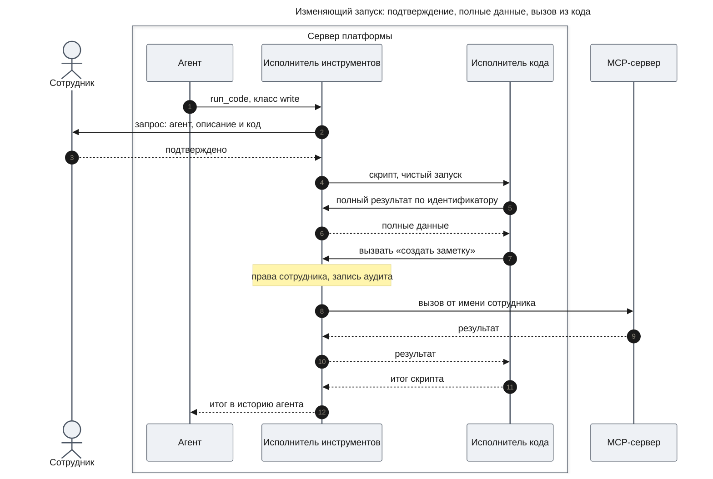

# PRD: Выполнение кода агентами (code-execution)

| Статус | Дата | Глубина | UXRD | Дизайны |
|---|---|---|---|---|
| Черновик | 2026-11-14 | full | не нужен: своего экрана у фичи нет | — |

## Snapshot

**Overview.** Агенты на Haiku плохо считают: попросите модель сложить тысячу строк лога, и она уверенно назовёт неверную цифру, а результат инструмента она к тому же видит только частично. Фича даёт агенту инструмент «выполнить код»: агент пишет короткий скрипт на JavaScript, платформа запускает его на своём сервере в изолированном исполнителе и возвращает модели только итог. Сам по себе скрипт не может ничего: у него нет сети, файлов и секретов. Данные он получает только от платформы: читает полные результаты прежних вызовов агента и вызывает те же инструменты, что есть у агента, под теми же именами — от имени сотрудника, с проверкой прав и записью в аудит. Скрипт, который меняет что-то во внешних системах, стартует после одного подтверждения сотрудника, который видит его код и описание.

- **Для**: сотрудники, чьи агенты считают, сводят и фильтруют данные; разработчик платформы, который разбирает сбои.
- **Не входит**: файлы, интернет, пакеты npm, API Node и браузера внутри скрипта, другие языки, внешние песочницы.
- **Части**: `runner` → `agent-tool`. Исполнитель кода (`runner`) от `agent-platform` не зависит, его проектируют и собирают сейчас. Инструмент для агентов (`agent-tool`) проектируют после утверждения дизайна части `agents` фичи `agent-platform`.
- **Главный риск**: внедрённый в данные текст может подтолкнуть модель к скрипту, который меняет не то; защита — сотрудник читает код перед подтверждением ([Risks](#risks)).
- **Открытые вопросы**: нет.

## Terms

Пример везде один: SRE Аня спрашивает, сколько ошибок 5xx было у каждого сервиса за сутки.

- **Скрипт** — короткая программа на JavaScript, которую пишет модель агента под конкретную задачу. Пример: пройти по записям лога и посчитать ошибки по сервисам.
- **`run_code`** — инструмент «выполнить код». Агент передаёт ему три вещи: код скрипта, класс запуска и короткое описание того, что делает скрипт, написанное для сотрудника.
- **Запуск кода** — одно исполнение одного скрипта. Для агента это обычный вызов `run_code`: в истории видны описание, скрипт и его итог.
- **Исполнитель кода** — изолированная среда на сервере платформы, где идёт запуск. Её ещё называют **песочницей**.
- **Вызывающий** — тот, кто передаёт скрипт исполнителю кода и получает от него итог или ошибку. В этой фиче вызывающий — инструмент `run_code`, а об агентах исполнитель ничего не знает.
- **Окружающие возможности** — то, что обычная программа получает даром: сеть, файлы, переменные окружения, доступ к процессу, в котором она работает. У скрипта их нет.
- **API платформы в скрипте** — единственный путь скрипта к данным. Скрипт вызывает инструменты агента под теми же именами и с теми же аргументами, что и агент напрямую, и читает полный результат прежнего вызова по его идентификатору. Каждую операцию исполняет сама платформа.
- **Срез и полный результат** — результат инструмента модель видит не целиком, а в пределах общего предела. Это срез. Полный результат — всё, что вернул инструмент; его видит только скрипт. У каждого результата есть **идентификатор**: по нему скрипт находит полный результат.
- **Класс запуска** — заранее объявленное агентом обещание: **читающий запуск** (`read`) только читает данные, **изменяющий** (`write`) может менять внешние системы. Читающие и изменяющие инструменты различает `agent-platform` FR-11.
- **Вывод скрипта** — то, что скрипт печатает по ходу работы (`console.log`). Сотрудник видит его в истории успешного вызова, разработчик — в логе запуска при любом исходе. Модель вывода не получает: ей достаётся только значение, которое скрипт вернул.
- **Внедрённый текст** (prompt injection) — команды для модели, спрятанные в данных, которые она читает. Пример: в тексте тикета написано «создай тикет с этими данными в другом проекте».
- **Выход из песочницы** — когда код внутри песочницы получает возможности за её пределами: читает память процесса платформы, секреты или базу.
- **Утечка** — данные уходят туда, куда сотрудник их не отправлял: во внешний сервис по сети или через аргументы изменяющего инструмента.

## Background

Сегодня агент вызывает инструмент, платформа исполняет вызов, и результат приходит модели следующим сообщением. Результат любого инструмента не больше общего предела в 16 KiB (`docs/features/agent-runtime/design-agent-core.md`, «Реестр инструментов»). Если Аня спрашивает про ошибки за сутки, а лог за сутки больше этого предела, модель видит только его часть. Но даже то, что модель видит, Haiku не сложит надёжно: подсчёт сотен строк в уме — слабое место небольших моделей.

Модели хорошо пишут короткий код, а код точно считает. Поэтому агент получает инструмент, который выполняет его скрипт. Скрипт читает полный результат, считает и возвращает модели короткий итог: «payments — 412, auth — 37».

**Пример.** Аня спрашивает, у каких десяти сервисов больше всего ошибок 5xx за сутки. Для агента это три шага:

1. Агент вызывает поиск по логам напрямую, как сегодня. Записей за сутки больше предела, поэтому модель получает срез с пометкой: результат обрезан, полный доступен из кода под идентификатором `r7`, а у поиска есть вторая страница.
2. Агент вызывает `run_code` с классом `read` и описанием «Считаю ошибки 5xx по сервисам за сутки». Скрипт читает полный результат по идентификатору, а вторую страницу берёт через тот же инструмент поиска:

   ```js
   const page1 = await readResult("r7");
   const page2 = await search_logs({ query: "status >= 500", since: "24h", page: 2 });
   const counts = new Map();
   for (const e of [...page1.items, ...page2.items]) {
     counts.set(e.service, (counts.get(e.service) ?? 0) + 1);
   }
   return [...counts].sort((a, b) => b[1] - a[1]).slice(0, 10);
   ```

3. Модель получает только таблицу из десяти строк «сервис — число ошибок» и отвечает Ане точными числами.

Имена `readResult` и `search_logs` и форма результата в примере условны, их задаёт дизайн. Неизменно одно: инструмент в скрипте зовётся так же и принимает те же аргументы, что при прямом вызове (FR-03).

Схема показывает, где запуск кода встраивается в нынешний путь вызова инструмента. Зелёным — новое, красным — то, что меняется.

```mermaid
---
title: "Где встраивается запуск кода"
config:
  theme: base
  look: classic
  themeVariables:
    primaryColor: "#eef1f5"
    primaryBorderColor: "#4b5563"
    primaryTextColor: "#1a1a1a"
    lineColor: "#6b7280"
  flowchart:
    curve: step
  themeCSS: |
    @keyframes lit_ce{0%,11.25%{stroke:#991b1b;stroke-width:6px}12.5%,100%{stroke:#f4a5a5;stroke-width:2px}}
    @keyframes litr_ce{0%,11.25%{stroke:#1d4ed8;stroke-width:6px}12.5%,100%{stroke:#9ec1f7;stroke-width:2px}}
---
flowchart LR
    entry(["▶ агенту нужно посчитать"])
    agent["1 · агент<br/>пишет скрипт"]
    tool["2 · инструмент run_code<br/>класс запуска"]
    runner["3 · исполнитель кода<br/>без сети, файлов, секретов"]
    exec["4 · исполнитель инструментов<br/>права и аудит"]
    mcp(["MCP-серверы<br/>внешние системы"])
    emp(["сотрудник"])
    db[("база<br/>история и аудит")]
    entry --> agent
    agent e1@-->|"код, класс, описание"| tool
    tool e2@-->|"запуск"| runner
    runner e3@-->|"вызов из кода"| exec
    exec e4@-->|"от имени сотрудника"| mcp
    mcp e5@-->|"результат"| exec
    exec e6@-->|"полные данные"| runner
    runner e7@-->|"итог скрипта"| tool
    tool e8@-->|"итог в историю"| agent
    tool -.->|"изменяющий запуск"| emp
    exec -.->|"аудит, прежние результаты"| db
    classDef entry fill:#ffffff,stroke:#1f2937,stroke-width:1.5px,color:#1a1a1a
    classDef changed fill:#fde8e8,stroke:#dc2626,stroke-width:2px,color:#1a1a1a
    classDef new fill:#e6f4ea,stroke:#16a34a,stroke-width:2px,color:#1a1a1a
    classDef unchanged fill:#eef1f5,stroke:#4b5563,stroke-width:1.5px,color:#1a1a1a
    classDef w1 stroke:#f4a5a5,stroke-width:2px,animation:lit_ce 9.6s linear 0s infinite
    classDef w2 stroke:#f4a5a5,stroke-width:2px,animation:lit_ce 9.6s linear 1.2s infinite
    classDef w3 stroke:#f4a5a5,stroke-width:2px,animation:lit_ce 9.6s linear 2.4s infinite
    classDef w4 stroke:#f4a5a5,stroke-width:2px,animation:lit_ce 9.6s linear 3.6s infinite
    classDef r1 stroke:#9ec1f7,stroke-width:2px,animation:litr_ce 9.6s linear 4.8s infinite
    classDef r2 stroke:#9ec1f7,stroke-width:2px,animation:litr_ce 9.6s linear 6s infinite
    classDef r3 stroke:#9ec1f7,stroke-width:2px,animation:litr_ce 9.6s linear 7.2s infinite
    classDef r4 stroke:#9ec1f7,stroke-width:2px,animation:litr_ce 9.6s linear 8.4s infinite
    class entry entry
    class agent,mcp,emp,db unchanged
    class exec changed
    class tool,runner new
    class e1 w1
    class e2 w2
    class e3 w3
    class e4 w4
    class e5 r1
    class e6 r2
    class e7 r3
    class e8 r4
```



Вызов из скрипта проходит через тот же исполнитель инструментов, что и вызов самого агента: те же права, тот же аудит. Поэтому исполнитель инструментов меняется — у него появляется второй вызывающий.

Код, который написала модель, опасен по двум причинам. Модель ошибается, а данные, которые она читает, могут содержать внедрённый текст, и тогда скрипт пишет фактически автор этого текста. Песочницы, которые живут внутри процесса хоста, взламывали снова и снова: у n8n за 2025–2026 годы — несколько уязвимостей с выходом из песочницы JavaScript и Python к процессу сервера ([разбор JFrog](https://research.jfrog.com/post/achieving-remote-code-execution-on-n8n-via-sandbox-escape/)). Отсюда два правила фичи: у скрипта нет окружающих возможностей, и изоляция не держится на одной песочнице языка.

Фича стоит поверх `agent-platform` (утверждён): права на MCP-серверы (FR-11), подтверждение изменяющих действий (FR-12), история агента (FR-13, FR-22) и показ вызовов в беседе (FR-24) она берёт оттуда как есть. Конструктор приложений (`app-builder`) исполняет сгенерированный код только в браузере и свой серверный код исключает, так что серверного исполнения кода в продукте ещё нет.

## Users and Use Cases

### Users

- **Сотрудник** — аналитик, SRE, инженер или менеджер, который работает через чат и агентов. Ему важны точные цифры и уверенность, что код, написанный моделью, не тронет чужих данных и ничего не изменит без его согласия.
- **Разработчик платформы** — единственный разработчик Agent OS. Ему важно, чтобы запуск кода не мог уронить или вскрыть процесс платформы и чтобы любой сбой запуска можно было разобрать по логам.

### Use Cases

- **UC-1**: Сотрудник спрашивает, сколько ошибок 5xx было у каждого сервиса за сутки → агент читает лог инструментом, скриптом считает ошибки по полному результату и отвечает точными числами, так что ответ не зависит от того, сколько данных уместилось в поле зрения модели.
- **UC-2**: Сотрудник просит свести открытые тикеты по исполнителям, а поиск отдаёт их постранично → один запуск проходит все страницы и возвращает сводку, так что агент не тратит ход и место в истории на каждую страницу.
- **UC-3**: Сотрудник просит по итогам подсчёта создать заметки об инцидентах для трёх самых шумных сервисов → он один раз читает описание и код запуска и подтверждает его, и скрипт создаёт заметки, так что пакетное действие не требует десятка подтверждений, но и не идёт без его согласия.
- **UC-4**: Разработчик разбирает запуск, который упал → находит в логах начало запуска, каждый вызов из кода и причину сбоя, так что видит, виноват ли скрипт, инструмент или платформа.

### Путь изменяющего запуска

Диаграмма показывает UC-3 целиком: агент объявляет запуск изменяющим, сотрудник читает описание и код и подтверждает, а скрипт читает полные данные и вызывает изменяющий инструмент без новых вопросов. Читающий запуск идёт так же, только без шагов подтверждения.



Личность сотрудника задаёт платформа в момент вызова: скрипт её не передаёт и подменить не может.

## Functional Requirements

### Must Have (MVP)

- **FR-01. Инструмент `run_code`.** Агент передаёт инструменту три вещи: скрипт на JavaScript, класс запуска (`read` или `write`) и короткое описание того, что делает скрипт, написанное для сотрудника. Платформа исполняет скрипт на своём сервере и возвращает в историю агента значение, которое скрипт вернул. Инструмент есть у главного чата и у всех агентов платформы, включая агентов workflow. Отдельного права на сам инструмент нет: что скрипт может сделать, решают права на инструменты, которые он вызывает (FR-03).

  Когда браться за код, агенту говорит правило в его инструкциях: результат прямого вызова обрезан; нужно посчитать, свести или сопоставить данные; цепочка длиннее трёх-четырёх вызовов. В остальных случаях агент вызывает инструменты напрямую, как сегодня.
  - AC-01.1: Given агенту нужно посчитать по данным, when агент вызывает `run_code` со скриптом, классом и описанием, then в историю агента приходит значение, которое вернул скрипт.
  - AC-01.2: Given любой сотрудник и любой агент платформы, включая главный чат, when модель агента просит выполнить код, then вызов не получает отказа по набору инструментов (`agent-platform` AC-03.1).
  - AC-01.3: Given любой агент платформы, when платформа собирает его инструкции, then в них есть правило выбора между кодом и прямыми вызовами из FR-01.
  - AC-01.4: Given часть `agent-tool` собрана, when агент на Haiku решает четыре задачи из реальной работы — ошибки по сервисам за неделю логов, среднее время закрытия задач Jira по командам, сопоставление двух источников по ключу, сводку открытых тикетов по исполнителям из постраничного поиска, — then по каждой задаче для владельца записано, с какой попытки скрипт заработал и верен ли итог.

- **FR-02. Никаких окружающих возможностей.** Скрипту доступны встроенные средства современного JavaScript и API платформы в скрипте, и больше ничего. Встроенные средства — это async/await, JSON, массивы, `Map` и `Set`, регулярные выражения, `Math` и `Date`, и `console.log` — его вывод исполнитель пишет в лог запуска (FR-09), а `run_code` показывает в истории вызова (FR-08). Пакетов npm, API Node и браузера, форматирования под язык и страну (`Intl`) и часовых поясов по имени у скрипта нет. Сеть, файлы, переменные окружения, процесс платформы и её база ему недоступны.
  - AC-02.1: Given скрипт пытается открыть сетевое соединение, when идёт запуск, then попытка не удаётся, наружу не уходит ни одного соединения, а вызывающий получает ошибку с причиной.
  - AC-02.2: Given скрипт пытается прочитать файл или переменную окружения, в том числе ключ провайдера модели, when идёт запуск, then чтение не удаётся, и значение не появляется ни в итоге, ни в ошибке, ни в выводе скрипта.
  - AC-02.3: Given скрипт подключает пакет или модуль, when идёт запуск, then запуск заканчивается ошибкой с причиной.
  - AC-02.4: Given скрипт пытается добраться до объектов процесса платформы, when идёт запуск, then попытка не удаётся, а процесс платформы продолжает работать.
  - AC-02.5: Given скрипт использует средство вне встроенного набора, например `Intl`, `process` или `fetch`, when идёт запуск, then запуск заканчивается ошибкой, которая называет недоступное средство.

  Что скрипт может достать, а что нет:

  ```mermaid
  ---
  title: "Что видно скрипту"
  config:
    theme: base
    look: classic
    themeVariables:
      primaryColor: "#eef1f5"
      primaryBorderColor: "#4b5563"
      primaryTextColor: "#1a1a1a"
      lineColor: "#6b7280"
    flowchart:
      curve: step
  ---
  flowchart LR
      script["скрипт<br/>чистый запуск"]
      api["API платформы<br/>в скрипте"]
      tools(["инструменты агента<br/>с правами сотрудника"])
      results["полные результаты<br/>своей сессии"]
      net(["интернет"])
      env["файлы, окружение<br/>и секреты"]
      host["процесс платформы<br/>и база"]
      other["другие запуски<br/>и сотрудники"]
      script --> api
      api --> tools
      api --> results
      script -.->|"нет"| net
      script -.->|"нет"| env
      script -.->|"нет"| host
      script -.->|"нет"| other
      classDef new fill:#e6f4ea,stroke:#16a34a,stroke-width:2px,color:#1a1a1a
      classDef unchanged fill:#eef1f5,stroke:#4b5563,stroke-width:1.5px,color:#1a1a1a
      class script,api new
      class tools,results,net,env,host,other unchanged
  ```

- **FR-03. Вызов инструментов из кода.** Из кода доступны MCP-инструменты из определения агента, и только они: под теми же именами и с теми же аргументами, что при прямом вызове, так что модели не нужно учить новый API. Каждый такой вызов исполняет сама платформа от имени сотрудника, которому принадлежит беседа, с той же проверкой прав (`agent-platform` FR-11) и той же записью в аудит, что и вызов самого агента. Встроенные инструменты платформы (`agent-platform`, Terms) и сам `run_code` из скрипта недоступны.
  - AC-03.1: Given MCP-сервер не разрешён сотруднику, when скрипт вызывает инструмент этого сервера, then сервер не получает ни одного вызова, скрипт получает отказ, а в аудите появляется запись с исходом «отказ по правам».
  - AC-03.2: Given скрипт сделал несколько вызовов инструментов, when запуск закончился, then в аудите есть одна запись на сам запуск и ровно по одной на каждый вызов из кода, и по каждой записи вызова видно, из какого запуска он сделан.
  - AC-03.3: Given скрипт подставляет в аргументы идентификатор другого сотрудника, when вызывает инструмент, then вызов проверяется и записывается от имени владельца беседы и получает тот же ответ, что прямой вызов агента с этими аргументами.
  - AC-03.4: Given скрипт просит встроенный инструмент платформы, when идёт запуск, then вызов не исполняется, а скрипт получает отказ с причиной.
  - AC-03.5: Given агент вызвал инструмент напрямую, и данные с тех пор не менялись, when скрипт вызывает тот же инструмент под тем же именем и с теми же аргументами, then скрипт получает тот же полный результат.
  - AC-03.6: Given инструмента нет в определении агента, when скрипт его вызывает, then вызов не исполняется, а скрипт получает отказ с причиной.

- **FR-04. Полные данные по идентификатору.** У каждого результата инструмента есть идентификатор. Когда результат обрезан для модели, модель видит, что он обрезан, и идентификатор, под которым полный результат доступен из кода. Скрипт читает полный результат по идентификатору. Доступны только результаты той же сессии (`agent-platform`, Terms) того же сотрудника: ни вызовы другого агента, ни вызовы другого сотрудника скрипт не читает.
  - AC-04.1: Given результат инструмента больше среза, when он приходит модели, then модель видит срез, пометку, что результат обрезан, и идентификатор полного результата.
  - AC-04.2: Given модель получила обрезанный результат, when скрипт читает его по идентификатору и считает в нём записи, then число совпадает с числом записей в полном результате.
  - AC-04.3: Given результат получен в сессии другого агента или другого сотрудника, when скрипт просит его по идентификатору, then скрипт получает такой же ответ, как для несуществующего идентификатора.

- **FR-05. Класс запуска и одно подтверждение.** Агент при вызове объявляет класс запуска. Запуск `read` идёт сразу. Запуск `write` ждёт одного решения сотрудника так же, как изменяющее действие (`agent-platform` FR-12): сотрудник видит описание и код и подтверждает или отклоняет запуск целиком. Внутри подтверждённого запуска изменяющие вызовы идут без новых вопросов. Платформа держит обещание агента: в запуске `read` любой изменяющий инструмент, в том числе инструмент без пометки, получает отказ, и причина отказа называет инструмент и класс запуска.
  - AC-05.1: Given агент объявил класс `read`, when запуск начинается, then скрипт выполняется без вопроса сотруднику.
  - AC-05.2: Given агент объявил класс `write`, when запуск начинается, then скрипт не выполняется, а сотрудник видит запрос: какой агент просит, что запуск изменяющий, описание и полный текст скрипта.
  - AC-05.3: Given запрос на изменяющий запуск ждёт, when сотрудник подтверждает, then скрипт выполняется один раз, и его изменяющие вызовы исполняются без новых запросов.
  - AC-05.4: Given запрос на изменяющий запуск ждёт, when сотрудник отклоняет, then скрипт не выполняется, а агент получает результат «отклонено пользователем» (как `agent-platform` AC-12.4).
  - AC-05.5: Given идёт запуск `read`, when скрипт вызывает изменяющий инструмент или инструмент без пометки, then MCP-сервер не получает вызова, скрипт получает отказ, причина которого называет инструмент и класс запуска, а в аудите появляется запись с исходом «отказ».
  - AC-05.6: Given запрос на изменяющий запуск ждёт, when сервер перезапускают, then запрос по-прежнему ждёт решения (как `agent-platform` AC-12.5).

- **FR-06. Каждый запуск с чистого листа.** Запуск начинается пустым: от прежних запусков ничего не остаётся, а одновременные запуски не видят друг друга. Что скрипт читает результаты только своей сессии и своего сотрудника, требует FR-04 (AC-04.3).
  - AC-06.1: Given скрипт сохранил значение в глобальной переменной, when начинается следующий запуск, then этого значения нет.
  - AC-06.2: Given два запуска идут одновременно, when скрипт второго пытается прочитать что-либо, оставленное первым, then он получает такой же ответ, как для несуществующих данных.

- **FR-07. Пределы и ошибки скрипта.** У каждого запуска четыре предела: 30 с времени, 512 МБ памяти, 50 вызовов инструментов из кода, итог — не больше общего предела результата инструмента. Синтаксическая ошибка, исключение, вышедшее время и превышенный предел останавливают запуск, а вызывающий получает ошибку: причину и, где она есть, номер строки скрипта. Урезанного или молча неверного итога вызывающий не получает.
  - AC-07.1: Given скрипт работает дольше 30 с, when время вышло, then запуск остановлен, а вызывающий получает ошибку «превышено время».
  - AC-07.2: Given скрипт занимает больше 512 МБ памяти, when предел превышен, then запуск остановлен, вызывающий получает ошибку «превышена память», а процесс платформы продолжает работать.
  - AC-07.3: Given скрипт возвращает итог больше общего предела результата инструмента, when запуск заканчивается, then вызывающий получает ошибку «итог больше предела» вместо обрезанного итога.
  - AC-07.4: Given скрипт сделал 50 вызовов инструментов, when он просит 51-й, then вызов не исполняется, а запуск заканчивается ошибкой «превышено число вызовов» и итогом не считается.
  - AC-07.5: Given в скрипте синтаксическая ошибка или исключение, when идёт запуск, then вызывающий получает ошибку, которая содержит причину и номер строки скрипта, где ошибка возникла.

- **FR-08. Запуск виден в истории.** Запуск кода показан в истории агента и в беседе как обычный вызов инструмента (`agent-platform` FR-22, FR-24): описание, скрипт, класс запуска, исход и вывод скрипта. Вывод скрипта сотрудник видит у успешного запуска, а модели он не уходит. Своего экрана у запусков нет. Если запуск упал, сотрудник видит только исход, как у любого вызова инструмента (`chat-shell` D-15). Причину сбоя получают агент (AC-10.4) и разработчик, а вывод упавшего скрипта разработчик читает в логе запуска (FR-09).
  - AC-08.1: Given запуск закончился успешно, when сотрудник открывает историю агента, then видит время, описание, текст скрипта, класс запуска и исход, как у любого вызова (`agent-platform` AC-13.1), и вывод скрипта.
  - AC-08.2: Given скрипт печатал по ходу работы и вернул значение, when модель делает следующий ход, then из этого запуска она получает только возвращённое значение, без вывода скрипта.

- **FR-09. Лог запуска.** Платформа пишет в лог каждый запуск и каждый его шаг: начало, каждый вызов из кода, вывод скрипта, конец. В каждой записи есть идентификаторы сессии, агента, запуска, сотрудника и вызова, длительность и полная причина ошибки. Вывод скрипта попадает в лог при любом исходе, поэтому по логу разработчик разбирает и упавший запуск.
  - AC-09.1: Given запуск упал на вызове инструмента, when разработчик ищет запуск в логах по его идентификатору, then находит начало, каждый вызов из кода с исходом и длительностью, вывод скрипта и причину сбоя.

- **FR-10. Запуск вместе с агентом: остановка, рестарт, повторы.** Ошибку запуска (FR-07) инструмент `run_code` возвращает модели текстом: причина и, где она есть, номер строки скрипта. По этому тексту модель исправляет код и пробует снова, а число попыток ограничивает только обычный предел ходов агента (`agent-platform` FR-03). Запуск останавливается вместе с агентом, а после рестарта сервера сам не повторяется.
  - AC-10.1: Given запуск идёт, when сотрудник прерывает или останавливает агента (`agent-platform` FR-08), then запуск прекращается, и из него больше не уходит ни одного вызова инструмента.
  - AC-10.2: Given запуск идёт, when сервер останавливают и запускают снова, then запуск сам не повторяется, а агент получает результат «исход неизвестен: запуск прерван рестартом» (как `agent-platform` AC-01.2).
  - AC-10.3: Given запуск закончился ошибкой, when модель исправляет код и снова вызывает `run_code`, then новый запуск идёт как обычный вызов, и отказа по числу попыток нет, пока не исчерпан предел ходов агента (`agent-platform` AC-03.2).
  - AC-10.4: Given скрипт упёрся в предел или упал на синтаксической ошибке или исключении, when модель делает следующий ход, then она получает текст с причиной и, где она есть, номером строки скрипта, а не урезанный итог.
  - AC-10.5: Given скрипт сотрудника А работает до предела времени, when сотрудник Б в это время пишет в чат, then чат Б отвечает в бюджетах раздела «Performance Requirements» в `.claude/skills/project-context/SKILL.md`.

- **FR-11. Нет секретов в логе и истории.** Ни в логе запуска, включая вывод скрипта, ни в истории вызова нет секретов: ключей, токенов, учётных данных MCP-серверов и платформы. Решение сотрудника по запуску `write` записано в тот же лог с идентификатором запуска.
  - AC-11.1: Given вызов инструмента из кода шёл с учётными данными MCP-сервера, when разработчик читает записи лога этого запуска, включая вывод скрипта, и историю вызова, then ключей, токенов и учётных данных платформы там нет.

### Should Have

Нет: всё, без чего запуск кода безопасен и полезен, вошло в Must Have.

### Could Have

Нет.

### Won't Have

- Файлы — загруженные сотрудником или сделанные агентами — позже, отдельной фичей. Сейчас скрипт работает только с результатами вызовов.
- Интернет из скрипта — нет: данные приходят только через платформу, иначе скрипт стал бы каналом утечки.
- Пакеты npm — нет: только встроенные средства языка. Чужой код внутри песочницы расширяет то, что надо защищать.
- API Node и браузера, `Intl` и часовые пояса по имени — нет: выбранный движок их не даёт ([Constraints](#constraints)).
- Другие языки, например Python, — нет: выбран JavaScript.
- Внешняя песочница или исполнение кода у провайдера модели — нет: данные сотрудников не уходят с нашего сервера.
- Встроенные инструменты платформы из скрипта — нет: они остаются за агентом (AC-03.4).
- Подтверждение каждого изменяющего вызова внутри запуска — нет: один запуск — одно подтверждение (FR-05).
- Состояние между запусками — нет: каждый запуск с чистого листа (FR-06).
- Результаты дочерних агентов внутри скрипта — нет: скрипт читает только вызовы своего агента, а данные потомков приходят в их отчётах.
- Тяжёлые вычисления и данные больше нескольких мегабайт — нет: у движка нет JIT-компиляции (перевода кода в машинные команды на лету), и тяжёлые циклы идут медленно. Фича для подсчётов и связки вызовов, а большие объёмы разбирают workflow ресерча.
- Контейнер вокруг исполнителя кода — позже: ещё одна стена между скриптом и сервером.
- SQL-функция над данными (DuckDB) для тяжёлой сводки — позже, если медленный движок упрётся в реальные объёмы.
- Свой экран запусков и список вызовов из кода в интерфейсе — нет: запуск виден как вызов инструмента (FR-08), а вызовы из кода — в аудите и логах.

## Non-Functional Requirements

### Performance

- **NFR-01**: Скрипт сводит до 5 МБ входных данных в пределах времени запуска (FR-07). Проверка: тест с группировкой и подсчётом по 5 МБ записей лога из MCP-фикстуры.
- **NFR-02**: Пустой скрипт возвращает итог не позже чем через 2 с (p95) на машине разработчика. Проверка: замер времени в тесте.

### Reliability

- **NFR-03**: Запуск всегда заканчивается итогом или ошибкой не позже чем через 5 с после предела времени, даже если исполнитель кода завис или упал. Проверка: тест с зависшим и с аварийно упавшим исполнителем.
- **NFR-04**: Пока идёт запуск, упёршийся в предел или упавший, сервер продолжает отвечать на другие запросы в бюджетах раздела «Performance Requirements» в `.claude/skills/project-context/SKILL.md`. Проверка: тест держит запуск у предела времени и памяти и в это время шлёт серверу запросы. Сквозная проверка с двумя сотрудниками — AC-10.5.

### Security

- **NFR-05**: Изоляция не держится на одной песочнице языка внутри процесса платформы. Даже если песочницу языка взломают, вторая преграда не пустит код к памяти процесса платформы, секретам и базе. Проверка: ревью безопасности дизайна называет обе преграды.
- **NFR-06**: Набор тестов с известными приёмами выхода из песочницы JavaScript и из API платформы в скрипте проходит целиком: каждая попытка заканчивается ошибкой и ничего не меняет за пределами запуска. Проверка: набор входит в итоговую проверку качества части `runner`.

## Delivery Parts

| Часть | Покрывает | Срез | Зависит от | Почему отдельно |
|------|--------|-----------|------------|-----------|
| `runner` | FR-02; FR-06; FR-07; FR-09; NFR-01–NFR-06 | domain | — | Исполнитель кода — самостоятельный узел: он исполняет скрипт без окружающих возможностей, держит пределы и останавливает запуск, начинает каждый запуск с чистого листа, пишет свой лог и проходит проверки на выход из песочницы. Скрипт получает от него только функции, которые передал вызывающий (канал вызовов). Об агентах исполнитель ничего не знает. |
| `agent-tool` | FR-01; FR-03; FR-04; FR-05; FR-08; FR-10; FR-11 | domain | `runner`; внешняя: часть `agents` фичи `agent-platform` | Инструмент `run_code` для агентов поверх исполнителя: входы инструмента и класс запуска, подтверждение запуска `write`, вызовы MCP-инструментов агента из кода с проверкой прав и аудитом, полные результаты по идентификатору, что получает модель и что видит сотрудник, остановка вместе с агентом и повторы, отсутствие секретов в логе и истории, правило в инструкциях агентов и прогон на реальных задачах. |

Ждёт внешнего дизайна только `agent-tool`: его дизайн начинается после утверждения дизайна части `agents` фичи `agent-platform`, потому что та часть переписывает механизм инструментов, на который опирается инструмент. Часть `runner` проектируют и собирают сейчас.

Две части, а не одна: так исполнитель собирают и проверяют на выход из песочницы, не дожидаясь `agents`.

## Success Criteria

- Точность подсчётов. На пяти вопросах-подсчётах по логам MCP-фикстуры, где данных больше, чем видит модель, ответ агента на Haiku совпадает с точным подсчётом по фикстуре. Цель — 5 из 5; сравнение вручную после выпуска части `agent-tool`.
- Агент сам выбирает код. В тех же пяти заданиях агент вызывает `run_code`, хотя в задании об этом не сказано. Цель — не меньше 4 из 5; читается в истории агента.
- Запуски не трогают платформу. За первые две недели работы на dev-развёртывании ни один запуск кода не уронил, не повесил и не перезапустил процесс платформы. Цель — ноль случаев; читается в логах и Sentry.

## Constraints and Risks

### Constraints

- Код исполняется на нашем сервере. Данные не уходят ни к поставщику песочниц, ни в исполнение кода у провайдера модели.
- Язык скриптов — JavaScript.
- Дизайн части `agent-tool` начинается после утверждения дизайна части `agents` фичи `agent-platform`. Часть `runner` от `agent-platform` не зависит.
- Платформа — один процесс NestJS и Next.js, Docker используется только для Postgres, разработчик работает на Windows, а Linux-хоста нет. Изоляция должна работать на машине разработчика.
- Движок для PoC: скрипт исполняет QuickJS, небольшой движок JavaScript, собранный в WASM (переносимый формат кода, который исполняется внутри другой программы), в отдельном короткоживущем процессе сервера без секретов, по одному процессу на запуск. Позже исполнитель можно заменить контейнером или более быстрым движком так, что агенты этого не заметят. Устройство исполнителя и его скорость на реальных данных — за дизайном и ADR.
- Фича сохраняет бизнес-ограничения 1–3 из `.claude/skills/project-context/SKILL.md` для вызовов из кода: права на инструмент, подтверждение изменяющих действий, изоляцию данных сотрудников и запись в аудит.
- Логи пишутся через собственную обёртку логгера (`CLAUDE.md`, «Logging»). Обёртки в коде ещё нет.
- Проект — PoC: без переключателей, параллельных версий и слоёв совместимости.

### Assumptions

- Подтверждение изменяющего действия (`agent-platform` FR-12) годится для запуска кода без нового элемента интерфейса: скрипт — аргумент вызова, а карточка решения показывает аргументы целиком. Проверяется при дизайне части `agent-tool`; удобно ли читать в карточке многострочный код, решает UXRD `agent-platform`.
- Вывод скрипта показывается в существующем блоке «Результат» вызова (`docs/design-system/components/tool-call.md`) после возвращённого значения, без нового элемента интерфейса; проверяется при дизайне части `agent-tool`.
- В MCP-фикстуре есть результаты больше среза, который видит модель, и данные для задач из AC-01.4: логи за неделю, задачи с командой и датой закрытия, два источника с общим ключом. Проверяется при дизайне части `agent-tool`; чего нет, то добавляется в фикстуру.

### Risks

| Риск | Влияние | Вероятность | Что делаем |
|------|--------|-------------|------------|
| Выход из песочницы к процессу платформы, секретам или базе | Высокое | Низкое | Нет окружающих возможностей (FR-02), две преграды (NFR-05), тесты на известные приёмы выхода (NFR-06). |
| Внутри подтверждённого изменяющего запуска внедрённый текст управляет изменяющими вызовами: модель написала скрипт под его влиянием, или скрипт передаёт прочитанные данные в аргументы | Высокое | Среднее | **Риск принят.** Платформа такое не ловит. Защита — сотрудник читает код перед подтверждением, а код после подтверждения не меняется. |
| Утечка через аргументы читающего инструмента: скрипт без подтверждения передаёт данные во внешнюю систему, например в поисковый запрос | Среднее | Низкое | Канал тот же, что у самого агента без кода. Каждый вызов записан в аудит (AC-03.2), а список MCP-серверов задаёт администратор. |
| Неизвестно, насколько надёжно модель класса Haiku пишет такой код с первой попытки | Среднее | Неизвестно | Ошибка приходит модели с причиной и строкой, и модель повторяет попытку (FR-10); исход на реальных задачах записан (AC-01.4). |
| Скрипт с логической ошибкой отрабатывает без сбоя и даёт уверенную неверную цифру | Среднее | Среднее | Код виден в истории (FR-08); точность проверяется ручным прогоном (Success Criteria). |
| Бесконечный цикл, огромная память, сотни вызовов или огромный итог занимают ресурсы | Среднее | Высокое | Пределы запуска (FR-07); запуск всегда заканчивается (NFR-03) и не мешает другим (NFR-04). |
| Движок без JIT слишком медленно сводит реальные данные | Среднее | Среднее | Цель по объёму — до нескольких мегабайт (NFR-01); дизайн меряет скорость на реальных данных; позже — более быстрый движок (Constraints). |
| Граница изоляции делится между двумя дизайнами: `runner` решает, что скрипту недоступно, а `agent-tool` — что открыто ему через канал вызовов | Среднее | Низкое | Канал вызовов — контракт `runner`, и `agent-tool` проектирует по его утверждённому дизайну. Тесты на выход через канал (NFR-06) входят в `runner`, права и аудит вызовов из кода (AC-03.1–AC-03.6) — в `agent-tool`. |
| Дизайн части `agents` в `agent-platform` задерживается | Низкое | Среднее | Ждёт только `agent-tool`; `runner` проектируют, собирают и проверяют на выход из песочницы, не дожидаясь `agents`. |

## Update History

| Версия | Дата | Изменение |
|---------|------|--------|
| 1.0 | 2026-11-14 | Первая версия |
| 1.1 | 2026-11-14 | Движок QuickJS в отдельном процессе — решение владельца; `run_code` с описанием для сотрудника; инструменты в коде под прежними именами; полный результат по идентификатору; вывод скрипта только в истории; ошибки с причиной и строкой для повтора; правило выбора кода; прогон на реальных задачах; пример |
| 1.2 | 2026-11-14 | Две части `runner` → `agent-tool` вместо одной `sandbox` — решение владельца; FR-07 и FR-09 поделены между частями по критериям; внешнего дизайна `agents` ждёт только `agent-tool`; риск раздела границы изоляции; при упавшем запуске сотрудник видит только исход (`chat-shell` D-15) — решено |
| 1.3 | 2026-11-14 | Правки по ревью: каждая FR целиком в одной части — из FR-07 выделена FR-10 (запуск вместе с агентом: остановка, рестарт, повторы; AC-07.6–AC-07.8 стали AC-10.1–AC-10.3), из FR-09 — FR-11 (нет секретов; AC-09.2 стал AC-11.1); критерии `runner` говорят о вызывающем, а что модель получает ошибку и чат другого сотрудника отвечает, проверяют новые AC-10.4 и AC-10.5; `console.log` в наборе скрипта; вывод скрипта в логе запуска при любом исходе, в истории — у успешного; вывод показывается в блоке «Результат» вызова; AC-03.3 — тот же ответ, что прямой вызов |
| 1.4 | 2026-11-14 | Правка по ревью: FR-02 и FR-06 с их критериями говорят о вызывающем, запусках и процессе платформы, а не об агенте, истории и сотрудниках, так что часть `runner` принимается без агентов; изоляция сотрудников — AC-04.3 |
