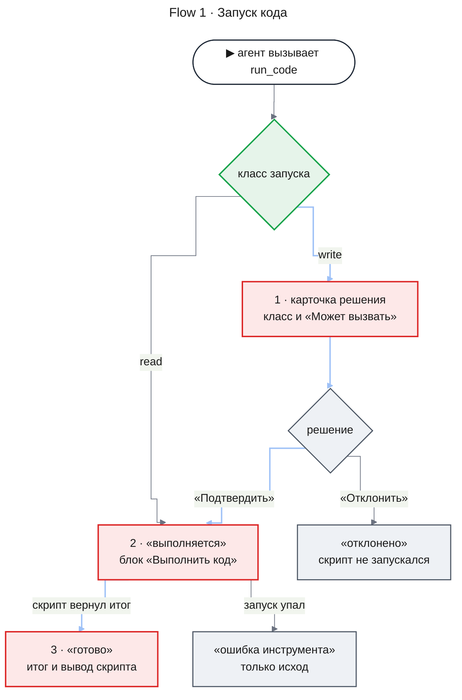

# UXRD: Выполнение кода агентами (code-execution)

| Статус | Дата | PRD | Дизайны |
|---|---|---|---|
| Утверждён владельцем | 2026-11-14 | [prd.md](./prd.md) | — |

## Snapshot

**Overview.** Своего экрана у запуска кода нет: в ленте беседы и на странице агента он выглядит как обычный вызов инструмента с подписью «Выполнить код». Скрипт свёрнут везде: в истории и в карточке решения изменяющего запуска. По умолчанию сотрудник видит описание запуска и класс запуска словами. Скрипт открывает одна кнопка «Показать скрипт»: код виден целиком, без изменений, и править его нельзя (KD-1). Подтвердить или отклонить запуск можно, не раскрывая скрипт. Поэтому над кнопками карточки стоит список «Может вызвать»: платформа сама находит в скрипте имена инструментов агента, и у каждого словом написано, меняет он данные или читает (KD-6). В истории раскрытый вызов показывает ещё итог, который вернул скрипт, и вывод скрипта; у упавшего запуска виден только исход. Новых элементов интерфейса нет: расширены два компонента дизайн-системы — вызов инструмента и карточка решения, а кнопка раскрытия скрипта устроена как уже существующая «Показать как JSON».

- **Не меняется**: исходы вызова, место карточки решения в ленте и объявления (agent-platform UXRD). В порядок фокуса добавляется только кнопка «Показать скрипт». Вызовы инструментов изнутри скрипта в интерфейсе не показываются: они видны только в аудите и логах (PRD, Won't Have).
- **Главный UX-риск**: сотрудник подтверждает запуск по описанию и не читает код. Свёрнутый скрипт ослабляет защиту от внедрённого текста; владелец принял этот риск (KD-1). Не раскрывая скрипт, сотрудник видит класс запуска словами (KD-2) и список «Может вызвать», который составила платформа, а не модель (KD-6). Что скрипт передаст этим инструментам, видно только в раскрытом коде.
- **Открытые вопросы**: нет.

### Key Decisions

| ID | Решение | Почему |
|---|---|---|
| KD-1 | Скрипт свёрнут по умолчанию везде: в истории (лента, страница агента) и в карточке решения изменяющего запуска. Его раскрывает кнопка «Показать скрипт» (MC-5) — тот же элемент, что «Показать как JSON». Раскрытый скрипт показан целиком блоком кода с номерами строк, без изменений и без правки. Подтверждение и отклонение раскрытия не требуют | Решение владельца от 2026-11-14: по умолчанию сотрудник читает описание и класс запуска, а код открывает по запросу (FR-05, AC-05.2). Владелец знает, что так слабее защита от внедрённого текста (PRD, Risks), и принял это |
| KD-2 | Аргументы `run_code` идут строками в постоянном порядке: описание, класс запуска, скрипт. Класс запуска написан словами (MC-3), а не `read` или `write` | Сотрудник должен понять, что запуск изменяющий, не раскрывая скрипт (AC-05.2, KD-1). Строка скрипта стоит последней, поэтому раскрытый код встаёт под короткими строками и не сдвигает их |
| KD-3 | Блок «Результат» успешного запуска показывает итог скрипта и под ним «Вывод скрипта». Любая ошибка запуска — синтаксис, исключение, предел, недоступное средство — показана исходом «ошибка инструмента», без результата и вывода | Так требует FR-08: у упавшего запуска сотрудник видит только исход (chat-shell UXRD, D-15). Новый исход не нужен |
| KD-4 | Во второй строке заголовка блока вызова стоит описание запуска | Несколько свёрнутых «Выполнить код» подряд иначе не различить. Строка уже есть в компоненте: у MCP-инструмента в ней техническое имя, у встроенного она пуста |
| KD-5 | Скрипт, который отработал без ошибки и ничего не вернул, получает исход «пустой результат». На месте итога в «Результате» стоит «—», под ним «Вывод скрипта», если скрипт печатал. Пустой массив или объект показан как вернул скрипт, с тем же исходом | Запуск без ошибки — успешный, и вывод сотрудник видит (AC-08.1). Исход «пустой результат» и «—» для отсутствующего значения уже есть в компоненте; новый исход не нужен |
| KD-6 | В карточке изменяющего запуска под сырым видом и над рядом действий стоит список «Может вызвать» (MC-6). Одна строка на инструмент: имя, как оно написано в скрипте, Mono, и через тире пометка словом — «меняет» или «читает» (MC-7). Инструмент без пометки показан как «меняет». Сначала меняющие, затем читающие, в каждой группе — в порядке первого упоминания в скрипте. Пометка «меняет» — UI 500 `--foreground`, «читает» — UI 400 `--muted-foreground`; красного нет. Под списком пояснение MC-8. Список не усекается и не сворачивается. Если скрипт не называет ни одного инструмента, вместо строк и пояснения стоит MC-9. Функции API платформы в скрипте, как `readResult`, в список не входят | Список составляет платформа, а не модель, поэтому он стоит отдельно от строк «Аргументы», которые написала модель и которые раскрывает сырой вид (AC-05.7). Над кнопками он оказывается последним, что сотрудник читает перед решением, и остаётся рядом с кнопками, когда скрипт раскрыт. Имя — как в коде, чтобы его можно было найти в раскрытом скрипте. Пометки различает слово, вес лишь помогает; красный в ленте читался бы как ошибка и утомлял бы глаза на долгой сессии |
| KD-7 | Список «Может вызвать» есть только в карточке решения: он остаётся в ней и после решения, в любом итоге. Блок вызова в истории его не повторяет, у читающего запуска списка нет | Карточка изменяющего запуска остаётся в ленте и в истории агента под блоком вызова (decision-card), так что список, по которому сотрудник решал, виден и потом. Читающий запуск решения не просит, и список ему не нужен |

## Design System

Фича следует [дизайн-системе](../../design-system/README.md). Блок кода собран из ролей [foundations](../../design-system/foundations.md): Mono, фон `--muted`, номера строк `--muted-foreground`. Подсветки синтаксиса нет.

### Component Inventory

Перед решением поиск шёл по `docs/design-system/components/` и `apps/web/src/components/` (`assistant-ui/elements`, `agents`). Блока кода с номерами строк в приложении нет; ближе всего строка вложенного JSON в строках аргументов, и скрипт показан на её месте. Для свёртки скрипта взята кнопка раскрытия сырого вида «Показать как JSON» из того же компонента.

| Компонент | Спецификация | Статус | Примечание |
|---|---|---|---|
| Вызов инструмента | [tool-call.md](../../design-system/components/tool-call.md) | extended | Вариант «Запуск кода»: описание во второй строке заголовка (KD-4), строки аргументов со скриптом за кнопкой раскрытия (KD-1, KD-2), вывод скрипта в «Результате» (KD-3, KD-5) |
| Карточка решения | [decision-card.md](../../design-system/components/decision-card.md) | extended | Подпись встроенного инструмента в действии; скрипт за кнопкой раскрытия, раскрытый — целиком (KD-1); список «Может вызвать» над рядом действий (KD-6, KD-7) |
| Лента, страница агента, объявления | agent-platform UXRD, Screen 1, Screen 3 | reused | — |

## User Flows

### Primary User Flow

**Flow 1.** Запуск кода от вызова до исхода.

**Implements:** UC-1, UC-2, UC-3; AC-01.1, AC-05.1, AC-05.2, AC-05.3, AC-05.4, AC-05.7, AC-08.1

Читающий запуск начинается сразу: в ленте встаёт блок «Выполнить код» с исходом «выполняется». Изменяющий запуск сначала получает исход «ждёт подтверждения», и под ним встаёт карточка решения (CE-01). Сотрудник читает описание, класс запуска и список «Может вызвать», по желанию раскрывает скрипт и подтверждает или отклоняет запуск целиком. После подтверждения блок переходит в «выполняется», и новых карточек по вызовам изнутри скрипта не появляется. В конце сотрудник раскрывает блок и видит итог и вывод, а скрипт — по кнопке «Показать скрипт» (CE-03).



### Alternative Flows

- **Повтор после ошибки** (AC-10.3). Каждая попытка — свой блок «Выполнить код» в ленте: упавший с исходом «ошибка инструмента», следующий со своим исходом (CE-03, свёрнутые блоки).
- **Запрос ждёт при рестарте** (AC-05.6). Карточка со скриптом остаётся в состоянии «Ждёт», кнопки работают, как у любого запроса (agent-platform UXRD, Error Flows, «Рестарт сервера»).
- **Агента остановили, пока запрос ждал.** Карточка переходит в «Не понадобилось», как у изменяющего действия (decision-card).

### Error Flows

Все исходы, которых достигает запуск кода. Иконки, цвета и поведение каждого исхода задаёт [tool-call → States](../../design-system/components/tool-call.md#states).

| Исход | Когда | Что видит сотрудник | AC |
|---|---|---|---|
| выполняется | Читающий запуск сразу; изменяющий — после подтверждения; читающий запуск, прерванный рестартом, платформа исполняет заново ровно один раз, и тот же блок остаётся в «выполняется» до нового исхода | Свёрнутый блок с описанием во второй строке | AC-05.1, AC-05.3, AC-10.6 |
| ждёт подтверждения | Изменяющий запуск | Под блоком — карточка решения: скрипт свёрнут, над кнопками список «Может вызвать» (CE-01) | AC-05.2, AC-05.6, AC-05.7 |
| готово | Скрипт вернул непустое значение | «Результат»: итог и «Вывод скрипта» (CE-04) | AC-01.1, AC-08.1 |
| пустой результат | Скрипт вернул пустой массив или объект или ничего не вернул (KD-5) | «Результат»: «[]», «{}» или «—» на месте итога и «Вывод скрипта» (CE-04) | AC-08.1 |
| ошибка инструмента | Любая ошибка запуска: сеть, модуль, недоступное средство, время, память, размер итога, число вызовов, синтаксис, исключение, у сотрудника уже исполняются два запуска | Только исход; блока результата и вывода нет (KD-3) | AC-02.1, AC-02.3, AC-02.5, AC-07.1, AC-07.2, AC-07.3, AC-07.4, AC-07.5, AC-07.6 |
| отказано | В скрипте есть невидимые символы из FR-01, в любом классе запуска | Блок с исходом «отказано» и строкой причины, как у любого вызова с неверными аргументами (agent-platform UXRD, Error Flows, «Отказ в инструменте»). Карточки решения нет и у изменяющего запуска | AC-01.5 |
| отклонено | Сотрудник отклонил запуск | Только исход; карточка — «Отклонено · {время}» | AC-05.4 |
| прервано | Сотрудник прервал или остановил агента во время запуска | Только исход | AC-10.1 |
| исход неизвестен | Изменяющий запуск прерван рестартом сервера | Только исход | AC-10.2 |

### Критерии без поверхности в интерфейсе

Эти критерии PRD проверяются на сервере, в инструкциях агента, в логах или в ответе модели, и интерфейс для них ничего не показывает:

- AC-01.2, AC-01.3, AC-01.4 — набор инструментов, правило в инструкциях, прогон на реальных задачах;
- AC-02.2, AC-02.4, AC-06.1, AC-06.2 — изоляция запуска; что недоступно скрипту, не попадает ни в итог, ни в вывод, которые показывает CE-03;
- AC-03.1–AC-03.7, AC-05.5 — вызовы изнутри скрипта и отказы в них, в том числе инструменту, которого нет в подтверждённом коде: отказ получает скрипт, а вызовы видны только в аудите. Если скрипт не обработал отказ, запуск кончается исходом «ошибка инструмента»;
- AC-04.1–AC-04.3 — срез с пометкой и полный результат по идентификатору получают модель и скрипт;
- AC-08.2, AC-10.4 — что получает модель: итог без вывода, причина ошибки текстом;
- AC-09.1, AC-11.1 — лог запуска и отсутствие секретов в нём и в истории;
- AC-10.5 — бюджеты чата другого сотрудника.

## Screens

Новых экранов нет. Оба элемента ниже стоят в ленте беседы и на странице агента (agent-platform UXRD, Screen 1, Screen 3) там же, где вызов инструмента и карточка решения сегодня. Имена в скриптах — пример.

### Screen 1: Карточка решения изменяющего запуска (CE-01)

Беседа, десктоп 1280 px. Агент просит изменяющий запуск. Так карточка выглядит по умолчанию: скрипт свёрнут.

```
┌ ✋ Ждёт подтверждения ─────────────────────────────── 14:36 ┐  CE-01
│ Агент «Заметки об инцидентах» хочет выполнить:              │
│ Выполнить код                                               │  MC-1
│ Аргументы                                                   │
│ Описание       Создаю заметки об инцидентах для трёх самых  │  MC-2
│                шумных сервисов                              │
│ Класс запуска  изменяющий: может менять данные во внешних   │  MC-3
│                системах                                     │
│ Скрипт         ▸ Показать скрипт                            │  MC-5
│ ▸ Показать как JSON                                         │
│ Может вызвать                                               │  MC-6
│ create_incident_note — меняет                               │  MC-7
│ search_logs — читает                                        │
│ Составила платформа по тексту скрипта: других               │  MC-8
│ инструментов запуск не вызовет                              │
│ [ Подтвердить ]  [ Отклонить ]                              │
└─────────────────────────────────────────────────────────────┘
```

Сотрудник нажал «Показать скрипт». Блок кода встал между строкой «Скрипт» и сырым видом; строки 3 и 6 длиннее ширины блока и перенесены. `readResult` — функция API платформы, а не инструмент агента, поэтому в списке её нет.

```
│ Скрипт         ▾ Скрыть скрипт                              │  MC-5
│ ┌─────────────────────────────────────────────────────────┐ │  CE-02
│ │ 1  const top = await readResult("r9");                  │ │
│ │ 2  for (const [service, count] of top.slice(0, 3)) {    │ │
│ │ 3    const [last] = await search_logs({ service,        │ │
│ │      limit: 1 });                                       │ │
│ │ 4    await create_incident_note({                       │ │
│ │ 5      title: `Рост 5xx в ${service}`,                  │ │
│ │ 6      text: `${count} ошибок 5xx, последняя:           │ │
│ │        ${last.message}`,                                │ │
│ │ 7    });                                                │ │
│ │ 8  }                                                    │ │
│ │ 9  return "создано заметок: 3";                         │ │
│ └─────────────────────────────────────────────────────────┘ │
│ ▸ Показать как JSON                                         │
│ Может вызвать                                               │  MC-6
│ create_incident_note — меняет                               │
│ search_logs — читает                                        │
│ Составила платформа по тексту скрипта: других               │
│ инструментов запуск не вызовет                              │
│ [ Подтвердить ]  [ Отклонить ]                              │
└─────────────────────────────────────────────────────────────┘
```

Скрипт, который не называет ни одного инструмента агента, например только сводит прочитанный ранее результат:

```
│ Может вызвать                                               │  MC-6
│ Ни одного инструмента: запуск не обратится к внешним        │  MC-9
│ системам                                                    │
│ [ Подтвердить ]  [ Отклонить ]                              │
```

**Раскладка**:

- **Действие** — подпись встроенного инструмента (MC-1), без строки технического имени.
- **Строки** — описание, класс, скрипт в постоянном порядке (KD-2); подписи — MC-2, значение класса — MC-3.
- **Скрипт** — в строке «Скрипт» стоит только кнопка раскрытия (MC-5), по умолчанию свёрнутая (KD-1). Кнопки «Подтвердить» и «Отклонить» работают в обоих состояниях.
- **Блок кода (CE-02)** — раскрытый скрипт целиком, без предела высоты: список «Может вызвать» и ряд кнопок опускаются на высоту скрипта. Вид блока задаёт [tool-call → Строки аргументов](../../design-system/components/tool-call.md#строки-аргументов).
- **Может вызвать** — отдельно от строк аргументов, сразу над рядом кнопок (KD-6). Вид строк и пометок задаёт [decision-card → Anatomy](../../design-system/components/decision-card.md#anatomy), часть 8.
- Карточка стоит в колонке прозы ленты, как любая карточка решения; на мобильном — во всю ширину ленты.

После решения скрипт в карточке раскрывается так же, а раскрытие не сохраняется после перезагрузки страницы. Список «Может вызвать» остаётся в карточке и после решения (KD-7). Код не редактируется ни до, ни после подтверждения.

### Screen 2: Запуск кода в истории (CE-03)

Страница агента, десктоп. Первая попытка упала, вторая прошла; второй блок раскрыт, скрипт в нём свёрнут.

```
▸ ⓧ Выполнить код                          ошибка инструмента   14:21   CE-03
    Считаю ошибки 5xx по сервисам за сутки                              KD-4
▾ ✓ Выполнить код                                      готово   14:22
    Считаю ошибки 5xx по сервисам за сутки
  Аргументы
  Описание       Считаю ошибки 5xx по сервисам за сутки
  Класс запуска  читающий
  Скрипт         ▸ Показать скрипт                                     MC-5
  ▸ Показать как JSON
  Результат
  ┌───────────────────────────────────────────────────────────┐
  │ [["payments", 412], ["auth", 37], …]                      │
  └───────────────────────────────────────────────────────────┘
  Вывод скрипта                                                        CE-04
  ┌───────────────────────────────────────────────────────────┐
  │ страница 1: 1000 записей                                  │
  │ страница 2: 214 записей                                   │
  └───────────────────────────────────────────────────────────┘
```

**Раскладка**:

- **Заголовок** — подпись MC-1 и во второй строке описание запуска (KD-4); у упавшего запуска раскрытие показывает только аргументы.
- **Скрипт** — свёрнут и в раскрытом блоке вызова (KD-1). «Показать скрипт» открывает под строкой «Скрипт» блок кода (CE-02) как в карточке, но не выше 320 px, дальше прокрутка внутри блока.
- **Вывод скрипта (CE-04)** — под итогом внутри «Результата», подпись MC-4. Если скрипт ничего не печатал, этой части нет. Если скрипт ничего не вернул, на месте итога стоит «—» (KD-5).
- **Списка «Может вызвать» в блоке вызова нет** (KD-7): у изменяющего запуска он остаётся в карточке решения под блоком.

## Accessibility

- **Целевой уровень**: WCAG 2.1 AA и работа от 360 px, как в agent-platform UXRD, раздел Accessibility. Роли, имена и клавиатура блока кода и вывода — в спецификации [tool-call](../../design-system/components/tool-call.md#accessibility).
- **Кнопка «Показать скрипт»** — остановка Tab, как «Показать как JSON». Enter и Space раскрывают и сворачивают скрипт, фокус остаётся на кнопке.
- **Фокус в карточке**: ссылка источника, «Показать скрипт», «Показать как JSON», «Подтвердить», «Отклонить». Раскрытый блок кода в карточке не прокручивается и остановки не добавляет. Список «Может вызвать» тоже остановок не добавляет: нажимать в нём нечего.
- **Список «Может вызвать»** скринридер читает после «Показать как JSON» и перед кнопками: подпись, затем строки по порядку на экране, каждая одной фразой с пометкой словом («create_incident_note — меняет»), затем пояснение. Роль и имя списка — [decision-card → Accessibility](../../design-system/components/decision-card.md#accessibility).
- **Фокус в истории**: в раскрытом блоке вызова остановки идут в порядке на экране — заголовок, «Показать скрипт», блок кода, «Показать как JSON», итог, вывод скрипта. Блок кода, итог и вывод добавляют остановку, только когда они выше 320 px и прокручиваются: фокус на блоке, прокрутка стрелками.
- **Объявления**: новых нет. Появление карточки объявляет экран (agent-platform UXRD, MC-25), действие в объявлении — MC-1. Раскрыт скрипт или свёрнут, скринридер сообщает так же, как у сырого вида: по `aria-expanded` кнопки ([tool-call → Accessibility](../../design-system/components/tool-call.md#accessibility)).

## Responsive Behavior

| Брейкпоинт | Ширина | Экран | Что меняется |
|---|---|---|---|
| Mobile | < 768 px | CE-01, CE-03 | Карточка и блок во всю ширину ленты; строки кода переносятся, номера строк остаются; длинное имя в «Может вызвать» переносится в любом месте |
| Tablet, Desktop | ≥ 768 px | CE-01 | Карточка в колонке прозы ленты (chat-shell UXRD, D-01) |

Горизонтальной прокрутки нет ни у страницы, ни у блока кода: длинная строка скрипта всегда переносится.

## Content and Microcopy

Скрипт, описание, итог и вывод приходят от агента и показываются как есть, без перевода.

| ID | Где | Текст | Примечание |
|---|---|---|---|
| MC-1 | Вызов инструмента, карточка решения — подпись `run_code` | «Выполнить код» | Встроенный инструмент, как agent-platform UXRD, MC-23 |
| MC-2 | Строки аргументов `run_code` | «Описание», «Класс запуска», «Скрипт» | Порядок постоянный (KD-2) |
| MC-3 | Значение класса запуска | `read` — «читающий»; `write` — «изменяющий: может менять данные во внешних системах» | — |
| MC-4 | Блок «Результат» — вывод скрипта | «Вывод скрипта» | Только у исходов «готово» и «пустой результат» |
| MC-5 | Строка «Скрипт» — кнопка раскрытия | Свёрнуто: «Показать скрипт»; раскрыто: «Скрыть скрипт» | По умолчанию свёрнуто, в истории и в карточке (KD-1) |
| MC-6 | Карточка решения изменяющего запуска — подпись списка | «Может вызвать» | Только в карточке (KD-6, KD-7) |
| MC-7 | Строка списка «Может вызвать» | «{имя инструмента} — меняет»; «{имя инструмента} — читает» | Имя — как в скрипте, не переводится. Инструмент без пометки — «меняет» |
| MC-8 | Пояснение под списком | «Составила платформа по тексту скрипта: других инструментов запуск не вызовет» | Только когда в списке есть строки |
| MC-9 | Список «Может вызвать» без инструментов | «Ни одного инструмента: запуск не обратится к внешним системам» | Заменяет строки и пояснение |

## Update History

| Версия | Дата | Изменение |
|---------|------|--------|
| 1.0 | 2026-11-14 | Первая версия |
| 1.1 | 2026-11-14 | Утверждён владельцем; запуск, который ничего не вернул, — «пустой результат» с «—» на месте итога (KD-5); фокус в истории: прокручиваемые блок кода и вывод добавляют остановки Tab; AC-10.6 в исходе «выполняется» |
| 1.2 | 2026-11-14 | Решение владельца: скрипт свёрнут по умолчанию везде, включая карточку решения, и открывается кнопкой «Показать скрипт» (KD-1, MC-5); обновлены KD-2, Flow 1, экраны CE-01 и CE-03, порядок фокуса |
| 1.3 | 2026-11-14 | Решение владельца: список «Может вызвать» в карточке изменяющего запуска (KD-6, KD-7, MC-6–MC-9); исход «отказано» для скрипта с невидимыми символами (AC-01.5); AC-07.6 в исходе «ошибка инструмента»; AC-03.7 без поверхности в интерфейсе |
