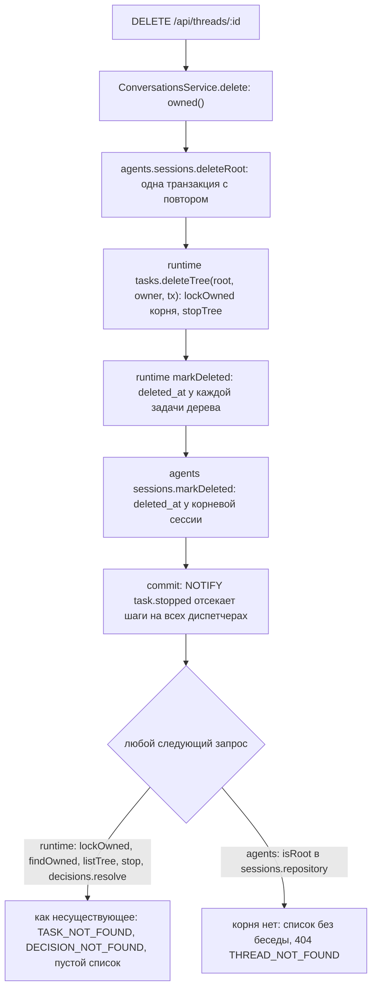

# Work Plan: Удаление беседы флагом — core

## Snapshot

**Overview.** Сегодня `DELETE /api/threads/:id` останавливает дерево агентов беседы и физически удаляет корневую задачу; каскад уносит задачи, очереди, запросы, события, сессии, журнал агентов и черновики. После плана удаление — это пометка `deleted_at`: дерево так же останавливается, строки остаются в базе, а все чтения и команды видят помеченное как несуществующее. Флаг ставится в двух слоях одной транзакцией — на каждой задаче дерева в `runtime_tasks` и на корневой сессии в `agent_sessions` — и проверяется в уже существующих узких местах. Порядок: база и runtime → agents и API → один quality gate → правка документов через их владельцев. Подход — снизу вверх по пакетам (`db` → `runtime` → `agents` → `apps/api`): каждый пакет компилируется против `dist` нижнего. Тесты пишутся в своих фазах и запускаются один раз в Phase 3; коммитов нет.

**Требования владельца** (единственное их место — этот план):

- **R-1. Удалённая беседа скрыта.** Для владельца она на каждом маршруте и в списке ведёт себя как несуществующая — те же 404 и те же тела. Её агенты остановлены и больше никогда не возобновляются.
- **R-2. Строки остаются.** Задачи, сессии, журнал с записями вызовов, результаты, черновики остаются в базе, чтобы потом можно было разобрать, что происходило.
- **R-3. Отправка на удалённый id — 404.** Отправка в беседу с id удалённой беседы отвечает «не найдено» — и владельцу, и любому другому — и ничего не создаёт. (Сегодня она начинает новую беседу с этим id.)
- **R-4. Расход не меняется.** Удаление не трогает журнал токенов: расход месяца тот же.

**Решения плана** (бриф оставлял выбор; взяты рекомендованные варианты):

| Вопрос | Решение | Почему |
|---|---|---|
| Где флаг | `runtime_tasks.deleted_at` на **каждой** задаче дерева и `agent_sessions.deleted_at` на корневой сессии; ставятся в одной транзакции | id ребёнка читается своей строкой (`findOwned`, `lockOwned`), поэтому флаг только на корне ребёнка не скрыл бы. Флаг только в agents оставил бы открытой гонку «отправка против удаления» (её закрывает `lockOwned`). Флаг только в runtime не служит списку бесед: `agents` не читает `runtime_*` |
| Как проверяется | В существующих узких местах: `TaskRepository.lockOwned` / `findOwned` / `listTree`, своя проверка владельца в `stop`, `Decisions.resolveIn`, `isRoot` в `sessions.repository.ts`. Новых проверок по маршрутам нет | Все маршруты беседы и агентов уже идут через эти места |
| Транзакция удаления | `deleteTree(rootId, ownerId, tx?)` принимает транзакцию вызывающего, как `TaskControl.create(request, tx?)`. Новая операция `agents.sessions.deleteRoot` открывает транзакцию через `retryingTransaction` runtime (экспорт добавляется в `packages/runtime/src/index.ts`) | Сегодня `deleteTree` сам повторяет транзакцию при deadlock (`retryingTransaction`, `runtime-tx.ts:29`); в режиме транзакции вызывающего повтора внутри нет, и без него удаление ответило бы 500 на deadlock. Одна функция, без копии |
| Отсечение шагов в режиме `tx` | Локальный `cutOff` не вызывается: шаги на всех экземплярах, этот включён, отсекает NOTIFY `task.stopped` при коммите (`dispatcher.ts:535-560`), а если NOTIFY потерян — heartbeat | `deleteTree` не знает момента коммита чужой транзакции |
| Отдельный режим `deleteTree` без `tx` | Остаётся (ставит только флаги runtime); его зовут тесты runtime. Документ-комментарий говорит, что беседу удаляет `agents.sessions.deleteRoot` | Тот же контракт, что у `create(request, tx?)`; одна ветка |
| Первая отправка на удалённый id | Новый код в `send` не нужен: строки остались, id корня занят, `start` получает `TASK_EXISTS` (сервис его уже глотает, `conversations.service.ts:214`), затем `owned()` отвечает 404 `THREAD_NOT_FOUND` — владельцу и чужому одинаково, с постоянным телом. **Цена принята:** до этого `start` разрешает запуск, поэтому при отказе модели ответ — 409 `START_REFUSED`, а не 404 (так же сегодня отвечает чужой занятый id). Дешёвая проверка перед `start()` не добавляется | Владелец вынес такую проверку из объёма; меньше кода |
| Черновики | `DraftsService.act` сначала проверяет `agents.sessions.root(threadId, ownerId)`, иначе 404 `DRAFT_NOT_FOUND` | Иначе ожидающий черновик удалённой беседы можно было бы сохранить записью библиотеки |
| Внешние ключи | Каскады в схеме остаются; приложение больше не удаляет строки | Очистка по сроку хранения — будущая работа, ей каскады нужны |

- **Не меняется**: журнал токенов (`runtime_model_calls` без FK на задачу); маршруты и их тела; веб (беседа пропадает из списка по-прежнему, 404 на её URL — прежний ответ); `extract.handler.ts` — `TASK_NOT_FOUND` при чтении входа уже ведёт в ветку «беседа удалена» (`extract.handler.ts:641-646`), поэтому из удалённой беседы ничего не выучивается; `stop-children-on-failure.ts` — для помеченного дерева `listTree` пуст, детей нет; замок корня в доставке событий (`outbox.relay.ts:220-223`, `lockAgainstDelete`) — строк больше никто не удаляет, он только упорядочивает доставку и удаление.
- **Biggest risk**: пропущенное узкое место — удалённая беседа или её агент снова читается или оживает (R-1, R-3). Первым его встречает Phase 1 (таблица операций runtime над удалённым деревом в INT-5 D), затем Phase 2 (все маршруты беседы в API INT-3 A).
- **Open questions**: блокирующих нет.
- **Design items no phase covers**: нет Design Doc. Утверждения прежних документов, которые станут ложными, правят их владельцы в Phase 4.

**Не входит** (владелец не просил): очистка удалённого по сроку хранения; запись аудита об удалении; экран администратора для удалённых бесед; изменение `recordCounts` / `ranBefore` (запуски удалённых бесед теперь считаются «запускался раньше» — Owner Checklist 1); фильтр флага в `events.listAfter`; проверка перед `start()` в `send`.

## Implementation Phases

Фазы идут по номерам: Phase 2 читает код Phase 1. Другой агент сейчас доделывает мелкие правки в `packages/agents` (`model-client.ts`, `extraction-input.ts`, репозитории, обёртка `logged` в `agent-sessions.ts`) и в lockfile — план написан по файлам в их текущем виде, номера строк сверяет первый пункт Phase 1.

### Phase 1: Флаг в базе и в runtime
**Purpose**: Добавить столбцы `deleted_at`, перегенерировать единую миграцию и научить runtime ставить флаг на дерево и видеть помеченное как несуществующее.

#### Target Files
- `packages/db/src/schema.ts`
- `packages/db/migrations/0000_baseline.sql`, `packages/db/migrations/meta/0000_snapshot.json`, `packages/db/migrations/meta/_journal.json`
- `packages/runtime/src/task.repository.ts`
- `packages/runtime/src/task-control.ts`
- `packages/runtime/src/decisions.ts`
- `packages/runtime/src/index.ts`
- `packages/runtime/test/agent-platform-runtime.int.e2e-spec.ts` (INT-5 D)

#### Investigation Targets
- `packages/runtime/src/task.repository.ts:48-55` (`lockOwned`), `:88-100` (`findOwned`), `:103-111` (`listTree`)
- `packages/runtime/src/task-control.ts:141-173` (`create(request, tx?)` — образец режима `tx`), `:253-281` (`stop`, проверка владельца `:260-263`), `:288-318` (`deleteTree`), `:398-429` (`stopTree`), `:458-463` (`cutOff`)
- `packages/runtime/src/decisions.ts:189-247` (`resolveIn`: замок задачи `:204`, `DECISION_NOT_FOUND` `:210-212`)
- `packages/runtime/src/inbox.ts:179-187` (`insertMessage` → `lockOwned`)
- `packages/runtime/src/runtime-tx.ts:29` (`retryingTransaction`)
- `packages/db/src/schema.ts:104-173` (`runtimeTasks`), `:329-393` (`agentSessions`, индекс `:389-391`)
- `packages/db/migrations/0000_baseline.sql:1`, `:3`, `:585`, `:608-613`

#### Patterns
- `docs/code-system/patterns/repository-over-transaction.md` — `markDeleted` в `TaskRepository`
- `docs/code-system/patterns/logging.md` — запись лога удаления

#### Work Items
- [x] 1. **Сверить план с кодом.** Только чтение; итог — в Investigation Notes этой фазы, расхождение — правка плана до продолжения. Проверить номера строк и сигнатуры, которые цитируют обе фазы: файлы выше; `packages/agents/src/store/sessions.repository.ts:144-147` (`isRoot`, `ownedRoot`), `:298-331` (`rootOwner`, `roots`); `packages/agents/src/operations/agent-sessions.ts:156-185` (интерфейс `AgentSessions`), `:212-221` (`asAgent`), `:237-264` (`logged` — его сейчас правит другой агент), `:431-457` (`send`, `revive: true` `:450`), `:660-713` (операции корня); `packages/agents/src/knowledge/knowledge-trigger.ts:121-125`, `:163-175`; `packages/agents/src/knowledge/extract.handler.ts:641-646`; `apps/api/src/chat/conversations.service.ts:54-61`, `:119-157`; `apps/api/src/chat/drafts.service.ts:50-88`; `apps/api/src/chat/live-hub.ts:62-68`; тесты Phase 2 по строкам из её Investigation Targets. Убедиться, что `git status` по `packages/agents` и lockfile чист от чужих незаконченных правок; если нет — Phase 2 ждёт. — covers сверку брифа
- [x] 2. **Схема.** `runtimeTasks` и `agentSessions` получают `deletedAt: timestamp('deleted_at', { withTimezone: true })` (null — не удалена). Частичный индекс `agent_sessions_owner_page_idx` — условие `updated_at IS NOT NULL AND deleted_at IS NULL` (совпадает с новым `isRoot`, иначе список бесед не берёт индекс). Комментарии `schema.ts:80-81` и `:325-327` — одна фраза: каскады остаются для будущей очистки, приложение помечает, а не удаляет. — covers R-1, R-2
- [x] 3. **Единая миграция.** Собрать `contracts` (drizzle-kit читает их из `dist`), удалить `0000_baseline.sql` и `meta/*`, выполнить `pnpm --filter @agent-os/db db:generate --name baseline`, вернуть ручные строки: в начало `CREATE EXTENSION IF NOT EXISTS vector;` и `CREATE SCHEMA IF NOT EXISTS "app";`, в конец шесть прежних `INSERT INTO` (`0000_baseline.sql:608-613`). Новых таблиц нет — `APP_TABLES` в `packages/db/test/migrations.e2e-spec.ts` не меняется. К базе не применять — только в Phase 3. — covers R-1, R-2
- [x] 4. **`TaskRepository`.** `lockOwned`, `findOwned`, `listTree` считают строку с `deleted_at` несуществующей: `lockOwned` — `undefined`, `findOwned` и `listTree` — условие `deleted_at IS NULL`. Новый `markDeleted(tx, rootId)` — `UPDATE runtime_tasks SET deleted_at = now() WHERE root_id = rootId` (все строки дерева уже под замком `stopTree`); комментарий класса «task rows change only through `guardedTaskWrite`» получает исключение — пометку удаления. **Проверка флага внутри `lockOwned` закрывает гонку «отправка против удаления»:** единственный путь оживления — `agents.sessions.send` в остановленный корень (`inbox.insertMessage` с `revive: true` под `lockOwned`, `inbox.ts:179-187`); отправка, которая ждала замок корня, после коммита удаления видит флаг и получает `TASK_NOT_FOUND`. Эту проверку нельзя «упростить» до проверки в API — комментарий у `lockOwned` говорит это прямо. — covers R-1, R-3
- [x] 5. **`TaskControl`.** `stop`: своя проверка владельца (`:260-263`) отвечает `TASK_NOT_FOUND` и для помеченной цели (`lockWithParent` флаг не смотрит). `deleteTree(rootId, ownerId, tx?)`: в транзакции — `lockOwned` корня (помеченный корень — `TASK_NOT_FOUND`, повторное удаление отвечает как несуществующее), `stopTree`, `tasks.markDeleted(tx, root.taskId)`; физического `delete` больше нет. С `tx` — всё в транзакции вызывающего, без повтора и без локального `cutOff` (NOTIFY при коммите); без `tx` — как сегодня, `retryingTransaction` и `cutOff`. Лог `task tree deleted` получает поле `inCallerTx`, как у `create`. Документ-комментарий: «останавливает дерево и помечает его удалённым; строки, журнал токенов и очереди остаются; беседу удаляет `agents.sessions.deleteRoot`». Комментарий класса (`:117-126`): задача удалённого дерева отвечает как несуществующая. — covers R-1, R-2, R-4
- [x] 6. **`Decisions.resolveIn`.** После `tasks.lock(tx, found.taskId)` (`:204`) задача с `deleted_at` даёт `DECISION_NOT_FOUND` (`:210-212`), как отсутствующая. Без этого запрос удалённого дерева, отменённый остановкой, ответил бы `already_resolved`, а веб опирается на код `DECISION_NOT_FOUND` (`apps/web/src/lib/feed/feed-store.ts:275`). — covers R-1
- [x] 7. **Экспорт.** `packages/runtime/src/index.ts`: `export { retryingTransaction, type RuntimeTx } from './runtime-tx.js'` (сейчас там только тип, `:28`). — covers решение «Транзакция удаления»
- [x] 8. **INT-5 D под новое поведение** (`agent-platform-runtime.int.e2e-spec.ts:1662-1750`, заголовок ряда D `:1525`, строка Catches `:1511-1512`). Сегодня ряд ждёт, что задачи, очередь, события и запрос исчезли. Теперь: `deleteTree` → `deleted`; строки корня и ребёнка есть, обе `stopped`, у обеих `deleted_at` не null; сообщение очереди, события и запрос остались, запрос `cancelled`. Затем таблица «удалённое дерево для своего владельца — как несуществующее», по образцу INT-4 (`answerOf`, сравнение с `randomUUID()`): `tasks.get` (корень и ребёнок), `tasks.listTree`, `tasks.interrupt`, `tasks.stop`, `tasks.deleteTree`, `inbox.enqueue` с `revive: true`, `tasks.create` с корнем как `parentId`, `decisions.resolve` — каждая отвечает так же, как для несуществующего id. После таблицы корень по-прежнему `stopped`, новых сообщений в очереди нет. Утверждения журнала токенов остаются как есть. Тест пишется, не запускается. — covers R-1, R-2, R-3, R-4

#### Proof Obligations
- R-1, R-3 (узкие места runtime) → `existing, updated: agent-platform-runtime.int — INT-5 D` (таблица операций) — красный, если хоть одна операция над удалённым деревом отвечает не как над несуществующим: например, `enqueue` с `revive` оживляет корень или `resolve` отвечает `already_resolved`.
- R-2, R-4 → `INT-5 D` (строки остались, журнал токенов тот же) — красный, если удаление снова уберёт строки или журнал.
- `INT-4` runtime (ряд `tasks.deleteTree`, `:1462`) не меняется: чужое удаление по-прежнему `TASK_NOT_FOUND` и ничего не меняет.

#### Operational Verification
- `pnpm turbo build --filter=@agent-os/runtime...` и typecheck `@agent-os/runtime` (с `test/`) без ошибок.
- В `0000_baseline.sql`: `"deleted_at" timestamp with time zone` у `runtime_tasks` и у `agent_sessions`; индекс `agent_sessions_owner_page_idx` с условием `... IS NOT NULL AND ... deleted_at" IS NULL`; две ручные строки в начале и шесть `INSERT INTO` в конце. `pnpm --filter @agent-os/db db:generate` — «No schema changes», `drizzle-kit check` — без ошибок.
- `grep -rn "tx.delete(runtimeTasks" packages/runtime/src` — пусто.

#### Investigation Notes
- **Сверка (п. 1).** Номера строк обеих фаз совпали с кодом на `341a13d`; `git status` был чист (ни `packages/agents`, ни lockfile не тронуты чужими правками). После Phase 1 сместились только строки самого runtime: `task-control.ts` — `stop` `:254`, проверка владельца `:262-265`, `deleteTree` `:297`, новый `deleteTreeIn` `:329`, `stopTree` `:419`; `task.repository.ts` — `lockOwned` `:56-63`, `findOwned`/`listTree`/`markDeleted` ниже; `decisions.ts` — проверка флага `:212`. Ссылки Phase 2 (`agents`, `apps/api`, тесты API) не сдвинуты.
- **Столбцы.** `app.runtime_tasks.deleted_at` и `app.agent_sessions.deleted_at` — `timestamp with time zone`, null = не удалена; в drizzle — `runtimeTasks.deletedAt`, `agentSessions.deletedAt`. Индекс `agent_sessions_owner_page_idx`: `WHERE updated_at IS NOT NULL AND deleted_at IS NULL` — `isRoot` в Phase 2 должен совпасть дословно: `and(isNotNull(agentSessions.updatedAt), isNull(agentSessions.deletedAt))`.
- **Baseline.** Перегенерирован (`db:generate --name baseline` после удаления `migrations/`; каталог `meta` надо удалять целиком, иначе drizzle-kit падает на отсутствующем `_journal.json`). drizzle-kit пишет `CREATE SCHEMA "app";` — заменено на прежнее `CREATE SCHEMA IF NOT EXISTS "app";`, сверху `CREATE EXTENSION IF NOT EXISTS vector;`, в конце шесть `INSERT INTO` (без перевода строки в конце, как было). `diff` со старым файлом — только два столбца и условие индекса. Новый `when` журнала: `1795216980700`. `db:generate` — «No schema changes», `drizzle-kit check` — «Everything's fine». К базе не применялось.
- **Runtime API для Phase 2.** `runtime.tasks.deleteTree(rootId: string, ownerId: string, tx?: RuntimeTx): Promise<'deleted'>` — с `tx` пишет в транзакции вызывающего, не повторяет и не вызывает локальный `cutOff`; лог `task tree deleted` с `inCallerTx`. Помеченный, чужой, несуществующий корень или не корень — `RuntimeError('TASK_NOT_FOUND')` (в agents `asAgent` переводит в `AGENT_NOT_FOUND`). `TaskRepository.markDeleted(tx, rootId): Promise<void>` — внутренний, agents его не зовёт. Экспорт `retryingTransaction<T>(db: Database, logger: Logger, operation: string, work: (tx: RuntimeTx) => Promise<T>): Promise<T>` из `@agent-os/runtime`. Что agents должен вызвать в `deleteRoot`: `retryingTransaction(database, logger, 'sessions.deleteRoot', async (tx) => { await runtime.tasks.deleteTree(rootId, ownerId, tx); await sessions.markDeleted(tx, rootId); })`, порядок — сначала `deleteTree` (замки задач), потом строка сессии.
- **Порядок внутри `deleteTree`:** `lockOwned` корня → `stopTree` (замки всех задач дерева; `child_finished` детей уходят в очередь корня через `insertMessage` → `lockOwned`, флага ещё нет) → `markDeleted`. Перенос `markDeleted` до `stopTree` сломал бы остановку детей (`lockOwned` родителя ответил бы `TASK_NOT_FOUND`).
- **Для INT-3 A в Phase 2:** остановка не доставляет ожидающие сообщения — у остановленного корня остаются `pending` (непрочитанные сообщения и `child_finished` остановленных детей; в INT-5 D у корня после удаления две `pending`). Утверждение «в `runtime_inbox` корня нет `pending`» верно, только если к моменту удаления корень всё прочитал и детей не было; иначе проверять, что новых сообщений после удаления не появилось.
- **Проверенные пути оживления (runtime):** захват (`dispatcher.ts` — только `queued`), sweeper (`recovery.sweeper.ts:143` — только `running` с истёкшей арендой и той же попыткой), коммит/провал шага и guard (`step-commit.ts`, `step-context.ts`, `dispatcher.ts:456` — сверка `attempt`, поднятого `stopTree`), решения (`resolveIn` — флаг), входящие (`insertMessage` → `lockOwned` — флаг), создание ребёнка (`createIn` → `lockOwned`). Потребителей событий в самом runtime не регистрируется (обе регистрации — в agents).
- **Тест.** INT-5 D в `packages/runtime/test/agent-platform-runtime.int.e2e-spec.ts` переписан (строки корня и ребёнка `stopped` с `deleted_at`, очередь корня `note`/`child_finished` `pending`, события `task.created`/`task.stopped`, запрос `cancelled`, таблица из девяти операций против случайного id, `rowVersionsOf` до и после таблицы, журнал токенов как был); не запускался. INT-4 не менялся.

### Phase 2: Флаг в agents и в API
**Purpose**: Ставить флаг сессии в той же транзакции, что флаги runtime, скрыть помеченную беседу в репозитории сессий, перевести API на новую операцию и закрыть два места, которые сегодня спасал каскад: черновики и триггер знаний.
**Depends on**: Phase 1 — `deleteTree(…, tx)`, экспорт `retryingTransaction`, столбец `agent_sessions.deleted_at`

#### Target Files
- `packages/agents/src/store/sessions.repository.ts`
- `packages/agents/src/operations/agent-sessions.ts`
- `packages/agents/src/knowledge/knowledge-trigger.ts`
- `apps/api/src/chat/conversations.service.ts`
- `apps/api/src/chat/drafts.service.ts`
- `apps/api/src/chat/live-hub.ts` (только комментарий)
- `apps/api/test/agent-platform-chat.int.e2e-spec.ts` (INT-3 A, комментарии INT-3, INT-4)
- `apps/api/test/custom-agents-runtime.int.e2e-spec.ts` (INT-4 D)

#### Investigation Targets
- `packages/agents/src/store/sessions.repository.ts:144` (`isRoot`), `:146-147` (`ownedRoot`), `:292-361` (операции корня)
- `packages/agents/src/operations/agent-sessions.ts:324-337` (`createRoot` — образец транзакции с `runtime.tasks.create(…, tx)`), `:431-457` (`send`), `:660-713`
- `packages/agents/src/events/stop-children-on-failure.ts:33` — образец чтения `sessions.get(tx, …)` в потребителе событий
- `packages/agents/src/knowledge/knowledge-trigger.ts:121-125` (`KnowledgeTriggerDeps`), `:163-175` (ветка `interrupted`); `packages/agents/src/create-agents.ts:270` (сборка триггера — правок не требует)
- `apps/api/src/chat/chat.errors.ts:71-100` — `AGENT_NOT_FOUND` и `TASK_NOT_FOUND` → `THREAD_NOT_FOUND`
- `apps/api/test/agent-platform-chat.int.e2e-spec.ts:363-393` (`expectSameAsMissing`), `:414-433` (`THREAD_ROUTES`, `THREAD_NOT_FOUND_BODY`), `:477-490` (`ledgerCalls` — образец запроса к базе через `harness.pool`), `:2235-2317` (INT-3, ряд A), `:2469-2589` (INT-3 C), `:2611-2617` (заголовок INT-4), `:2685-2688`, `:2928-2957` (шаг «A retaken id»)
- `apps/api/test/custom-agents-runtime.int.e2e-spec.ts:1639-1725` (INT-4 D)

#### Patterns
- `docs/code-system/patterns/repository-over-transaction.md` — `sessions.markDeleted`, `sessions.rootIdOf`
- `docs/code-system/patterns/logging.md` — операция `deleteRoot` через `logged`

#### Work Items
- [x] 1. **`sessions.repository.ts`.** `isRoot` (`:144`) = `updated_at IS NOT NULL AND deleted_at IS NULL` — одним изменением закрывает `root`, `rootOwner`, `roots`, `touchRoot`, `renameRoot`, `titleRootIfEmpty`; условие совпадает с индексом Phase 1. Новый `markDeleted(tx, rootId)` — `UPDATE agent_sessions SET deleted_at = now() WHERE task_id = rootId`. — covers R-1, R-2
- [x] 2. **`agents.sessions.deleteRoot(rootId, ownerId)`** в `AgentSessions` (интерфейс `:156-185`) и в `createAgentSessions`, через `logged('deleteRoot', { rootId, ownerId }, …)`: `asAgent(retryingTransaction(database, logger, 'sessions.deleteRoot', async (tx) => { await runtime.tasks.deleteTree(rootId, ownerId, tx); await sessions.markDeleted(tx, rootId); }))`. Порядок замков — сначала строки задач (внутри `deleteTree`), потом строка сессии, как в коммите шага. Чужой, несуществующий или уже удалённый корень — `AGENT_NOT_FOUND`. Комментарий интерфейса: «останавливает дерево беседы и помечает его и корневую сессию удалёнными; строки остаются». — covers R-1, R-2
- [x] 3. **Триггер знаний.** В ветке `interrupted` (`knowledge-trigger.ts:170-171`) `rootId` берётся из своей таблицы: новая функция репозитория `sessions.rootIdOf(reader, taskId)` в `sessions.repository.ts` — `SELECT root_id` по `task_id` (столбец `schema.ts:341`), `undefined` без строки; в триггере нет строки — исключение с текстом. `Session` и `toSession` не меняются: у `Session` нет `rootId`, а его литералы строят `access-gate.spec.ts:82` и `tool-gate.spec.ts:421`. Сегодня там `deps.tasks.get(run.runId, run.ownerId)`: для помеченного дерева он бросит `TASK_NOT_FOUND`, и доставка уйдёт в `needs_attention` — ожидающие доставки теперь переживают удаление. `KnowledgeTriggerDeps.tasks` → `Pick<Runtime['tasks'], 'create'>`, комментарий `:122` без `get`. `create-agents.ts:270` не меняется (передаёт весь `runtime.tasks`). — covers R-1 (ничего не ломается после удаления)
- [x] 4. **`ConversationsService`.** `delete` (`:154-157`): `owned()`, затем `agents.sessions.deleteRoot(threadId, ownerId)`; `runtime.tasks.deleteTree` из API уходит. Комментарии: класс (`:54-61`) — беседа доступна только через `agents.sessions`, удалённая отвечает как несуществующая на каждом маршруте, отправка включительно; `delete` — «дерево остановлено и помечено удалённым вместе с корневой сессией, строки остаются»; `send` (`:111-118`) — «id удалённой беседы занят её строками: `start` получает `TASK_EXISTS`, `owned()` отвечает 404». `RUNTIME` в сервисе остаётся (`view` читает задачу корня и очередь). — covers R-1, R-3
- [x] 5. **`DraftsService.act`.** После проверки UUID (`:56-57`) и до транзакции: `agents.sessions.root(threadId, ownerId)`; `undefined` → 404 `DRAFT_NOT_FOUND` (тот же ответ, что у чужого черновика). Комментарий метода — одной фразой: удалённая беседа — как чужая. — covers R-1
- [x] 6. **Комментарий `live-hub.ts:62-68`.** Фраза «id удалённой беседы может занять первое сообщение другого сотрудника» становится ложной; заменить: у помеченного корня нет владельца (`rootOwner` → `undefined`), поэтому заметки дерева удалённой беседы не уходят никому; владельца по-прежнему читают на каждую заметку и не запоминают. Кода нет. — covers R-1
- [x] 7. **API INT-3 A** (`agent-platform-chat.int.e2e-spec.ts:2260-2317`). После `deleteThread(bottom)` — все `THREAD_ROUTES` (`expectSameAsMissing`, сейчас фильтр только `history` и `interrupt`, `:2309-2314`) и отправка: `api.raw('post', /threads/${bottom}/messages, …)` → 404 с телом `THREAD_NOT_FOUND_BODY` (случайный id для отправки — первое сообщение, поэтому сравнение с постоянным телом). Затем через `harness.pool`: строка `app.runtime_tasks` корня — `stopped`, `deleted_at` не null; строка `app.agent_sessions` корня — `deleted_at` не null; записи `app.agent_messages` корня есть; в `app.runtime_inbox` корня нет `pending`. Список бесед без неё уже проверяет `threads.e2e-spec.ts:170-207` — не повторять. Правки текста: Verification item ряда A (`:2254`) — «отправка на удалённый id — 404 с постоянным телом, ничего не создаёт» вместо «a send to a deleted id is a first message»; название теста — «… answers 404 on every route, the send included». — covers R-1, R-2, R-3
- [x] 8. **API INT-3 C, INT-4 — только то, что стало ложным.** INT-3 C: логика не меняется (её гонка «удаление против первой отправки» сохраняет утверждение «или-или», `:2560-2583`); в `:2247` «the rows `deleteTree` removes (runtime INT-3)» → «the rows `deleteTree` marks (runtime INT-5 D)». INT-4: шаг «A retaken id» (`:2928-2957`, добавлен в `7063d00`) **разворачивается** — после `a.deleteThread(aThread.id)` первое сообщение B с этим id → 404 с телом `THREAD_NOT_FOUND_BODY`; через `harness.pool` — в `app.agent_sessions` у id по-прежнему одна строка, владелец A, `deleted_at` не null; поток A, открытый после удаления, не получает заметок этого id (проверка через заметку следующей беседы A остаётся как есть); ожидание заметки на потоке B (`:2936-2939`) и `untilIdle` беседы B (`:2940-2946`) удаляются; скрипт `bRetakenTask` (`:2685-2688`) остаётся только для текста отправки или удаляется, если не нужен. Verification item `:2616` — переписать под новое поведение. — covers R-3
- [x] 9. **INT-4 D черновиков** (`custom-agents-runtime.int.e2e-spec.ts:1639-1725`). В конце: Борис удаляет свою беседу `borisThread` с ожидающим черновиком D2; `save` D2 через `borisThread` → тот же 404 `DRAFT_NOT_FOUND`, что `answers[0]`; `ownNames(boris)` не содержит `borisName`. Название теста дополнить «… and a draft of a deleted conversation». — covers R-1 (черновик удалённой беседы не становится записью)

#### Proof Obligations
- R-1, R-3 (все маршруты беседы и отправка, владелец) → `existing, updated: agent-platform-chat.int — INT-3 A` — красный, если хоть один маршрут удалённой беседы отвечает не 404 с телом несуществующей или отправка создаёт беседу либо будит корень.
- R-2 (строки корня в базе) → `INT-3 A` — красный, если удаление снова удалит строки.
- R-3 (другой сотрудник) → `existing, updated: agent-platform-chat.int — INT-4` — красный, если первое сообщение B займёт id удалённой беседы A.
- R-1 (черновик) → `existing, updated: custom-agents-runtime.int — INT-4 D` — красный, если черновик удалённой беседы сохраняется записью.
- Агенты удалённой беседы для всех маршрутов агентов, остановка вызовов, R-4 через `GET /spend` → `existing: INT-3 C` без изменений логики.
- Триггер знаний — теста нет: сценарий (раунд извлечения прерван после удаления беседы) требует обвязки self-learning ради одной строки чтения; правку проверяют typecheck и ревью. Риск записан в Risks.

#### Operational Verification
- `pnpm turbo build --filter=api...`; typecheck `@agent-os/agents` (с `test/`) и `api` без ошибок.
- `grep -rn "deleteTree" apps/api/src` — пусто; `grep -n "tasks.get" packages/agents/src/knowledge/knowledge-trigger.ts` — пусто.

#### Investigation Notes
- **Новые операции.** `sessions.markDeleted(tx: RuntimeTx, rootId): Promise<void>` и `sessions.rootIdOf(reader: StoreReader, taskId): Promise<string | undefined>` в `packages/agents/src/store/sessions.repository.ts`; `isRoot` = `and(isNotNull(updatedAt), isNull(deletedAt))` — дословно условие индекса. `AgentSessions.deleteRoot(rootId: string, ownerId: string): Promise<void>` (`agent-sessions.ts`, в конце `createAgentSessions`): `logged('deleteRoot', { rootId, ownerId })` → `asAgent(retryingTransaction(database, logger, 'sessions.deleteRoot', tx => { deleteTree(rootId, ownerId, tx); sessions.markDeleted(tx, rootId) }))`. Чужой, несуществующий, уже удалённый корень и не корень — `AGENT_NOT_FOUND` (из `TASK_NOT_FOUND` `deleteTree`), в API — 404 `THREAD_NOT_FOUND` (`chat.errors.ts`). `KnowledgeTriggerDeps.tasks` — `Pick<Runtime['tasks'], 'create'>`; ветка `interrupted` читает `rootId` через `sessions.rootIdOf(tx, run.runId)` в транзакции доставки, без строки — `Error` с текстом.
- **Маршруты над удалённой беседой (владелец).** Ответ равен ответу на случайный id: тот же статус и тело.

| Маршрут | Ответ | Какая проверка |
|---|---|---|
| `GET /threads` | беседы нет в списке | `sessions.roots` → `isRoot` |
| `GET /threads/:id`, `GET .../history`, `GET .../agents`, `POST .../interrupt`, повторный `DELETE /threads/:id` | 404 `THREAD_NOT_FOUND` | `ConversationsService.owned()` → `sessions.root` → `isRoot` |
| `PATCH /threads/:id` | 404 `THREAD_NOT_FOUND` | `renameRoot` → `ownedRoot` → `isRoot` (ничего не пишет) |
| `POST /threads/:id/messages` | 404 `THREAD_NOT_FOUND`, ничего не создаётся | `sessions.root` → нет; `start` → `TASK_EXISTS` (PK `runtime_tasks`, флаг не важен; транзакция `createRoot` откатывается) → `owned()` → 404. При отказе в `resolveStart` — 409 `START_REFUSED` до `create`, как сегодня у чужого занятого id (Owner Checklist 2) |
| `POST /threads/:id/drafts/:draftId` | 404 `DRAFT_NOT_FOUND` | новая проверка `agents.sessions.root(threadId, ownerId)` в `DraftsService.act` до транзакции |
| `GET /agents`, `GET /agents/awaiting` | агентов и запросов удалённой беседы нет | `sessions.roots` → `isRoot`; удаление между `roots` и чтением дерева — `unlessDeleted` (`listTree` пуст → `AGENT_NOT_FOUND` → `[]`) |
| `GET /agents/:id/history`, `.../inherited`, `.../run`, `POST /agents/:id/messages`, `.../interrupt`, `.../stop`, `.../restart` | 404 `AGENT_NOT_FOUND` | `AgentControlService.agent()` → `sessions.get` → `runtime.tasks.get` → `findOwned` (`deleted_at IS NULL`) |
| `POST /decisions/:id` | 404 `DECISION_NOT_FOUND` | `decisions.resolve` → `resolveIn` (флаг задачи, Phase 1); `decisions.get` флаг не смотрит, но открытых запросов у остановленного дерева нет, поэтому правка аргументов не проверяется и ответ даёт `resolve` |
| `GET /spend` | без изменений | журнал токенов не трогается |
| `GET /events` | заметок дерева нет никому | `LiveHub.note` → `rootOwner` → `isRoot` → `undefined` |

- **Другие потребители для помеченного дерева.** `stop-children-on-failure` (потребитель событий): `listTree` помеченного дерева пуст → детей нет, доставка завершается нормально. `knowledge-trigger`: ветка `interrupted` больше не зовёт runtime (`rootIdOf` из `agent_sessions`); `create_extract` для удалённой беседы создаёт задачу извлечения, её шаг получает `TASK_NOT_FOUND` в `readExtractionInput` и уходит в ветку «беседа удалена» (`extract.handler.ts`, `inputOf`); `stopped` пишет «пропущен: остановлен» (Owner Checklist 3); ветки векторного прохода дерево не читают. Шаговые инструменты и шаг модели (`list-agents`, `message-agent`, `stop-agent`, `start-child`, `model-step` `listTree`/`listPending`) внутри шага только что удалённого дерева получают пустое дерево или `TASK_NOT_FOUND` — ожидаемый шум, коммит шага всё равно отсекает `fence`. `packages/workflows`: потребителей событий и фоновых задач нет; `runs.get` идёт через `agents.sessions.get` (из API — после `agent()`). `TitleService` в фоне: `titleRootIfEmpty` по `ownedRoot` — no-op. Вне `apps/api/src/chat` вызовов `runtime.tasks|inbox|decisions` и `sessions.root*` нет.
- **Остаток, не исправлялся (вне целевых файлов, чужому ничего не уходит).** Части текста (`agent_text_delta`) несут `ownerId` в самом сигнале и не проходят через `rootOwner`: шаг, который печатал в момент коммита удаления, может отдать ещё несколько частей потоку владельца, смотрящему этого агента, до отсечения по NOTIFY `task.stopped`.
- **Тесты (написаны, не запускались).** API INT-3 A (`agent-platform-chat.int.e2e-spec.ts`): после удаления все шесть `THREAD_ROUTES` — `expectSameAsMissing` (тот же статус и тело, что у случайного id); отправка — 404 с `THREAD_NOT_FOUND_BODY`; через `harness.pool`: задача корня `stopped` и `deleted_at` не null, сессия корня `deleted_at` не null, в `agent_messages` корня не меньше 4 записей; новая функция `deletedTreeState` (`treeSnapshot` дерева + строки журнала токенов задач дерева) снята сразу после удаления и после всех запросов — снимки равны (нет новых сообщений очереди, смены статусов, записей истории, решений, изменения строки сессии и вызовов модели). Утверждение «нет `pending`» заменено этим сравнением (заметка Phase 1 для INT-3 A). Комментарии INT-3: Verification item ряда A, «Not re-checked» (`deleteTree` marks, runtime INT-5 D), `@dependency` (`agents.sessions.deleteRoot`), Notes 5(б); название теста. INT-3 C — логика не менялась. API INT-4: шаг «A retaken id» развёрнут — B шлёт первое сообщение с id удалённой беседы A → 404 `THREAD_NOT_FOUND_BODY`; в `agent_sessions` у id одна строка, `owner_id` = A, `deleted_at` не null; поток A, открытый после удаления, не получает заметок этого id (проверка через заметку следующей беседы A осталась); скрипт `bRetakenTask`, ожидание заметки на потоке B и `untilIdle` беседы B удалены; Verification item переписан. `custom-agents-runtime.int.e2e-spec.ts` INT-4 D: Борис удаляет `borisThread` с ожидающим D2, `save` D2 через неё → тот же 404, что `answers[0]`; `ownNames(boris)` без `borisName`; название дополнено.
- **Проверено без прогона.** `pnpm turbo build --filter=api^...` — успешно; typecheck `@agent-os/agents` (с `test/`), `api` (весь каталог, тесты включены), `@agent-os/workflows` — без ошибок; `oxlint` `agents` и `api` — чисто. `grep deleteTree apps/api/src` — пусто; `grep tasks.get knowledge-trigger.ts` — пусто. Prettier в `apps/api` не применялся: изменённые файлы не отформатированы уже на `HEAD`.
- **Подтвердит только прогон (Phase 3).** (1) Отправка владельца на удалённый id в INT-3 A доходит до `TASK_EXISTS` (провайдер модели у пользователя готов) и отвечает 404, а не 409. (2) Строки дерева и сессии не меняются после 204 (фоновый заголовок — no-op, `xmin` стабилен), то есть снимки `deletedTreeState` равны. (3) В INT-4 поток A не получает заметку `task.stopped` удаления: `rootOwner` уже `undefined`, так как NOTIFY приходит при коммите той же транзакции. (4) Повтор `deleteRoot` целиком при deadlock через `retryingTransaction` тестом не покрыт.

### Phase 3: Quality Assurance
**Purpose**: Пересоздать базу разработчика под перегенерированную миграцию и пройти один quality gate части.
**Depends on**: Phases 1–2

#### Target Files
- нет новых; правки, которые потребует gate, — в файлы фаз 1–2 (с записью в Investigation Notes)

#### Work Items
- [x] 1. **Пересоздать базу разработчика** (контейнер `infra-postgres-1`, порт 5433, `DATABASE_URL` из `apps/api/.env`). Дамп не нужен (решение владельца): `docker exec infra-postgres-1 psql -U agent -d agent_os -c 'DROP SCHEMA app CASCADE;'` — схемы `drizzle` в этой базе нет, журнал миграций — `app.__drizzle_migrations` (`packages/db/src/pending-migrations.ts:9-10`) и уходит со схемой; затем `pnpm turbo build --filter=api...` и `pnpm --filter api db:migrate`; проверить шесть строк сидов. Перегенерированный baseline с новым `when` поверх старого журнала не применяется, поэтому шаг обязателен. До него ни одна фаза не запускает e2e и `db:migrate` (они пишут в эту базу).
- [x] 2. **Статика.** `pnpm turbo build`, `pnpm typecheck`, `pnpm lint`, `pnpm knip` — без ошибок (`retryingTransaction`, `markDeleted`, `deleteRoot` имеют потребителей).
- [x] 3. **Unit.** `pnpm test`.
- [x] 4. **Postgres-наборы в порядке CI** (`.github/workflows/ci.yml`, job `e2e-runtime`, около 8 минут): `pnpm turbo build --filter=api...`, `pnpm --filter @agent-os/code-runner test:e2e`, `pnpm --filter @agent-os/db test:e2e`, `pnpm --filter @agent-os/runtime test:e2e`, `pnpm --filter @agent-os/agents test:e2e`, `pnpm --filter @agent-os/workflows test:e2e`, `pnpm --filter api test:e2e`. Длительности — в Progress Tracking.
- [x] 5. **Аудит тестов** — не проводится: правки — адаптация существующих рядов, новых тестов нет (лёгкий процесс тестов).

#### Proof Obligations
- Все тесты фаз 1–2 зелёные в одном прогоне; ни один не пропущен и не ослаблен.

#### Operational Verification
- Ряд Progress Tracking заполнен фактами: пересоздание базы, длительности наборов.

#### Investigation Notes
- **Gate 2026-11-21.** База разработчика удалена и пересоздана из baseline; проверка каталога пройдена: `deleted_at` у `runtime_tasks` и `agent_sessions`, условие индекса списка с `deleted_at IS NULL`, шесть строк сидов, `vector`. `pnpm turbo lint typecheck build test` — 39/39; порядок журнала в порядке, `drizzle-kit check` чист, `db:generate` — без изменений, knip чист.
- **Postgres-наборы локально:** code-runner 22/22, db 2/2, runtime 28/28 (с новым INT-5 D), agents 63/63, workflows 7/7. Набор `api` локально не запускался по указанию владельца; его прогнал GitHub CI на `7d1fe8d` (job `e2e-runtime`, все наборы зелёные) — этим подтверждены INT-3 A, INT-4 и INT-4 D черновиков. Длительности не записывались.
- **Допущения Phase 2, которые подтверждает только прогон:** (1)–(3) подтверждены прогоном CI; (4) повтор `deleteRoot` целиком при deadlock — теста нет.
- **Gate не менял ни одного файла.**
- **Не сделано:** проверка `runtime_event_deliveries` на неудавшиеся доставки удалённых деревьев; поиск других тестов, опиравшихся на удалённые строки (в CI ни один не покраснел).

### Phase 4: Документы
**Purpose**: Исправить через владельцев документов только утверждения, которые стали ложными (правило no doc churn: без пометок в соседних документах и без правок рекомендованного уровня).
**Depends on**: Phase 3 — поведение подтверждено прогоном

#### Target Files
- `docs/code-system/README.md`
- `docs/features/agent-platform/design-chat.md`, `design-runtime.md`, `design-agents.md`

#### Work Items
- [x] 1. **Передать владельцу (`technical-designer`, через `/update-doc`) список ложных утверждений** — исполнитель плана сам их не правит:
  - `docs/code-system/README.md:51`, строка «чат в `apps/api`»: «`chat_drafts` … поэтому черновики уходят вместе с деревом беседы» и «удаляет через `runtime.tasks.deleteTree`» → удаляет через `Agents.sessions.deleteRoot`, беседа и дерево помечаются, строки остаются.
  - `design-chat.md`: `:26` (последствие «отправка на удалённый id начинает новую беседу»), `:249` («сессия корня и черновики беседы уходят с деревом каскадом»), `:392` (Failure handling «Беседа удалена … начинает новую беседу»), Flow 6 `:679-690` (вызов `deleteTree` корня, заметка «дерево … удалено», Outcome «беседы, её агентов … нет», «Отправка после удаления начинает новую беседу с тем же id»), `:699` («Удаление останавливает и удаляет дерево»), `:702` («Id без корня — новый, удалённый …— начинает беседу»), `:840` («отправка на её id начинает новую беседу»), `:891` («Flow 6 удаляет её вместе с деревом»); запись истории версий — по решению владельца документа.
  - `design-runtime.md`: `:86` (Out of scope «Мягкое удаление: удаление дерева физическое»), `:769` (контракт `deleteTree`: «физически удаляет»; новый третий аргумент `tx`).
  - `design-agents.md:847` («`deleteTree` удаляет и сессии»).
  — covers согласованность документов с кодом

#### Proof Obligations
- Нет тестов; проверка — ревью документа его владельцем.

#### Investigation Notes
- **Сделано.** `design-runtime.md`, `design-chat.md`, `design-agents.md` обновлены (коммит `fd32c47`); `docs/features/agent-platform/prd.md` — v1.6 (коммит `dbd061d`).
- **Не сделано.** `docs/code-system/README.md:51` (строка «чат в `apps/api`») не правился: на 2026-11-21 там по-прежнему «черновики уходят вместе с деревом беседы» и «удаляет через `runtime.tasks.deleteTree`» — Owner Checklist 5.

## Risks

| Риск | Чем гасится | Где впервые |
|---|---|---|
| Поздняя отправка оживляет удалённую беседу (отправка прочла корень до удаления, записала после) | Флаг проверяет `lockOwned` под замком корня, через который идёт `inbox.insertMessage`; пункт 4 Phase 1 запрещает переносить проверку выше; ряд `enqueue` с `revive` в INT-5 D | Phase 1 |
| Ожидающие доставки событий переживают удаление (раньше каскад уносил события и доставки) | `knowledge-trigger` читает `rootId` из `agent_sessions`, а не из `runtime_tasks`; `extract.handler` уже ведёт `TASK_NOT_FOUND` в ветку «беседа удалена»; `stop-children-on-failure` для помеченного дерева видит пустой `listTree`. Новый видимый эффект — Owner Checklist 3 | Phase 2 |
| Остановленное, но сохранённое дерево будит решение | Остановка отменяет открытые запросы (`stopTree`); `resolveIn` для задачи с флагом отвечает `DECISION_NOT_FOUND`; ряд `decisions.resolve` в INT-5 D | Phase 1 |
| Список бесед перестаёт брать индекс | Условие индекса и `isRoot` совпадают (`updated_at IS NOT NULL AND deleted_at IS NULL`); проверка текста baseline | Phase 1, Phase 2 |
| `deleteTree` в транзакции вызывающего не повторяет её при deadlock | `deleteRoot` идёт через `retryingTransaction` runtime; порядок замков — задачи, потом сессия, как в коммите шага | Phase 2 |
| Шаг агента после удаления дописывает результат | Попытка поднята (`fence`) в `stopTree`, коммит старого шага не пройдёт; отсечение — NOTIFY при коммите на всех экземплярах, потерянный NOTIFY ловит heartbeat; INT-3 C (вызов инструмента и модели после 204 не идут) | Phase 2 |
| Черновик удалённой беседы сохраняется записью в окне между проверкой корня и транзакцией черновика | Окно — время одного запроса; удаление после проверки не может создать новый черновик (шаги остановлены). Принято | Phase 2 |
| `firstRun` и порядок записей в чате считают запуски удалённых бесед | Владелец вынес из объёма; Owner Checklist 1 | — |
| Строки удалённых бесед растут без предела | Очистка по сроку хранения — будущая работа; каскады в схеме для неё остаются | — |
| Пересоздание базы разработчика теряет её данные | Принято владельцем, дамп не делается; провайдеров, администратора и MCP-серверы владелец вводит заново | Phase 3 |

## Notes

**Порядок пакетов.** `agents` и `apps/api` компилируются против `dist` нижних пакетов: перед typecheck собирать зависимости (`pnpm turbo build --filter=<пакет>^...`).

**Логи.** Через логгеры пакетов: `task tree deleted` (`rootId`, `ownerId`, `stoppedIds`, `inCallerTx`, `durationMs`) и `agents.deleteRoot answered/failed` обёртки `logged` (`rootId`, `ownerId`, `outcome`, `durationMs`); секретов и текста беседы в полях нет.

**Поиск кода при планировании.** Места символов найдены текстовым поиском и прочитаны: LSP для TypeScript в этом репозитории отдаёт ссылки только внутри файла. Проверены все потребители `deleteTree`, `lockOwned`, `findOwned`, `listTree`, `rootOwner`, `sessions.root`, `decisions.resolve`, регистрации `eventConsumers.register` (две: `stop-children-on-failure`, `knowledge-trigger`) и тестовые двойники `AgentSessions` (нет).

## Progress Tracking

| Фаза | Статус | Факты |
|---|---|---|
| Phase 1 | done | код в коммите `7d1fe8d` (PR #12); baseline перегенерирован; runtime INT-5 D зелёный в gate |
| Phase 2 | done | код в коммите `7d1fe8d` (PR #12); API INT-3 A, INT-4, INT-4 D зелёные в GitHub CI; таблица маршрутов — Investigation Notes Phase 2 |
| Phase 3 | done 2026-11-21 | база разработчика пересоздана; `turbo lint typecheck build test` 39/39, knip, `drizzle-kit check` чисты; Postgres-наборы локально 22/2/28/63/7 зелёные, `api` — в CI на `7d1fe8d`; файлы не менялись; длительности не записывались. Не сделано: проверка `runtime_event_deliveries`, поиск тестов на удалённые строки |
| Phase 4 | done, кроме `docs/code-system/README.md` | `design-runtime/chat/agents.md` (`fd32c47`), `prd.md` v1.6 (`dbd061d`); README — Owner Checklist 5 |

## Owner Checklist (только человек)

1. Согласие или отказ: запуски агентов из удалённых бесед по-прежнему считаются в `recordCounts` (порядок записей в списке чата) и в `ranBefore` (`first_run`: повторный запуск записи после удаления беседы — уже не «первый»). Сегодня каскад уносил их сессии. Если отказ — отдельная правка двух запросов в `sessions.repository.ts`.
2. Согласие: отправка на id удалённой беседы при отказе модели в запуске отвечает 409 `START_REFUSED`, а не 404 — как сегодня чужой занятый id.
3. Согласие: у workflow, который учится, после удаления беседы с его запуском последний итог обучения может стать «пропущен: остановлен» — раньше событие остановки уносил каскад.
4. После Phase 3 база разработчика пересоздана из baseline (только сиды): заново ввести провайдеров моделей, администратора и серверы MCP.
5. `docs/code-system/README.md:51` (строка «чат в `apps/api`») всё ещё говорит, что чат удаляет через `runtime.tasks.deleteTree` и черновики уходят с деревом; теперь — `Agents.sessions.deleteRoot`, беседа помечается, строки остаются. Решить, править ли через `/update-doc`.
6. PRD chat-shell по-прежнему описывает удаление беседы «вместе с её сообщениями» — решить, править ли.
7. В браузере (по желанию): удалить беседу с работающим агентом — она уходит из списка, её URL показывает «не найдено», повторная отправка с открытой вкладки получает ошибку, расход месяца прежний.

## Update History

- 2026-11-21 — план закрыт: фазы 1–2 в коммите `7d1fe8d` (PR #12), gate Phase 3 пройден (набор `api` — в GitHub CI), документы Phase 4 обновлены кроме `docs/code-system/README.md`; статус completed.
