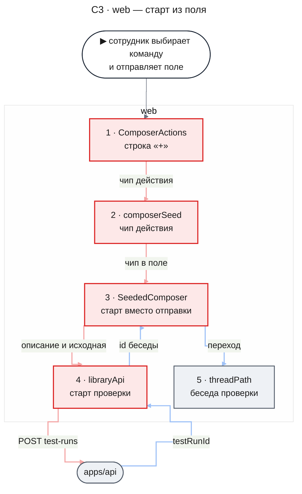
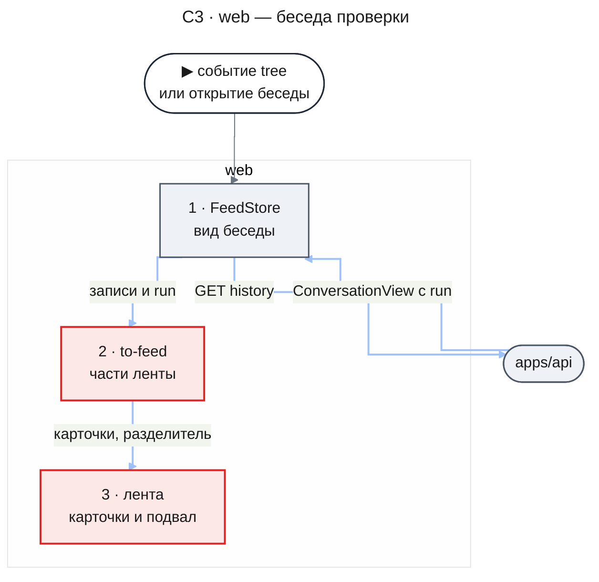
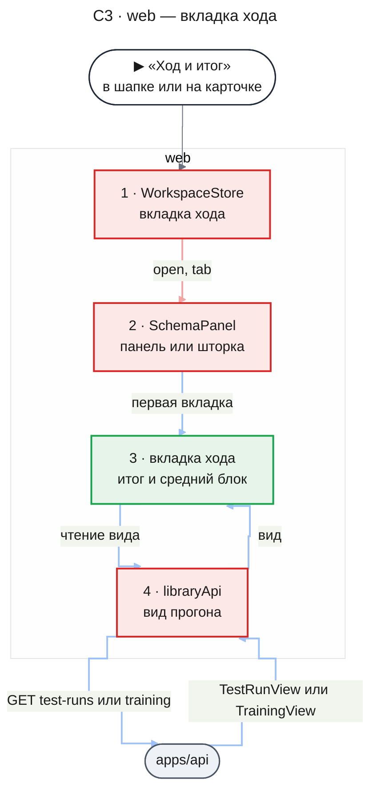
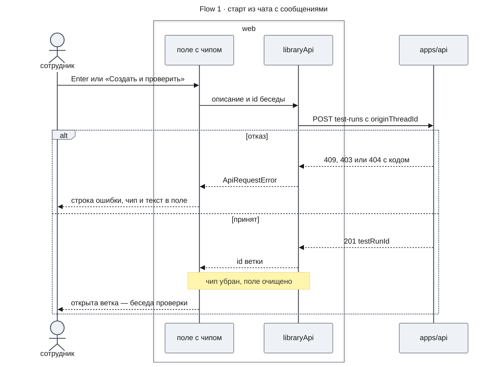
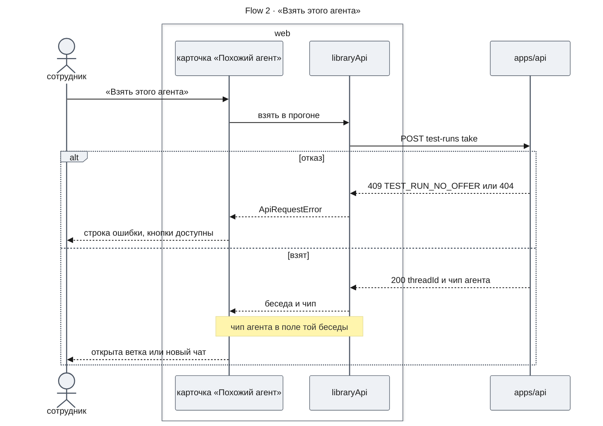
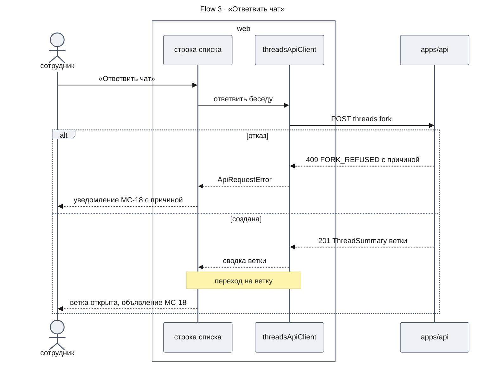
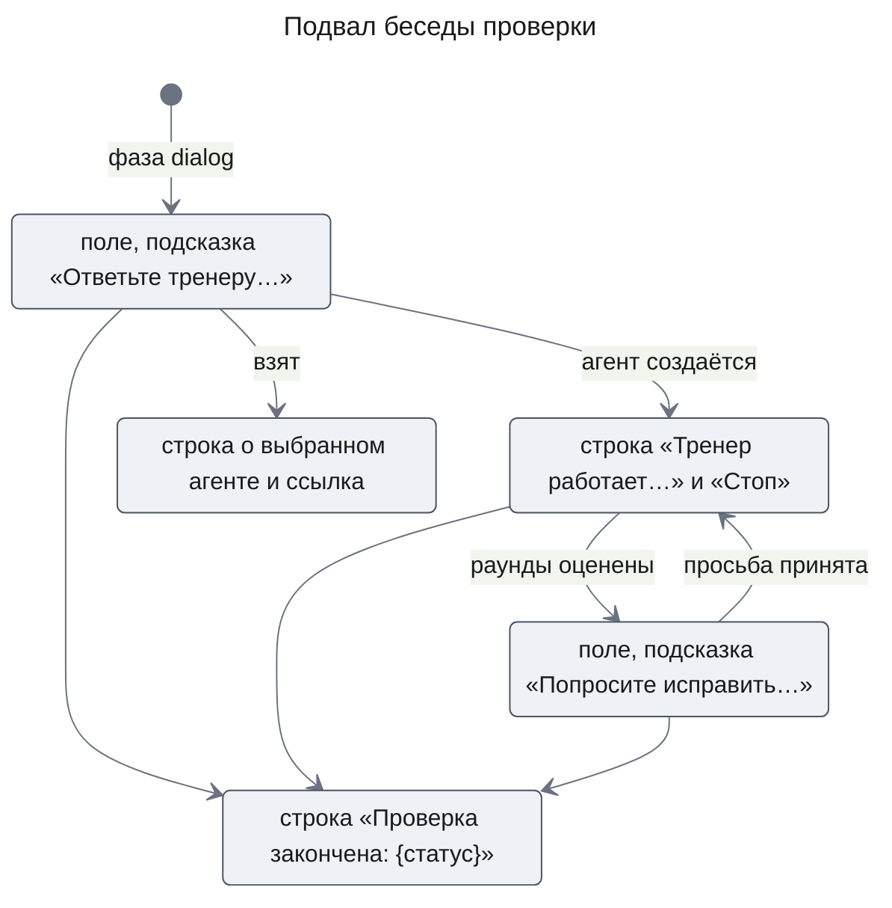

# Создать и проверить агента — Design Document — chat-web

**Status:** На утверждении · **Date:** 2026-11-25 · **PRD:** [prd.md](./prd.md) · **UXRD:** [uxrd.md](./uxrd.md) · **Depends on:** [design-fork.md, Contract Definitions](./design-fork.md#contract-definitions), [design-trainer-dialog.md, Contract Definitions](./design-trainer-dialog.md#contract-definitions)

## Snapshot

**Overview.** Эта часть переносит проверку агента в чат. Строка «+» ставит в поле сообщения чип действия на место чипа записи, и пока он стоит, отправка поля не пишет сообщение, а запускает проверку: в пустом чате — с описанием, в чате с сообщениями — ещё и с id этой беседы, чтобы сервер ответвил её. Беседа проверки — обычная лента: карточки «Похожий агент» и «План» рисуются из вызовов тренера, карточка проверки — из раундов, а поле сообщения открыто или заменено строкой «Стоп» по фазе. Всё это читается из сводки `training.run` в виде беседы и обновляется тем же перечитыванием, что лента. Ход и итог проверки и обучения показывает одна вкладка правой панели вместо «Задач»; её открывают только кнопки «Ход и итог». Окно старта, страницы результата проверки и обучения и их адреса удаляются. Отдельно сотрудник ответвляет любую свою беседу из меню «⋯» списка бесед, а ветку узнаёт по иконке в списке, разделителю в ленте и кнопке «Ветки» в шапке исходной беседы.

- **Не меняется**: путь обычного сообщения, лента и её живое обновление, окно удаления записи, окно включения (`ConfirmDialog`), карточка агента с «Обучить».
- **Главный риск**: перехват Enter и кнопки отправки, пока в поле стоит чип действия: поле должно звать старт, а не отправку assistant-ui (KD-2, [Risks](#risks-and-mitigation)).
- **Открытые вопросы**: два запроса к контрактам бэкенда — число веток в сводке беседы и объяснение «нечего исправить» в виде прогона — и два вопроса к UXRD — ссылки унаследованных карточек и карточка хода обучения ([Open Questions](#open-questions)). Сборку не блокирует ни один.

### Key Decisions

#### KD-1: Чип действия живёт в том же месте `composerSeed`, что чип записи

Стор `composerSeed` ([shell-store.md](../../code-system/patterns/shell-store.md)) держит у каждой цели поля один чип. Теперь этот чип — либо запись (`ChipRecord`), либо действие «Создать и проверить агента». Ставить чип по-прежнему может только `put`: действие вытесняет запись и наоборот, а «Создать агента в чате» убирает любой чип, как сейчас. `clear`, `move` и сравнение «тот ли это ещё чип» работают для обоих видов одинаково. Второй стор или флажок в поле отвергнут: UXRD KD-2 требует ровно один чип, и одно место это держит само.

#### KD-2: Пока стоит чип действия, отправка поля зовёт старт проверки, а не отправку сообщения

Поле с чипом действия отправляет своим обработчиком: Enter и кнопка «Создать и проверить» зовут `POST /api/test-runs` с текстом поля, а в беседе с сообщениями — с `originThreadId` этой беседы. Путь сообщения (`useThreadFeedRuntime`, `sendToFeed`) не трогается. Свой обработчик выбран по трём причинам:

- в пустом чате беседу создаёт сам старт, поэтому `initialize()` списка бесед звать нельзя;
- в беседе с сообщениями пустое поле должно отправляться (UXRD CT-02), а кнопка отправки assistant-ui пустое поле не шлёт;
- текст не покидает поле до успеха, поэтому при отказе возвращать его не нужно.

Отказ стоит в той же строке ошибки под полем, что сбой отправки (`aui_composer-send-failure`); текст берёт `describeLibraryError` в месте `testRun`. После успеха чип убирается, поле очищается, и вкладка переходит в беседу `threadPath(testRunId)` — в пустом чате это та же новая беседа, в беседе с сообщениями — ветка.

#### KD-3: Фаза поля беседы проверки читается из `training.run`, без своего запроса

Сводка `run` приходит в каждом виде беседы ([design-trainer-dialog.md, KD-9](./design-trainer-dialog.md#kd-9-карточки-ленты-и-поле-сообщения-читают-сводку-прогона-в-виде-беседы)). Подвал ленты корня проверки решает по ней: `canSend` — обычное поле без «+» с подсказкой MC-4; иначе — строка по `closedReason` (UXRD MC-4): `working` — «Тренер работает…» и «Стоп», `capped`, `stopped`, `failed` — «Проверка закончена: {статус}…», `taken` — строка о выбранном агенте со ссылкой. Объявление «Проверка закончена: {статус}» звучит, когда `run.phase` впервые за визит становится концом. Построенный `TestRunStep` с отдельным чтением `GET /api/test-runs/:id` и показом шага из списка задач удаляется. Беседа обучения, повторы и запуски тестов сохраняют построенный `TrainingLine`.

#### KD-4: Карточки «Похожий агент» и «План» — варианты `DecisionCard`, которые лента ставит на место вызова тренера

Лента (`to-feed.ts`) рисует карточкой только вызов, чей `callId` есть в `run.offer` или `run.plans`; содержимое — аргументы этого вызова, состояние и время — из сводки ([design-trainer-dialog.md, Contract Definitions](./design-trainer-dialog.md#contract-definitions)). Сам блок вызова у таких записей не рисуется, как сейчас не рисуется вызов запуска агента под карточкой хода. Карточки — два новых варианта построенного `DecisionCard` ([decision-card.md](../../design-system/components/decision-card.md)): рамка, строка статуса, итог, ряд кнопок и строка ошибки отправки у них общие с остальными вариантами.

- «Создать нового» и «Создать и проверить» шлют обычное сообщение с подписью кнопки через `feed.send` — так кнопка и набранный ответ значат одно (UXRD KD-3). Отказ отправки — строка ошибки на карточке.
- «Взять этого агента» зовёт `POST /api/test-runs/:testRunId/take`, кладёт полученный чип в поле беседы, которую вернул маршрут (`threadId`), или в поле нового чата (`NEW_THREAD_TARGET`, когда `threadId` — `null`), и открывает её. Ссылка «Открыть беседу с ним» в строке вместо поля зовёт тот же маршрут: он повторяем.
- Имя и вид найденного агента для подписи записи берутся из `libraryIndex`: агент проходит правило чипа, значит он есть в списке библиотеки сотрудника.

#### KD-5: Карточка проверки — вариант построенного `RunCard`, её место — вызов, начавший раунд

Первая карточка стоит под последним планом в состоянии `confirmed` и держит раунды, у которых `requested` — `false`. Каждая следующая стоит под вызовом `startCallId` своего раунда по просьбе и держит только его. Статус и «Сейчас: {задача}» (`run.step`) показывает последняя карточка; прежние показывают свой итог «прошло N из M». Карточка обновляется на месте, потому что лента перечитывает вид беседы по событию живого канала; хранить состояние карточки в вебе не нужно. «Ход и итог» на любой карточке открывает вкладку панели (KD-6). Вариант «Проверка» описан в [agent-run-card.md](../../design-system/components/agent-run-card.md).

#### KD-6: Одна вкладка хода и итога для проверки и обучения заменяет «Задачи» в их беседах

`SchemaTab` получает значение хода и итога. В беседе, где `training.isRoot`, панель показывает эту вкладку первой («Проверка» или «Обучение») и «Документы», а «Схемы» и «Задач» в ней нет: задачи пула стоят в итоге вкладки (self-learning UXRD, TR-01). Компонент вкладки один ([self-learning UXRD, TR-02](../self-learning/uxrd.md)): строка «когда и с чего», итог, состояния загрузки и ошибки общие, средний блок свой.

- Данные — по правилу [read-on-open.md](../../code-system/patterns/read-on-open.md): `useResource` с `GET /api/test-runs/:testRunId` у проверки или `GET /api/library/:id/training/:trainingId` у обучения. Пока прогон идёт, `useReloadOnTree` перечитывает вид по событию `tree` этой беседы — тем же способом, что построенные страницы и список задач; таймера опроса нет.
- Блоки берутся из построенных страниц: `PoolProgress`, `VersionChanges`, `Comparison`, подпись записи и `DefinitionView`, `ConfirmDialog`, `DeleteRecordDialog`; тесты по раундам строятся заново по образцу `test-run-tests.tsx`, который удаляет часть `trainer-dialog`.
- Панель сама не открывается (UXRD KD-4): автоматическое открытие `SchemaAutoOpen` в беседе с `training.isRoot` не работает, иначе первая задача пула открывала бы «Задачи». Открывают вкладку только «Ход и итог» в шапке и на карточке; фокус остаётся на кнопке.
- В шапке такой беседы кнопку «Схема» заменяет «Ход и итог» (`outline` `sm`), а панель и её «×» называются «Ход и итог» и «Закрыть ход и итог» (self-learning UXRD, TR-01); у проверки слева от неё «Открыть агента», пока `run.agent` есть и не удалён.

#### KD-7: Страницы результата и их адреса удаляются; ссылки на итог ведут в беседу с открытой вкладкой

Виды маршрута `testRun` и `training` в `parseShellRoute`, построители `testRunPath` и `trainingPath`, их ветки в `MainView` и обе страницы уходят ([shell-route.md](../../code-system/patterns/shell-route.md)). Файлов страниц в `app/(chat)` у них нет: адреса ловит общий `library/[[...path]]`, и после удаления вида такой адрес открывает список библиотеки, как любой неизвестный адрес под ним. Ссылка «Открыть результат» карточки агента (`TrainingBlock`) открывает беседу обучения и вкладку хода: сначала `workspace.show` с этой вкладкой, затем переход на `threadPath`, как сейчас делает окно старта. Ссылка «Смотреть» для того, кто обучение не начинал, уходит: вид обучения отвечает ему 404 ([design-trainer-dialog.md, FR-15](./design-trainer-dialog.md#fr-15-итог-обучения-только-у-начавшего)).

#### KD-8: «Ответвить чат» — пункт меню строки списка; признаки ветки едут в метаданных assistant-ui

Список бесед строит assistant-ui из `RemoteThreadMetadata`, которые отдаёт `toRemoteMetadata` в `thread-list-adapter.ts`. Его поле `custom` несёт `forkable` и признак ветки (`forkedFrom` задан), поэтому строке не нужен отдельный запрос. Пункт «Ответвить чат» есть, когда `forkable` — `true`. Нажатие зовёт `POST /api/threads/:threadId/fork` и при успехе открывает ветку переходом на `threadPath`, тем же путём, каким открывается беседа проверки после старта: строка ветки встаёт в список при открытии. Отказ — уведомление `toast.error` с причиной (UXRD MC-18), как отказы в `agent-header.tsx`.

#### KD-9: Разделитель ветки — запись события `forked`; унаследованная часть показывается без ссылок

`EventLine` рисует событие `forked` разделителем ленты ([feed-divider.md](../../design-system/components/feed-divider.md)): название и ссылка — из `ConversationView.thread.forkedFrom`, время — `createdAt` сводки ветки. Запись с номером не больше `forkedFrom.throughSeq` лента помечает унаследованной. У унаследованных записей нет перехода во вложенные беседы и ссылок на документы: отчёт агента стоит в состоянии «В ветке» ([agent-report.md](../../design-system/components/agent-report.md)), карточка хода вложенного агента — без ссылки на агента. Так требует контракт части `fork`: беседы вложенных агентов и документы остаются у исходной беседы ([design-fork.md, Contract Definitions](./design-fork.md#contract-definitions)).

#### KD-10: Кнопка «Ветки · N» берёт число из сводки беседы, а список — при открытии меню

Кнопка в шапке исходной беседы видна, пока число веток больше нуля, поэтому число нужно до открытия меню. В контракте части `fork` числа нет; веб просит его полем сводки (Open Question 1), а не читает весь список при каждом открытии беседы ради редкой кнопки. Список `GET /api/threads/:threadId/forks` читается, когда сотрудник открывает меню, и перечитывается при каждом открытии. Если часть `fork` поле не добавит, шапка читает этот же список при открытии беседы ([read-on-open.md](../../code-system/patterns/read-on-open.md)) и показывает кнопку, пока он не пуст; меню берёт уже прочитанный список.

## Terms

Термины прогона — в [design-trainer-dialog.md, Terms](./design-trainer-dialog.md#terms), ответвления — в [design-fork.md, Terms](./design-fork.md#terms).

- **чип действия** — чип «Создать и проверить агента» в поле сообщения; стоит на месте чипа записи.
- **подвал ленты** — место под лентой, где стоит поле сообщения или строка вместо него.
- **вкладка хода** — первая вкладка правой панели беседы проверки или обучения: «Проверка» или «Обучение».

## Part

Часть покрывает FR-09 и FR-10. Её экраны показывают и критерии частей `trainer-dialog` и `fork`, которые сотрудник видит; поведение этих критериев держит сервер.

- **Prerequisite ADRs**: нет решений, которым веб следует сверх [code system](../../code-system/README.md).

**Out of scope**

- Карточка хода в ленте беседы обучения (self-learning UXRD, TR-01) — до решения Open Question 4. FR-10 требует карточку только у прогона, а сводка `run` у обучения — `null`; беседа обучения сохраняет построенную строку `TrainingLine`.
- Ответвление от выбранного сообщения, сводки вместо истории, синхронизация веток — PRD, Won't Have.
- Текст для модели и всё, что делает сервер: фаза, отказы, копия истории.

**Constraints**

- Веб зависит только от `contracts` и `common`; запросы — только через `apiRequest` и функции модулей областей ([web-api-client.md](../../code-system/patterns/web-api-client.md)). Новые функции — в `libraryApi` и `threadsApiClient`.
- Весь текст — в каталогах `en` и `ru` с одинаковыми ключами ([interface-text.md](../../code-system/patterns/interface-text.md)); стор и лента отдают ключи, текст собирает компонент.
- Без таймеров опроса: всё живое приходит перечитыванием по `GET /api/events`.
- PoC: заменённое удаляется в той же правке — окно старта, обе страницы, их адреса, ключи текста и тесты.
- Работа от 360 px и WCAG 2.1 AA — как в UXRD (Accessibility, Responsive Behavior); здесь только то, что отличается от построенного.

## Building-block Inventory

Follows the [code system](../../code-system/README.md). Искал в `components/assistant-ui`, `components/agents`, `components/library`, `components/shell`, `lib/feed`, `lib/threads`, `lib/library`, `lib/shell`: чипа действия, разделителя ленты и действия ответвления в вебе нет; остальное расширяет построенное.

| Building block | Pattern | Status | Note |
|---|---|---|---|
| `composerSeed` | [shell-store.md](../../code-system/patterns/shell-store.md) | extended | чип — запись или действие (KD-1) |
| `ComposerActions` | — | extended | строка ставит чип действия вместо открытия окна |
| `SeededComposer` и поле | — | extended | чип действия, подсказка, строка под полем, счётчик, старт (KD-2) |
| Подвал корня проверки | — | new | вместо `TestRunStep`; фаза из `run` (KD-3) |
| `to-feed.ts` | — | extended | карточки решений и проверки, разделитель, унаследованная часть, чип над описанием |
| `DecisionCard` | — | extended | варианты «Похожий агент» и «План» (KD-4) |
| `RunCard` | — | extended | вариант «Проверка» (KD-5) |
| `EventLine` | — | extended | событие `forked` — разделитель (KD-9) |
| Разделитель ветки | — | new | по [feed-divider.md](../../design-system/components/feed-divider.md) |
| Отчёт агента | — | extended | состояние «В ветке» |
| `SchemaPanel`, `WorkspaceStore` | [shell-store.md](../../code-system/patterns/shell-store.md) | extended | вкладка хода вместо «Задач» (KD-6) |
| Вкладка хода | [read-on-open.md](../../code-system/patterns/read-on-open.md) | new | из блоков страниц `test-run-page.tsx` и `training-page.tsx` |
| Тесты по раундам | — | new | по образцу удалённого `test-run-tests.tsx`: раунды списком вместо пары «первый — второй» |
| `ChatHeader` | — | extended | «Ход и итог», «Открыть агента», «Ветки · N» |
| `ThreadHistoryItem`, `toRemoteMetadata` | — | extended | «Ответвить чат», иконка ветки (KD-8) |
| `threadsApiClient`, `libraryApi` | [web-api-client.md](../../code-system/patterns/web-api-client.md) | extended | Contract Definitions |
| `describeLibraryError` | [web-api-client.md](../../code-system/patterns/web-api-client.md) | extended | новые отказы |
| `TrainingBlock` | — | extended | ссылки ведут в беседу с вкладкой (KD-7) |
| `parseShellRoute`, `MainView` | [shell-route.md](../../code-system/patterns/shell-route.md) | extended | виды `testRun` и `training` уходят |

## Acceptance Criteria

### FR-09: команда и ответвление в чате

- From the PRD: AC-09.1, AC-09.2, AC-09.3.
- На экране этой части видны и критерии других частей: старт — AC-12.1, AC-12.2, AC-12.3, AC-01.4; ответвление — AC-11.3, AC-11.5, AC-11.8.
- Пока стоит чип действия, отправка поля не пишет сообщения в беседу, а при отказе описание и чип остаются в поле (DC-1).

### FR-10: панель прогона и обучения

- From the PRD: AC-10.1, AC-10.2, AC-10.3, AC-10.4.
- На экране видны и критерии частей `trainer-dialog` и `test-run`: разговор до создания — AC-13.1, AC-13.7; поле по фазе — AC-01.3, AC-14.1, AC-14.2, AC-14.3; решение — AC-08.1, AC-08.2.
- Панель беседы проверки и обучения не открывается сама ни на какой ширине (DC-2).
- У каждой исправленной версии своя кнопка «Сделать активной», и запрос включения несёт номер этой версии (DC-3).

## Design

### Как часть встраивается в работу системы

Пример на весь документ — из [design-trainer-dialog.md](./design-trainer-dialog.md#как-часть-встраивается-в-работу-системы). Аня в беседе «Разбор Jira» выбирает в «+» «Создать и проверить агента» и отправляет пустое поле. Вкладка открывает «Ветка · Разбор Jira»: сверху унаследованная история и разделитель, под ним карточка «Похожий агент». Аня пишет «Создать нового, тикет не нужен», и карточка получает итог «Создаём нового». Под планом она нажимает «Создать и проверить»; под планом встаёт карточка проверки, а вместо поля — «Тренер работает…» и «Стоп». После итога Аня открывает «Ход и итог», видит два раунда и включает «Исправление 1».

C1 и C2 не рисуются: люди, приложения и API те же; меняется только веб.

#### C3 · web — старт из поля

Исходная беседа уходит в теле старта, только когда цель поля — беседа, а не `NEW_THREAD_TARGET`: у беседы, которая есть на сервере, всегда есть сообщения. Счётчик, предел 4 000 знаков (`TEST_RUN_DESCRIPTION_MAX`) и потолок в строке под полем (`currentUser.trainingCapUsd`) поле проверяет до запроса.

#### C3 · web — беседа проверки

`FeedStore` не меняется: он уже перечитывает вид по событиям канала и отправляет сообщения. Новое — в том, как `to-feed.ts` превращает записи и `run` в части ленты, и в том, что рисует лента:

| Запись или поле | Часть ленты |
|---|---|
| вызов `offer_agent`, чей `callId` — `run.offer.callId` | карточка «Похожий агент» вместо блока вызова |
| вызов `propose_plan`, чей `callId` есть в `run.plans` | карточка «План» вместо блока вызова |
| последний план `confirmed` и вызовы `startCallId` раундов по просьбе | карточка проверки под ними |
| событие `forked` | разделитель ветки |
| записи с номером не больше `forkedFrom.throughSeq` | те же части, помеченные унаследованными |
| описание корня проверки | чип действия без «✕» над текстом; при пустом описании — один чип сразу под разделителем |
| `run` в подвале корня проверки | поле, строка «Стоп» или строка конца (KD-3) |

Описание — первая запись `user_message` после события `forked` или запись `task` прогона без ветки ([design-trainer-dialog.md, Contract Definitions](./design-trainer-dialog.md#contract-definitions)). Если сразу за событием `forked` стоит запись тренера, описание пустое, и лента ставит туда один чип.

#### C3 · web — вкладка хода

Вкладка хода стоит там же, где «Задачи», и в панели от 1024 px, и в шторке уже 1024 px: `SchemaPanel` рисуется в обоих местах. Состав вкладки — UXRD CT-04 и self-learning UXRD TR-02:

| Блок | Проверка | Обучение |
|---|---|---|
| Строка «когда и с чего» | `startedAt`, «по подтверждённому плану» | `startedAt`, «с версии {b}», «Открыть глубокого агента» |
| Итог | статус и расход, «прошло N из M» по `rounds`, строка о библиотеке, `fixSkipped`, кнопки, `PoolProgress` | статус и расход, рекомендация, «Сделать активной», «Обучить заново» (`useStartTraining`), `PoolProgress` |
| Средний блок | тесты по раундам; «Что меняет исправление {n}» — `VersionChanges` на раунд с текстами прошлого раунда как «было»; агент — подпись записи и `DefinitionView` | `VersionChanges` и `Comparison` |

Кнопки итога проверки. У каждого раунда с `canActivate` своя строка «Исправление {n}» с кнопкой «Сделать активной»; у раунда, чья `version` равна `activeVersion` после включения, на месте кнопки — «Активна с {activatedAt}». Кнопка открывает `ConfirmDialog` с текстами MC-11 и зовёт включение с номером этой версии. «Удалить агента» есть при `canDelete` и строке агента в `libraryIndex`; она открывает построенный `DeleteRecordDialog`, а после удаления вкладка перечитывает вид, и фокус встаёт на вкладку «Проверка».

### Runtime Flows

#### Flow 1: старт из чата с сообщениями

**Starts when:** сотрудник отправляет поле с чипом действия в беседе, for AC-09.2, AC-12.1, AC-01.4, DC-1

В пустом чате тот же путь идёт без `originThreadId`, и открывается новая беседа проверки; пустое поле там не отправляется, потому что кнопка недоступна (AC-12.2). Пока запрос идёт, поле и кнопка недоступны, а строка под полем — «Запускаем…». Отказ `TEST_RUN_RUNNING` называет идущую проверку по `testRunTitle` ссылкой на `threadPath(testRunId)`; `FORK_REFUSED` называет причину текстами MC-18.

#### Flow 2: «Взять этого агента»

**Starts when:** сотрудник нажимает «Взять этого агента» на карточке или ссылку в строке вместо поля, for AC-13.1

Беседа проверки после этого показывает строку MC-4 «Вы выбрали агента…»: следующее перечитывание даёт `closedReason` `taken`. Повтор маршрута безопасен, поэтому та же ссылка в строке после перезагрузки открывает ту же беседу.

#### Flow 3: «Ответвить чат»

**Starts when:** сотрудник выбирает «Ответвить чат» в меню строки списка, for AC-09.3, AC-11.3, AC-11.8

Ветка открывается так же, как любая беседа по адресу: фокус — как при открытии беседы. В ветке над полем стоит разделитель, пока нет новых сообщений: событие `forked` — последняя запись копии.

### Contract Definitions

**Вызовы бэкенда.** Веб берёт маршруты и формы как есть из частей `fork` и `trainer-dialog`; ниже — что каждая функция веба зовёт и как показывает отказ. Отказ, который веб не узнаёт по коду, показывает текст «Не удалось …: {причина}» своего места.

- **`libraryApi` — старт проверки** → `POST /api/test-runs` с `description` и необязательным `originThreadId`; ответ `TestRunStarted`. Отказы — строка ошибки под полем (UXRD MC-3): `TEST_RUN_RUNNING` — со ссылкой на идущую проверку, `FORK_REFUSED` — с причиной, `TRAINING_FORBIDDEN` — «нет права», `THREAD_NOT_FOUND` и `START_REFUSED` — текстами `describeLibraryError`, сбой связи — «нет связи с сервером».
- **`libraryApi` — взять** → `POST /api/test-runs/:testRunId/take`; ответ `TestRunTaken`. Отказы — строка ошибки на карточке или под строкой вместо поля.
- **`libraryApi` — вид прогона** → `GET /api/test-runs/:testRunId`; `TestRunView`. 404 — состояние «Не найдено» вкладки, как у построенных страниц (`isHiddenFromViewer`); остальное — ошибка MC-13 с «Повторить».
- **`libraryApi` — включить версию прогона** → `POST /api/test-runs/:testRunId/activate` с `{ version }`. Отказы `TRAINING_NOT_ACTIVATABLE`, `TRAINING_BASE_CHANGED`, `TRAINING_FORBIDDEN` — ошибка в окне включения (MC-11).
- **`libraryApi` — вид обучения и включение** — прежние `training` и `activateTraining`; 404 — «Не найдено».
- **`threadsApiClient` — ответвить** → `POST /api/threads/:threadId/fork`; ответ `ThreadSummary`. `FORK_REFUSED` — уведомление MC-18 с причиной; `THREAD_NOT_FOUND` и `START_REFUSED` — «Не удалось ответвить чат. Попробуйте ещё раз.».
- **`threadsApiClient` — ветки беседы** → `GET /api/threads/:threadId/forks`; `{ threads }`. Ошибка — строка в меню и пункт «Повторить» по образцу MC-13.
- **Отправка в беседу проверки** — прежний `feed.send`. `TEST_RUN_NOT_ACCEPTING` с `training_running` и `agent_deleted` — тексты MC-17 в строке ошибки под полем; с остальными причинами — «Не удалось отправить: {причина}», а следующее перечитывание закрывает поле по фазе.

**Что веб читает из сводок.** `ThreadSummary.forkable` и `forkedFrom` — у строк списка через `custom` метаданных (KD-8) и у открытой беседы через `ConversationView.thread`. `ConversationView.training.run` — у подвала, карточек и кнопок шапки. Новых полей сверх контрактов веб не требует, кроме Open Questions 1 и 2.

**Стор `composerSeed`** (общий для поля и «+»): цель — по-прежнему id беседы или `NEW_THREAD_TARGET`; значение у цели — один чип, запись или действие. `put` с действием вытесняет запись, `put` без чипа убирает любой; Backspace в пустом поле и «✕» зовут `clear`.

**Вкладка хода** — компонент панели; вход — беседа (`trainingId`, `agentId`, признак проверки из `ConversationView.training`). Наружу событий нет: включение и удаление перечитывают свой вид сами.

**Тексты.** Ключи по местам, в обоих каталогах:

| Действие | Группы |
|---|---|
| Добавить | `chat.composer` — чип действия, подсказки, строка под полем, счётчик, «Запускаем…», кнопка (MC-1 – MC-3); `chat.testRun` — строки подвала, карточки «Похожий агент», «План» и проверки, объявление (MC-4, MC-14 – MC-17); `library.testRun` — вкладка «Проверка» (MC-6 – MC-11, MC-13); `shell` — «Ответвить чат», отказы, ветки, «, ветка» (MC-18, MC-20); `agents` — разделитель и «Документ остался в исходной беседе» (MC-19); `chat.workspace` или существующая группа шапки — «Ход и итог», «Закрыть ход и итог» |
| Удалить | `library.testRun` — ключи окна старта и шапки страницы; ключи пары «первый — второй» раунда; `library.training` — ключи только страницы («Обучение «{имя}»», «Открыть разговор» страницы, `textsHidden`, `nothingToImproveHidden`, `watch`); `chat.testRun.result`, `chat.training.result`, `chat.testRun.readOnlyNow` |

### Data Model

Хранимых данных веб не заводит. Стор `composerSeed` и вкладка панели живут в памяти вкладки браузера, как прежде.

### State Transitions and Invariants

Подвал корня проверки — функция от `run`:

Фокус, стоявший в поле, при смене поля строкой переходит на «Стоп»; когда поле возвращается, фокус не двигается (UXRD, Accessibility).

**Invariants**

1. У цели поля не больше одного чипа: запись или действие.
2. Пока стоит чип действия, поле не зовёт отправку сообщения.
3. Карточкой решения становится только вызов, который есть в `run.offer` или `run.plans`; карточка проверки стоит только под подтверждённым планом или под `startCallId` раунда.
4. Панель беседы с `training.isRoot` открывает только сотрудник.
5. У унаследованной записи нет перехода во вложенную беседу и ссылки на документ.

### Что меняется в построенном коде и в каком порядке

Части `fork` и `trainer-dialog` строятся раньше. Их правки контрактов ломают сборку веба, поэтому каждая из них правит веб в той же правке ровно настолько, чтобы `pnpm --filter web typecheck` проходил. Остальное делает `chat-web`.

**Правка контрактов части `fork`** (событие `forked`, поля `ThreadSummary`, `FORK_REFUSED`):

- `components/agents/event-line.tsx` — `forked` исключается из `StatusEvent`, иначе `EVENT_STATUS` не собирается; до `chat-web` `EventLine` ничего для него не рисует.
- `test/fixtures.ts` — `threadSummary` получает `forkable: true` и `forkedFrom: null`.

**Первая фаза части `trainer-dialog`** (контракты: раунды, `run`, тело старта, `{ version }`, уход `fix`, `canActivate` и `startedByMe`):

- удалены `components/library/test-run-dialog.tsx`, `test-run-page.tsx`; строка проверки в `composer-actions.tsx` вместе с окном; `libraryApi.startTestRun` и `activateTestRun` без потребителей;
- удалены вид `testRun`, `testRunPath` и его префикс в `lib/shell-route.ts`, ветка `TestRunPage` в `main-view.tsx`, ссылка «Результат проверки» в `chat-header.tsx`;
- удалён и `test-run-tests.tsx`: он читает `first` и `second`, а его единственный потребитель — удалённая страница; тесты по раундам `chat-web` строит во вкладке по его образцу;
- `components/library/training-page.tsx` перестаёт читать `startedByMe` в трёх местах: перечитывание по `tree` всегда, строка `textsHidden` и условие ссылки уходят;
- `components/shell/self-learning-web.int.test.tsx` — блок `create-and-test / test-web` удаляется вместе с его помощниками `TEST_RUN_ID` и `testRunView` над ним (они проверяют удалённые окно и страницу и строят `TestRunView` с `first`, `second` и `fix`); объекты `training` в оставшихся тестах получают `run`;
- ключи текста удалённых файлов удаляются.

**`chat-web`, по порядку** (каждый шаг собирается):

1. Клиенты и отказы: функции `libraryApi` и `threadsApiClient`, `describeLibraryError`.
2. Поле: `composerSeed`, строка «+», чип действия, старт, строка под полем.
3. Лента: подвал по фазе вместо `TestRunStep`, карточки решения и проверки, разделитель, унаследованная часть, чип над описанием.
4. Панель и шапка: вкладка хода, «Ход и итог», «Открыть агента», выключенное автооткрытие; удаление `training-page.tsx`, вида `training` и `trainingPath`; ссылки `TrainingBlock`.
5. Ветки: пункт «Ответвить чат», иконка в строке, «Ветки · N».
6. Тесты фичи — один раз, в конце.

## Test Strategy

Тесты пишутся один раз, в конце фичи, и расширяют существующие файлы: старт, лента и вкладка — `components/shell/self-learning-web.int.test.tsx` (блок `create-and-test / chat-web`), ветки — `components/shell/shell.list.int.test.tsx`. Сервер — MSW-обработчики этих файлов и фикстуры `test/fixtures.ts`.

- **UC-1: команда в пустом чате** — covers AC-09.1, AC-12.2, AC-12.3, AC-01.4, DC-1
  - Given: сотрудник с правом и без права обучать своих агентов, пустой чат.
  - When: открывает «+»; выбирает команду; отправляет пустое поле, затем описание; затем получает 409 `TEST_RUN_RUNNING`.
  - Then: без права строки нет; с правом чип в поле, у пустого поля кнопка недоступна; `POST /api/test-runs` получил описание без `originThreadId`, открылась беседа проверки; при отказе описание и чип остались, а сообщение в ленту не ушло.
- **UC-2: команда в чате с сообщениями** — covers AC-09.2, AC-12.1
  - Given: беседа с сообщениями.
  - When: сотрудник ставит чип и отправляет пустое поле.
  - Then: тело старта несёт пустое описание и `originThreadId` беседы; открыта ветка, в её ленте разделитель со ссылкой на исходную беседу.
- **UC-3: карточки до создания** — covers AC-13.1, AC-13.7
  - Given: вид беседы проверки с `run.offer` в `waiting`; затем — с двумя планами, первый `replaced`, второй `waiting`.
  - When: «Взять этого агента»; в другом виде — «Создать и проверить».
  - Then: маршрут «взять» вызван, открыта беседа из ответа, в её поле чип агента; кнопка плана отправила сообщение с подписью кнопки; у первого плана итог «Заменён планом ниже», кнопок нет.
- **UC-4: подвал по фазе и раунд по просьбе** — covers AC-01.3, AC-14.1, AC-14.2, AC-14.3
  - Given: вид беседы проверки с фазами `working`, `result`, `ended` с `capped`; затем вид с третьим раундом `requested`.
  - When: каждая фаза приходит перечитыванием; в `result` отправка получает 409 `TEST_RUN_NOT_ACCEPTING` с `training_running`.
  - Then: строка «Тренер работает…» с «Стоп», а карточка проверки показывает «Сейчас: {run.step}» и после оценки — «Первая версия — n из m»; затем поле с подсказкой после итога, затем строка конца без поля; отказ — текст MC-17 под полем, текст остался; третий раунд — новая карточка под своим `startCallId`, прежняя хранит свой итог.
- **UC-5: вкладка с раундами и включение по версии** — covers AC-10.1, AC-10.2, AC-10.4, AC-08.1, AC-08.2, DC-2, DC-3
  - Given: прогон с одним раундом; прогон с тремя раундами; прогон с удалённым агентом.
  - When: беседа открыта; сотрудник нажимает «Ход и итог» на карточке; включает «Исправление 2».
  - Then: до нажатия панели нет; у одного раунда «Сделать активной» нет, а «Удалить агента» есть; у трёх — строки трёх раундов у каждого теста, блоки «Что меняет исправление 1» и «Что меняет исправление 2» и две кнопки включения; запрос включения несёт `version` 3, на месте кнопки «Активна с …»; у удалённого агента — «Агент удалён.» без ссылок «Запуск».
- **UC-6: ответвление из списка** — covers AC-09.3, AC-11.3, AC-11.5, AC-11.8
  - Given: беседа «Разбор Jira»; затем та же беседа, на которую сервер отвечает `FORK_REFUSED` с `answering`.
  - When: «Ответвить чат» в меню строки.
  - Then: открыта «Ветка · Разбор Jira», в списке у неё иконка ветки, в ленте разделитель со ссылкой; при `forkedFrom.title` `null` разделитель говорит, что исходная удалена, и ссылки нет; исходная беседа показывает «Ветки · 1», а её меню — ветку со временем ответвления; при отказе — уведомление с причиной, адрес прежний.
- **UC-7: вкладка «Обучение»** — covers AC-10.3
  - Given: законченное обучение с предложенной версией; беседа обучения открыта.
  - When: сотрудник нажимает «Ход и итог» в шапке и включает версию.
  - Then: панель открыта на вкладке «Обучение» без «Схемы» и «Задач»; видны изменения, сравнение, расход и рекомендация; включение вызвано.
- **UC-8: пункта нет у беседы проверки и обучения** — covers AC-11.3
  - Given: строки списка с `forkable` `false`.
  - When: сотрудник открывает их меню.
  - Then: «Ответвить чат» нет.

**Проверка в настоящем браузере** — после сборки, `next build && next start` против настоящего API; оркестратор проходит сценарии через Claude-in-Chrome:

| Сценарий | Что проверить |
|---|---|
| Enter и кнопка при чипе действия в пустом чате и в беседе | В Network один `POST /api/test-runs` и ни одного `POST …/messages`; в пустом чате нет `POST /api/threads`; переход на беседу проверки |
| Отказ старта | Строка ошибки под полем, чип и текст на месте, фокус в поле |
| Ветка из списка | Строка ветки встаёт наверх «Сегодня» с иконкой; разделитель над полем; ссылка разделителя открывает исходную беседу |
| Карточки и подвал вживую | Без перезагрузки: итог карточки плана после ответа, карточка проверки и «Стоп» после подтверждения, поле после итога |
| Вкладка «Проверка» | Не открывается сама на 1280 и 360 px; «Ход и итог» открывает панель или шторку, фокус остаётся на кнопке; вкладка обновляется во время раундов |
| «Открыть результат» на карточке агента | Беседа обучения открыта с вкладкой «Обучение»; адрес `/library/…/training/…` открывает список библиотеки |
| 360 px | Чип в одну строку, строка под полем не больше двух строк, кнопки карточек столбцом, разделитель в две строки без линий |

## Security Considerations

- **Authentication & Authorization**: права решает API. Веб прячет строку «+» без `trainOwn` и пункт «Ответвить чат» при `forkable` `false`, но это не защита: старт отвечает 403, ответвление — 409.
- **Чужие данные**: вкладку видит только начавший; 404 вида показывается «Не найдено», без подробностей.
- **Ввод**: описание проверяется по длине до запроса и сервером после; текст плана, причин и объяснений тренера рисуется как текст, без разметки.
- **Логи**: отказы пишутся через `logger` и `describeApiError` — метод, путь, код и причина, без описания и текстов.

## Risks and Mitigation

- **Enter при чипе действия уходит в отправку assistant-ui** — средний. Поле с чипом действия перехватывает отправку формы до assistant-ui; первая задача сборки проверяет это в браузере (таблица выше) прежде остального.
- **Поле `custom` метаданных не доходит до строки списка** — низкий. Тип `RemoteThreadMetadata` в установленной `@assistant-ui/core` его объявляет; если состояние строки его не отдаёт, строка берёт признаки из сводки, прочитанной при открытии беседы, — это проверка первой фазы веток.
- **Частые перечитывания вида беседы во время раундов** — низкий. Путь построен и уже работает для ленты; новых запросов на событие нет, кроме вида прогона при открытой вкладке.
- **Сотрудник не заметит, что агент уже в библиотеке** — UXRD, главный UX-риск: строка о библиотеке на карточке и во вкладке.

## Open Questions

1. **Число веток в сводке беседы** — к части `fork`. Кнопке «Ветки · N» нужно число до открытия меню. Просьба: `ThreadSummary` в `ConversationView.thread` (`GET /api/threads/:threadId/history`) получает `forkCount` — число живых веток беседы её владельца. Сборку не блокирует: без поля шапка читает список веток при открытии беседы (KD-10).
3. **Ссылки унаследованных карточек хода** — к ux-designer. UXRD FK-03 говорит, что ссылки карточек хода и решения в унаследованной части ведут туда же, куда в исходной беседе; контракт части `fork` велит показывать вложенные беседы без перехода, и дизайн следует контракту (KD-9). Просьба: привести FK-03 к контракту — без перехода остаются вложенные беседы и документы, итог карточек виден.
4. **Карточка хода в беседе обучения** — к владельцу и ux-designer. self-learning UXRD TR-01 делает её первым элементом ленты обучения и одним из двух способов открыть вкладку «Обучение» (TR-02, «Открытие»), а FR-10 требует карточку только у прогона, и сводка `run` у обучения — `null`. Рекомендация: убрать карточку из TR-01 и TR-02 — вкладку открывает «Ход и итог» в шапке. Другой путь — просьба к части `trainer-dialog` о сводке обучения в `ConversationView.training`, и тогда карточку строит эта часть. До решения карточка не строится (Part, Out of scope).
2. **Объяснение «нечего исправить» во вкладке** — к части `trainer-dialog`. UXRD MC-7 показывает во вкладке «Тренер не нашёл, что исправить: {объяснение}», а `TestRunView` после правки несёт только `fixSkipped`. Просьба: `TestRunView.fixExplanation` — текст объяснения или `null`. Пока поля нет, вкладка показывает «Тренер не нашёл, что исправить.» (MC-5), а объяснение остаётся сообщением тренера в ленте.

## Update History

| Version | Date | Change |
|---------|------|--------|
| 1.0 | 2026-11-25 | Первая версия; заменяет часть `test-web` |
