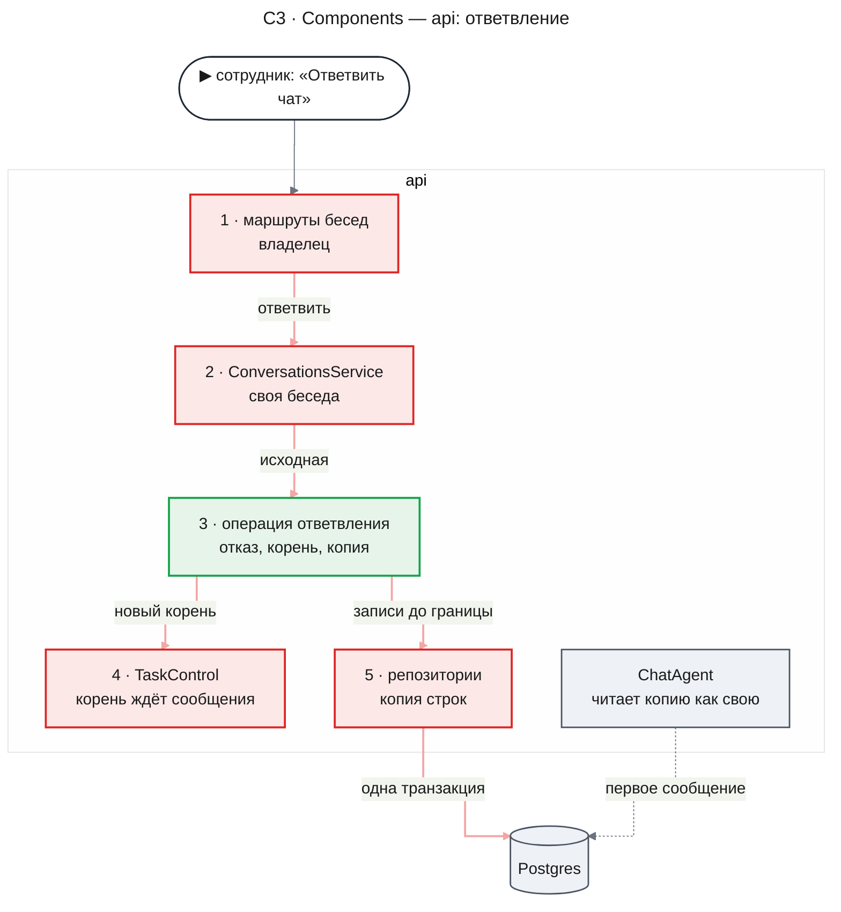
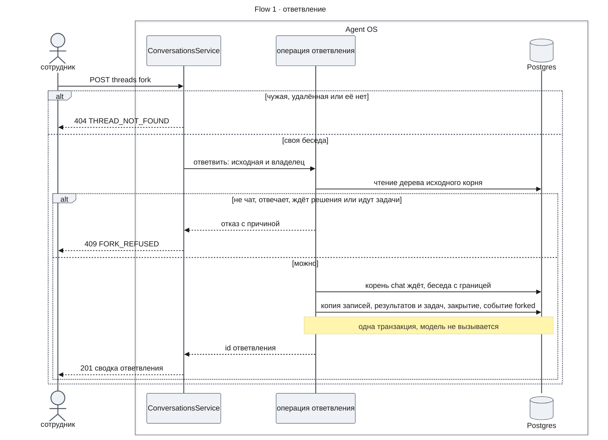
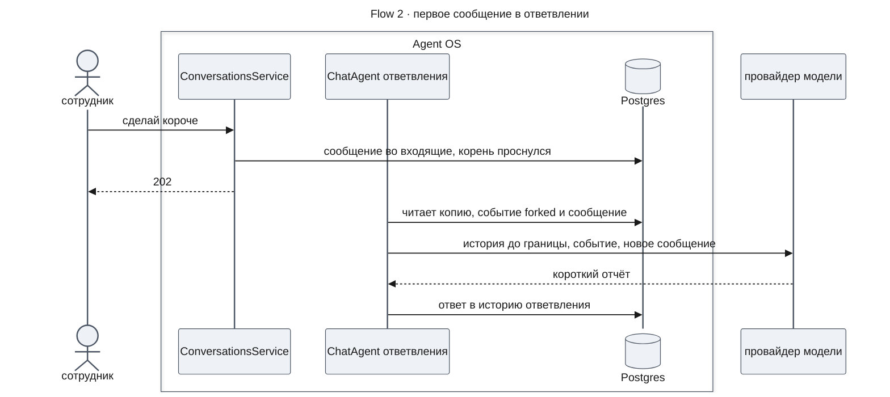

# Создать и проверить агента — Design Document — fork

**Status:** На утверждении · **Date:** 2026-11-25 · **PRD:** [prd.md](./prd.md) · **UXRD:** [uxrd.md](./uxrd.md) · **Depends on:** —

## Snapshot

**Overview.** Сотрудник хочет попробовать другой ход разговора и не потерять текущий. Ответвление — новая беседа того же сотрудника, в которую платформа одной транзакцией копирует строки истории исходной беседы: сообщения, вызовы инструментов, их полные результаты и список задач. Новый корень чата встаёт на ту же версию того же агента и сразу ждёт сообщения, поэтому модель при ответвлении не вызывается. Последней записью копии платформа пишет событие «ветка»: агент видит, что история унаследована, а веб рисует на этом месте разделитель. Дальше беседы живут отдельно: всё, что читает историю, читает копию так же, как свою.

- **Не меняется**: исходная беседа; удаление беседы — пометка корня и его дерева; ответвление сабагента от родителя по ссылке (`forked_through_seq` у ребёнка).
- **Главный риск**: длинная беседа — первый ход в ответвлении отправляет модели всю копию заново (KD-5).
- **Открытые вопросы**: нет.

### Key Decisions

#### KD-1: Ответвление копирует строки истории, а не ссылается на префикс исходной беседы

Копия нужна потому, что всё, что читает историю, читает строки своей беседы. Состояние агента (`loadState`, `absorbState`, `history.after`), страница ленты (`history.page`), сжатие и чтение полного результата (`read_tool_result`) ищут по id беседы. Копия с теми же номерами записей проходит через все эти места без единой правки, а удаление любой стороны другую не задевает: у каждой свои строки. Так же устроена ветка «Branch in new chat» в ChatGPT — отдельная беседа со всей историей ([PRD, Background](./prd.md#background)).

Общий префикс по ссылке в коде уже есть, но только у сабагента: его история начинается с истории родителя до `forked_through_seq`. Для корня он не подходит. Признак корня — пустой `parent_id`, а префикс читается через родителя; страница ленты, полные результаты и чтение удалённой исходной беседы пришлось бы учить ходить в чужую беседу.

#### KD-2: Копируются сообщения, полные результаты вызовов и список задач; вложенные беседы и документы остаются у исходной

| Что | В ответвлении | Почему |
|---|---|---|
| `messages` с номерами 1 … N | копия: те же номера, содержимое и время | это и есть история; запись 1 (`task`) пишет обычное создание беседы из текста и чипа исходной, записи 2 … N переносятся как есть |
| `tool_results` вызовов из скопированных записей | копия под новым id беседы | `read_tool_result` и `readResult` скрипта находят полный результат по id беседы и вызова |
| `conversation_tasks` и счётчик номеров задач | копия | блок задач модели совпадает с вызовами `task_create` и `task_update` в истории |
| `last_input_tokens` | переносится | сжатие решает по нему: ответвление длинной беседы сжимается первым шагом, как сжалась бы исходная |
| беседы вложенных агентов, `documents` | нет | PRD FR-11: они остаются у исходной беседы |
| `code_calls` | нет | это аудит вызовов скриптов; читает его только отбор прошлых задач обучения, а он смотрит на беседы под чатом, не на корень |

Записи истории, которые называют вложенных агентов и документы, — карточка отчёта (`child_report` с `agentId` и `document`), вызов `start_agent` с `childTaskId`, — копируются как текст. Модель видит их так же, как видела в исходной беседе: отчёт и название документа. Для веба API отдаёт эти записи как есть, а граница ответвления (KD-3) говорит, где кончается унаследованное: унаследованную часть веб показывает без ссылок на вложенные беседы и документы. Маршрут документа беседы на такой id и так ответит `DOCUMENT_NOT_FOUND`: он ищет документ в дереве той беседы, которую открыли.

Если в исходной беседе остался открытый вызов — у остановленного или упавшего корня записи закрытия выводятся при чтении и пишутся только первым шагом после продолжения, — ответвление закрывает его в своей копии теми же записями: «прерван», а вызов в отправке — «неизвестно» (`interruptedResults`). Поэтому первый шаг ответвления никогда не исполняет унаследованный вызов заново.

#### KD-3: Ответвление — новый корень чата на версии исходного корня, который ждёт сообщения; границу хранит беседа, а модели её показывает событие

Корень ответвления — задача `chat` того же сотрудника. Её старт берёт версию, имя и модель исходного корня и проверяет их правилами старта от имени сотрудника сейчас (`resolveStart` с источником «повтор запуска»), так что агент тот же и на той же версии. Задача создаётся сразу ждущей сообщения: `TaskControl.create` получает для этого признак, а первое сообщение сотрудника будит её обычным путём входящих. Название — «Ветка · {название исходной}», обрезанное до предела названия беседы; у исходной без названия — «Ветка». Ответвление встаёт наверх списка бесед.

Беседа хранит два факта. `forked_from_id` — новая колонка, ссылка на исходную беседу: по ней сводка беседы даёт ссылку разделителя, а исходная находит свои ответвления одним запросом. `forked_through_seq` — существующая колонка, номер последней унаследованной записи; её смысл становится общим: «записи до этого номера унаследованы» — у сабагента они читаются у родителя, у корня ответвления они скопированы. Единственное правило, которое отличает эти случаи, — повтор запуска (`restartSource`): версию прежней он оставляет у участника команды (`subagent`) и у ребёнка с `forked_through_seq` (задан `parent_id`), а корень ответвления (`parent_id` пуст) перезапускается на активной версии, как любой корень.

Следом за копией и записями закрытия ответвление пишет запись `event` с новым значением `forked` и постоянной причиной на английском: история выше скопирована из другой беседы сотрудника, продолжай с этого места. Модель видит её строкой события, как «interrupted» или «compacted», и поэтому продолжает разговор, а не начинает его (AC-11.4, AC-11.7). Последний ответ агента остаётся в истории перед событием, и новое сообщение сотрудника приходит после него (AC-11.6). Названия исходной беседы в событии нет: текст сотрудника не попадает в строку, которую модель читает вне конверта данных.

#### KD-4: Отказ решает одно чтение дерева исходной беседы

Операция читает дерево исходного корня (`TaskControl.listTree`) и решает по нему чистым правилом ([pure-decision.md](../../code-system/patterns/pure-decision.md)), по порядку:

1. Корень не `chat` — `not_a_chat`. Так отказывают беседы обучения и прогона: их корень — `trainer`. Беседы повторов и запусков тестов — не корни и до правила не доходят: маршрут отвечает на них 404.
2. В дереве есть открытый вопрос подтверждения — `awaiting_confirmation`.
3. Корень в очереди или работает, либо ждёт не сообщения — `answering`. Сообщение, которое уже в очереди, держит корень в очереди, поэтому отправка во время ответвления тоже даёт этот отказ.
4. В дереве есть незаконченная задача агента, кроме корня, — `tasks_running`.

Корень, который ждёт сообщения (в том числе прерванный), остановленный или упавший, ответвляется. Отказ — чтение дерева до транзакции. Копия берёт записи по последнюю закоммиченную на момент копирования. Если между проверкой и копией исходный корень принял сообщение, оно попадает в копию без ответа, а открытые вызовы закрываются по KD-2; корень ответвления ждёт, и сотрудник видит своё сообщение последним.

#### KD-5: Ответвление ничего не стоит, а первый ход в нём отправляет историю заново

При ответвлении модель не вызывается: корень создаётся ждущим (KD-3). Первый ход в ответвлении отправляет модели всю скопированную историю, как следующий ход отправил бы её в исходной беседе. Кэш подсказок у Anthropic метится в `mastra-turn.ts` на блоке инструкций и на последнем сообщении и ищется по содержимому начала запроса, а не по id беседы. Пока запись кэша жива, первый ход ответвления может её застать; позже он стоит как ход полной длины. Это принятая цена: ответвление несёт историю целиком (PRD, Won't Have — сводки нет).

#### KD-6: Копия — отдельный шаг, который другой старт вызывает в своей транзакции

Ответвление собрано из двух шагов: создать корень и скопировать историю в создаваемую беседу. Копия не знает, какой агент стоит в корне: она пишет строки и границу в беседу, которую создатель создаёт в той же транзакции. Объект корня читает своё состояние после копии: в построенном `createAgent` объект читает строки при создании, раньше шага `after`, поэтому создатель берёт его состояние заново перед тем, как отдать рантайму. Так часть `trainer-dialog` начинает прогон в ответвлении — корнем там стоит тренер — и создаёт беседу с найденным агентом, вызывая те же отказ и копию.

## Terms

- **исходная беседа** — беседа, которую ответвляют; она не меняется.
- **граница** — номер последней унаследованной записи; дальше идут записи самого ответвления.
- **унаследованная часть** — записи ответвления до границы включительно.

## Part

Часть покрывает FR-11. Действие «Ответвить чат», название, разделитель и список ответвлений на экране делает часть `chat-web` по контракту этой части.

- **Prerequisite ADRs**: [ADR-0022](../../adr/ADR-0022-one-database-and-nestjs-modules.md) (одна база, модули NestJS), [ADR-0023](../../adr/ADR-0023-live-task-objects-one-stepping-process.md) (живые объекты задач), [ADR-0024](../../adr/ADR-0024-every-reference-is-a-foreign-key.md) (каждая ссылка — внешний ключ).

**Out of scope**

- Удаление беседы: пометка `runtime_tasks.deleted_at` по дереву, строки остаются; удаление одной стороны другую не задевает, потому что у каждой свои строки.
- Ответвление сабагента от родителя (`forkPrefix` в `agent-state.ts`, `GET /agents/:agentId/inherited`).
- Память: она принадлежит агенту и сотруднику и видна ответвлению, как любой беседе с этим агентом.
- Чип агента в поле сообщения и неотправленный текст: это состояние веба, на сервере его нет.

**Constraints**

- PoC без переноса данных: схема генерируется заново, базы пересоздаются.
- Запросы — только в репозиториях `packages/db` ([repository-over-transaction.md](../../code-system/patterns/repository-over-transaction.md)); операция открывает транзакцию.
- Без новых настроек: предел названия — `THREAD_TITLE_MAX_LENGTH`.
- Лог через обёртку `packages/common`: ответвление — id исходной и новой беседы, сотрудник, граница, число скопированных записей, результатов и задач, длительность; отказ — причина. Тексты истории в лог не идут.

## Building-block Inventory

Follows the [code system](../../code-system/README.md). Искал в `packages/agents/src/operations`, `packages/agents/src/store`, `packages/db/src/repositories`, `apps/api/src/chat`: копии беседы в коде нет; создание корня, правила старта и чтение дерева берутся готовыми.

| Building block | Pattern | Status | Note |
|---|---|---|---|
| Операция ответвления: отказ, корень, копия | [step-handler.md](../../code-system/patterns/step-handler.md) | new | рядом с `StartOperations`; корень создаёт `createAgent`, как старт беседы |
| Правило отказа | [pure-decision.md](../../code-system/patterns/pure-decision.md) | new | чистая функция над деревом задач (KD-4) |
| `TaskControl.create` | — | extended | признак «создать ждущей сообщения» (KD-3) |
| `MessagesRepository`, `ToolResultsRepository`, `ConversationTasksRepository` | [repository-over-transaction.md](../../code-system/patterns/repository-over-transaction.md) | extended | копирование строк одним `INSERT … SELECT` |
| `ConversationsRepository` | [repository-over-transaction.md](../../code-system/patterns/repository-over-transaction.md) | extended | колонки ответвления в строке корня; список ответвлений |
| `restartSource` | — | extended | прежняя версия — у участника команды и у ответвлённого ребёнка, не у корня (KD-3) |
| `ConversationsService`, `ThreadsController` | [auth-boundary.md](../../code-system/patterns/auth-boundary.md) | extended | два маршрута, `forkedFrom` в сводке |
| Событие истории `forked` | — | extended | новое значение `HistoryEventSchema` |

## Acceptance Criteria

### FR-11: ответвление беседы

- From the PRD: AC-11.1, AC-11.2, AC-11.3, AC-11.4, AC-11.5, AC-11.6, AC-11.7, AC-11.8.
- При ответвлении нет ни одного вызова модели: корень ответвления ждёт первого сообщения сотрудника (DC-1).
- Отказ приходит до записи: 409 `FORK_REFUSED` с причиной из KD-4, и новой беседы нет (DC-2).
- Унаследованный вызов, оставшийся открытым в исходной беседе, в ответвлении закрыт «прерван» или «неизвестно» и заново не исполняется (DC-3).

## Design

### Как часть встраивается в работу системы

Пример на весь документ. 25 ноября Аня полчаса разбирала в беседе «Разбор Jira» выгрузку тикетов; последним агент прислал отчёт по ошибкам оплаты. Аня ответвляет беседу: появляется «Ветка · Разбор Jira» с теми же 14 записями истории, событием «ветка» и полями ответа, ждущими её. Она пишет «сделай короче», и агент сокращает отчёт из унаследованной истории. В исходной беседе ничего не появилось.

C1 и C2 не рисуются: люди, процессы и база те же. Новое лежит в процессе API.

#### C3 · api — ответвление

- **`ConversationsService`** проверяет, что беседа своя и живая (`owned`), как у любого маршрута беседы, и отдаёт сводку новой беседы.
- **Операция ответвления** — в `packages/agents`: чтение дерева и отказ (KD-4), затем одна транзакция `createAgent`: корень `chat` со стартом исходного корня, созданный ждущим, и в той же транзакции копия, записи закрытия, событие `forked` и колонки ответвления.
- **`ChatAgent`** не меняется: его объект при создании читает свою историю (`loadState`), а это уже копия.

### Runtime Flows

#### Flow 1: ответвление

**Starts when:** сотрудник ответвляет свою беседу — `POST /api/threads/:threadId/fork`, for AC-11.1, AC-11.2, AC-11.3, AC-11.8, DC-1, DC-2, DC-3

Если правила старта больше не пускают сотрудника к модели или версии исходного корня, старт отказывает до транзакции: 409 `START_REFUSED`, как у первого сообщения беседы. Объект корня читает свою историю — копию — в транзакции создания и после коммита передаётся рантайму ждущим; рестарт процесса восстанавливает его, как любой ждущий корень. Падение до коммита не оставляет ничего.

#### Flow 2: первое сообщение в ответвлении

**Starts when:** сотрудник пишет в ответвление — прежний `POST /api/threads/:threadId/messages`, for AC-11.4, AC-11.5, AC-11.6, AC-11.7

Путь отправки не меняется: ответвление — обычный корень, у которого история уже есть. Модель получает последний унаследованный ответ агента, затем строку события и только потом новое сообщение, поэтому отвечает на новое (AC-11.6). Ответ пишется в историю ответвления; исходная беседа его не видит (AC-11.1). Удаление исходной беседы помечает только её дерево, а строки ответвления — свои (AC-11.5).

### Contract Definitions

**Маршруты бесед** (`apps/api`, модуль `chat`, сессия сотрудника). Отказ — код и сообщение, как у остальных маршрутов бесед.

- **`POST /api/threads/:threadId/fork`** — ответвляет беседу; тело не читается. Возвращает 201 `ThreadSummary` новой беседы. Ошибки: 404 `THREAD_NOT_FOUND` — беседы нет, она удалена или чужая, в том числе для администратора (AC-11.2); 409 `FORK_REFUSED` с `reason` (KD-4); 409 `START_REFUSED` — правила старта не пускают к модели или версии исходного корня, тело `StartRefusedErrorSchema`.
- **`GET /api/threads/:threadId/forks`** — живые ответвления этой беседы её владельца, новые сверху. Возвращает 200 `{ threads: ThreadSummary[] }`; удалённое ответвление в список не входит. Ошибка: 404 `THREAD_NOT_FOUND`, как у чтения беседы.
- **`GET /api/threads`**, **`GET /api/threads/:threadId`**, **`GET /api/threads/:threadId/history`** — каждая сводка беседы получает `forkable` и `forkedFrom`.

**`ThreadSummary`** получает поля:

- `forkable` — корень беседы — чат. У бесед обучения и прогона `false`, и веб не показывает у них «Ответвить чат». Занятость беседы сюда не входит: её проверяет сам маршрут (KD-4).
- `forkedFrom` — `null` у беседы, которая не ответвление; иначе `threadId` исходной беседы, её `title` — `null`, если исходную удалили, — и `throughSeq` — граница: записи с номером не больше неё унаследованы. Время ответвления — `createdAt` самой сводки. Список бесед получает название исходной тем же запросом, что строки списка.

**Запись истории** — `HistoryEventSchema` получает значение `forked`. Запись `event` с ним стоит сразу после унаследованной части и записей закрытия, `reason` — постоянный текст для модели. Веб рисует на её месте разделитель; веб, который ещё не знает значения, собирается, только если все перечисления событий получают его в той же правке.

**Унаследованные записи** — каждая запись с номером не больше `forkedFrom.throughSeq` унаследована. Записи отдаются как есть, с id вложенных агентов и документов исходной беседы. Беседы вложенных агентов принадлежат исходной беседе, а документы маршрут `GET /api/threads/:threadId/documents/:documentId` ответвления не находит (`DOCUMENT_NOT_FOUND`), поэтому веб показывает у унаследованных записей документ без ссылки, а вложенные беседы — без перехода.

**Ошибки** — `ThreadsErrorCodeSchema` получает `FORK_REFUSED`; `reason` — `not_a_chat`, `awaiting_confirmation`, `answering` или `tasks_running`.

**Копия для другого старта** (`packages/agents`, для части `trainer-dialog`). Операция ответвления даёт два шага, которые создатель другой беседы вызывает сам:

- **отказ** — исходная беседа и владелец → причина из KD-4 или «можно»; одно чтение дерева, без записи.
- **копия** — исходная беседа, новая беседа, граница и `forkedFrom` → внутри транзакции создателя, после записи 1 и до того, как объект нового корня берёт свои строки: записи 2 … N, полные результаты их вызовов, список задач, записи закрытия открытых вызовов, событие `forked` и колонки ответвления. Отдаёт номер записи события. Запись 1 создатель пишет сам обычным созданием беседы — из текста и чипа записи 1 источника. Создатель, у корня которого свой список задач, просит копию без списка задач и без `last_input_tokens`: так стартует тренер прогона, у которого пул — единственный список. Объект, прочитавший состояние до копии, её не видит, поэтому рантайм получает объект только с состоянием, прочитанным после копии.

### Data Model

**`conversations`**

- `forked_from_id` — новая колонка: исходная беседа ответвления, внешний ключ на `conversations` с `ON DELETE SET NULL` и индексом для списка ответвлений. Строки бесед физически уходят только с удалением сотрудника, а тогда уходят обе беседы; `SET NULL` держит ответвление, если исходную когда-нибудь удалит чистка.
- `forked_through_seq` — существующая колонка: номер последней унаследованной записи. У корня ответвления задана вместе с `forked_from_id`; у сабагента — без неё (CHECK: `forked_from_id` задана только у корня и только вместе с `forked_through_seq`).

Остальные таблицы не меняются: копии ложатся в `messages`, `tool_results` и `conversation_tasks` обычными строками новой беседы.

### State Transitions and Invariants

Состояния у ответвления нет: это обычная беседа чата.

**Invariants**

1. Ответвление не меняет ни одной строки исходной беседы.
2. Скопированные записи 1 … N совпадают с записями исходной беседы по номеру, виду и содержимому; у каждой скопированной записи `tool_result` с полным результатом есть строка в `tool_results` ответвления.
3. У ответвления нет открытых вызовов в унаследованной части.
4. При ответвлении нет вызова модели.
5. Ответвить может только владелец исходной беседы.

## Test Strategy

Тесты пишутся один раз, в итоговом проходе фичи. Модель — тестовый провайдер с заданными ответами, который записывает каждый запрос.

- **UC-1: копия полная и независимая** — covers AC-11.1, AC-11.5, AC-11.8, DC-1
  - Given: беседа «Разбор Jira» с шестью сообщениями, вызовом с большим результатом и задачей в списке.
  - When: сотрудник её ответвляет, затем пишет в каждую беседу и удаляет исходную.
  - Then: у ответвления название «Ветка · Разбор Jira», `forkedFrom` с границей, те же записи до границы, событие `forked` после них, тот же список задач, `read_tool_result` в ответвлении читает полный результат; при ответвлении провайдер не получил запроса; сообщение одной беседы не появилось в другой; исходная перечисляет ответвление в `forks`; после удаления исходной ответвление читается целиком.
- **UC-2: последний ответ и пометка наследования** — covers AC-11.4, AC-11.6, AC-11.7, DC-3
  - Given: беседа кончается ответом агента на вопрос, а в другой беседе корень остановлен с открытым вызовом.
  - When: сотрудник ответвляет первую и пишет новое сообщение; ответвляет вторую и пишет в неё.
  - Then: запрос первого хода к провайдеру содержит унаследованные сообщения, последний ответ агента, строку события `forked` и новое сообщение в этом порядке; во второй унаследованный вызов закрыт «прерван», и сервер инструмента его не получил.
- **UC-3: ответвляет только владелец** — covers AC-11.2
  - Given: беседа сотрудника А.
  - When: сотрудник Б, в том числе администратор, её ответвляет.
  - Then: 404 `THREAD_NOT_FOUND`, новой беседы нет.
- **UC-4: отказы** — covers AC-11.3, DC-2
  - Given: беседа, где агент отвечает; беседа с открытым вопросом подтверждения; беседа с работающим вложенным агентом; беседа прогона.
  - When: сотрудник ответвляет каждую.
  - Then: 409 `FORK_REFUSED` с `answering`, `awaiting_confirmation`, `tasks_running` и `not_a_chat`; ни одной новой беседы.

## Security Considerations

- **Authentication & Authorization**: маршрут под сессией; беседа должна быть своей и живой, чужая отвечает 404, как отсутствующая. Старт корня проверяет модель и версию правилами старта от имени сотрудника сейчас, поэтому ответвление не даёт модели или агента, к которым у него больше нет доступа.
- **Что видит модель**: копия — разговоры самого сотрудника; событие `forked` несёт постоянный текст, а не текст сотрудника. Унаследованные результаты инструментов остаются в конверте данных, как в исходной беседе.
- **Input Validation**: id беседы проверяет `owned`; тела у маршрута нет.
- **Sensitive Data Handling**: лог несёт id, номера и счётчики, без текстов истории.

## Risks and Mitigation

- **Длинная беседа дорога в ответвлении** — средний. Первый ход отправляет всю копию; `last_input_tokens` переносится, поэтому беседа у порога сжатия сжимается первым шагом (KD-2, KD-5).
- **Ссылки унаследованной части ведут в исходную беседу** — низкий. Контракт отдаёт записи как есть, а веб показывает унаследованную часть без ссылок; документы ответвления их не находят.
- **Сообщение, отправленное в исходную беседу во время ответвления** — низкий, принят. Либо отказ `answering`, либо сообщение в копии без ответа (KD-4).

## Update History

| Version | Date | Change |
|---------|------|--------|
| 1.0 | 2026-11-25 | Первая версия |
