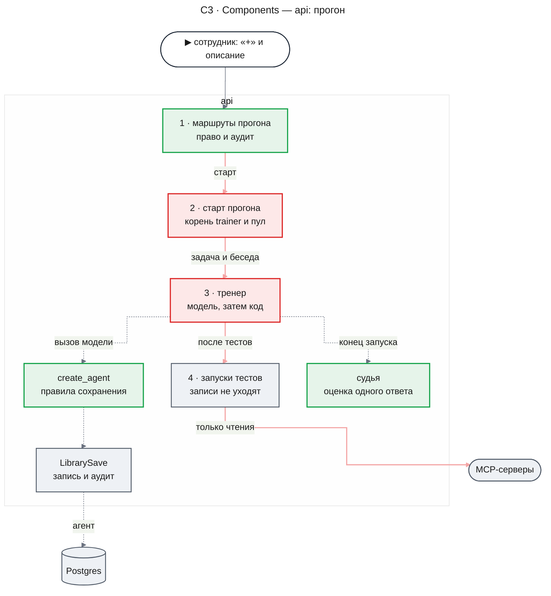
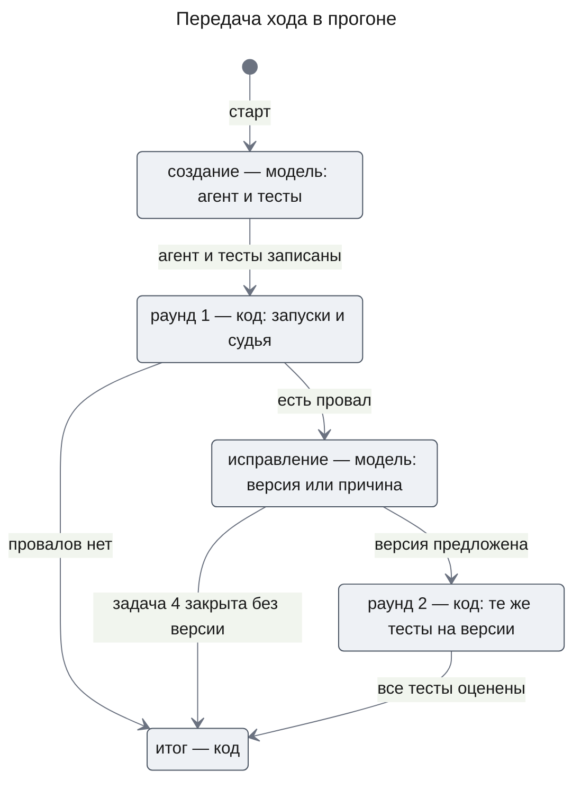
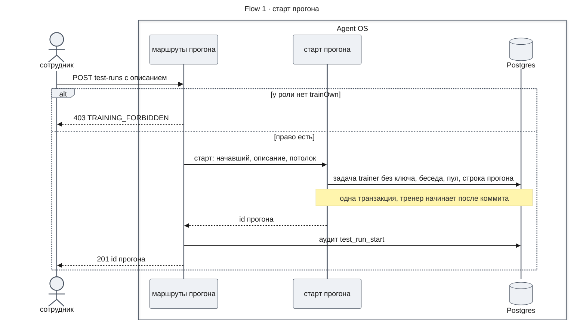
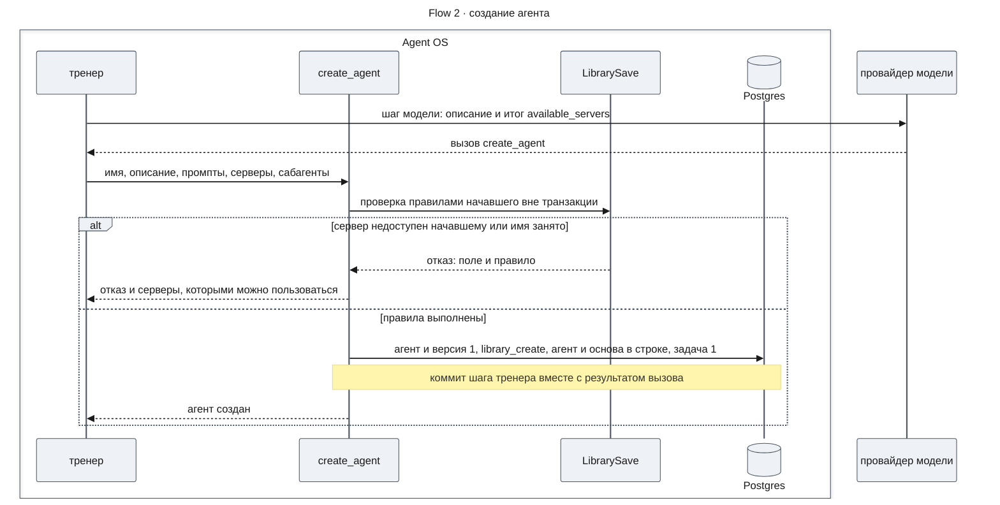
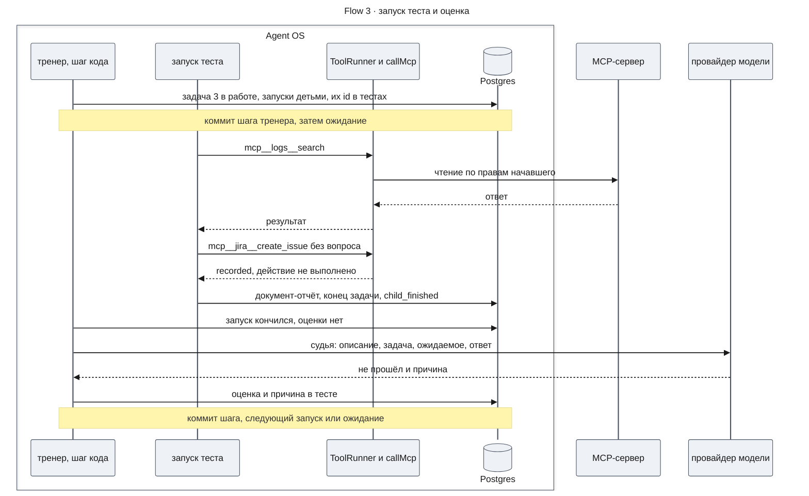

# Создать и проверить агента — Design Document — test-run

**Status:** На утверждении · **Date:** 2026-11-24 · **PRD:** [prd.md](./prd.md) · **UXRD:** [uxrd.md](./uxrd.md) · **Depends on:** — (строится на построенной части [`self-learning` training](../self-learning/design-training.md))

## Snapshot

**Overview.** Проверить нового агента до его первой настоящей задачи сегодня нельзя: тренер обучает агента только по его прошлым беседам. Прогон даёт встроенному тренеру вторую работу. Сотрудник пишет, что должен делать агент, а тренер сам создаёт по этому описанию приватного глубокого агента без карточки подтверждения и пишет до пяти тестов с ожидаемым результатом. Дальше работает платформа: запускает каждый тест под той же защитой, что повторы обучения, отдаёт каждый ответ судье и, если что-то не прошло, даёт тренеру один раз исправить агента и повторяет те же тесты. Всё это живёт в механизмах обучения — его задаче, таблице, потолке расхода и правилах версий. Результат видит только начавший: он включает исправленную версию или удаляет агента.

- **Не меняется**: пять мест, где код читает признак дерева обучения; правила сохранения записи; «Обучить» с карточки агента — у него только меняется порядок отказов (KD-3).
- **Главный риск**: у одной записи тренера теперь две работы, и модель класса Haiku может спутать их; у каждой работы свой набор инструментов, а ход передаёт код по данным строки (KD-1, KD-4).
- **Открытые вопросы**: нет ([Open Questions](#open-questions)).

### Key Decisions

#### KD-1: Прогон — режим тренера, а не новая подсистема

Прогон живёт там же, где обучение: корневая задача типа `trainer`, её беседа, список задач беседы как пул, строка `trainings` с id корня, бюджет по сумме журнала токенов. Поэтому без единой правки работают признак дерева обучения ([design-training.md, KD-3](../self-learning/design-training.md#kd-3-повтор--ребёнок-тренера-на-заданной-версии-и-модели-исходной-беседы-меняющий-вызов-в-дереве-обучения-записывается)) и его пять мест: запуски тестов не задают вопросов, меняющий вызов кончается `recorded`, потолок проверяется перед каждым вызовом модели, память не меняется, а сообщение и перезапуск получают отказ. Так же работают остановка корня, список бесед начавшего и запрет запускать тренера из чата.

Режим — признак во входе задачи `trainer` (`runtime_tasks.input`), который пишет старт прогона. Объект тренера читает вход один раз при создании и при восстановлении, как любой агент, и по нему берёт пул, набор инструментов и шаг кода. Класс `Trainer` остаётся один; ветка по режиму — в его переопределённых методах, а не в общем коде. Строка `trainings` знает режим по своему описанию (KD-2): описание есть только у прогона.

Отвергнуто: свой тип задачи и свой класс — признак дерева проверяет тип корня `trainer`, и пришлось бы расширять его, бюджет и ответы бесед; вторая встроенная запись «тренер прогона» — вторая модель и второй промпт в панели, а PRD запрещает новые настройки и требует судью на модели тренера.

#### KD-2: Одна таблица `trainings`; у прогона агент и основа пусты до создания агента, а тесты — список в строке

Старт прогона пишет строку `trainings` сразу, потому что бюджет берёт потолок из неё с первого вызова модели. Агента в этот момент ещё нет, поэтому `agent_id` и `base_version_id` становятся необязательными: у обучения их пишет старт, у прогона — инструмент создания агента, оба в одном коммите (KD-3). Основа прогона — версия 1 созданного агента: так прежние `propose_version`, `agent_definition`, `try_script` и активация с проверкой «основа не сменилась» работают без изменений.

Новые колонки — `description` (описание сотрудника, у обучения пусто) и `tests` — jsonb-список до пяти тестов. Элемент — задача, ожидаемый результат и по каждому раунду id беседы запуска, оценка и причина. Как список сравнения обучения ([design-training.md, KD-6](../self-learning/design-training.md#kd-6-обучение-хранит-одна-таблица-trainings-сравнение--список-в-её-строке-автор-версии--ссылка-на-обучение)), он короткий, его читают только вместе со строкой и пишет только тренер; id бесед в нём — то же исключение из [ADR-0024](../../adr/ADR-0024-every-reference-is-a-foreign-key.md). Цифры запуска — ошибки, вызовы, стоимость — список не копирует: вид считает их при чтении. Исправленная версия — прежняя ссылка `agent_versions.training_id`, объяснения — прежняя колонка `changes`; список сравнения у прогона пуст.

Отвергнуто: своя таблица прогонов — бюджет, активация и ответы бесед читают `trainings`; общий jsonb для сравнений и тестов — две разные формы в одной колонке.

#### KD-3: Агента создаёт инструмент `create_agent` из `apps/api` по правилам `create_record`, без карточки, в коммите шага тренера

Правила сохранения записи живут в `apps/api` (`LibraryChatService`, `LibrarySave`), а `packages/agents` не импортирует `apps/api`. Поэтому `create_agent` устроен как инструменты записей главного чата: `apps/api` регистрирует его в реестре инструментов `agents` в `onModuleInit` ([tool-declaration.md](../../code-system/patterns/tool-declaration.md)), без `rootOnly` и `everySession`, а объявляет его только тренер в режиме прогона. Вне транзакции (`prepare`) инструмент собирает факты начавшего — серверы, которыми он может пользоваться, модели, `library_settings.defaultMaxTurns` — и проверяет запись тем же путём, что карточка `create_record`. В коммите шага (`execute`) запись сохраняется тем же путём, что одобренная карточка, только карточку никому не показывают: так решил PRD (Constraints).

Модель даёт имя, описание, промпт и серверы агента и его сабагентов: имя, описание «когда звать», промпт, серверы. Остальное ставит код: модель `null` — модель чата по умолчанию, `maxTurns` агента и сабагентов — `defaultMaxTurns`, у сабагента `maxRuns` — постоянная 3 (у администратора нет настройки для неё), `finalSubagent` пусто, самообучение выключено, скриптов нет. Запись — личная запись начавшего: он автор, ролям она не открыта, событие аудита `library_create` пишет `LibrarySave` от его имени. Сервер, недоступный начавшему, и занятое имя дают отказ с полем и правилом, как у `create_record`, а отказ сервера перечисляет серверы, которыми можно пользоваться; модель исправляет вызов (AC-02.2).

В том же коммите инструмент пишет в строку прогона агента и версию 1, закрывает задачу 1 пула и даёт беседе прогона название «Проверка «{имя}»» вместо «Проверка нового агента» (UXRD MC-4). Второй вызов получает отказ «агент уже создан». Рестарт не создаёт второго агента (NFR-02): запись агента, строка и результат вызова — один коммит; потерянный коммит не оставляет ничего, и вызов исполняется снова с новым id записи.

Ключ исключительности корню прогона не нужен: до создания агента ключа нет, а после него «пока прогон идёт, обучение агента не запускается» (AC-07.4) держит старт обучения. Он первым делом читает незаконченную работу тренера над агентом (`TrainingsRepository.running`, теперь она находит и прогон) и отвечает 409 `TEST_RUN_RUNNING` раньше проверки прошлых задач. Ключ `trainer` по id агента остаётся для гонки двух обучений.

#### KD-4: Пул прогона из пяти задач; модель создаёт агента, пишет тесты и исправляет, всё остальное — код

Старт пишет в список задач беседы пять задач с заголовками UXRD MC-5, каждая заблокирована предыдущей ([Пул прогона и передача хода](#пул-прогона-и-передача-хода)). Номер 4 — предложение версии, как в пуле обучения, поэтому правило «задача 4 закрыта без версии» одно на обе работы. Задачи 1 и 2 закрывают сами инструменты `create_agent` и `write_tests`, а не модель, поэтому модель не может закрыть их без агента и тестов. Задача 4 «Исправить и проверить снова» начинается работой модели и кончается работой кода — вторым раундом.

У режима свой набор инструментов. Новые: `available_servers` — серверы и инструменты, которыми начавший может пользоваться сейчас, тем же текстом, что серверная часть `list_records` (`record-listing.ts`); `create_agent`; `write_tests`; `test_results` — чтение тестов с оценками первого раунда, вызовами и отчётами их запусков. Прежние, без изменений: `agent_definition`, `try_script`, `propose_version` и инструменты списка задач без `task_create`. Чтений прошлых задач и памяти (`past_tasks`, `read_past_task`, `read_past_document`, `agent_memory`) у режима нет: тренер прогона читает только описание, серверы начавшего, тесты, беседы их запусков и оценки (FR-02). Первая запись беседы — описание сотрудника как есть (UXRD CT-03).

`write_tests` в своём коммите пишет тесты ещё и документом блокнота «Тесты» беседы прогона: код создаёт обычную строку `documents` беседы тренера, нумерованный список, у каждого теста — задача и строка «Ожидается: …» (UXRD CT-03, MC-4). У тренера инструментов блокнота нет, поэтому документ пишет код инструмента, а не модель. Вкладка «Документы» показывает его прежними маршрутами блокнота, а результат вызова называет документ так же, как результаты инструментов блокнота, — по этой строке веб показывает вызов документом в ленте.

Промпт встроенной записи тренера получает второй раздел — работу прогона, рядом с разделом обучения; общие правила остаются общими. Какая работа идёт, модель видит по заголовкам пула в блоке списка задач, а инструменты другой работы ей не даны. Отвергнуто: инструкции в описаниях задач пула — блок списка задач показывает модели только заголовки и помечает их как её заметки, а не правила.

#### KD-5: Судья оценивает один ответ одним структурным вызовом; без верной оценки тест «не проверен»

Судья — тот же механизм, что в обучении ([design-training.md, KD-4](../self-learning/design-training.md#kd-4-судья--один-вызов-модели-в-шаге-тренера-на-каждую-законченную-пару-вслепую)): вызов модели тренера в шаге кода тренера, от имени начавшего, с признаком дерева, по образцу [tool-call-answer.md](../../code-system/patterns/tool-call-answer.md). Он получает описание, задачу теста, ожидаемый результат и ответ запуска — его документ-отчёт, а без отчёта короткий ответ из итога задачи; каждый текст не длиннее 40 000 знаков с пометкой обрезки. Ответ — одна форма: прошёл или нет и причина одной фразой. Запуск, который кончился не ответом (`failed`, остановка), судье не идёт: тест не прошёл, причина называет исход и текст сбоя (AC-05.2). Ошибка модели, отказ в вызове или второй неразобранный ответ дают оценку `unchecked` с причиной; оценка с любым значением записана и больше не ставится. Один шаг кода оценивает один законченный запуск и пишет оценку своим коммитом, как пару в обучении.

#### KD-6: Маршруты прогона — второй контроллер модуля `training`; результат и активация — только начавшему; удаление — обычное удаление записи

Маршрут с id записи в пути не подходит: агента нет до создания (AC-07.2), а после удаления его не видно. Поэтому у прогона свои маршруты `/api/test-runs/:testRunId` в модуле `training` `apps/api`, рядом с маршрутами обучения ([port-module-split.md](../../code-system/patterns/port-module-split.md)); id прогона — id его беседы. Один маршрут чтения отдаёт весь результат: тесты, оба раунда, исправление, расход и действия. Удаление агента сотрудником — пометка `agents.deleted_at`, а не удаление строки, поэтому строка прогона и её ссылки на агента и версии остаются, и экран остаётся записью прогона (UXRD KD-5). Строки агента физически уходят только вместе с их владельцем, а с ним каскадом уходят и беседа прогона, и строка `trainings`.

Строке меню и окну старта до прогона нужны право и потолок. Их отдаёт ответ, который оболочка уже читает: `GET /api/auth/me` (`CurrentUser`) получает `trainOwn` и `trainingCapUsd` — текущий потолок одного обучения. Старт берёт потолок заново в момент старта.

Начать прогон может сотрудник, у роли которого есть `trainOwn` (`AuthUser.trainOwn`); флажок самообучения и прошлые задачи не нужны. Старт пишет событие аудита `test_run_start` через `AuditLog` — тот же журнал, что `training_activate`, — сразу после коммита старта. Результат читает только начавший: остальным маршрут отвечает 404 `TRAINING_NOT_FOUND`, как отсутствующему, даже владельцу `trainAny` (AC-08.3). Активация — тот же путь, что у обучения ([design-training.md, KD-7](../self-learning/design-training.md#kd-7-рекомендация--подпись-а-не-замок-активация--одна-транзакция-с-проверкой-основы)): агент для смотрящего через `LibraryService.trainingTarget`, правило `canTrain` (автор с `trainOwn`), одна транзакция с указателем от основы и аудитом `training_activate`. Удаляет агента прежний `DELETE /api/library/:id`; потраченное остаётся в журнале токенов начавшего (AC-08.2).

Маршруты обучения прогонов не отдают: чтение и активация по id прогона отвечают 404 `TRAINING_NOT_FOUND`, а состояние для карточки агента (`TrainingState`) не показывает прогон ни идущим, ни последним законченным обучением.

## Terms

Термины обучения — тренер, судья, версия, основа, дерево обучения, пул, потолок — значат то же, что в [design-training.md, Terms](../self-learning/design-training.md#terms); термины прогона — в [PRD, Terms](./prd.md#terms).

- **режим прогона** — признак во входе задачи `trainer`: тренер делает прогон, а не обучение.
- **раунд** — запуски всех тестов на одной версии с их оценками: первый на версии 1, второй на исправленной.
- **шаг кода** — шаг тренера, в котором его модель не вызывается: код стартует запуски, зовёт судью и двигает пул.

## Part

Часть покрывает FR-01 – FR-08, NFR-01 и NFR-02. Экраны — меню «+», беседа прогона и экран результата — делает часть `test-web` по контракту этой части.

- **Prerequisite ADRs**: [ADR-0016](../../adr/ADR-0016-library-records-and-visibility.md) (записи библиотеки и видимость), [ADR-0022](../../adr/ADR-0022-one-database-and-nestjs-modules.md) (одна база, модули NestJS), [ADR-0023](../../adr/ADR-0023-live-task-objects-one-stepping-process.md) (живые объекты задач), [ADR-0024](../../adr/ADR-0024-every-reference-is-a-foreign-key.md) (каждая ссылка — внешний ключ; исключение KD-2), [ADR-0025](../../adr/ADR-0025-settings-key-table.md) (настройки по ключу).

**Out of scope**

- Пять мест признака дерева обучения, правило «записать, не исполнять», бюджет, повторы и судья пар обучения — как в `training`.
- Правила сохранения записи и удаление записи — как в библиотеке; меняется только то, что вызывать их может тренер без карточки.
- Права обучать и потолок в панели — как в `training` и `training-web`.

**Constraints**

- PoC без переноса данных: схема генерируется заново (`0000_schema.sql`), промпт тренера правится в `0001_builtin_rows.sql`, базы пересоздаются.
- Без новых настроек: потолок — `self_learning_settings.trainingCapUsd`, шаги агента — `library_settings.defaultMaxTurns`, модель — модель чата по умолчанию.
- Запросы — только в репозиториях `packages/db` ([repository-over-transaction.md](../../code-system/patterns/repository-over-transaction.md)).
- Лог через обёртку `packages/common`: старт, агент создан, тесты записаны, запуск начат, оценка, итог раунда, предложение, потолок — с id и суммами, без текстов описания, тестов и ответов.

## Building-block Inventory

Follows the [code system](../../code-system/README.md). Искал в `packages/agents/src/training`, `apps/api/src/library`, `apps/api/src/training` и `packages/db/src`: создания записи без карточки и оценки одного ответа в коде нет; всё остальное прогон берёт у обучения и библиотеки.

| Building block | Pattern | Status | Note |
|---|---|---|---|
| Класс `Trainer`: режим, пул прогона, передача хода | [step-handler.md](../../code-system/patterns/step-handler.md) | extended | режим из входа задачи (KD-1, KD-4) |
| Шаг кода прогона: запуски тестов, судья, пул | [step-handler.md](../../code-system/patterns/step-handler.md) | new | рядом с `trainer-step.ts`, тот же старт детей и тот же коммит |
| Судья одного ответа | [tool-call-answer.md](../../code-system/patterns/tool-call-answer.md) | extended | рядом с `judgePair` в `judge.ts`, общий структурный ответ |
| `create_agent`, `available_servers` | [tool-declaration.md](../../code-system/patterns/tool-declaration.md) | new | в `apps/api` рядом с `record-tools.ts`; сохранение — `LibraryChatService`, текст серверов — `record-listing.ts` |
| `write_tests`, `test_results` | [tool-declaration.md](../../code-system/patterns/tool-declaration.md) | new | инструменты тренера в `packages/agents`; документ «Тесты» — `DocumentsRepository` |
| `CurrentUser` | [auth-boundary.md](../../code-system/patterns/auth-boundary.md) | extended | `trainOwn`, `trainingCapUsd` |
| `agent_definition`, `try_script`, `propose_version` | — | reused | `propose_version` получает одну проверку режима (KD-4) |
| Старт прогона | [immutable-versions.md](../../code-system/patterns/immutable-versions.md) | extended | метод `TrainingOperations`; старт обучения — проверка идущей работы первой |
| `trainings`, `TrainingsRepository` | [repository-over-transaction.md](../../code-system/patterns/repository-over-transaction.md) | extended | KD-2 |
| Маршруты прогона, вид, активация | [auth-boundary.md](../../code-system/patterns/auth-boundary.md), [pure-decision.md](../../code-system/patterns/pure-decision.md) | extended | модуль `training`; правило `canTrain` то же |
| Промпт встроенного тренера | [builtin-record.md](../../code-system/patterns/builtin-record.md) | extended | второй раздел (KD-4) |

## Acceptance Criteria

Номера `DC-n` уточняют критерии PRD там, где дизайн решает больше, чем PRD.

### FR-01: старт из описания

- From the PRD: AC-01.1, AC-01.2, AC-01.3.
- Модель чата прогон не запускает: старт — только маршрут, инструмента старта нет (DC-1).

### FR-02: тренер создаёт агента сам

- From the PRD: AC-02.1, AC-02.2.
- В режиме прогона тренер не получает инструментов чтения прошлых задач и памяти; второй вызов `create_agent` получает отказ, а агент один (DC-2).

### FR-03: тесты пишет тренер

- From the PRD: AC-03.1, AC-03.2.
- `write_tests` принимает от одного до пяти тестов один раз; второй вызов получает отказ (DC-3).

### FR-04: запуски тестов под защитой обучения

- From the PRD: AC-04.1, AC-04.2.

### FR-05: судья оценивает каждый ответ

- From the PRD: AC-05.1, AC-05.2.
- Ошибка модели судьи, отказ в её вызове или второй неразобранный ответ дают тесту `unchecked`; запуск без ответа судье не идёт (DC-4).

### FR-06: один раунд исправления

- From the PRD: AC-06.1, AC-06.2, AC-06.3.
- `propose_version` в прогоне получает отказ, пока первый раунд не оценён целиком или когда в нём не было провала (DC-5).

### FR-07: потолок, остановка и сбой

- From the PRD: AC-07.1, AC-07.2, AC-07.3, AC-07.4.
- Старт обучения агента, чей прогон идёт, — 409 `TEST_RUN_RUNNING`, раньше `TRAINING_RUNNING` и `TRAINING_NO_PAST_TASKS` (DC-6).

### FR-08: результат и решение сотрудника

- From the PRD: AC-08.1, AC-08.2, AC-08.3, AC-08.4.
- Маршруты обучения на id прогона отвечают 404 `TRAINING_NOT_FOUND`, а карточка агента не показывает прогон обучением (DC-7).

## Design

### Как часть встраивается в работу системы

Пример на весь документ. У роли Ани есть право обучать своих агентов. 24 ноября она открывает «+» и пишет: «Агент разбирает ошибки оплаты по логам и заводит тикет в Jira. Примеры: „Почему с 14:00 падают оплаты?“, „Сколько ошибок у billing-api за сутки?“». Тренер читает её серверы инструментом `available_servers`: `logs` есть, Jira нет. Он создаёт «Разбор ошибок оплаты» с сервером `logs` и одним сабагентом, затем пишет четыре теста: два примера Ани и два своих. Первый раунд: прошло 3 из 4, а тест «Сколько ошибок у billing-api» не прошёл — агент не разделил ошибки по сервису. Тренер предлагает версию 2 с исправленным промптом, второй раунд: прошло 4 из 4. Потрачено $1,10 из $2. Аня включает версию 2.

C1 и C2 не рисуются: люди, процессы, база, MCP-серверы и провайдеры моделей те же. Новое лежит в процессе API — в пакете `agents` и в модулях `training` и `library` `apps/api`.

#### C3 · api — прогон

- **Маршруты прогона** проверяют `trainOwn` и берут потолок из `self_learning_settings`.
- **Старт прогона** — метод `TrainingOperations` рядом со стартом обучения: та же модель тренера через `resolveStart` по ключу `trainer`, та же транзакция создания корня, но без ключа исключительности, с режимом во входе, с пулом прогона и с описанием первой записью беседы.
- **Тренер** в шагах модели работает инструментами режима, в шагах кода стартует запуски тестов детьми и зовёт судью ([Пул прогона и передача хода](#пул-прогона-и-передача-хода)).
- **Запуски тестов** — обычные запуски глубокого агента под тренером на глубине 1, как повторы обучения: сабагенты, блокнот и документ-отчёт, скрипты своей версии.

### Пул прогона и передача хода

Старт пишет пять задач с заголовками UXRD MC-5, каждая заблокирована предыдущей; все пять видны с начала.

| № | Задача | Кто | Кончается |
|---|---|---|---|
| 1 | Создать агента | модель, `create_agent` | закрывает инструмент при успехе |
| 2 | Написать тесты | модель, `write_tests` | закрывает инструмент при успехе |
| 3 | Проверить первую версию | код | все тесты раунда оценены |
| 4 | Исправить и проверить снова | модель, `propose_version`, затем код | код — когда второй раунд оценён; без версии — пропуск с описанием от кода |
| 5 | Подвести итог | код | задача тренера `completed` |

Модель не может менять задачи 1, 2, 3 и 5 (`fixedTasks`) и не создаёт новых. Ход модели держат открытые задачи 1, 2 и 4; задачи кода его не держат. Провал — тест раунда с оценкой не `passed`: `failed` или `unchecked`. Пропущенную задачу 4 код закрывает и пишет ей описание: «Не понадобилось: все тесты прошли.» или «Тренер не нашёл, что исправить.» (UXRD MC-5); список задач беседы показывает его прежним путём. Как передаётся ход:

Перед каждым шагом модели тренер читает строку прогона и пул и решает по данным:

1. Агента или тестов нет — шаг модели.
2. Агент и тесты есть, а в первом раунде есть тест без оценки — шаг кода раунда на версии 1.
3. Первый раунд оценён, провал есть, версии нет и задача 4 не закрыта — шаг модели. Шаг кода, который записал последнюю оценку первого раунда, закрывает задачу 3, ставит задачу 4 в работу — даже если модель закрыла её раньше, — и пишет в историю тренера строку платформы с итогом раунда. Поэтому в правиле 5 считается только закрытие, сделанное после этого шага.
4. Версия есть, а во втором раунде есть тест без оценки — шаг кода раунда на ней; задача 4 остаётся в работе до последней оценки.
5. Задача 4 закрыта моделью без версии — код пишет ей описание «Тренер не нашёл, что исправить.», закрывает задачу 5, а итог задачи тренера — текст ответа модели, в котором стоит закрывающий вызов, как «улучшить нечего» в обучении.

Задачи 1 и 2 держат ход модели, поэтому без агента и тестов тренер работает до предела ходов своей версии или до потолка. Предел ходов кончает его, как любого агента, статусом `failed` с причиной; вид отдаёт `failed` с `agent: null` или с пустым списком тестов, а экран показывает сбой до агента или после него (UXRD CT-04).

Если в первом раунде провалов нет, его последний шаг закрывает задачу 3, пропускает задачу 4 с описанием «Не понадобилось: все тесты прошли.», закрывает задачу 5, и тренер кончается итогом раунда (AC-06.1). После второго раунда код закрывает задачи 4 и 5, тренер кончается итогом двух раундов, и третьего раунда нет (AC-06.2).

Как в обучении, `task_update`, который закрывает задачу 4 в одном ответе с отклонённым `propose_version`, кончает прогон без исправления: код видит закрытую задачу без версии. Защищает правило промпта из раздела обучения, перенесённое в раздел прогона: вызывать `propose_version` одним вызовом в ответе и не закрывать задачу 4 после него. `propose_version` в прогоне до конца первого раунда и при раунде без провалов отвечает отказом (DC-5), поэтому версия не появляется раньше времени.

Шаг кода раунда устроен как шаг повторов ([design-training.md, KD-4](../self-learning/design-training.md#kd-4-судья--один-вызов-модели-в-шаге-тренера-на-каждую-законченную-пару-вслепую)). До коммита он готовит старты всех тестов раунда без запуска и одну оценку законченного запуска. В коммите он стартует детей с вызовом старта `test:{n}:{раунд}`, пишет их id и оценку в список тестов, двигает пул. Есть ещё законченный запуск без оценки — следующий шаг идёт сразу, иначе тренер ждёт `child_finished`. Запуск идёт на версии раунда под именем агента; модель — модель версии, а без неё модель чата по умолчанию; старт проверяет `resolveStart` от имени начавшего. Отказ старта даёт тесту `failed` с причиной в том же коммите. Шаг, потерянный до коммита, повторяется с начала и ничего не дублирует.

### Runtime Flows

#### Flow 1: старт прогона

**Starts when:** сотрудник запускает прогон — `POST /api/test-runs`, for AC-01.1, AC-01.2, AC-01.3, DC-1

Отказ — без записи и без расхода (AC-01.1). Если начавшему недоступна модель тренера, `resolveStart` отказывает до транзакции: 409 `START_REFUSED`, как у старта обучения. Аудит пишется после коммита старта; если процесс упадёт между ними, прогон идёт без записи аудита (Risks). Корень без родителя попадает в список бесед начавшего, а беседа — только для чтения: сообщение тренеру отклоняет место 5 признака дерева, остановка — прежний `POST /api/agents/:agentId/stop` корня (AC-01.3).

#### Flow 2: тренер создаёт агента

**Starts when:** модель тренера вызывает `create_agent`, for AC-02.1, AC-02.2, DC-2, NFR-02

`write_tests` идёт так же, в коммите шага: тесты в строку прогона, документ «Тесты» в блокнот беседы, задача 2 закрыта; так начавший видит в беседе задачу и ожидаемый результат каждого теста (AC-03.2). Второй вызов любого из двух инструментов получает отказ, а строка не меняется.

#### Flow 3: раунд и оценка

**Starts when:** агент и тесты записаны, или предложена исправленная версия, for AC-04.1, AC-04.2, AC-05.1, AC-05.2, AC-06.1, AC-06.2, DC-4, NFR-01

Беседа запуска — беседа задачи `deep_agent` под тренером, поэтому «Обучить» и прошлые документы блокнота её не берут: прошлая задача — беседа под корнем чата (AC-04.2). Ссылку «Запуск» веб открывает прежней страницей повтора: `GET /agents/:agentId/history` отдаёт беседу запуска с полем `training`, где `testRun` и `isRoot: false`, и страница показывает её только для чтения, с записанными вызовами (AC-04.1). Расход запусков, судьи и тренера — одна сумма журнала по корню; рестарт её не обнуляет, а потолок проверяется перед каждым вызовом модели ([design-training.md, Flow 3](../self-learning/design-training.md#flow-3-остановка-потолком)). Остановка, потолок и сбой прерывают раунд: оценки, записанные до этого, остаются, у тестов без оценки её нет, агент остаётся на версии 1, исправленная версия — неактивной (AC-07.1 – AC-07.3).

### Contract Definitions

**Маршруты прогона** (`apps/api`, модуль `training`, сессия сотрудника, без `@AdminOnly`). Отказ — код и сообщение, как у маршрутов обучения.

- **`POST /api/test-runs`** — начинает прогон; тело `StartTestRunBody` — `description`: текст сотрудника, после обрезки пробелов от 1 до 4 000 знаков; предел — постоянная `packages/contracts`, общая с вебом (UXRD CT-02, MC-3). Возвращает 201 `TestRunStarted` — `{ testRunId }`, это и id беседы прогона. Ошибки: 400 — тело не прошло схему; 403 `TRAINING_FORBIDDEN` — у роли нет `trainOwn`; 409 `START_REFUSED` — начавшему недоступна модель тренера.
- **`GET /api/test-runs/:testRunId`** — результат, `TestRunView`. 404 `TRAINING_NOT_FOUND` — прогона нет, его начал другой сотрудник, id принадлежит обучению или беседу прогона удалили.
- **`POST /api/test-runs/:testRunId/activate`** — включает исправленную версию. Возвращает 200 `TrainingActivated` — `{ version, activatedAt }`. Ошибки: 404 `TRAINING_NOT_FOUND` — как у чтения; 404 `RECORD_NOT_FOUND` — агента нет или он удалён; 403 `TRAINING_FORBIDDEN` — у роли больше нет `trainOwn`; 409 `TRAINING_NOT_ACTIVATABLE` — прогон идёт, версии нет или она уже включена; 409 `TRAINING_BASE_CHANGED` — активная версия уже не версия 1.
- **Удаление агента** — прежний `DELETE /api/library/:id` с `agent.id` из вида, со своими отказами.
- **`POST /api/library/:id/training`** — новый отказ 409 `TEST_RUN_RUNNING`: прогон, создавший этого агента, ещё идёт.

**`TestRunView`** — всё для экрана результата:

- `id`, `description`, `startedAt`; `status` — `running`, `done`, `stopped`, `failed` из статуса корня, как `TrainingStatusSchema`; `failureReason` у `failed`; `cappedAt` — остановка пришла от потолка; `spentUsd` и `capUsd`.
- `pool` — пять задач: номер, заголовок, статус из `SessionTaskStatusSchema`; по нему видно, что прогон делает сейчас.
- `agent` — `null`, пока агента нет; иначе `id`, `name`, `description`, `deleted` и `content` — содержимое версии 1 целиком в форме содержимого записи глубокого агента (`DeepAgentContentSchema`): промпт, серверы, модель, `maxTurns`, сабагенты с их моделью, `maxTurns` и `maxRuns`, `finalSubagent`, флажки и скрипты. После удаления агента `content` остаётся: удаление только помечает строку агента, а версия 1 и ссылка на неё в строке прогона сохраняются и читаются по id версии (`AgentsRepository.findVersion` удалённых не отсеивает).
- `tests` — по порядку: `task`, `expected` и `first`, `second` — результат теста в раунде «Первая версия» и «Исправленная» или `null`, пока раунда нет. Результат — `verdict`, `reason`, `conversationId` беседы запуска, `errors`, `toolCalls`, `costUsd`. `verdict` — `passed`, `failed`, `unchecked` («не проверен»), или `null`, пока прогон идёт и оценки нет; тест без оценки в кончившемся прогоне вид отдаёт `unchecked` с `reason: null`, и веб показывает свою причину (UXRD MC-8). У удалённого агента `conversationId` — `null`: экран остаётся записью без ссылок на запуски (UXRD CT-04).
- `rounds` — один или два, по порядку: номер версии раунда, `passed` и `total` для «прошло N из M», сумма `errors`, `toolCalls` и `costUsd` его запусков. Ошибки и стоимость считаются как у повторов обучения ([design-training.md, `TrainingView`](../self-learning/design-training.md#contract-definitions)); расход судьи в раунд не входит, только в `spentUsd`.
- `fix` — `version` (номер или `null`); `skipped` — `not_needed` (провалов в первом раунде нет), `nothing_to_fix` (тренер закрыл задачу 4 без версии) или `null`; `explanation` — текст тренера из итога его задачи при `nothing_to_fix`; `base` и `proposed` — промпты и скрипты версий 1 и исправленной в форме `TrainingView.proposal`; `changes`.
- `activatedAt`, `activeVersion` (номер или `null`, когда агента нет или он удалён); `canActivate` — прогон кончился, версия есть и не включена, активна всё ещё версия 1, агент не удалён, у смотрящего есть `trainOwn`; `canDelete` — прогон кончился, агент есть и не удалён.

**`CurrentUser`** (`GET /api/auth/me`) получает `trainOwn` — право роли обучать своих агентов, как в `AuthUser`, — и `trainingCapUsd` — текущий потолок одного обучения из `self_learning_settings`. По ним веб показывает строку меню «+» и потолок в ней и в окне старта до прогона (UXRD CT-01, CT-02).

**Беседы прогона** — поле `training` в `ConversationViewSchema` и `AgentPageViewSchema` (`ConversationTrainingSchema`) получает `testRun` — беседа принадлежит прогону, а `agentId` может быть `null`: у прогона — пока агента нет и после его удаления; сборка вида читает пометку удаления агента. Так кнопка «Открыть агента» пропадает после удаления (UXRD CT-03). У обучения `agentId` задан всегда, поэтому прежние читатели поля работают как раньше; ссылку на результат веб строит по `testRun`.

**Инструменты режима прогона** (агент и прогон — из строки по `ToolCaller.rootId`, никогда из аргументов)

- **`available_servers`** — без аргументов; серверы, которыми начавший может пользоваться сейчас, с именами инструментов, на которые у него есть право.
- **`create_agent`** — имя, описание, промпт и серверы агента, сабагенты: имя, описание, промпт, серверы. Остальное ставит код (KD-3). Отказы — с полем и правилом, как у `create_record`; второй вызов — «агент уже создан».
- **`write_tests`** — от одного до пяти тестов: задача и ожидаемый результат, каждый текст ограничен. Один раз на прогон; пишет и документ «Тесты» (KD-4).
- **`test_results`** — тесты с оценками и причинами первого раунда и для каждого запуска его вызовы с исходами (в том числе `recorded`) и отчёт; полный итог хранится под `callId`, модели длинный итог отдаётся обёрткой, как у чтений тренера.
- **`agent_definition`**, **`try_script`**, **`propose_version`** — как в обучении; до создания агента они отвечают отказом «агента ещё нет», а `propose_version` — ещё и отказом DC-5.

**Ошибки** — `TrainingErrorCode` получает `TEST_RUN_RUNNING`; остальные коды прогона — коды обучения.

**Аудит** — `test_run_start`: актор — начавший, объект — прогон, после — потолок и длина описания, без текста.

**Runtime settings** — новых нет: `self_learning_settings.trainingCapUsd` — потолок прогона при старте; `library_settings.defaultMaxTurns` — шаги агента и сабагентов.

### Что меняется и в каком порядке

Порядок держит сборку зелёной: каждый слой собирается на уже изменённом нижнем.

1. `packages/contracts` — схемы прогона (`StartTestRunBody` с пределом, `TestRunStarted`, `TestRunView`, элемент теста и оценка), имена новых инструментов, `TEST_RUN_RUNNING`, поля `CurrentUser`, `testRun` и необязательный `agentId` в `ConversationTrainingSchema`. В той же правке веб строит ссылку на результат обучения в шапке беседы только при `testRun: false` — иначе он не соберётся; экраны прогона делает `test-web`.
2. `packages/db` — колонки `trainings` и CHECK, методы `TrainingsRepository` для прогона, новый `0000_schema.sql`; второй раздел промпта тренера в `0001_builtin_rows.sql`.
3. `packages/agents` — режим и пул тренера, шаг кода прогона, судья одного ответа, `write_tests` и `test_results`, отказ «агента ещё нет» в чтении основы, проверка DC-5 в `propose_version`, старт прогона и проверка идущей работы первой в старте обучения.
4. `apps/api` — `create_agent` и `available_servers`, маршруты прогона с видом и общей активацией, аудит старта, отказ `TEST_RUN_RUNNING`, отказ маршрутов обучения на прогон, поля `CurrentUser` и вида беседы.
5. Тесты фичи — один раз, в конце ([Test Strategy](#test-strategy)).

### Data Model

#### `trainings` — изменения

| Колонка | Что это |
|---|---|
| `agent_id`, `base_version_id` | теперь могут быть пустыми — только у прогона, пока агента нет; пусты или заданы вместе (CHECK). У прогона основа — версия 1 созданного агента |
| `description` | новая; описание сотрудника. Задано — строка является прогоном; у обучения пусто |
| `tests` | новая, jsonb, по умолчанию пустой список; до 5 элементов по порядку: задача, ожидаемый результат и для каждого раунда id беседы запуска, оценка (`passed`, `failed`, `unchecked`) и причина — пусто, пока их нет. Id бесед без внешнего ключа (KD-2). У обучения — пустой список |

`comparisons` у прогона — пустой список. Ссылки строки остаются прежними внешними ключами: удаление агента сотрудником — пометка `agents.deleted_at`, поэтому строка и её ссылки переживают его (KD-6). `TrainingsRepository.running` находит незаконченную работу тренера над агентом любого режима, а `latestFinished` — только обучения. Вход задачи `trainer` получает признак режима прогона; у обучения его нет.

### State Transitions and Invariants

Состояние прогона — статус корня (`running`, `done`, `stopped`, `failed`), как у обучения; передачу хода внутри `running` показывает [Пул прогона и передача хода](#пул-прогона-и-передача-хода).

**Invariants**

1. Ни один вызов инструмента без `readOnlyHint` из запуска теста не уходит к MCP-серверу — ни прямой, ни из кода, ни после рестарта: запуск теста — в дереве обучения.
2. У прогона не больше одного агента; агент и его id в строке появляются в одном коммите.
3. Тесты пишутся один раз, их от одного до пяти, и до конца прогона они не меняются.
4. В раунде каждый тест запускается не больше одного раза; раундов не больше двух; второй — только на версии, предложенной после провала в первом.
5. Оценка теста в раунде записывается один раз.
6. Вызов модели в прогоне не начинается, если сумма журнала по корню уже дошла до потолка.
7. Результат читает и версию включает только начавший; сама система версию не включает.

## Test Strategy

Тесты пишутся один раз, в итоговом проходе фичи. Модель — тестовый провайдер с заданными ответами, MCP-сервер — тестовый сервер, считающий вызовы.

- **UC-1: запись из запуска теста не уходит** — covers AC-04.1, NFR-01
  - Интеграционный, `packages/agents`: тест прогона вызывает `jira.create_issue` и чтение. Then: сервер получил только чтение; вызов в беседе запуска — `recorded` с аргументами; вопросов начавшему нет.
- **UC-2: потолок на оба раунда** — covers AC-07.1, NFR-02
  - Интеграционный, `packages/agents`: потолок кончается в раунде исправления; в другом прогоне рестарт процесса после создания агента, посреди запусков. Then: после потолка нет вызовов модели и инструментов; оценки первого раунда записаны, тесты второго без оценки; агент один, на версии 1; после рестарта сумма прежняя и прогон останавливается на том же потолке.
- **UC-3: права и изоляция** — covers AC-01.1, AC-02.1, AC-02.2, AC-08.3, AC-08.4, DC-2, DC-7
  - Интеграционный, `apps/api`: старт без `trainOwn` — 403, агента и расхода нет; агент прогона — личная запись начавшего, другой сотрудник его не видит; сервер, недоступный начавшему, в агенте не оказался; результат другому сотруднику с `trainAny` — 404; после снятия права активация — 403, активна прежняя версия; маршрут обучения на id прогона — 404.
- **UC-4: не больше одного исправления** — covers AC-06.1, AC-06.2, AC-06.3, DC-5
  - Интеграционный, `packages/agents`: в одном прогоне все тесты проходят, в другом провалы в обоих раундах. Then: в первом версии нет и прогон кончается одним раундом; во втором одна версия с моделью, серверами, лимитами и сабагентами версии 1, ровно два раунда; `propose_version` до конца первого раунда получает отказ, а задача 4, закрытая моделью до конца первого раунда, после него снова в работе.
- **UC-5: главный путь** — covers AC-01.2, AC-01.3, AC-03.1, AC-03.2, AC-04.2, AC-05.1, AC-05.2, AC-07.2, AC-07.3, AC-07.4, AC-08.1, AC-08.2, DC-1, DC-3, DC-4, DC-6
  - Интеграционный, `packages/agents` и `apps/api`: старт пишет аудит; тренер создаёт агента и пишет тесты с двумя примерами из описания; один запуск падает. Then: в беседе видны тесты с ожидаемым результатом, а сообщение тренеру отклонено; «прошло N из M» по оценкам, упавший тест не прошёл с причиной сбоя без вызова судьи, а тест, на котором модель судьи ответила ошибкой, — `unchecked`; во время прогона «Обучить» агента — 409 `TEST_RUN_RUNNING`; после включения новая беседа идёт на исправленной версии; после удаления агента новой беседы с ним не начать, а расход остался; у агента без бесед, кроме запусков, «Обучить» — `TRAINING_NO_PAST_TASKS`; остановка до создания агента оставляет библиотеку без агента, после создания — с агентом и `canDelete`.

## Security Considerations

- **Authentication & Authorization**: старт и активация требуют `trainOwn`; результат и активация — только начавшему, остальным 404 как отсутствующему. Каждый вызов инструмента в запусках тестов идёт по правам начавшего через `AccessGate`.
- **Исключение из подтверждения записей** — агента сохраняет тренер без карточки (PRD, Constraints): только как личную запись начавшего, только с серверами, которые начавший может использовать, без открытия ролям и без самообучения. Каждая запись во внешнюю систему в обычной работе агента ждёт решения сотрудника, как у любого агента.
- **Что читает тренер** — описание, серверы начавшего, тесты, беседы их запусков и оценки; инструментов чтения чужих бесед, памяти и других агентов у режима нет.
- **Input Validation**: описание проверяет схема тела; аргументы инструментов — их схемы и правила сохранения записи. Описание и тесты — тексты сотрудника и модели, а не правила: судья получает их в конверте данных с автором.
- **Sensitive Data Handling**: логи несут id, суммы и исходы, но не описание, тесты, промпты и ответы; аудит старта — без текста описания.

## Risks and Mitigation

- **Модель путает работы одного промпта** — средний. У режима свои инструменты, работу называет список задач в промпте, а ход передаёт код по данным строки, а не по словам модели.
- **Задача 4 закрыта в одном ответе с отклонённым `propose_version`** — низкий, принят как в обучении. Прогон кончается без исправления с результатом первого раунда; правило промпта требует вызывать `propose_version` одним вызовом.
- **Агент удалён, пока прогон идёт** — низкий, принято. Запуски идут на версиях, которые не удаляются; вид показывает `deleted`, а начавший может остановить прогон.
- **Аудит старта пишется после коммита старта** — низкий, принято. Падение процесса между ними оставит прогон без записи аудита; лог старта есть.
- **Настоящие чтения только что созданного агента** — из PRD; тот же вопрос открыт для повторов обучения ([design-training.md, Open Questions](../self-learning/design-training.md#open-questions)) и здесь отдельно не решается.

## Open Questions

Нет. Вопрос о настоящих чтениях непроверенной версии — общий с обучением и решается там.

## Update History

| Version | Date | Change |
|---------|------|--------|
| 1.0 | 2026-11-24 | Первая версия |
