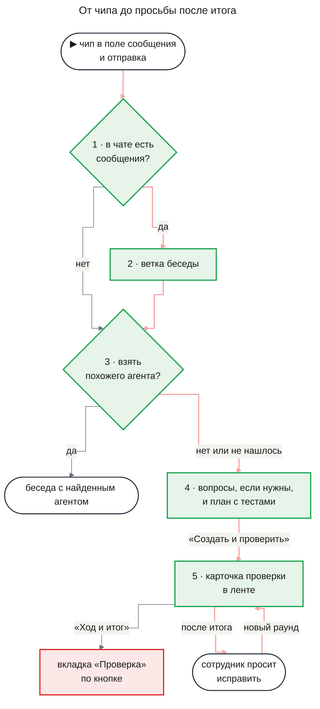

# UXRD: Создать и проверить агента (create-and-test)

| Дата | PRD | Опирается на |
|---|---|---|
| 2026-11-25 | [prd.md](./prd.md) | [self-learning UXRD](../self-learning/uxrd.md) — беседа обучения TR-01, вкладка TR-02, окно включения TR-03; [custom-agents UXRD](../custom-agents/uxrd.md) — чип записи CH-01; [chat-shell UXRD](../chat-shell/uxrd.md) — список бесед, шапка, композер |

## Snapshot

**Overview.** Сотрудник хочет получить агента под свою задачу и до первой настоящей задачи знать, справляется ли тот. Меню «+» у поля сообщения любой беседы ставит в поле чип «Создать и проверить агента». В пустом чате сотрудник описывает агента, а в чате, где задачу уже обсудили, может отправить и пустое сообщение: тогда чат ответвляется, и тренер работает в ветке с копией разговора. В ленте тренер предлагает похожего агента, если нашёл, задаёт вопросы, если они нужны, и присылает план с тестами; кнопка «Создать и проверить» под планом запускает работу. Ход виден на карточке в ленте, подробности — на вкладке «Проверка» правой панели, которую открывает сам сотрудник; после итога он пишет тренеру «поправь вот это», и тренер делает ещё одно исправление. Ветку любой своей беседы сотрудник делает и сам — действием «Ответвить чат».

- **Не меняется**: вкладка хода и итога (TR-02), окно включения (TR-03) и окно удаления — проверка берёт их как есть. Остальные строки меню «+» прежние.
- **Главный UX-риск**: сотрудник не заметит, что агент уже сохранён в его библиотеке, и забудет удалить неудачного. Поэтому карточка и итог говорят, что агент уже в библиотеке, а «Удалить агента» стоит в итоге.

### Key Decisions

| ID | Решение | Почему |
|---|---|---|
| KD-1 | Строка «Создать и проверить агента» есть в меню «+» любой беседы, где поле сообщения принимает чипы, кроме беседы самой проверки и обучения. В пустом чате проверка идёт в этом чате, в чате с сообщениями — в его ветке «Ветка · {название}», как любая ветка | Задачу часто сначала обсуждают в чате, и тренеру нужен этот разговор. Проверку в ветке узнают по карточке проверки в ленте, а название говорит, из какой беседы она выросла |
| KD-2 | Старт — чип действия в поле сообщения, на месте чипа записи (CH-01) и того же вида. Backspace в пустом поле убирает любой чип, Esc — нет | Описание пишется там же и так же, как любое сообщение. Так чип снимается в ChatGPT |
| KD-3 | Разговор до создания — обычные сообщения тренера и под ними две карточки решения: «Похожий агент» и «План». Кнопка на карточке и ответ сообщением равны; итог на карточке ставит проверка, а не кнопка | Решение видно в ленте на своём месте и после перезагрузки. Сотрудник отвечает тренеру как удобно, а карточка всё равно говорит, чем кончилось |
| KD-4 | Ход в ленте — карточка проверки: одна на создание и первые раунды, затем новая на каждый раунд по просьбе. Правая панель сама не открывается: её открывают «Ход и итог» на карточке и в шапке | Новая карточка стоит под просьбой, которая её начала, поэтому лента читается сверху вниз, а прежние карточки остаются записью своих раундов. Панель, которая открывается сама, мешает читать ленту |
| KD-5 | Ход и итог — вкладка «Проверка» правой панели беседы: та же вкладка, что «Обучение» (TR-02), со своим средним блоком. Порядок: итог, тесты, изменения, агент. Раунды называются «Первая версия», «Исправление 1», «Исправление 2» | Решение принимают, не уходя из беседы. Тесты стоят сразу под итогом, потому что решают по ним |
| KD-6 | «Оставить» — не кнопка: агент уже в библиотеке, и итог говорит это одной строкой. После удаления вкладка остаётся записью прогона без ссылок на агента и запуски | Кнопка, которая ничего не делает, путает. Расход остаётся в месячном расходе (AC-08.2), поэтому итог остаётся видимым |
| KD-7 | «Ответвить чат» — пункт меню «⋯» строки списка бесед, без окна. Ветку отличают три знака: иконка ветки в строке списка, разделитель со ссылкой на исходную беседу и кнопка «Ветки» в шапке исходной беседы. Унаследованные сообщения выглядят как обычные | Меню «⋯» уже держит действия с беседой. Одинаковые ветки, которые не отличить, — главная жалоба на ветки в ChatGPT; приглушённый текст мешает долгому чтению |

## Design System

Фича следует [дизайн-системе](../../design-system/README.md); беседа и панель — комфортная плотность ([foundations → Spacing & Density](../../design-system/foundations.md#spacing--density)). Новых цветов нет.

### Component Inventory

| Компонент | Спецификация | Статус | Примечание |
|---|---|---|---|
| Меню «+» поля сообщения | [shadcn `dropdown-menu`](https://ui.shadcn.com/docs/components/dropdown-menu); строка «иконка, название, строка описания» — как у построенных строк | reused | Строка CT-01 |
| Композер | chat-shell UXRD, TH-04; custom-agents UXRD, CH-01 | extended | Чип действия, подсказка и строка под полем — CT-02; фазы беседы проверки — CT-03 |
| Подпись записи | [record-label.md](../../design-system/components/record-label.md) | extended | «Чип действия» в поле и в отправленном сообщении; имя агента на вкладке; «Недоступна» после удаления |
| Карточка решения | [decision-card.md](../../design-system/components/decision-card.md) | extended | Варианты «Похожий агент» (CT-07) и «План» (CT-08) |
| Карточка хода | [agent-run-card.md](../../design-system/components/agent-run-card.md) | extended | Вариант «Проверка» (CT-06), общий с обучением |
| Разделитель ленты | [feed-divider.md](../../design-system/components/feed-divider.md) | new | Разделитель ветки (FK-03). Искали строку события статуса и карточку хода: обе говорят о работе агента, а не о том, откуда история беседы |
| Отчёт агента | [agent-report.md](../../design-system/components/agent-report.md) | extended | Документ блокнота в унаследованной части ветки — состояние «В ветке» |
| Строка и меню «⋯» списка бесед | chat-shell UXRD, SB-06, SB-07 | extended | Иконка ветки (FK-02), «Ответвить чат» (FK-01) |
| Шапка беседы | chat-shell UXRD, HD-01 | extended | Кнопка «Ветки» (FK-04); «Ход и итог», «Открыть агента» — CT-03 |
| Уведомления | chat-shell UXRD, TST-01 | reused | Отказ «Ответвить чат» |
| Беседа проверки | self-learning UXRD, TR-01 | extended | Отличия — CT-03 |
| Правая панель и вкладка хода | chat-shell UXRD, WS-01–WS-03; self-learning UXRD, TR-02 | extended | Вариант «Проверка» — CT-04 |
| Список задач | [run-task-list.md](../../design-system/components/run-task-list.md), вариант «Задачи» | reused | Задачи проверки в итоге вкладки |
| Статус обучения | [agent-status.md](../../design-system/components/agent-status.md#статусы-обучения) | reused | Статус проверки на карточке и вкладке |
| Метка состояния | [state-badge.md](../../design-system/components/state-badge.md) | extended | Состояние «Не прошло»: «Хуже» говорит о сравнении версий, «Закрыто» — о запрете, ни одно не значит провал |
| Таблица данных | [data-table.md](../../design-system/components/data-table.md), вариант «Две строки» | reused | Цифры раундов |
| Определение записи | [definition-view.md](../../design-system/components/definition-view.md), вариант «В карточке» | reused | Часть «Агент» вкладки |
| Окно включения | self-learning UXRD, TR-03 | reused | Тексты MC-11 |
| Окно удаления | custom-agents UXRD, LB-04 | reused | Тексты «только вы» — custom-agents UXRD, MC-5 |

## User Flows

### Primary User Flow

**От чипа до просьбы после итога.** Implements: UC-1, UC-2, UC-3, UC-4; AC-01.3, AC-03.2, AC-09.2, AC-10.1, AC-10.2, AC-10.4, AC-12.1, AC-12.2, AC-12.3, AC-13.1, AC-13.2, AC-13.5, AC-13.6, AC-13.7, AC-14.1, AC-08.1, AC-08.2



Тренер присылает план сразу, без вопросов, когда похожего агента нет, а описание подробное (AC-13.5). На вкладке «Проверка» сотрудник включает исправленную версию или удаляет агента (CT-05); чтобы оставить агента, ничего нажимать не нужно (KD-6).

### Ответвить чат

Implements: UC-6; AC-09.3, AC-11.1, AC-11.3, AC-11.5, AC-11.8. Сотрудник выбирает «Ответвить чат» в меню «⋯» строки беседы (FK-01) и сразу оказывается в ветке «Ветка · {название}»: над полем сообщения стоит разделитель со ссылкой на исходную беседу (FK-03). В списке бесед ветка стоит отдельной строкой с иконкой ветки (FK-02), а в шапке исходной беседы появляется кнопка «Ветки» (FK-04).

### Alternative Flows

- **Нет права обучать своих агентов** (AC-09.1). Строки CT-01 в меню нет. Если право пропало, пока стоял чип, отправка получает отказ в строке ошибки под полем (AC-01.1, MC-3).
- **Уже идёт другая проверка** (AC-01.4). Отправка получает отказ MC-3, который называет идущую проверку и ведёт в неё; чип и текст остаются в поле.
- **Чат сейчас не ответвить** (AC-11.3). Агент отвечает, ждёт решения по записи или выполняет задачи: отправка с чипом получает отказ MC-3 с причиной, а «Ответвить чат» — уведомление MC-18. Ветки нет, чип и текст остаются.
- **Взят похожий агент** (AC-13.1). Сотрудник сразу попадает в беседу с найденным агентом (CT-07), а беседа проверки кончается строкой MC-4.
- **Поправка к плану** (AC-13.7). Тренер присылает исправленный план, прежний получает итог «Заменён планом ниже». Поправка к исправленному плану сразу даёт итоговый план с итогом «Подтверждено», и работа начинается без ответа.
- **Все тесты прошли** (AC-06.1, AC-10.1). Задача «Исправить и проверить снова» закрывается с описанием MC-5, в итоге один раунд, «Сделать активной» нет.
- **Исправлять нечего.** Тренер не нашёл, что исправить: итог показывает его объяснение (MC-7), второго раунда и «Сделать активной» нет.
- **Остановлено до создания агента** (AC-07.2). Карточка и итог — «Остановлено вручную» и строка «Агент не создан.»; на вкладке частей «Тесты» и «Агент» нет.
- **Остановлено после создания агента или на потолке** (AC-07.1, AC-07.3). Тесты без оценки помечены «не проверен», агент остаётся в библиотеке, «Удалить агента» есть.
- **Просьбу после итога не принять** (AC-14.3). Идёт обучение этого агента или агент удалён: отказ MC-17 в строке ошибки под полем, текст остаётся.
- **Проверка дошла до потолка, остановлена или упала** (AC-14.2). Вместо поля сообщения стоит строка MC-4 со статусом «Остановлено на потолке», «Остановлено вручную» или «Сбой»: она и есть отказ, писать нельзя.
- **«Обучить» во время проверки** (AC-07.4). На карточке созданного агента «Обучить» получает отказ, который называет идущую проверку (self-learning UXRD, MC-9).

### Error Flows

- Запуск отказан или не дошёл до сервера — строка ошибки под полем, описание и чип остаются (MC-3).
- Решение на карточке не отправилось — строка ошибки на карточке, кнопки снова доступны (decision-card, «Ошибка отправки»).
- Ветка не создалась — уведомление MC-18, сотрудник остаётся в исходной беседе.
- Ход и итог не загрузились — ошибка с «Повторить» на вкладке, как в TR-02 (MC-13).
- Включение отказано — например, роль потеряла право или активная версия сменилась (AC-08.4); ошибка в окне включения (MC-11).
- Удаление не прошло — ошибка в окне удаления, агент остаётся (custom-agents UXRD, MC-5).

## Screens

### Screen 1: Строка в меню «+»

```
┌ Агенты ─────────────────────────────────────┐
│ ◇ Разбор ошибок оплаты                      │
│   Ищет причину падения оплат по логам       │
├─────────────────────────────────────────────┤
│ ✧ Создать агента в чате                     │
│   Опишите агента — чат соберёт его          │
│ ⚗ Создать и проверить агента                │  CT-01
│   Тренер соберёт агента и тесты · до 2 $    │
│ ⌁ Подключения                               │
│   Аккаунты сервисов, с которыми работают …  │
└─────────────────────────────────────────────┘
```

**CT-01. «Создать и проверить агента»** — строка меню того же вида, что соседние: иконка, название и строка описания цветом `--muted-foreground`. Иконка — колба: она говорит о проверке и не похожа на иконку «Создать агента в чате». Потолок в строке описания — тот же потолок одного обучения, что на карточке агента (self-learning UXRD, SL-01). Строка есть в меню «+» пустого чата и любой обычной беседы (KD-1); у поля сообщения беседы проверки кнопки «+» нет. Нажатие закрывает меню и ставит в поле сообщения чип CT-02.

### Screen 2: Поле сообщения с чипом действия

```
Пустой чат
┌──────────────────────────────────────────────────────┐
│ [ ⚗ Создать и проверить агента ✕ ]                   │  CT-02
│ Опишите, что должен делать агент. Задачи для         │
│ примера станут тестами…                              │
│ [+]                                           [ ↑ ]  │
└──────────────────────────────────────────────────────┘
  Не больше 2 $ · тесты только читают ваши системы

Чат с сообщениями
┌──────────────────────────────────────────────────────┐
│ [ ⚗ Создать и проверить агента ✕ ]                   │
│ Уточните, какой агент нужен, или отправьте пустым —  │
│ тренер возьмёт задачу из беседы…                     │
│ [+]                                           [ ↑ ]  │
└──────────────────────────────────────────────────────┘
  Запустится в ветке этой беседы · не больше 2 $
```

**CT-02. Чип действия в поле сообщения** (KD-2) — [подпись записи](../../design-system/components/record-label.md), вариант «Чип действия»: колба, «Создать и проверить агента», «✕». Чип один: выбор записи в «+» заменяет чип действия, CT-01 — чип записи, «Создать агента в чате» убирает чип. Когда CT-01 ставит чип, набранный в поле текст остаётся и становится описанием. Пока чип стоит:

- **Подсказка в пустом поле** — MC-2: в пустом чате — что описать, в чате с сообщениями — что можно отправить пустым.
- **Строка под полем** — MC-2, текстом Caption `--muted-foreground`, там же, где строка сбоя отправки композера; когда есть ошибка, строка ошибки стоит над ней. В чате с сообщениями строка первой фразой говорит, что проверка пойдёт в ветке.
- **Кнопка отправки** — обычная кнопка со стрелкой; её имя и подсказка — «Создать и проверить».

Что бывает при отправке (кнопкой или Enter):

- **Пустое поле.** В пустом чате кнопка недоступна, как у обычного сообщения (AC-12.2). В чате с сообщениями пустое поле отправляется.
- **Длинное описание.** Предел — 4 000 знаков. Когда остаётся меньше 400, справа в строке под полем появляется счётчик «{n} из 4 000». Сверх предела счётчик становится цветом `--destructive`, а отправка не уходит и даёт строку ошибки MC-3; текст не обрезается.
- **Запуск.** Поле и кнопка недоступны, строка под полем — «Запускаем…».
- **Отказ.** Строка ошибки MC-3 с причиной; описание остаётся в поле, чип — над ним.
- **Успех в пустом чате.** Поле очищается, чип уходит, и этот чат становится беседой проверки CT-03 (AC-12.3).
- **Успех в чате с сообщениями.** Сотрудник оказывается в ветке — беседе проверки CT-03 (AC-12.1, AC-09.2). Поле исходной беседы очищено, чипа в нём нет, остальное в ней не изменилось.

### Screen 3: Беседа проверки

```
┌──────────────────────────────────────────────────────┐
│ Ветка · Разбор Jira                   [ Ход и итог ] │
│ ─ ⑂ Ответвлено от «Разбор Jira» · 25 нояб., 14:02 ─  │  FK-03, только в ветке
│ Вы: [⚗ Создать и проверить агента]                   │
│     Пусть разбирает такие выгрузки каждую неделю.    │
│ Тренер: Похожий агент уже есть: он разбирает …       │
│ ┌ Есть похожий агент ───────────────────────────┐    │  CT-07
│ │ Разбор выгрузок Jira · Аня Смирнова  SRE       │    │
│ │ [ Взять этого агента ] [ Создать нового ]      │    │
│ │ Можно ответить и сообщением.                   │    │
│ └────────────────────────────────────────────────┘    │
│ Вы: Создай нового, выгрузки у нас другие.            │
│ ┌ План · Еженедельный разбор Jira ───────────────┐    │  CT-08
│ │ Что делает  Раз в неделю разбирает выгрузку …  │    │
│ │ Системы     Jira                               │    │
│ │ Тесты       1. Сколько задач без оценки?       │    │
│ │                Ожидается: называет число и …   │    │
│ │ Агента увидите только вы. Тесты только …       │    │
│ │ ✓ Подтверждено · 14:05                         │    │
│ └────────────────────────────────────────────────┘    │
│ ┌ ⟳ Идёт  Проверка «Еженедельный разбор…» 14:05 ┐    │  CT-06
│ │ Сейчас: Проверить первую версию                │    │
│ │ [ Ход и итог ]                                 │    │
│ └────────────────────────────────────────────────┘    │
│ Тренер работает — писать можно будет после итога. [⏹]│
└──────────────────────────────────────────────────────┘
```

**CT-03. Беседа проверки** — беседа начавшего с тренером (KD-3), со своим названием MC-4. Беседа стоит в списке бесед начавшего (AC-01.3), а ссылка на итог — ссылка на эту беседу. Работа тренера показана блоками вызова, запуски тестов — как повторы в TR-01. Части беседы сверху вниз:

1. **Начало.** В пустом чате первое сообщение — описание. В ветке выше стоит унаследованная история и разделитель FK-03, а описание идёт сразу под ним. Над текстом описания стоит чип действия без «✕»; пустое описание — только чип.
2. **Разговор до создания.** Сообщения тренера, карточка «Похожий агент» (CT-07), если он нашёлся, вопросы обычным текстом и карточка «План» (CT-08). Поле сообщения открыто, подсказка — MC-4. Агента ещё нет, тесты не запущены (AC-13.6).
3. **Работа.** С подтверждения плана в ленте стоит карточка проверки (CT-06). Вместо поля сообщения — строка MC-4 и «Стоп» (AC-01.3).
4. **После итога.** Поле сообщения снова открыто, просьбы — CT-09.

В шапке «Ход и итог» (`outline` `sm`) появляется вместе с первой карточкой и открывает правую панель на вкладке «Проверка»: от 1024 px — рядом с лентой, уже — шторкой (chat-shell UXRD, D-05). Слева от неё «Открыть агента» появляется, когда тренер создал агента, ведёт на его карточку и исчезает после удаления. Кнопки «Схема» нет, как в TR-01.

**CT-06. Карточка проверки** (KD-4) — [карточка хода](../../design-system/components/agent-run-card.md), вариант «Проверка». Первая карточка встаёт под подтверждённым планом и обновляется на месте до итога первых раундов. Каждая просьба об исправлении после итога даёт новую карточку под сообщением сотрудника; прежние карточки сохраняют свой итог. Карточка показывает статус, текущую задачу и «прошло N из M» по каждому оценённому раунду (AC-10.4), а в конце — итог MC-14. «Ход и итог» на любой карточке открывает одну и ту же вкладку. Правая панель сама не открывается никогда.

### Screen 4: Решения до создания

**CT-07. Похожий агент** — [карточка решения](../../design-system/components/decision-card.md), вариант «Похожий агент», под сообщением тренера, где он в одной-двух фразах говорит, чем агент подходит, и задаёт вопросы, если они есть (AC-13.1). Карточка показывает агента [подписью записи](../../design-system/components/record-label.md) «Строка» со ссылкой на его карточку и кнопки «Взять этого агента» и «Создать нового». Ответ сообщением работает так же, и он же отвечает на вопросы тренера (AC-13.2). Итог на карточке — MC-15.

«Взять этого агента» сразу переводит сотрудника в беседу с найденным агентом. Если проверка шла в ветке, это новая ветка исходной беседы «Ветка · {название}» с той же историей, без сообщений тренера и описания, с разделителем FK-03 на исходную беседу. Если проверка шла в пустом чате, это новый пустой чат. В обоих случаях найденный агент стоит в поле сообщения чипом записи (custom-agents UXRD, CH-01), а фокус — как при открытии беседы (chat-shell UXRD, «Порядок фокуса»). Беседа проверки кончается строкой MC-4 вместо поля сообщения, со ссылкой на беседу с агентом.

**CT-08. План** — карточка решения, вариант «План», под сообщением тренера. Карточка показывает имя агента, что он делает, системы и тесты: задачу и строку «Ожидается: …» у каждого (FR-03), а ниже — пояснение MC-16 о том, кто увидит агента, что тесты ничего не пишут, и потолок. Кнопка одна — «Создать и проверить»; под ней подсказка, что поправку можно написать сообщением. Итог ставит проверка:

| Что случилось | Итог на карточке |
|---|---|
| Сотрудник нажал «Создать и проверить» или написал «да, запускай» | «Подтверждено · {время}», кнопок нет; под карточкой встаёт CT-06 |
| Сотрудник написал поправку | Кнопок нет, пока тренер читает ответ; когда пришёл исправленный план — «Заменён планом ниже» |
| Тренер показал итоговый план после второй поправки | Карточка приходит сразу с «Подтверждено · {время}» и без кнопок (AC-13.7) |

Итог «Заменён» стоит строкой, а не пропадает: закрытая карточка без итога выглядит недоделанной.

### Screen 5: Вкладка «Проверка»

```
┌──────────────────────────────────────────┐
│ [ Проверка ]  [ Документы · 5 ]        × │ CT-04
│ 24 нояб., 14:02 · по подтверждённому плану│
│ ✓ Готово · потрачено 1,48 $ из 2 $       │
│ Прошло тестов: первая версия — 2 из 5,   │
│ исправление 1 — 4 из 5.                  │
│ Агент уже в вашей библиотеке — чтобы     │
│ оставить его, ничего нажимать не нужно.  │
│ [ Сделать активной ] [ Удалить агента ]  │
│ ✓ 1 Создать агента … ✓ 4 Подвести итог   │
│ Тесты                                    │
│ 1  Почему с 14:00 падают оплаты?         │
│    Ожидается: называет сбой шлюза и …    │
│    Первая версия  ✗ не прошёл   Запуск → │
│    Не назвал время начала.               │
│    Исправление 1  ✓ прошёл      Запуск → │
│    Назвал сбой шлюза и 14:02.            │
│ Что меняет исправление 1                 │
│ Агент                                    │
│ Разбор ошибок оплаты · только вы         │
│ ▸ Показать определение                   │
└──────────────────────────────────────────┘
```

**CT-04. Вкладка «Проверка»** — вкладка хода и итога (self-learning UXRD, TR-02) в варианте «Проверка» (KD-5), первая вкладка правой панели беседы проверки. Вид вкладки, строка «когда и с чего», состояния загрузки и ошибки, ширина и открытие — из TR-02; здесь — средний блок и тексты. Видит вкладку только начавший: другой сотрудник, даже с правом обучать любых агентов, по ссылке на беседу видит «Не найдено», как у любой чужой беседы (AC-08.3). Пока проверка идёт, вкладка обновляется сама.

1. **Итог** — блок TR-02: [статус обучения](../../design-system/components/agent-status.md#статусы-обучения) и расход, строка «прошло N из M» по раундам (AC-05.1), строка о библиотеке (KD-6), кнопки и ход списком задач (MC-5). «Сделать активной» (`default`) стоит у каждой исправленной версии, пока она не включена, а после включения на её месте строка «Активна с …». «Удалить агента» (`outline`) есть, когда работа кончилась и агент существует.
2. **Тесты** — `h2` и [таблица цифр](../../design-system/components/data-table.md) «Две строки» по раундам: прошло тестов, ошибки, вызовы инструментов и стоимость. Затем тесты нумерованным списком: задача, «Ожидается: …» и по две строки на раунд. Первая строка — название раунда, итог [меткой состояния](../../design-system/components/state-badge.md) и ссылка «Запуск», вторая — причина судьи целиком. У упавшего запуска причина называет ошибку (AC-05.2), у непроверенного теста — MC-8. «Запуск» открывает страницу запуска только для чтения, где вызов, который меняет данные, виден записанным и не выполненным (AC-04.1).
3. **Что меняет исправление {n}** — часть «Что меняет версия» TR-02, по одной на каждое исправление (AC-10.2, AC-14.1).
4. **Агент** — `h2` «Агент», подпись записи «Строка» со ссылкой на карточку и «Показать определение». Определение первой версии ([definition-view.md](../../design-system/components/definition-view.md), «В карточке») свёрнуто и раскрывается на месте (FR-08).

Состояния вкладки:

| Состояние | Что показано | AC |
|---|---|---|
| Loading, ошибка | Как в TR-02: скелетон; ошибка MC-13 и «Повторить» | — |
| Идёт | Статус «Идёт», расход, ход; тесты и агент появляются, когда готовы; кнопок нет — остановить можно из строки беседы | AC-10.4 |
| Готово, один раунд | Цифры первой версии, «Прошло N из M тестов»; «Удалить агента»; «Сделать активной» нет | AC-06.1, AC-10.1 |
| Готово, несколько раундов | Цифры всех раундов, строки каждого раунда у каждого теста, изменения каждого исправления, «Сделать активной» у каждого | AC-06.2, AC-10.2, AC-14.1 |
| Исправлять нечего | Один раунд, объяснение тренера (MC-7), «Удалить агента» | — |
| Остановлено, потолок | Статус говорит, как остановили; оценки, какие успели; остальные тесты — «не проверен»; «Удалить агента», если агент есть | AC-07.1, AC-07.3 |
| Остановлено или сбой до агента | Статус, расход, строка «Агент не создан.»; частей 2–4 и кнопок нет | AC-07.2 |
| Сбой после агента | «Сбой: {причина}», что успели оценить, «не проверен» у остальных, «Удалить агента» | — |
| Агент удалён | «Агент удалён.» вместо строки о библиотеке; имя — подпись записи «Недоступна»; ссылок «Запуск», «Открыть агента» и кнопок нет; оценки, цифры и расход остаются | AC-08.2 |

**CT-05. Удаление и включение.** «Удалить агента» открывает окно удаления custom-agents UXRD, LB-04, с текстом для агента, которого видит только автор. После удаления — уведомление «Глубокий агент удалён», вкладка переходит в состояние «Агент удалён», фокус — на вкладку «Проверка». «Сделать активной» открывает окно включения TR-03 с текстами MC-11; после успеха на месте кнопки — «Активна с …» (AC-08.1).

**CT-09. Просьбы после итога** (FR-14). Поле сообщения беседы открыто с подсказкой MC-4. Просьба исправить начинает ещё один раунд: под сообщением встаёт новая карточка CT-06, поле снова заменяет строка MC-4 со «Стопом», а вкладка добавляет раунд к прежним (AC-14.1). На вопрос тренер отвечает обычным сообщением, без карточки. Просьбу, которую принять нельзя, поле не отправляет: строка ошибки MC-17 стоит там же, где ошибки старта, а текст остаётся в поле (AC-14.3). Если проверка остановлена, упала или дошла до потолка, вместо поля стоит строка MC-4 со статусом, который называет причину, и писать нельзя (AC-14.2).

### Screen 6: Ветка беседы

```
Список бесед                   Шапка исходной беседы
│ ⑂ Ветка · Разбор Jira  │     │ Разбор Jira              [⑂ 2] [▯] │  FK-04
│   Разбор Jira          │     ┌ Ветки этой беседы ───────────┐
                               │ Ветка · Разбор Jira          │
Меню «⋯» строки                │ 25 нояб., 14:02              │
│ ✎ Переименовать        │     │ Ветка · Разбор Jira          │
│ ⑂ Ответвить чат        │     │ 25 нояб., 14:05              │
│ 🗑 Удалить              │     └──────────────────────────────┘
```

**FK-01. «Ответвить чат»** — пункт меню «⋯» строки списка бесед (chat-shell UXRD, SB-07) между «Переименовать» и «Удалить», с иконкой ветки (KD-7). В меню беседы проверки и беседы обучения пункта нет: их не ответвляют. Нажатие закрывает меню; окна нет. Когда ветка создана, её строка встаёт в начало «Сегодня» активной, как новая беседа (UX-02), ветка открывается, а фокус — как при открытии беседы. Если ветку сделать нельзя, ветки нет, сотрудник остаётся в исходной беседе и видит уведомление MC-18 с причиной (AC-11.3).

**FK-02. Ветка в списке бесед.** Строка ветки (SB-06) несёт иконку ветки перед названием цветом `--muted-foreground`. Иконка остаётся и после переименования, а название по умолчанию — «Ветка · {название исходной}» (AC-09.3), у беседы проверки в ветке тоже. Одинаковые названия веток различает время ответвления в списке FK-04 и их место в группах списка. Других отличий у строки нет.

**FK-03. Разделитель ветки** — [разделитель ленты](../../design-system/components/feed-divider.md) после последнего унаследованного сообщения: «Ответвлено от «{название}» · {дата и время}», где название — ссылка на исходную беседу (AC-11.8). Пока в ветке нет новых сообщений, разделитель стоит прямо над полем сообщения. Если исходную беседу удалили, ссылки нет, а текст говорит, что беседа удалена (AC-11.5). Унаследованные сообщения выглядят как обычные: без приглушения и пометок, «Копировать» у них работает.

- Документ блокнота в унаследованной части показан заголовком и строкой «Документ остался в исходной беседе» ([отчёт агента](../../design-system/components/agent-report.md), состояние «В ветке»).
- Карточки хода и решения в унаследованной части показывают свой итог, а их ссылки ведут туда же, куда в исходной беседе.

**FK-04. Ветки исходной беседы** — кнопка в шапке (HD-01) слева от «Схемы»: иконка ветки и число веток, `ghost`. Она есть, только пока у беседы есть хотя бы одна ветка, и открывает меню MC-20 со списком веток, новые сверху: название и под ним время ответвления. Пункт открывает ветку. Удалённая ветка из списка уходит.

## Accessibility

- **Целевой уровень**: WCAG 2.1 AA и работа от 360 px, как у беседы обучения и её вкладки (self-learning UXRD, Accessibility). Здесь — только то, что отличается.
- **Чип действия**: после выбора CT-01 меню закрывается, фокус — в поле сообщения. Появление чипа объявляется вежливо один раз текстом MC-2. «✕» и Backspace в пустом поле убирают чип, фокус остаётся в поле; Esc чип не убирает (KD-2). Строка под полем — описание поля вместе со строкой ошибки; счётчик не объявляется, строка ошибки объявляется сразу.
- **Карточки решения** (CT-07, CT-08): роль, имя и фокус после решения — по [decision-card](../../design-system/components/decision-card.md#accessibility). Когда поле сообщения сменяется строкой «Стоп», фокус, стоявший в поле, переходит на «Стоп»; когда поле возвращается, фокус не двигается.
- **Карточка проверки**: смена задачи не объявляется. Конец работы объявляется один раз: «Проверка закончена: {статус}» (MC-4).
- **Тесты на вкладке**: нумерованный список, задача — `h3`. Строки раунда читаются одной фразой «{раунд}: {итог}. {причина}». У ссылки доступное имя «Запуск теста {номер}, {раунд}». Итог передаёт слово, а не только цвет.
- **Ветка**: при входе в ветку вежливо объявляется MC-18. Разделитель читается как текст между сообщениями, его линии декоративны. У строки ветки в списке после названия скрыт текст «, ветка». Кнопка FK-04 — `button` с меню и именем MC-20.
- **Фокус после действий**: после удаления агента — на вкладку «Проверка»; после включения — как в TR-03.

## Responsive Behavior

- **Меню «+»** на 360 px: строка описания CT-01 занимает одну строку и обрезается с конца, как у соседних строк.
- **Поле с чипом** на 360 px: чип помещается в одну строку целиком, подсказка переносится. Строка под полем занимает не больше двух строк и не обрезается; счётчик стоит справа на последней из них.
- **Карточки** CT-07 и CT-08: уже 480 px кнопки стоят столбцом во всю ширину, как у карточки решения; пары «подпись — текст» плана идут подписью над текстом.
- **Ветка**: на 360 px разделитель переносится на две строки, линии по краям при переносе скрыты. Кнопка FK-04 — 44×44 с числом рядом, название беседы в шапке обрезается раньше.
- **Беседа и вкладка** — как TR-01 и TR-02: одна раскладка вкладки для любой ширины панели от 360 px. Цели касания — 44 px.

## Content and Microcopy

Тон, деньги и даты — как в self-learning UXRD (Content and Microcopy). Слов «промпт», «судья», «раунд» и «прогон» сотрудник не видит: «инструкция», «проверка», «первая версия», «исправление». Тексты описания, плана, тестов, причин и объяснений тренера не переводятся. Таблица ниже — все тексты фичи.

| ID | Где | Текст |
|---|---|---|
| MC-1 | Строка меню (CT-01) | «Создать и проверить агента»; строка описания «Тренер соберёт агента и тесты · до {потолок}» |
| MC-2 | Поле с чипом (CT-02) | Чип «Создать и проверить агента», его «✕» — «Убрать: Создать и проверить агента». Подсказка поля: в пустом чате «Опишите, что должен делать агент. Задачи для примера станут тестами…», в чате с сообщениями «Уточните, какой агент нужен, или отправьте пустым — тренер возьмёт задачу из беседы…». Строка под полем: в пустом чате «Не больше {потолок} · тесты только читают ваши системы», в чате с сообщениями «Запустится в ветке этой беседы · не больше {потолок}». Во время запуска «Запускаем…»; кнопка отправки «Создать и проверить»; объявление ««Создать и проверить агента» в поле сообщения» |
| MC-3 | Поле с чипом — ошибки | Счётчик «{n} из 4 000»; «Описание длиннее 4 000 знаков — сократите его.»; «Уже идёт проверка «{название}» — дождитесь итога или остановите её.» (название — ссылка на ту беседу); «Ветку для проверки сейчас не сделать: {причина}.» с причинами MC-18; «Не удалось запустить: {причина}»; без связи — «Не удалось запустить: нет связи с сервером» |
| MC-4 | Беседа проверки (CT-03, CT-07, CT-09) | Название в пустом чате «Проверка нового агента», когда агент назван, — «Проверка «{имя}»»; в ветке — название ветки (MC-18); «Открыть агента», «Ход и итог». Подсказка поля до плана «Ответьте тренеру…», после итога «Попросите исправить агента или спросите о проверке…». Строка вместо поля «Тренер работает — писать можно будет после итога.»; после остановки, сбоя или потолка «Проверка закончена: {статус}. Писать сюда больше нельзя.»; после выбора похожего «Вы выбрали агента «{имя}». Новый не создавался.» и ссылка «Открыть беседу с ним» (в пустом чате — «Начать беседу с ним»). Объявление «Проверка закончена: {статус}» |
| MC-5 | Задачи проверки | «Создать агента», «Проверить первую версию», «Исправить и проверить снова», «Подвести итог»; на каждую просьбу — «Исправление {n}: исправить и проверить»; описание пропущенной задачи — «Не понадобилось: все тесты прошли.» или «Тренер не нашёл, что исправить.» |
| MC-6 | Вкладка (CT-04) | Вкладка «Проверка»; «{дата и время} · по подтверждённому плану» |
| MC-7 | Вкладка — итог | Статусы и расход — self-learning UXRD, MC-11; «Прошло {n} из {m} тестов.» / «Прошло тестов: первая версия — {n} из {m}, исправление {k} — {x} из {m}.»; «Агент уже в вашей библиотеке — чтобы оставить его, ничего нажимать не нужно.»; «Тренер не нашёл, что исправить: {объяснение}»; «Агент не создан.»; «Агент удалён.»; «Сделать активной», «Активна с {дата и время}», «Удалить агента» |
| MC-8 | Вкладка — тесты | `h2` «Тесты»; строки таблицы «Прошло тестов», «Ошибок», «Вызовов инструментов», «Стоимость»; раунды «Первая версия», «Исправление {n}»; «Ожидается: {результат}»; итоги «прошёл», «не прошёл», «не проверен»; причина непроверенного — «Проверка кончилась раньше.»; «Запуск» |
| MC-9 | Вкладка — изменения | `h2` «Что меняет исправление {n}»; остальное — self-learning UXRD, MC-11 |
| MC-10 | Вкладка — агент | `h2` «Агент»; «Показать определение» / «Скрыть определение» |
| MC-11 | Окно включения (CT-05) | «Сделать «Исправление {n}» активной версией?» / «Ваши новые беседы с агентом пойдут на ней; начатые доработают на прежней версии.»; «Сделать активной», «Отмена»; «Исправление {n} активно»; «Не удалось включить: {причина}» |
| MC-12 | Окно удаления (CT-05) | Тексты custom-agents UXRD, MC-5, вариант «только вы» |
| MC-13 | Вкладка — ошибка загрузки | «Не удалось загрузить ход и итог» + «Повторить» |
| MC-14 | Карточка проверки (CT-06) | Название «Проверка нового агента» / «Проверка «{имя}»», у раунда по просьбе — «Исправление {n} · «{имя}»»; статусы — self-learning UXRD, MC-11; «Сейчас: {задача}»; «Первая версия — {n} из {m}», «Исправление {k} — {x} из {m}»; в конце первой карточки, если агент есть, — «Агент уже в вашей библиотеке.», если нет — «Агент не создан.»; кнопка «Ход и итог» |
| MC-15 | Похожий агент (CT-07) | Заголовок «Есть похожий агент»; «Взять этого агента», «Создать нового»; подсказка «Можно ответить и сообщением.»; итоги «Взят этот агент · {время}», «Создаём нового · {время}» |
| MC-16 | План (CT-08) | Заголовок «План · {имя}»; подписи «Что делает», «Системы», «Тесты»; «Ожидается: {результат}»; пояснение «Агента увидите только вы. Тесты только читают ваши системы — записи не уходят. Вся проверка — не больше {потолок}.»; кнопка «Создать и проверить»; подсказка «Или напишите, что поправить, — тренер пришлёт исправленный план.»; итоги «Подтверждено · {время}», «Заменён планом ниже» |
| MC-17 | Поле после итога — отказы (CT-09) | «Сейчас идёт обучение «{имя}» — исправить можно после него.»; «Агент удалён — исправлять нечего.»; «Не удалось отправить: {причина}» |
| MC-18 | «Ответвить чат» (FK-01) | Пункт «Ответвить чат»; название ветки «Ветка · {название}»; объявление «Открыта ветка «{название}»»; отказ «Ветку сейчас не сделать: {причина}.» с причинами «агент ещё отвечает», «агент ждёт вашего решения по записи», «агент ещё выполняет задачи»; «Не удалось ответвить чат. Попробуйте ещё раз.» |
| MC-19 | Разделитель и унаследованная часть (FK-03) | «Ответвлено от «{название}» · {дата и время}»; исходная удалена — «Ответвлено от удалённой беседы · {дата и время}»; документ — «Документ остался в исходной беседе»; скрытый текст строки списка «, ветка» |
| MC-20 | Ветки исходной беседы (FK-04) | Имя кнопки «Ветки этой беседы: {n}», подсказка «Ветки · {n}»; пункт — «{название ветки}», под ним «{дата и время}» |

## Update History

| Версия | Дата | Изменение |
|---------|------|--------|
| 1.0 | 2026-11-24 | Первая версия |
| 1.1 | 2026-11-25 | Старт CT-02 — чип действия в поле сообщения пустого чата; Backspace убирает чип; ход и итог — вкладка «Проверка» правой панели беседы (CT-04) |
| 2.0 | 2026-11-25 | Команда в любой беседе, в чате с сообщениями — в ветке; разговор с тренером: похожий агент (CT-07) и план (CT-08); карточка проверки (CT-06), панель сама не открывается; просьбы после итога (CT-09); «Ответвить чат» и знаки ветки (FK-01–FK-04) |
