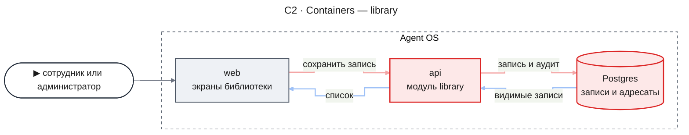
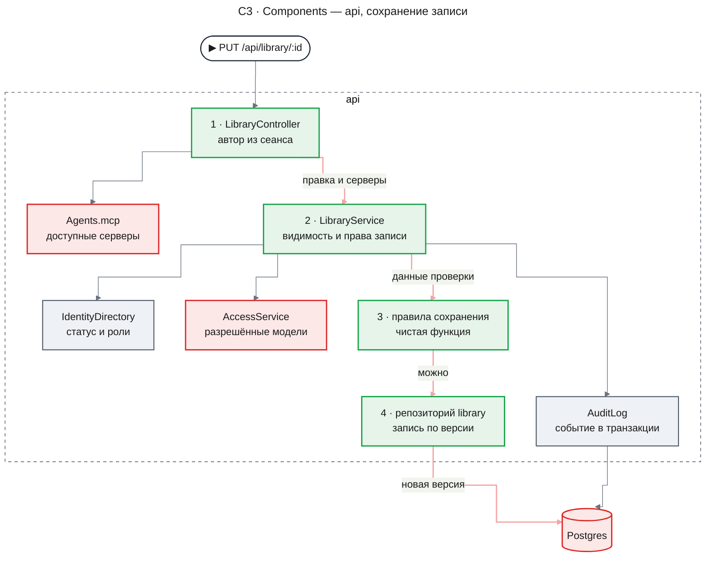
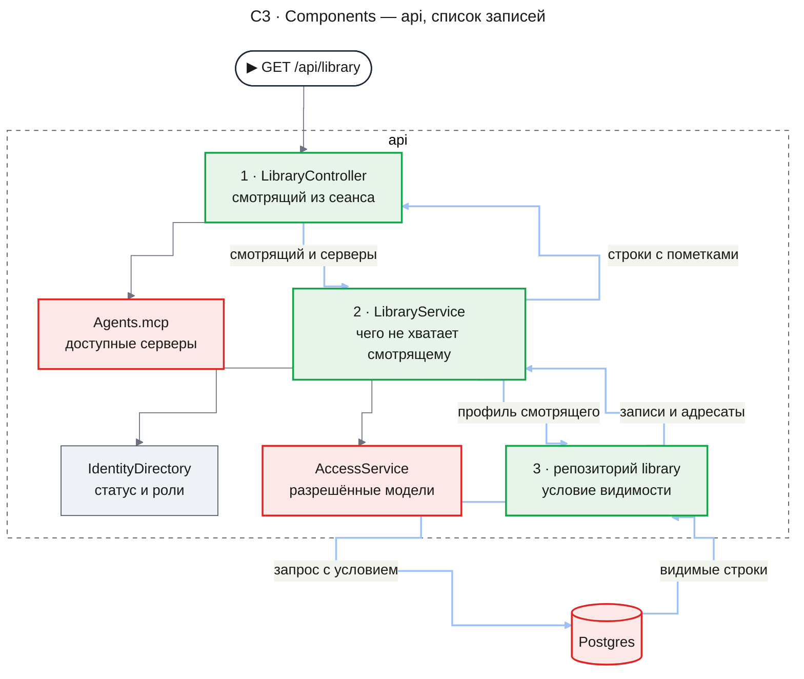
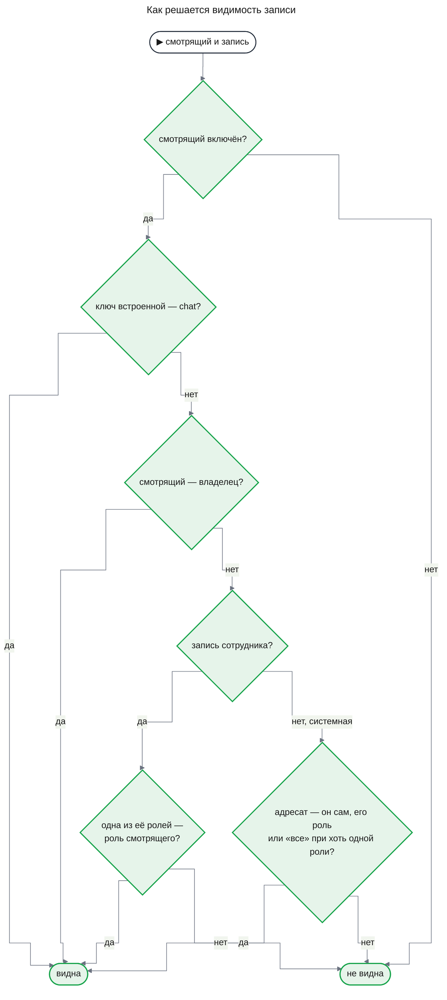
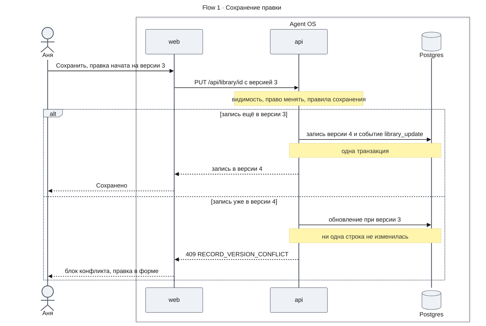
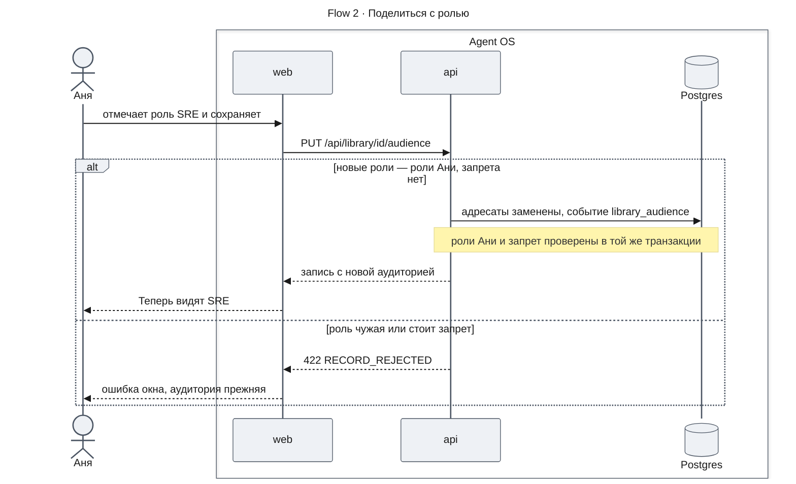
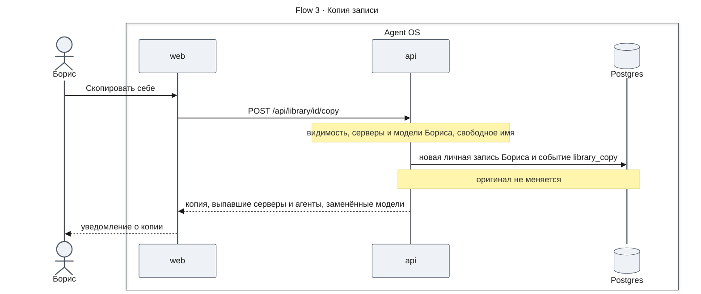
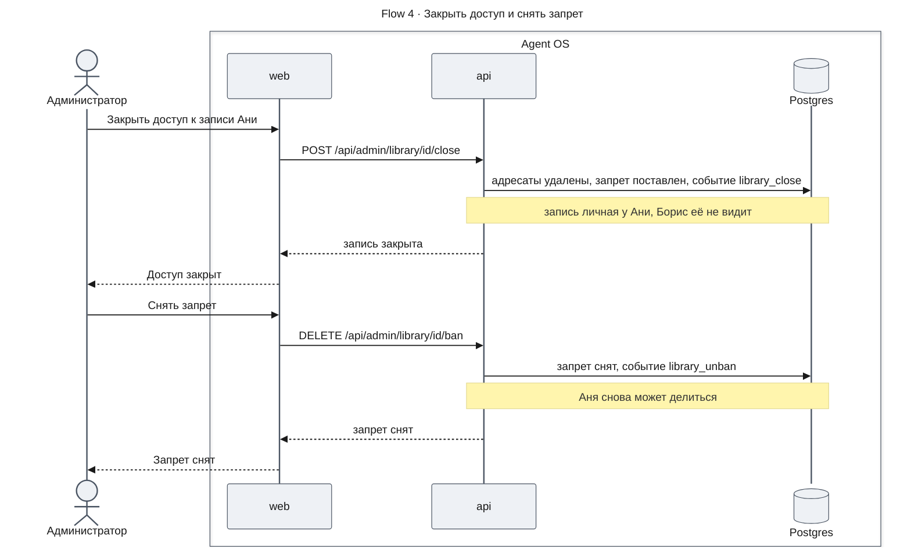
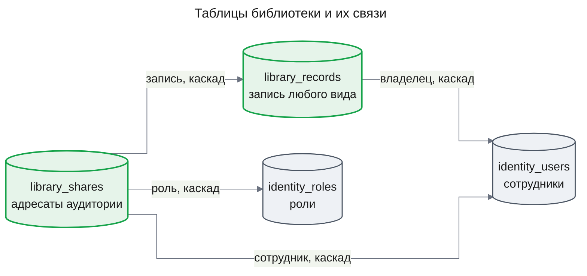
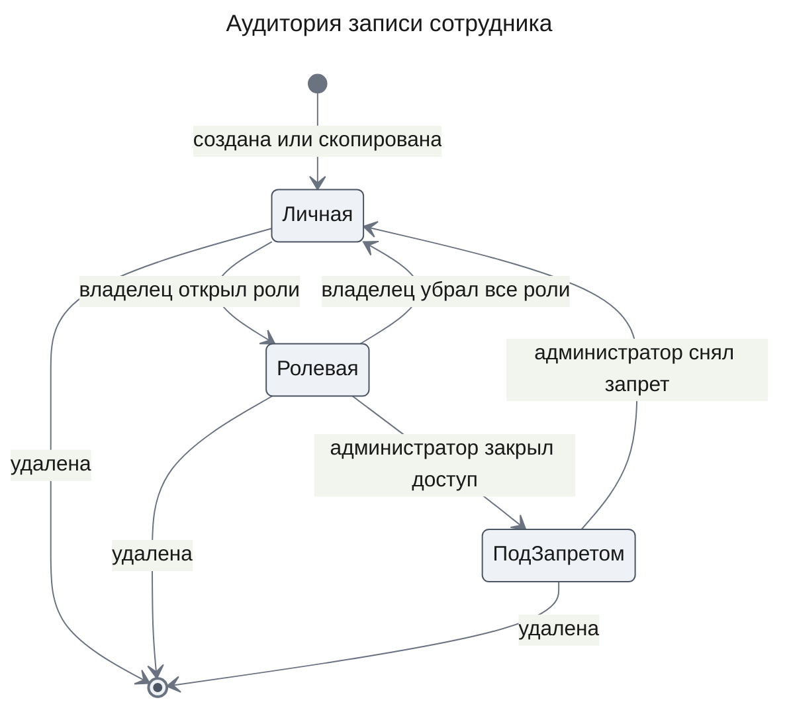

# Библиотека агентов — Design Document — library

**Status:** Approved · **Date:** 2026-11-22 · **PRD:** [prd.md](./prd.md) · **UXRD:** [uxrd.md](./uxrd.md) · **Depends on:** ничего — первая часть

## Snapshot

**Overview.** Агенты и глубокие агенты, которые делают сотрудники и администраторы, — записи библиотеки в базе. Эта часть хранит записи, решает, кто какую запись видит и кто может её менять, и отдаёт это трём потребителям: экранам — через HTTP, запуску агентов и инструментам записей главного чата — через операции модуля в `apps/api`. Кто видит запись, решает одно правило: свою — владелец, ролевую — те, кто сейчас состоит в её ролях, системную — те, кому её открыл администратор. Каждое чтение проходит через это правило, и невидимая запись отвечает так же, как несуществующая. При сохранении сервер сверяет серверы и модели с действующими правами автора, ведёт номер версии, отклоняет правку, начатую на старой версии, и пишет событие аудита без текста промпта.

- **Не меняется**: права на серверы и модели (`access_grants`) и их проверка перед каждым вызовом (`AccessGate`). Запуск записей и встроенные записи — часть `runtime`; глубокий агент и инструменты записей главного чата — [deep-agents design-agent-types.md](../deep-agents/design-agent-types.md).
- **Главный риск**: ошибка в правиле видимости открывает чужую личную запись. Защита — одно правило в одном запросе и один табличный тест по всем маршрутам ([Risks and Mitigation](#risks-and-mitigation)).
- **Открытые вопросы**: нет.

### Key Decisions

#### KD-1: Библиотека — модуль `library` в `apps/api` с двумя таблицами: `library_records` (одна строка на запись любого вида, содержимое — jsonb) и `library_shares` (адресаты аудитории); обе ссылаются на сотрудников и роли внешним ключом с каскадом

Видимость записи зависит от ролей сотрудника, а роли и сотрудники живут в `apps/api` (`identity_*`). Таблицы библиотеки встают рядом с ними, как таблицы прав `access_*` ([ADR-0015](../../adr/ADR-0015-access-gate-and-model-catalogue.md)), и получают каскад даром: удалённая из базы учётная запись уносит свои записи и их адресатов (AC-11.2), удалённая роль — свои адресаты (FR-11). Общие поля всех видов — столбцы, а содержимое вида — один столбец jsonb, который проверяет схема этого вида. Вид — значение `RecordKindSchema` (`agent`, `deep_agent`) со своей схемой содержимого; доступ, копия, версия и аудит у всех видов общие (FR-01). Пакеты таблиц не читают: они получают записи через операции `LibraryService` ([Contract Definitions](#contract-definitions)).

Варианты, которые не взяты:

- **Таблицы в пакете `agents` с ролями и владельцем текстом.** Каскада нет, и удаление роли или сотрудника пришлось бы чистить кодом. Видимость всё равно требует ролей из `apps/api`, то есть порта в обратную сторону.
- **Таблица на каждый вид.** Каждое правило доступа и каждый запрос видимости пришлось бы повторять по числу видов.
- **Аудитория массивом в строке записи.** Массив ролей не держит внешний ключ, поэтому удаление роли не убирает её из аудитории.
- **Записи в `access_grants`.** Права выдаёт только администратор, а аудиторию задаёт и сотрудник; смешение двух механизмов размыло бы обе проверки.

Решение записано в [ADR-0016](../../adr/ADR-0016-library-records-and-visibility.md).

#### KD-2: Кто видит запись, решает одна процедура; все чтения — список, запись по номеру, копия, операции для `runtime` и чата — идут через один запрос репозитория с этим условием, и невидимая запись отвечает как несуществующая

Процедура описана в [«Как решается видимость»](#как-решается-видимость). Её вход — смотрящий (включён ли и в каких ролях состоит сейчас, из `IdentityDirectory.isActive` и `rolesOf`) и запись с адресатами. Право администратора видимость не расширяет: все системные записи и записи сотрудников, открытые ролям, администратор читает отдельными маршрутами панели, а чужие личные не получает никогда (NFR-01). Системную запись, которую ещё никому не открыли, видят только в панели; чтобы запустить её в своём чате, администратор открывает её себе. Определение главного чата (ключ встроенной записи `chat`) видно каждому включённому сотруднику: так его получает и сотрудник без ролей. Сотрудник без каких-либо прав увидит эту запись, но чат ему не ответит — модель отклонит `AccessGate`.

Так «чужое = нет» из [auth-boundary.md](../../code-system/patterns/auth-boundary.md) расширяется с поиска по владельцу на поиск по видимости. Записи целиком репозиторий читает ровно через два условия. Процедура видимости (`findVisibleRecords`) обслуживает все маршруты сотрудника и все операции для `runtime` и чата. Условие панели (`findPanelRecords`) обслуживает маршруты `/api/admin/library` и системные записи, которые администратор правит из чата: системные записи и записи сотрудников, у которых есть роль-адресат и нет запрета, — личной записи оно не находит никогда. Третьего чтения записей нет, поэтому маршрут не может забыть проверку.

Кроме них, у репозитория два узких чтения, и ни одно не отдаёт описания и содержимого:

- список запретов и запрет одной записи по номеру: условие панели исключает записи под запретом, поэтому `GET /api/admin/library/bans` и снятие запрета из него не построить;
- имена записей одного владельца и имена всех системных записей (`recordNames`): обе группы нужны правилу имён и выбору имени копии.

Варианты, которые не взяты:

- **Проверка в каждом обработчике после чтения строки.** Каждый новый маршрут — новое место, где проверку можно забыть.
- **Чтение всех записей и фильтр в памяти чистой функцией.** Сервер читал бы чужие личные записи, чтобы их выбросить, и время списка росло бы с размером библиотеки.

#### KD-3: Содержимое записи хранится в форме своего вида — `AgentContentSchema` или `DeepAgentContentSchema` из `packages/contracts`; имя записи — свободный текст, а другие записи содержимое называет по номеру

Форму содержимого читают три стороны: сервер при сохранении, веб в редакторе и карточке записи и `runtime` при запуске. Веб видит только `contracts` и `common`, поэтому схема живёт в `contracts`. Имя и описание — столбцы записи, в содержимом их нет. Агенты, которых агент может запускать, содержимое называет номерами записей, а не именами (FR-17), поэтому переименование их не ломает. Поля агента — в [Contract Definitions](#contract-definitions); содержимое глубокого агента описывает [design-agent-types.md](../deep-agents/design-agent-types.md#contract-definitions). Как содержимое записи превращается в определение запуска, решает `runtime`.

Вариант, который не взят: **содержимое без схемы, проверка только при запуске** — запись с неизвестным инструментом или `*` у сотрудника сохранялась бы и падала у получателей.

#### KD-4: При сохранении сервер проверяет только то, что автор добавил: новые серверы — среди доступных автору, новые агенты — среди видимых ему; выбранную модель — среди разрешённых автору, если у него есть хоть одна разрешённая; факты реестра приходят в сервис входом от вызывающего

Сервер доступен автору, если он включён и автору разрешён хотя бы один его инструмент. Это правило есть в пакете `agents` (`usableServer`), и операция `Agents.mcp.usable(ownerId)` отдаёт его итог наружу, а не повторяет его в `apps/api`. Сервер, который уже был в записи, остаётся при любом сохранении, даже если автор потерял на него право (AC-07.2).

Модель записи — номер модели или `null`. `null` значит модель чата по умолчанию, которую выбирает администратор; сохранение её не проверяет, её проверяет старт. Выбранную модель, которая автору не разрешена, сохранение отклоняет, если у автора есть другая разрешённая. Если разрешённых моделей у автора нет ни одной, модель не проверяется: отказ не дал бы ничего поправить, а копия по AC-05.5 сохраняет модель оригинала.

Проверка идёт по каждой части содержимого: у агента — по самой записи, у глубокого агента — по нему и по каждому сабагенту. Отказ называет часть и значения, которые нарушили правило ([design-agent-types.md](../deep-agents/design-agent-types.md), KD-4).

«Разрешённые модели» — разрешённые правами и есть в каталоге, без учёта квоты: исчерпанная квота временна. Это список «Мой доступ», и в его порядке (по отображаемому имени, затем по номеру модели) «первая разрешённая» из FR-05 — верхняя модель в выборе модели. Операция `AccessService.allowedModels` отдаёт этот список. Она и `myModels` строятся на одном закрытом помощнике сервиса над чистой функцией `allowedCatalogue` (`apps/api/src/access/effective-access.ts`).

Администратор, который правит системную запись, выбирает из всего реестра и каталога (FR-07): новые серверы — любые зарегистрированные или «все серверы», новая модель — любая из каталога. Сотруднику «все серверы» недоступны.

`LibraryService` не знает модуль агентов (KD-6), поэтому доступные серверы и имена реестра ему передаёт вызывающий: маршруты и инструменты записей берут их из `Agents.mcp`.

Проверки сохранения не защищают права: агент получает только инструменты и модели запускающего, и это держит `AccessGate` перед каждым вызовом. Проверки держат согласие записи с тем, что автор видит в редакторе.

Варианты, которые не взяты:

- **Свести доступность сервера к строкам прав в `apps/api`.** Правило расходилось бы с `usableServer`: сервер выключенный или с запрещёнными по одному инструментами считался бы доступным.
- **Спрашивать модель через `AccessGate.model`.** Ответ включает исчерпанную квоту и модель вне каталога, и сохранение отклонялось бы до конца месяца.
- **Отклонять сохранение с потерянным сервером.** Противоречит AC-07.2: автор не мог бы поправить даже промпт.

#### KD-5: Версия — число в строке записи; сохранение содержимого проходит, только если запись ещё в той версии, с которой начата правка, и тогда версия растёт на единицу; аудитория, переключатель и запрет делиться версию не меняют

Запуск хранит копию определения и номер версии, поэтому версия считает изменения того, что запуск копирует: имени, описания и содержимого. Тело сохранения несёт номер версии, с которой правка начата. Если запись уже в другой версии, ничего не меняется, и ответ — 409 `RECORD_VERSION_CONFLICT` (AC-08.1). Истории версий нет (FR-08). Окно «Поделиться» пишет аудиторию последним словом: у записи один владелец, и гонку двух его окон за аудиторию PRD не описывает.

Варианты, которые не взяты:

- **Сравнение даты правки.** Две правки в одну миллисекунду неотличимы, а номер версии всё равно нужен запуску.
- **Таблица версий.** История и откат — Won't Have.

#### KD-6: Модуль делится на два: `LibraryModule` — сервис, репозиторий и настройки, без импорта модуля агентов; `LibraryApiModule` — маршруты сотрудника и панели, посев встроенных записей и регистрация инструментов записей, он импортирует оба

`AgentsModule` импортирует `LibraryModule`: пакет `agents` получает записи через порт `RecordLibrary`, который реализует `LibraryService`. Если бы `LibraryModule` импортировал `AgentsModule` ради реестра серверов, Nest упал бы на круговом импорте при старте. Тот же разрез сделан для прав (`AccessModule` и `AccessAdminModule`) и записан паттерном [port-module-split.md](../../code-system/patterns/port-module-split.md).

Варианты, которые не взяты:

- **`forwardRef` между модулями.** Скрывает порядок сборки, и провайдер может получить ещё не собранную зависимость.
- **Один модуль, реестр через `ModuleRef` в момент вызова.** Зависимость не видна в импортах модуля.

#### KD-7: Аудит — свой вид события на каждое действие с записью, в транзакции этого действия; «было» и «стало» — выборка полей без содержимого и описания

Виды: `library_create`, `library_update`, `library_audience`, `library_copy`, `library_delete`, `library_close`, `library_unban`; тип объекта `library_record`. Выборка: вид записи, имя, владелец, версия, переключатель, адресаты аудитории номерами, дата закрытия доступа и, у копии, номер оригинала. `AuditLog` прячет только поля с именами секретов, а `prompt` к ним не относится, поэтому текст промпта не попадает в аудит потому, что его нет в выборке (FR-10). Событие пишется в той же транзакции, что изменение, поэтому откаченное изменение не оставляет события.

Варианты, которые не взяты:

- **Общий вид `admin_change`.** Сотрудник — не администратор, а сценарий AC-10.1 удобнее читать по видам действий.
- **Вся строка записи в «было» и «стало», как у прав.** В аудит попал бы промпт.

#### KD-9: «Максимум шагов» новой записи — настройка администратора в единственной строке таблицы `library_settings`; веб ставит её в форму новой записи, а сервер в запись её не подставляет

Администратор решает, с каким лимитом шагов начинается новая запись. Таблица устроена по паттерну [settings-row.md](../../code-system/patterns/settings-row.md): ключ всегда `true`, и проверка базы держит одну строку. Миграция создаёт эту строку со значением `RECORD_MAX_TURNS_DEFAULT` (40). Веб получает значение полем `defaultMaxTurns` в `GET /api/library/choices` и ставит его в форму новой записи; панель читает и меняет его маршрутами `/api/admin/library/settings`. Поле `maxTurns` в теле записи обязательно, и сервер его не подставляет. Инструменты записей главного чата настройку не читают: `maxTurns` задаёт модель в аргументах. Встроенные записи берут свои значения из посева, а сохранённые записи смена настройки не меняет.

Сохранение настройки меняет не запись, а настройку библиотеки, поэтому оно пишет общий вид `admin_change` с типом объекта `library_settings`, как настройки входа, а не вид из KD-7. В «было» и «стало» — только `defaultMaxTurns`; ту же пару и автора пишет строка лога.

Варианты, которые не взяты:

- **Постоянная в вебе.** Значение менялось бы только сборкой, а настройки платформы живут в базе и меняются в панели.
- **Значение по умолчанию на сервере, когда тело без `maxTurns`.** Запись перестала бы нести свой лимит явно: тело без поля получало бы то значение, которое стоит в настройке в момент сохранения.

## Terms

- **Запись** — агент или глубокий агент в библиотеке (PRD, Terms).
- **Запись сотрудника** — у записи есть владелец; **системная** — владельца нет.
- **Адресат** — один элемент аудитории: роль, сотрудник или «все». Строка `library_shares`.
- **Смотрящий** — сотрудник, от имени которого идёт чтение: автор запроса HTTP, запускающий в `runtime` или сотрудник беседы, чей чат вызвал инструмент записей.
- **Видимая запись** — запись, которую процедура видимости открывает смотрящему.
- **Запрет делиться** — отметка о закрытии доступа администратором на записи сотрудника (PRD, Terms).
- **Ключ встроенной записи** — строка, по которой `runtime` находит свою системную запись при любом её имени.
- **Доступный сервер** — включённый сервер реестра, у которого сотруднику разрешён хотя бы один инструмент.
- **Разрешённые модели** — модели каталога, разрешённые сотруднику правами, без учёта квоты, в порядке списка «Мой доступ».
- **Модель чата по умолчанию** — модель, которую администратор выбрал в `access_model_defaults`; её читает `AccessService.defaultChatModel`. На ней работает запись с моделью `null`.

## Part

- **Part**: `library`
- **Covers**: FR-01, FR-02, FR-03, FR-04, FR-05, FR-06, FR-07, FR-08, FR-09, FR-10, FR-11
- **Depends on**: нет — первая часть
- **Prerequisite ADRs**: [ADR-0003](../../adr/ADR-0003-drizzle-data-layer.md) (схема `app`, миграции drizzle), [ADR-0004](../../adr/ADR-0004-agent-framework-packages.md) (правила пакетов), [ADR-0012](../../adr/ADR-0012-closed-api-and-server-issued-employee-id.md) (сеанс, владелец из `req.user.id`, внешний ключ у таблиц слоя приложения), [ADR-0014](../../adr/ADR-0014-mcp-registry-owned-by-agents.md) (реестр серверов в `agents`), [ADR-0015](../../adr/ADR-0015-access-gate-and-model-catalogue.md) (права и каталог в `access`), [ADR-0018](../../adr/ADR-0018-model-id-provider-prefix.md) (номер модели с префиксом провайдера), [ADR-0021](../../adr/ADR-0021-deep-agent-record-kind.md) (вид `deep_agent`)
- **Sibling parts**: `runtime` ([design-runtime.md](design-runtime.md)) получает операции из [Contract Definitions](#contract-definitions); `web` ([design-web.md](design-web.md)) строит экраны над маршрутами HTTP

**Out of scope**

- Запуск записей: снимок определения при старте, проверка видимости перед стартом, список записей в главном чате — часть `runtime`. Эта часть даёт для них операции.
- Содержимое встроенных записей — часть `runtime`. Эта часть даёт ключ встроенной записи, посев и правила «не удалять встроенную» и «аудитория `chat` не меняется».
- Схема содержимого глубокого агента, запуск по брифу, пять инструментов записей главного чата и их карточка — [design-agent-types.md](../deep-agents/design-agent-types.md). Эта часть хранит запись и даёт инструментам операции.
- Знания глубокого агента и маршруты `/api/library/:id/knowledge` — [self-learning design-core.md](../self-learning/design-core.md). Эта часть даёт им правило доступа `LibraryService.knowledgeTarget`.
- Экраны — часть `web`.
- Права на серверы и модели, их выдача и проверка перед вызовом, таблица `access_grants`.
- Удаление сотрудника через API: его нет; каскад срабатывает при удалении строки из базы.

**Constraints**

- PoC: схема меняется миграциями, переноса старых данных нет.
- Изоляция данных (бизнес-ограничение 2, NFR-01): каждый маршрут библиотеки покрыт тестом с двумя сотрудниками и администратором (UC-E1).
- Аудит (FR-10) пишется в транзакции изменения и без текста промпта (KD-7).
- Настройки живут в базе: модель новой записи — модель чата по умолчанию, «Максимум шагов» — строка `library_settings` (KD-9).
- Тестов мало: правила — по одной таблице, остальное — по одному случаю на критерий (Test Strategy).

## Building-block Inventory

Follows the [code system](../../code-system/README.md). Поиск перед «new»: `apps/api/src`, `packages/*/src` и `docs/code-system/` — хранилища записей, которыми делятся, и проверки видимости в коде нет.

| Building block | Pattern | Status | Note |
|---|---|---|---|
| `LibraryModule`: `LibraryService` (сотрудник и часть `runtime`), `LibraryPanelService` (панель), `LibraryChatService` (инструменты записей) над общими `LibraryRecords` и `LibrarySave`, репозиторий `library` | [repository-over-transaction.md](../../code-system/patterns/repository-over-transaction.md) | new | сервис открывает транзакцию, пишет запись и аудит (KD-1) |
| Условие видимости в репозитории | [auth-boundary.md](../../code-system/patterns/auth-boundary.md) | extended | поиск по видимости вместо поиска по владельцу (KD-2) |
| Правила сохранения, аудитории и копии | [pure-decision.md](../../code-system/patterns/pure-decision.md) | new | три чистые функции, по таблице тестов на каждую |
| `LibraryApiModule`: `LibraryController`, `AdminLibraryController`, `BuiltinRecordsSeeder`, регистрация инструментов записей | [port-module-split.md](../../code-system/patterns/port-module-split.md) | new | второе использование после `access` (KD-6) |
| Таблицы `library_records`, `library_shares` | [ADR-0003](../../adr/ADR-0003-drizzle-data-layer.md) | new | адресат «роль или сотрудник» — как у `access_grants` |
| `LibrarySettingsService` и таблица `library_settings` | [settings-row.md](../../code-system/patterns/settings-row.md) | new | одна строка настроек; сохранение и аудит в одной транзакции (KD-9) |
| `packages/contracts/src/library.ts` | — | new | схемы тел, ответов и содержимого, коды ошибок |
| `IdentityDirectory` | — | extended | `isActive` и `rolesOf` — вход процедуры видимости; `existing({ roleIds, userIds })` — какие из названных ролей и сотрудников есть; `roleNames` и `userNames` — имена адресатов и автора записи, которые `LibraryRecords` добавляет к прочитанным записям. `existing` зовут и `library` (`holder_not_found`), и `access`; репозитории `identity` вне модуля `identity` никто не импортирует |
| `AuthController` | [auth-boundary.md](../../code-system/patterns/auth-boundary.md) | extended | маршрут `GET /api/auth/me/roles` (FR-03) |
| `AccessService` | — | extended | `allowedModels(ownerId)`; она и `myModels` — над одним закрытым помощником поверх чистой `allowedCatalogue` |
| `Agents.mcp` | [composition-root.md](../../code-system/patterns/composition-root.md) | extended | операция `usable(ownerId)` над `usableServer` |
| `AuditLog`, `SessionGuard` с `@AdminOnly()`, `apiError`, `ZodValidationPipe` | [auth-boundary.md](../../code-system/patterns/auth-boundary.md), [logging.md](../../code-system/patterns/logging.md) | reused | — |

## Acceptance Criteria

### FR-01: Запись библиотеки

- From the PRD: AC-01.1, AC-01.2
- Новая запись — личная, в версии 1, с включённым «предлагать в главном чате», без запрета делиться (DC-1).

### FR-02: Кто видит запись

- From the PRD: AC-02.1, AC-02.2, AC-02.3
- Удалённая, невидимая и несуществующая запись и номер не в формате UUID дают один и тот же ответ 404 `RECORD_NOT_FOUND` на каждом маршруте сотрудника (DC-2).
- Право администратора не открывает записей сверх процедуры видимости: системную запись, никому не открытую, администратор видит только в панели (DC-3).

### FR-03: Мои роли

- From the PRD: AC-03.1

### FR-04: Поделиться

- From the PRD: AC-04.1, AC-04.2, AC-04.3
- Роль, которой запись уже открыта, остаётся в аудитории при сохранении окна, даже если владелец из неё вышел; проверку «своя роль» проходят только добавленные роли (DC-4).

### FR-05: Копия

- From the PRD: AC-05.1, AC-05.2, AC-05.3, AC-05.4, AC-05.5
- Копия называется «{имя} — копия» на языке страницы копирующего, а если имя занято — «{имя} — копия {N}» с наименьшим свободным N; если имя копии длиннее 80 знаков, имя оригинала обрезается так, чтобы суффикс поместился (DC-5).
- Копия записи со «всеми серверами» получает список серверов, доступных копирующему (DC-6).
- Агенты, которых запись может запускать, остаются в копии, только если копирующий их видит; ответ копии перечисляет выпавшее и заменённое (DC-7).

### FR-06: Имя и описание

- From the PRD: AC-06.1, AC-06.2, AC-06.3
- Имя — от 1 до 80 знаков без пробелов по краям, без управляющих символов и переводов строки; уникально у владельца без учёта регистра и вида; описание — от 1 до 300 знаков. Проверка «имя системной записи» идёт, только когда имя меняется (DC-8).

### FR-07: Инструменты и модель из своих прав

- From the PRD: AC-07.1, AC-07.2, AC-07.3
- Сохранение записи сотрудника с выбранной моделью, которая автору не разрешена, отклоняется с причиной `model_not_allowed`, если у автора есть хоть одна разрешённая модель; без разрешённых моделей и у модели `null` модель не проверяется (DC-9).
- «Все серверы» в записи сотрудника отклоняются с причиной `all_servers_not_allowed` (DC-10).

### FR-08: Версия и конфликт сохранения

- From the PRD: AC-08.1
- Сохранение окна «Поделиться», закрытие доступа и снятие запрета версию не меняют (DC-11).

### FR-09: Администратор и записи сотрудников

- From the PRD: AC-09.1, AC-09.2, AC-09.3, AC-09.4

### FR-10: Аудит записей

- From the PRD: AC-10.1

### FR-11: Удаление и изменения в ролях

- From the PRD: AC-11.1, AC-11.2, AC-11.3

## Design

### Architecture (C1–C4)

C1 не меняется: новых людей и внешних систем нет.

#### C2 · Containers

- `api` получает модуль `library`: маршруты библиотеки и панели, видимость, проверки сохранения, версию и аудит, а также операции, которые вызывают пакет `agents` и инструменты записей внутри того же процесса.
- `Postgres` получает таблицы `library_records`, `library_shares` и `library_settings` в схеме `app`.
- `web` в этой части не меняется: экраны строит часть `web` над маршрутами из [Contract Definitions](#contract-definitions).

#### C3 · Components: api

**api — сохранение записи**

- `LibraryController` берёт автора и его право администратора из `req.user`, спрашивает `Agents.mcp.usable` о доступных ему серверах и передаёт их в сервис вместе с телом.
- `LibraryService` находит запись через условие видимости, решает, может ли автор её менять, и собирает вход правил: статус и роли (`IdentityDirectory.isActive`, `rolesOf`), разрешённые модели (`AccessService.allowedModels`), прежнее содержимое и видимых автору агентов.
- Правила сохранения (`decideSave`) — чистая функция: по входу она отвечает «можно» или отказом с причиной, частью записи и значениями (KD-4).
- Репозиторий меняет запись, только если она ещё в версии из тела, и вместе с ней в той же транзакции `AuditLog` пишет событие (KD-5, KD-7).

Сохранение из чата идёт тем же путём: инструмент записей берёт серверы из `Agents.mcp` и зовёт операции `LibraryChatService` ([Contract Definitions](#contract-definitions), «Для инструментов записей главного чата»).

**api — список и чтение записи**

- Репозиторий строит один запрос с условием видимости; чтение по номеру, копия и операции для `runtime` и чата зовут тот же запрос с номером или ключом встроенной записи.
- Сервис помечает у каждой записи, каких серверов и моделей смотрящему не хватает (`missingRights`), и проецирует аудиторию: чужой записи смотрящий видит только свои роли (FR-03).
- Пакет `agents` вызывает `LibraryService` напрямую через порт `RecordLibrary`, минуя контроллер.

#### Как решается видимость

Процедура отвечает «видна» или «не видна» для пары «смотрящий — запись». Вопросы идут сверху вниз, первый ответ решает.

Роли смотрящего читаются в момент запроса, поэтому снятие с роли и удаление роли закрывают её записи со следующего чтения (AC-11.1). Владелец видит свою запись всегда, даже выйдя из её ролей (AC-11.3). Адресатом записи сотрудника бывает только роль; сотрудник и «все» есть только у системных записей. Право администратора в процедуре не участвует (DC-3), а отключение автора видимость не меняет (AC-09.2).

### Runtime Flows

Все потоки идут одним путём: сотрудник или администратор — веб — API — база.

#### Flow 1: Сохранение правки и конфликт версии

**Starts when:** автор нажимает «Сохранить» в редакторе, для AC-08.1, AC-07.1, AC-06.1

**Outcome:** запись в версии 4, одно событие `library_update`; вторая вкладка получает конфликт, и запись остаётся в версии 4.

**Failure handling:**

- Правила сохранения отклонили правку (сервер недоступен автору, модель не разрешена, «все серверы» у сотрудника, агент не виден) → 422 `RECORD_REJECTED` с причиной; база не меняется.
- Имя занято у автора или совпадает с именем системной записи → 409 `RECORD_NAME_TAKEN` с причиной `own` или `system`; база не меняется. Одновременное создание двух записей с одним именем отклоняет уникальный индекс, и вторая получает тот же ответ.
- Тело не прошло схему своего вида или его вид не совпадает с видом записи → 400 `VALIDATION_FAILED`.
- Запись не видна автору → 404 `RECORD_NOT_FOUND`; видна, но менять её он не может → 403 `RECORD_READ_ONLY`.

#### Flow 2: Поделиться с ролью

**Starts when:** владелец сохраняет окно «Поделиться», для AC-04.1, AC-09.3

**Outcome:** запись видна участникам роли со следующего чтения, у неё одно событие `library_audience`; версия не меняется.

**Failure handling:**

- Добавлена роль, в которой владелец не состоит → 422 `RECORD_REJECTED`, причина `role_not_member`.
- На записи стоит запрет делиться, а в теле есть хоть одна роль → 422 `RECORD_REJECTED`, причина `sharing_banned`.
- Запись системная или чужая, но видимая → 403 `RECORD_READ_ONLY`; невидимая → 404 `RECORD_NOT_FOUND`.

#### Flow 3: Копия

**Starts when:** смотрящий выбирает «Скопировать себе», для AC-05.1, AC-05.3, AC-05.4, AC-05.5

**Outcome:** у Бориса личная запись в версии 1 с серверами, доступными ему, и моделями по правилу замены; оригинал не меняется, и его правки копию не трогают (AC-05.2).

**Failure handling:**

- Запись не видна → 404 `RECORD_NOT_FOUND`, копии нет.

Правило замены модели действует на каждую выбранную модель содержимого: у агента — одну, у глубокого агента — его собственную и модель каждого сабагента. Модель `null` копируется как есть: на старте её заменит модель чата по умолчанию.

1. Модель разрешена копирующему → остаётся.
2. Иначе модель чата по умолчанию выбрана и разрешена ему → она.
3. Иначе у него есть разрешённые модели → первая из них в порядке «Мой доступ».
4. Иначе модель остаётся, а `missingRights` копии её помечает (AC-05.5).

#### Flow 4: Администратор закрывает доступ и снимает запрет

**Starts when:** администратор выбирает «Закрыть доступ», а позже «Снять запрет» в панели, для AC-09.1, AC-09.4

**Outcome:** после закрытия у записи нет адресатов и есть дата закрытия; владелец видит её в своей библиотеке с этой датой и не может открыть ролям (AC-09.3), а в списке запретов она стоит без промпта. После снятия запрета владелец снова делится.

**Failure handling:**

- Запись личная, системная или удалена → 404 `RECORD_NOT_FOUND`: личных записей администратор не видит (NFR-01).
- Запрета на записи нет → 404 `RECORD_NOT_FOUND` у снятия запрета.
- Закрытие и сохранение окна «Поделиться» одной записи не перемешиваются: то, что идёт вторым, видит итог первого, поэтому владелец не откроет роли запись, которую уже закрыли.

### Contract Definitions

Все маршруты — под глобальной проверкой сеанса; сотрудник берётся только из `req.user.id`. Тела проверяет `ZodValidationPipe` схемами из `packages/contracts/src/library.ts`. Маршруты `/api/admin/library/...` помечены `@AdminOnly()`.

**Маршруты сотрудника**

- **`GET /api/library`** — видимые смотрящему записи, по имени без учёта регистра. Returns список `RecordSummary`. Веб делит его на «Мои» (`mine`), «От коллег» (владелец — другой сотрудник) и «От компании» (`author` пуст).
- **`GET /api/library/:id`** — одна видимая запись с содержимым. Returns `RecordDetail`. 404 `RECORD_NOT_FOUND`, если записи нет, она не видна или номер не UUID.
- **`POST /api/library`** — создаёт личную запись смотрящего из вида, имени, описания и содержимого. Returns `RecordDetail` (DC-1). 400 `VALIDATION_FAILED`, 409 `RECORD_NAME_TAKEN`, 422 `RECORD_REJECTED`.
- **`PUT /api/library/:id`** — сохраняет имя, описание и содержимое своей записи; тело несёт `version`, с которой начата правка. Returns `RecordDetail` с новой версией. Ошибки — как у создания, плюс 404 `RECORD_NOT_FOUND`, 403 `RECORD_READ_ONLY` и 409 `RECORD_VERSION_CONFLICT`. После конфликта веб перечитывает запись, чтобы показать изменившиеся поля. Этим же маршрутом карточка глубокого агента сохраняет переключатель самообучения.
- **`PUT /api/library/:id/audience`** — заменяет аудиторию своей записи: тело — номера ролей и `offerInChat`. Returns `RecordDetail`. 404, 403, 422 `RECORD_REJECTED` с причиной `role_not_member` или `sharing_banned`; номер роли, которой нет, даёт `role_not_member`.
- **`POST /api/library/:id/copy`** — копирует видимую запись в новую личную запись смотрящего (Flow 3). Тело — `language`: язык пометки «копия» и имени встроенной записи. Returns `CopyResult`. 404 `RECORD_NOT_FOUND`.
- **`DELETE /api/library/:id`** — удаляет свою запись. Returns 204. 404, 403 `RECORD_READ_ONLY` (запись чужая или системная).
- **`GET /api/library/choices`** — что сотрудник может выбрать в своей записи. Returns `servers` — имена доступных ему серверов по имени, `defaultModel` — модель новой записи: модель чата по умолчанию по правилу замены из Flow 3, `null`, пока администратор её не выбрал, и `defaultMaxTurns` — «Максимум шагов» новой записи из `library_settings` (KD-9). Список разрешённых моделей с именами веб берёт из `GET /api/access/models`.
- **`GET /api/auth/me/roles`** — роли смотрящего: номер и название, по названию (FR-03). Других ролей и состава ролей ответ не содержит.

**Маршруты панели**

- **`GET /api/admin/library/system`** — все системные записи. Returns список `RecordSummary` с полной аудиторией и `builtinKey`.
- **`GET /api/admin/library/shared`** — записи сотрудников, у которых есть хоть одна роль-адресат: `RecordSummary` с автором (`disabled`, если автор отключён) и всеми ролями. Личных записей и записей под запретом в списке нет. Поиск по имени и автору веб делает в своём списке.
- **`GET /api/admin/library/bans`** — записи под запретом делиться: номер, вид, имя, автор и дата закрытия, без описания и содержимого (AC-09.4).
- **`GET /api/admin/library/settings`** — настройки библиотеки. Returns `LibrarySettings`: `defaultMaxTurns` и `updatedAt` — дата последнего сохранения или `null`, пока стоит значение миграции.
- **`PUT /api/admin/library/settings`** — сохраняет `defaultMaxTurns` в тех же границах, что `maxTurns` записи (от 1 до 200). Returns `LibrarySettings`. Значение вне границ — 400 `VALIDATION_FAILED`, и ничего не меняется. Сохранение пишет `admin_change` и строку лога (KD-9).
- **`GET /api/admin/library/:id`** — `RecordDetail` системной записи или записи сотрудника, открытой ролям; любая другая — 404 `RECORD_NOT_FOUND`.
- **`POST /api/admin/library`** — создаёт системную запись без адресатов: её видят только администраторы. Returns `RecordDetail`. 400, 409 `RECORD_NAME_TAKEN` (имя занято среди системных), 422 `RECORD_REJECTED` (сервера нет в реестре, модели нет в каталоге).
- **`PUT /api/admin/library/:id`** — сохраняет системную запись с `version`, как у сотрудника. Запись сотрудника, открытая ролям, — 403 `RECORD_READ_ONLY` (FR-09).
- **`PUT /api/admin/library/:id/audience`** — заменяет аудиторию системной записи: `everyone`, номера ролей и сотрудников, `offerInChat`. Запись с ключом `chat` — 422, причина `audience_fixed`. Роль или сотрудник, которых нет (`IdentityDirectory.existing`), — 422, причина `holder_not_found`. Запись сотрудника, открытая ролям, — 403 `RECORD_READ_ONLY`; личная или под запретом — 404 `RECORD_NOT_FOUND`.
- **`DELETE /api/admin/library/:id`** — удаляет системную запись. Запись с ключом встроенной — 422, причина `builtin`. Запись сотрудника, открытая ролям, — 403 `RECORD_READ_ONLY`; личная или под запретом — 404 `RECORD_NOT_FOUND`.
- **`POST /api/admin/library/:id/close`** — закрывает доступ к записи сотрудника, открытой ролям: удаляет адресатов и ставит запрет (Flow 4). Returns 204. Иначе 404 `RECORD_NOT_FOUND`.
- **`DELETE /api/admin/library/:id/ban`** — снимает запрет делиться. Returns 204. Нет запрета — 404 `RECORD_NOT_FOUND`.

Не администратор на маршрутах панели получает 403 `ADMIN_REQUIRED` и запись `access_denied` от `SessionGuard`. Создать системную запись маршрутами сотрудника нельзя: владелец там всегда смотрящий (AC-04.2).

**`RecordSummary`** — строка списка

- `id`, `kind` (`agent` или `deep_agent`), `name`, `description`, `version`, `updatedAt`.
- `offerInChat` — «предлагать в главном чате».
- `builtinKey` — ключ встроенной записи или `null`.
- `mine` — смотрящий — владелец.
- `author` — `{ id, name, disabled }` владельца или `null` у системной записи.
- `audience` — `everyone`, `roles` (`{ id, name, member }`, где `member` — смотрящий в этой роли), `users` (`{ id, name }`). Владелец и администратор на системной записи видят аудиторию целиком; остальные — только роли, где `member` истинно, без `everyone` и `users`.
- `ban` — `{ closedAt }` у своей записи под запретом, иначе `null`.
- `missingRights` — список `{ subagent, servers, model }`: чего смотрящему не хватает для запуска. `subagent` — имя сабагента или `null` для самого агента или глубокого агента; `servers` — серверы этой части, которые ему недоступны; `model` — модель, которая ему не разрешена, или `null`. Пустой список — хватает всего. «Все серверы» и модель `null` пропусков не дают.
- `canEdit`, `canShare`, `canDelete` — может ли смотрящий править, делиться и удалять: владелец — свою запись, администратор — системную; делиться нельзя под запретом и у ключа `chat`, удалять нельзя встроенную. Системную запись администратор меняет только маршрутами панели; маршруты сотрудника отвечают ему 403 `RECORD_READ_ONLY`.

**`RecordDetail`** — `RecordSummary` и `content`: `AgentContent` или `DeepAgentContent` по виду.

**`AgentContent`**

- `prompt` — от 1 до 20 000 знаков.
- `servers` — имена серверов реестра без повторов; `*` — «все серверы», только в системной записи.
- `model` — номер модели с префиксом провайдера или `null` — модель чата по умолчанию на старте.
- `maxTurns` — от 1 до 200.
- `agents` — номера записей-агентов, которых агент может запускать; без повторов.
- `tools` — встроенные инструменты платформы из закрытого набора `RecordToolSchema`: `start_agent`, `message_agent`, `list_agents`, `stop_agent`. `run_code` и `start_deep_agent` даёт код, в записи их нет. Редактор поле `tools` не показывает и сохраняет как есть; новая запись начинает с пустого списка.
- `taskList` — ведёт ли запуск список задач, по умолчанию `true` ([design-task-list.md](../deep-agents/design-task-list.md), KD-2).

**`DeepAgentContent`** — `DeepAgentContentSchema`, поля описывает [design-agent-types.md](../deep-agents/design-agent-types.md#contract-definitions).

**`CopyResult`**

- `record` — `RecordDetail` копии.
- `removedServers` — `{ subagent, servers }`: серверы, которых нет в копии.
- `replacedModels` — `{ subagent, from, to }`: заменённые модели.
- `removedAgents` — номера агентов, которых копия не может запускать, потому что копирующий их не видит.

**Для части `runtime`**

Пакет `agents` объявляет порт `RecordLibrary` (`packages/agents/src/start/record-library.ts`) по образцу `AccessGate`, и `LibraryService` его реализует. Все чтения идут через условие видимости от имени запускающего; на невидимую, удалённую и несуществующую запись ответ один — `null`.

- **`resolve(viewerId, recordId)`** — запись для старта. Returns `ResolvedRecord` или `null`.
- **`resolveBuiltin(viewerId, builtinKey)`** — то же по ключу встроенной записи. Returns `ResolvedRecord` или `null`.
- **`listVisible(viewerId)`** — все видимые записи для списка главного чата. Returns `RecordHeader`: `id`, `kind`, `name`, `description`, `version`, `builtinKey`, `author` (`{ id, name, disabled }` или `null`), `mine`, `shared` (у записи есть хоть один адресат), `offerInChat`. Содержимого нет: полное определение берёт `resolve` при старте.
- **`seedBuiltin(input)`** — не входит в порт; его зовёт `BuiltinRecordsSeeder` при старте приложения. Создаёт системную запись с заданными номером, ключом, видом, именем, описанием, содержимым и `everyone`, если записи с этим ключом нет. Существующую не трогает, поэтому правки администратора переживают рестарт. Номер задаёт вызывающий, чтобы встроенные записи могли ссылаться друг на друга и на себя. Пишет `library_create` от имени `system`. Безопасна при двух экземплярах сервера: второй найдёт запись первого.

**`ResolvedRecord`** — заголовок из `listVisible` без `kind`, вид и содержимое своего вида. Номер записи и `version` запуск сохраняет вместе с копией содержимого.

**Для инструментов записей главного чата**

Пять инструментов записей и их отказы описывает [design-agent-types.md](../deep-agents/design-agent-types.md), KD-3 и Contract Definitions. Им `LibraryChatService` даёт операции, которые идут по тем же правилам сохранения, видимости и аудита, что маршруты:

- **`chatContext(actor, servers)`** — сотрудник, доступные ему серверы и, для администратора, реестр, разрешённые модели и модели каталога; читается до транзакции шага.
- **`chatRecords(context)`**, **`chatRecord(context, recordId)`** — видимые записи и, для администратора, системные записи панели; невидимая запись — `null`.
- **`reviewChatChange(context, change)`** — проверка создания, правки или удаления без записи; отвечает отказом или содержимым карточки `library.record`.
- **`saveChatChange(context, card)`** — сохраняет одобренную карточку в точке сохранения транзакции шага: повторяет проверки на версии, которую показала карточка, и пишет версию с событием аудита. Флажок самообучения при создании выключен, при правке берётся из сохранённой версии.

**Error handling**

Коды — объект `LibraryErrorCode` в `packages/contracts/src/library.ts`; тело ответа — общее `{ statusCode, error, errorCode, message, reason? }` от `apiError`, одно постоянное сообщение на код.

- `RECORD_NOT_FOUND` — 404: записи нет, она не видна, номер не UUID, на маршруте панели — запись не из её списков. Тело одно на все случаи (AC-02.1).
- `RECORD_READ_ONLY` — 403: запись видна, но смотрящий не может её менять: получатель, сотрудник на системной записи, администратор на записи сотрудника, открытой ролям (сохранение, аудитория и удаление маршрутами панели). Личную запись и запись под запретом маршруты панели не находят — 404.
- `RECORD_VERSION_CONFLICT` — 409: запись уже не в той версии, с которой начата правка.
- `RECORD_NAME_TAKEN` — 409, `reason`: `own` — имя есть у владельца (у администратора — среди системных); `system` — так называется системная запись.
- `RECORD_REJECTED` — 422, `reason` из `LibraryRejectReasonSchema`: `server_not_allowed`, `all_servers_not_allowed`, `model_not_allowed`, `agent_not_visible`, `role_not_member`, `sharing_banned`, `holder_not_found`, `audience_fixed`, `builtin`.
- `KNOWLEDGE_FORBIDDEN` — 403 маршрутов знаний глубокого агента ([self-learning design-core.md](../self-learning/design-core.md), KD-7).
- `VALIDATION_FAILED` — 400 от `ZodValidationPipe`: тело не прошло схему своего вида, в том числе длина имени и описания (AC-06.3). Тот же ответ даёт сервис на сохранение, где `kind` тела не совпадает с видом записи: вид записи не меняется.

### Data Model

`library_records` хранит одну строку на запись: вид, владельца (пусто у системной), имя, описание, «предлагать в главном чате», ключ встроенной записи, содержимое в форме своего вида, версию, дату закрытия доступа администратором и даты создания и правки. Вид — значение из `RecordKindSchema`, и база проверяет его ограничением, построенным из этого набора. База держит: имя уникально у владельца без учёта регистра, а системные записи образуют одну группу; ключ встроенной записи уникален и бывает только у системной; дата закрытия бывает только у записи сотрудника.

`library_shares` хранит адресатов: в строке ровно один из «роль», «сотрудник» или «все», и пара «запись — адресат» не повторяется. Удаление записи, роли или сотрудника уносит его строки.

Остальное держит сервис: у записи сотрудника адресаты только роли, а у записи под запретом их нет совсем. Имя и статус автора и названия ролей репозиторий читает соединением с `identity_users` и `identity_roles`; пишет эти таблицы только `identity`.

`library_settings` хранит одну строку настроек библиотеки (KD-9): ключ, всегда `true`; «Максимум шагов» новой записи — по умолчанию 40, и база держит границы от 1 до 200; дату последнего сохранения, пустую, пока стоит значение миграции. Автора сохранения пишет событие аудита. Строку создаёт миграция; с другими таблицами она не связана.

### State Transitions and Invariants

Аудитория записи сотрудника:

Ролевая запись становится личной и сама, когда у неё удалили последнюю роль-адресата. Удаление учётной записи владельца из базы удаляет запись из любого состояния.

**Invariants**

1. Владелец записи не меняется за всю её жизнь; у системной записи владельца нет.
2. Адресаты записи сотрудника — только роли; у записи под запретом адресатов нет.
3. Записи целиком читаются только через два условия (KD-2): каждое чтение маршрутов сотрудника и операций для `runtime` и чата проходит процедуру видимости, и невидимая запись отвечает как несуществующая; маршруты панели читают только системные записи и записи сотрудников, открытые ролям и не под запретом. Три узких чтения — запреты, имена записей, блокировка строки — не отдают ни описания, ни содержимого.
4. Администратор никогда не получает содержимое личной записи сотрудника.
5. Имя уникально у владельца без учёта регистра и вида; среди системных — тоже.
6. Версия растёт на единицу при каждом сохранении содержимого, а сохранение со старой версией ничего не меняет.
7. Запись с ключом встроенной всегда системная и не удаляется; аудитория записи с ключом `chat` не меняется.
8. Каждое изменение записи через операции библиотеки пишет одно событие аудита в своей транзакции, и в событии нет содержимого; каскад при удалении роли или учётной записи событий библиотеки не пишет.

## Test Strategy

Правила — три чистые функции: сохранения, аудитории и замены в копии; каждую проверяет одна таблица. Остальные случаи идут через HTTP на настоящей базе, с двумя сотрудниками и администратором; модель не вызывается ни разу. Механику `@AdminOnly()` и одного тела 404 уже проверяют `enterprise-access` и `agent-platform`; здесь UC-E1 и UC-E3 проверяют только, что маршруты библиотеки к ним подключены.

### Main Use Cases

- **UC-1: Создать и открыть снова** — covers AC-01.2
  - Given: у Ани нет записей.
  - When: она создаёт агента и открывает его по номеру.
  - Then: имя, описание, переключатель и содержимое те же; версия 1, переключатель включён, аудитория личная, запрета нет.
- **UC-2: Поделиться с ролью** — covers AC-01.1, AC-02.2, AC-03.1
  - Given: Аня в ролях «SRE» и «Оплаты», Борис в «SRE», Вера без ролей.
  - When: Аня читает свои роли, делится агентом и глубоким агентом с «SRE», Борис открывает оба и сохраняет правку агента.
  - Then: у Ани ровно две роли; Борис видит оба с содержимым, его правка — 403 `RECORD_READ_ONLY`, запись не изменилась; Вера не видит ни одного; в аудите два события `library_audience` одной формы.
- **UC-3: Изменения в ролях** — covers AC-11.1, AC-11.3, AC-04.3
  - Given: агент Ани открыт «SRE».
  - When: Аню снимают с «SRE»; затем снимают Бориса; затем Аня убирает все роли.
  - Then: после первого шага Борис видит агента, а Аня сохраняет правку; после второго Борис получает 404; после третьего агент личный.
- **UC-4: Копия с заменой** — covers AC-05.1, AC-05.2, AC-05.3
  - Given: в агенте Ани серверы Jira и Sentry и модель, которая Борису не разрешена; Борису доступен только Sentry и разрешена модель чата по умолчанию.
  - When: Борис копирует агента, потом Аня сохраняет новую версию оригинала.
  - Then: в копии только Sentry и модель чата по умолчанию; ответ называет выпавший Jira и замену модели; копия Бориса после правки Ани не изменилась.
- **UC-5: Закрытие доступа и запрет** — covers AC-09.1, AC-09.2, AC-09.3, AC-09.4
  - Given: агент Ани открыт «SRE», Аню отключили.
  - When: администратор читает «открытые ролям», закрывает доступ, Аню включают, она открывает агента и пытается открыть его «SRE», администратор читает запреты и снимает запрет, Аня делится снова.
  - Then: в «открытых ролям» агент с `disabled` у автора, и Борис его видит; после закрытия Борис его не видит, у Ани есть дата закрытия, её попытка — 422 `sharing_banned`; в запретах имя, автор и дата без содержимого; после снятия Аня делится.
- **UC-6: Аудит без промпта** — covers AC-10.1
  - Given: у Ани нет записей.
  - When: Аня создаёт агента, правит, делится, Борис копирует, Аня убирает роли и удаляет агента.
  - Then: в аудите ровно шесть событий библиотеки этого сценария — создание, правка, аудитория, копия (с номером оригинала), аудитория без ролей, удаление, — и ни одно не содержит текста промпта.
- **UC-7: Системная запись «всем»** — covers AC-02.3
  - Given: системный агент открыт «всем», у Веры нет ролей.
  - When: Вера читает библиотеку; администратор даёт ей роль; она читает снова.
  - Then: в первый раз агента нет, во второй — есть.

### Error and Edge Use Cases

- **UC-E1: Чужая личная запись — как несуществующая** — covers AC-02.1
  - Given: личный агент Ани, Борис, администратор и номер, которого нет.
  - When: Борис и администратор зовут каждый маршрут сотрудника и панели с номером агента Ани и с несуществующим номером.
  - Then: каждый ответ по агенту Ани равен ответу по несуществующему номеру; списки Бориса и администратора агента не содержат; запись не изменилась.
- **UC-E2: Правила сохранения** — covers AC-06.1, AC-06.2, AC-06.3, AC-07.1, AC-07.2, AC-07.3
  - Given: строки таблицы правил: имя уже есть у автора; имя системной записи; описание в 301 знак; новый сервер без права; сервер в записи, на который право потеряно; «все серверы» у сотрудника; модель не разрешена при другой разрешённой; у автора нет разрешённых моделей; администратор добавляет сервер, на который у него нет права.
  - When: правило решает по каждой строке; через HTTP — одна строка отказа и одна строка «прошло».
  - Then: отказы с причинами из [Error handling](#contract-definitions), а потерянный сервер, отсутствие моделей и выбор администратора проходят; после отказа запись не изменилась.
- **UC-E3: Аудитория и право менять** — covers AC-04.1, AC-04.2
  - Given: Аня не в «Финансах»; системный агент; сотрудник без права администратора.
  - When: Аня открывает запись «Финансам»; сотрудник правит, делится и удаляет системного агента маршрутами сотрудника и панели и сохраняет настройку библиотеки; администратор сохраняет настройку со значением 201.
  - Then: 422 `role_not_member`; 403 `RECORD_READ_ONLY` на маршрутах сотрудника и 403 `ADMIN_REQUIRED` на маршрутах панели, в том числе у настройки; значение 201 — 400 `VALIDATION_FAILED`; аудитория и запись не изменились.
- **UC-E4: Замена модели в копии** — covers AC-05.4, AC-05.5
  - Given: строки таблицы замены: модель разрешена; разрешена только модель чата по умолчанию; разрешены две другие; не разрешено ничего.
  - When: правило замены решает по каждой строке.
  - Then: модель остаётся; модель чата по умолчанию; первая из двух в порядке «Мой доступ»; модель остаётся и отмечена в `missingRights`.
- **UC-E5: Конфликт версии** — covers AC-08.1
  - Given: запись в версии 3.
  - When: два сохранения с версией 3 одно за другим.
  - Then: первое даёт версию 4, второе — 409 `RECORD_VERSION_CONFLICT`; запись в версии 4 с содержимым первого.
- **UC-E6: Учётная запись удалена из базы** — covers AC-11.2
  - Given: личный и ролевой агенты Ани, Борис в роли.
  - When: строку Ани удаляют из базы.
  - Then: Борис не видит ни одного агента, и строк библиотеки Ани в базе нет.

## Security Considerations

- **Authentication & Authorization**: все маршруты закрыты сеансом; маршруты панели — `@AdminOnly()`. Владелец новой записи и автор правки — только `req.user.id`, тело его не несёт. Право менять решает сервис по владельцу записи и `req.user.isAdmin`, а видимость — одно условие репозитория (KD-2). Системную запись меняют только маршруты панели и инструменты записей у администратора; «всех» и сотрудников в аудитории принимает только тело администратора.
- **Input Validation**: тела проверяют схемы `contracts` (длины, формы содержимого, закрытый набор инструментов, `*` без повторов). Права автора, видимость агентов, роли владельца и запрет проверяет сервис до записи; номер записи не в формате UUID не доходит до базы.
- **Sensitive Data Handling**: содержимое чужой записи получают только те, кому она видна, и администратор — у записей, открытых ролям. В аудит и лог не попадают ни промпт, ни описание, ни содержимое: только номера, имена записей, версии и адресаты. Тела ошибок постоянные и не говорят, существует ли невидимая запись.
- **Известное и принятое следствие**: ответ 409 `RECORD_NAME_TAKEN` с причиной `system` говорит сотруднику, что системная запись с таким именем есть, даже если он её не видит. Так работает утверждённое правило: имя системной записи сотрудник занять не может (AC-06.2), и правило имён сверяет имя со всеми системными записями. Более узкий вариант — сверять только с системными записями, видимыми автору, — не взят: AC-06.2 не делает исключения для системных записей, которых автор не видит.

## Risks and Mitigation

- **Ошибка в условии видимости открывает чужую личную запись** — высокое влияние, низкая вероятность. Условий чтения записей два — видимость и условие панели, третьего нет, узкие чтения не отдают описания и содержимого, а UC-E1 проходит каждый маршрут сотрудника и панели с двумя сотрудниками и администратором и так проверяет оба условия.
- **`runtime` понадобится поле содержимого, которого нет в схемах** — среднее влияние, средняя вероятность. Схемы живут в одном месте, `contracts`, и `runtime` меняет их своей частью без переноса данных.
- **Проверки сохранения примут за защиту прав** — высокое влияние, низкая вероятность. KD-4 говорит прямо: права держит `AccessGate` при каждом вызове, а сохранение только согласует запись с редактором.
- **Описание ролевой записи перехватывает выбор чата у всей роли** — риск принят в PRD. Эта часть ограничивает описание 300 знаками и даёт администратору закрытие доступа с запретом.

## Update History

| Version | Date | Change |
|---------|------|--------|
| 1.0–1.5 | 2026-11-17 – 2026-11-18 | Первая версия, утверждение, ADR-0016, сверка с кодом после сборки |
| 1.6 | 2026-11-22 | Сверка с кодом: виды `agent` и `deep_agent`, модель `null` и модель чата по умолчанию, операции для инструментов записей главного чата, `copy` с языком; убраны удалённые виды, сохранение из черновика и приложение с фактами анализа |
