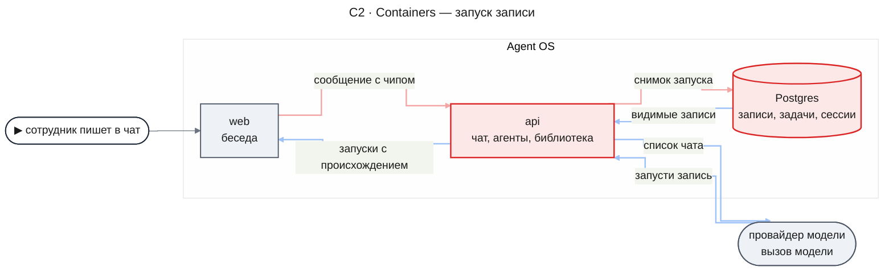
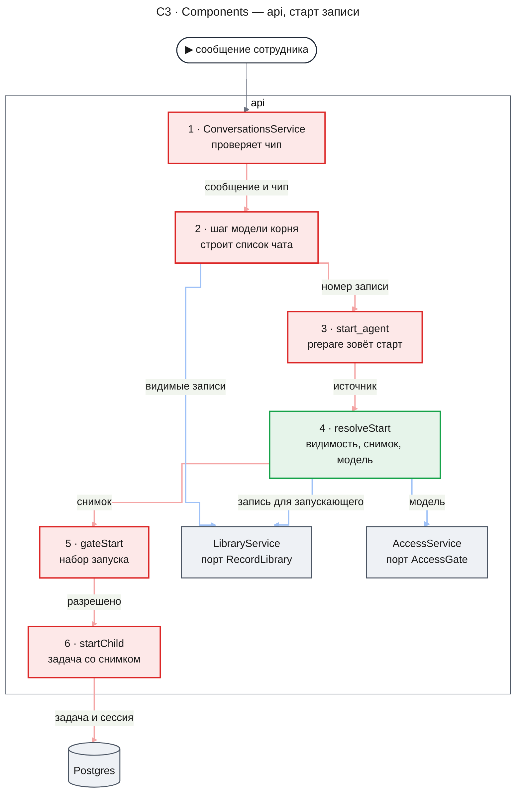
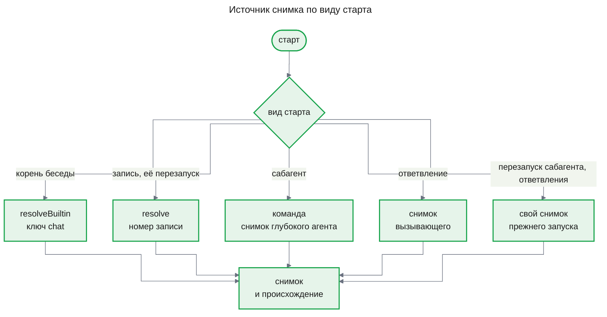
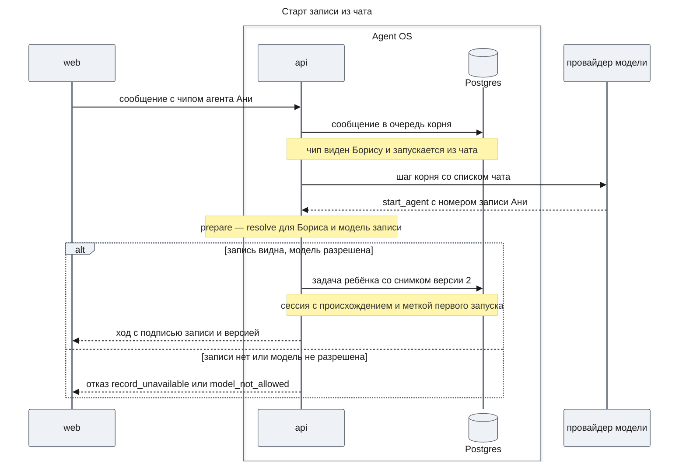

# Библиотека агентов — Design Document — runtime

**Status:** Approved · **Date:** 2026-11-22 · **PRD:** [prd.md](./prd.md) · **UXRD:** [uxrd.md](./uxrd.md) · **Depends on:** [design-library.md](./design-library.md#contract-definitions)

## Snapshot

**Overview.** Запуск агента берёт определение только из записи библиотеки. Перед каждым стартом процедура `resolveStart` спрашивает библиотеку, видна ли запись тому, кто запускает, и сохраняет полную копию определения — снимок — во входе задачи. Дальше шаги читают только снимок, поэтому правка и удаление записи работающих агентов не трогают. Главный чат перед каждым вызовом модели получает список видимых сотруднику записей и запускает их по номеру. Три встроенные записи — главный чат, `general-purpose` и глубокий агент `deep-research` — платформа создаёт в библиотеке при запуске приложения.

- **Не меняется**: права на инструменты и модели и их проверка перед каждым вызовом (`AccessGate`); движок шагов, очередь и подтверждение изменяющих действий; хранение записей и правило видимости — часть `library`; глубокий агент, его сабагенты и инструменты записей — [deep-agents design-agent-types.md](../deep-agents/design-agent-types.md).
- **Главный риск**: список чата читается из библиотеки на каждом шаге модели корня и может съесть бюджет времени до первого токена (NFR-04); замер — UC-N1.
- **Открытые вопросы**: нет.

### Key Decisions

#### KD-1: Запуск хранит снимок записи во входе своей задачи и читает только его

Снимок замораживает всё определение, как требует FR-13, и переживает рестарт сервера, потому что вход задачи лежит в Postgres. Тело снимка — содержимое записи в библиотечной форме: `AgentContent`, `DeepAgentContent` или один сабагент из него; второго формата определения нет. Модель `null` в записи становится моделью чата по умолчанию один раз, при старте ([model-providers design-core.md](../model-providers/design-core.md), KD-5), и сабагенты, ответвления и перезапуски копируют уже готовую модель. Определение, которое шаг передаёт модели, по снимку вычисляет одна чистая функция `snapshotDefinition`; у корня беседы к нему добавляется список чата (KD-4).

Чтение записи на каждом шаге отвергнуто: правка меняла бы работающих агентов (против AC-13.1). Хранить только номер и версию нельзя: прежних версий в библиотеке нет (FR-08). Решение записывает [ADR-0017](../../adr/ADR-0017-run-snapshots-from-library.md).

#### KD-2: Каждый старт проходит одну процедуру `resolveStart` в пакете `agents`: источник → видимость для запускающего → снимок → модель → провайдер

Источник процедура выбирает по виду старта ([«Откуда берётся снимок»](#откуда-берётся-снимок)). Библиотеку она спрашивает только через порт `RecordLibrary` и только от имени запускающего, поэтому автор записи на запуск не влияет. Процедура работает в `prepare` инструмента, до транзакции шага, и ничего не пишет. Отказ по модели несёт готовую запись `access_denied`, и вызывающий пишет её через `auditStartRefusal`, только когда этот отказ стал итогом вызова. Отказы провайдера (`provider_missing`, `provider_disabled`, `provider_key_missing`) и `model_not_configured` описывает [model-providers design-core.md](../model-providers/design-core.md), KD-2 и KD-5. Исчерпанная квота старт не останавливает — запуск упадёт на первом вызове модели; выключенный владелец даёт `OwnerDisabledError`, а не отказ.

Перезапуск записи — новый старт по её номеру на последней видимой версии; если записи нет, перезапуск отклоняется. На своём снимке перезапускаются только сабагент, у которого своей записи нет, и ответвление, которое работало на снимке вызывающего; историю родителя перезапущенное ответвление не наследует. У `start_agent` нет аргумента модели: модель выбрал автор записи, и модель без права останавливает старт (AC-14.4), а не меняется на другую.

Проверка видимости в каждом инструменте отвергнута: новый вид старта стал бы местом, где её забудут.

#### KD-3: Снимок лежит только во входе задачи; строка сессии хранит имя, происхождение и метку первого запуска

Вход задачи (`runtime_tasks.input`) шаг и так читает каждый раз. По нему первая попытка шага создаёт сессию, если старт упал, и по нему перезапуск сабагента берёт снимок. В строке сессии (`agent_sessions`) лежит то, что читают виды и счёт запусков: имя, происхождение и метка «первый запуск этой записи у этого сотрудника».

Вторая копия снимка в сессии отвергнута: две копии до 200 КБ читали бы разные места.

#### KD-4: Главный чат получает список видимых записей на каждом шаге модели корня и запускает запись по номеру; чип приходит полем сообщения

На каждом шаге модели корень читает `listVisible` запускающего и оставляет записи, которые чат может предложить (`inRootLaunchSet`): свои всегда, чужие — с включённым «предлагать в главном чате», запись `chat` — никогда. Агенты идут в описание `start_agent`, глубокие агенты — в описание `start_deep_agent`. Строка — номер, имя, чья запись и описание; свои стоят первыми с пометкой `yours`. Сверх бюджета `CHAT_LISTING_BUDGET` имена остаются у всех, а описания пропадают сначала у записей, с которых сотрудник реже начинал сессии. Счётчика нет: счёт берётся из сессий сотрудника по номеру записи, и считаются только запуски самой записи — сессии с родителем, не сабагенты и не ответвления. Каждая строка списка и каждая строка команды глубокого агента строится функцией `descriptionLine` в одну строку: пробелы и переводы строки сжимаются в один пробел, поэтому описание не добавит строку от себя.

Номер нужен, потому что одноимённых записей может быть несколько, и среди чужих чат выбирает по описанию (AC-15.7). Правило «по имени — своя, иначе лучшая по описанию, и назови автора» стоит в промпте записи главного чата: код держит видимость и набор запуска, а выбор делает модель. Чип — поле `recordId` тела сообщения: API проверяет, что чат может запустить запись, и сообщение несёт её номер, вид и имя в модель и в историю.

Инструменты корня помечены в реестре `rootOnly`, и их получает только сессия без родителя: `start_deep_agent` и пять инструментов записей ([deep-agents design-agent-types.md](../deep-agents/design-agent-types.md), KD-2, KD-3). Встроенные инструменты, которые запись может назвать, — `RecordToolSchema`: `start_agent`, `message_agent`, `list_agents`, `stop_agent`. `run_code`, `read_tool_result` и `search_tool_result` код даёт каждой сессии, а инструменты списка задач — по флажку `taskList` снимка ([design-task-list.md](../deep-agents/design-task-list.md), KD-2).

Список на всю беседу отвергнут: Борис не увидел бы запись Ани до новой беседы (против AC-15.1).

#### KD-5: Встроенные записи создаёт `BuiltinRecordsSeeder` при запуске приложения, после проверки миграций; номера постоянные, а главный чат код находит по ключу `chat`

Ключи — `chat`, `general-purpose`, `deep-research`; номера — константы кода в `apps/api/src/library/builtin-records.ts`, поэтому записи ссылаются друг на друга, а повторный посев возвращает записи её номер. `deep-research` — глубокий агент ([deep-agents](../deep-agents/design-agent-types.md), FR-06) с моделью `anthropic/claude-sonnet-5-5`; остальные модели встроенных записей — `null`, модель чата по умолчанию на старте. `general-purpose` запускает сам себя по постоянному номеру. «Предлагать в главном чате» у встроенных записей включено, но `chat` из списка исключён (KD-4). `seedBuiltin` существующую запись не трогает, поэтому правки администратора переживают рестарт. Посев идёт в хуке `onApplicationBootstrap` — после всех `onModuleInit`, включая проверку миграций, и до приёма запросов ([builtin-record.md](../../code-system/patterns/builtin-record.md)).

Посев в фабрике провайдера отвергнут — фабрики работают до проверки миграций; посев миграцией положил бы промпты в SQL.

## Terms

- **Снимок** — копия запуска (PRD, Terms): содержимое записи на момент старта, имя запуска и происхождение. У глубокого агента в нём вся команда сабагентов. У агента снимок несёт ещё заголовки записей из его `agents` — номер, имя и описание тех, что видны запускающему на старте: по ним строится описание его `start_agent`.
- **Происхождение** (`RunOrigin`) — номер, вид, версия, имя и автор записи, с которой стартовал запуск, ключ встроенной записи и у сабагента — его имя в команде.
- **Корень беседы** — сессия главного чата, которую создаёт первое сообщение беседы.
- **Набор запуска** — кого сессия может запустить: у корня — записи, которые чат может предложить, того вида, который запускает инструмент; у агента — номера из его `agents`; у глубокого агента — его команда.
- **Чип** — запись, которую сообщение несёт отдельным полем (UXRD CH-01).

## Part

- **Part**: `runtime`
- **Covers**: FR-12, FR-13, FR-14, FR-15, FR-17
- **Depends on**: [design-library.md, Contract Definitions](./design-library.md#contract-definitions) — порт для `runtime`, содержимое записей, номер записи, правило версии и видимости; [ADR-0016](../../adr/ADR-0016-library-records-and-visibility.md)
- **Prerequisite ADRs**: [ADR-0001](../../adr/ADR-0001-durable-runtime-owner.md), [ADR-0003](../../adr/ADR-0003-drizzle-data-layer.md), [ADR-0004](../../adr/ADR-0004-agent-framework-packages.md), [ADR-0012](../../adr/ADR-0012-closed-api-and-server-issued-employee-id.md), [ADR-0015](../../adr/ADR-0015-access-gate-and-model-catalogue.md), [ADR-0017](../../adr/ADR-0017-run-snapshots-from-library.md), [ADR-0021](../../adr/ADR-0021-deep-agent-record-kind.md)
- **Sibling parts**: `library` (FR-01–FR-11) хранит записи; `web` (FR-20, FR-21, FR-23–FR-29) строит экраны над [контрактом](#contract-definitions) этой части и маршрутами `library`

**Out of scope**

- Хранение записей, видимость, версия, копия, имена и аудит записей — часть `library`.
- Экраны, подписи и пометки — часть `web`; эта часть даёт им данные.
- Глубокий агент: его снимок и команда, `start_deep_agent` с брифом, вид запуска `GET /api/agents/:agentId/run`, инструменты записей главного чата — [deep-agents design-agent-types.md](../deep-agents/design-agent-types.md); список задач сессии — [design-task-list.md](../deep-agents/design-task-list.md).
- Права и их проверка перед вызовом: инструменты без права у запускающего выпадают (`enterprise-access` FR-18).
- Движок шагов, очередь, прерывание, остановка, сжатие, вызов MCP и подтверждение — как в [design-agents.md](../agent-platform/design-agents.md).

**Constraints**

- Никаких запросов при открытой транзакции шага: библиотеку и модель старт спрашивает в `prepare` (KD-2).
- Новых переменных окружения нет; бюджет списка — константа кода.
- Логирование — через обёртку `common` ([Логирование](#логирование)); тестов мало ([Test Strategy](#test-strategy)).

## Building-block Inventory

Follows the [code system](../../code-system/README.md).

| Building block | Pattern | Status | Note |
|---|---|---|---|
| Порт `RecordLibrary`, двойник `createLibraryDouble` | [port-module-split.md](../../code-system/patterns/port-module-split.md) | new | по образцу `AccessGate`; реализует `LibraryService` |
| `resolveStart`, снимок, `snapshotDefinition` | [run-snapshot.md](../../code-system/patterns/run-snapshot.md) | new | KD-1, KD-2 |
| `gateStart` | [pure-decision.md](../../code-system/patterns/pure-decision.md) | extended | набор запуска по номеру записи |
| `chatListing` | [pure-decision.md](../../code-system/patterns/pure-decision.md) | new | список чата с бюджетом (KD-4) |
| `ToolRegistry` | [composition-root.md](../../code-system/patterns/composition-root.md) | extended | набор по снимку, список чата, инструменты корня |
| `start_agent`, `startChild`, перезапуск сессии | [step-handler.md](../../code-system/patterns/step-handler.md) | extended | номер записи, старт в `prepare` |
| `BuiltinRecordsSeeder` | [builtin-record.md](../../code-system/patterns/builtin-record.md) | new | хук после проверки миграций (KD-5) |
| `ConversationsService`, `conversation-view.ts` | [repository-over-transaction.md](../../code-system/patterns/repository-over-transaction.md) | extended | чип, корень из записи, происхождение |
| `LibraryService`, `AccessGate`, логгер | [logging.md](../../code-system/patterns/logging.md) | reused | — |

## Acceptance Criteria

### FR-12: Встроенные записи

- From the PRD: AC-12.1, AC-12.2, AC-12.3, AC-12.4, AC-12.5
- **DC-1**: при каждом запуске приложения недостающая встроенная запись создаётся со своим постоянным номером, а существующая, в том числе правленая и переименованная, не меняется.
- **DC-2**: корень беседы стартует с записи с ключом `chat`, как бы она ни называлась.

### FR-13: Запуск работает на своей копии

- From the PRD: AC-13.1, AC-13.2, AC-13.3, AC-13.4
- **DC-3**: «Запустить с нуля» стартует с последней видимой версии записи; сабагент и ответвление перезапускаются на своём снимке, а новое ответвление получает снимок вызывающего.
- **DC-4**: если при перезапуске записи нет или модель не разрешена, перезапуск отклоняется с причиной, и нового агента нет.

### FR-14: Видимость проверяется при каждом старте

- From the PRD: AC-14.1, AC-14.2, AC-14.3, AC-14.4
- **DC-5**: отказ из-за записи — `record_unavailable`, из-за модели — `model_not_connected` или `model_not_allowed` с номером модели.

### FR-15: Записи в главном чате

- From the PRD: AC-15.1, AC-15.2, AC-15.3, AC-15.4, AC-15.5, AC-15.6, AC-15.7
- **DC-6**: сообщение с чипом записи, которую чат сотрудника не может запустить, отклоняется 404 `RECORD_NOT_FOUND` и в очередь не попадает.

### FR-17: Запуск помнит запись, а не имя

- From the PRD: AC-17.1

## Design

### Architecture (C1–C4)

#### C2 · Containers

`api` строит список чата, разрешает старты через библиотеку и сеет встроенные записи. `Postgres` хранит снимок во входе задачи и происхождение в строке сессии.

#### C3 · Components: api

Сообщение сотрудника превращается в агента со снимком; шаги 3–5 — одна процедура старта (KD-2).

`ConversationsService` проверяет чип через `LibraryService.resolve` и `inRootLaunchSet` и кладёт в очередь корня сообщение с номером, видом и именем записи. Шаг модели корня строит список чата чистой функцией `chatListing` из `listVisible` и счёта сессий сотрудника по записям. `start_agent` зовёт `resolveStart` в `prepare`, до транзакции шага; `gateStart` и `startChild` работают в `execute`, в транзакции. Повтор шага повторяет `prepare`, и в силе снимок закоммиченной попытки. Тем же путём идёт `start_deep_agent` ([deep-agents](../deep-agents/design-agent-types.md), KD-2).

#### Откуда берётся снимок

`resolveStart` выбирает источник по виду старта; библиотеку спрашивают только две левые ветки.

Запись, которую библиотека не отдаёт запускающему, даёт `record_unavailable`: удалена она, закрыта администратором, запускающего сняли с роли или вид записи не тот, что ждёт инструмент, — ответ один. Правые ветки библиотеку не спрашивают, поэтому сабагент работает на копии из снимка глубокого агента.

У корня набор запуска — записи, которые чат может предложить, и вид должен подходить инструменту: агент — `start_agent`, глубокий агент — `start_deep_agent`; поле `agents` записи главного чата корень не читает. У обычного агента набор — номера из `agents` его снимка, у глубокого агента — имена команды. Запись глубокого агента `start_agent` не запускает ни у кого, ответвление разрешено всем, кроме глубокого агента.

### Runtime Flows

#### Flow 1: Старт записи из чата

**Starts when:** Борис отправляет сообщение с чипом агента Ани, для AC-15.6, AC-17.1, AC-13.1, AC-13.2, AC-14.1, AC-14.3, AC-14.4

**Outcome:** у ребёнка снимок версии, которую Борис видел в момент старта; следующие шаги читают только его, и версия 3, сохранённая Аней позже, достанется следующему старту (AC-13.1).

**Failure handling:**

- Запись удалена, закрыта или Борис больше не в её роли → отказ `record_unavailable`, ребёнка нет, модель корня получает причину (AC-13.2, AC-14.1, AC-14.3).
- Модель записи Борису не разрешена или не подключена → отказ по модели с её номером; веб называет модель и даёт «Открыть» (AC-14.4).
- Чип ведёт на запись, которую чат Бориса запустить не может → 404 на отправке (DC-6).
- Сбой между `prepare` и коммитом → шаг повторяется целиком, снимок берётся заново.

### Contract Definitions

**Порт `RecordLibrary`** (`packages/agents`, по образцу `AccessGate`)

- Операции `resolve`, `resolveBuiltin`, `listVisible` и форма `ResolvedRecord` — как в [design-library.md, Contract Definitions](./design-library.md#contract-definitions). Невидимая, удалённая и неизвестная запись отвечают одинаково — `null`. Порт реализует `LibraryService`, и `createAgents` получает его параметром `library`. `seedBuiltin` `apps/api` зовёт напрямую.
- `createLibraryDouble` в `packages/agents/src/testing.ts` — записи в памяти для пакетных тестов.

**Операции `agents`**

- **`Agents.resolveStart({ ownerId, source })`** — процедура KD-2. `source` — встроенная запись по ключу (`builtin`), запись по номеру с ожидаемым видом (`record`), сабагент по имени из снимка глубокого агента (`subagent`), ответвление (`fork`) или перезапуск на своём снимке (`restart`). Returns снимок с происхождением или отказ с причиной и номером модели: `record_unavailable`, `model_not_configured`, `model_not_connected`, `model_not_allowed`, `provider_missing`, `provider_disabled`, `provider_key_missing`. Ничего не пишет; выключенный владелец — `OwnerDisabledError`.
- **`Agents.sessions.start({ ownerId, prompt, description, record? })`** — корень беседы из записи `chat`; `record` — чип первого сообщения. **`Agents.sessions.restart({ agentId, ownerId })`** — новый агент под тем же родителем со снимком по KD-2 и прежним поручением. Отказ обеих — `START_REFUSED`.
- **`Agents.sessions.snapshot(agentId, ownerId)`** — снимок сессии или `null`, если задача не агент.
- **`startChild({ snapshot, prompt, description, forkedFrom? })`** — единственный старт ребёнка в транзакции шага: задача со снимком во входе и сессия ребёнка.

**Инструмент модели `start_agent`** — `agent`, `prompt`, `description`; `agent` — номер записи, `fork` или у глубокого агента имя сабагента. Отказы этой части: `record_unavailable`, `not_allowed` (цель вне набора запуска, запись глубокого агента), `depth_limit`, отказы модели и провайдера. Отказ `run_limit` и правила команды — [deep-agents design-agent-types.md](../deep-agents/design-agent-types.md).

**Маршруты** (сотрудник из сеанса; остальные — как в [design-chat.md](../agent-platform/design-chat.md#contract-definitions))

- **`POST /api/threads/:threadId/messages`** — тело `text` и необязательный `recordId` чипа; запись, которую чат сотрудника запустить не может, — 404 `RECORD_NOT_FOUND`. Если первое сообщение не может стартовать корень беседы, ответ — 409 `START_REFUSED` с `reason` и `model`.
- **`POST /api/agents/:agentId/restart`** — 409 `START_REFUSED` с `reason` и `model`.

**Данные для `web`** (`packages/contracts`)

- **`RunOrigin`** — с какой записи стартовал запуск: `recordId`, `kind`, `version` и `name` на старте, `author` (`{ id, name }` или `null` у системной), `builtinKey` или `null`, `subagent` — имя сабагента или `null`. Живые данные записи — последнюю видимую версию, аудиторию, доступность — веб берёт из `GET /api/library` по `recordId`; записи там нет — она смотрящему недоступна.
- **`AgentView`** (и `AgentNode`): `name` — имя запуска из снимка; `origin` (`null` у корня беседы); `firstRun` — у владельца не было более ранней сессии с этой записью.
- **`Confirmation`**: `origin` агента, который просит (`null` у корня).
- **`HistoryEntry`**: у `user_message` и `task` — `record` чипа (`{ id, kind, name }` или `null`); у `task` он бывает только у корня беседы, потому что её первое сообщение становится заданием корня. У `tool_result` — `refusalDetail` (`{ model }` или `null`): номер модели при отказе по модели.

**Error handling**

- `START_REFUSED` — 409: `reason` — одна из причин `resolveStart`; `model` — номер модели при отказе по модели или провайдеру, иначе `null`.
- `RECORD_NOT_FOUND` — 404 чипа, который чат сотрудника запустить не может.

**Runtime settings**

- `CHAT_LISTING_BUDGET` — константа `agents`, 12 000 знаков на строки списка чата; имена входят всегда.

### Data Model

- **`runtime_tasks.input`** хранит снимок, поручение, описание и у ответвления — ссылку на историю родителя. Модель сессии — модель снимка.
- **`agent_sessions`**: `name` запуска; происхождение (`record_id`, `record_kind`, `record_version`, `record_name`, `author_id`, `author_name`, `builtin_key`, `subagent`) без внешнего ключа, потому что запись могут удалить; `first_run`. Корень беседы хранит происхождение встроенной записи `chat`, а вид API отдаёт ему `origin: null`. Индекс `agent_sessions_owner_record_idx` по паре «владелец — номер записи» служит счёту в списке чата.
- **Запись `tool_result`** в истории (`agent_messages`): `refusalDetail` — номер модели отказа по модели или пусто.

### Invariants

1. После старта определение запуска берётся только из снимка, включая описание `start_agent` агента: его строят заголовки записей из `agents`, сохранённые в снимке на старте. Идущий запуск читает библиотеку в двух случаях: корень — список чата на каждом шаге модели (KD-4), и любой запуск — когда стартует запись по номеру. Ни одно из этих чтений снимок идущего запуска не меняет.
2. Каждый старт записи — корень, ребёнок, глубокий агент, перезапуск — проходит `resolveStart` от имени запускающего; сабагент и ответвление берут снимок из снимка.
3. У задач одного дерева один владелец, и права проверяются для него, кто бы ни написал запись.
4. Инструменты `rootOnly` есть только у сессии без родителя.

### Логирование

Через логгер `common` ([logging.md](../../code-system/patterns/logging.md)); промпт и содержимое записи в лог не идут.

- Старт и его отказ: `ownerId`, `rootId`, `parentId`, `agentId`, вид источника, `recordId`, `version`, `subagent`, итог, `refusedModel`, длительность.
- Вызов `start_agent` в логе вызовов инструментов несёт только `agent` и `description` (`loggedArgs`); поручение в лог не идёт.
- Список чата: `ownerId`, `agentId`, число видимых записей и записей с описанием, длина, длительность.
- Посев: `builtinKey`, `recordId`, «создана» или «уже есть».

## Test Strategy

### Main Use Cases

- **UC-1: Новая установка** — covers AC-12.3, DC-1, DC-2
  - Given: пустая библиотека
  - When: приложение запускается дважды, сотрудник пишет в чат и запускает глубокий ресерч
  - Then: встроенных записей три, у каждой свой постоянный номер; корень стартует с `chat`, глубокий агент — с `deep-research`
- **UC-2: Правка `general-purpose`** — covers AC-12.1
  - Given: администратор сохранил новый промпт `general-purpose`
  - When: сотрудник запускает его в новой беседе
  - Then: вызов модели ребёнка несёт новый промпт
- **UC-3: Встроенные защищены** — covers AC-12.2, AC-12.5
  - Given: три встроенные записи
  - When: администратор удаляет любую, меняет аудиторию главного чата, открывает `deep-research` только роли «SRE»
  - Then: удаление и смена аудитории отклонены; в списке чата сотрудника вне «SRE» нет `deep-research`
- **UC-4: Сотрудник без ролей** — covers AC-12.4
  - Given: у сотрудника только личное право на модель
  - When: он пишет в чат
  - Then: чат отвечает
- **UC-5: Снимок держит версию** — covers AC-13.1, AC-13.3, DC-3
  - Given: агент Ани работает у Бориса на версии 1; беседа Бориса открыта до правки главного чата
  - When: Аня сохраняет версию 2, администратор правит главный чат, Борис пишет в старую и новую беседы и жмёт «Запустить с нуля»
  - Then: работающий агент шагает с промптом версии 1; новый старт и перезапуск — на версии 2; старая беседа — на прежнем промпте чата, новая — на новом
- **UC-6: Глубокий агент на своей копии** — covers AC-13.4
  - Given: глубокий агент Ани с тремя сабагентами
  - When: Борис запускает его, а Аня посреди запуска правит промпт и сабагента
  - Then: запуск доходит до конца на прежнем снимке со всеми сабагентами; следующий запуск — на новом
- **UC-7: Список чата** — covers AC-15.3, AC-15.5, AC-15.7
  - Given: строки таблицы — свои и чужие записи, одноимённые, переключатель включён и выключен, список сверх бюджета с разным счётом сессий
  - When: строится список чата
  - Then: своя — первой и с пометкой, чужая — с автором; чужой без переключателя нет; сверх бюджета все имена на месте, описаний нет у реже запускаемых. Выбор модели между одноимёнными проверяет ручной прогон из Success Criteria PRD
- **UC-8: Запись коллеги в чате** — covers AC-15.1, AC-15.2
  - Given: Аня делится агентом с ролью «SRE» Бориса
  - When: Борис пишет следующее сообщение; потом Аня выключает переключатель, и чаты Бориса и Ани стартуют этот агент
  - Then: на первом шаге агент в списке Бориса; после выключения его там нет, старт из корня Бориса — `not_allowed`, из корня Ани — разрешён
- **UC-9: Чип** — covers AC-15.6
  - Given: у Бориса свой «разбор оплат», и он видит одноимённого агента Ани
  - When: Борис отправляет сообщение с чипом агента Ани
  - Then: вход модели корня несёт номер записи Ани, история — чип, старт этого номера разрешён
- **UC-10: Подпись запуска** — covers AC-17.1
  - Given: у Ани и Бориса есть «разбор оплат»
  - When: Борис запускает агента Ани
  - Then: у ребёнка в беседе и списке агентов `origin` записи Ани с автором «Аня»

AC-15.4 держит правило сохранения `library`: новая запись получает включённое «предлагать в главном чате» ([design-library.md](./design-library.md#test-strategy)).

### Error and Edge Use Cases

- **UC-E1: Закрытая запись не стартует** — covers AC-13.2, AC-14.1, AC-14.3, NFR-03
  - Given: строки таблицы — запись удалена; личная запись Ани в `agents` агента, который работает у Бориса; Бориса сняли с роли; администратор закрыл доступ
  - When: запускающий или его агент стартует запись
  - Then: отказ `record_unavailable`, детей нет
- **UC-E2: Модель без права** — covers AC-14.4, DC-4, DC-5
  - Given: модель агента Ани Ане больше не разрешена
  - When: Аня запускает агента из чата, затем перезапускает прежний запуск
  - Then: отказ `model_not_allowed` с номером модели; перезапуск — 409 `START_REFUSED`; агентов нет
- **UC-E3: Запись не расширяет права** — covers AC-14.2, NFR-02
  - Given: в агенте Ани есть Jira, у Бориса права на Jira нет
  - When: Борис запускает агента
  - Then: Jira нет в наборе инструментов, вызовов Jira нет ни с одним аккаунтом

### Non-Functional Use Cases

- **UC-N1: Список из ста записей** — covers NFR-04
  - Given: сотруднику видны сто записей
  - When: он пишет в чат
  - Then: время до первого токена — в бюджете «Performance Requirements» `project-context`; замер — отдельный скрипт по запросу

## Security Considerations

- **Authentication & Authorization**: каждый старт спрашивает библиотеку от имени владельца дерева, и невидимая запись отвечает как несуществующая; автор записи на запуск не влияет. Набор запуска сужает, кого можно запустить, но проверку видимости не заменяет. Подтверждение изменяющих действий решает инструмент, и ни одно поле записи его не выключает.
- **Input Validation**: аргументы инструментов проверяют их схемы, тела маршрутов — `ZodValidationPipe`. Описания чужих записей становятся текстом для модели: их длину ограничивает `library` (300 знаков), объём — `CHAT_LISTING_BUDGET`, а `descriptionLine` не даёт описанию добавить в список свою строку.
- **Sensitive Data Handling**: в снимке нет учётных данных — аккаунты MCP и права берутся у запускающего на каждом вызове. Промпт, содержимое записи и токены не попадают ни в лог, ни в ответы ошибок.

## Risks and Mitigation

- **Чтение списка на каждом шаге корня замедлит чат** — заметно при сотнях записей, вероятность низкая (PRD: десятки). Один `listVisible` и один счёт по индексу на шаг; замер UC-N1.
- **Снимок глубокого агента с десятью сабагентами велик и читается каждым шагом** — нагрузка средняя, вероятность низкая. Вход задачи шаг читает в любом случае; при нужде раздел сабагента выносится из снимка без смены контракта.
- **Модель выбирает не ту одноимённую запись** — влияние среднее. Пометка «ваша» и автор в строке, правило в промпте главного чата, ручной прогон; чип запускает ровно ту запись.
- **Описание ролевой записи перехватывает выбор чата у роли** — риск принят в PRD; строка списка показывает автора, а объём списка ограничен.

## Open Questions

Нет.

## Update History

| Version | Date | Change |
|---------|------|--------|
| 1.0–1.6 | 2026-11-17 – 2026-11-21 | Первая версия и сверки с кодом |
| 1.7 | 2026-11-22 | Сверка с кодом: только агенты и глубокие агенты, без черновиков; глубокий агент и инструменты записей — по ссылке на `deep-agents` |
