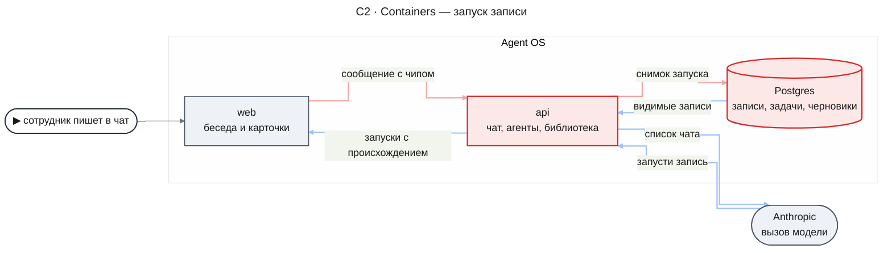
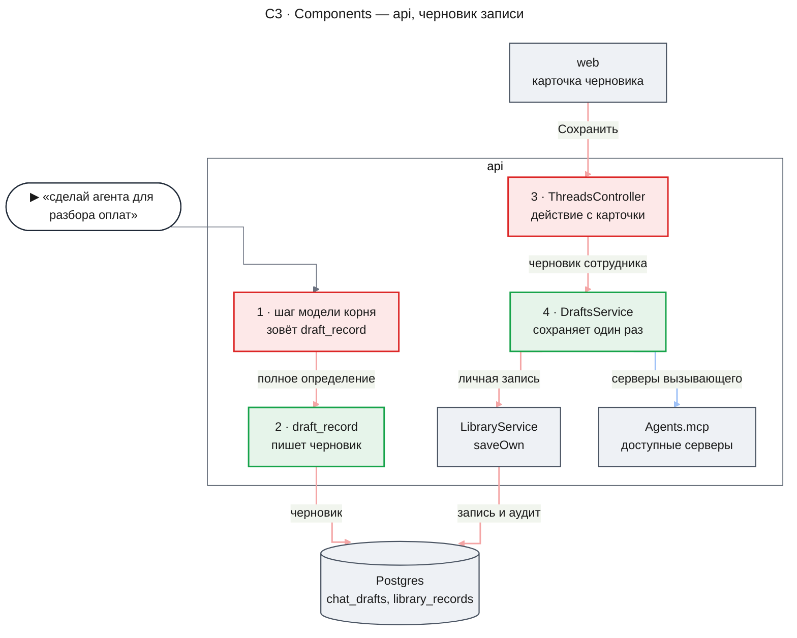
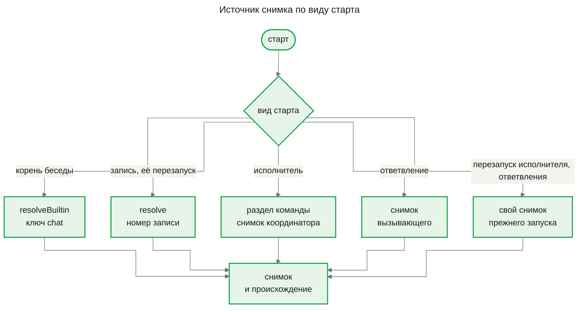
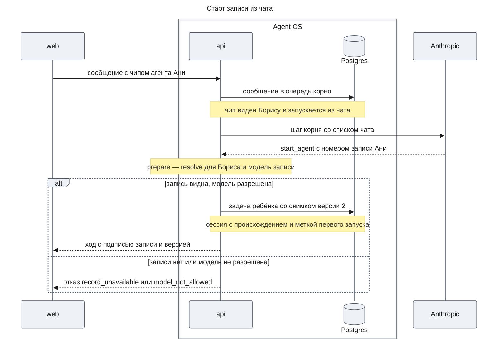
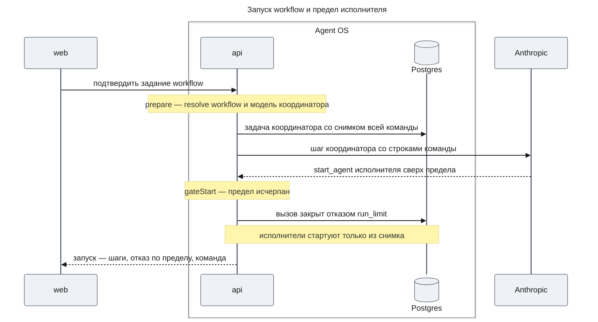
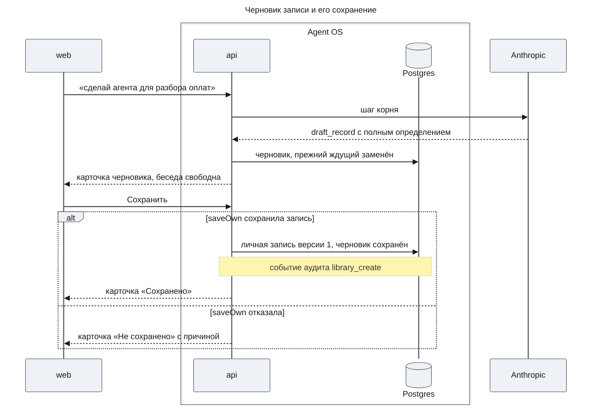
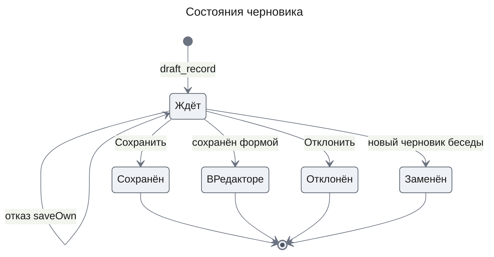

# Свои агенты и workflow — Design Document — runtime

**Status:** Approved · **Date:** 2026-11-17 · **PRD:** [prd.md](./prd.md) · **UXRD:** [uxrd.md](./uxrd.md) · **Depends on:** [design-library.md](./design-library.md#contract-definitions)

## Snapshot

**Overview.** Сегодня определения агентов лежат в коде и JSON: при старте сервер складывает их в каталог в памяти, и каждый шаг агента берёт определение из каталога по имени. Эта часть переводит запуск на записи библиотеки. Перед каждым стартом запуск спрашивает библиотеку, видна ли запись тому, кто запускает, и сохраняет полную копию определения — снимок; дальше шаги читают только снимок, поэтому правка и удаление записи работающих агентов не трогают. Главный чат перед каждым вызовом модели получает список видимых сотруднику записей и запускает их по номеру, а внутренним инструментом готовит черновик записи, который сотрудник сохраняет на карточке. Три встроенные записи платформа создаёт в библиотеке при запуске, а беседы прежнего формата стирает миграция.

- **Не меняется**: права на инструменты и модели и их проверка перед каждым вызовом (`AccessGate`); движок шагов, очередь и подтверждение изменяющих действий; хранение записей и правило видимости — часть `library`.
- **Главный риск**: список чата читается из библиотеки на каждом шаге модели корня и может съесть бюджет времени до первого токена (NFR-04); замер — UC-N1.
- **Открытые вопросы**: нет.

### Key Decisions

#### KD-1: Запуск хранит снимок записи во входе своей задачи и читает только его; каталог определений и определения в коде и JSON удаляются

Сегодня запуск замораживает только имя определения и модель, а промпт, инструменты, серверы и предел ходов каждый шаг читает из каталога заново. Снимок замораживает всё, как требует FR-13, и переживает рестарт сервера, потому что вход задачи лежит в Postgres. Тело снимка — содержимое записи в библиотечной форме (`AgentContent`, `WorkflowContent` или один исполнитель из него); второго формата определения нет. Определение, которое шаг передаёт модели, по снимку вычисляет одна чистая функция; у корня беседы к нему добавляется список чата (KD-4). Удаляются `AgentDefinitionSchema`, `DefinitionCatalog`, `definitionOf`, `checkCatalog`, `GENERAL_PURPOSE`, `CHAT_DEFINITION`, `deep-research.json` и разбор шаблонов `parseTemplates`, `toDefinitions`, `toLimits`.

Не взяты: чтение записи по номеру на каждом шаге — правка меняла бы работающих агентов (против AC-13.1); загрузка записей в каталог при старте сервера — правка дошла бы только после рестарта (против AC-12.1), а видимость зависит от запускающего; хранение только номера и версии — прежних версий в библиотеке нет (FR-08).

Решение проходит тест ADR: смена формата сессий стирает данные (KD-3), на снимке будут строиться будущие виды записей, и варианты были. После утверждения его записывает ADR, который заменяет [ADR-0009](../../adr/ADR-0009-agent-definitions-as-process-data.md).

#### KD-2: Каждый старт проходит одну процедуру `resolveStart` в пакете `agents`: источник → видимость для запускающего → снимок → проверка модели

Источник процедура выбирает по виду старта ([«Откуда берётся снимок»](#откуда-берётся-снимок)); библиотеку она спрашивает только через порт `RecordLibrary` и только от имени запускающего, поэтому автор записи на запуск не влияет. Процедура работает в `prepare` инструмента, до транзакции шага. Проверка записи перед стартом, если она появится, встанет в это одно место.

Здесь дизайн отходит от рекомендации экспертов «перезапуск копирует снимок»: утверждённый UXRD (KD-7, RN-03) говорит, что «Запустить с нуля» идёт на последней версии и недоступна, когда записи нет. Поэтому перезапуск записи — новый старт по её номеру. На своём снимке перезапускаются только исполнитель, у которого своей записи нет, и ответвление, которое работало на снимке вызывающего, а не на записи; историю родителя перезапущенное ответвление, как и сегодня, не наследует. Аргумент `model` у `start_agent` удаляется вместе с `chooseModel`: модель выбрал автор записи, и модель без права должна остановить старт (AC-14.4), а не смениться на другую.

Не взяты: проверка видимости в каждом инструменте — новый вид старта стал бы местом, где её забудут; перезапуск копией снимка — расходится с UXRD KD-7.

#### KD-3: Снимок лежит только во входе задачи; строка сессии хранит имя, происхождение и метку первого запуска; миграция стирает беседы и деревья задач

Вход задачи (`runtime_tasks.input`) шаг и так читает каждый раз; по нему первая попытка шага создаёт сессию, если старт упал, и по нему перезапуск исполнителя берёт снимок. В строке сессии (`agent_sessions`) остаётся то, что читают виды и счёт запусков: имя, происхождение и метка «первый запуск этой записи у этого сотрудника». Пределы workflow теперь часть снимка координатора (KD-5), поэтому `limits` и `SessionLimitsSchema` уходят.

Старый формат не переносится (FR-19): миграция пакета `db` первым шагом удаляет все беседы и деревья задач. Каскад от `runtime_tasks` уносит очередь, решения, события, сессии, сообщения и вызовы; `chat_conversations` удаляется явно, потому что ключа на дерево у неё нет. Журнал токенов, сотрудники, роли, права, реестр MCP, аудит и библиотека остаются. Миграции — дело `db`, владельца схемы, поэтому граница «чужой код не пишет `runtime_*`» держится.

Не взяты: снимок и во входе задачи, и в сессии — две копии до 200 КБ, которые читали бы разные места; таблица снимков по версиям — таблица и соединение ради объёма, который PoC не жмёт; стирание отдельной командой — шаг выпуска, который легко забыть.

#### KD-4: Главный чат получает список видимых записей на каждом шаге модели корня и запускает запись по номеру; чип приходит полем сообщения

На каждом шаге модели корень читает `listVisible` запускающего и оставляет записи, которые чат может предложить: свои всегда, чужие — с включённым «предлагать в главном чате». Агенты идут в описание `start_agent`, workflow — в описание `start_workflow`. Строка — номер, имя, чья запись и описание; свои стоят первыми с пометкой «ваша». Сверх бюджета `CHAT_LISTING_BUDGET` имена остаются у всех, а описания пропадают сначала у записей, с которых сотрудник реже начинал сессии. Счётчика нет: счёт берётся из сессий сотрудника по номеру записи.

Номер нужен, потому что одноимённых записей может быть несколько, и среди чужих чат выбирает по описанию (AC-15.7). Правило «по имени — своя, иначе лучшая по описанию, и назови автора» стоит в промпте записи главного чата: код держит видимость и набор запуска, а выбор делает модель. Чип — поле `recordId` тела сообщения: API проверяет, что чат может запустить запись, и сообщение несёт её номер, вид и имя модели и в историю.

Не взяты: список на всю беседу — Борис не увидит запись Ани до новой беседы (против AC-15.1); таблица счётчиков — новое хранимое состояние ради порядка, в котором пропадают описания; адресация по имени с правилом «своя первой» в коде — среди двух чужих одноимённых имя не выбирает.

#### KD-5: Команда workflow — в снимке координатора: он видит роль и предел каждого исполнителя, исполнители стартуют из снимка, а вызов сверх предела получает причину `run_limit`

Промпт координатора — общий текст координатора из `agents` и необязательные правила записи; инструменты — `start_agent` и `message_agent`, серверов нет, как сегодня. Описание его `start_agent` перечисляет исполнителей строками «имя (до N вызовов): роль». Зовёт он их по имени: имена уникальны в команде и глобальными не становятся. `gateStart` различает «нет в команде» (`not_allowed`) и «предел исчерпан» (`run_limit`, AC-16.6). Последний шаг ждёт отчёта исполнителя `finalExecutor`, как сегодня `finalAgent`; без него ответ пишет координатор. Превращение записи workflow в снимок живёт в `agents`, который и так держит предел и последний шаг; в `workflows` остаются бриф, `start_workflow` и вид запуска.

Не взяты: исполнители как глобальные определения — исполнители двух workflow столкнутся именами (против AC-13.4); снимок workflow в пакете `workflows` — перезапуск координатора в `agents` не смог бы его построить без механизма регистрации видов.

#### KD-6: Инструмент создания `draft_record` есть только у корня и не ждёт решения: он пишет черновик в `chat_drafts`, а сохраняет черновик маршрут беседы через `LibraryService.saveOwn`

Карточка черновика не держит беседу (UXRD KD-3), а запрос решения останавливает корень до ответа ([design-agents.md](../agent-platform/design-agents.md), KD-4). Поэтому инструмент сразу отвечает модели номером черновика, а состояние карточки живёт в `chat_drafts` рядом с беседой. Новый черновик заменяет ждущий. Владелец черновика — владелец сессии.

Правимую запись инструмент проверяет до черновика по заголовку из `resolve`. Системную или чужую запись он не берёт (`read_only`), запись с адресатами — признак `shared` в заголовке — тоже не берёт, с причиной `shared` (AC-18.5). В обоих случаях вызов отказан с причиной, черновика и карточки нет (UXRD DC-02). `saveOwn` отказывает в тех же случаях при сохранении и остаётся проверкой за этим отказом: адресат может появиться, пока черновик ждёт. Аргумента аудитории у инструмента нет. На просьбу поделиться чат отвечает текстом, что делятся кнопкой «Поделиться» у самого агента или workflow; это правило стоит в промпте записи главного чата (AC-18.3).

«Только у корня» держит реестр: зарегистрированный инструмент помечается как инструмент корня, и такие инструменты (`draft_record`, `start_workflow`) получает только сессия без родителя. Набор встроенных инструментов записи `RecordToolSchema` — его по контракту `library` меняет эта часть — становится `start_agent`, `message_agent`, `list_agents`, `stop_agent`: `run_code` код даёт каждой сессии, а `start_workflow` — только корню.

Не взяты: черновик как запрос решения — уточнение словами ждало бы в очереди; черновик только в строке вызова — строка пишется один раз, а карточка меняет состояние потом; инструмент в `tools` записи главного чата — его получил бы любой агент с таким же набором.

#### KD-7: Встроенные записи создаёт `BuiltinRecordsSeeder` при запуске приложения, после проверки миграций; номера постоянные, а главный чат код находит по ключу `chat`

Содержимое переезжает из `chat-definition.ts`, `definition.ts` и `deep-research.json` в один файл посева в `apps/api`. Ключи — `chat`, `general-purpose`, `deep-research`; имена — «Главный чат», `general-purpose`, «Глубокий ресерч». Модель — `AGENT_DEFAULT_MODEL` на момент посева, у координатора `deep-research` — Sonnet, как сейчас; его процедура становится правилами координатора. `general-purpose` запускает сам себя по постоянному номеру. У `general-purpose` и `deep-research` «предлагать в главном чате» включено, поэтому они попадают в список чата; запись `chat` из списка исключена. `seedBuiltin` существующую запись не трогает, поэтому правки администратора переживают рестарт. Посев идёт в хуке завершения запуска приложения — после всех `onModuleInit`, включая проверку миграций, и до приёма запросов.

Не взяты: посев в фабрике провайдера — фабрики работают до проверки миграций; посев миграцией — промпты оказались бы в SQL.

## Terms

- **Снимок** — копия запуска (PRD, Terms): содержимое записи на момент старта, имя запуска и происхождение; у координатора в нём вся команда.
- **Происхождение** — номер, вид, версия, имя и автор записи, с которой стартовал запуск, ключ встроенной записи и у исполнителя — его имя в команде.
- **Корень беседы** — сессия главного чата, которую создаёт первое сообщение беседы.
- **Набор запуска** — кого сессия может запустить: у корня — записи, которые чат может предложить, у агента — номера из его `agents`, у координатора — команда.
- **Чип** — запись, которую сообщение несёт отдельным полем (UXRD CH-01).
- **Черновик** — запись, подготовленная `draft_record`; в библиотеку она попадает, только когда сотрудник её сохранит.

## Part

- **Part**: `runtime`
- **Covers**: FR-12, FR-13, FR-14, FR-15, FR-16, FR-17, FR-18, FR-19
- **Depends on**: [design-library.md, Contract Definitions](./design-library.md#contract-definitions) — «Для части `runtime`», `AgentContent`, `WorkflowContent`, номер записи, правило версии и видимости; [ADR-0016](../../adr/ADR-0016-library-records-and-visibility.md)
- **Prerequisite ADRs**: [ADR-0001](../../adr/ADR-0001-durable-runtime-owner.md), [ADR-0003](../../adr/ADR-0003-drizzle-data-layer.md), [ADR-0004](../../adr/ADR-0004-agent-framework-packages.md), [ADR-0011](../../adr/ADR-0011-code-runner-quickjs-process.md), [ADR-0012](../../adr/ADR-0012-closed-api-and-server-issued-employee-id.md), [ADR-0015](../../adr/ADR-0015-access-gate-and-model-catalogue.md); [ADR-0009](../../adr/ADR-0009-agent-definitions-as-process-data.md) заменяется (KD-1)
- **Sibling parts**: `library` (FR-01–FR-11) хранит записи; `web` (FR-20–FR-29) строит экраны над [контрактом](#contract-definitions) этой части и маршрутами `library`

**Out of scope**

- Хранение записей, видимость, версия, копия, имена и аудит записей — часть `library`.
- Экраны, подписи, пояснение получателю и пометки — часть `web`; эта часть даёт им данные.
- Права и их проверка перед вызовом: инструменты без права у запускающего выпадают, как сегодня (`enterprise-access` FR-18).
- Движок шагов, очередь, прерывание, остановка, сжатие, вызов MCP и подтверждение — как в [design-agents.md](../agent-platform/design-agents.md).

**Constraints**

- PoC без обратной совместимости: прежние беседы стираются (KD-3), старый код удаляется в той же работе.
- Никаких запросов при открытой транзакции шага: библиотеку и модель старт спрашивает в `prepare` (KD-2).
- Новых переменных окружения нет; бюджет списка — константа кода.
- Логирование — через обёртку `common` ([Логирование](#логирование)); тестов мало ([Test Strategy](#test-strategy)).

## Building-block Inventory

Follows the [code system](../../code-system/README.md). Поиск перед «new»: `packages/agents/src`, `packages/workflows/src`, `apps/api/src`, `docs/code-system/` — копии определения на запуск, черновиков и посева при запуске нет.

| Building block | Pattern | Status | Note |
|---|---|---|---|
| Порт `RecordLibrary`, двойник `createLibraryDouble` | [port-module-split.md](../../code-system/patterns/port-module-split.md) | new | по образцу `AccessGate`; реализует `LibraryService` |
| `resolveStart` и снимок | [run-snapshot.md](../../code-system/patterns/run-snapshot.md) | new | новый паттерн (KD-1, KD-2) |
| `gateStart` | [pure-decision.md](../../code-system/patterns/pure-decision.md) | extended | цели по номеру и по имени в команде, `run_limit` |
| `chatListing` | [pure-decision.md](../../code-system/patterns/pure-decision.md) | new | список чата с бюджетом (KD-4) |
| `ToolRegistry` | [composition-root.md](../../code-system/patterns/composition-root.md) | extended | набор по снимку, список чата, инструменты корня |
| `start_agent`, `start_workflow`, `runs.get` | [step-handler.md](../../code-system/patterns/step-handler.md) | extended | номер записи, старт в `prepare`, команда в виде |
| `draft_record`, `DraftsService`, `chat_drafts` | [repository-over-transaction.md](../../code-system/patterns/repository-over-transaction.md) | new | KD-6 |
| `BuiltinRecordsSeeder` | [composition-root.md](../../code-system/patterns/composition-root.md) | new | хук после проверки миграций (KD-7) |
| `ConversationsService`, `conversation-view.ts` | [repository-over-transaction.md](../../code-system/patterns/repository-over-transaction.md) | extended | чип, корень из записи, происхождение, черновики |
| `LibraryService`, `AccessGate`, `Agents.mcp.usable`, логгер | [logging.md](../../code-system/patterns/logging.md) | reused | — |
| Миграция стирания и схемы | — | new | паттерна для миграций в каталоге нет, их правила — [ADR-0003](../../adr/ADR-0003-drizzle-data-layer.md); KD-3 |

## Acceptance Criteria

### FR-12: Встроенные записи вместо кода

- From the PRD: AC-12.1, AC-12.2, AC-12.3, AC-12.4, AC-12.5
- При каждом запуске приложения недостающая встроенная запись создаётся со своим постоянным номером, а существующая, в том числе правленая и переименованная, не меняется (DC-1).
- Корень беседы стартует с записи с ключом `chat`, как бы она ни называлась (DC-2).

### FR-13: Запуск работает на своей копии

- From the PRD: AC-13.1, AC-13.2, AC-13.3, AC-13.4
- «Запустить с нуля» стартует с последней видимой версии записи; исполнитель и ответвление перезапускаются на своём снимке, а новое ответвление получает снимок вызывающего (DC-3).
- Если при перезапуске записи нет или модель не разрешена, перезапуск отклоняется с причиной, и нового агента нет (DC-4).

### FR-14: Видимость проверяется при каждом старте

- From the PRD: AC-14.1, AC-14.2, AC-14.3, AC-14.4
- Отказ из-за записи — `record_unavailable`, из-за модели — `model_not_connected` или `model_not_allowed` с номером модели (DC-5).

### FR-15: Записи в главном чате

- From the PRD: AC-15.1, AC-15.2, AC-15.3, AC-15.4, AC-15.5, AC-15.6, AC-15.7
- Сообщение с чипом записи, которую чат сотрудника не может запустить, отклоняется 404 `RECORD_NOT_FOUND` и в очередь не попадает (DC-6).

### FR-16: Workflow из библиотеки

- From the PRD: AC-16.1, AC-16.2, AC-16.3, AC-16.4, AC-16.6
- У workflow без последнего шага ход завершает своим ответом координатор (DC-7).

### FR-17: Запуск помнит запись, а не имя

- From the PRD: AC-17.1

### FR-18: Инструмент создания в чате

- From the PRD: AC-18.1, AC-18.2, AC-18.3, AC-18.4, AC-18.5
- Новый черновик в беседе переводит ждущий черновик этой беседы в «заменён», и сохранить заменённый нельзя (DC-8).
- Черновик сохраняется не больше одного раза: повторное действие отвечает, что черновик уже решён (DC-9).

### FR-19: Старые беседы стираются

- From the PRD: AC-19.1

## Design

### Architecture (C1–C4)

#### C2 · Containers

Запуск записи проходит те же контейнеры, что и сегодня; меняется то, что `api` читает и пишет.

`api` строит список чата, разрешает старты через библиотеку, хранит черновики и сеет встроенные записи. `Postgres` получает снимок во входе задачи, происхождение в строке сессии и таблицу `chat_drafts`. Экраны `web` строит часть `web`.

#### C3 · Components: api

**api — старт записи из чата.** Сообщение сотрудника превращается в агента со снимком; шаги 3–5 — одна процедура старта (KD-2).

`ConversationsService` проверяет чип через `LibraryService.resolve` и кладёт в очередь корня сообщение с номером, видом и именем записи. Шаг модели корня строит список чата чистой функцией `chatListing` из `listVisible` и счёта сессий сотрудника по записям. `start_agent` зовёт `resolveStart` в `prepare`, до транзакции шага; `gateStart` и `startChild` работают в `execute`, в транзакции. Повтор шага повторяет `prepare`, и в силе снимок закоммиченной попытки.

**api — черновик и его сохранение.** Инструмент пишет черновик, а сохраняет его сотрудник с карточки.

`draft_record` проверяет правимую запись через `resolve` и отказывает до черновика, если она системная, чужая или с адресатами; иначе пишет черновик и заменяет ждущий черновик беседы. `DraftsService` находит черновик через беседу сотрудника из сеанса, берёт доступные ему серверы и зовёт `saveOwn`; права автора, версию, имя и аудит проверяет `saveOwn`.

#### Откуда берётся снимок

`resolveStart` выбирает источник по виду старта; библиотеку спрашивают только две левые ветки.

Запись, которую библиотека не отдаёт запускающему, даёт `record_unavailable`: удалена она, закрыта администратором или запускающего сняли с роли — ответ один. Правые ветки библиотеку не спрашивают, поэтому исполнитель работает на копии из workflow, даже если его источник запускающему не виден (AC-16.3).

У корня набор запуска — записи, которые чат может предложить, и вид должен подходить инструменту: агент — `start_agent`, workflow — `start_workflow`; поле `agents` записи главного чата корень не читает. У обычного агента набор — номера из `agents` его снимка, у координатора — имена команды. Ответвление разрешено всем, кроме координатора.

### Runtime Flows

#### Flow 1: Старт записи из чата

**Starts when:** Борис отправляет сообщение с чипом агента Ани, для AC-15.6, AC-17.1, AC-13.1, AC-13.2, AC-14.1, AC-14.3, AC-14.4

**Outcome:** у ребёнка снимок версии, которую Борис видел в момент старта; следующие шаги читают только его, и версия 3, сохранённая Аней позже, достанется следующему старту (AC-13.1).

**Failure handling:**

- Запись удалена, закрыта или Борис больше не в её роли → отказ `record_unavailable`, ребёнка нет, модель корня получает причину (AC-13.2, AC-14.1, AC-14.3).
- Модель записи Борису не разрешена или не подключена → отказ по модели с её номером; веб называет модель и даёт «Открыть» (AC-14.4).
- Чип ведёт на запись, которую чат Бориса запустить не может → 404 на отправке (DC-6).
- Сбой между `prepare` и коммитом → шаг повторяется целиком, снимок берётся заново.

#### Flow 2: Запуск workflow и предел исполнителя

**Starts when:** сотрудник подтверждает задание на карточке «Задание · {имя}», для AC-13.4, AC-16.3, AC-16.4, AC-16.6

**Outcome:** координатор и исполнители работают на снимке той версии workflow, которую сотрудник подтвердил, что бы автор ни правил потом (AC-13.4). Вид запуска отдаёт команду, шаги с именами исполнителей и отказы по пределу.

**Failure handling:**

- Workflow удалён или закрыт до подтверждения → отказ `record_unavailable`, координатора нет.
- Модель координатора не разрешена → отказ по модели; модель исполнителя проверяется на его собственном старте.
- Координатор зовёт имя вне команды → `not_allowed`, отличимый от `run_limit` (AC-16.6).

#### Flow 3: Черновик записи и его сохранение

**Starts when:** Аня просит чат сделать агента, для AC-18.1, AC-18.2, AC-18.5, AC-15.4

**Outcome:** запись появляется только после «Сохранить»: личная, версии 1, с включённым «предлагать в главном чате» по правилу `library` (AC-15.4); на следующем шаге корня она уже в списке чата.

**Failure handling:**

- «Отклонить» → черновик `rejected`, записи нет (AC-18.2).
- Чат просит черновик для записи с адресатами → `draft_record` отказывает причиной `shared`: черновика и карточки нет, запись не меняется; веб предлагает редактор (AC-18.5).
- Адресат появился, пока черновик ждал, → `saveOwn` отвечает `shared`, черновик ждёт с этой причиной, запись не меняется.
- Имя занято, сервер или модель не разрешены, версия ушла вперёд → черновик ждёт с причиной `saveOwn`; «Сохранить как» шлёт то же действие с другим именем.
- Повторное действие с решённым черновиком → 409 `DRAFT_RESOLVED` (DC-9).

### Contract Definitions

**Порт `RecordLibrary`** (`packages/agents`, по образцу `AccessGate`)

- Операции `resolve`, `resolveBuiltin`, `listVisible` и форма `ResolvedRecord` — как в [design-library.md, «Для части `runtime`»](./design-library.md#contract-definitions). Порт реализует `LibraryService`; `AgentsModule` импортирует `LibraryModule` и передаёт сервис в `createAgents` параметром `library`. `seedBuiltin` и `saveOwn` `apps/api` зовёт напрямую.
- `createLibraryDouble` в `packages/agents/src/testing.ts` — записи в памяти с владельцем, признаком «видна всем» и признаком `shared` для пакетных тестов.

**Операции `agents`** (прежние формы удаляются)

- **`Agents.resolveStart({ ownerId, source })`** — процедура KD-2; `source` — встроенная запись по ключу, запись по номеру с ожидаемым видом, исполнитель, ответвление или перезапуск. Returns снимок с происхождением или отказ `record_unavailable`, `model_not_connected`, `model_not_allowed` с номером модели.
- **`Agents.sessions.start({ ownerId, prompt, description, record? })`** — корень беседы из записи `chat`; `record` — чип первого сообщения. **`Agents.sessions.restart({ agentId, ownerId })`** — новый агент под тем же родителем со снимком по KD-2 и прежним поручением. Отказ обеих — `START_REFUSED`.
- **`Agents.sessions.snapshot(agentId, ownerId)`** — снимок сессии для вида запуска или `null`.
- **`startChild({ snapshot, prompt, description, forkedFrom? })`** — помощник старта ребёнка; вместо имени, модели и лимитов берёт снимок.

**Инструменты модели**

- **`start_agent`** — `agent`, `prompt`, `description`; `agent` — номер записи, `fork` или у координатора имя исполнителя. Отказы: `record_unavailable`, `not_allowed` (цель вне набора, ответвление у координатора, не тот вид), `run_limit`, `depth_limit`, `model_not_connected`, `model_not_allowed`.
- **`start_workflow`** — только у корня: `workflow` (номер записи), `question`, `boundaries`, `result`. Ждёт решения `workflows.brief` с правкой аргументов; запись разрешает `prepare` после подтверждения.
- **`draft_record`** — только у корня, без решения: `recordId` своей правимой записи или ничего, `kind`, `name`, `description`, `content` по форме вида. Returns текст с номером черновика. Отказы: `record_unavailable`, `read_only` (системная или чужая), `shared` (у записи есть адресаты), `invalid_arguments`.

**Маршруты** (под `SessionGuard`, сотрудник из `req.user.id`; остальные — как в [design-chat.md](../agent-platform/design-chat.md#contract-definitions))

- **`POST /api/threads/:threadId/messages`** — тело `text` и необязательный `recordId` чипа; запись, которую чат сотрудника запустить не может, — 404 `RECORD_NOT_FOUND`.
- **`POST /api/threads/:threadId/drafts/:draftId`** — `action`: `save` с необязательным `name`, `reject`, или `saved_in_editor` с `recordId` своей записи. Returns `DraftView`; отказ `saveOwn` приходит в его `refusal` с ответом 200. 404 `DRAFT_NOT_FOUND`, 409 `DRAFT_RESOLVED`.
- **`POST /api/agents/:agentId/restart`** — добавляется 409 `START_REFUSED` с `reason` и `model`.
- **`POST /api/decisions/:decisionId`** — у брифа веб передаёт `workflow` без изменений вместо `template`.

**Данные для `web`** (`packages/contracts`)

**`RunOrigin`** — с какой записи стартовал запуск: `recordId`, `kind`, `version` и `name` на старте, `author` (`{ id, name }` или `null` у системной), `builtinKey` или `null`, `executor` — имя исполнителя или `null`. Живые данные записи — последнюю видимую версию, аудиторию, доступность — веб берёт из `GET /api/library` по `recordId`; записи там нет — она смотрящему недоступна.

- **`AgentView`** (и `AgentNode`): `definition` становится `name` — имя запуска из снимка; `template` уходит; добавляются `origin` (`null` у корня беседы) и `firstRun` — у владельца не было более ранней сессии с этой записью.
- **`WorkflowRunView`**: `origin`, `brief`, `coordinator`; `team` — исполнители снимка с `name`, `role`, `maxRuns`, `final`; `steps` — дети координатора с `origin.executor`, а не вызванные — исполнители `team` вне `steps`; `limitRefusals` — `{ executor, at }` каждого отказа `run_limit`.
- **`Confirmation`**: добавляется `origin` агента, который просит (`null` у корня); `templateTitle` уходит; содержимое брифа — `workflow` и три поля.
- **`DraftView`** (`ConversationView.drafts`, все черновики беседы): `draftId`; `callId` вызова `draft_record`, у которого стоит карточка; `kind`, `name`, `description`, `content`; `recordId` и `baseVersion` правимой записи или `null`; `state` — `pending`, `saved`, `saved_in_editor`, `rejected`, `superseded`; `refusal` — причина последнего отказа `saveOwn` или `null`; `savedRecordId`; `createdAt`, `resolvedAt`.
- **`HistoryEntry`**: у `user_message` — `record` чипа (`{ id, kind, name }`), у отказа `tool_result` — `refusalDetail`, номер модели при отказе по модели.

**Error handling**

- `ToolRefusalReasonSchema` получает `record_unavailable`, `run_limit`, `read_only`, `shared`; ограничения CHECK переписывает миграция KD-3.
- `START_REFUSED` — 409: `reason` — `record_unavailable`, `model_not_connected` или `model_not_allowed`; `model` — номер модели или пусто.
- `DRAFT_NOT_FOUND` — 404: черновика нет, он чужой или из другой беседы. `DRAFT_RESOLVED` — 409: черновик не ждёт.

**Runtime settings**

- `CHAT_LISTING_BUDGET` — константа `agents`, 12 000 знаков на строки списка чата; имена входят всегда.
- `AGENT_DEFAULT_MODEL` — существующая; модель встроенных записей при первом посеве.

### Data Model

- **`runtime_tasks.input`** хранит снимок, поручение, описание и у ответвления — ссылку на историю родителя. Модель сессии — модель снимка.
- **`agent_sessions`**: вместо `definition` — `name`; добавлены происхождение и метка первого запуска; `limits` удалён. Пара «владелец — номер записи» проиндексирована для счёта в списке чата.
- **`chat_drafts`** — новая таблица: беседа (каскад), владелец, вызов в истории корня, вид, правимая запись и версия, имя, описание, содержимое, состояние, сохранённая запись, последний отказ, даты.
- **Миграция** сначала удаляет все строки `chat_conversations` и `runtime_tasks`, затем меняет схему и CHECK причин отказа; `runtime_model_calls` и таблицы без связи с деревом остаются (AC-19.1).

### State Transitions and Invariants

Состояния черновика:

**Invariants**

1. После старта определение запуска берётся только из снимка. Единственное чтение библиотеки после старта — список чата корня на каждом шаге модели (KD-4), и снимок оно не меняет.
2. Каждый старт записи — корень, ребёнок, workflow, перезапуск — проходит `resolveStart` от имени запускающего; исполнитель и ответвление берут снимок из снимка.
3. У задач одного дерева один владелец, и права проверяются для него, кто бы ни написал запись.
4. `draft_record` и `start_workflow` есть только у сессии без родителя.
5. Черновик меняет только записи своего владельца, сохраняется не больше одного раза и не меняет аудиторию; в беседе ждёт не больше одного черновика.

### Логирование

Через логгер `common` ([logging.md](../../code-system/patterns/logging.md)); промпт и содержимое записи в лог не идут.

- Старт: `ownerId`, `rootId`, `parentId`, `agentId`, вид источника, `recordId`, `version`, `executor`, итог или причина отказа, длительность.
- Список чата: `ownerId`, `agentId`, число видимых записей и записей с описанием, длина, длительность.
- Черновик: `ownerId`, `threadId`, `draftId`, `callId`, `recordId`, действие, итог или причина отказа.
- Посев: ключ, номер, «создана» или «уже есть».

## Test Strategy

### Main Use Cases

- **UC-1: Новая установка** — covers AC-12.3, DC-1, DC-2
  - Given: пустая библиотека
  - When: приложение запускается дважды, сотрудник пишет в чат и запускает глубокий ресерч
  - Then: встроенных записей три, у каждой свой постоянный номер; корень стартует с `chat`, координатор — с `deep-research`
- **UC-2: Правка `general-purpose`** — covers AC-12.1
  - Given: администратор сохранил новый промпт `general-purpose`
  - When: сотрудник запускает его в новой беседе
  - Then: вызов модели ребёнка несёт новый промпт
- **UC-3: Встроенные защищены** — covers AC-12.2, AC-12.5
  - Given: три встроенные записи
  - When: администратор удаляет любую, меняет аудиторию главного чата, открывает `deep-research` только роли «SRE»
  - Then: удаление и смена аудитории отклонены; в списке чата сотрудника вне «SRE» нет `deep-research`
- **UC-4: Сотрудник без ролей** — covers AC-12.4
  - Given: у сотрудника только личное право на модель
  - When: он пишет в чат
  - Then: чат отвечает
- **UC-5: Снимок держит версию** — covers AC-13.1, AC-13.3, DC-3
  - Given: агент Ани работает у Бориса на версии 1; беседа Бориса открыта до правки главного чата
  - When: Аня сохраняет версию 2, администратор правит главный чат, Борис пишет в старую и новую беседы и жмёт «Запустить с нуля»
  - Then: работающий агент шагает с промптом версии 1; новый старт и перезапуск — на версии 2; старая беседа — на прежнем промпте чата, новая — на новом
- **UC-6: Workflow на своих копиях** — covers AC-13.4, AC-16.1, AC-16.2, AC-16.3, AC-16.4, DC-7
  - Given: workflow Ани из трёх исполнителей без правил и без последнего шага; источник одного Борису не виден
  - When: Борис запускает workflow, Аня посреди запуска правит координатора и обновляет исполнителя
  - Then: описание `start_agent` координатора несёт три строки ролей; все исполнители стартуют; запуск доходит до конца на прежнем снимке и завершается ответом координатора; следующий запуск — на новом
- **UC-7: Список чата** — covers AC-15.3, AC-15.5, AC-15.7
  - Given: строки таблицы — свои и чужие записи, одноимённые, переключатель включён и выключен, список сверх бюджета с разным счётом сессий
  - When: строится список чата
  - Then: своя — первой и с пометкой, чужая — с автором; чужой без переключателя нет; сверх бюджета все имена на месте, описаний нет у реже запускаемых. Выбор модели между одноимёнными проверяет ручной прогон из Success Criteria PRD
- **UC-8: Запись коллеги в чате** — covers AC-15.1, AC-15.2
  - Given: Аня делится агентом с ролью «SRE» Бориса
  - When: Борис пишет следующее сообщение; потом Аня выключает переключатель, и чаты Бориса и Ани стартуют этот агент
  - Then: на первом шаге агент в списке Бориса; после выключения его там нет, старт из корня Бориса — `not_allowed`, из корня Ани — разрешён
- **UC-9: Чип** — covers AC-15.6
  - Given: у Бориса свой «разбор оплат», и он видит одноимённого агента Ани
  - When: Борис отправляет сообщение с чипом агента Ани
  - Then: вход модели корня несёт номер записи Ани, история — чип, старт этого номера разрешён
- **UC-10: Подпись запуска** — covers AC-17.1
  - Given: у Ани и Бориса есть «разбор оплат»
  - When: Борис запускает агента Ани
  - Then: у ребёнка в беседе и списке агентов `origin` записи Ани с автором «Аня»
- **UC-11: Черновик сохраняется** — covers AC-18.1, AC-15.4, DC-8
  - Given: беседа Ани без черновиков
  - When: чат дважды зовёт `draft_record`, Аня сохраняет второй черновик
  - Then: первый — `superseded`, второй — `saved`; в библиотеке личная запись Ани версии 1 с включённым «предлагать в главном чате»
- **UC-12: Стирание при выпуске** — covers AC-19.1
  - Given: база с беседами, сессиями, ресерчем, ролями, правами и журналом токенов
  - When: применяется миграция
  - Then: бесед и задач нет; сотрудники, роли, права и расход за месяц те же

### Error and Edge Use Cases

- **UC-E1: Закрытая запись не стартует** — covers AC-13.2, AC-14.1, AC-14.3, NFR-03
  - Given: строки таблицы — запись удалена; личная запись Ани в `agents` агента, который работает у Бориса; Бориса сняли с роли; администратор закрыл доступ
  - When: запускающий или его агент стартует запись
  - Then: отказ `record_unavailable`, детей нет
- **UC-E2: Модель без права** — covers AC-14.4, DC-4, DC-5
  - Given: модель агента Ани Ане больше не разрешена
  - When: Аня запускает агента из чата, затем перезапускает прежний запуск
  - Then: отказ `model_not_allowed` с номером модели; перезапуск — 409 `START_REFUSED`; агентов нет
- **UC-E3: Запись не расширяет права** — covers AC-14.2, NFR-02
  - Given: в агенте Ани есть Jira, у Бориса права на Jira нет
  - When: Борис запускает агента
  - Then: Jira нет в наборе инструментов, вызовов Jira нет ни с одним аккаунтом
- **UC-E4: Предел запуска** — covers AC-16.6
  - Given: строки таблицы `gateStart` — исполнитель на пределе, имя вне команды, ответвление у координатора
  - When: координатор зовёт `start_agent`
  - Then: `run_limit`, `not_allowed`, `not_allowed`; один интеграционный случай пишет `run_limit` в базу
- **UC-E5: Инструмент создания отказывает** — covers AC-18.2, AC-18.3, AC-18.5, DC-9
  - Given: строки — Аня отклоняет черновик; администратор просит поправить `general-purpose`; Аня просит поправить свою запись, открытую роли; черновик сохраняют дважды
  - When: выполняется действие
  - Then: записи нет; `read_only`, черновика нет, запись не меняется; `shared`, черновика нет, запись не меняется; второе действие — 409 `DRAFT_RESOLVED`
- **UC-E6: Инструменты только у корня** — covers AC-18.4
  - Given: набор инструментов ребёнка и исполнителя
  - When: реестр строит набор
  - Then: в нём нет `draft_record` и `start_workflow`

AC-16.5 держит форма `WorkflowContentSchema` части `library`; её проверяет таблица правил сохранения в [design-library.md](./design-library.md#test-strategy).

### Non-Functional Use Cases

- **UC-N1: Список из ста записей** — covers NFR-04
  - Given: сотруднику видны сто записей
  - When: он пишет в чат
  - Then: время до первого токена — в бюджете «Performance Requirements» `project-context`; замер — отдельный скрипт по запросу

## Security Considerations

- **Authentication & Authorization**: каждый старт спрашивает библиотеку от имени владельца дерева, и невидимая запись отвечает как несуществующая; автор записи на запуск не влияет. Набор запуска сужает, кого можно запустить, но проверку видимости не заменяет. Маршрут черновиков берёт сотрудника из сеанса и ищет черновик в его беседе. `draft_record` пишет только личные записи вызывающего через `saveOwn` и есть только у корня; скрипты `run_code` агентских инструментов не зовут. Подтверждение изменяющих действий решает инструмент, и ни одно поле записи его не выключает.
- **Input Validation**: аргументы инструментов проверяют их схемы, содержимое черновика — `AgentContentSchema` и `WorkflowContentSchema`, тела маршрутов — `ZodValidationPipe`. Описания чужих записей становятся текстом для модели: их длину ограничивает `library` (300 знаков), объём — `CHAT_LISTING_BUDGET`.
- **Sensitive Data Handling**: в снимке нет учётных данных — аккаунты MCP и права берутся у запускающего на каждом вызове. Промпт, содержимое записи и токены не попадают ни в лог, ни в ответы ошибок.

## Risks and Mitigation

- **Чтение списка на каждом шаге корня замедлит чат** — заметно при сотнях записей, вероятность низкая (PRD: десятки). Один `listVisible` и один счёт по индексу на шаг; замер UC-N1 до выпуска.
- **Снимок координатора с десятью исполнителями — до 200 КБ на каждый шаг** — нагрузка средняя, вероятность низкая. Вход задачи шаг читает и сегодня; при нужде раздел исполнителя выносится из снимка без смены контракта.
- **Модель выбирает не ту одноимённую запись** — влияние среднее. Пометка «ваша» и автор в строке, правило в промпте главного чата, ручной прогон; чип запускает ровно ту запись.
- **Описание ролевой записи перехватывает выбор чата у роли** — риск принят в PRD; строка списка показывает автора, а объём списка ограничен.

## Open Questions

Нет.

## Appendix: Fact Disposition

| Fact | Disposition | Handled in |
|------|-------------|------------|
| Каталог и чтения определения по имени (`packages/agents/src/definitions/catalog.ts:DefinitionCatalog`) | remove | KD-1, KD-2 |
| Вход сессии замораживает только имя и модель (`packages/agents/src/store/sessions.repository.ts:SessionInput`) | transform | KD-3, Data Model |
| Имя разрешается в `prepare` и снова в `execute` (`packages/agents/src/tools/builtin/start-agent.ts:createStartAgentTool`) | transform | KD-2, C3 старта |
| Один `not_allowed` на три случая (`packages/agents/src/tools/tool-gate.ts:gateStart`) | transform | KD-5, UC-E4 |
| Описание `start_agent` из каталога, счётчика нет (`packages/agents/src/tools/tool-registry.ts:startableHeaders`) | transform | KD-4, UC-7 |
| Шаблон в глобальные определения и лимиты (`packages/workflows/src/template.ts:toDefinitions`) | remove | KD-1, KD-5 |
| Статические аргументы и карточка брифа (`packages/workflows/src/start-workflow.tool.ts:createStartWorkflowTool`) | transform | KD-5, Contract Definitions |
| Вид запуска ищет шаблон по имени (`packages/workflows/src/runs.ts:createWorkflowRuns`) | transform | `WorkflowRunView` |
| Главный чат в коде (`apps/api/src/chat/chat-definition.ts:CHAT_DEFINITION`) | remove | KD-7, DC-2 |
| Подтверждение инструмента (`packages/agents/src/tools/tool.ts:ToolConfirmation`) | transform | KD-6 — черновик без решения; карточка брифа |
| `run_code` вне набора записи (`packages/agents/src/tools/builtin/run-code.ts:createRunCodeTool`) | transform | KD-6; серверы — из снимка |
| Каскад для стирания (`packages/db/src/schema.ts:runtimeTasks`) | transform | KD-3, Data Model |
| Порты пакетам из `apps/api` (`apps/api/src/agents/agents.module.ts:AGENTS`) | transform | порт `RecordLibrary`, KD-7 |
| Определение читается каждым шагом (`packages/agents/src/step/model-step.ts:createModelStep`) | transform | KD-1, инвариант 1 |
| Данные для веба без записи и версии (`packages/contracts/src/chat.ts:AgentViewSchema`) | transform | «Данные для `web`» |
| Тесты регистрируют определения по имени (`packages/agents/test/support/agentsHarness.ts:createAgentsHarness`) | transform | `createLibraryDouble`, Test Strategy |

Расхождения с `docs/code-system/` из отчёта о соответствии решают KD-7 (посев после проверки миграций), KD-1 (каталог вместо порта библиотеки) и KD-3 (стирание `runtime_*`).

## Update History

| Version | Date | Change |
|---------|------|--------|
| 1.0 | 2026-11-17 | Initial version |
| 1.1 | 2026-11-17 | Решён вопрос к `design-library.md`: `draft_record` по признаку `shared` заголовка отказывает до черновика (AC-18.5), просьбу поделиться чат направляет к «Поделиться» текстом (AC-18.3); утверждён владельцем |
