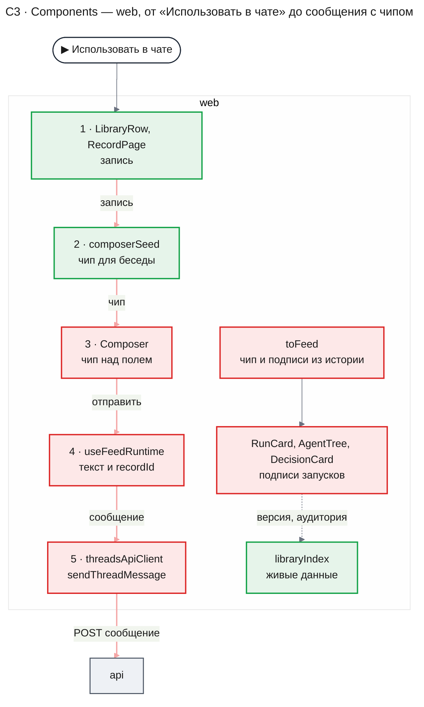
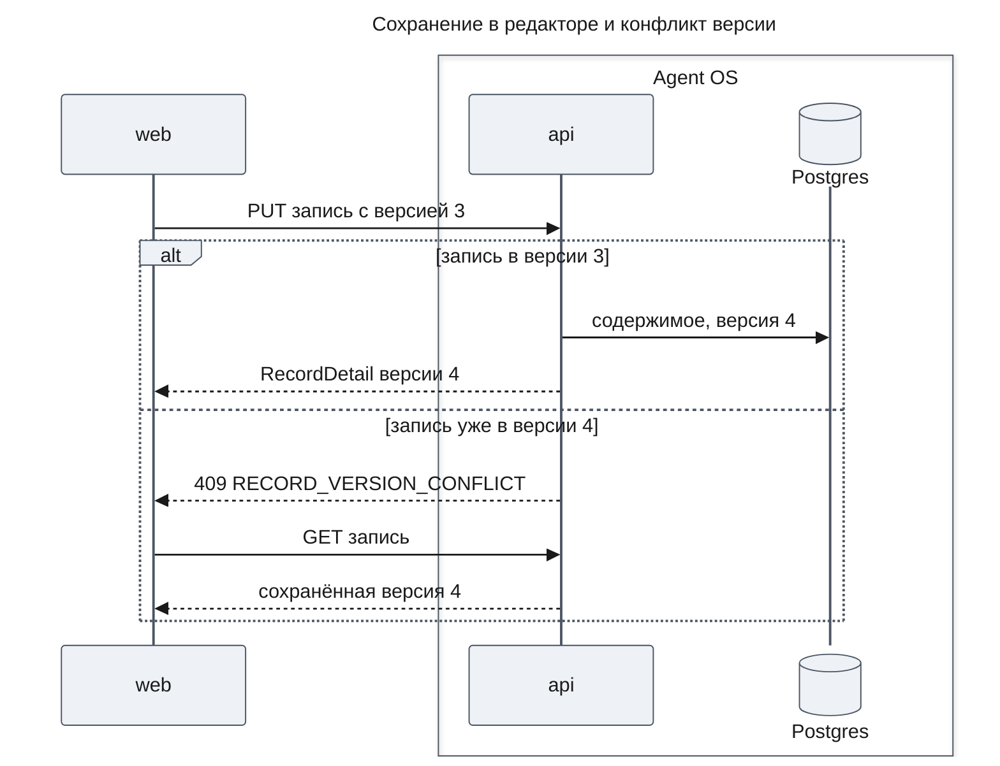
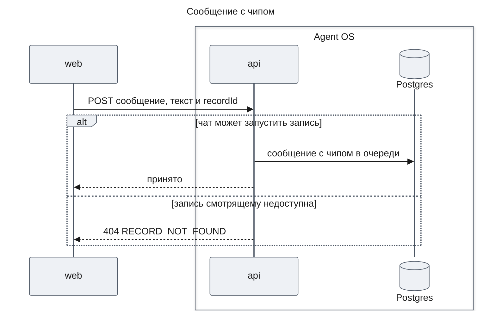
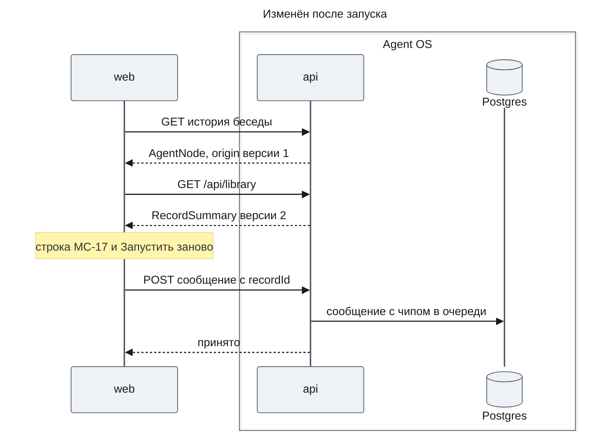
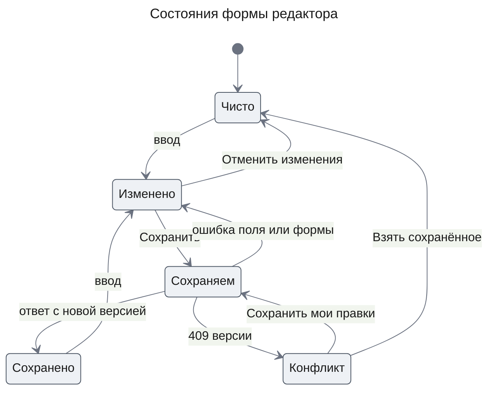

# Свои агенты — Design Document — web

**Status:** Approved · **Date:** 2026-11-22 · **PRD:** [prd.md](./prd.md) · **UXRD:** [uxrd.md](./uxrd.md) · **Depends on:** [design-library.md](./design-library.md#contract-definitions), [design-runtime.md](./design-runtime.md#contract-definitions)

## Snapshot

**Overview.** Эта часть строит в вебе то, что сотрудник видит в библиотеке: раздел «Библиотека», страницу записи с редактором агента или просмотром, окно «Поделиться», раздел панели администратора «Агенты и глубокие агенты», а в беседе — чип записи в поле сообщения и подписи у запусков. Новые экраны встают в оболочку чата по своим адресам и читают данные при открытии через общий клиент API. Живые данные записей — последняя версия, кто видит, доступна ли — веб держит в одном хранилище оболочки, откуда их берут карточки хода, дерево агентов и страница агента. Редактор агента хранит правку в своём состоянии, решает конфликт версии на месте и не отпускает со страницы с несохранённым без вопроса. Чип и заготовка сообщения переходят между экранами через хранилище оболочки, а сообщение несёт номер записи отдельным полем.

Глубокий агент формы не имеет: он открывается карточкой только для чтения, а записи меняет чат через карточку подтверждения «Запись». Обе описывает [deep-agents design-agent-types.md](../deep-agents/design-agent-types.md) (KD-3, C3 · Components: web); здесь — только экраны и сторы, в которые они встают.

- **Не меняется**: беседа, лента, поток событий и очередь; ядро клиента API и его обработчики 401 и 403; форма и таблица панели, которыми пользуются остальные разделы.
- **Главный риск**: защита несохранённого от кнопки «Назад» держится на своём обработчике `popstate`, а у App Router для этого API нет (KD-4); её проверяет L1-сценарий «Назад с изменениями».
- **Открытые вопросы**: нет.

### Key Decisions

#### KD-1: Адреса — один вид маршрута `library` для страниц сотрудника и раздел панели `library`, у которого вкладки и форма создания — сегменты пути

Сотрудник открывает `/library`, `/library/<id>` и `/library/new/agent` (UXRD KD-1). `parseShellRoute` разбирает их в один вид `library` со страницей: список, запись по номеру или новый агент; буквальное `new/agent` разбирается раньше номера. Адрес знаний глубокого агента `/library/<id>/knowledge` — того же вида, его экран описывает [self-learning design-web.md](../self-learning/design-web.md). Панель получает раздел `library`: «Системные» — `/admin/library`, «Открытые ролям» — `/admin/library/shared`, «Запреты» — `/admin/library/bans`, форма — `/admin/library/new/agent`, запись — `/admin/library/<id>`. Номер записи — UUID, поэтому со словами `shared`, `bans` и `new` он не совпадёт.

Вкладка в пути, а не в состоянии компонента или в `?tab=`: «Назад» и перезагрузка возвращают ту же вкладку, а `useSearchParams` под `cacheComponents` потребовал бы `Suspense` у каждой страницы оболочки (документация Next 16.4.3, `use-search-params.md`).

#### KD-2: Живые данные записей для всех экранов держит одно хранилище оболочки `libraryIndex` над `GET /api/library`

Контракт `runtime` отдаёт у запуска только происхождение на момент старта (`RunOrigin`), а последнюю видимую версию, аудиторию и доступность веб берёт из `GET /api/library` по номеру ([design-runtime.md](./design-runtime.md#contract-definitions), «Данные для `web`»). Тот же список нужен библиотеке, полю «Может запускать» редактора, правилу «Использовать в чате» и заголовку карточки брифа. Поэтому список живёт в одном хранилище в `ShellServices`. Хранилище перечитывает список при входе на экран беседы, агента, списка агентов, библиотеки и страницы записи и после каждого изменения записи, в том числе после «Закрыть доступ» и «Снять запрет» в панели. Просьба перечитать во время чтения получает ровно одно чтение после него, общее для всех просьб за это время, поэтому экран, который только что изменил запись, не получит список до своего изменения. Записи нет в списке — смотрящему она недоступна, и подпись показывает «агент недоступен» или «глубокий агент недоступен» (MC-17).

Живых событий о записях нет: новая версия на открытой карточке появится при следующем входе на экран, этого достаточно для AC-28.1.

#### KD-3: Редактор агента — свой компонент `RecordEditor` с состоянием в редьюсере `useRecordForm`, собранный из частей формы панели; `AdminForm` не расширяется

Редактору нужно то, чего у `AdminForm` нет: базовая версия и отметка изменений, панель сохранения со следующим шагом, конфликт с двумя действиями, «Отменить изменения» с «Вернуть», баннеры, Ctrl+S и защита ухода. Редьюсер держит сохранённую версию и введённые значения отдельно, поэтому «есть изменения», конфликт и «Вернуть» — сравнение двух значений, а не флаги. Редактор берёт из панели `FormError`, поля shadcn `field` и правило «фокус на первую ошибку»; плотность — комфортная у сотрудника и компактная в панели. Один компонент служит сотруднику (ED-01) и администратору (AL-02). Новую зависимость вроде react-hook-form панель уже отклонила ([design-admin.md](../enterprise-access/design-admin.md), KD-5).

Редактор открывает только запись вида `agent`. Свой глубокий агент на странице `/library/<id>` и системный в `/admin/library/<id>` открываются карточкой `DeepAgentCard` с переключателем самообучения ([deep-agents design-agent-types.md](../deep-agents/design-agent-types.md), C3 · Components: web).

#### KD-4: Несохранённое держит стор оболочки `leaveGuard`: ссылки оболочки спрашивают через `onNavigate`, программные переходы — через проверку стора, вкладка — через `beforeunload`, «Назад» — через свой обработчик `popstate`

В Next 16.4.3 `<Link>` даёт `onNavigate` с `preventDefault()` именно для этого случая (`link.md`, «Blocking navigation»), а для `router.push`, «Назад» и закрытия вкладки API нет. Поэтому `leaveGuard` знает, есть ли на экране несохранённое, и умеет спросить диалогом MC-11. Ссылки, которые видны рядом с редактором — сайдбар, история бесед, меню пользователя, навигация и шапка панели, ссылки шапки редактора, — идут через обёртку `ShellLink` над `next/link`. «Новый чат», его сочетание клавиш и переходы самого редактора спрашивают стор до `router.push` (`leaveThenGo`). «Выйти» в меню пользователя тоже сначала спрашивает стор и только потом завершает сеанс: иначе «Остаться» оставило бы во вкладке форму другого пользователя. Закрытие вкладки — `beforeunload`: браузер показывает свой вопрос вместо MC-11. «Назад» при несохранённом ловит запасная запись истории и обработчик `popstate` (`useLeaveGuardHistory`); это поведение не описано в документации Next.

#### KD-5: Чип и заготовку сообщения переносит стор оболочки `composerSeed`; сообщение несёт номер записи полем `recordId`

«Использовать в чате», «Запустить заново», «Создать в чате» и «Доработать в чате» кладут в `composerSeed` цель — беседу по номеру или новую беседу — и чип записи или текст заготовки, затем ведут на беседу (`useInChat`). Поле сообщения этой беседы забирает заготовку при появлении, а чип держит до отправки или «✕» (CH-01). Отправка передаёт `recordId` в `POST /api/threads/:threadId/messages`, в том числе первым сообщением новой беседы. Неудачная отправка возвращает и текст, и чип.

Чип не идёт в адрес — адрес беседы остаётся постоянным и без `Suspense` (KD-1) — и не становится вложением assistant-ui: вложения скрыты решением chat-shell D-04.

#### KD-6: Только что созданную запись новый адрес открывает в «Сохранено» по стору `createdHandoff`

Создание отвечает на адресе `/library/new/agent` или `/admin/library/new/agent`, а запись живёт по своему адресу, где монтируется новый редактор. Перед переходом редактор кладёт в `createdHandoff` адрес новой страницы, и её редактор при монтировании забирает его через `take(page)`: форма открывается в «Сохранено», а в панели — с уведомлением MC-18 «пока видят только администраторы» и действием «Поделиться». Сотрудник получает уведомление «{Вид} создан». Перенос для другой страницы при этом стирается, а перезагрузка стирает любой: стор живёт только в памяти вкладки.

#### KD-7: Карточка хода глубокого агента дочитывает `DeepAgentRunView` через `getRun`

Команду, не вызванных сабагентов и отказы по пределу отдаёт только вид запуска `GET /api/agents/:agentId/run` ([deep-agents design-agent-types.md](../deep-agents/design-agent-types.md#contract-definitions)); что карточка показывает, задаёт deep-agents UXRD, DA-07. `RunCard` читает вид при появлении и снова, когда меняется статус глубокого агента или число его детей. Шаги приходят живыми из ленты, поэтому строки шагов не ждут запроса, а «не вызывался» и «предел вызовов исчерпан» появляются с задержкой одного чтения. Сбой чтения оставляет карточку без строк команды и пишется в лог.

#### KD-8: Систему веб показывает по имени из реестра MCP, без описания

`GET /api/library/choices` отдаёт в `servers` только имена ([design-library.md](./design-library.md#contract-definitions)), а у реестра MCP нет ни отображаемого имени, ни описания сервера. Поэтому флажок в поле «Системы» редактора и строка системы в просмотре подписаны именем сервера из реестра без пояснения. Это отход от UXRD: [record-editor.md](../../design-system/components/record-editor.md), часть 7, [definition-view.md](../../design-system/components/definition-view.md), часть 4, и MC-7 просят «отображаемое имя и описание». Отображаемое имя и описание в реестре — изменение реестра MCP и его раздела панели, вне этой фичи.

## Terms

- **Запись** — агент или глубокий агент в библиотеке (PRD, Terms); в интерфейсе этого слова нет.
- **Живые данные записи** — строка `RecordSummary` из `GET /api/library`: последняя версия, аудитория, права смотрящего.
- **Происхождение** — `RunOrigin` запуска: запись, версия и имя на момент старта.
- **Стор оболочки** — хранилище zustand, которое создаёт `createShellServices` и видят все экраны оболочки ([shell-store.md](../../code-system/patterns/shell-store.md)).
- **Чип** — запись в поле сообщения (UXRD CH-01); **заготовка** — текст, который встаёт в поле новой беседы.

## Part

- **Part**: `web`
- **Covers**: FR-20, FR-21, FR-23, FR-24, FR-25, FR-26, FR-28, FR-29
- **Depends on**: [design-library.md, Contract Definitions](./design-library.md#contract-definitions) — маршруты сотрудника и панели, `RecordSummary`, `RecordDetail`, `CopyResult`, `AgentContent`, коды ошибок, `GET /api/auth/me/roles`, `GET /api/library/choices`; [design-runtime.md, Contract Definitions](./design-runtime.md#contract-definitions) — «Данные для `web`», сообщение с `recordId`, `START_REFUSED`, причины отказа
- **Prerequisite ADRs**: [ADR-0012](../../adr/ADR-0012-closed-api-and-server-issued-employee-id.md) (сотрудник берётся из сеанса), [ADR-0016](../../adr/ADR-0016-library-records-and-visibility.md) (невидимая запись отвечает как несуществующая)
- **Sibling parts**: `library` и `runtime` — здесь только их контракты

**Out of scope**

- Правила видимости, версии, копии, проверки сохранения и запуска — их держит сервер; веб только показывает ответы.
- Карточка глубокого агента, карточка подтверждения «Запись», панель «Схема» и ход глубокого агента — [deep-agents](../deep-agents/design-agent-types.md); экран знаний и блок самообучения в панели — [self-learning design-web.md](../self-learning/design-web.md).
- Лента, поток событий, лоток, карточки отчёта и вызова инструмента остаются, как в agent-platform; меняются только подписи.
- Остальные разделы панели, их формы и таблицы.

**Constraints**

- `apps/web` зависит только от `contracts` и `common`; к API ходит только через `apiRequest` ([web-api-client.md](../../code-system/patterns/web-api-client.md)).
- Лог — через `src/lib/logger.ts` ([Логирование](#логирование)); тестов мало ([Test Strategy](#test-strategy)).
- WCAG 2.1 AA и работа от 360 px (NFR-05) — как задают UXRD «Accessibility», «Responsive Behavior» и спецификации компонентов; проверяют L1-сценарии.

## Building-block Inventory

Follows the [code system](../../code-system/README.md). Поиск перед «new»: `apps/web/src/components` (`admin`, `agents`, `shell`, `ui`, `assistant-ui`), `apps/web/src/lib`, `apps/web/src/hooks`, `docs/code-system/`.

| Building block | Pattern | Status | Note |
|---|---|---|---|
| `parseShellRoute`, `MainView`, `AppSidebar`, `ChatHeader`, `DocumentTitle` | [shell-route.md](../../code-system/patterns/shell-route.md) | extended | вид `library`, раздел панели `library` (KD-1) |
| `libraryApi` в `lib/library`, `adminApi.library`, `describeLibraryError` | [web-api-client.md](../../code-system/patterns/web-api-client.md) | new | по образцу `adminApi` и `describeAdminError` |
| `threadsApiClient`, `useFeedRuntime` | [web-api-client.md](../../code-system/patterns/web-api-client.md) | extended | `recordId` у сообщения; `getRun` разбирает `DeepAgentRunViewSchema` |
| `useResource` | [read-on-open.md](../../code-system/patterns/read-on-open.md) | extended | метка лога экрана |
| `libraryIndex`, `composerSeed`, `createdHandoff`, `leaveGuard` | [shell-store.md](../../code-system/patterns/shell-store.md) | new | KD-2, KD-4–KD-6 |
| `RecordEditor`, `useRecordForm` | — | new | KD-3; части формы панели — reused |
| `LibrarySettingsForm` | — | new | блок «Настройки новых записей» на вкладке «Системные»: `AdminForm` с одним полем `AdminTextField` |
| `RecordLabel`, `LibraryRow`, `DefinitionView`, `ShareDialog` | спецификации дизайн-системы | new | по [Дереву компонентов](#дерево-компонентов) |
| `DecisionCard`, `RunCard`, `AgentTree`, `AgentMeta`, `AgentHeader`, `StateBadge`, `ThreadNotice`, `Composer`, `tool-fallback.aui.tsx` | спецификации дизайн-системы | extended | подписи записи, состояние «Сведения», RV-02, чип, отказы |
| `PageHeader` | — | extended | шапка через портал и для страниц библиотеки; родитель — ссылка, а не раздел панели |
| `SectionNavItem` | — | extended | второй пункт сайдбара «Библиотека» |
| `DataTable`, `ConfirmDialog`, `FormError`, лента `ConversationView`, announcer, `formatModel` | — | reused | — |
| shadcn `tabs`; поиск на `Combobox` base-ui; `CollapsibleRoot` | — | new / reused | `command` в проекте нет: поиск — `Combobox` без cmdk; раскрытие — существующий `CollapsibleRoot` |

## Acceptance Criteria

### FR-20: Раздел «Библиотека»

- From the PRD: AC-20.1, AC-20.2
- Страница записи, которую API ответил 404, показывает один экран RV-02 для чужой личной, закрытой, удалённой и несуществующей записи (DC-1).

### FR-21: Редактор агента

- From the PRD: AC-21.1, AC-21.2
- При несохранённом переход по ссылке оболочки, «Новый чат», «Выйти», «Назад» и закрытие вкладки спрашивают подтверждение, и «Остаться» оставляет форму с введённым (DC-2).
- «Взять сохранённое» заменяет форму сохранённой версией, а «Вернуть» в уведомлении возвращает введённое поверх неё (DC-3).

### FR-23: Окно «Поделиться»

- From the PRD: AC-23.1, AC-23.2
- Без ролей у сотрудника и под запретом делиться кнопка аудитории недоступна с причиной MC-14, а окно не открывается (DC-5).

### FR-24: Раздел панели

- From the PRD: AC-24.1
- Вкладка панели — адрес: перезагрузка и «Назад» возвращают ту же вкладку (DC-6).

### FR-25: Чей агент — видно в беседе

- From the PRD: AC-25.1, AC-25.2
- Подпись запуска берёт имя и автора из происхождения, а аудиторию — из живых данных; записи нет в живых данных — подпись «агент недоступен» или «глубокий агент недоступен» (MC-17, DC-7).

### FR-26: «Использовать в чате»

- From the PRD: AC-26.1, AC-26.2
- Сообщение с чипом уходит с `recordId`; если API ответил 404 `RECORD_NOT_FOUND`, чип уходит из поля, текст возвращается, а под полем — MC-16 «{Вид} недоступен…» (DC-10).

### FR-28: Изменён после запуска

- From the PRD: AC-28.1
- На странице агента подсказка «Запустить с нуля» называет последнюю видимую версию; записи нет в живых данных — кнопка недоступна с подсказкой MC-17, а отказ 409 `START_REFUSED` показывает причину и не открывает нового агента (DC-11).

### FR-29: Получателю объясняют, а не спрашивают

- From the PRD: AC-29.1

## Design

### Architecture (C1–C4)

#### C2 · Containers

Контейнеры те же; `web` получает новые экраны и новые вызовы `api`.

#### C3 · Components: web

**web — библиотека и редактор.** Адрес выбирает экран, экран читает запись и правит её через модуль `lib/library`; список записей держит `libraryIndex`.

`RecordPage` показывает редактор, только если запись своя (`mine`), `canEdit` это разрешает и вид — `agent`; свой глубокий агент открывается карточкой `DeepAgentCard`, остальное — просмотр RV-01. Запись компании администратор правит только в панели, поэтому на её странице в библиотеке он видит просмотр с «Открыть в панели». Новая запись — пустой редактор агента с моделью и «Максимум шагов» из выборов. После создания страница меняет адрес на `/library/<id>` без новой записи истории (KD-6). Раздел панели собран так же: `AdminScreen` с разделом `library` рисует вкладки с `DataTable`; на вкладке «Системные» под таблицей — блок «Настройки новых записей» (`LibrarySettingsForm`) с полем «Лимит ходов для новой записи», целым числом от 1 до 200. `/admin/library/<id>` у записи без автора — `RecordEditor` в режиме `system` или `DeepAgentCard`, у записи сотрудника — просмотр AL-03.

**web — беседа и запуски.** Чип идёт в поле сообщения через `composerSeed`, лента строит подписи запусков из вида беседы, а живые данные берёт у `libraryIndex`.

Чип отправленного сообщения лента берёт из поля `record` записи истории: у `user_message` — у любого сообщения, у `task` — только у корня беседы, чьё задание — первое сообщение. Карточка хода глубокого агента (`isDeepAgentRun`) дочитывает `DeepAgentRunView` (KD-7). Модель отказа блок вызова читает из `refusalDetail` результата `tool_result`, а не из аргументов вызова.

#### Дерево компонентов

Где стоит каждый компонент и по какой спецификации он строится.

| Компонент | Спецификация | Где | Статус |
|---|---|---|---|
| `LibraryScreen`, `LibraryRow` | [library-row.md](../../design-system/components/library-row.md) | `/library`, три группы (LB-02) | new |
| `RecordLabel` | [record-label.md](../../design-system/components/record-label.md) | строка, шапка, чип, карточки, дерево, страница агента | new |
| `RecordPage` с `DefinitionView` | [definition-view.md](../../design-system/components/definition-view.md) | просмотр RV-01, AL-03 | new |
| `RecordEditor` | [record-editor.md](../../design-system/components/record-editor.md) | ED-01, AL-02 | new |
| `ShareDialog` | [share-dialog.md](../../design-system/components/share-dialog.md) | SH-01, сотрудник и администратор | new |
| `DecisionCard` | [decision-card.md](../../design-system/components/decision-card.md), «Действие» и «Бриф» | подпись записи (RN-04), «Задание · {имя}» с именем по правилу [«Имя в заголовке задания»](#правила-веба) | extended |
| `RunCard` | [agent-run-card.md](../../design-system/components/agent-run-card.md) | RN-01 | extended |
| `AgentTree` | [agent-tree.md](../../design-system/components/agent-tree.md) | колонка «Из библиотеки» (RN-02) | extended |
| `AgentMeta`, `AgentHeader` | agent-platform UXRD, AV-01, AV-02 | вторая строка мета и подсказка перезапуска (RN-03) | extended |
| `StateBadge` | [state-badge.md](../../design-system/components/state-badge.md) | состояние «Сведения» | extended |
| `Composer` | chat-shell UXRD, TH-04 | чип над полем (CH-01) | extended |
| блок вызова в `tool-fallback.aui.tsx` | [tool-call.md](../../design-system/components/tool-call.md) | отказы запуска RN-06 с действием | extended |
| `ThreadNotice` | chat-shell UXRD, TH-06 | вариант RV-02 с «В библиотеку» | extended |

#### Данные экранов

Каждый экран читает при открытии ([read-on-open.md](../../code-system/patterns/read-on-open.md)), а после своего изменения перечитывает затронутое и `libraryIndex`. Живого обновления нет, оптимистичных правок нет.

| Экран | Читает | Пишет |
|---|---|---|
| Библиотека | `libraryIndex`; `GET /api/auth/me/roles` | копия, удаление, аудитория |
| Страница записи | `GET /api/library/:id`; `libraryIndex` для «Может запускать»; у редактора — `GET /api/library/choices` и `GET /api/access/models` | `POST` или `PUT /api/library`, аудитория, копия, удаление |
| Окно «Поделиться» | у сотрудника `GET /api/auth/me/roles`; у администратора `adminApi.roles.list` и `adminApi.users.list` | `PUT …/audience` своего маршрута |
| Раздел панели | `GET /api/admin/library/system`, `/shared`, `/bans`, `/:id`, `/settings`; у редактора `GET /api/library/choices`, `adminApi.servers.list`, `adminApi.models.list` | создание, правка, аудитория, удаление, закрытие доступа, снятие запрета, лимит ходов новой записи |
| Беседа | вид беседы; `libraryIndex`; у карточки глубокого агента — `getRun` | сообщение с `recordId` |
| Список и страница агента | `libraryIndex` | «Запустить с нуля» |

### Runtime Flows

#### Flow 1: Сохранение в редакторе и конфликт версии

**Starts when:** автор нажимает «Сохранить», для AC-21.2, DC-3

**Outcome:** при успехе форма берёт версию 4 как сохранённую, панель показывает «Сохранено» и «Использовать в чате», `libraryIndex` перечитывается. При конфликте форма остаётся с введённым, а над панелью встаёт блок MC-10 с полями, которые отличаются у сохранённой версии 4 от версии 3, с которой начата правка.

**Failure handling:**

- «Сохранить мои правки» → `PUT` введённого с версией 4; новый конфликт показывает блок снова.
- «Взять сохранённое» → форма и сохранённое — версия 4; уведомление «Вернуть» кладёт введённое обратно поверх версии 4 (DC-3).
- 404 → экран RV-02; 403 `RECORD_READ_ONLY`, 409 `RECORD_NAME_TAKEN`, 422 `RECORD_REJECTED`, 400, сеть → по таблице [Ошибки](#ошибки-и-их-место); введённое остаётся.
- Ответ `GET` после конфликта не пришёл → блок MC-10 без списка полей.

#### Flow 2: «Использовать в чате» и сообщение с чипом

**Starts when:** Аня жмёт «Использовать в чате» у своего агента и отправляет сообщение, для AC-26.1, DC-10

**Outcome:** до отправки чип стоит над полем новой беседы, подсказка поля — MC-20, фокус — в поле, запуска нет. После принятой отправки чип уходит, а главный чат запускает именно эту запись.

**Failure handling:**

- 404 `RECORD_NOT_FOUND` на сообщение → чип уходит, текст возвращается в поле, под полем MC-16 «{Вид} недоступен…» (DC-10).
- Первое сообщение не доставлено, а беседу создала эта же отправка → беседа пуста, и веб её удаляет. `useFeedRuntime` копирует `sendFailure` хранилища ленты в `newThreadSendFailure` стора `ShellStatusStore`: поле новой беседы берёт отказ оттуда, поэтому текст возвращается в поле, а уведомление остаётся под ним. `composerSeed.move(created, NEW_THREAD_TARGET)` возвращает чип в поле новой беседы. `listAdapter.markEmpty(remoteId)` помечает беседу, и удаление адаптера списка не показывает уведомление «Беседа удалена», а пишет уборку в лог; сбой такого удаления тоже только пишется в лог, и строка остаётся в списке. Существующая беседа этим путём не идёт: её отказ остаётся в её поле.
- 409 `START_REFUSED` на первое сообщение новой беседы (модель записи `chat` сотруднику не разрешена или не подключена) → текст и чип возвращаются, беседы в списке нет (пункт выше). Под полем — текст отказа запуска MC-16, тот же, что у перезапуска: «Модель {модель} вам недоступна — {вид} не запустился», где на месте вида — «чат», а модель — из поля `model` тела ошибки. «Откройте его и выберите другую модель» и «Открыть» не показываются: запись `chat` сотрудник не правит. Тело без `model` → строка неудачной отправки chat-shell MC-27.
- Сеть или 5xx на сообщение → текст и чип возвращаются, строка неудачной отправки chat-shell MC-27.

#### Flow 3: Изменён после запуска и «Запустить заново»

**Starts when:** Борис открывает беседу, где шёл агент Ани версии 1, а Аня уже сохранила версию 2, для AC-28.1

**Outcome:** карточка хода показывает «{Вид} изменён после запуска: сейчас версия 2» и «Запустить заново»; кнопка кладёт агента чипом в поле этой беседы, и отправка стартует версию 2. Работающий запуск идёт на версии 1 и продолжает показывать её.

**Failure handling:**

- Записи нет в `GET /api/library` → подпись «агент недоступен» или «глубокий агент недоступен», строки и кнопки нет.
- Беседы карточки уже нет → беседа отвечает «не найдено», и `composerSeed` переносит чип в новую беседу (CH-01).
- `GET /api/library` не удался → подписи без аудитории и без строки версии; ошибка в логе, повтор — при следующем входе на экран.

### Contract Definitions

#### Адреса

- **`libraryPath()`, `recordPath(id)`, `newAgentPath()`** — адреса страниц сотрудника; номер кодируется `encodeURIComponent`. `parseShellRoute` разбирает их в `{ kind: 'library', page }`, где `page` — `list`, `record` с номером, `new` или `knowledge` с номером (`knowledgePath(id)`, экран self-learning).
- **`adminPath('library')`, `adminLibraryTabPath(tab)`, `adminRecordPath('library', id)`, `adminNewAgentPath()`** — адреса раздела панели; `tab` — `system`, `shared` или `bans`.
- Все потребители вида — `MainView`, `AppSidebar` (пункт «Библиотека» выбран на всех страницах вида `library`), `ChatHeader`, `DocumentTitle` (MC-1, MC-6, MC-7, MC-18), рабочая область и skip link — обрабатывают вид `library`; пустая страница `app/(chat)/library/[[...path]]/page.tsx` занимает адреса.

#### Клиент API библиотеки

- **`libraryApi`** (`lib/library`) — по функции на маршрут сотрудника из [design-library.md](./design-library.md#contract-definitions): `list`, `get`, `create`, `save` (с `version`), `saveAudience`, `copy` (с языком страницы), `remove`, `choices`, `myRoles`. Ответы разбирают схемы `packages/contracts/src/library.ts`. Функции знаний глубокого агента описывает [self-learning design-web.md](../self-learning/design-web.md).
- **`adminApi.library`** — по функции на маршрут панели: `system`, `shared`, `bans`, `get`, `create`, `save`, `saveAudience`, `remove`, `close`, `liftBan`, а также `settings` и `saveSettings` — `GET` и `PUT /api/admin/library/settings` с полем `defaultMaxTurns`.
- **`recordAction`** — одно изменение записи с логом итога; при 409 `RECORD_VERSION_CONFLICT` дочитывает сохранённую версию и бросает `RecordConflictError`.
- **`describeLibraryError(t, error, context)`** — переводит `ApiRequestError` в место и текст: поле формы по имени, форма или экран; правила — [Ошибки и их место](#ошибки-и-их-место). Неизвестный код — «Не удалось сохранить: {причина}» с сообщением сервера.
- Пределы полей для счётчиков и проверки до отправки — константы `packages/contracts/src/library.ts`; веб своих пределов не держит. Модель и «Максимум шагов» новой записи `blankAgent` берёт из `GET /api/library/choices` (`defaultModel`, `defaultMaxTurns`); второе — настройка, которую администратор меняет в панели. Правило имени записи — без управляющих символов и переводов строки — редактор берёт из схемы контракта.

#### Сторы оболочки

- **`libraryIndex`** — `status`, записи по номеру и `refresh()`. Отдаёт `summaryOf(recordId)`: `RecordSummary`, `null`, когда список прочитан, а записи в нём нет, и `undefined` до первого чтения. Вызванный во время чтения, `refresh()` получает ровно одно чтение после него, общее для всех вызовов за это время (`createCoalescedRunner`), и завершается вместе с этим чтением. `refresh()` не отклоняется. Ошибка чтения не стирает прежний список.
- **`composerSeed`** — `put(target, { record?, text? })`, где `target` — номер беседы или `NEW_THREAD_TARGET`; `takeText(target)` отдаёт заготовку один раз; `clear(target, record?)` снимает чип после принятой отправки или «✕»; `move(from, to)` переносит чип и заготовку из ушедшей беседы. Один чип на беседу.
- **`createdHandoff`** — `put(page)` и `take(page)`: адрес страницы только что созданной записи (KD-6).
- **`leaveGuard`** — `hold(name)` и `release()` у экрана с несохранённым; `confirmLeave()` спрашивает MC-11 и отвечает, уходить ли. Пока ничего не удержано, переходы идут без вопроса.

#### Компоненты

- **`RecordLabel`** — запись (номер, вид, имя, автор, аудитория со строки `RecordSummary` или из `RunOrigin`), вариант «Строка», «Под названием» или «Чип», необязательная версия, `onRemove` у чипа. Сама решает «моя», «от компании», роли смотрящего и состояние «агент недоступен» или «глубокий агент недоступен» (MC-17).
- **`LibraryRow`** — `RecordSummary` и действия меню. «Поделиться» и «Удалить» строка показывает только у своей записи (`mine`) и по `canShare`, `canDelete`; «Использовать в чате» — по правилу ниже, недоступность «Поделиться» — по ролям смотрящего и `ban`.
- **`DefinitionView`** — вид, содержимое, имена систем смотрящего для пометок, вариант «В карточке» или «На странице» и пояснение получателю.
- **`RecordEditor`** — режим (`employee` или `system`), сохранённая запись агента или пустой агент, выборы (системы, модели, модель и «Максимум шагов» новой записи) и отметка `created` из `createdHandoff`. Событий наружу нет: редактор сам зовёт клиент API и ведёт по адресам.
- **`ShareDialog`** — вариант («Сотрудник», «Администратор»), запись, `onSaved(RecordDetail)`; роли и поиск читает сам.

#### Правила веба

- **«Использовать в чате» есть**, если запись не `chat` (`builtinKey`), своя или с `offerInChat`, и в `missingRights` нет строки с `subagent` `null` и непустым `model`. Так кнопки нет у записи «только для чтения» (AC-26.2) и у записи с недоступной моделью (RV-01).
- **Изменён после запуска**, если в `libraryIndex` есть запись `origin.recordId` с версией больше `origin.version`.
- **Пояснение получателю** (AC-29.1) показывают страница записи коллеги и карточка хода, у которой `firstRun`, автор — не смотрящий и запись есть в живых данных; роли — те, где `member`.
- **Имя в заголовке задания** (deep-agents MC-22) — из `libraryIndex` по номеру глубокого агента из поля `deepAgent` брифа: запуска с `origin` до подтверждения ещё нет. Пока список не прочитан или записи в нём нет, заголовок — «Задание» без имени.
- **Изменённые поля** конфликта считает `changedFields` — одна функция сравнения двух определений; поля называются подписями формы (MC-7).

#### Ошибки и их место

| Ответ | Где показан | Текст |
|---|---|---|
| 404 `RECORD_NOT_FOUND` на странице записи | экран RV-02 вместо страницы | MC-6 |
| 409 `RECORD_VERSION_CONFLICT` | блок конфликта над панелью | MC-10 |
| 409 `RECORD_NAME_TAKEN`, `own` или `system` | поле «Имя» | MC-8 |
| 422 `server_not_allowed`, `all_servers_not_allowed` | поле «Системы» | MC-8 |
| 422 `model_not_allowed` | поле «Модель», «Дополнительно» раскрывается | MC-8 |
| 422 `agent_not_visible` | поле «Может запускать» | MC-8 |
| 422 `role_not_member`, `sharing_banned` | ошибка формы окна «Поделиться» | MC-14 |
| 422 `audience_fixed`, `builtin`, `holder_not_found` | ошибка формы панели | MC-8 «Не удалось сохранить: {причина}» |
| 403 `RECORD_READ_ONLY` | ошибка формы; введённое остаётся | MC-8 |
| 409 `START_REFUSED` на «Запустить с нуля» | уведомление у «Запустить с нуля», нового агента нет | MC-16 |
| 409 `START_REFUSED` на первое сообщение новой беседы | уведомление под полем; текст и чип возвращаются, беседы в списке нет (Flow 2) | MC-16 с «чат» на месте вида |
| отказ запуска `record_unavailable`, `model_not_allowed`, `run_limit` | блок вызова в ленте; у модели — «Открыть» и модель из `refusalDetail.model` | MC-16, MC-17 |
| сеть | ошибка формы или уведомления | MC-8 «нет связи с сервером» |

Отказы по провайдеру модели называет model-providers MC-12. Отказ инструмента записей блок вызова показывает строкой «Не сохранено:» с текстом платформы как есть ([deep-agents design-agent-types.md](../deep-agents/design-agent-types.md), KD-4).

### State Transitions and Invariants

Состояния формы редактора (record-editor, States):

**Invariants**

1. Введённое в редакторе не пропадает без действия автора: ни ошибка, ни конфликт, ни отказ сервера не меняют значения формы.
2. Сохранение несёт версию, с которой начата правка или которую автор принял в конфликте; другой версии веб не подставляет.
3. Кнопка, которая меняет запись, есть только там, где флаг `canEdit`, `canShare` или `canDelete` её разрешает; на страницах библиотеки — только у своей записи, а запись компании меняется только в панели. Сервер проверяет то же сам.
4. У поля сообщения не больше одного чипа, и сообщение несёт ровно тот `recordId`, который показан чипом.
5. Слова «личная», «ролевая», «системная» и «встроенная» вне панели не показываются (AC-25.2).

### Доступность и ширина

Фокус, объявления, заголовки и ширина — как в UXRD «Accessibility» и «Responsive Behavior» и в спецификациях; здесь — то, как веб это даёт.

- Фокус после перехода — `focusShellTarget('page-title')`; в поле сообщения после чипа — `focusShellTarget('composer')`. Остальные переходы фокуса из таблицы UXRD экран делает по своим ссылкам на элементы.
- Объявления MC-19 — через announcer оболочки; конфликт и ошибки — `role="alert"`.
- Ctrl+S / Cmd+S ловит обработчик клавиш на самой форме, а не глобальные сочетания оболочки.
- Брейкпоинты 768 и 1024 px — существующие. Окно «Поделиться» и диалог копии на узкой ширине — на весь экран через размер `DialogContent` `full-narrow`.
- Уведомления с действием («Вернуть», «Открыть», «Поделиться») — `action` у sonner.

### Логирование

Через `logger` из `src/lib/logger.ts` с `describeApiError` ([logging.md](../../code-system/patterns/logging.md)); пишет место, где ошибка обработана. Промпт, описание и содержимое записи в лог не идут.

- Чтения: маршрут, статус, код и причина ошибки; `useResource` получает метку экрана.
- Изменения записи (`recordAction`): `recordId`, вид, действие (`create`, `save`, `audience`, `copy`, `delete`, `close`, `unban`), версия, итог или код и причина отказа, `durationMs`; у конфликта — версия правки и сохранённая версия.
- Сообщение с чипом: `threadId`, `recordId`, итог или код.
- Перезапуск: `agentId`, итог.

## Test Strategy

Правила сервера — видимость, версию, отказы — доказывают тесты `library` и `runtime`; эти случаи доказывают, что веб показывает, что шлёт и что делает с каждым ответом. Правила веба — адреса, перевод ошибок, «Использовать в чате», сравнение полей, состояния формы — проверяются таблицами случаев на самом нижнем уровне.

### Main Use Cases

- **UC-1: Библиотека и страница коллеги по правам** — covers AC-20.1, AC-23.1, AC-25.2, AC-26.2, AC-29.1
  - Given: у Бориса агент Ани для роли «SRE» без `offerInChat` с Jira, которой у Бориса нет, и `general-purpose` от компании; первый запуск агента Ани в беседе Бориса с `firstRun`
  - When: Борис открывает библиотеку, страницу агента Ани и беседу
  - Then: у строки Ани — пометка о Jira, в меню и на странице нет «Использовать в чате» и «Поделиться», есть пояснение получателю; `general-purpose` подписан «от компании» без «встроенная»; карточка хода показывает пояснение MC-17
- **UC-2: Копия** — covers AC-20.2
  - Given: агент Ани с Jira и моделью, которой у Бориса нет
  - When: Борис выбирает «Скопировать себе» и подтверждает диалог
  - Then: диалог называл Jira; уведомление MC-4 называет обе модели; «Открыть» ведёт на страницу копии
- **UC-3: Правка агента** — covers AC-21.1, AC-21.2, DC-3
  - Given: агент Ани с Jira, права на Jira нет; в другой вкладке запись уже версии 4
  - When: Аня открывает редактор, меняет инструкцию и сохраняет, затем «Взять сохранённое» и «Вернуть»
  - Then: Jira помечена и не мешает отправке; ответ 409 — блок MC-10 с изменившимися полями и введённое на месте; «Вернуть» возвращает введённое над версией 4
- **UC-4: Окно «Поделиться»** — covers AC-23.2
  - Given: у Ани роли «SRE» и «Оплаты»; запись открыта роли «Дежурный», из которой Аня ушла
  - When: Аня открывает окно, отмечает «SRE» и сохраняет
  - Then: флажки — её роли и отмеченная «Дежурный» с пометкой; тело — роли и `offerInChat`; уведомление MC-14
- **UC-5: Раздел панели** — covers AC-24.1, DC-6
  - Given: администратор; ответ `shared` с записью Ани для «SRE»
  - When: он открывает «Открытые ролям», перезагружает страницу, открывает запись и закрывает доступ
  - Then: вкладка та же после перезагрузки; строка — имя, автор и роли, страница — инструкция; после подтверждения строка ушла
- **UC-6: Подписи запусков** — covers AC-25.1, DC-7
  - Given: агент Ани в беседе Бориса просит подтверждения; второй запуск — с записью, которой нет в живых данных
  - When: Борис открывает беседу
  - Then: карточка решения подписана «… · Аня Смирнова SRE»; второй запуск — подпись «агент недоступен» без ссылки
- **UC-7: Чип до сообщения** — covers AC-26.1
  - Given: свой агент Ани
  - When: Аня жмёт «Использовать в чате» на странице агента и отправляет текст
  - Then: чип над полем новой беседы, фокус в поле; до отправки запросов сообщения нет; тело сообщения несёт текст и `recordId`
- **UC-8: Изменён после запуска** — covers AC-28.1, DC-11
  - Given: агент Ани версии 1 в беседе Бориса, в живых данных версия 2
  - When: Борис жмёт «Запустить заново», а потом открывает страницу агента
  - Then: чип в поле этой беседы, фокус в поле; на странице агента — строка MC-17 без своей кнопки

### Error and Edge Use Cases

- **UC-E1: Не найдено** — covers DC-1
  - Given: `GET /api/library/:id` отвечает 404
  - When: сотрудник открывает адрес записи
  - Then: экран RV-02 с «В библиотеку», фокус на `h1`
- **UC-E2: Уход с несохранённым** — covers DC-2
  - Given: изменённая форма
  - When: сотрудник жмёт пункт сайдбара, затем «Новый чат»
  - Then: диалог MC-11 с фокусом на «Остаться»; «Остаться» оставляет введённое, «Уйти без сохранения» уходит
- **UC-E3: Делиться нельзя** — covers DC-5
  - Given: строки — у сотрудника нет ролей; у записи `ban`
  - When: он открывает редактор своей записи
  - Then: кнопка аудитории недоступна с причиной MC-14; окно не открывается
- **UC-E4: Чип недоступной записи** — covers DC-10
  - Given: чип в поле, сообщение отвечает 404 `RECORD_NOT_FOUND`
  - When: Аня отправляет
  - Then: чипа нет, текст в поле, под полем MC-16
- **UC-E5: Перезапуск отклонён** — covers DC-11
  - Given: строки — запись агента в живых данных версии 2; записи нет в живых данных; перезапуск отвечает 409 `START_REFUSED` `model_not_allowed`
  - When: Борис открывает страницу агента и жмёт «Запустить с нуля»
  - Then: подсказка «Пойдёт на версии 2»; кнопка недоступна с подсказкой MC-17; уведомление о модели, адрес не меняется

### L1-сценарии в браузере

Готовый интерфейс принимается в настоящем браузере против настоящего API.

| Сценарий | Шаги | Проверяемый сигнал |
|---|---|---|
| Назад с изменениями | Изменить инструкцию, нажать «Назад» браузера, «Остаться», затем «Назад» и «Уйти без сохранения» | Диалог MC-11; после «Остаться» адрес прежний и текст на месте; после ухода — прежний экран, лишней записи истории нет |
| Чип в новой беседе | В библиотеке «Использовать в чате», ввести текст, отправить | Новая беседа, чип над полем, фокус в поле; в Network тело `POST …/messages` с `recordId`; карточка хода с подписью этого агента |
| Библиотека на 360 px | Открыть `/library` и редактор на ширине 360 px | Нет горизонтальной прокрутки; кнопка «+» с меню; цели касания 44 px; панель сохранения во всю ширину |
| Конфликт в двух вкладках | Открыть редактор в двух вкладках, сохранить в первой, во второй | Блок MC-10 с полями; после «Сохранить мои правки» версия +1 |
| Тема и контраст | Библиотека, редактор, карточка хода в светлой и тёмной теме | Цвета из токенов; пояснение получателю на `--info-subtle`; нет чистого белого и чёрного |

## Security Considerations

- **Authentication & Authorization**: права решает сервер; веб показывает действия по флагам `canEdit`, `canShare`, `canDelete` и праву администратора из `CurrentUser`, а раздел панели монтируется только через `AdminGate`. Невидимая запись для веба — 404, и экран RV-02 одинаков для всех причин, поэтому существование чужой записи не видно.
- **Input Validation**: веб проверяет поля до отправки по тем же пределам контракта, но решает сервер; ответы разбирают схемы `contracts`, ответ не по схеме — ошибка `invalid_response`. Имена, описания, промпты, имена сабагентов и авторов — свободный текст, который пишут другие сотрудники. Веб выводит их только как текст: без `dangerouslySetInnerHTML` и без перевода markdown в HTML без очистки.
- **Sensitive Data Handling**: секретов в записях нет; промпт и содержимое не идут в лог, адрес и хранилища браузера. Сторы оболочки живут только в памяти вкладки.

## Risks and Mitigation

- **Защита «Назад» сломается с новой версией роутера Next** — она держится на недокументированном поведении `popstate`; потеря длинной инструкции. L1-сценарий «Назад с изменениями» ловит это при обновлении Next.
- **Живые данные отстают от сохранения у коллеги** — строка «изменён после запуска» появится только при следующем входе на экран; вероятность высокая, влияние низкое (KD-2).

## Open Questions

Нет.

## Update History

| Version | Date | Change |
|---------|------|--------|
| 1.0–1.3 | 2026-11-17 – 2026-11-18 | Первая версия, сверка с частью `runtime` и с построенным кодом |
| 1.4 | 2026-11-22 | Сверено с кодом: записи — агент и глубокий агент; редактор только у агента, глубокий агент открывается карточкой deep-agents; `createdHandoff` (KD-6); карточка хода глубокого агента читает `DeepAgentRunView` (KD-7); записи меняет чат через карточку «Запись» deep-agents |
