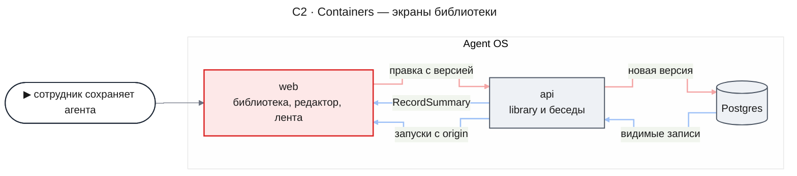
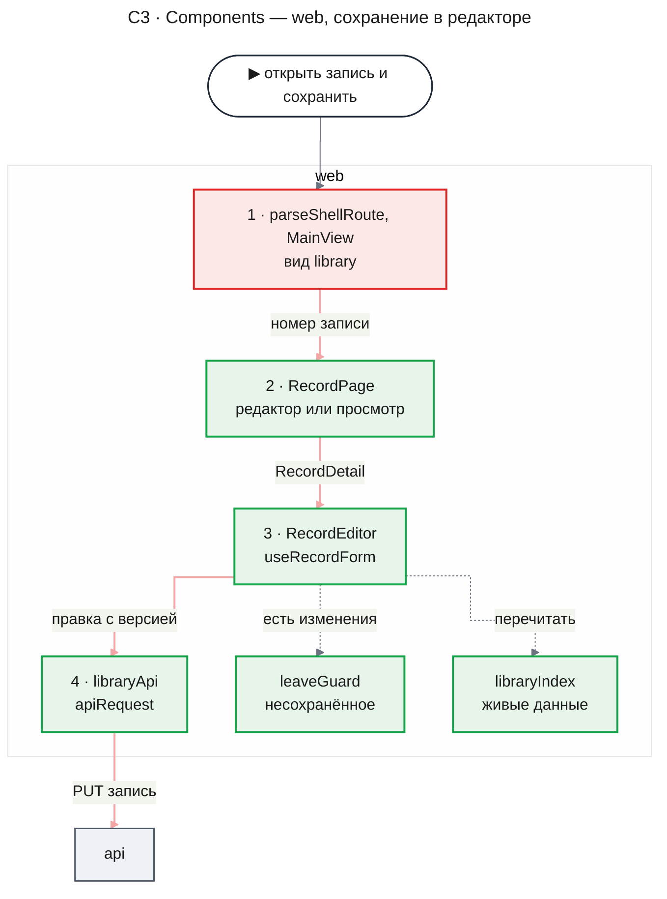
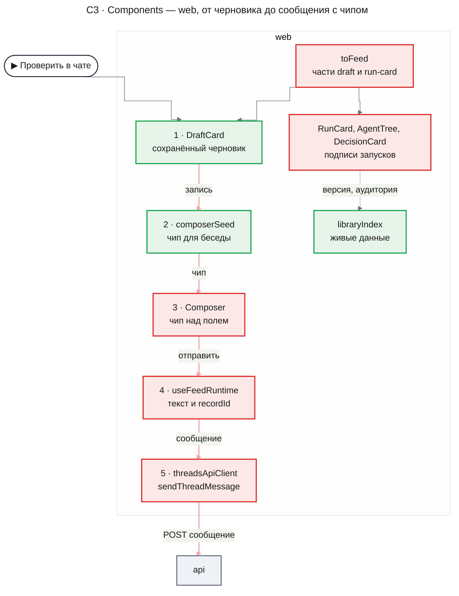
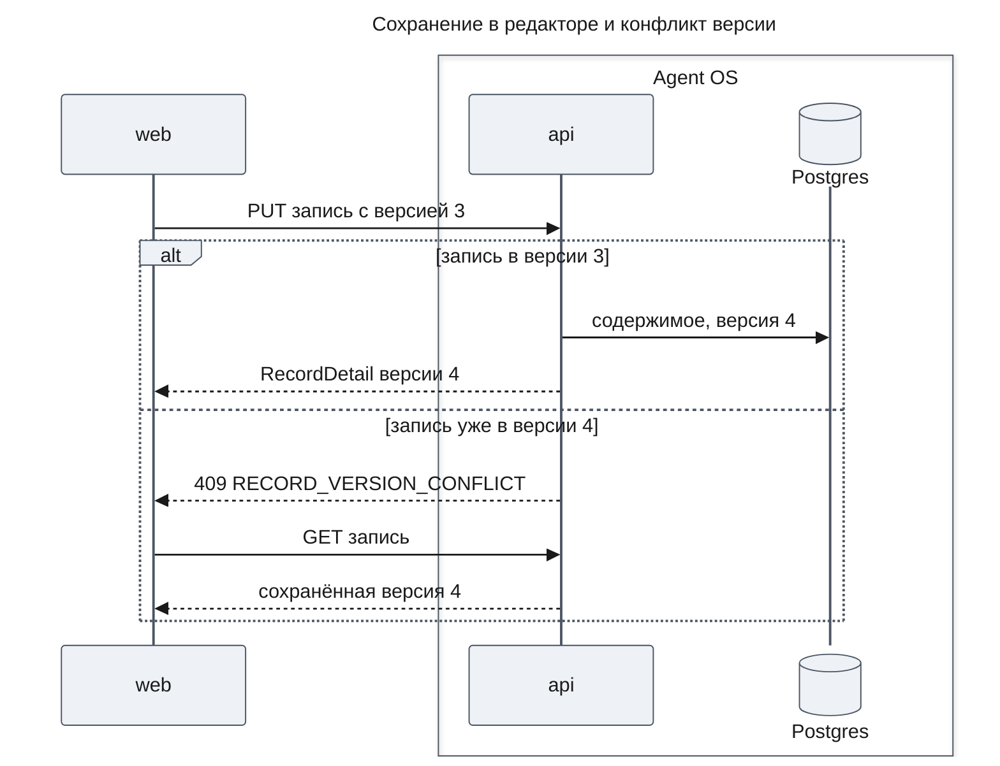
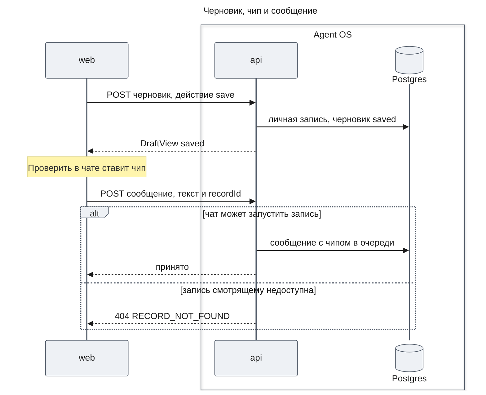
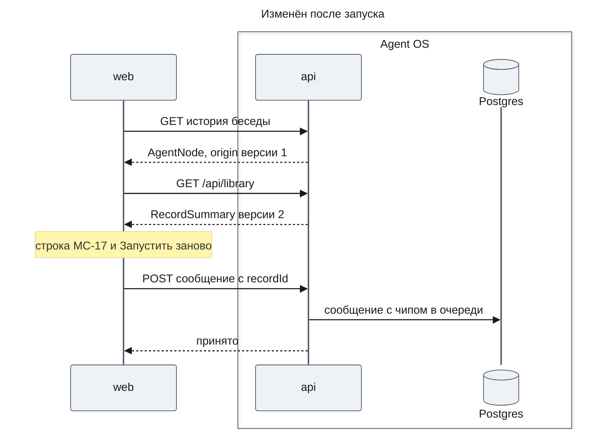
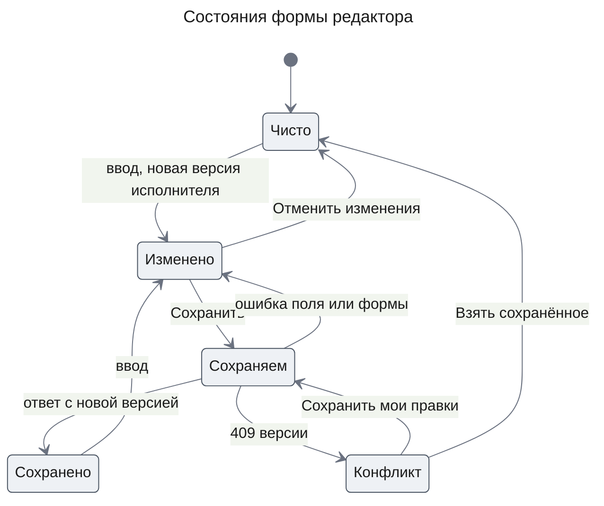

# Свои агенты и workflow — Design Document — web

**Status:** Draft · **Date:** 2026-11-17 · **PRD:** [prd.md](./prd.md) · **UXRD:** [uxrd.md](./uxrd.md) · **Depends on:** [design-library.md](./design-library.md#contract-definitions), [design-runtime.md](./design-runtime.md#contract-definitions)

## Snapshot

**Overview.** Эта часть строит в вебе всё, что сотрудник видит в фиче: раздел «Библиотека», страницу агента или workflow с редактором или просмотром, окно «Поделиться», раздел панели администратора, а в беседе — карточку черновика, чип агента в поле сообщения и подписи у запусков. Новые экраны встают в существующую оболочку чата по своим адресам и читают данные при открытии через общий клиент API. Живые данные записей — последняя версия, кто видит, доступна ли — веб держит в одном хранилище оболочки, из которого их берут карточки хода, дерево агентов и страница агента. Редактор хранит правку в своём состоянии, решает конфликт версии на месте и не отпускает со страницы с несохранённым без вопроса. Чип и заготовка сообщения переходят между экранами через хранилище оболочки, а сообщение несёт номер записи отдельным полем.

- **Не меняется**: беседа, лента, поток событий и очередь; ядро клиента API и его обработчики 401 и 403; форма и таблица панели, которыми пользуются пять существующих разделов.
- **Главный риск**: защита несохранённых изменений от кнопки «Назад» — у App Router нет для этого API, и решение держится на своём обработчике `popstate` (KD-4); проверяет его спайк в браузере до работы над редактором.
- **Открытые вопросы**: один, к `library` — [Open Questions](#open-questions).

### Key Decisions

#### KD-1: Адреса — один вид маршрута `library` для страниц сотрудника и раздел панели `library`, у которого вкладки и формы создания — сегменты пути

Сотрудник открывает `/library`, `/library/<id>`, `/library/new/agent` и `/library/new/workflow` (UXRD KD-1). `parseShellRoute` разбирает их в один вид `library` со страницей: список, запись по номеру или новая запись нужного вида; буквальные `new/agent` и `new/workflow` разбираются раньше номера. Панель получает шестой раздел `library`: «Системные» — `/admin/library`, «Открытые ролям» — `/admin/library/shared`, «Запреты» — `/admin/library/bans`, формы — `/admin/library/new/agent` и `/admin/library/new/workflow`, запись — `/admin/library/<id>`. Номер записи — UUID, поэтому со словами `shared`, `bans` и `new` он не совпадёт.

Не взяты: вкладки в состоянии компонента — «Назад» и перезагрузка сбрасывали бы вкладку на «Системные»; вкладка в `?tab=` — `useSearchParams` под `cacheComponents` требует `Suspense` у каждой страницы оболочки (документация Next 16.4.3, `use-search-params.md`, Prerendering); отдельный вид маршрута на каждый экран — пять потребителей вида получили бы по три ветки вместо одной.

#### KD-2: Живые данные записей для всех экранов держит одно хранилище оболочки `libraryIndex` над `GET /api/library`

Контракт `runtime` отдаёт у запуска только происхождение на момент старта (`RunOrigin`), а последнюю видимую версию, аудиторию и доступность веб берёт из `GET /api/library` по номеру ([design-runtime.md](./design-runtime.md#contract-definitions), «Данные для `web`»). Тот же список нужен библиотеке, выбору агента в редакторе и правилу «Использовать в чате». Поэтому список живёт в одном хранилище в `ShellServices`: его читают библиотека, подписи запусков, карточки решений, дерево агентов, страница агента и редакторы. Хранилище перечитывает список при входе на экран беседы, агента, списка агентов, библиотеки и страницы записи и после каждого своего изменения записи; одновременные чтения сливаются в одно. Записи нет в списке — смотрящему она недоступна, и подпись показывает состояние «Недоступна».

Не взяты: `GET /api/library/:id` на каждую карточку — запрос на карточку, с содержимым, которое подписи не нужно; новые поля в видах `runtime` — утверждённый контракт говорит, что эти данные веб читает сам; живые события о записях — в потоке событий их нет, а новая версия на открытой карточке появится при следующем входе на экран, что достаточно для AC-28.1.

#### KD-3: Редактор — свой компонент `RecordEditor` с состоянием в редьюсере `useRecordForm`, собранный из частей формы панели; `AdminForm` не расширяется

Редактору нужно то, чего у `AdminForm` нет: базовая версия и отметка изменений, панель сохранения со следующим шагом, конфликт с двумя действиями, «Отменить изменения» с «Вернуть», баннеры, Ctrl+S и защита ухода. Редьюсер держит сохранённую версию и введённые значения отдельно, поэтому «есть изменения», конфликт и «Вернуть» — сравнение двух значений, а не флаги. Редактор берёт из панели `FormError`, поля shadcn `field` и правило «фокус на первую ошибку»; плотность — комфортная у сотрудника и компактная в панели, как у формы панели. Один компонент служит сотруднику (ED-01, WF-01) и администратору (AL-02).

Не взяты: `AdminForm` с новыми пропсами — около десяти новых опций у формы, на которой стоят пять форм панели; react-hook-form — новая зависимость, от которой панель уже отказалась ([design-admin.md](../enterprise-access/design-admin.md), KD-5).

#### KD-4: Несохранённое держит стор оболочки `leaveGuard`: ссылки оболочки спрашивают через `onNavigate`, программные переходы — через проверку стора, вкладка — через `beforeunload`, «Назад» — через свой обработчик `popstate`

В Next 16.4.3 `<Link>` даёт `onNavigate` с `preventDefault()` именно для этого случая (`link.md`, «Blocking navigation»), а для `router.push`, «Назад» и закрытия вкладки API нет. Поэтому `leaveGuard` знает, есть ли на экране несохранённое, и умеет спросить диалогом MC-11. Ссылки, которые видны рядом с редактором — сайдбар, история бесед, меню пользователя, навигация и шапка панели, ссылки шапки редактора, — идут через обёртку `ShellLink` над `next/link`. «Новый чат», его сочетание клавиш и переходы самого редактора спрашивают стор до `router.push`. Закрытие вкладки — `beforeunload`: браузер показывает свой вопрос вместо MC-11. «Назад» при несохранённом ловит запасная запись истории и обработчик `popstate`; это не описано в документации Next, поэтому сначала спайк (L1-сценарий «Назад с изменениями»).

Не взяты: перехват всех кликов по ссылкам слушателем документа — работает в обход `Link`, и порядок с его обработчиком не описан; без защиты «Назад» — UXRD KD-6 и спецификация редактора её требуют; вопрос в каждой ссылке по месту — 15 файлов с `next/link` вместо одной обёртки.

#### KD-5: Чип и заготовку сообщения переносит стор оболочки `composerSeed`; сообщение несёт номер записи полем `recordId`

«Использовать в чате», «Проверить в чате», «Запустить заново», «Создать в чате» и «Доработать в чате» кладут в `composerSeed` цель — беседу по номеру или новую беседу — и чип записи или текст заготовки, затем ведут на беседу. Поле сообщения этой беседы забирает заготовку при появлении, а чип держит до отправки или «✕» (CH-01). Отправка передаёт `recordId` в `POST /api/threads/:threadId/messages`, в том числе первым сообщением новой беседы. Неудачная отправка возвращает и текст, и чип.

Не взяты: чип в адресе — тот же `Suspense`, что в KD-1, и адрес беседы перестал бы быть постоянным; вложение assistant-ui — вложения скрыты решением chat-shell D-04, а тело сообщения из них берёт только текст.

#### KD-6: Карточка черновика — своя часть ленты `draft` из `ConversationView.drafts`, а не карточка решения; в редактор черновик переносит стор `draftHandoff`

Черновик в контракте `runtime` — не запрос решения: он не держит беседу и не попадает в «ждут решения» (UXRD KD-3, `runtime` KD-6). Поэтому `toFeed` делает из каждого `DraftView` часть ленты `draft` и ставит её по времени создания, как карточки решений, а `DraftCard` рисует вариант «Черновик записи» из [decision-card.md](../../design-system/components/decision-card.md). Счётчики ожидания и лоток черновика не видят, потому что он не `Confirmation`. «Открыть в редакторе» кладёт черновик и номер беседы в `draftHandoff` и ведёт на форму в той же вкладке. Сохранив такую форму, редактор отправляет черновику действие `saved_in_editor` с номером сохранённой записи, и карточка становится «Сохранено в редакторе». После перезагрузки формы черновик остаётся в карточке, и его можно открыть снова.

Не взяты: черновик через часть `decision` — карточка решения держит беседу и падает в ветку «Подтвердить / Отклонить» для неизвестного вида; черновик в адресе формы — снова `Suspense`, и маршрута чтения одного черновика в контракте нет.

#### KD-7: Карточка хода workflow читает `WorkflowRunView` через существующий `getRun`; шаги — дети координатора из ленты, подписанные `origin.executor`

Команда, не вызванные исполнители и отказы по пределу есть только в `WorkflowRunView` ([design-runtime.md](./design-runtime.md#contract-definitions)), который отдаёт вид запуска `runs.get` по существующему `GET /api/agents/:agentId/run`. Карточка читает его при появлении и снова, когда меняется статус координатора или число его детей; шаги приходят живыми из ленты, как сегодня. Так строки шагов не ждут запроса, а «не вызывался» и «предел вызовов исчерпан» появляются с задержкой одного чтения.

Не взяты: команда в каждом `AgentNode` — контракт `runtime` утверждён без неё; опрос по таймеру — лишние запросы у завершённых запусков.

## Terms

- **Запись** — агент или workflow в библиотеке (PRD, Terms); в интерфейсе этого слова нет.
- **Живые данные записи** — строка `RecordSummary` из `GET /api/library`: последняя версия, аудитория, права смотрящего.
- **Происхождение** — `RunOrigin` запуска: запись, версия и имя на момент старта.
- **Стор оболочки** — хранилище zustand, которое создаёт `createShellServices` и видят все экраны оболочки ([shell-store.md](../../code-system/patterns/shell-store.md)).
- **Чип** — запись в поле сообщения (UXRD CH-01); **заготовка** — текст, который встаёт в поле новой беседы.

## Part

- **Part**: `web`
- **Covers**: FR-20, FR-21, FR-22, FR-23, FR-24, FR-25, FR-26, FR-27, FR-28, FR-29
- **Depends on**: [design-library.md, Contract Definitions](./design-library.md#contract-definitions) — маршруты сотрудника и панели, `RecordSummary`, `RecordDetail`, `CopyResult`, `AgentContent`, `WorkflowContent`, коды ошибок, `GET /api/auth/me/roles`, `GET /api/library/choices`; [design-runtime.md, Contract Definitions](./design-runtime.md#contract-definitions) — «Данные для `web`», маршруты черновиков и сообщения с `recordId`, `START_REFUSED`, причины отказа
- **Prerequisite ADRs**: [ADR-0012](../../adr/ADR-0012-closed-api-and-server-issued-employee-id.md) (сотрудник берётся из сеанса), [ADR-0016](../../adr/ADR-0016-library-records-and-visibility.md) (невидимая запись отвечает как несуществующая)
- **Sibling parts**: `library` (FR-01–FR-11) и `runtime` (FR-12–FR-19) — здесь только их контракты

**Out of scope**

- Правила видимости, версии, копии, проверки сохранения и запуска — их держит сервер; веб только показывает ответы.
- Лента, поток событий, лоток, карточки отчёта и вызова инструмента остаются, как в agent-platform; меняются только подписи и новые строки.
- Пять существующих разделов панели, их формы и таблицы.

**Constraints**

- PoC без совместимости: код, который читал `template` и `definition` у запусков, переписывается на `origin` и `name` в той же работе, слово «Бриф» в интерфейсе заменяется (MC-21).
- `apps/web` зависит только от `contracts` и `common`; к API ходит только через `apiRequest` ([web-api-client.md](../../code-system/patterns/web-api-client.md)).
- Лог — через `src/lib/logger.ts` ([Логирование](#логирование)); тестов мало ([Test Strategy](#test-strategy)).
- WCAG 2.1 AA и работа от 360 px (NFR-05) — как задают UXRD «Accessibility», «Responsive Behavior» и спецификации компонентов; проверяют L1-сценарии.

## Building-block Inventory

Follows the [code system](../../code-system/README.md). Поиск перед «new»: `apps/web/src/components` (`admin`, `agents`, `shell`, `ui`, `assistant-ui`), `apps/web/src/lib`, `apps/web/src/hooks`, `docs/code-system/` — подписи записи, редактора с версией, защиты ухода, переноса заготовки между экранами и вкладок нет.

| Building block | Pattern | Status | Note |
|---|---|---|---|
| `parseShellRoute`, `MainView`, `AppSidebar`, `ChatHeader`, `DocumentTitle` | [shell-route.md](../../code-system/patterns/shell-route.md) | extended | вид `library`, раздел панели `library` (KD-1) |
| `libraryApi` в `lib/library`, `adminApi.library`, `describeLibraryError` | [web-api-client.md](../../code-system/patterns/web-api-client.md) | new | по образцу `adminApi` и `describeAdminError` |
| `threadsApiClient`, `useFeedRuntime` | [web-api-client.md](../../code-system/patterns/web-api-client.md) | extended | `recordId` у сообщения, `draftAction` |
| `useResource` | [read-on-open.md](../../code-system/patterns/read-on-open.md) | extended | метка лога вместо постоянной `admin: read failed` |
| `libraryIndex`, `composerSeed`, `draftHandoff`, `leaveGuard` | [shell-store.md](../../code-system/patterns/shell-store.md) | new | новый паттерн по образцу `agentList` и `currentUser` (KD-2, KD-4–KD-6) |
| `RecordEditor`, `useRecordForm` | — | new | KD-3; части формы панели — reused |
| `RecordLabel`, `LibraryRow`, `DefinitionView`, `ExecutorItem`, `ShareDialog`, `DraftCard` | спецификации дизайн-системы | new | по [Component tree](#дерево-компонентов) |
| `DecisionCard`, `RunCard`, `AgentTree`, `AgentMeta`, `AgentHeader`, `StateBadge`, `ThreadNotice`, `Composer`, `tool-fallback.aui.tsx` | спецификации дизайн-системы | extended | подписи, строки шагов, состояние «Сведения», RV-02, чип, отказы |
| `AdminPageHeader` → `PageHeader` | — | extended | шапка через портал и для страниц библиотеки; родитель — ссылка, а не раздел панели |
| `AgentsNavItem` → `SectionNavItem` | — | extended | второй пункт сайдбара «Библиотека» |
| `DataTable`, `ConfirmDialog`, `FormError`, `ConversationView`-лента, announcer, `pluralRu`, `formatModel` | — | reused | — |
| shadcn `tabs`; панель исполнителя на `Drawer` base-ui; поиск на `Combobox` base-ui; `CollapsibleRoot` | — | new / reused | `sheet` и `command` в проекте нет: правая панель — `Drawer`, как у сайдбара; поиск — `Combobox` без cmdk; раскрытие — существующий `CollapsibleRoot` |

## Acceptance Criteria

### FR-20: Раздел «Библиотека»

- From the PRD: AC-20.1, AC-20.2
- Страница записи, которую API ответил 404, показывает один экран RV-02 для чужой личной, закрытой, удалённой и несуществующей записи (DC-1).

### FR-21: Редактор агента

- From the PRD: AC-21.1, AC-21.2
- При несохранённом переход по ссылке оболочки, «Новый чат», «Назад» и закрытие вкладки спрашивают подтверждение, и «Остаться» оставляет форму с введённым (DC-2).
- «Взять сохранённое» заменяет форму сохранённой версией, а «Вернуть» в уведомлении возвращает введённое поверх неё (DC-3).

### FR-22: Редактор workflow

- From the PRD: AC-22.1, AC-22.2, AC-22.3
- «Взять новую версию» меняет только форму; запись меняется после «Сохранить», а «Отменить изменения» отменяет и её (DC-4).

### FR-23: Окно «Поделиться»

- From the PRD: AC-23.1, AC-23.2
- Без ролей у сотрудника и под запретом делиться кнопка аудитории недоступна с причиной MC-14, а окно не открывается (DC-5).

### FR-24: Раздел панели «Агенты и workflow»

- From the PRD: AC-24.1
- Вкладка панели — адрес: перезагрузка и «Назад» возвращают ту же вкладку (DC-6).

### FR-25: Чей агент — видно в беседе

- From the PRD: AC-25.1, AC-25.2
- Подпись запуска берёт имя и автора из происхождения, а аудиторию — из живых данных; записи нет в живых данных — подпись в состоянии «Недоступна» (DC-7).
- Новый черновик в беседе сворачивает прежний в строку MC-15 и отмечает «изменено» поля, которые отличаются от прежнего (DC-8).
- Черновик, решённый в другой вкладке, после ответа 409 `DRAFT_RESOLVED` показывает итог без строки ошибки (DC-9).

### FR-26: «Использовать в чате»

- From the PRD: AC-26.1, AC-26.2
- Черновик, открытый в редакторе и сохранённый там, переводит карточку в «Сохранено в редакторе», а панель сохранения предлагает «Вернуться в беседу» (DC-12).
- Сообщение с чипом уходит с `recordId`; если API ответил 404 `RECORD_NOT_FOUND`, чип уходит из поля, текст возвращается, а под полем — MC-16 «{Вид} недоступен…» (DC-10).

### FR-27: Запуск workflow сверяется с командой

- From the PRD: AC-27.1, AC-27.2, AC-27.3

### FR-28: Изменён после запуска

- From the PRD: AC-28.1
- На странице агента подсказка «Запустить с нуля» называет последнюю видимую версию; записи нет в живых данных — кнопка недоступна с подсказкой MC-17, а отказ 409 `START_REFUSED` показывает причину и не открывает нового агента (DC-11).

### FR-29: Получателю объясняют, а не спрашивают

- From the PRD: AC-29.1

## Design

### Architecture (C1–C4)

#### C2 · Containers

Контейнеры те же; `web` получает новые экраны и новые вызовы `api`.

`web` строит экраны над маршрутами `library` и видами `runtime`; `api` и `Postgres` меняют части `library` и `runtime`.

#### C3 · Components: web

**web — библиотека и редактор.** Адрес выбирает экран, экран читает запись и правит её через модуль `lib/library`; список записей держит `libraryIndex`.

`RecordPage` показывает редактор, только если запись своя (`mine`) и `canEdit` это разрешает; иначе — просмотр RV-01. Запись компании администратор правит только в панели, поэтому на её странице в библиотеке он видит просмотр с «Открыть в панели». У новой записи — пустой редактор или черновик из `draftHandoff`. После создания страница меняет адрес на `/library/<id>` без новой записи истории. Раздел панели собран так же: `AdminScreen` с разделом `library` рисует вкладки с `DataTable`, а `/admin/library/<id>` — `RecordEditor` в варианте «Системная» у записи без автора или просмотр AL-03 у записи сотрудника.

**web — беседа и запуски.** Лента строит черновики и подписи запусков из вида беседы, а живые данные берёт у `libraryIndex`; чип идёт в поле сообщения через `composerSeed`.

`toFeed` ставит часть `draft` по времени создания черновика и прячет успешный вызов `draft_record`, как сегодня прячет успешный `start_agent`. Карточка хода выбирает вариант по `origin.kind`, а не по `template`; задание связывается с запуском по номеру записи workflow, а не по имени. `RunCard` workflow дочитывает `WorkflowRunView` (KD-7).

#### Дерево компонентов

Где стоит каждый компонент и по какой спецификации он строится.

| Компонент | Спецификация | Где | Статус |
|---|---|---|---|
| `LibraryScreen`, `LibraryRow` | [library-row.md](../../design-system/components/library-row.md) | `/library`, три группы (LB-02) | new |
| `RecordLabel` | [record-label.md](../../design-system/components/record-label.md) | строка, шапка, чип, карточки, дерево, страница агента | new |
| `RecordPage` с `DefinitionView` | [definition-view.md](../../design-system/components/definition-view.md) | просмотр RV-01, AL-03, тело карточки черновика | new |
| `RecordEditor` | [record-editor.md](../../design-system/components/record-editor.md) | ED-01, WF-01, AL-02 | new |
| `ExecutorItem`, `ExecutorPanel` | [executor-item.md](../../design-system/components/executor-item.md) | команда WF-01, панель WF-03 на `Drawer` | new |
| `ShareDialog` | [share-dialog.md](../../design-system/components/share-dialog.md) | SH-01, сотрудник и администратор | new |
| `DraftCard` | [decision-card.md](../../design-system/components/decision-card.md), «Черновик записи» | часть ленты `draft` (DC-01) | new |
| `DecisionCard` | то же, «Действие» и «Бриф» | подпись записи (RN-04), «Задание · {имя}» (RN-05) | extended |
| `RunCard` | [agent-run-card.md](../../design-system/components/agent-run-card.md) | RN-01 | extended |
| `AgentTree` | [agent-tree.md](../../design-system/components/agent-tree.md) | колонка «Из библиотеки» (RN-02) | extended |
| `AgentMeta`, `AgentHeader` | agent-platform UXRD, AV-01, AV-02 | вторая строка мета и подсказка перезапуска (RN-03) | extended |
| `StateBadge` | [state-badge.md](../../design-system/components/state-badge.md) | состояние «Сведения» | extended |
| `Composer` | chat-shell UXRD, TH-04 | чип над полем (CH-01) | extended |
| блок вызова в `tool-fallback.aui.tsx` | [tool-call.md](../../design-system/components/tool-call.md) | отказы DC-02, RN-06 с действием | extended |
| `ThreadNotice` | chat-shell UXRD, TH-06 | вариант RV-02 с «В библиотеку» | extended |

#### Данные экранов

Каждый экран читает при открытии ([read-on-open.md](../../code-system/patterns/read-on-open.md)), а после своего изменения перечитывает затронутое и `libraryIndex`. Живого обновления нет, оптимистичных правок нет.

| Экран | Читает | Пишет |
|---|---|---|
| Библиотека | `libraryIndex`; `GET /api/auth/me/roles` | копия, удаление, аудитория |
| Страница записи | `GET /api/library/:id`; `libraryIndex` для «Может запускать»; у редактора — `GET /api/library/choices` и `GET /api/access/models` | `POST` или `PUT /api/library`, аудитория, копия, удаление |
| Окно «Поделиться» | у сотрудника `GET /api/auth/me/roles`; у администратора `adminApi.roles.list` и `adminApi.users.list` | `PUT …/audience` своего маршрута |
| Раздел панели | `GET /api/admin/library/system`, `/shared`, `/bans`, `/:id`; у редактора `adminApi.servers.list`, `adminApi.models.list` | создание, правка, аудитория, удаление, закрытие доступа, снятие запрета |
| Беседа | вид беседы с `drafts`; `libraryIndex`; у карточки workflow — `getRun` | действия черновика, сообщение с `recordId` |
| Список и страница агента | как сегодня; `libraryIndex` | «Запустить с нуля» |

«Обновить там» (MC-13) после сохранения агента читает свои workflow из `libraryIndex`, их записи — по одной, и отбирает те, у кого источник исполнителя — этот агент по `executorSources`. По нажатию каждый такой workflow берёт новую версию исполнителя и сохраняется своим `PUT` с версией; конфликт одного не останавливает остальные, и уведомление называет, что обновилось.

### Runtime Flows

#### Flow 1: Сохранение в редакторе и конфликт версии

**Starts when:** автор нажимает «Сохранить», для AC-21.2, DC-3

**Outcome:** при успехе форма берёт версию 4 как сохранённую, панель показывает «Сохранено» и «Использовать в чате» или «Вернуться в беседу», `libraryIndex` перечитывается. При конфликте форма остаётся с введённым, а над панелью встаёт блок MC-10 с полями, которые отличаются у сохранённой версии 4 от версии 3, с которой начата правка.

**Failure handling:**

- «Сохранить мои правки» → `PUT` введённого с версией 4; новый конфликт показывает блок снова.
- «Взять сохранённое» → форма и сохранённое — версия 4; уведомление «Вернуть» кладёт введённое обратно поверх версии 4 (DC-3).
- 404 → экран RV-02; 403 `RECORD_READ_ONLY`, 409 `RECORD_NAME_TAKEN`, 422 `RECORD_REJECTED`, 400, сеть → по таблице [Ошибки](#ошибки-и-их-место); введённое остаётся.
- Ответ `GET` после конфликта не пришёл → блок MC-10 без списка полей.

#### Flow 2: Черновик, «Проверить в чате» и сообщение с чипом

**Starts when:** Аня жмёт «Сохранить» на карточке черновика, для AC-26.1, DC-10

**Outcome:** карточка показывает «Сохранено · {время}» с «Проверить в чате», «Поделиться» и «Открыть». Чип стоит над полем этой беседы, подсказка поля — MC-20, фокус — в поле; запуска нет до отправки. После принятой отправки чип уходит.

**Failure handling:**

- `DraftView` с `refusal` → строка MC-8 на карточке; при `name_taken` — «Сохранить как «{свободное имя}»», и то же действие уходит с этим именем.
- 409 `DRAFT_RESOLVED` → лента перечитывает беседу, карточка показывает итог из другой вкладки без строки ошибки (DC-9).
- 404 `RECORD_NOT_FOUND` на сообщение → чип уходит, текст возвращается в поле, под полем MC-16 «{Вид} недоступен…» (DC-10).
- Сеть или 5xx на сообщение → текст и чип возвращаются, строка неудачной отправки chat-shell MC-27.

#### Flow 3: Изменён после запуска и «Запустить заново»

**Starts when:** Борис открывает беседу, где шёл агент Ани версии 1, а Аня уже сохранила версию 2, для AC-28.1

**Outcome:** карточка хода показывает «{Вид} изменён после запуска: сейчас версия 2» и «Запустить заново»; кнопка кладёт агента чипом в поле этой беседы, и отправка стартует версию 2. Работающий запуск идёт на версии 1 и продолжает показывать её.

**Failure handling:**

- Записи нет в `GET /api/library` → подпись «Недоступна», строки и кнопки нет.
- Беседы карточки уже нет → беседа отвечает «не найдено», и `composerSeed` переносит чип в новую беседу (CH-01).
- `GET /api/library` не удался → подписи без аудитории и без строки версии; ошибка в логе, повтор — при следующем входе на экран.

### Contract Definitions

#### Адреса

- **`libraryPath()`, `recordPath(id)`, `newRecordPath(kind)`** — адреса страниц сотрудника; номер кодируется `encodeURIComponent`. `parseShellRoute` разбирает их в `{ kind: 'library', page }`, где `page` — `list`, `record` с номером или `new` с видом.
- **`adminPath('library')`, `adminLibraryTabPath(tab)`, `adminRecordPath('library', id)`, `adminNewRecordPath(kind)`** — адреса раздела панели; `tab` — `system`, `shared` или `bans`. `AdminPage` раздела `library` получает вкладку у списка и вид у новой записи.
- Все потребители вида — `MainView`, `AppSidebar` (пункт «Библиотека» выбран на всех страницах вида `library`), `ChatHeader`, `DocumentTitle` (MC-1, MC-6, MC-7, MC-18), рабочая область и skip link — обрабатывают новый вид; пустая страница `app/(chat)/library/[[...path]]/page.tsx` занимает адреса.

#### Клиент API библиотеки

- **`libraryApi`** (`lib/library`) — по функции на маршрут сотрудника из [design-library.md](./design-library.md#contract-definitions): `list`, `get`, `create`, `save` (с `version`), `saveAudience`, `copy`, `remove`, `choices`, `myRoles`. Ответы разбирают схемы `packages/contracts/src/library.ts`.
- **`adminApi.library`** — по функции на маршрут панели: `system`, `shared`, `bans`, `get`, `create`, `save`, `saveAudience`, `remove`, `close`, `liftBan`.
- **`describeLibraryError(error, context)`** — переводит `ApiRequestError` в место и текст: поле формы по имени или форма; правила — [Ошибки и их место](#ошибки-и-их-место). Неизвестный код — «Не удалось сохранить: {причина}» с сообщением сервера.
- Пределы полей для счётчиков и проверки до отправки — константы `packages/contracts/src/library.ts`, по которым построены схемы содержимого; веб своих чисел не держит.

#### Сторы оболочки

- **`libraryIndex`** — `status`, записи по номеру и `refresh()`. Отдаёт `summaryOf(recordId)`: `RecordSummary` или «нет», когда список прочитан, а записи в нём нет. Ошибка чтения не стирает прежний список.
- **`composerSeed`** — `put(target, { record?, text? })`, где `target` — номер беседы или `new`; поле этой беседы забирает текст один раз при появлении и держит чип до принятой отправки, «✕» или нового чипа. Один чип на беседу.
- **`draftHandoff`** — один перенос: номер беседы и `DraftView`. Редактор забирает его при открытии своей страницы; перенос другой страницы или перезагрузка его стирают. После успешного создания или сохранения редактор шлёт этому черновику `saved_in_editor` с номером записи; ответ 409 `DRAFT_RESOLVED` или 404 `DRAFT_NOT_FOUND` только пишется в лог — запись уже сохранена.
- **`threadsApiClient.draftAction(threadId, draftId, action)`** — `POST /api/threads/:threadId/drafts/:draftId` с `save` (и необязательным именем), `reject` или `saved_in_editor`; ответ — `DraftView`. Его зовут `DraftCard` и редактор.
- **`leaveGuard`** — `hold(name)` и `release()` у экрана с несохранённым; `confirmLeave()` спрашивает MC-11 и отвечает, уходить ли. Пока ничего не удержано, переходы идут без вопроса.

#### Компоненты

- **`RecordLabel`** — запись (номер, вид, имя, автор, аудитория со строки `RecordSummary` или из `RunOrigin`), вариант «Строка», «Под названием» или «Чип», необязательная версия, `onRemove` у чипа. Сама решает «моя», «от компании», роли смотрящего и состояние «Недоступна».
- **`LibraryRow`** — `RecordSummary` и действия меню. «Поделиться» и «Удалить» строка показывает только у своей записи (`mine`) и по `canShare`, `canDelete`; «Использовать в чате» — по правилу ниже, недоступность «Поделиться» — по ролям смотрящего и `ban`.
- **`DefinitionView`** — вид, содержимое, имена систем смотрящего для пометок, вариант «В карточке» или «На странице», пояснение получателю и, у черновика, набор изменённых полей.
- **`RecordEditor`** — вариант («Агент», «Workflow»), режим (`employee` или `system`), сохранённая `RecordDetail` или вид новой записи, необязательный черновик из `draftHandoff`, выборы (системы, модели, модель по умолчанию). Событий наружу нет: редактор сам зовёт клиент API и ведёт по адресам.
- **`ExecutorItem`** — исполнитель, состояние источника из `executorSources`, выбран ли он автором ответа, ошибка строки; события `onEdit`, `onRemove`, `onTakeNewVersion`, `onResponsibilityChange`. **`ExecutorPanel`** правит исполнителя в копии и отдаёт её по «Готово».
- **`ShareDialog`** — вариант («Сотрудник», «Администратор»), запись, `onSaved(RecordDetail)`; роли и поиск читает сам.
- **`DraftCard`** — `DraftView`, предыдущий черновик беседы (для «изменено») и живые данные правимой записи; действия зовут маршрут черновиков `runtime`.

#### Правила веба

- **«Использовать в чате» есть**, если запись не `chat` (`builtinKey`), своя или с `offerInChat`, и в `missingRights` нет строки с `executor` `null` и непустым `model`. Так кнопки нет у записи «только для чтения» (AC-26.2) и у записи с недоступной моделью (RV-01).
- **Изменён после запуска**, если в `libraryIndex` есть запись `origin.recordId` с версией больше `origin.version`.
- **Пояснение получателю** (AC-29.1) показывают страница записи коллеги и карточка хода, у которой `firstRun`, автор — не смотрящий и запись есть в живых данных; роли — те, где `member`.
- **Черновик устарел** (DC-01), если у ждущего черновика правки версия записи в живых данных больше `baseVersion` или последний отказ — `version_conflict`.
- **Свободное имя** — «{имя} 2», «{имя} 3» и дальше, первое, которого нет среди своих записей в живых данных.
- **Изменённые поля** конфликта и черновика считает одна функция сравнения двух определений; поля называются подписями формы (MC-7, MC-15).

#### Ошибки и их место

| Ответ | Где показан | Текст |
|---|---|---|
| 404 `RECORD_NOT_FOUND` на странице записи | экран RV-02 вместо страницы | MC-6 |
| 409 `RECORD_VERSION_CONFLICT` | блок конфликта над панелью | MC-10 |
| 409 `RECORD_NAME_TAKEN`, `own` или `system` | поле «Имя»; в карточке черновика — строка и «Сохранить как» | MC-8 |
| 422 `server_not_allowed`, `all_servers_not_allowed` | поле «Системы» или карточка исполнителя | MC-8 |
| 422 `model_not_allowed` | поле «Модель», «Дополнительно» раскрывается | MC-8 |
| 422 `agent_not_visible` | поле «Может запускать» | MC-8 |
| 422 `role_not_member`, `sharing_banned` | ошибка формы окна «Поделиться» | MC-14 |
| 422 `audience_fixed`, `builtin`, `holder_not_found` | ошибка формы панели | MC-8 «Не удалось сохранить: {причина}» |
| 403 `RECORD_READ_ONLY` | ошибка формы; введённое остаётся | MC-8 |
| 409 `START_REFUSED` | уведомление у «Запустить с нуля», нового агента нет | MC-16 |
| отказ инструмента `record_unavailable`, `model_not_allowed`, `shared`, `read_only`, `run_limit` | блок вызова в ленте; у модели — «Открыть», у `shared` — «Открыть в редакторе» | MC-16, MC-17 |
| сеть | ошибка формы или уведомления | MC-8 «нет связи с сервером» |

Отказ `read_only` на записи коллеги текста в UXRD не имеет и показывает общий текст отказа платформы, как сегодня у неизвестной причины.

### State Transitions and Invariants

Состояния формы редактора (record-editor, States):

Карточка черновика следует состояниям `DraftView` из [design-runtime.md](./design-runtime.md#state-transitions-and-invariants); «Не сохранено» и «Устарел» — ждущий черновик с отказом или по правилу выше.

**Invariants**

1. Введённое в редакторе не пропадает без действия автора: ни ошибка, ни конфликт, ни отказ сервера не меняют значения формы.
2. Сохранение несёт версию, с которой начата правка или которую автор принял в конфликте; другой версии веб не подставляет.
3. Кнопка, которая меняет запись, есть только там, где флаг `canEdit`, `canShare` или `canDelete` её разрешает; на страницах библиотеки — только у своей записи, а запись компании меняется только в панели. Сервер проверяет то же сам.
4. У поля сообщения не больше одного чипа, и сообщение несёт ровно тот `recordId`, который показан чипом.
5. Слова «личная», «ролевая», «системная» и «встроенная» вне панели не показываются (AC-25.2).

### Доступность и ширина

Фокус, объявления, заголовки и ширина — как в UXRD «Accessibility» и «Responsive Behavior» и в спецификациях; здесь — то, как веб это даёт.

- Фокус после перехода — `focusShellTarget('page-title')`; в поле сообщения после чипа — `focusShellTarget('composer')`. Остальные переходы фокуса из таблицы UXRD экран делает по своим ссылкам на элементы.
- Объявления MC-19 — через существующий announcer оболочки; конфликт и ошибки — `role="alert"`.
- Ctrl+S / Cmd+S ловит обработчик клавиш на самой форме, а не глобальные сочетания оболочки.
- Брейкпоинты 768 и 1024 px — существующие; столбец кнопок черновика уже 480 px — произвольный брейкпоинт Tailwind в этом компоненте, нового токена нет. Окно «Поделиться» и диалог копии на узкой ширине — на весь экран через новый размер `DialogContent`; панель исполнителя — `Drawer` справа, на узкой — во весь экран.
- Уведомления с действием («Вернуть», «Открыть», «Поделиться», «Обновить там») — `action` у sonner.

### Логирование

Через `logger` из `src/lib/logger.ts` с `describeApiError` ([logging.md](../../code-system/patterns/logging.md)); пишет место, где ошибка обработана. Промпт, правила, описание и содержимое записи в лог не идут.

- Чтения: маршрут, статус, код и причина ошибки; `useResource` получает метку экрана вместо постоянной `admin: read failed`.
- Изменения записи: `recordId`, вид, действие (`create`, `save`, `audience`, `copy`, `delete`, `close`, `unban`), версия, итог или код и причина отказа, `durationMs`; у конфликта — версия правки и сохранённая версия.
- Черновик: `threadId`, `draftId`, действие, итог или `refusal`.
- Сообщение с чипом: `threadId`, `recordId`, итог или код.
- Перезапуск и «Обновить там»: `agentId` или номера workflow, итог каждого.

## Test Strategy

Правила сервера — видимость, версию, отказы — доказывают тесты `library` и `runtime`; эти случаи доказывают, что веб показывает, что шлёт и что делает с каждым ответом. Правила веба — адреса, перевод ошибок, «Использовать в чате», сравнение полей, состояния формы — проверяются таблицами случаев на самом нижнем уровне.

### Main Use Cases

- **UC-1: Библиотека и страница коллеги по правам** — covers AC-20.1, AC-23.1, AC-25.2, AC-26.2, AC-29.1
  - Given: у Бориса агент Ани для роли «SRE» без `offerInChat` с Jira, которой у Бориса нет, и `general-purpose` от компании; первый запуск агента Ани в беседе Бориса с `firstRun`
  - When: Борис открывает библиотеку, страницу агента Ани и беседу
  - Then: у строки Ани — пометка о Jira, в меню и на странице нет «Использовать в чате» и «Поделиться», есть пояснение получателю; `general-purpose` подписан «от компании» без «встроенная»; карточка хода показывает пояснение MC-17
- **UC-2: Копия** — covers AC-20.2
  - Given: агент Ани с Jira и моделью, которой у Бориса нет
  - When: Борис выбирает «Скопировать себе» и подтверждает диалог
  - Then: диалог называл Jira; уведомление MC-4 называет обе модели; «Открыть» ведёт на страницу копии
- **UC-3: Правка агента** — covers AC-21.1, AC-21.2, DC-3
  - Given: агент Ани с Jira, права на Jira нет; в другой вкладке запись уже версии 4
  - When: Аня открывает редактор, меняет инструкцию и сохраняет, затем «Взять сохранённое» и «Вернуть»
  - Then: Jira помечена и не мешает отправке; ответ 409 — блок MC-10 с изменившимися полями и введённое на месте; «Вернуть» возвращает введённое над версией 4
- **UC-4: Команда workflow** — covers AC-22.1, AC-22.2, AC-22.3, DC-4
  - Given: workflow с исполнителями, у одного источник `changed`, у другого `gone`
  - When: автор открывает редактор, жмёт «Взять новую версию», затем «Отменить изменения», снова берёт и сохраняет
  - Then: фраза MC-12 о задании видна; у второго — строка без действия; после отмены форма прежняя; `PUT` несёт новую версию источника
- **UC-5: Окно «Поделиться»** — covers AC-23.2
  - Given: у Ани роли «SRE» и «Оплаты»; запись открыта роли «Дежурный», из которой Аня ушла
  - When: Аня открывает окно, отмечает «SRE» и сохраняет
  - Then: флажки — её роли и отмеченная «Дежурный» с пометкой; тело — роли и `offerInChat`; уведомление MC-14
- **UC-6: Раздел панели** — covers AC-24.1, DC-6
  - Given: администратор; ответ `shared` с записью Ани для «SRE»
  - When: он открывает «Открытые ролям», перезагружает страницу, открывает запись и закрывает доступ
  - Then: вкладка та же после перезагрузки; строка — имя, автор и роли, страница — инструкция; после подтверждения строка ушла
- **UC-7: Подписи запусков** — covers AC-25.1, DC-7
  - Given: агент Ани в беседе Бориса просит подтверждения; второй запуск — с записью, которой нет в живых данных
  - When: Борис открывает беседу
  - Then: карточка решения подписана «… · Аня Смирнова SRE»; второй запуск — подпись «Недоступна» без ссылки
- **UC-8: Черновик до сообщения** — covers AC-26.1, DC-8
  - Given: в беседе два черновика, первый заменён
  - When: Аня сохраняет второй, жмёт «Проверить в чате» и отправляет текст
  - Then: первый — строка MC-15, у второго «изменено» на отличных полях; до отправки запросов сообщения нет; тело сообщения несёт текст и `recordId`
- **UC-9: Ход workflow** — covers AC-27.1, AC-27.2, AC-27.3
  - Given: завершённый координатор версии 3 с командой из четырёх, три шага и отказ `run_limit`; в живых данных версия 4
  - When: Борис открывает беседу
  - Then: шаги подписаны именами из команды, строка «предел вызовов исчерпан», четвёртый — «не вызывался»; заголовок — «версия 3»
- **UC-10: Изменён после запуска** — covers AC-28.1, DC-11
  - Given: агент Ани версии 1 в беседе Бориса, в живых данных версия 2
  - When: Борис жмёт «Запустить заново», а потом открывает страницу агента
  - Then: чип в поле этой беседы, фокус в поле; на странице агента — строка MC-17 без своей кнопки

- **UC-11: Черновик через редактор** — covers DC-12
  - Given: ждущий черновик нового агента в беседе Ани
  - When: Аня жмёт «Открыть в редакторе», меняет описание и жмёт «Создать», затем «Вернуться в беседу»
  - Then: форма заполнена черновиком; после создания черновику ушло `saved_in_editor` с номером новой записи; в беседе карточка «Сохранено в редакторе · {время}»

### Error and Edge Use Cases

- **UC-E1: Не найдено** — covers DC-1
  - Given: `GET /api/library/:id` отвечает 404
  - When: сотрудник открывает адрес записи
  - Then: экран RV-02 с «В библиотеку», фокус на `h1`
- **UC-E2: Уход с несохранённым** — covers DC-2
  - Given: изменённая форма
  - When: сотрудник жмёт пункт сайдбара, затем «Новый чат»
  - Then: диалог MC-11 с фокусом на «Остаться»; «Остаться» оставляет введённое, «Уйти без сохранения» уходит
- **UC-E3: Делиться нельзя** — covers DC-5
  - Given: строки — у сотрудника нет ролей; у записи `ban`
  - When: он открывает редактор своей записи
  - Then: кнопка аудитории недоступна с причиной MC-14; окно не открывается
- **UC-E4: Черновик решён в другой вкладке** — covers DC-9
  - Given: ждущий черновик, маршрут черновика отвечает 409 `DRAFT_RESOLVED`, перечитанный вид — `saved`
  - When: Аня жмёт «Сохранить»
  - Then: карточка «Сохранено» без строки ошибки
- **UC-E5: Чип недоступной записи** — covers DC-10
  - Given: чип в поле, сообщение отвечает 404 `RECORD_NOT_FOUND`
  - When: Аня отправляет
  - Then: чипа нет, текст в поле, под полем MC-16
- **UC-E6: Перезапуск отклонён** — covers DC-11
  - Given: строки — запись агента в живых данных версии 2; записи нет в живых данных; перезапуск отвечает 409 `START_REFUSED` `model_not_allowed`
  - When: Борис открывает страницу агента и жмёт «Запустить с нуля»
  - Then: подсказка «Пойдёт на версии 2»; кнопка недоступна с подсказкой MC-17; уведомление о модели, адрес не меняется

### L1-сценарии в браузере

Готовый интерфейс принимается в настоящем браузере против настоящего API. Два первых сценария — спайки: они идут до работы над редактором и чипом.

| Сценарий | Шаги | Проверяемый сигнал |
|---|---|---|
| Назад с изменениями (спайк) | Изменить инструкцию, нажать «Назад» браузера, «Остаться», затем «Назад» и «Уйти без сохранения» | Диалог MC-11; после «Остаться» адрес прежний и текст на месте; после ухода — прежний экран, лишней записи истории нет |
| Чип в новой беседе (спайк) | В библиотеке «Использовать в чате», ввести текст, отправить | Новая беседа, чип над полем, фокус в поле; в Network тело `POST …/messages` с `recordId`; карточка хода с подписью этого агента |
| Библиотека на 360 px | Открыть `/library` и редактор на ширине 360 px | Нет горизонтальной прокрутки; кнопка «+» с меню; цели касания 44 px; панель сохранения во всю ширину |
| Конфликт в двух вкладках | Открыть редактор в двух вкладках, сохранить в первой, во второй | Блок MC-10 с полями; после «Сохранить мои правки» версия +1 |
| Workflow от чата до хода | Описать workflow в чате, сохранить, «Проверить в чате», подтвердить задание | Карточка «Задание · {имя}», шаги по именам команды, после конца — «не вызывался» |
| Тема и контраст | Библиотека, редактор, карточка черновика в светлой и тёмной теме | Цвета из токенов; пояснение получателю на `--info-subtle`; нет чистого белого и чёрного |

## Security Considerations

- **Authentication & Authorization**: права решает сервер; веб показывает действия по флагам `canEdit`, `canShare`, `canDelete` и праву администратора из `CurrentUser`, а раздел панели монтируется только через `AdminGate`. Невидимая запись для веба — 404, и экран RV-02 одинаков для всех причин, поэтому существование чужой записи не видно.
- **Input Validation**: веб проверяет поля до отправки по тем же пределам контракта, но решает сервер; ответы разбирают схемы `contracts`, ответ не по схеме — ошибка `invalid_response`. Имена и тексты авторов выводятся как текст, без разметки.
- **Sensitive Data Handling**: секретов в записях нет; промпт и содержимое не идут в лог, адрес и хранилища браузера. Сторы оболочки живут только в памяти вкладки.

## Risks and Mitigation

- **Защита «Назад» не сработает с роутером Next** — потеря длинной инструкции, вероятность средняя. Спайк до редактора; если он не проходит, «Назад» остаётся без вопроса, а ссылки, «Новый чат» и вкладка — с вопросом, и это решение возвращается к UXRD.
- **Живые данные отстают от сохранения у коллеги** — строка «изменён после запуска» появится только при следующем входе на экран; вероятность высокая, влияние низкое (KD-2).
- **«Обновить там» читает каждую свою запись workflow** — заметно при сотнях своих workflow, вероятность низкая (PRD: десятки).

## Open Questions

- [design-library.md](./design-library.md#contract-definitions): `GET /api/library/choices` отдаёт в `servers` только имена, и у реестра MCP нет отображаемого имени и описания сервера, а UXRD их требует: [record-editor.md](../../design-system/components/record-editor.md), часть 7, и [definition-view.md](../../design-system/components/definition-view.md), часть 4 («отображаемое имя UI и описание Caption», MC-7). Не хватает поля отображаемого имени и описания у каждого сервера в `choices.servers` (и источника в реестре). Блокирует только описание под флажком; до решения веб показывает имя сервера реестра без описания. Решает `library` с владельцем реестра.

## Appendix: Fact Disposition

| Fact | Disposition | Handled in |
|------|-------------|------------|
| Нет вида `library`, неизвестный адрес открывает чат (`apps/web/src/lib/shell-route.ts:ShellRoute`) | transform | KD-1, «Адреса» |
| Пункт «Агенты» — единственный раздел в сайдбаре (`apps/web/src/components/shell/app-sidebar.tsx:AgentsNavItem`) | transform | `SectionNavItem`, Building-block Inventory |
| Пять разделов панели, тесты считают пять (`apps/web/src/components/admin/admin-sections.ts:ADMIN_SECTIONS`) | transform | KD-1, UC-6; ожидания тестов панели — шесть разделов |
| Нет модуля библиотеки и перевода её кодов (`apps/web/src/lib/api/api-request.ts:apiRequest`) | transform | «Клиент API библиотеки», «Ошибки и их место» |
| Форма панели без версии, конфликта и защиты (`apps/web/src/components/admin/admin-form.tsx:AdminForm`) | out-of-scope | KD-3: не меняется, редактор свой |
| Нет защиты ухода, переходы — `next/link` и `router.push` (`apps/web/src/components/shell/shell-actions.tsx:newChat`) | transform | KD-4 |
| Поле сообщения шлёт только текст (`apps/web/src/components/assistant-ui/elements/thread.aui.tsx:Composer`) | transform | KD-5, Flow 2 |
| Неизвестный вид решения — «Подтвердить / Отклонить», слово «Бриф» (`apps/web/src/components/agents/decision-card.tsx:briefOf`) | transform | KD-6, RN-05, MC-21 |
| Задание связано с запуском по имени шаблона (`apps/web/src/lib/feed/to-feed.ts:briefQuestionOf`) | transform | C3 · беседа и запуски: по номеру записи |
| Шаги подписаны поручением, вариант — по `template` (`apps/web/src/components/agents/run-card.tsx:RunCard`) | transform | KD-7, UC-9 |
| Шесть колонок дерева без «Из библиотеки» (`apps/web/src/components/agents/agent-tree.tsx:ROW_GRID`) | transform | RN-02, «Дерево компонентов» |
| Одна строка мета и перезапуск без подсказки (`apps/web/src/components/agents/agent-header.tsx:RESTART`) | transform | DC-11, UC-10 |
| «Запись не найдена» привязана к разделу панели (`apps/web/src/components/shell/thread-notice.tsx:record-not-found`) | transform | новый вариант RV-02, DC-1; панель — прежний вариант с разделом `library` |
| Нет `tabs`, `sheet`, `command`, `collapsible` в `ui` (`apps/web/src/components/ui:missing-primitives`) | transform | Building-block Inventory: `tabs`, `Drawer`, `Combobox`, `CollapsibleRoot` |
| Нет состояния «Сведения» у метки (`apps/web/src/components/state-badge.tsx:StateBadge`) | transform | «Дерево компонентов» |
| Оболочка, MSW и фикстуры по схемам (`apps/web/src/test:harness`) | transform | Test Strategy: новые фикстуры по `library.ts` |

Отчёт о соответствии: расхождение с `read-on-open.md` (постоянная метка лога в `useResource`) решает «Логирование»; список «нужно от `runtime`» сверен с [design-runtime.md](./design-runtime.md#contract-definitions) и закрыт им, кроме отображаемых имён систем из Open Questions.

## Update History

| Version | Date | Change |
|---------|------|--------|
| 1.0 | 2026-11-17 | Initial version |
