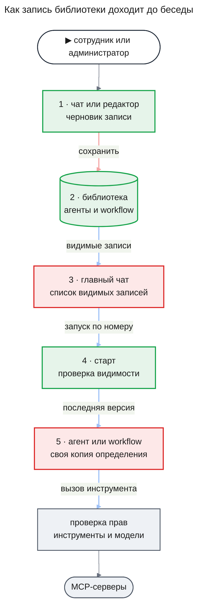
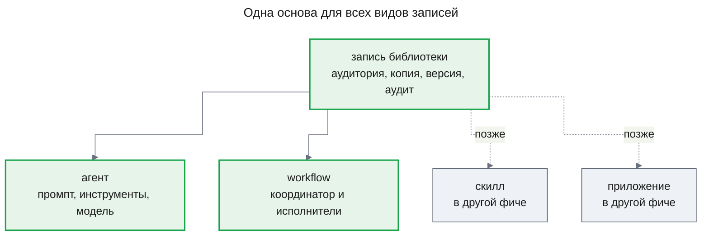
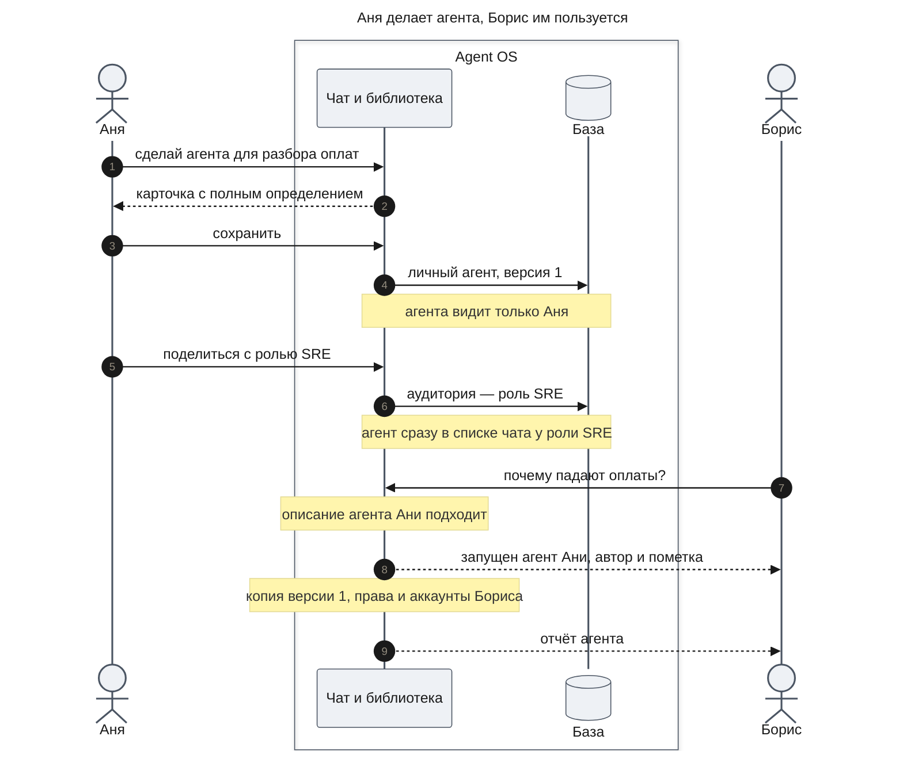
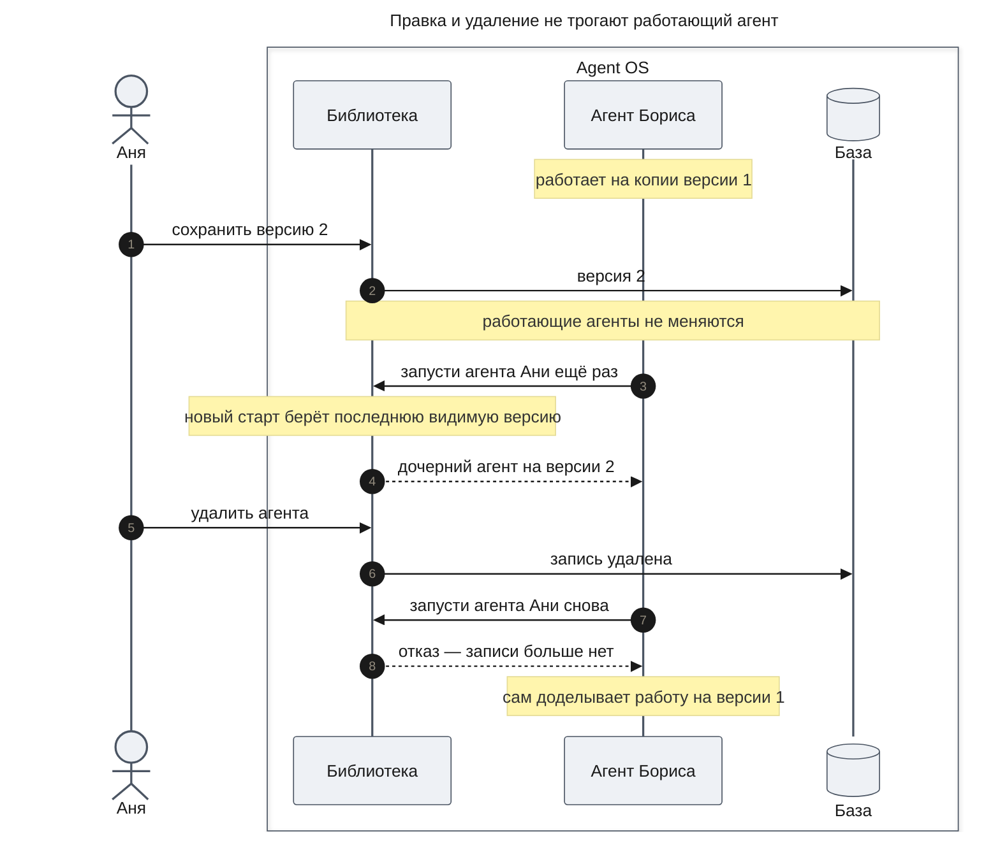
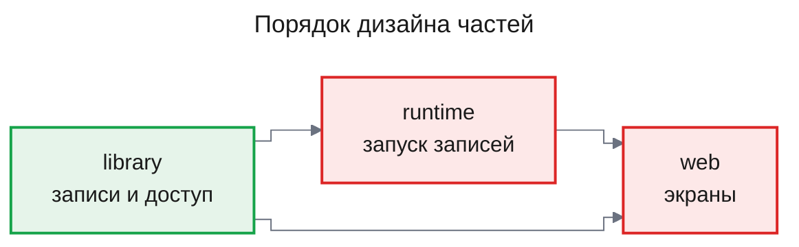

# PRD: Свои агенты и workflow (custom-agents)

| Статус | Дата | Глубина | UXRD | Дизайны |
|---|---|---|---|---|
| Утверждён | 2026-11-17 | full | будет после утверждения PRD | — |

## Snapshot

**Overview.** Сегодня агентов и шаблоны workflow поставляет только платформа: их определения лежат в коде, и даже чтобы поправить промпт агента общего назначения, нужен выпуск. Фича даёт сотрудникам и администраторам самим создавать агентов и workflow — в чате, где черновик готовит внутренний инструмент, или в форме. Всё созданное хранится в библиотеке, а кто видит каждую запись, решает одна схема: личную видит только автор, ролевую — участники ролей, системную — те, кому её открыл администратор. Главный чат сотрудника знает все видимые ему записи и запускает их, но агент всегда работает только с инструментами и моделями того, кто его запустил. Системные агенты переезжают из кода в библиотеку, и администратор правит их в панели.

- **Для**: сотрудники, которые делают агентов для себя и своей роли; администраторы, которые ведут системных агентов.
- **Не входит**: скиллы и приложения, визуальный редактор workflow, история версий и откат, согласие получателя на ролевую запись.
- **Не меняется**: права на инструменты и модели выдаёт только администратор (`enterprise-access` FR-16).
- **Цена перехода**: беседы, агенты и результаты прошлых ресерчей стираются при выпуске (FR-19).
- **Части**: `library` → `runtime` → `web`.
- **Главный риск**: ролевая запись сразу попадает в чаты всей роли без согласия получателей; владелец принял этот риск ([Risks](#risks)).
- **Открытые вопросы**: нет.

## Terms

Пример везде один: SRE Аня делает агента «разбор оплат» и делится им с ролью «SRE», где работает её коллега Борис.

- **Библиотека** — все сохранённые агенты и workflow, которые создали сотрудники и администраторы. До фичи таких записей не было: определения лежали в коде.
- **Запись** — одна вещь в библиотеке. У каждой записи есть вид, владелец, имя, описание, переключатель «предлагать в главном чате» и содержимое своего вида.
- **Вид записи** — агент или workflow. Правила доступа, копирования, версий и аудита одни для всех видов. Позже так же войдут скиллы и приложения (`app-builder`).
- **Определение агента** — промпт, инструменты, модель, предел ходов (`agent-platform`, Terms) и агенты, которых этот агент может запускать. **Определение workflow** — координатор, встроенные агенты-исполнители, пределы запуска и последний шаг (`agent-platform` FR-18). У каждого исполнителя есть строка о том, за что он отвечает и когда его звать, а правила координатора словами необязательны (FR-16).
- **Бриф** — вопрос, его границы и что считается результатом. Чат готовит бриф перед запуском workflow, и workflow получает только его (`agent-platform` FR-28).
- **Владелец** — сотрудник, который создал запись. У системной записи владельца нет.
- **Аудитория** — кто видит запись. **Личная** запись видна только владельцу. **Ролевая** — владельцу и участникам ролей, которым он её открыл. **Системная** — тем, кому её открыл администратор: роли, отдельному сотруднику или всем. «Все» — учётные записи хотя бы с одной ролью. Определение главного чата открыто шире: всем, у кого есть хоть какие-то права (FR-12). Слова «личная», «ролевая» и «системная» — термины этого документа; сотрудник видит аудиторию простыми словами без них (FR-25).
- **Запрет делиться** — то, что остаётся на записи после того, как администратор закрыл к ней доступ: запись снова личная, и владелец не может открыть её ролям, пока администратор не снимет запрет (FR-09).
- **Встроенные записи** — три системные записи, которые создаёт сама платформа: агент общего назначения `general-purpose`, workflow `deep-research` и определение главного чата.
- **Действующие права** — MCP-серверы, инструменты и модели, которые сотруднику дали роли и личные права, за вычетом личных запретов (`enterprise-access` FR-16).
- **Запускающий** — сотрудник, которому принадлежит беседа. Агент работает с его действующими правами и его подключёнными аккаунтами, кто бы ни написал определение.
- **Версия** — номер записи, который растёт на единицу при каждом сохранении.
- **Копия запуска** — определение, которое запуск сохранил у себя при старте, вместе с номером записи и версией. Правка и удаление записи эту копию не меняют.
- **Источник исполнителя** — агент библиотеки, которого автор скопировал внутрь workflow. Workflow помнит источник, но работает на своей копии.
- **Бюджет списка** — предел объёма, который главный чат отводит под имена и описания записей.

## Background

Сегодня определения агентов поставляет платформа. Агент общего назначения и определение главного чата записаны в коде, шаблон `deep-research` — в JSON-файле. Главный чат видит только заголовки этих агентов и шаблонов и по описанию решает, кому отдать запрос (`agent-platform` FR-15). Сотрудник своего агента сделать не может, а администратор не может поправить системный промпт без выпуска. Фича `enterprise-access` дала роли, права на серверы и модели и панель администратора; на них и строится эта фича.

Владелец хочет, чтобы сотрудники делали агентов и workflow сами и делились ими с коллегами по роли, а администраторы вели системные записи. Схема доступа одна для всех видов: позже в библиотеку войдут скиллы и приложения, и второй схемы для них не будет.

Два внешних образца объясняют решения фичи. Claude Code держит в контексте имена и описания всех скиллов в пределах бюджета, загружает тело скилла по требованию, а при переполнении сначала отбрасывает описания реже всего используемых ([документация Claude Code](https://code.claude.com/docs/en/skills)) — так же главный чат держит список записей (FR-15). В ChatGPT Enterprise поделиться GPT с группой и открыть его всей организации — разные права, а группами управляют администраторы ([OpenAI Help](https://help.openai.com/en/articles/9083988-how-to-share-gpts-within-workspaces)) — так же здесь сотрудник открывает запись только своим ролям, а всем — только администратор.

Схема показывает путь записи от автора до работающего агента. Всё, что ниже главного чата, уже работает; новое — библиотека, путь сохранения в неё и проверка видимости при старте.

Определения в коде и в JSON удаляются: `general-purpose`, `deep-research` и главный чат становятся встроенными записями библиотеки. Проверка прав перед каждым вызовом инструмента и модели остаётся той же (`enterprise-access` FR-18), поэтому запись не может дать агенту больше, чем есть у запускающего.

### Одна схема доступа

У всех видов записей одна основа: аудитория, «поделиться», копия, версия, удаление и аудит. Вид добавляет к ней только своё содержимое.

Что может каждый с записью в зависимости от её аудитории:

| Что можно | Личная | Ролевая | Системная |
|---|---|---|---|
| Видеть, запускать, читать промпт, копировать | владелец | владелец и участники ролей | кому открыл администратор |
| Править и удалять | владелец | владелец | администраторы |
| Делиться | владелец, своим ролям | владелец, своим ролям | администраторы: роли, сотруднику, всем |
| Видит в панели администратор | нет; под запретом делиться — имя, автора и дату | да, может закрыть доступ | да |

Сотрудник делится только с ролями, в которых состоит сам, а открыть запись всей компании может только администратор. Уровней для получателей нет: получатель запускает, читает и копирует, но не правит.

## Users and Use Cases

### Users

- **Сотрудник-автор** — аналитик, SRE, инженер или менеджер, который делает агентов и workflow под свои задачи. Ему важно сделать агента без разработчика и поделиться им с коллегами по роли.
- **Сотрудник-получатель** — пользуется записями коллег и системными. Ему важно видеть, чей агент работает в его беседе, и что этот агент не сделает изменений без его подтверждения.
- **Администратор** — ведёт системных агентов и следит за записями, открытыми ролям. Ему важно править системные промпты без выпуска и быстро закрыть опасную запись.

### Use Cases

- **UC-1**: Сотрудник описывает агента в чате → видит полное определение и после подтверждения получает личного агента, которого чат сразу может запустить, так что новый агент не требует разработчика.
- **UC-2**: Сотрудник правит свою запись в форме → следующие запуски идут по новой версии, а работающие агенты не меняются, так что правка не ломает начатую работу.
- **UC-3**: Сотрудник собирает workflow из своих агентов → workflow работает на их копиях, а при изменении агента автор сам решает, обновить ли копию, так что workflow не меняется без ведома автора.
- **UC-4**: Сотрудник делится записью с ролью → коллеги по роли сразу могут её запустить из чата, и она работает с их собственными правами, так что удачный агент расходится по команде.
- **UC-5**: Сотрудник копирует запись коллеги или системную → получает свою личную запись и видит, какие инструменты выпали и какую модель заменили, так что может доработать чужого агента под себя.
- **UC-6**: Администратор правит встроенного агента или главный чат в панели → новые беседы работают по новой версии без выпуска платформы.
- **UC-7**: Администратор находит опасную ролевую запись → закрывает доступ, и запись возвращается автору личной, а поделиться ею снова автор не может, пока администратор не снимет запрет, так что роль больше её не запускает.
- **UC-8**: Сотрудник получает запрос на подтверждение действия от агента коллеги → видит автора и пометку записи и решает, так что чужой промпт не действует от его имени незаметно.

### Путь записи: от Ани к Борису

Диаграмма показывает UC-1, UC-4 и UC-8 вместе: Аня делает агента в чате, делится им с ролью, а Борис получает его в своём чате.

Агент Ани в беседе Бориса вызывает только те инструменты, на которые есть право и подключённый аккаунт у Бориса. Изменяющее действие ждёт подтверждения Бориса, как любое другое (`agent-platform` FR-12).

### Что видит работающий агент, когда запись меняется

Правка и удаление записи действуют только на следующие старты. Уже работающий агент доделывает работу на своей копии.

## Functional Requirements

Требования сгруппированы по частям поставки ([Delivery Parts](#delivery-parts)).

### Must Have (MVP)

#### Библиотека и доступ — часть `library`

- **FR-01. Запись библиотеки.** Агент и workflow хранятся как записи библиотеки с общей основой: вид, владелец, имя, описание, переключатель «предлагать в главном чате», содержимое вида и аудитория. Доступ, «поделиться», копирование, версии, удаление и аудит работают одинаково для обоих видов, поэтому новый вид добавляет только своё содержимое.
  - AC-01.1: Given Аня сохранила агента и workflow, when она делится обоими с ролью «SRE», then оба становятся видны участникам роли по одним правилам, а в аудите появляются записи одного вида.
  - AC-01.2: Given запись сохранена, when владелец открывает её снова, then видит те же имя, описание, переключатель и содержимое, что сохранил.

- **FR-02. Кто видит запись.** Личную запись видит только владелец. Ролевую — владелец и сотрудники, которые сейчас состоят хотя бы в одной из её ролей. Системную — те, кому её открыл администратор: роль, отдельный сотрудник или все учётные записи хотя бы с одной ролью. Кто видит запись, тот может её запустить, прочитать её промпт, инструменты и модель и скопировать её. Править запись сотрудника может только владелец, а системную — только администраторы.
  - AC-02.1: Given Аня сохранила личного агента, when Борис или администратор ищет его в библиотеке или запрашивает по номеру, then записи для них нет, и ответ такой же, как на несуществующую запись.
  - AC-02.2: Given Аня поделилась агентом с ролью «SRE», when Борис из «SRE» открывает его, then видит промпт, инструменты и модель, а его попытка сохранить правку отклоняется.
  - AC-02.3: Given системный агент открыт всем, when его ищет сотрудник без единой роли, then агента он не видит; когда администратор назначает ему роль, агент становится виден.

- **FR-03. Мои роли.** Сотрудник видит названия ролей, в которых состоит. Других ролей и состава ролей он не видит.
  - AC-03.1: Given Аня состоит в ролях «SRE» и «Оплаты», when она смотрит свои роли, then видит ровно эти две.

- **FR-04. Поделиться.** Владелец открывает свою запись одной или нескольким ролям, в которых состоит в момент, когда делится, и закрывает её. Запись без ролей снова личная. Отдельным сотрудникам и всем сотрудник запись не открывает. Системные записи создают, правят, открывают и закрывают только администраторы, и открыть их можно роли, сотруднику или всем. Уровней прав для получателей нет.
  - AC-04.1: Given Аня не состоит в роли «Финансы», when она открывает запись этой роли, then отказ с причиной, и аудитория записи не меняется.
  - AC-04.2: Given сотрудник без права администратора, when он создаёт, правит, открывает или удаляет системную запись, в том числе в обход интерфейса, then отказ, и запись не меняется.
  - AC-04.3: Given Аня закрыла запись для всех ролей, when Борис ищет её, then записи для него нет.

- **FR-05. Копия.** Любой, кто видит запись, копирует её в свою личную запись. В копии остаются только те серверы, которые доступны копирующему (FR-07), а выпавшие он видит списком. Если модель записи копирующему не разрешена, копия получает модель платформы по умолчанию, когда она ему разрешена, а иначе первую из разрешённых ему моделей; копирующий видит, какую модель заменили. Если разрешённых моделей у копирующего нет совсем, копия сохраняет модель оригинала, и редактор помечает её так же, как сервер, на который автор потерял право (FR-07, FR-21). Копия — независимая запись: правки оригинала её не меняют.
  - AC-05.1: Given в агенте Ани есть сервер Jira, а у Бориса нет права ни на Jira, ни на один его инструмент, when Борис копирует агента, then в копии нет Jira, и Борис видит, что Jira выпал.
  - AC-05.2: Given Борис скопировал агента, when Аня меняет оригинал, then копия Бориса не меняется.
  - AC-05.3: Given в агенте Ани выбрана модель, которая Борису не разрешена, а модель платформы по умолчанию разрешена, when Борис копирует агента, then в копии стоит модель платформы по умолчанию, и Борис видит, какую модель заменили.
  - AC-05.4: Given Борису не разрешены ни модель агента Ани, ни модель платформы по умолчанию, when Борис копирует агента, then в копии стоит первая из разрешённых ему моделей, и Борис видит замену.
  - AC-05.5: Given у Бориса нет ни одной разрешённой модели, when Борис копирует агента, then копия сохраняется с моделью Ани, и редактор помечает модель как недоступную Борису.

- **FR-06. Имя и описание.** Имя записи уникально среди записей одного владельца, а имя системной записи — среди системных. Сотрудник не может сохранить запись с именем системной записи. Длина описания ограничена, потому что описание попадает в главный чат каждого получателя; предел задаёт дизайн части `library`.
  - AC-06.1: Given у Ани есть агент «разбор оплат», when она сохраняет второго с тем же именем, then отказ с причиной.
  - AC-06.2: Given есть системный агент `general-purpose`, when сотрудник сохраняет запись с этим именем, then отказ с причиной.
  - AC-06.3: Given описание длиннее предела, when автор сохраняет запись, then отказ с причиной.

- **FR-07. Инструменты и модель из своих прав.** Автор выбирает MCP-серверы и модель только из своих действующих прав. Сервер выбирается целиком, как сегодня. Сервер доступен автору, если у него есть право на весь сервер или хотя бы на один его инструмент; при запуске агент получает только инструменты, на которые есть право у запускающего (FR-14). Администратор, который правит системную запись, выбирает из всего реестра и может дать ей все серверы развёртывания; у записи сотрудника варианта «все серверы» нет. Если автор потерял право на сервер, который уже есть в записи, сохранение не отклоняется: сервер остаётся в записи, а редактор его помечает (FR-21).
  - AC-07.1: Given у Ани нет права на сервер Gmail, when она сохраняет агента с Gmail, в том числе в обход формы, then отказ с причиной.
  - AC-07.2: Given в агенте Ани есть Jira, а Аня потеряла право на Jira, when она сохраняет правку промпта, then сохранение проходит, и Jira остаётся в записи.
  - AC-07.3: Given администратор правит системного агента, when он выбирает сервер, на который у него самого нет права, then сохранение проходит.

- **FR-08. Версия и конфликт сохранения.** Каждое сохранение увеличивает версию записи на единицу. Сохранение правки, начатой на старой версии, отклоняется как конфликт, и автор узнаёт, что запись изменилась. Истории версий и отката нет: прежние версии живут только в копиях запусков (FR-13).
  - AC-08.1: Given запись в версии 3 открыта в двух вкладках, when первая вкладка сохраняет правку, а затем сохраняет вторая, then вторая получает конфликт, и запись остаётся в версии 4.

- **FR-09. Администратор и записи сотрудников.** Администратор видит записи сотрудников, открытые ролям: промпт, автора, роли и пометку «автор отключён». Он может закрыть доступ к такой записи: она становится личной у автора, и на неё ложится запрет делиться. Пока администратор не снимет запрет, владелец не открывает запись ни одной роли, а видит, что доступ закрыл администратор, когда это было и что делиться нельзя. Записи под запретом администратор видит списком — имя, автор и дата закрытия, без промпта — и снимает запрет, после чего владелец снова может делиться. Править чужую запись администратор не может, а других личных записей сотрудников не видит никогда.
  - AC-09.1: Given запись Ани открыта роли «SRE», when администратор закрывает доступ, then запись остаётся у Ани личной, а Борис её больше не видит.
  - AC-09.2: Given Аня отключена, when администратор смотрит записи, открытые ролям, then её записи отмечены «автор отключён» и по-прежнему видны роли.
  - AC-09.3: Given администратор закрыл доступ к записи Ани, when Аня открывает запись, then видит, что доступ закрыл администратор, дату закрытия и что делиться нельзя; when она открывает запись роли, в том числе в обход интерфейса, then отказ с причиной, и аудитория не меняется.
  - AC-09.4: Given запись Ани под запретом делиться, when администратор открывает список запретов, then видит имя записи, автора и дату закрытия, но не промпт; when он снимает запрет, then Аня снова может открыть запись роли «SRE».

- **FR-10. Аудит записей.** Аудит записывает создание, правку, открытие и закрытие доступа, в том числе администратором, снятие запрета делиться, копирование и удаление записи: кто, когда, какая запись и какая у неё стала аудитория. Текст промпта в аудит не попадает.
  - AC-10.1: Given Аня создала агента, поправила его, поделилась им, Борис его скопировал, а Аня закрыла доступ и удалила агента, then в аудите шесть записей, и ни одна не содержит текста промпта.

- **FR-11. Удаление и изменения в ролях.** Владелец удаляет свою запись, администратор — системную, кроме встроенных (FR-12). Записи сотрудника живут, пока живёт его учётная запись: если её удаляют из базы, вместе с ней удаляются все его записи, в том числе ролевые. Снятие получателя с роли и удаление роли закрывают ему записи этой роли. Отключение автора записи не закрывает: его ролевые записи работают, пока администратор не закроет доступ. Владелец всегда входит в аудиторию своей записи и убрать себя из неё не может, а каждая роль, которой он открыл запись, — отдельная часть аудитории. Поэтому снятие самого владельца с роли запись не закрывает: роль по-прежнему её видит, а владелец по-прежнему владеет записью и правит её. Правило «делиться только со своими ролями» (FR-04) проверяется только в момент, когда владелец открывает запись роли. Закрыть доступ по-прежнему может администратор (FR-09).
  - AC-11.1: Given Бориса сняли с роли «SRE», when он ищет агента Ани, then агента для него нет.
  - AC-11.2: Given учётную запись Ани удалили из базы, then её записи не видны никому, в том числе ролевые.
  - AC-11.3: Given Аня открыла агента роли «SRE», when Аню снимают с этой роли, then Борис по-прежнему видит и запускает агента, а Аня по-прежнему правит его и сохраняет правку.

#### Запуск записей — часть `runtime`

- **FR-12. Встроенные записи вместо кода.** Агент общего назначения, workflow `deep-research` и определение главного чата становятся системными записями. Их создаёт платформа при установке. Администратор их правит, а удалить их нельзя; переименование встроенной записи не ломает ни чат, ни глубокий ресерч. Определение главного чата открыто каждой учётной записи, у которой есть хоть какие-то права, в том числе сотруднику только с личными правами и без роли, и его аудиторию изменить нельзя. Аудиторию `general-purpose` и `deep-research` администратор может сузить до ролей. Определения агентов в коде и в JSON удаляются: других источников агентов, кроме библиотеки, нет.
  - AC-12.1: Given администратор поменял промпт `general-purpose`, when сотрудник запускает этого агента в новой беседе, then агент работает с новым промптом без выпуска платформы.
  - AC-12.2: Given администратор удаляет любую встроенную запись, then отказ.
  - AC-12.4: Given у сотрудника нет ни одной роли, но есть личные права, when он пишет в чат, then чат ему отвечает.
  - AC-12.5: Given администратор меняет аудиторию определения главного чата, then отказ, и аудитория не меняется; when он открывает `deep-research` только роли «SRE», then сотрудники вне этой роли глубокий ресерч не видят.
  - AC-12.3: Given новая установка без записей администратора, when сотрудник пишет в чат и запускает глубокий ресерч, then чат и ресерч работают как до фичи (`agent-platform` FR-15, FR-19).

- **FR-13. Запуск работает на своей копии.** При старте запуск сохраняет копию определения вместе с номером записи и версией. Новая беседа берёт последнюю версию. Правка и удаление записи не меняют ни работающих агентов, ни открытых бесед. Workflow фиксируется целиком, вместе с исполнителями. Агент, которого запускает уже работающая сессия, — новый старт: он берёт последнюю видимую запускающему версию, а если записи нет или доступ к ней закрыт, запуск отклоняется.
  - AC-13.1: Given агент Бориса работает на версии 1, when Аня сохраняет версию 2, then агент Бориса доделывает работу на версии 1, а следующий старт идёт на версии 2.
  - AC-13.2: Given работающий агент запускает агента по записи, которую Аня удалила, then запуск отклонён, и родитель получает причину.
  - AC-13.3: Given беседа создана до правки определения главного чата, when сотрудник пишет в неё, then чат отвечает по прежней копии, а новая беседа — по новой версии.
  - AC-13.4: Given workflow запущен, when автор меняет координатора или исполнителя, then запуск доходит до конца на прежних копиях всех своих агентов.

- **FR-14. Видимость проверяется при каждом старте.** Перед каждым стартом агента или workflow из библиотеки платформа проверяет, что запись видна запускающему. То же касается агентов, которых определение разрешает агенту запускать. Инструменты, на которые у запускающего нет права или подключённого аккаунта, молча выпадают (`enterprise-access` FR-18), а модель без права не даёт агенту стартовать (`enterprise-access` FR-20). Если запуск из чата отклонён из-за модели, запускающий видит, какая модель ему недоступна и что делать: для своей записи — открыть её и выбрать другую модель.
  - AC-14.1: Given агенту Ани разрешено запускать её личного агента «сбор логов», when агент Ани работает в беседе Бориса и запускает «сбор логов», then запуск отклонён, потому что Борис эту запись не видит.
  - AC-14.2: Given в агенте Ани есть Jira, а у Бориса права на Jira нет, when Борис запускает агента, then агент работает без Jira, и ни одного вызова Jira — ни с аккаунтом Бориса, ни с аккаунтом Ани — нет.
  - AC-14.3: Given Бориса сняли с роли, when он или его агент запускает запись этой роли, then отказ с причиной.
  - AC-14.4: Given в агенте Ани выбрана модель, на которую у Ани больше нет права, when Аня запускает агента из чата, then агент не стартует, а Аня видит, какая модель ей недоступна и что можно открыть агента и выбрать другую модель.

- **FR-15. Записи в главном чате.** Главный чат знает имя и описание каждой записи, которую он может предложить сотруднику, и по ним решает, кому отдать запрос (`agent-platform` FR-15). Полное определение загружается только при старте. Свою запись владелец всегда может запустить в своём главном чате — и назвав её по имени, и запросом, который подходит под её описание, — при любом значении переключателя «предлагать в главном чате». Переключатель решает только, предлагает ли запись главный чат тех, с кем ею поделились; у новой записи он включён. С выключенным переключателем чат получателя запись не предлагает и не запускает, но её по-прежнему запускает агент, которому это разрешено (FR-14), и она служит источником исполнителя workflow (FR-16). Если сотрудник называет запись по имени, а видимых ему записей с этим именем несколько, чат запускает его собственную. Если своей среди них нет, чат запускает ту, чьё описание лучше подходит под запрос, а в запуске виден её автор (FR-17). Запись, которую сотрудник положил в поле сообщения кнопкой «Использовать в чате» (FR-26), стартует всегда именно она, а для workflow чат готовит бриф именно этого workflow. Если список не помещается в бюджет, имена остаются, а описания пропадают сначала у записей, которые сотрудник запускал реже всего. Запись, которую открыли роли, появляется в чатах участников роли сразу, без их согласия.
  - AC-15.1: Given Аня поделилась агентом с ролью «SRE» и включила «предлагать в главном чате», when Борис пишет следующее сообщение в любую беседу, then его чат знает этого агента и может его запустить.
  - AC-15.2: Given Аня поделилась агентом с ролью «SRE» и выключила переключатель, when Борис называет агента по имени или пишет подходящий под описание запрос, then его чат агента не предлагает и не запускает, а в чате Ани агент запускается и по имени, и по описанию.
  - AC-15.3: Given видимых записей больше, чем вмещает бюджет, then имена всех записей в списке остаются, а описаний нет у тех, что сотрудник запускал реже всего.
  - AC-15.4: Given Аня сохранила нового агента (UC-1), then переключатель «предлагать в главном чате» у него включён.
  - AC-15.5: Given у Бориса есть свой агент «разбор оплат», и он видит одноимённого агента Ани, when Борис просит в чате запустить «разбор оплат», then запускается агент Бориса.
  - AC-15.6: Given Борис положил агента Ани в поле сообщения кнопкой «Использовать в чате», when он отправляет сообщение, then запускается агент Ани, хотя у Бориса есть свой с тем же именем.
  - AC-15.7: Given Борис видит агента «разбор оплат» Ани и одноимённого агента другого коллеги, а своего с этим именем у него нет, when Борис просит запустить «разбор оплат», then чат запускает того из двух, чьё описание лучше подходит под запрос, и в беседе у имени указан автор запущенного агента.

- **FR-16. Workflow из библиотеки.** Workflow устроен как в `agent-platform`: координатор, встроенные исполнители, пределы запуска и последний шаг (`agent-platform` FR-18, FR-19, FR-28). Workflow начинается с команды: у каждого исполнителя есть строка о том, за что он отвечает и когда его звать, и координатор видит эту строку у каждого исполнителя. Правила координатора словами необязательны и нужны для зависимостей между исполнителями — что чего должно ждать. Жёсткого порядка шагов нет: кого и когда звать, решает координатор. Вызов сверх предела запуска отклоняется со своей причиной, и её можно отличить от других отказов — например, от вызова исполнителя, которого нет в команде. Workflow получает только подтверждённый бриф и не видит беседу, из которой его запустили (`agent-platform` FR-28). Автор добавляет исполнителя с нуля или копирует агента из библиотеки, и копия помнит источник. Когда источник меняется, workflow об этом знает, а явное обновление заменяет копию последней версией источника. Workflow всегда работает на своих копиях.
  - AC-16.1: Given исполнитель скопирован из агента Ани версии 2, when Аня сохраняет версию 3, then workflow работает на копии версии 2 и сообщает, что источник изменился.
  - AC-16.2: Given автор обновил исполнителя, when workflow запускают снова, then исполнитель работает по версии 3.
  - AC-16.3: Given workflow Ани открыт роли «SRE», when Борис его запускает, then исполнители работают с правами Бориса, даже если их источники Борису не видны.
  - AC-16.4: Given у workflow три исполнителя со своими строками, а правил координатора нет, when workflow запускают, then координатор видит строку каждого исполнителя и сам решает, кого и когда звать.
  - AC-16.5: Given у исполнителя нет строки о том, за что он отвечает и когда его звать, when автор сохраняет workflow, then отказ с причиной.
  - AC-16.6: Given предел запуска workflow исчерпан, when координатор зовёт исполнителя из команды ещё раз, then вызов отклонён с причиной, которая называет предел запуска и отличается от причины отказа при вызове исполнителя, которого нет в команде.

- **FR-17. Запуск помнит запись, а не имя.** Запуски ссылаются на запись по её номеру. В беседе, в списке агентов и в истории агента видны имя записи и чья она: самого сотрудника, другого автора или компании; слова подписи задаёт [UXRD](uxrd.md), KD-5. Две записи с одним именем от разных авторов не путаются.
  - AC-17.1: Given у Ани и у Бориса есть агент «разбор оплат», when Борис запускает агента Ани, then запущен именно её агент, а в беседе и списке агентов у имени указан автор «Аня».

- **FR-18. Инструмент создания в чате.** У главного чата есть внутренний инструмент, который по просьбе сотрудника готовит новую запись или правку его записи и показывает карточку подтверждения с полным определением. Запись сохраняется только после подтверждения. Инструмент создаёт и правит только записи вызвавшего с личной аудиторией: ролевую запись автор правит в редакторе (FR-21). Инструмент никогда не делится и не трогает системные записи, даже если вызвал администратор. Инструмент есть только у главного чата.
  - AC-18.1: Given Аня просит в чате сделать агента для разбора оплат, when чат готовит черновик, then Аня видит карточку с именем, описанием, промптом, инструментами и моделью, а запись появляется только после её подтверждения.
  - AC-18.2: Given Аня отклонила карточку, then новой записи нет.
  - AC-18.3: Given администратор просит чат поправить `general-purpose` или поделиться записью, then чат отказывает, и ни системная запись, ни аудитория не меняются.
  - AC-18.4: Given агент работает в фоне или исполнителем workflow, then инструмента создания у него нет.
  - AC-18.5: Given агент Ани открыт роли «SRE», when Аня просит чат поправить его промпт, then чат отказывает и предлагает редактор, а запись не меняется.

- **FR-19. Старые беседы стираются.** При выпуске стираются беседы, сессии агентов, сообщения и вызовы инструментов. Сотрудники, роли, права и журнал токенов остаются. Результаты прошлых глубоких ресерчей теряются.
  - AC-19.1: Given до выпуска у Ани были беседы и завершённый ресерч, when она входит после выпуска, then бесед и ресерча нет, а её роли, права и расход за месяц те же.

#### Экраны — часть `web`

- **FR-20. Раздел «Библиотека».** Сотрудник видит три группы записей: свои, открытые его ролям и системные. У каждой записи видны имя, описание, вид, автор и аудитория. Инструменты, на которые у смотрящего нет права, помечены: при его запуске они выпадут. Отсюда сотрудник создаёт, открывает, копирует и удаляет записи.
  - AC-20.1: Given в агенте Ани есть Jira, а у Бориса права на Jira нет, when Борис открывает агента в библиотеке, then Jira помечен как недоступный ему.
  - AC-20.2: Given Борис копирует запись, then он видит список выпавших инструментов (AC-05.1) и заменённую модель (AC-05.3, AC-05.4).

- **FR-21. Редактор агента.** Автор правит в форме имя, описание, промпт, серверы, модель, предел ходов и агентов, которых этот агент может запускать, — из видимых автору записей. Серверы и модели предлагаются только из его действующих прав (FR-07), а серверы, на которые он потерял право, и модель, которая ему не разрешена (FR-05), помечены. При конфликте сохранения автор видит, что запись изменилась, и его правка не теряется молча.
  - AC-21.1: Given Аня потеряла право на Jira, а Jira есть в её агенте, when она открывает редактор, then Jira помечен, а сохранить агента можно.
  - AC-21.2: Given запись изменили в другой вкладке, when Аня сохраняет, then она видит конфликт (AC-08.1).

- **FR-22. Редактор workflow.** Автор сначала собирает команду: исполнителей, у каждого из которых строка о том, за что он отвечает и когда его звать (FR-16). Затем он правит пределы запуска, последний шаг и необязательные правила координатора о зависимостях между исполнителями. Исполнителя он создаёт с нуля или добавляет из библиотеки. У исполнителя из библиотеки видно, изменился ли источник, и есть явное обновление. Если источник удалён или больше не виден автору, редактор это показывает, а обновить исполнителя нельзя. Редактор и карточка черновика workflow в чате говорят автору, что workflow получает только подтверждённый бриф, а не беседу.
  - AC-22.1: Given источник исполнителя изменился, when автор открывает workflow, then видит отметку об изменении и обновляет исполнителя одним действием (AC-16.2).
  - AC-22.2: Given источник исполнителя удалён, then редактор показывает это, а исполнитель остаётся в workflow.
  - AC-22.3: Given автор создаёт workflow в редакторе или в чате, then он видит, что workflow получит только подтверждённый бриф, а не беседу.

- **FR-23. Окно «Поделиться».** Окно открывается кнопкой «Поделиться». В нём аудитория записи и переключатель «предлагать в главном чате». Кнопку видит только тот, кто может делиться записью: владелец, а для системной — администратор. Сотрудник выбирает только из своих ролей (FR-03), администратор — роли, сотрудников или всех.
  - AC-23.1: Given Борис видит ролевую запись Ани, then кнопки «Поделиться» у него нет.
  - AC-23.2: Given Аня открывает окно, then ей предложены только её роли.

- **FR-24. Раздел панели «Агенты и workflow».** В панели администратора появляется раздел, где администратор создаёт, правит, открывает и удаляет системные записи, а встроенные не удаляет и аудиторию главного чата не меняет (FR-12). В том же разделе он видит записи сотрудников, открытые ролям (FR-09), и закрывает к ним доступ, а в списке записей под запретом делиться снимает запрет. Здесь встроенные записи отмечены как встроенные; эту пометку видят только администраторы (FR-25).
  - AC-24.1: Given у Ани есть личная и ролевая запись, when администратор открывает раздел, then видит только ролевую — с промптом, автором и ролями.

- **FR-25. Чей агент — видно в беседе.** Карточка подтверждения инструмента создания показывает полное определение (FR-18). Карточка подтверждения изменяющего действия (`agent-platform` FR-12) и страница агента (`agent-platform` FR-22) показывают имя записи, автора и пометку аудитории. Пометку сотрудник везде видит простыми словами, без терминов «личная», «ролевая» и «системная»; слова пометки задаёт [UXRD](uxrd.md), KD-5. Получатель видит только те роли записи, в которых состоит сам (FR-03). Что запись встроенная, видят только администраторы в панели (FR-24).
  - AC-25.1: Given агент Ани в беседе Бориса просит подтвердить изменяющее действие, then на карточке видно имя агента, автор «Аня» и роль «SRE».
  - AC-25.2: Given системный агент `general-purpose`, when сотрудник видит его в библиотеке или на карточке, then пометка простыми словами говорит, что агента дала компания, а что агент встроенный, сотрудник не видит нигде.

- **FR-26. «Использовать в чате».** Сотрудник кладёт запись в поле сообщения главного чата из карточки сохранённого черновика (FR-18), из редактора, из строки библиотеки и со страницы записи. Тогда главный чат запускает именно эту запись (FR-15). Кнопка не запускает запись: запуск по-прежнему идёт только из беседы, когда сотрудник отправит сообщение. Кнопка есть только у записей, которые главный чат сотрудника может запустить (FR-15).
  - AC-26.1: Given Аня сохранила агента из карточки черновика, when она нажимает «Использовать в чате», then агент стоит в поле сообщения, а запуска нет, пока она не отправит сообщение.
  - AC-26.2: Given Аня поделилась агентом с ролью «SRE» и выключила «предлагать в главном чате», when Борис открывает агента в библиотеке, then кнопки «Использовать в чате» у него нет.

- **FR-27. Запуск workflow сверяется с командой.** В запуске workflow каждый шаг подписан именем исполнителя из команды. Когда запуск закончен, исполнители, которых координатор ни разу не позвал, показаны как не вызванные. Вызов, отклонённый из-за предела запуска (FR-16), показан как отклонённый по пределу. Запуск показывает версию workflow, с которой стартовал.
  - AC-27.1: Given у workflow четыре исполнителя, а координатор позвал троих, when запуск закончился, then каждый шаг подписан именем исполнителя, а четвёртый показан как не вызванный.
  - AC-27.2: Given координатор позвал исполнителя сверх предела запуска, then этот вызов показан как отклонённый по пределу.
  - AC-27.3: Given workflow стартовал на версии 3, when автор сохраняет версию 4, then запуск по-прежнему показывает версию 3.

- **FR-28. Изменён после запуска.** Если у записи, с которой стартовал работающий или завершённый агент, появилась новая версия, запуск показывает, что агент изменился после старта, и предлагает запустить его заново на последней версии. Повторный запуск идёт через беседу, как «Использовать в чате» (FR-26).
  - AC-28.1: Given агент Бориса стартовал на версии 1 агента Ани, when Аня сохраняет версию 2, then в запуске Борис видит, что агент изменился после старта, и может запустить его заново на версии 2.

- **FR-29. Получателю объясняют, а не спрашивают.** На странице записи коллеги и при её первом запуске в чате получателя получатель видит, кто поделился записью и с какой ролью, что запись работает с его собственными правами и подключёнными аккаунтами, что изменяющие действия выполняются только после его подтверждения и что убрать запись может автор или администратор. Получатель ничего не подтверждает и от записи не отказывается: это объяснение, а не вопрос.
  - AC-29.1: Given Аня поделилась агентом с ролью «SRE», when Борис открывает страницу агента или агент впервые запускается в его чате, then Борис видит, что агентом поделилась Аня с ролью «SRE», что агент работает с правами и аккаунтами Бориса, что изменения выполняются только после подтверждения Бориса и что убрать агента может Аня или администратор, и ответа от Бориса это не требует.

### Should Have

Нет: в MVP входит только то, без чего фича не работает, а остальное перечислено в Won't Have.

### Could Have

Нет, по той же причине.

### Won't Have

- Скиллы и приложения как виды записей — другие фичи; схема доступа готова их принять (FR-01).
- Визуальный редактор графа workflow — кого и когда звать, решает координатор по строкам исполнителей и необязательным правилам словами (FR-16).
- Шаги, которые исполняет сама платформа, а не агенты, — не эта фича: модель workflow не меняется.
- История версий, откат и проверка версии перед тем, как она дойдёт до роли — для MVP хватает номера версии и копий запусков.
- Согласие получателя перед тем, как ролевая запись попадёт в его чат, и отказ получателя от неё — запись доходит до роли сразу (FR-15), получатель получает только объяснение (FR-29), риск принят ([Risks](#risks)).
- Настройка «кто может делиться с этой ролью» — сотрудник делится с любой своей ролью.
- Открыть запись отдельному коллеге — сотрудник делится только с ролями; отдельному сотруднику открывает только администратор.
- Уровни прав для получателей и совместная правка — получатель только запускает, читает и копирует.
- Закрыть запись отдельному получателю или одной из её ролей — администратор закрывает доступ к записи целиком и запрещает владельцу делиться ею снова (FR-09).
- Передача записи другому владельцу — у записи один владелец на всю её жизнь (FR-11).
- Живая ссылка из workflow на агента библиотеки — workflow работает на копиях (FR-16).
- Изменения в том, как выдаются права на инструменты и модели, — это `enterprise-access`.

## Non-Functional Requirements

### Security

- **NFR-01**: Изоляция записей: личную запись не получает никто, кроме владельца, включая администраторов; у записи под запретом делиться администратор видит только имя, автора и дату закрытия (FR-09). Каждая точка доступа к библиотеке покрыта e2e-тестом с двумя сотрудниками и администратором — ноль случаев доступа к чужой личной записи.
- **NFR-02**: Запись не расширяет права. Тест запускает агента Ани с серверами, на которые у Бориса нет права, от имени Бориса — ноль вызовов этих серверов и ноль вызовов с аккаунтом Ани.
- **NFR-03**: Закрытая запись не стартует. Тесты на снятие с роли, удаление записи и закрытие доступа администратором — ноль стартов после каждого из них, включая запуски из работающих агентов.

### Performance

- **NFR-04**: Список записей в главном чате держит время до первого токена в бюджете раздела «Performance Requirements» в `.claude/skills/project-context/SKILL.md`. Замер — в тесте со ста видимыми записями.

### Accessibility and responsiveness

- **NFR-05**: Библиотека, редакторы и окно «Поделиться» соответствуют уровню `chat-shell` NFR-18 и пригодны к работе от ширины `chat-shell` NFR-22. Раздел панели — на уровне остальной панели (`enterprise-access` NFR-05).

## Delivery Parts

| Часть | Покрывает | Срез | Зависит от | Почему отдельно |
|------|--------|-----------|------------|-----------|
| `library` | FR-01–FR-11 | domain | — | Записи и одна схема доступа: аудитория, «поделиться», копия, имена, проверка прав автора при сохранении, версия и конфликт, «мои роли», закрытие доступа администратором и аудит. На этой основе строятся запуск и экраны, а позже — скиллы и приложения. |
| `runtime` | FR-12–FR-19 | domain | `library` | Как записи работают: встроенные записи вместо кода, копия запуска, проверка видимости при каждом старте, список в главном чате, workflow с копиями исполнителей, инструмент создания, ссылка на запись по номеру и стирание старых сессий. Часть отдаёт вебу данные беседы и карточек, а для FR-27 и FR-28 — имя исполнителя у каждого шага workflow, версию записи у каждого запуска и отдельную причину отказа по пределу запуска (FR-16). |
| `web` | FR-20–FR-29 | frontend | `library`, `runtime` | Экраны над операциями двух частей: библиотека, редакторы, окно «Поделиться», раздел панели, карточки в чате, пометки недоступных инструментов, «Использовать в чате» и вид запусков. |

### Part Dependency Diagram

Стрелка ведёт от части к той, что строится на её утверждённом дизайне.

## Success Criteria

- Сотрудники делают агентов сами. Цель: за две недели после выпуска хотя бы три сотрудника сохранили свои записи, и хотя бы одну ролевую запись запустил не её автор; читается в аудите записей и списке агентов.
- Главный чат находит нужную запись. Цель: в ручном прогоне на пяти запросах, под которые подходит запись библиотеки, чат запускает именно её хотя бы в четырёх; читается в беседе и списке агентов.
- Записи не дают лишних прав. Цель: ноль вызовов инструментов и моделей сверх действующих прав запускающего за две недели после выпуска; читается в аудите вызовов и журнале токенов.

## Constraints and Risks

### Constraints

- Записи библиотеки хранятся в базе. Определений агентов и workflow в коде и в JSON-файлах нет.
- Права на инструменты и модели выдаёт только администратор, как в `enterprise-access`; библиотека их не выдаёт и не расширяет.
- Модель workflow — из `agent-platform`: координатор и исполнители-агенты. Платформа сама шагов не исполняет.
- Проект — PoC: формат сессий меняется без переноса, старые сессии стираются (FR-19), слоёв совместимости нет.
- Бизнес-ограничения 1–3 из `.claude/skills/project-context/SKILL.md` — права на инструменты, изоляция данных, аудит — распространяются на записи библиотеки.

### Assumptions

- У сотрудника видимых записей десятки, а не сотни, поэтому бюджет списка обычно не переполняется. Проверяется по числу записей через месяц после выпуска.
- Модель главного чата различает пользовательские и системные записи по описаниям и не перехватывает запросы, которые должен брать `general-purpose`. Проверяется ручным прогоном из Success Criteria.

### Risks

| Риск | Влияние | Вероятность | Что делаем |
|------|--------|-------------|------------|
| Ролевая запись сразу попадает в чаты всей роли без согласия получателей. Промпт одного сотрудника работает с правами и аккаунтами другого, а описание может перехватить выбор чата для всей роли | Высокое | Среднее | Принято владельцем: запись доходит до роли сразу, а согласие получателя, которое закрыло бы риск, не входит в фичу (Won't Have). В фиче: автор и пометка на карточке подтверждения и странице агента (FR-25), объяснение получателю (FR-29), подтверждение каждого изменяющего действия (`agent-platform` FR-12), предел длины описания (FR-06), закрытие доступа администратором с запретом делиться снова (FR-09). |
| Запрет делиться обходится: владелец копирует запись под запретом или пишет новую с тем же содержимым и открывает её роли | Среднее | Низкое | Принято владельцем: правило запрета не меняется (FR-09). Новую запись администратор видит среди записей, открытых ролям, и в аудите (FR-10) и снова закрывает к ней доступ. |
| Агент молча работает без инструмента — у запускающего нет права или автор его потерял — и даёт худший результат | Среднее | Высокое | Принято: инструменты выпадают молча, как в `enterprise-access` FR-18. Библиотека помечает недоступные инструменты (FR-20), редактор — потерянные автором (FR-21). |
| Неудачная правка администратора ломает главный чат или встроенного агента у всех | Высокое | Низкое | Открытые беседы работают на прежней копии (FR-13); автор правки виден в аудите (FR-10), а исправление — новая правка. Отката нет (Won't Have). |
| Удаление учётной записи сотрудника из базы убирает его ролевые записи у всей роли | Среднее | Низкое | Принято: записи удаляются вместе с учётной записью (FR-11). Нужную запись получатель заранее копирует себе (FR-05). |
| Стирание сессий при выпуске теряет беседы и результаты прошлых ресерчей | Низкое | Высокое | Принято: продукт не в продакшене (FR-19). |

## Undetermined Items

Нет: владелец ответил на все вопросы (FR-11, FR-12, FR-15).

## Update History

| Версия | Дата | Изменение |
|---------|------|--------|
| 1.0 | 2026-11-17 | Первая версия |
| 1.1 | 2026-11-17 | Утверждён; решения владельца: аудитория встроенных записей (FR-12), снятие владельца с роли (FR-04, FR-11), переключатель «предлагать в главном чате» (FR-15) |
| 1.2 | 2026-11-17 | Решения владельца после проходов по UXRD: запрет делиться после закрытия доступа (FR-09, FR-10, FR-24), замена модели в копии (FR-05), своя запись при одинаковом имени (FR-15), отказ по модели (FR-14), команда исполнителей и бриф в workflow (FR-16, FR-22), пометка аудитории простыми словами (FR-17, FR-25), «Использовать в чате» (FR-26), сверка запуска workflow с командой (FR-27), «изменён после запуска» (FR-28), объяснение получателю (FR-29) |
| 1.3 | 2026-11-17 | После ревью v1.2: риск обхода запрета делиться принят владельцем (Risks); одноимённые чужие записи — чат выбирает по описанию (FR-15); модель копии по умолчанию и копия без разрешённых моделей (FR-05, FR-21); отдельная причина отказа по пределу запуска в `runtime` (FR-16, FR-27, Delivery Parts); слова пометок отданы UXRD (Terms, FR-17, FR-24, FR-25) |
