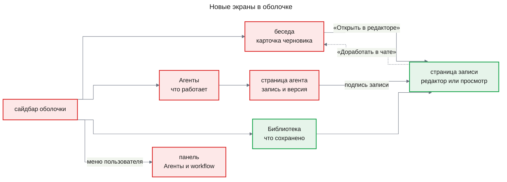
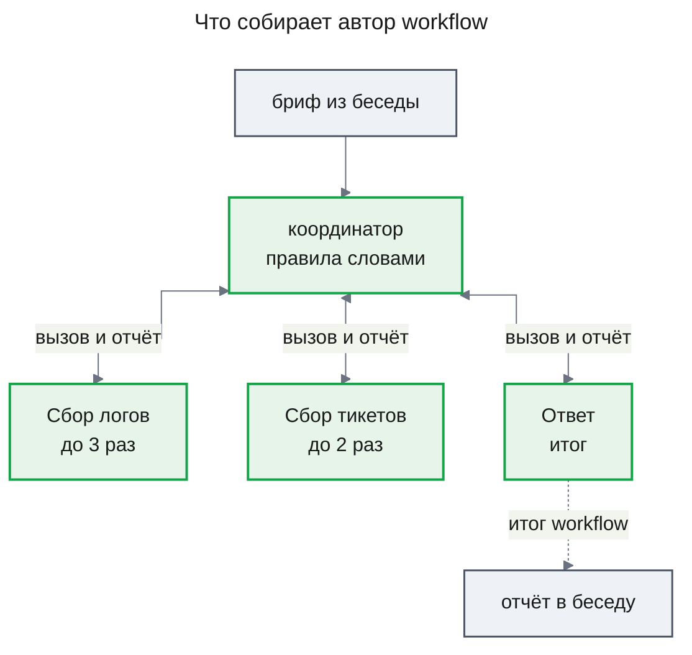
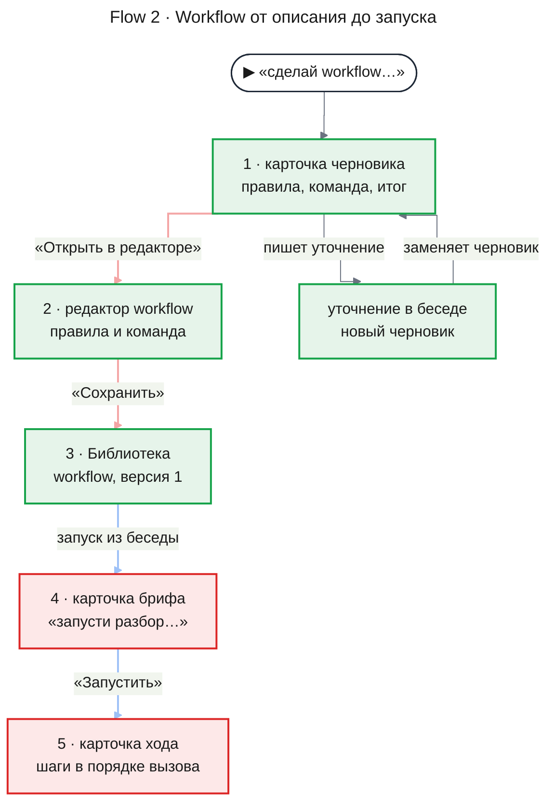
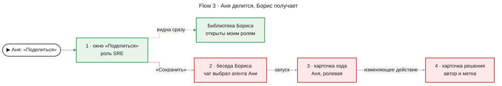

# UXRD: Свои агенты и workflow (custom-agents)

| Статус | Дата | PRD | Дизайны |
|---|---|---|---|
| Черновик | 2026-11-17 | [prd.md](./prd.md) | — |

## Snapshot

**Overview.** В сайдбаре появляется «Библиотека»: сотрудник видит в ней свои записи, записи коллег по ролям и системные, а у каждой — автора, кто её видит и какие серверы у него выпадут. Агента и workflow проще всего сделать в чате: чат показывает карточку с полным определением, которую сохраняют одной кнопкой, переносят в форму или уточняют следующим сообщением. Форма workflow ставит правила координатора словами рядом с командой исполнителей, и у команды нет порядка: его решает координатор во время работы. Поделиться записью можно в окне «Поделиться», а администратор ведёт системные записи и закрывает доступ к ролевым в новом разделе панели. В беседе, в списке агентов и на странице агента у каждого запуска видно, чья это запись и на какой версии он работает.

- **Не меняется**: беседа, лента, карточки хода и решения, дерево агентов — к ним добавляется только подпись записи. Запуск по-прежнему только из беседы: кнопки «Запустить» в библиотеке нет.
- **Главный UX-риск**: автор workflow ждёт очереди шагов, которой нет, и пишет правила как список «сначала, потом». Защищают пояснение над правилами, команда без номеров и шаги в карточке хода в порядке вызова (KD-4).
- **Открытые вопросы**: нет.

### Key Decisions

| ID | Решение | Почему |
|---|---|---|
| KD-1 | Библиотека — своя страница `/library` и пункт «Библиотека» в сайдбаре под «Агентами». «Агенты» остаются списком того, что работает, «Библиотека» — того, что сохранено. У записи одна страница `/library/<id>`: владельцу она открывает редактор, остальным — просмотр | `/agents` уже занят запусками. Ссылка на запись одна для всех, кто её видит, — из карточки, дерева и чужой беседы |
| KD-2 | Чат — главный путь создания. В меню «Создать» группа «В чате» стоит первой, пустая форма workflow начинается с подсказки начать в чате, а форма служит для проверки и правки | Пустое поле правил координатора — самое трудное место для новичка: чат расспрашивает и пишет правила за него. Пустая форма всё равно нужна: администратор не создаёт системные записи в чате (AC-18.3) |
| KD-3 | Карточка черновика не держит беседу. Сотрудник уточняет обычным сообщением, чат готовит новый черновик, а ждущий прежний получает итог «Заменён черновиком ниже». «Открыть в редакторе» переносит черновик в форму; сохранение в форме закрывает карточку итогом «Сохранено в редакторе» | Доработка словами — главный путь. Карточка, которая держит чат, как запрос действия (agent-platform UXRD, KD-5), отправила бы каждое уточнение ждать в лоток |
| KD-4 | Форма workflow — «Правила и команда» на одной странице: правила координатора словами, рядом команда исполнителей по алфавиту без номеров и стрелок, отдельно поле «Итог даёт». Над правилами одна фраза о том, что порядок решает координатор | Правила называют исполнителей по имени, и автор видит обе части сразу. Набор карточек не обещает порядка, которого нет (Screen 4, «Почему форма такая») |
| KD-5 | Одна [подпись записи](../../design-system/components/record-label.md) везде: имя, «моя» или автор или «системная», метка «личная», «ролевая» или «системная» | Библиотека, карточки, дерево и страница агента читаются одинаково, а одноимённые записи разных авторов не путаются (FR-17, FR-25) |
| KD-6 | Правка не теряется. При конфликте введённое остаётся в форме, а сотрудник открывает новую версию в соседней вкладке и выбирает «Сохранить поверх». Уход из редактора с несохранёнными изменениями спрашивает подтверждение | Промпты длинные, их потеря стоит часов. Короткие формы панели такого вопроса не задают ([settings-form](../../design-system/components/settings-form.md)), редактор — задаёт |
| KD-7 | Страница агента показывает запись и версию, с которой он стартовал, а рядом — «есть версия N» или «запись недоступна». Подсказка «Запустить с нуля» называет версию, на которой пойдёт новый старт | Работающий агент идёт на своей копии (FR-13), и сотрудник видит, почему он ведёт себя по-старому |

## Terms

Термины продукта — в PRD, раздел Terms; здесь — термины интерфейса.

- **Страница записи** — `/library/<id>`: у владельца это редактор, у остальных — просмотр.
- **Карточка черновика** — карточка в беседе с полным определением, которую сотрудник сохраняет, переносит в редактор или отклоняет.
- **Подпись записи** — имя записи, её источник и метка аудитории в одну строку.
- **Команда** — исполнители workflow, набор без порядка.
- **Правила координатора** — промпт координатора: словами, кого из команды, когда и зачем вызывать.
- **Итог** — исполнитель, чей отчёт становится ответом workflow, то есть последний шаг (`agent-platform` FR-18).
- **Панель исполнителя** — боковая панель с полями агента для одного исполнителя.

## Design System

Фича следует [дизайн-системе](../../design-system/README.md). Библиотека, страницы записей, редакторы и окно «Поделиться» — комфортная плотность; раздел панели — компактная ([foundations → Spacing & Density](../../design-system/foundations.md#spacing--density)).

### Component Inventory

Перед решением «new» поиск шёл по `docs/design-system/components/` и `apps/web/src/components/` (`admin`, `agents`, `shell`, `ui`).

| Компонент | Спецификация | Статус | Примечание |
|---|---|---|---|
| Подпись записи | [record-label.md](../../design-system/components/record-label.md) | new | Автора и аудитории записи нигде нет; метка состояния даёт только слово |
| Строка библиотеки | [library-row.md](../../design-system/components/library-row.md) | new | Таблица данных — компактная и для панели, дерево агентов — для запусков |
| Определение записи | [definition-view.md](../../design-system/components/definition-view.md) | new | Ни один блок не показывает определение; строки аргументов вызова — значения, а не текст для чтения |
| Редактор записи | [record-editor.md](../../design-system/components/record-editor.md) | new | Собран на форме настроек; у неё нет длинного текста, версии, конфликта и защиты изменений |
| Исполнитель workflow | [executor-item.md](../../design-system/components/executor-item.md) | new | Карточки участника с источником в библиотеке нет |
| Окно «Поделиться» | [share-dialog.md](../../design-system/components/share-dialog.md) | new | Диалоги панели выдают права, а не аудиторию |
| Карточка решения | [decision-card.md](../../design-system/components/decision-card.md) | extended | Вариант «Черновик записи»; подпись записи в действии и брифе |
| Карточка хода | [agent-run-card.md](../../design-system/components/agent-run-card.md) | extended | Подпись записи (RN-01) |
| Дерево агентов | [agent-tree.md](../../design-system/components/agent-tree.md) | extended | Колонка «Запись» (RN-02) |
| Метка состояния | [state-badge.md](../../design-system/components/state-badge.md) | extended | Тексты аудитории и пометок; состояние «Сведения» |
| Таблица данных, форма настроек | [data-table.md](../../design-system/components/data-table.md), [settings-form.md](../../design-system/components/settings-form.md) | reused | Раздел панели; диалоги копии, удаления и закрытия доступа |
| Вызов инструмента | [tool-call.md](../../design-system/components/tool-call.md) | reused | Отказы инструмента создания и запуска записи (DC-02, RN-06) |
| Сайдбар | chat-shell UXRD, SB-01; agent-platform UXRD, NV-01 | extended | Пункт «Библиотека» (LB-01) |
| Каркас панели | enterprise-access UXRD, AD-01 | extended | Шестой раздел «Агенты и workflow» (AL-01) |
| Страница агента | agent-platform UXRD, AV-01, AV-02 | extended | Подпись записи, версия, подсказка «Запустить с нуля» (RN-03) |
| Экран «не найдено» | chat-shell UXRD, TH-06 | reused | «Запись не найдена» (RV-02) |
| Кнопка, диалог, меню, шторка, поле, флажок, переключатель, радиогруппа, список, поиск, вкладки, тултип, скелетон | shadcn `button`, `dialog`, `alert-dialog`, `dropdown-menu`, `sheet`, `input`, `textarea`, `checkbox`, `switch`, `radio-group`, `select`, `command`, `tabs`, `tooltip`, `skeleton` | reused | `command` (поиск записи, роли или сотрудника) добавляется из shadcn без изменений |

### Где новые экраны в оболочке

Новых экранов три: библиотека, страница записи и раздел панели. Беседа связана со страницей записи в обе стороны.



## User Flows

### Primary User Flow

**Flow 1. Агент из чата.** Implements: UC-1; AC-18.1, AC-18.2, AC-15.4, AC-01.2

Сотрудник пишет в беседе, какой агент ему нужен; чат при необходимости задаёт вопросы и показывает карточку черновика с полным определением. «Сохранить» создаёт личную запись версии 1, и карточка показывает ссылку на неё. Со следующего сообщения чат знает нового агента и запускает его по имени или по подходящему запросу. Если что-то не так, сотрудник пишет уточнение, и новый черновик заменяет прежний (KD-3), или открывает черновик в редакторе.

```mermaid
---
title: "Flow 1 · Агент из чата"
config:
  theme: base
  look: classic
  themeVariables:
    primaryColor: "#eef1f5"
    primaryBorderColor: "#4b5563"
    primaryTextColor: "#1a1a1a"
    lineColor: "#6b7280"
  flowchart:
    curve: step
  themeCSS: |
    @keyframes lit_ca1{0%,30%{stroke:#991b1b;stroke-width:6px}33.33%,100%{stroke:#f4a5a5;stroke-width:2px}}
    @keyframes litr_ca1{0%,30%{stroke:#1d4ed8;stroke-width:6px}33.33%,100%{stroke:#9ec1f7;stroke-width:2px}}
---
flowchart LR
    entry(["▶ «сделай агента…»"])
    card["1 · карточка черновика<br/>полное определение"]
    choice{"решение"}
    lib["2 · Библиотека<br/>моя, версия 1"]
    chat["3 · беседа<br/>чат запускает агента"]
    more["уточнение в беседе<br/>новый черновик"]
    editor["редактор агента<br/>черновик в форме"]
    declined["отклонено<br/>записи нет"]
    entry --> card
    card e1@--> choice
    choice e2@-->|"«Сохранить»"| lib
    lib e3@-->|"следующее сообщение"| chat
    card -->|"пишет уточнение"| more
    choice -->|"«Открыть в редакторе»"| editor
    editor -->|"«Создать»"| lib
    choice -->|"«Отклонить»"| declined
    classDef entry fill:#ffffff,stroke:#1f2937,stroke-width:1.5px,color:#1a1a1a
    classDef changed fill:#fde8e8,stroke:#dc2626,stroke-width:2px,color:#1a1a1a
    classDef new fill:#e6f4ea,stroke:#16a34a,stroke-width:2px,color:#1a1a1a
    classDef w1 stroke:#f4a5a5,stroke-width:2px,animation:lit_ca1 3.6s linear 0s infinite
    classDef w2 stroke:#f4a5a5,stroke-width:2px,animation:lit_ca1 3.6s linear 1.2s infinite
    classDef r1 stroke:#9ec1f7,stroke-width:2px,animation:litr_ca1 3.6s linear 2.4s infinite
    class entry entry
    class chat changed
    class card,choice,lib,more,editor,declined new
    class e1 w1
    class e2 w2
    class e3 r1
```



У новой записи переключатель «Предлагать в главном чате» включён, но пока запись личная, он ничего не меняет: владелец запускает её всегда (AC-15.4). Отклонённый черновик записи не создаёт (AC-18.2).

### Alternative Flows

**Flow 2. Workflow: описать, уточнить, проверить в форме, запустить.** Implements: UC-3; AC-18.1, AC-16.1, AC-16.2, AC-22.1, AC-13.4

Сначала о том, что сотрудник собирает. Workflow — это координатор и команда: координатор читает правила и сам вызывает исполнителей, в любом порядке и параллельно, в пределах их лимитов. Отчёт исполнителя-итога становится ответом в беседу. Схемы шагов нет, поэтому карточка, форма и запуск показывают команду набором.



Сотрудник описывает workflow в беседе, а чат показывает карточку черновика: пояснение о координаторе, правила, команду, итог и координатора. Уточнения идут обычными сообщениями, и каждый новый черновик заменяет прежний. Чтобы проверить всё глазами или поправить одно поле, сотрудник жмёт «Открыть в редакторе» и сохраняет в форме. Потом он просит чат запустить workflow, подтверждает бриф (agent-platform UXRD, Flow 2), и карточка хода показывает исполнителей в том порядке, в каком их вызвал координатор.



«Сохранить» прямо в карточке тоже создаёт запись — редактор не обязателен. Если исполнитель скопирован из агента библиотеки, а автор агента потом сохранил новую версию, редактор workflow показывает «Источник изменился» и «Обновить» (AC-16.1, AC-22.1); обновление ждёт сохранения workflow (AC-16.2). Работающий запуск доходит до конца на прежних копиях, а его карточка не меняется (AC-13.4).

**Flow 3. Поделиться и получить.** Implements: UC-4, UC-8; AC-23.2, AC-03.1, AC-01.1, AC-15.1, AC-17.1, AC-25.1

Аня открывает окно «Поделиться» из редактора или из меню строки, отмечает роль «SRE» и сохраняет. Окно одинаково для агента и workflow. Запись сразу видна Борису в группе «Открыты моим ролям», и с его следующего сообщения чат может её запустить. В беседе Бориса карточка хода и карточка решения подписаны записью Ани с меткой «ролевая».



Пути без своей схемы:

- **Правка в форме** (UC-2; AC-21.1, AC-07.2, AC-13.1). Владелец открывает запись из библиотеки, правит и сохраняет; версия в шапке растёт. Сервер, на который он потерял право, помечен и сохранению не мешает. Агенты, которые уже работают, остаются на прежней версии (RN-03).
- **Доработка своей записи в чате** (AC-18.5). В меню редактора личной записи есть «Доработать в чате»: он открывает новую беседу с заготовкой в композере. Черновик правки показывает определение с метками «изменено» и номер версии, которой оно станет. У ролевой записи пункта нет, а просьба в чате получает отказ со ссылкой на редактор (DC-02).
- **Копия** (UC-5; AC-05.1, AC-05.2, AC-20.1, AC-20.2). «Скопировать себе» в меню строки или на странице записи. Если у копирующего нет права на какие-то серверы, диалог LB-03 перечисляет их до копирования. Копия — личная запись в «Мои», правки оригинала её не трогают.
- **Удаление** (FR-11). «Удалить» в меню строки или редактора спрашивает подтверждение (LB-04). Работающие агенты доделывают работу на своей копии.
- **Администратор правит встроенную запись** (UC-6; AC-12.1, AC-12.2, AC-07.3). В панели, раздел «Агенты и workflow», он открывает `general-purpose` и сохраняет правку; новые беседы работают по новой версии. У встроенных записей нет «Удалить».
- **Администратор закрывает доступ** (UC-7; AC-09.1, AC-09.2, AC-24.1). На вкладке «Открытые ролям» он нажимает «Закрыть доступ» и подтверждает. Запись пропадает у роли, а у автора становится личной с пометкой «Доступ закрыл администратор» (LB-02). Поделиться снова автор может обычным путём.

### Error Flows

- **Чат отказывает** (AC-18.3, AC-18.5). Просьба поправить ролевую или системную запись или поделиться записью получает блок вызова «Подготовить запись» с исходом «отказано» и причиной (DC-02). Записи и аудитория не меняются.
- **Сохранение отклонено** (AC-06.1, AC-06.2, AC-06.3, AC-07.1). Занятое имя, имя системной записи, длинное описание или сервер без права — ошибка поля в редакторе или строка ошибки в карточке черновика (MC-8). Из карточки причину исправляют в редакторе.
- **Конфликт** (AC-08.1, AC-21.2). Запись изменилась в другой вкладке или из чата: редактор показывает блок конфликта, а правка остаётся в форме (KD-6). Черновик правки, который устарел, нельзя сохранить из карточки.
- **Чужая роль** (AC-04.1). Роль, из которой владелец успел уйти, отклоняется с причиной в окне «Поделиться».
- **Запись не найдена** (AC-02.1, AC-04.3, AC-11.1, AC-11.2). Ссылка на чужую личную, закрытую, удалённую или несуществующую запись открывает один и тот же экран RV-02.
- **Старт отклонён** (AC-13.2, AC-14.1, AC-14.3). Агент запускает запись, которую запускающий не видит: в ленте родителя — блок вызова «Запустить агента» с исходом «отказано» (RN-06).
- **Источник исполнителя пропал** (AC-22.2). Карточка исполнителя говорит, что источник удалён или закрыт; «Обновить» нет, исполнитель работает.

Критерии без видимой поверхности: AC-02.3 (запись просто не появляется), AC-10.1, AC-12.3, AC-12.4, AC-13.3, AC-15.3, AC-16.3, AC-18.4, AC-19.1.

## Screens

### Screen 1: Библиотека (`/library`)

```
┌─────────────┬─────────────────────────────────────────────────┐
│ ◆ Agent OS  │ ◧  Библиотека                    [ + Создать ▾ ] │ LB-02
│ ✎ Новый чат │─────────────────────────────────────────────────│
│ ⌬ Агенты    │  Мои · 2                                        │
│ ▌▤ Библиоте…│  ⌬ Разбор оплат · моя  ролевая               ⋯ │
│             │    агент · SRE                                  │
│ Сегодня     │    Разбирает падения оплат по логам и тикетам   │
│  Ошибки оп… │  ⑂ Разбор инцидента · моя  личная            ⋯ │
│             │    workflow                                     │
│             │    ⊘ Доступ закрыл администратор · 17 нояб.     │
│             │  Открыты моим ролям · 1                         │
│             │  ⌬ Сводка дежурства · Борис Ким  ролевая     ⋯ │
│             │    агент                                        │
│             │    Готовит сводку смены по алертам              │
│             │    ⊖ Без доступа у вас: jira — выпадет при запуске│
│             │  Системные · 2                                  │
│             │  ⌬ general-purpose  системная  встроенная    ⋯ │
│             │  ⑂ deep-research  системная  встроенная      ⋯ │
└─────────────┴─────────────────────────────────────────────────┘
```

Меню «Создать» и мобильный 360 px:

```
[ + Создать ▾ ]                 ┌──────────────────────────────┐
┌──────────────────────┐        │ ≡  Библиотека            [+] │
│ В чате               │        │ Мои · 2                      │
│   Агента             │        │ ⌬ Разбор оплат · моя      ⋯ │
│   Workflow           │        │   ролевая                    │
│ В форме              │        │   агент · SRE                │
│   Агента             │        │   Разбирает падения оплат…   │
│   Workflow           │        │ Открыты моим ролям · 1       │
└──────────────────────┘        │ ⌬ Сводка дежурства        ⋯ │
                                │   Борис Ким  ролевая         │
                                │   ⊖ Без доступа у вас: jira  │
                                └──────────────────────────────┘
```

**LB-01. Пункт «Библиотека»** — строка меню сайдбара под «Агентами» (agent-platform UXRD, NV-01), иконка `LibraryBig`, подпись MC-1. На `/library` и `/library/<id>` пункт выбран, как активная беседа (chat-shell UXRD, SB-06). В полосе — иконка с подсказкой, в шторке — как остальной сайдбар.

**LB-02. Библиотека.** Заголовок «Библиотека» — `h1` в шапке (chat-shell UXRD, HD-03), композера нет. Три группы одна под другой в колонке ленты (chat-shell UXRD, D-01): «Мои», «Открыты моим ролям», «Системные». Заголовок группы — Caption с числом, строки — [строки библиотеки](../../design-system/components/library-row.md) по имени. В «Мои» — личные и ролевые записи смотрящего; у ролевой в мете перечислены роли. Пометка «Без доступа у вас» заранее говорит, что выпадет при запуске (AC-20.1, AC-14.2). Пометка «Доступ закрыл администратор» стоит у своей записи, пока владелец снова не поделится ею.

Меню «Создать» — две группы, «В чате» первой (KD-2). Пункты группы «В чате» открывают новую беседу, в композере которой стоит заготовка MC-1, а курсор — в её конце. Пункты группы «В форме» открывают пустой редактор (ED-01, WF-01).

| Состояние | Что показано | AC |
|---|---|---|
| Loading | Заголовки групп и по две строки-скелетона в каждой | — |
| Default | Три группы | AC-20.1 |
| Своих записей нет | В «Мои» — MC-3 и кнопка «Описать в чате» (`outline`) | — |
| У смотрящего нет ролей | В «Открыты моим ролям» — MC-3 о ролях | — |
| Группа пуста | Одна строка MC-3 под заголовком группы | AC-02.3 |
| Ошибка | MC-3 и «Повторить» по центру области | — |

**LB-03. Копия.** «Скопировать себе» копирует сразу, если у смотрящего есть право на все серверы записи: уведомление MC-4 с действием «Открыть», копия встаёт в «Мои». Если права хватает не на всё, сначала открывается диалог ([форма диалога](../../design-system/components/settings-form.md)) со списком выпадающих серверов; у workflow — строка на исполнителя (AC-05.1, AC-20.2). Имя копии — MC-4.

- **«Все серверы развёртывания»** у системной записи в копию сотрудника не переходит (FR-07): копия получает серверы, к которым у копирующего есть доступ сейчас, и диалог называет их строкой MC-4.
- **Модель без права** у копирующего: диалог предупреждает строкой MC-4. Копия хранит модель с пометкой «нет доступа у вас», а первое сохранение правки требует выбрать другую модель (ED-01, «Модель»).

**LB-04. Удаление** — `alert-dialog` MC-5, кнопка «Удалить» сплошной `--destructive`. После удаления строка уходит, уведомление «Запись удалена»; из редактора — возврат в библиотеку.

### Screen 2: Страница чужой записи (`/library/<id>`)

```
┌────────────────────────────────────────────────────────────┐
│ ◧ Библиотека / Сводка дежурства · Борис Ким  ролевая       │ RV-01
│                                        [ Скопировать себе ]│
│────────────────────────────────────────────────────────────│
│  Чтобы запустить, назовите запись в чате или опишите        │
│  задачу — чат подберёт её сам.                              │
│  Описание       Готовит сводку смены по алертам             │
│  Промпт         Ты готовишь сводку дежурной смены…          │
│  Модель         Haiku                                       │
│  Предел ходов   30                                          │
│  Серверы        sentry · jira ⊖ нет доступа у вас           │
└────────────────────────────────────────────────────────────┘
```

**RV-01. Просмотр** — запись, которую смотрящий видит, но не правит: ролевая запись коллеги или системная у сотрудника (AC-02.2, AC-04.2). Шапка — подпись записи и «Скопировать себе»; у администратора на системной записи ещё «Открыть в панели». Тело — [определение записи](../../design-system/components/definition-view.md), вариант «На странице». Над ним — подсказка о запуске MC-6; если автор выключил «Предлагать в главном чате», подсказка говорит, что запустить можно только копию (AC-15.2). Полей и «Сохранить» нет.

**RV-02. Запись не найдена** — экран, как chat-shell UXRD, TH-06: `SearchX`, MC-6 и «В библиотеку». Один и тот же для чужой личной, закрытой, удалённой и несуществующей записи (AC-02.1, AC-04.3, AC-11.1, AC-11.2).

| Состояние | Что показано | AC |
|---|---|---|
| Loading | Скелетон шапки и строк определения | — |
| Ошибка | Как chat-shell UXRD, TH-07, с MC-6 | — |

### Screen 3: Редактор агента (`/library/<id>`, `/library/new/agent`)

```
┌────────────────────────────────────────────────────────────┐
│ ◧ Библиотека / Разбор оплат · моя  личная  версия 3        │ ED-01
│                                     [ Поделиться ]  ⋯      │
│────────────────────────────────────────────────────────────│
│  Имя                                                       │
│  [ Разбор оплат                                        ]   │
│  Описание                                    84 / {предел} │
│  [ Разбирает падения оплат по логам и тикетам          ]   │
│  По описанию чат решает, когда предложить запись.          │
│  Промпт                                                    │
│  ┌──────────────────────────────────────────────────────┐  │
│  │ Ты разбираешь падения оплат. Сначала найди ошибки…   │  │
│  └──────────────────────────────────────────────────────┘  │
│  Модель                       Предел ходов                 │
│  [ Haiku               ▾ ]    [ 40 ]                       │
│  Серверы                                                   │
│  ☑ jira       ⊖ нет доступа у вас — останется в записи     │
│  ☑ sentry     Ошибки и события                             │
│  ☐ incidents  Инциденты                                    │
│  Может запускать                                           │
│  [ Сбор логов · моя ✕ ]  [ + Добавить ]                    │
│────────────────────────────────────────────────────────────│
│ ● Есть несохранённые изменения  [Отменить изменения] [Сохранить]│
└────────────────────────────────────────────────────────────┘
```

Конфликт над панелью сохранения:

```
│ ⚠ Запись изменилась: пока вы правили версию 3, сохранили   │
│   версию 4. Ваши правки остались в форме.                  │
│   [ Открыть версию 4 ]  [ Сохранить поверх ]               │
```

**ED-01. Редактор агента** — [редактор записи](../../design-system/components/record-editor.md), вариант «Агент», в колонке ленты; поля — MC-7. Меню «⋯» — «Доработать в чате» (только у личной записи; недоступен, пока есть несохранённые изменения), «Скопировать себе», «Удалить». Новая запись — заголовок «Новый агент» и кнопка «Создать»; после создания страница получает адрес записи.

- **Серверы** — только из действующих прав автора (AC-07.1). Сервер, на который автор потерял право, стоит первым с пометкой MC-9 и не мешает сохранению (AC-21.1, AC-07.2).
- **Модель** — только из прав автора (FR-07). Модель записи, на которую автор потерял право, остаётся выбранной с пометкой «нет доступа у вас» (MC-9), но сохранение отклоняется ошибкой поля MC-8, пока автор не выберет другую модель: исключение для потерянного права в PRD есть только у серверов. То же правило действует для модели координатора и исполнителей в WF-01.
- **Может запускать** — поиск по агентам библиотеки, которые видит автор; workflow в списке нет. Ставшая недоступной запись остаётся чипом с пометкой «запись недоступна».

| Состояние | Что показано | AC |
|---|---|---|
| Открыта снова | Те же имя, описание, содержимое и версия, что сохранены | AC-01.2 |
| Сохранено | Версия в шапке и в панели выросла на единицу | AC-08.1 |
| Ошибка поля | Имя занято, имя системной записи, описание длиннее предела, сервер без права — MC-8 | AC-06.1, AC-06.2, AC-06.3, AC-07.1 |
| Конфликт | Блок MC-10, введённое на месте | AC-08.1, AC-21.2 |
| Уход с изменениями | Диалог MC-11 | — |
| Доступ закрыт администратором | Под шапкой — строка MC-2 с датой | AC-09.1 |

### Screen 4: Редактор workflow (`/library/<id>`, `/library/new/workflow`)

Десктоп, основная область не уже 1024 px:

```
┌──────────────────────────────────────────────────────────────────────┐
│ ◧ Библиотека / Разбор инцидента · моя  личная  версия 2              │ WF-01
│                                               [ Поделиться ]  ⋯      │
│──────────────────────────────────────────────────────────────────────│
│ Имя [ Разбор инцидента ]     Описание [ Собирает логи и тикеты, … ]  │
│ ⓘ Координатор читает правила и сам решает, кого из команды вызвать,  │
│   в каком порядке и сколько раз. Порядка шагов в форме нет.          │
│ Правила координатора            │ Команда · 3        [ + Добавить ▾ ]│
│ ┌─────────────────────────────┐ │ ┌ Ответ                итог   ⋯ ┐ │
│ │ Пусть «Сбор логов» и «Сбор  │ │ │ Пишет сводку из собранного    │ │
│ │ тикетов» работают           │ │ │ Sonnet           до [1] раза  │ │
│ │ параллельно по периоду из   │ │ └───────────────────────────────┘ │
│ │ брифа. Когда оба вернутся,  │ │ ┌ Сбор логов                  ⋯ ┐ │
│ │ передай всё «Ответу».       │ │ │ Собирает ошибки gateway       │ │
│ └─────────────────────────────┘ │ │ Haiku · sentry   до [3] раз   │ │
│ Называйте исполнителей по имени.│ │ из Сбор логов · моя  версия 2 │ │
│ Модель координатора  Предел ходов│ │ ⓘ Источник изменился: версия 3│ │
│ [ Sonnet       ▾ ]   [ 30 ]     │ │                  [ Обновить ] │ │
│ Итог даёт  [ Ответ          ▾ ] │ └───────────────────────────────┘ │
│──────────────────────────────────────────────────────────────────────│
│ ● Есть несохранённые изменения         [Отменить изменения][Сохранить]│
└──────────────────────────────────────────────────────────────────────┘
```

Мобильный 360 px — одна колонка; команда идёт после правил, «Итог даёт» — после команды:

```
┌──────────────────────────────────┐
│ ≡  Разбор инцидента           ⋯  │
│ моя · личная · версия 2          │
│ ⓘ Координатор читает правила…    │
│ Правила координатора             │
│ ┌──────────────────────────────┐ │
│ │ Пусть «Сбор логов» и …       │ │
│ └──────────────────────────────┘ │
│ Команда · 3        [+ Добавить]  │
│ ┌ Ответ          итог       ⋯ ┐ │
│ │ Sonnet          до [1] раза  │ │
│ └──────────────────────────────┘ │
│ ┌ Сбор логов                ⋯ ┐ │
│ │ ⓘ Источник изменился         │ │
│ │                 [ Обновить ] │ │
│ └──────────────────────────────┘ │
│ Итог даёт  [ Ответ         ▾ ]   │
│ [ Отменить ]       [ Сохранить ] │
└──────────────────────────────────┘
```

**WF-01. Редактор workflow** — [редактор записи](../../design-system/components/record-editor.md), вариант «Workflow»; меню «⋯» и панель сохранения — как у ED-01. Части, сверху вниз:

1. **Имя и описание** — как у агента.
2. **Пояснение** MC-12 — одна фраза над правилами; она отвечает новичку на вопрос, кто решает порядок.
3. **Правила координатора** — длинный текст с подсказкой называть исполнителей по имени; под ним модель и предел ходов координатора.
4. **Команда** — [исполнители](../../design-system/components/executor-item.md) по алфавиту: без номеров, стрелок и перетаскивания, чтобы форма не обещала порядка (KD-4). «Добавить» — меню «Новый исполнитель» и «Из библиотеки…».
5. **Итог даёт** — список исполнителей и вариант «итог пишет координатор». Если итог убирают из команды, поле переходит на этот вариант.

У новой пустой формы над правилами стоит подсказка MC-12 начать в чате с кнопкой «Описать в чате» (KD-2), а команда показывает пустое состояние MC-12. В панели (AL-02) подсказки нет: чат не создаёт системные записи (AC-18.3), поэтому команда показывает только пустое состояние.

**WF-02. «Из библиотеки…»** — диалог с поиском по агентам библиотеки, которых видит автор: подпись записи и описание в строке. Выбранный агент становится исполнителем-копией с источником и версией. Серверы, к которым у автора нет доступа, в копию не входят, как в копии записи (FR-05, FR-07): под карточкой исполнителя встаёт строка MC-13 с их списком. То же при «Обновить» из источника. Если имя уже есть в команде, сразу открывается панель исполнителя с ошибкой имени.

**WF-03. Панель исполнителя** — шторка с полями агента ([executor-item](../../design-system/components/executor-item.md), «Панель исполнителя»). Новый исполнитель появляется в команде по «Готово»; закрытие без «Готово» его не добавляет.

| Состояние | Что показано | AC |
|---|---|---|
| Источник изменился | У исполнителя строка «Источник изменился: версия N» и «Обновить» | AC-16.1, AC-22.1 |
| Обновлено | Новая версия в строке источника; изменение ждёт «Сохранить» | AC-16.2 |
| Источник удалён или закрыт | Строка MC-13 без «Обновить»; исполнитель остаётся | AC-22.2 |
| Ошибки | Пустые правила, пустая команда, повтор имени, предел меньше 1 — MC-12, MC-13 | — |
| Конфликт, уход с изменениями | Как у ED-01 | AC-08.1 |

**Почему форма такая.** Сравнивались три формы; выбрана первая (KD-4).

| Форма | Чем хороша | Чего стоит |
|---|---|---|
| «Правила и команда» на одной странице | Правила и исполнители, которых они называют, видны вместе; набор карточек не обещает порядка | На телефоне длинная страница: команда уходит под правила |
| Вкладки «Правила», «Команда», «Итог и пределы» | Короткие экраны на телефоне | Правила называют исполнителей с другой вкладки; ряд вкладок читается как последовательность шагов |
| Мастер «цель → команда → правила → итог» | Ведёт новичка за руку | Повторяет то, что делает чат; ради одной правки приходится проходить шаги, а сами шаги снова подсказывают порядок |

### Screen 5: Окно «Поделиться»

**SH-01** — [окно «Поделиться»](../../design-system/components/share-dialog.md); тексты MC-14. Открывается кнопкой «Поделиться» в шапке редактора, пунктом меню строки библиотеки и в панели на системной записи. Кнопку и пункт видит только тот, кто может делиться записью: Борис на ролевой записи Ани их не видит (AC-23.1). У определения главного чата кнопки нет: вместо неё в шапке строка MC-14 о неизменной аудитории (AC-12.5).

- **Сотрудник** — флажки только его ролей: так он видит свои роли (AC-03.1, AC-23.2). Роль, из которой владелец ушёл, остаётся отмеченной с пометкой (AC-11.3).
- **Администратор** на системной записи — «Все сотрудники с ролью» или выбранные роли и сотрудники.
- **«Предлагать в главном чате»** — включён у новой записи (AC-15.4); подсказка объясняет, что выключение убирает запись из чата получателей, но не из чата владельца (AC-15.2, AC-15.1).

| Состояние | Что показано | AC |
|---|---|---|
| Роль владельцу больше не принадлежит | Ошибка формы MC-14 при сохранении; аудитория прежняя | AC-04.1 |
| У сотрудника нет ролей | Текст MC-14 вместо флажков | — |
| Сохранено | Уведомление «Доступ обновлён»; метка аудитории и мета строки обновились | AC-01.1 |

### Screen 6: Беседа — карточка черновика и отказы

Карточка черновика workflow на телефоне:

```
┌ ✋ Ждёт подтверждения     14:36 ┐
│ Новый workflow · черновик       │ DC-01
│ Разбор инцидента                │
│ Описание                        │
│ Собирает логи и тикеты, пишет   │
│ сводку                          │
│ Координатор читает правила и    │
│ сам решает, кого вызвать…       │
│ Правила                         │
│ Пусть «Сбор логов» и «Сбор      │
│ тикетов» работают параллельно…  │
│ ▸ Показать целиком              │
│ Команда · 3                     │
│ порядок вызовов решает          │
│ координатор                     │
│ ┌ Ответ    итог · до 1 раза ┐   │
│ │ Пишет сводку              │   │
│ └───────────────────────────┘   │
│ ┌ Сбор логов     до 3 раз   ┐   │
│ └───────────────────────────┘   │
│ Итог даёт        Ответ          │
│ Координатор  Sonnet · 30 ходов  │
│ [          Сохранить          ] │
│ [     Открыть в редакторе     ] │
│ [          Отклонить          ] │
└─────────────────────────────────┘
```

**DC-01. Карточка черновика** — [карточка решения](../../design-system/components/decision-card.md), вариант «Черновик записи»: заголовок, имя и [определение записи](../../design-system/components/definition-view.md), вариант «В карточке» (AC-18.1). Встаёт в ленту там, где чат вызвал инструмент создания; блока вызова над ней нет. Длинные тексты свёрнуты до шести строк, но раскрываются целиком, а сохранять можно и без раскрытия. У правки заголовок называет будущую версию, а изменённые строки несут метку «изменено».

- Карточка не держит беседу (KD-3): «Отправить» работает как обычно, лоток не показывает «К запросу», а пункт «Агенты» не считает карточку ждущим решением.
- Новый черновик в той же беседе закрывает ждущий итогом «Заменён черновиком ниже».
- «Открыть в редакторе» открывает ED-01 или WF-01 с черновиком в той же вкладке. Сохранение в форме закрывает карточку итогом «Сохранено в редакторе · версия N». Если сотрудник ушёл из формы без сохранения, карточка ждёт дальше.

| Состояние | Что показано | AC |
|---|---|---|
| Сохранено | Итог «Сохранено · версия N» и «Открыть» | AC-18.1 |
| Отклонено | Итог «Отклонено»; записи нет | AC-18.2 |
| Не сохранено | Строка ошибки с причиной MC-8; кнопки активны | AC-06.1, AC-06.2, AC-06.3, AC-07.1 |
| Устарел | Запись изменилась после черновика правки: строка MC-15, «Сохранить» недоступна | AC-08.1 |
| Перезагрузка | Карточка в том же состоянии | — |

**DC-02. Отказы инструмента создания** — [блок вызова](../../design-system/components/tool-call.md) «Подготовить запись» с исходом «отказано» и причиной MC-16; карточки черновика нет. Причины: запись открыта ролям — со ссылкой «Открыть в редакторе» (AC-18.5); системная запись и просьба поделиться (AC-18.3).

### Screen 7: Панель — «Агенты и workflow» (`/admin/library`, `/admin/library/<id>`)

```
│ ◧  Агенты и workflow                           [ + Создать ▾ ] │ AL-01
│  [ Системные ]  Открытые ролям                                 │
│  Запись                         Вид       Аудитория   Версия   │
│  deep-research  встроенная      workflow  SRE            2   ⋯ │
│  general-purpose  встроенная    агент     все            4   ⋯ │
│  Сводка релизов                 агент     Оплаты, Борис  1   ⋯ │
```

```
│  [ Системные ]  [ Открытые ролям ]                                 │
│  Запись              Автор                        Роли   Изменена  │
│  Разбор оплат        Аня Смирнова                 SRE    14:20     │
│                                                  [ Закрыть доступ ] │
│  Сводка дежурства    Борис Ким ⊖ автор отключён   SRE    12 нояб.  │
│                                                  [ Закрыть доступ ] │
```

**AL-01. Раздел** — шестой пункт сайдбара панели (enterprise-access UXRD, AD-01) с иконкой `LibraryBig` и подписью MC-18. Две вкладки (shadcn `tabs`), [таблицы данных](../../design-system/components/data-table.md) со строками-ссылками по имени.

- **«Системные»** — колонки «Запись», «Вид», «Аудитория», «Версия». У встроенных — метка «встроенная»; в меню строки нет «Удалить» (AC-12.2). «Создать» — «Агента» и «Workflow»: пустые формы AL-02.
- **«Открытые ролям»** — только ролевые записи сотрудников, личных нет (AC-24.1): «Запись», «Автор» с меткой «автор отключён» (AC-09.2), «Роли», «Изменена» и кнопка «Закрыть доступ» в строке.

**AL-02. Системная запись** — ED-01 или WF-01 в варианте «Системная», компактная плотность: модель из каталога, серверы из реестра и «Все серверы развёртывания» (AC-07.3). В шапке — «Поделиться» (SH-01, вариант администратора). У определения главного чата вместо «Поделиться» — строка MC-14 (AC-12.5).

**AL-03. Запись сотрудника** — просмотр: подпись записи с автором, роли, [определение записи](../../design-system/components/definition-view.md) «На странице» с промптом; в шапке «Закрыть доступ». Править её администратор не может.

**Закрыть доступ** — `alert-dialog` MC-18. После подтверждения строка уходит из таблицы, уведомление «Доступ закрыт», а со страницы записи — возврат к вкладке (AC-09.1).

| Состояние | Что показано | AC |
|---|---|---|
| Вкладка «Открытые ролям» пуста | MC-18 | — |
| Loading, ошибка, «не найдено», нет права | Как в каркасе панели (enterprise-access UXRD, AD-01, AD-02, AD-15) | AC-04.2 |

### Screen 8: Запуск записи в беседе, в списке и на странице агента

```
┌ ⟳ Работает  Инциденты по оплате      14:20  Открыть → ┐  RN-01
│ Разбор оплат · Аня Смирнова  ролевая                   │
└────────────────────────────────────────────────────────┘
┌ ✋ Ждёт подтверждения                           14:23 ┐  RN-04
│ Агент «Инциденты по оплате» хочет выполнить:           │
│ Разбор оплат · Аня Смирнова  ролевая                   │
│ Создать заметку об инциденте                           │

│ ◧  Инциденты по оплате   ✓ Завершён  [↺ Запустить с нуля] │  RN-03
│  Haiku · запущен 14:20 · из беседы «Ошибки оплаты»        │
│  Разбор оплат · Аня Смирнова  ролевая  версия 3           │
│  ⓘ есть версия 4                                          │
```

- **RN-01. Карточка хода** — у агента из библиотеки под строкой карточки стоит подпись записи; у workflow подпись записи — его название ([agent-run-card](../../design-system/components/agent-run-card.md); AC-17.1). Строки шагов — исполнители в порядке вызова координатором.
- **RN-02. Дерево агентов** — колонка «Запись», на узкой области — подпись в строке мета ([agent-tree](../../design-system/components/agent-tree.md); AC-17.1).
- **RN-03. Страница агента** — вторая строка мета (agent-platform UXRD, AV-02): подпись записи с версией копии запуска; имя ведёт на страницу записи. Если запись сохранена позже — метка «есть версия N», а подсказка «Запустить с нуля» — MC-17 с этим номером (KD-7, AC-13.1). Если запись недоступна — метка «запись недоступна», а «Запустить с нуля» недоступна с подсказкой MC-17. Продолжение сообщением работает, как раньше.
- **RN-04. Карточка решения «Действие»** — под источником подпись записи агента, который просит (AC-25.1). Запрос самого чата подписи не получает.
- **RN-05. Карточка брифа** — под заголовком подпись записи workflow.
- **RN-06. Отклонённый старт** — блок вызова «Запустить агента» с исходом «отказано» и причиной MC-16 в ленте родителя (AC-13.2, AC-14.1, AC-14.3).

Запуск без записи — у главного чата — подписи не получает.

## Accessibility

- **Целевой уровень**: WCAG 2.1 AA и работа от 360 px — PRD NFR-05 (уровень chat-shell PRD NFR-18 и NFR-22); раздел панели — как остальная панель (enterprise-access PRD NFR-05). Роли, имена и клавиатура компонентов — в их спецификациях.
- **Заголовки**: `h1` — «Библиотека», имя записи, «Новый агент» или «Новый workflow», раздел панели. Заголовок вкладки — MC-1, MC-7, MC-18.
- **Сочетание клавиш**: одно новое — Ctrl+S или Cmd+S сохраняет запись, пока фокус в редакторе.

| Событие | Куда фокус |
|---|---|
| Открытие библиотеки, страницы записи, раздела панели | `h1` |
| «Описать в чате», «Доработать в чате» | Поле композера новой беседы, курсор после заготовки |
| «Открыть в редакторе» из карточки | `h1` редактора |
| «Сохранить» в редакторе | Остаётся на «Сохранить»: кнопка недоступна через `aria-disabled` и не теряет фокус |
| Конфликт, ошибка формы | Блок конфликта или ошибки |
| Закрытие окна «Поделиться», диалога копии, панели исполнителя | Кнопка или имя исполнителя, которые его открыли |
| Решение в карточке черновика | Карточка |
| Удаление записи в библиотеке | Следующая строка группы, без неё — предыдущая, без строк — заголовок группы |
| Удаление из редактора | `h1` библиотеки |

**Объявления** — вежливые (`polite`), тексты MC-19: появилась карточка черновика; запись сохранена с номером версии; копия сохранена; исполнитель обновлён. Конфликт, ошибки форм и отказ в окне «Поделиться» — `alert`.

## Responsive Behavior

| Брейкпоинт | Ширина | Экран | Что меняется |
|---|---|---|---|
| Mobile | < 768 px | Библиотека | «Создать» — иконочная кнопка `Plus` с именем «Создать»; подпись записи переносит источник и метку на вторую строку |
| Mobile | < 768 px | Редакторы | Одна колонка; панель сохранения во всю ширину, состояние — точкой без текста; «Поделиться» уходит в меню «⋯» |
| Mobile | < 768 px | Окно «Поделиться», панель исполнителя | На весь экран |
| Mobile | < 480 px | Карточка черновика | Кнопки столбцом во всю ширину; подписи определения над значениями |
| Tablet | 768–1023 px | Редактор workflow | Одна колонка, как на мобильном, с полной панелью сохранения |
| Desktop | ≥ 1024 px | Редактор workflow | Правила и команда двумя колонками |
| Desktop | ≥ 1024 px | Остальные экраны | Колонка ленты (chat-shell UXRD, D-01); панель — как enterprise-access UXRD, Responsive Behavior |

На 360 px нет горизонтальной прокрутки страницы; цели касания при грубом указателе — 44 px.

## Content and Microcopy

Тон и знаки — как в chat-shell UXRD, Content and Microcopy. Имена записей, серверов, моделей, ролей и тексты авторов не переводятся. Склонение «раз»: «до 1 раза», «до 2 раз», «до 5 раз».

| ID | Где | Текст | Примечание |
|---|---|---|---|
| MC-1 | Библиотека — навигация и заголовки (LB-01, LB-02) | «Библиотека»; вкладка «Библиотека — Agent OS»; «Мои · {N}», «Открыты моим ролям · {N}», «Системные · {N}»; «Создать»: группа «В чате» — «Агента», «Workflow»; группа «В форме» — «Агента», «Workflow»; заготовки в композере «Сделай агента, который », «Сделай workflow, который » | — |
| MC-2 | Строка библиотеки | «агент», «workflow»; «Без доступа у вас: {серверы} — выпадут при запуске» (один сервер — «выпадет»); «Доступ закрыл администратор · {дата}»; меню «Действия: {имя}»: «Открыть», «Поделиться», «Скопировать себе», «Удалить», «Открыть в панели» | Больше трёх серверов — «и ещё {N}» |
| MC-3 | Библиотека — состояния | «Своих записей пока нет» / «Опишите в чате, что должен делать агент, — например: «Сделай агента, который каждое утро собирает новые ошибки Sentry».» + «Описать в чате»; «Коллеги по вашим ролям ещё ничем не поделились»; «У вас нет ролей, поэтому записей коллег здесь нет»; «Системных записей для вас нет»; «Не удалось загрузить библиотеку» + «Повторить»; скринридер «Загружаем библиотеку…» | — |
| MC-4 | Копия (LB-03) | «Скопировать «{имя}» себе?» / «Копия станет вашей личной записью. Правки оригинала её не изменят.» / «Не войдут серверы, к которым у вас нет доступа: {серверы}»; у workflow — «{исполнитель}: {серверы}»; вместо всех серверов — «Копия получит серверы, к которым у вас есть доступ: {серверы}»; «Модель {модель} вам не разрешена — перед первой правкой выберите другую» / «Скопировать», «Отмена»; имя копии «{имя} — копия», если занято — «{имя} — копия {N}»; «Копия «{имя копии}» сохранена» + «Открыть»; «Не удалось скопировать: {причина}» | — |
| MC-5 | Удаление (LB-04) | «Удалить «{имя}»?»; личная — «Запись удалится насовсем. Агенты, которые уже работают по ней, доделают работу.»; ролевая — «Запись пропадёт у вас и у ролей {роли}. Агенты, которые уже работают по ней, доделают работу.»; системная — «Запись пропадёт у всех, кому открыта. Агенты, которые уже работают по ней, доделают работу.»; «Удалить»; «Запись удалена»; «Не удалось удалить: {причина}» | — |
| MC-6 | Страница чужой записи, «не найдено» (RV-01, RV-02) | «Скопировать себе», «Открыть в панели»; «Чтобы запустить, назовите запись в чате или опишите задачу — чат подберёт её сам.»; при выключенном «Предлагать в главном чате» — «Автор не предлагает эту запись в чате. Чтобы запускать её, скопируйте себе.»; «Запись не найдена» / «Возможно, её удалили, закрыли для вас или ссылка указана неверно.» / «В библиотеку»; вкладка «Запись не найдена — Agent OS»; «Не удалось загрузить запись» / «Проверьте подключение и попробуйте ещё раз.» / «Повторить» | — |
| MC-7 | Редактор — поля и сохранение (ED-01, WF-01) | «Новый агент», «Новый workflow»; вкладка «{имя} — Библиотека — Agent OS»; «Имя»; «Описание», «По описанию чат решает, когда предложить запись.», «{N} / {предел}»; «Промпт», «Что агент делает и как. Он видит только этот текст и своё задание.»; «Модель»; «Предел ходов», «Сколько ходов агент делает на одно задание.»; «Серверы», «Агент получит инструменты только тех серверов, к которым есть доступ у запустившего.»; «Может запускать», «Добавить», «Найти агента в библиотеке», «Убрать: {имя}»; «Поделиться»; меню «Действия: {имя}»: «Доработать в чате» (недоступен — «Сначала сохраните изменения»), «Скопировать себе», «Удалить»; заготовка «Доработай «{имя}»: »; «Создать», «Сохранить», «Сохраняем…», «Отменить изменения»; «Есть несохранённые изменения», «Сохранено · версия {N}»; «версия {N}»; «Запись создана» | — |
| MC-8 | Ошибки сохранения (редактор, карточка черновика) | «Введите имя»; «Запись «{имя}» у вас уже есть»; «Так называется системная запись — выберите другое имя»; «Описание длиннее {предел} знаков»; «Введите промпт»; «Нет доступа к серверу {сервер} — уберите его»; «Модель {модель} вам не разрешена»; «Предел — целое число от 1»; «Не удалось сохранить: {причина}»; «Не удалось сохранить: нет связи с сервером» | — |
| MC-9 | Пометки прав | «нет доступа у вас»; у потерянного сервера — «нет доступа у вас — останется в записи и будет работать у тех, у кого доступ есть»; «запись недоступна»; администратор — «Все серверы развёртывания» / «Агент получит все серверы реестра, в том числе подключённые позже.» | — |
| MC-10 | Конфликт | «Запись изменилась: пока вы правили версию {N}, сохранили версию {M}. Ваши правки остались в форме.»; «Открыть версию {M}»; «Сохранить поверх»; «Сохранить поверх версии {M}?» / «Изменения версии {M}, которых нет в форме, пропадут.» / «Сохранить поверх» | — |
| MC-11 | Уход из редактора | «Уйти без сохранения?» / «Изменения в «{имя}» не сохранены и пропадут.» / «Остаться», «Уйти без сохранения» | Новая запись — «в новой записи» вместо «в «{имя}»» |
| MC-12 | Редактор и определение workflow | «Координатор читает правила и сам решает, кого из команды вызвать, в каком порядке и сколько раз. Порядка шагов в форме нет.» (в определении — без второй фразы); «Правила координатора» (в определении — «Правила»), «Называйте исполнителей по имени — так координатор поймёт, кого вызвать.», плейсхолдер «Например: пусть «Сбор логов» и «Сбор тикетов» работают параллельно, а когда оба вернутся, «Ответ» пишет сводку.»; «Модель координатора», «Предел ходов координатора»; «Координатор» — «{модель} · до {N} ходов»; «Команда · {N}», «порядок вызовов решает координатор»; «Добавить»: «Новый исполнитель», «Из библиотеки…»; «Команды пока нет» / «Добавьте исполнителя или скопируйте своего агента из библиотеки.»; «Итог даёт», «итог пишет координатор», «Отчёт этого исполнителя станет ответом workflow.»; «Введите правила координатора», «Добавьте хотя бы одного исполнителя»; «Проще начать в чате: опишите, что должен делать workflow, — чат напишет правила и соберёт команду.» + «Описать в чате»; диалог «Добавить из библиотеки», «Найти агента», «Добавить», «Агентов в библиотеке нет» | — |
| MC-13 | Исполнитель | «до {N} раз»; «итог»; «из»; «Источник изменился: версия {N}», «Обновить»; «Обновить «{имя}» до версии {N}?» / «Промпт, модель, серверы и описание исполнителя заменит версия {N} источника. Предел вызовов и итог останутся.» / «Обновить»; «Источник удалён или закрыт — обновить нельзя»; «Не вошли серверы, к которым у вас нет доступа: {серверы}»; «Исполнитель «{имя}» обновлён до версии {N} — сохраните workflow»; меню «Изменить», «Сделать итогом», «Не итог», «Обновить из источника», «Убрать из команды»; «Предел вызовов: {имя}»; панель «Исполнитель «{имя}»», «Новый исполнитель», «Готово»; «Такое имя уже есть в команде», «Предел — целое число от 1» | — |
| MC-14 | Окно «Поделиться» (SH-01) | «Поделиться «{имя}»»; «Кто видит»; «Вы — владелец, видите всегда»; «вы больше не в этой роли»; «Запись сразу появится в чате участников отмеченных ролей и будет работать с их правами.»; «Предлагать в главном чате» / «Выключите — и чат коллег не предложит и не запустит запись сам. Вы запускаете её всегда.»; «У вас нет ролей — поделиться не с кем»; «Все сотрудники с ролью», «Выбранные», «Найти роль или сотрудника», «Никто, кроме администраторов», «Убрать: {имя}»; «Сохранить», «Отмена»; «Доступ обновлён»; «Не удалось сохранить: вы не состоите в роли {роль}»; «Не удалось загрузить роли» + «Повторить»; у главного чата — «Видят все, у кого есть права. Это изменить нельзя.» | — |
| MC-15 | Карточка черновика (DC-01), определение | «Новый агент · черновик», «Новый workflow · черновик», «Правка «{имя}» · станет версией {N}»; «Описание», «Промпт», «Модель», «Предел ходов», «Серверы», «Может запускать», «без серверов», «все серверы развёртывания», «Показать целиком», «Свернуть», «изменено», «Убрано: {что}»; «Сохранить», «Открыть в редакторе», «Отклонить»; «Сохранено · версия {N}» + «Открыть»; «Сохранено в редакторе · версия {N}»; «Отклонено · {время}»; «Заменён черновиком ниже»; «Запись изменилась после черновика: сейчас версия {N}. Попросите чат подготовить правку заново или откройте редактор.» | Причины отказа — MC-8 |
| MC-16 | Чат — инструмент создания и запуск (DC-02, RN-06) | Подпись инструмента «Подготовить запись»; отказы: «Запись открыта ролям — правьте её в редакторе» + «Открыть в редакторе»; «Системные записи правят в панели администратора»; «Чат не делится записями — откройте «Поделиться» в библиотеке»; запуск: «Запись недоступна: её удалили или закрыли для вас» | Добавляется к agent-platform MC-22 и MC-23 |
| MC-17 | Подпись записи и запуск (RN-01 — RN-05) | «моя»; «личная», «ролевая», «системная», «встроенная»; «версия {N}»; «есть версия {N}»; «запись недоступна»; «автор отключён»; подсказка «Запустить с нуля» — «Пойдёт на версии {N}» / «Запись недоступна — запустить с нуля нельзя»; скринридер «{имя}, автор {автор}, {метка}», «{имя}, моя запись, {метка}», «{имя}, системная» | — |
| MC-18 | Панель — «Агенты и workflow» (AL-01 — AL-03) | «Агенты и workflow»; вкладка «Агенты и workflow — Панель — Agent OS»; «Системные», «Открытые ролям»; «Запись», «Вид», «Аудитория», «Версия», «Автор», «Роли», «Изменена»; «все», «все, у кого есть права»; «Создать»: «Агента», «Workflow»; «Закрыть доступ»; «Закрыть доступ к «{имя}»?» / «Запись станет личной у {автор}: роли {роли} перестанут её видеть. Работающие агенты доделают работу.» / «Закрыть доступ»; «Доступ закрыт»; «Сотрудники пока не открыли ролям ни одной записи»; «Не удалось загрузить записи» + «Повторить» | — |
| MC-19 | Объявления | «Черновик «{имя}» готов — проверьте и сохраните»; «Сохранено, версия {N}»; «Копия «{имя}» сохранена»; «Исполнитель «{имя}» обновлён до версии {N}» | — |

## Undetermined Items

Нет: UX-вопросов не осталось.

## Update History

| Версия | Дата | Изменение |
|---------|------|--------|
| 1.0 | 2026-11-17 | Первая версия |
