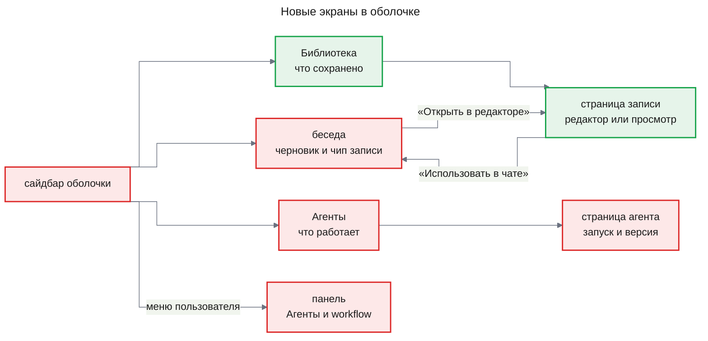
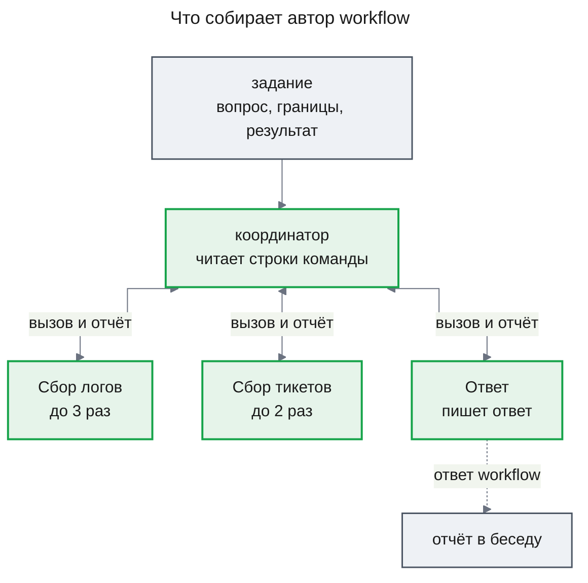
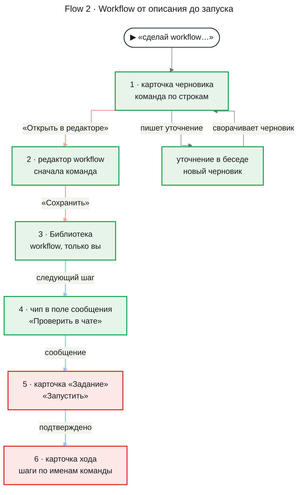
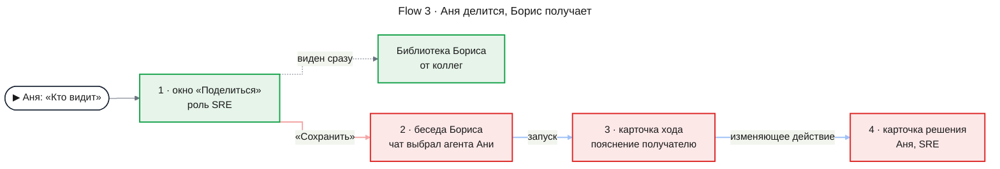

# UXRD: Свои агенты и workflow (custom-agents)

| Статус | Дата | PRD | Дизайны |
|---|---|---|---|
| Черновик | 2026-11-17 | [prd.md](./prd.md) | — |

## Snapshot

**Overview.** В сайдбаре появляется «Библиотека»: в ней агенты и workflow сотрудника, агенты коллег по его ролям и агенты от компании, и у каждого видно автора и кто его видит. Агента проще всего сделать в чате: чат показывает черновик, сотрудник сохраняет его одной кнопкой и тут же жмёт «Проверить в чате» — агент встаёт в поле сообщения. Workflow собирают с команды: у каждого исполнителя одна строка «за что отвечает и когда звать», а правила словами пишут, только если важен порядок. Делятся агентом в окне «Поделиться», и коллега видит, кто им поделился и что агент работает с его собственными правами. В беседе и на странице агента у запуска видно, чей это агент и на какой версии он работает, а у workflow — кого из команды звал координатор.

- **Не меняется**: беседа, лента, карточки хода и решения — к ним добавляются подпись агента и строки о версии. Запускает по-прежнему только сообщение в беседе: «Использовать в чате» кладёт агента в поле сообщения, но не запускает.
- **Главный UX-риск**: автор workflow ждёт очереди шагов, которой нет. Защищают форма, которая начинается с команды без номеров, подсказка о порядке в «Как работает команда» и карточка хода, где шаги подписаны именами из команды (KD-4).
- **Открытые вопросы**: нет.

### Key Decisions

| ID | Решение | Почему |
|---|---|---|
| KD-1 | Библиотека — страница `/library` и пункт сайдбара под «Агентами». У агента или workflow одна страница `/library/<id>`: владельцу она открывает редактор, остальным — просмотр | `/agents` уже занят запусками. Ссылка одна для всех, кто видит запись: из карточки, дерева и чужой беседы |
| KD-2 | Чат — главный путь создания, и он же замыкает круг. «Создать в чате» — главная кнопка библиотеки, форма — второстепенная. После сохранения следующий шаг всегда «Использовать в чате»: агент встаёт в поле сообщения чипом | Пустая форма — самое трудное место для новичка. Без шага после сохранения сотрудник не знает, как запустить нового агента (FR-26) |
| KD-3 | Карточка черновика не держит беседу и не выглядит запросом: статус «Черновик» нейтральный. Уточняют обычным сообщением; новый черновик сворачивает прежний в одну строку и помечает, что изменилось | Доработка словами — главный путь. Карточка-запрос (agent-platform UXRD, KD-5) отправляла бы каждое уточнение ждать в лоток |
| KD-4 | Форма workflow начинается с команды: у каждого исполнителя строка «За что отвечает и когда звать». Ниже — необязательное «Как работает команда» и одно поле «Кто пишет ответ». Номеров, стрелок и перетаскивания нет. Карточка хода подписывает шаги именами из команды и показывает, кого не звали | Координатор решает порядок по строкам команды (FR-16). Автор видит набор, а не очередь, и сверяет запуск с тем, что собрал (FR-27) |
| KD-5 | Одна [подпись записи](../../design-system/components/record-label.md) везде: имя, автор или «от компании» и аудитория простыми словами — «только вы» или названия ролей. В группе «Мои» и в своём редакторе автора нет. Номер версии стоит только там, где объясняет поведение: в запуске, в строке «изменён после запуска» и в подсказке «Запустить с нуля» | Одноимённые агенты разных авторов не путаются (FR-17, FR-25), а лишние номера не шумят |
| KD-6 | Правка не теряется. Конфликт решается на месте: «Сохранить мои правки» или «Взять сохранённое». «Отменить изменения» можно вернуть из уведомления, а уход с несохранённым спрашивает подтверждение | Инструкции длинные, их потеря стоит часов |
| KD-7 | Запуск помнит свою версию. Если агент изменился после старта, карточка хода и страница агента говорят об этом. Действие перезапуска на каждом месте одно: на карточке хода — «Запустить заново» через поле сообщения, на странице агента — привычное «Запустить с нуля», которое пойдёт на новой версии | Работающий агент идёт на своей копии (FR-13, FR-28), и сотрудник видит, почему он ведёт себя по-старому. Две похожие кнопки рядом заставили бы гадать, чем они различаются |

## Terms

Термины продукта — в PRD, раздел Terms; здесь — термины интерфейса.

- **Страница записи** — `/library/<id>`: у владельца это редактор, у остальных — просмотр. Не путать со страницей агента `/agents/<id>`, которая показывает запуск.
- **Карточка черновика** — карточка в беседе с полным определением, которую сотрудник сохраняет, переносит в редактор или отклоняет.
- **Подпись записи** — имя, источник и аудитория в одну строку.
- **Чип записи** — агент или workflow в поле сообщения после «Использовать в чате»; следующее сообщение запускает именно его.
- **Команда** — исполнители workflow, набор без порядка.
- **Правила команды** — необязательный текст «Как работает команда»: кто кого ждёт и где важен порядок.
- **Задание** — то, что PRD называет брифом: вопрос, границы и результат, которые сотрудник подтверждает перед запуском workflow. В интерфейсе слово «задание» значит только это: карточка подтверждения называется «Задание · {имя}» (MC-21).
- **Поручение** — то, что чат или координатор дают отдельному агенту. На странице агента и в карточке хода оно подписано «Поручение», чтобы не путаться с заданием workflow (MC-21).
- **Пишет ответ** — исполнитель последнего шага (`agent-platform` FR-18): его отчёт становится ответом workflow.

## Design System

Фича следует [дизайн-системе](../../design-system/README.md). Библиотека, страницы записей, редакторы и окно «Поделиться» — комфортная плотность; раздел панели — компактная ([foundations → Spacing & Density](../../design-system/foundations.md#spacing--density)).

### Component Inventory

Перед решением «new» поиск шёл по `docs/design-system/components/` и `apps/web/src/components/` (`admin`, `agents`, `shell`, `ui`).

| Компонент | Спецификация | Статус | Примечание |
|---|---|---|---|
| Подпись записи | [record-label.md](../../design-system/components/record-label.md) | new | Автора и аудитории записи нигде нет. Вариант «Чип» — для поля сообщения и «Может запускать» |
| Строка библиотеки | [library-row.md](../../design-system/components/library-row.md) | new | Таблица данных — компактная и для панели, дерево агентов — для запусков |
| Определение записи | [definition-view.md](../../design-system/components/definition-view.md) | new | Ни один блок не показывает определение; строки аргументов вызова — значения, а не текст для чтения |
| Редактор записи | [record-editor.md](../../design-system/components/record-editor.md) | new | Собран на форме настроек; у неё нет длинного текста, «Дополнительно», конфликта и защиты изменений |
| Исполнитель workflow | [executor-item.md](../../design-system/components/executor-item.md) | new | Карточки участника со строкой «за что отвечает» и источником в библиотеке нет |
| Окно «Поделиться» | [share-dialog.md](../../design-system/components/share-dialog.md) | new | Диалоги панели выдают права, а не аудиторию |
| Карточка решения | [decision-card.md](../../design-system/components/decision-card.md) | extended | Вариант «Черновик записи» с нейтральным статусом; подпись записи в действии и задании |
| Карточка хода | [agent-run-card.md](../../design-system/components/agent-run-card.md) | extended | Подпись записи, шаги по именам команды, «изменён после запуска», пояснение получателю |
| Дерево агентов | [agent-tree.md](../../design-system/components/agent-tree.md) | extended | Колонка «Из библиотеки» (RN-02) |
| Метка состояния | [state-badge.md](../../design-system/components/state-badge.md) | extended | Тексты аудитории и пометок; состояние «Сведения» |
| Композер | chat-shell UXRD, TH-04 | extended | Чип записи над полем (CH-01) |
| Уведомления | chat-shell UXRD, TST-01 | reused | Уведомления с действием: «Вернуть», «Поделиться», «Обновить там» |
| Таблица данных, форма настроек | [data-table.md](../../design-system/components/data-table.md), [settings-form.md](../../design-system/components/settings-form.md) | reused | Раздел панели; диалоги копии, удаления и закрытия доступа |
| Вызов инструмента | [tool-call.md](../../design-system/components/tool-call.md) | reused | Отказы создания и запуска (DC-02, RN-06) |
| Сайдбар | chat-shell UXRD, SB-01; agent-platform UXRD, NV-01 | extended | Пункт «Библиотека» (LB-01) |
| Каркас панели | enterprise-access UXRD, AD-01 | extended | Шестой раздел «Агенты и workflow» (AL-01) |
| Страница агента | agent-platform UXRD, AV-01, AV-02 | extended | Подпись записи, «изменён после запуска» (RN-03) |
| Экран «не найдено» | chat-shell UXRD, TH-06 | reused | RV-02 |
| Кнопка, диалог, меню, шторка, поле, флажок, радиогруппа, список, поиск, вкладки, тултип, скелетон, раскрытие | shadcn `button`, `dialog`, `alert-dialog`, `dropdown-menu`, `sheet`, `input`, `textarea`, `checkbox`, `radio-group`, `select`, `command`, `tabs`, `tooltip`, `skeleton`, `collapsible` | reused | `command` и `collapsible` добавляются из shadcn без изменений |

### Где новые экраны в оболочке

Новых экранов три: библиотека, страница записи и раздел панели. Беседа связана со страницей записи в обе стороны.



## User Flows

### Primary User Flow

**Flow 1. Агент из чата.** Implements: UC-1; AC-18.1, AC-18.2, AC-15.4, AC-01.2, AC-26.1

Сотрудник пишет в беседе, какой агент ему нужен; чат при необходимости расспрашивает и показывает карточку черновика (DC-01). «Сохранить» создаёт агента, которого видит только автор, и карточка предлагает «Проверить в чате»: агент встаёт чипом в поле сообщения этой же беседы, сотрудник пишет задачу и отправляет (CH-01). Уточнение пишут обычным сообщением, и новый черновик сворачивает прежний (KD-3). Проверить всё глазами можно в редакторе.

```mermaid
---
title: "Flow 1 · Агент из чата"
config:
  theme: base
  look: classic
  themeVariables:
    primaryColor: "#eef1f5"
    primaryBorderColor: "#4b5563"
    primaryTextColor: "#1a1a1a"
    lineColor: "#6b7280"
  flowchart:
    curve: step
  themeCSS: |
    @keyframes lit_ca1{0%,22.5%{stroke:#991b1b;stroke-width:6px}25%,100%{stroke:#f4a5a5;stroke-width:2px}}
    @keyframes litr_ca1{0%,22.5%{stroke:#1d4ed8;stroke-width:6px}25%,100%{stroke:#9ec1f7;stroke-width:2px}}
---
flowchart LR
    entry(["▶ «сделай агента…»"])
    card["1 · карточка черновика<br/>полное определение"]
    choice{"решение"}
    lib["2 · Библиотека<br/>агент, только вы"]
    chip["3 · чип в поле сообщения<br/>«Проверить в чате»"]
    chat["4 · беседа<br/>чат запускает агента"]
    more["уточнение в беседе<br/>новый черновик"]
    editor["редактор агента<br/>черновик в форме"]
    declined["отклонено<br/>агента нет"]
    entry --> card
    card e1@--> choice
    choice e2@-->|"«Сохранить»"| lib
    lib e3@-->|"следующий шаг"| chip
    chip e4@-->|"сообщение"| chat
    card -->|"пишет уточнение"| more
    choice -->|"«Открыть в редакторе»"| editor
    editor -->|"«Создать»"| lib
    choice -->|"«Отклонить»"| declined
    classDef entry fill:#ffffff,stroke:#1f2937,stroke-width:1.5px,color:#1a1a1a
    classDef changed fill:#fde8e8,stroke:#dc2626,stroke-width:2px,color:#1a1a1a
    classDef new fill:#e6f4ea,stroke:#16a34a,stroke-width:2px,color:#1a1a1a
    classDef w1 stroke:#f4a5a5,stroke-width:2px,animation:lit_ca1 4.8s linear 0s infinite
    classDef w2 stroke:#f4a5a5,stroke-width:2px,animation:lit_ca1 4.8s linear 1.2s infinite
    classDef r1 stroke:#9ec1f7,stroke-width:2px,animation:litr_ca1 4.8s linear 2.4s infinite
    classDef r2 stroke:#9ec1f7,stroke-width:2px,animation:litr_ca1 4.8s linear 3.6s infinite
    class entry entry
    class chat changed
    class card,choice,lib,chip,more,editor,declined new
    class e1 w1
    class e2 w2
    class e3 r1
    class e4 r2
```



Отклонённый черновик агента не создаёт (AC-18.2). У нового агента выбрано «Их чат предлагает и запускает», но пока агента видит только автор, выбор ничего не меняет: свой агент запускается всегда (AC-15.4).

### Alternative Flows

**Flow 2. Workflow: описать, проверить, запустить.** Implements: UC-3; AC-18.1, AC-22.3, AC-16.4, AC-16.5, AC-16.1, AC-16.2, AC-22.1, AC-13.4, AC-27.1, AC-27.2, AC-27.3

Workflow — это координатор и команда. Координатор читает строки команды и необязательные правила и сам зовёт исполнителей в любом порядке и параллельно, в пределах их лимитов. Беседу workflow не видит: он получает только задание.



Сотрудник описывает workflow в беседе. Черновик показывает команду по строке на исполнителя и фразу о том, что workflow видит только задание (DC-01). Проверить или поправить одно поле можно в редакторе (WF-01). После сохранения «Проверить в чате» кладёт workflow в поле сообщения; чат готовит задание именно этого workflow, и сотрудник подтверждает его в карточке «Задание · Разбор инцидента» (RN-05, порядок — agent-platform UXRD, Flow 2), а карточка хода подписывает каждый шаг именем исполнителя (RN-01).



«Сохранить» прямо в карточке тоже создаёт workflow — редактор не обязателен. Когда автор сохраняет новую версию агента, из которого скопирован исполнитель, исполнитель предлагает «Взять новую версию» (WF-01). Работающий запуск доходит до конца на прежних копиях (AC-13.4).

**Flow 3. Поделиться и получить.** Implements: UC-4, UC-8; AC-23.2, AC-03.1, AC-01.1, AC-15.1, AC-15.2, AC-17.1, AC-25.1, AC-26.2, AC-29.1

Аня нажимает «Кто видит: только вы» в шапке редактора, отмечает роль «SRE» и выбирает, как коллеги получают агента (SH-01). Агент сразу появляется у Бориса в группе «От коллег». На странице агента и при первом запуске в своём чате Борис видит пояснение: кто поделился, с какой ролью, с чьими правами агент работает и кто может его убрать (RV-01, RN-01). Карточка решения подписана агентом Ани с меткой «SRE» (RN-04).



Пути без своей схемы:

- **Правка в форме** (UC-2; AC-21.1, AC-07.2, AC-13.1). Владелец правит агента в ED-01 и сохраняет; идущие запуски остаются на прежней версии (RN-03).
- **Доработка в чате** (AC-18.5). «Доработать в чате» в меню редактора открывает новую беседу с заготовкой; агента, открытого ролям, чат не правит (DC-02).
- **Копия** (UC-5; AC-05.1, AC-05.2, AC-05.3, AC-05.4, AC-05.5, AC-20.1, AC-20.2). «Скопировать себе» в меню строки или на странице записи (LB-03); копия встаёт в «Мои», правки оригинала её не трогают.
- **Удаление** (FR-11). «Удалить» спрашивает подтверждение (LB-04); идущие запуски доделывают работу.
- **Администратор правит встроенного агента** (UC-6; AC-12.1, AC-12.2, AC-07.3, AC-25.2) в панели (AL-02); новые беседы работают по новой версии.
- **Администратор закрывает доступ и снимает запрет** (UC-7; AC-09.1, AC-09.2, AC-09.3, AC-09.4, AC-24.1). Агент пропадает у роли и становится личным у автора, а поделиться им автор не может, пока запрет не снят (AL-03, AL-04, ED-01).
- **Одинаковые имена** (FR-15; AC-15.5, AC-15.6, AC-15.7). Просьба по имени запускает своего агента — карточка хода подписывает его «моя». Если своего с таким именем нет, а видимых одноимённых несколько, чат сам берёт того, чьё описание лучше подходит к просьбе, и ни о чём не спрашивает; карточка хода называет автора (RN-01). Чип запускает ровно того, кого положили в поле сообщения, поэтому на странице агента коллеги с повторяющимся именем подсказка о запуске советует «Использовать в чате» и говорит, кого запустит имя (MC-6): если у смотрящего есть свой с таким именем — его, если одноимённых несколько только у коллег — того, чьё описание подходит лучше.

### Error Flows

- **Чат отказывает** (AC-18.3, AC-18.5). Просьба поправить агента, открытого ролям, агента от компании или поделиться агентом получает блок вызова с исходом «отказано», причиной и действием «Открыть в редакторе» или «Поделиться» (DC-02). Ничего не меняется.
- **Сохранение отклонено** (AC-06.1, AC-06.2, AC-06.3, AC-07.1, AC-16.5). Занятое имя, имя агента от компании, длинное описание, система без права или исполнитель без строки «за что отвечает» — ошибка у поля или у карточки исполнителя в редакторе, строка ошибки в карточке черновика (MC-8). На занятое имя карточка сразу предлагает свободное.
- **Конфликт** (AC-08.1, AC-21.2). Агента сохранили в другом окне или из чата: редактор показывает блок конфликта, правка остаётся в форме (KD-6). Устаревший черновик правки нельзя сохранить из карточки.
- **Чужая роль** (AC-04.1). Роль, из которой владелец успел уйти, отклоняется с причиной в окне «Поделиться».
- **Делиться нельзя** (AC-09.3). После закрытия доступа «Поделиться» недоступно везде с причиной; попытка в обход интерфейса — ошибка окна с той же причиной.
- **Не найдено** (AC-02.1, AC-04.3, AC-11.1, AC-11.2). Ссылка на чужой личный, закрытый, удалённый или несуществующий агент открывает один экран RV-02.
- **Старт отклонён** (AC-13.2, AC-14.1, AC-14.3, AC-14.4). Блок вызова «Запустить агента» с исходом «отказано» и причиной; если причина — модель, блок называет её и ведёт к агенту (RN-06).
- **Источник исполнителя пропал** (AC-22.2). Карточка исполнителя говорит, что агент удалён или закрыт; взять новую версию нельзя, исполнитель работает.

Критерии без видимой поверхности: AC-02.3 (агент просто не появляется), AC-10.1, AC-12.3, AC-12.4, AC-13.3, AC-15.3, AC-16.3, AC-18.4, AC-19.1.

## Screens

### Screen 1: Библиотека (`/library`)

```
┌─────────────┬──────────────────────────────────────────────────────┐
│ ◆ Agent OS  │ ◧ Библиотека   [ Создать в чате ] [ Заполнить форму ▾ ]│ LB-02
│ ✎ Новый чат │──────────────────────────────────────────────────────│
│ ⌬ Агенты    │ Мои · 2                                              │
│ ▌▤ Библиоте…│ ⌬ Разбор оплат  SRE                                ⋯ │
│             │   агент · Разбирает падения оплат по логам и тикетам │
│ Сегодня     │ ⑂ Разбор инцидента  только вы                      ⋯ │
│  Ошибки оп… │   workflow · Собирает логи и тикеты, пишет сводку    │
│             │   ⊘ Доступ закрыл администратор · 17 нояб. —         │
│             │     делиться нельзя                                  │
│             │ От коллег · 1                                        │
│             │ ⌬ Сводка дежурства · Борис Ким  SRE                ⋯ │
│             │   агент · Готовит сводку смены по алертам            │
│             │   ⊖ Jira у вас недоступна — агент будет работать     │
│             │     без неё                                          │
│             │ От компании · 3                                      │
│             │ ⌬ chat  от компании                                ⋯ │
│             │ ⌬ general-purpose  от компании                     ⋯ │
│             │ ⑂ deep-research  от компании                       ⋯ │
└─────────────┴──────────────────────────────────────────────────────┘
```

Мобильный 360 px:

```
┌──────────────────────────────┐
│ ≡  Библиотека            [+] │
│ Мои · 2                      │
│ ⌬ Разбор оплат            ⋯ │
│   SRE                        │
│   агент · Разбирает падени…  │
│ От коллег · 1                │
│ ⌬ Сводка дежурства        ⋯ │
│   Борис Ким  SRE             │
│   ⊖ Jira у вас недоступна…   │
└──────────────────────────────┘
```

**LB-01. Пункт «Библиотека»** — строка меню сайдбара под «Агентами» (agent-platform UXRD, NV-01), иконка `LibraryBig`, подпись MC-1. На `/library` и `/library/<id>` пункт выбран, как активная беседа (chat-shell UXRD, SB-06).

**LB-02. Библиотека.** Заголовок «Библиотека» — `h1` в шапке (chat-shell UXRD, HD-03), композера нет. Три группы одна под другой в колонке ленты (chat-shell UXRD, D-01): «Мои», «От коллег», «От компании». Строки — [строки библиотеки](../../design-system/components/library-row.md) по имени. В «Мои» автора нет, аудитория — «только вы» или роли. У агента коллеги видны только те роли, в которых состоит смотрящий (FR-25), у агента от компании — метка «от компании» без «встроенная» (AC-25.2). Определение чата `chat` стоит в «От компании»: его можно прочитать и скопировать, но не положить в поле сообщения — это и есть чат.

Пометки строки заранее говорят, что будет при запуске (AC-20.1, AC-14.2, AC-15.2, AC-09.3). Первый пункт меню строки — «Использовать в чате» (CH-01); его нет там, где чат смотрящего агента не запустит (AC-26.2). «Создать в чате» открывает новую беседу с заготовкой MC-1 (KD-2), «Заполнить форму» — пустые ED-01 и WF-01; на телефоне обе — в меню кнопки «+».

| Состояние | Что показано | AC |
|---|---|---|
| Loading | Заголовки групп и по две строки-скелетона в каждой | — |
| Default | Три группы | AC-20.1 |
| Своих нет | В «Мои» — MC-3 и «Создать в чате» | — |
| У смотрящего нет ролей | В «От коллег» — MC-3 о ролях | — |
| Группа пуста | Одна строка MC-3 под заголовком группы | AC-02.3 |
| Ошибка | MC-3 и «Повторить» по центру области | — |

**LB-03. Копия.** Если у смотрящего есть доступ ко всем системам агента, «Скопировать себе» копирует сразу и показывает уведомление MC-4 с «Открыть». Иначе сначала открывается [диалог](../../design-system/components/settings-form.md) со списком систем, которые не войдут, у workflow — по исполнителям (AC-05.1, AC-20.2). Если модель агента копирующему недоступна, копия получает модель платформы по умолчанию, а если недоступна и она — первую из моделей копирующего; уведомление MC-4 называет обе модели (AC-05.3, AC-05.4). Если доступных моделей у копирующего нет совсем, копия сохраняется с моделью оригинала: уведомление MC-4 говорит, что копия не запустится, а редактор помечает модель баннером MC-9 без замены (AC-05.5). У агента от компании со «Все системы» диалог называет системы, которые получит копия (FR-07).

**LB-04. Удаление** — `alert-dialog` MC-5, кнопка «Удалить» сплошной `--destructive`. После удаления строка уходит, уведомление MC-5; из редактора — возврат в библиотеку.

### Screen 2: Страница агента коллеги (`/library/<id>`)

```
┌──────────────────────────────────────────────────────────────┐
│ ◧ Библиотека / Сводка дежурства · Борис Ким  SRE              │ RV-01
│                    [ Использовать в чате ] [ Скопировать себе ]│
│ Или назовите агента в чате — чат запустит его сам.            │
│──────────────────────────────────────────────────────────────│
│ ⓘ Автор — Борис Ким. Агент открыт вашей роли SRE.             │
│   Работает с вашими правами и подключёнными аккаунтами.       │
│   Изменения в системах — только после вашего подтверждения.   │
│   Убрать агента может автор или администратор.                │
│ Описание        Готовит сводку смены по алертам               │
│ Инструкция      Ты готовишь сводку дежурной смены…            │
│ Модель          Haiku                                         │
│ Максимум шагов  30                                            │
│ Системы         Sentry · Jira ⊖ у вас недоступна              │
└──────────────────────────────────────────────────────────────┘
```

**RV-01. Просмотр** — агент или workflow, который смотрящий видит, но не правит: коллеги по роли или от компании (AC-02.2, AC-04.2). Шапка — подпись записи, «Использовать в чате» (`default`) и «Скопировать себе» (`outline`); под ними подсказка о запуске MC-6. Тело — [определение записи](../../design-system/components/definition-view.md), вариант «На странице»; у агента коллеги над ним пояснение получателю (AC-29.1). Полей и «Сохранить» нет; администратору на агенте от компании — ещё «Открыть в панели».

- **Чат не запускает** (AC-15.2, AC-26.2). Если автор открыл агента только для чтения, «Использовать в чате» нет, а вместо подсказки о запуске стоит MC-6 о копии.
- **Модель недоступна** (AC-14.4). Если модель агента смотрящему недоступна, «Использовать в чате» нет, а строка MC-6 говорит, что копия получит его модель; если доступных моделей у смотрящего нет, строка говорит, что не запустится и копия (AC-05.5).

**RV-02. Не найдено** — экран как chat-shell UXRD, TH-06: `SearchX`, MC-6 и «В библиотеку». Один для чужого личного, закрытого, удалённого и несуществующего агента (AC-02.1, AC-04.3, AC-11.1, AC-11.2).

| Состояние | Что показано | AC |
|---|---|---|
| Loading | Скелетон шапки и строк определения | — |
| Ошибка | Как chat-shell UXRD, TH-07, с MC-6 | — |

### Screen 3: Редактор агента (`/library/<id>`, `/library/new/agent`)

```
┌──────────────────────────────────────────────────────────────┐
│ ◧ Библиотека / Разбор оплат      [ Кто видит: SRE ]        ⋯ │ ED-01
│ Чтобы запустить, нажмите «Использовать в чате» или назовите  │
│ агента в чате.                                               │
│──────────────────────────────────────────────────────────────│
│ ⚠ Модель Sonnet вам больше недоступна — агент не запустится. │
│                                       [ Заменить на Haiku ]  │
│ Имя         [ Разбор оплат                                ]  │
│ Описание    [ Разбирает падения оплат по логам и тикетам  ]  │
│             По описанию чат решает, когда звать агента.      │
│ Инструкция                                                   │
│ ┌──────────────────────────────────────────────────────────┐ │
│ │ Ты разбираешь падения оплат. Сначала найди ошибки…       │ │
│ └──────────────────────────────────────────────────────────┘ │
│ Системы                                                      │
│ ☑ Jira      ⊖ у вас недоступна — останется и будет работать  │
│             у тех, у кого есть доступ                        │
│ ☑ Sentry    Ошибки и события                                 │
│ ☐ Инциденты                                                  │
│ ▸ Дополнительно: модель, максимум шагов, кого может запускать│
│──────────────────────────────────────────────────────────────│
│ ● Есть несохранённые изменения  [Отменить изменения][Сохранить]│
└──────────────────────────────────────────────────────────────┘
```

Панель после сохранения и конфликт над ней:

```
│ ⚠ Вы уже сохранили изменения в другом окне или в чате.       │  конфликт
│   Там изменились: Инструкция, Модель.                        │
│   [ Сохранить мои правки ]  [ Взять сохранённое ]            │
│──────────────────────────────────────────────────────────────│
│ Сохранено                           [ Использовать в чате ]  │  после сохранения
```

**ED-01. Редактор агента** — [редактор записи](../../design-system/components/record-editor.md), вариант «Агент», в колонке ленты; поля — MC-7. Новый агент — заголовок «Новый агент» и кнопка «Создать»; после создания страница получает адрес агента.

- **Шапка.** Подпись записи без автора и кнопка аудитории «Кто видит: …», которая открывает SH-01; под шапкой — подсказка о запуске MC-6. Меню «⋯» — «Использовать в чате», «Доработать в чате» (только у агента, которого видит один автор), «Скопировать себе», «Удалить».
- **Делиться нельзя** (AC-09.3). Под шапкой строка MC-9 с датой, кнопка аудитории недоступна с той же причиной; без ролей — с причиной MC-14.
- **Системы и модель** — только из действующих прав автора (AC-07.1, FR-07). Потерянная система помечена и сохранению не мешает (AC-21.1, AC-07.2). Потерянная модель даёт баннер MC-9 с заменой одним нажатием; без замены сохранение отклоняется ошибкой MC-8. Если доступных моделей у автора нет, баннер MC-9 стоит без замены (AC-05.5). То же у моделей в WF-01.
- **Дополнительно** — свёрнуто, значения по умолчанию уже стоят: модель, максимум шагов, кого агент может запускать (только агенты, которых видит автор).
- **После сохранения** панель предлагает «Использовать в чате», а если редактор открыт из карточки черновика — «Вернуться в беседу» (AC-26.1).

| Состояние | Что показано | AC |
|---|---|---|
| Открыт снова | Те же имя, описание, инструкция и настройки, что сохранены | AC-01.2 |
| Сохранено | «Сохранено» и «Использовать в чате» в панели | AC-08.1, AC-26.1 |
| Ошибка поля | MC-8 у поля; фокус — на первое поле с ошибкой | AC-06.1, AC-06.2, AC-06.3, AC-07.1 |
| Конфликт | Блок MC-10 с изменившимися полями; введённое на месте | AC-08.1, AC-21.2 |
| Модель недоступна | Баннер MC-9 с заменой одним нажатием; без доступных моделей — без замены | AC-14.4, AC-05.5 |
| Делиться нельзя | Строка MC-9, кнопка аудитории недоступна | AC-09.3 |
| Уход с изменениями | Диалог MC-11 | — |

### Screen 4: Редактор workflow (`/library/<id>`, `/library/new/workflow`)

Одна колонка на любой ширине; сверху вниз — команда, правила, ответ:

```
┌──────────────────────────────────────────────────────────────┐
│ ◧ Библиотека / Разбор инцидента  [ Кто видит: только вы ]  ⋯ │ WF-01
│──────────────────────────────────────────────────────────────│
│ Имя       [ Разбор инцидента                              ]  │
│ Описание  [ Собирает логи и тикеты, пишет сводку          ]  │
│ ⓘ Workflow получает только задание, которое вы подтверждаете │
│   перед запуском: вопрос, границы и результат. Беседу он не  │
│   видит.                                                     │
│ Команда · 3                                  [ + Добавить ▾ ]│
│ ┌ Ответ                                  пишет ответ    ⋯ ┐  │
│ │ За что отвечает и когда звать                           │  │
│ │ [ Пишет сводку, когда собраны логи и тикеты           ] │  │
│ │ Sonnet · без систем · до 1 раза                         │  │
│ └─────────────────────────────────────────────────────────┘  │
│ ┌ Сбор логов                                            ⋯ ┐  │
│ │ [ Собирает ошибки gateway за период из задания        ] │  │
│ │ Haiku · Sentry · до 3 раз                               │  │
│ │ ⓘ Агент «Сбор логов» обновлён в библиотеке              │  │
│ │                                 [ Взять новую версию ]  │  │
│ └─────────────────────────────────────────────────────────┘  │
│ ┌ Сбор тикетов                                          ⋯ ┐  │
│ │ [                                                     ] │  │
│ │ ⓧ Напишите, за что отвечает исполнитель и когда его звать│  │
│ └─────────────────────────────────────────────────────────┘  │
│ Как работает команда · необязательно                         │
│ ┌──────────────────────────────────────────────────────────┐ │
│ │ «Ответ» пишет сводку, когда вернутся «Сбор логов» и      │ │
│ │ «Сбор тикетов».                                          │ │
│ └──────────────────────────────────────────────────────────┘ │
│ Если важен порядок или кто кого ждёт — напишите здесь.       │
│ Кто пишет ответ   [ Ответ                 ▾ ]                │
│ ▸ Дополнительно: модель и максимум шагов координатора        │
│──────────────────────────────────────────────────────────────│
│ ● Есть несохранённые изменения  [Отменить изменения][Сохранить]│
└──────────────────────────────────────────────────────────────┘
```

**WF-01. Редактор workflow** — [редактор записи](../../design-system/components/record-editor.md), вариант «Workflow»; шапка, меню и панель сохранения — как у ED-01. Части сверху вниз:

1. **Имя и описание** — как у агента.
2. **Задание** — одна фраза MC-12 о том, что workflow получает только подтверждённое задание из трёх частей и не видит беседу (AC-22.3). Слово то же, что в заголовке карточки подтверждения «Задание · {имя}» (RN-05).
3. **Команда** — [исполнители](../../design-system/components/executor-item.md) по алфавиту, без номеров, стрелок и перетаскивания (KD-4). У каждого обязательная строка «За что отвечает и когда звать» прямо на карточке (AC-16.5): по этим строкам координатор решает, кого звать (AC-16.4).
4. **Как работает команда** — необязательный текст о зависимостях; из чата приходит заполненным. Имена из команды подсвечены, а заметки MC-12 под полем говорят о лишних, неупомянутых и переименованных исполнителях.
5. **Кто пишет ответ** — единственное место, где выбирают последний шаг; метка «пишет ответ» на карточке только показывает выбор. Если этого исполнителя убрали, поле переходит на «Координатор сам» с заметкой MC-12.
6. **Дополнительно** — свёрнуто: модель и максимум шагов координатора со значениями по умолчанию.

У новой пустой формы над командой стоит подсказка MC-12 «Описать в чате» (KD-2), а команда — пустая (MC-12). В панели (AL-02) подсказки нет: чат не создаёт агентов от компании (AC-18.3).

**Источник исполнителя.** Строка источника появляется, только когда агент-источник изменился или пропал (AC-16.1, AC-22.1, AC-22.2). «Взять новую версию» срабатывает без диалога, отменяется «Отменить изменения», а что она меняет и что оставляет, задаёт [executor-item](../../design-system/components/executor-item.md). Когда автор сохраняет агента, скопированного в его собственные workflow, уведомление MC-13 предлагает «Обновить там»: каждый такой workflow берёт новую версию и сохраняется, идущие запуски не меняются.

**WF-02. «Из библиотеки…»** — диалог с поиском по агентам, которых видит автор. Выбранный агент становится исполнителем-копией, его описание — заготовкой строки «за что отвечает». Если имя уже есть в команде, сразу открывается панель исполнителя с ошибкой имени.

**WF-03. Панель исполнителя** — шторка с полями исполнителя ([executor-item](../../design-system/components/executor-item.md), «Панель исполнителя»). Новый исполнитель появляется в команде по «Готово».

| Состояние | Что показано | AC |
|---|---|---|
| Агент-источник обновлён | Строка MC-13 и «Взять новую версию» | AC-16.1, AC-22.1 |
| Новая версия взята | Строки источника нет; изменение ждёт «Сохранить» | AC-16.2 |
| Агент-источник удалён или закрыт | Строка MC-13 без действия; исполнитель остаётся | AC-22.2 |
| Нет строки у исполнителя | Ошибка на карточке; неудачное сохранение ставит фокус на неё | AC-16.5 |
| Команда пуста | MC-12; сохранение отклоняется | — |
| Конфликт, уход с изменениями | Как у ED-01 | AC-08.1 |

### Screen 5: Окно «Поделиться»

**SH-01** — [окно «Поделиться»](../../design-system/components/share-dialog.md); тексты MC-14. Открывается кнопкой аудитории «Кто видит: …» в шапке редактора, пунктом «Поделиться» в меню строки, действием «Поделиться» в сохранённой карточке черновика и в отказе чата (DC-02), а в панели — на агенте от компании. Действие видит только тот, кто может делиться: Борис на агенте Ани его не видит (AC-23.1). У определения чата `chat` действия нет: вместо него строка MC-14 о неизменной аудитории (AC-12.5).

- **Сотрудник** — флажки только его ролей: так он видит свои роли (AC-03.1, AC-23.2). Роль, из которой владелец ушёл, остаётся отмеченной с пометкой (AC-11.3).
- **Как коллеги получают** — появляется, когда отмечена хоть одна роль: «Их чат предлагает и запускает» (выбрано у нового агента, AC-15.4) или «Только в библиотеке — прочитать и скопировать» (AC-15.2, AC-15.1).
- **Администратор** на агенте от компании — «Все сотрудники» или «Выбранные роли и сотрудники»; роли и сотрудники различаются иконкой. Фраз о владельце в этом варианте нет.
- **Сохранено** — уведомление называет, что изменилось: MC-14 (AC-01.1). Метка аудитории в шапке и строке обновляется.

| Состояние | Что показано | AC |
|---|---|---|
| Роль владельцу больше не принадлежит | Ошибка формы MC-14 при сохранении; аудитория прежняя | AC-04.1 |
| Запрет делиться | Ошибка формы MC-14, если окно открыто в обход недоступной кнопки | AC-09.3 |

### Screen 6: Беседа — черновик, чип записи и отказы

Карточка черновика workflow на телефоне, сохранённый и заменённый черновики:

```
┌ ✎ Черновик                     14:36 ┐
│ Новый workflow                        │ DC-01
│ Разбор инцидента                      │
│ Собирает логи и тикеты, пишет сводку  │
│ Workflow получает только задание,     │
│ которое вы подтверждаете перед        │
│ запуском. Беседу он не видит.         │
│ Команда · 3                           │
│ Ответ — пишет сводку, когда собраны…  │
│ Сбор логов — собирает ошибки gateway… │
│ Сбор тикетов — находит тикеты по…     │
│ ▸ Подробнее                           │
│ Чтобы поправить — напишите в чат,     │
│ что изменить                          │
│ [             Сохранить             ] │
│ [        Открыть в редакторе        ] │
│ [             Отклонить             ] │
└───────────────────────────────────────┘
┌ ✓ Сохранено · 14:38 ──────────────────┐
│ Разбор инцидента                      │
│ [ Проверить в чате ]  [ Поделиться ]  │
│ Открыть →                             │
└───────────────────────────────────────┘
⊖ Черновик «Разбор инцидента» заменён новым ниже
```

**DC-01. Карточка черновика** — [карточка решения](../../design-system/components/decision-card.md), вариант «Черновик записи»: статус «Черновик» без цвета запроса, заголовок, имя и [определение записи](../../design-system/components/definition-view.md), вариант «В карточке» (AC-18.1). Встаёт в ленту там, где чат вызвал инструмент создания. Длинные тексты свёрнуты до шести строк; у workflow — по строке на исполнителя, остальное под «Подробнее», чтобы кнопки на телефоне были рядом. Над кнопками — подпись MC-15 о том, как поправить.

- Карточка не держит беседу (KD-3): «Отправить» работает как обычно, лоток не показывает «К запросу», пункт «Агенты» не считает карточку ждущим решением.
- Новый черновик в той же беседе сворачивает ждущий в одну строку MC-15 и помечает изменённые строки меткой «изменено».
- «Открыть в редакторе» открывает ED-01 или WF-01 с черновиком в той же вкладке. Сохранение в форме переводит карточку в «Сохранено в редакторе»; ушёл без сохранения — карточка ждёт дальше.
- Сохранённая карточка даёт следующий шаг: «Проверить в чате» кладёт агента в поле сообщения этой же беседы (CH-01), «Поделиться» открывает SH-01, «Открыть» ведёт на страницу записи.

| Состояние | Что показано | AC |
|---|---|---|
| Сохранено | Итог MC-15, «Проверить в чате», «Поделиться», «Открыть» | AC-18.1, AC-26.1 |
| Отклонено | Итог «Отклонено»; агента нет | AC-18.2 |
| Не сохранено | Строка ошибки MC-8; на занятое имя — «Сохранить как «{свободное имя}»» | AC-06.1, AC-06.2, AC-06.3, AC-07.1, AC-16.5 |
| Устарел | Агент изменился после черновика правки: строка MC-15, «Сохранить» недоступна | AC-08.1 |
| Перезагрузка | Карточка в том же состоянии | — |

**CH-01. Чип записи в поле сообщения** (chat-shell UXRD, TH-04):

```
┌──────────────────────────────────────────────────────┐
│ [ ⌬ Разбор оплат ✕ ]                                 │ CH-01
│ Опишите задачу для «Разбор оплат»…                   │
│                                               [ ↑ ]  │
└──────────────────────────────────────────────────────┘
```

«Использовать в чате», «Проверить в чате» и «Запустить заново» ставят над полем сообщения [подпись записи](../../design-system/components/record-label.md), вариант «Чип», меняют подсказку поля на MC-20 и ставят фокус в поле. Куда встаёт чип:

- «Проверить в чате» на карточке черновика — в беседу, где стоит карточка;
- «Запустить заново» на карточке хода — в беседу, где шёл запуск; если этой беседы уже нет — в новую;
- отовсюду ещё (библиотека, страница записи, редактор) — в новую беседу.

Следующее сообщение запускает именно этого агента, даже если у сотрудника есть одноимённый свой (AC-15.6); для workflow чат готовит задание именно этого workflow. Запуска до отправки нет (AC-26.1). Чип один: новый заменяет прежний, после отправки чип уходит, «✕» убирает его без отправки.

**DC-02. Отказы инструмента создания** — [блок вызова](../../design-system/components/tool-call.md) «Подготовить черновик» с исходом «отказано» и причиной MC-16; карточки черновика нет. Агент открыт ролям — с действием «Открыть в редакторе» (AC-18.5); агент от компании (AC-18.3); просьба поделиться — с действием «Поделиться» (AC-18.3).

### Screen 7: Панель — «Агенты и workflow» (`/admin/library`, `/admin/library/<id>`)

```
│ ◧  Агенты и workflow                              [ + Создать ▾ ] │ AL-01
│  [ Системные ]  Открытые ролям  Запреты                           │
│  Агент или workflow          Вид       Видят                Версия│
│  chat  встроенная            агент     все, у кого есть права   3 ⋯│
│  deep-research  встроенная   workflow  ◎ SRE                    2 ⋯│
│  general-purpose  встроенная агент     все сотрудники           4 ⋯│
│  Сводка релизов              агент     ◎ Оплаты  ◉ Борис Ким    1 ⋯│

│  Системные  [ Открытые ролям ]  Запреты   [ Найти по имени или автору ] │
│  Агент или workflow                 Автор                 Роли  В чате  │
│  Разбор оплат                       Аня Смирнова          SRE   да    ⋯ │
│  Разбирает падения оплат по логам…                                      │
│  Сводка дежурства                   Борис Ким ⊖ отключён  SRE   нет   ⋯ │
│  Готовит сводку смены по алертам                                        │

│  Системные  Открытые ролям  [ Запреты ]                                 │
│  Агент или workflow       Автор           Доступ закрыт                 │
│  Разбор инцидента         Аня Смирнова    17 нояб.      [ Снять запрет ]│
```

**AL-01. Раздел** — шестой пункт сайдбара панели (enterprise-access UXRD, AD-01) с иконкой `LibraryBig` и подписью MC-18. Три вкладки (shadcn `tabs`) с [таблицами данных](../../design-system/components/data-table.md).

- **«Системные»** — агенты и workflow от компании. У встроенных — метка «встроенная», в меню строки нет «Удалить» (AC-12.2). В колонке «Видят» роль — иконка `Users` (◎), сотрудник — `User` (◉). «Создать» — «Агент» и «Workflow»: пустые формы AL-02.
- **«Открытые ролям»** — только агенты сотрудников, открытые ролям, личных нет (AC-24.1): имя и описание второй строкой, автор с меткой «отключён» (AC-09.2), роли и «В чате ролей» — да или нет. Поиск по имени или автору. «Закрыть доступ» — в меню строки.

**AL-02. Агент от компании** — ED-01 или WF-01 в варианте «Системная», компактная плотность: модель из каталога, системы из реестра и «Все системы» (AC-07.3); «Поделиться» — вариант администратора. У определения чата `chat` вместо него строка MC-14 (AC-12.5). Если агента видят все сотрудники, над панелью сохранения стоит строка MC-18 о том, кто получит изменение. После создания уведомление MC-18 говорит, что агента пока видят только администраторы, и предлагает «Поделиться».

**AL-03. Агент сотрудника** — просмотр: подпись записи с автором, роли, [определение записи](../../design-system/components/definition-view.md) «На странице»; в шапке «Закрыть доступ». Править его администратор не может. «Закрыть доступ» здесь и в меню строки открывает `alert-dialog` MC-18: он говорит, что автор не сможет снова поделиться, пока запрет не снят. После подтверждения строка уходит, уведомление «Доступ закрыт», со страницы — возврат к вкладке (AC-09.1).

**AL-04. Запреты** — имя, автор и дата закрытия, без инструкции (AC-09.4). «Снять запрет» снимает его сразу, без диалога, с уведомлением MC-18; строка уходит.

| Состояние | Что показано | AC |
|---|---|---|
| Вкладка пуста | MC-18 | — |
| Loading, ошибка, «не найдено», нет права | Как в каркасе панели (enterprise-access UXRD, AD-01, AD-02, AD-15) | AC-04.2 |

### Screen 8: Запуск в беседе, в списке и на странице агента

```
┌ ⟳ Работает  Разбор инцидента · Аня Смирнова  SRE · версия 3    14:20 ┐ RN-01
│ Почему с 14:00 падают оплаты                                          │
│ Аня Смирнова · для роли SRE: работает с вашими правами и аккаунтами,  │
│ изменения — только после вашего подтверждения. Убрать может автор     │
│ или администратор.                                                    │
│ ✓ Сбор логов     ошибки gateway за 14:00–15:00                        │
│ ✓ Сбор тикетов   тикеты по оплатам за день                            │
│ ⊘ Сбор логов     предел вызовов исчерпан                              │
│ ✓ Ответ          сводка по найденному                                 │
│ ○ Сбор метрик    не вызывался                                         │
│ ⓘ Workflow изменён после запуска: сейчас версия 4  [ Запустить заново ]│
│ Открыть запуск →                                                      │
└───────────────────────────────────────────────────────────────────────┘
┌ ✋ Ждёт подтверждения                                        14:23 ┐ RN-04
│ Агент «Инциденты по оплате» хочет выполнить:                        │
│ Разбор оплат · Аня Смирнова  SRE                                    │
│ Создать заметку об инциденте                                        │

│ ◧  Инциденты по оплате   ✓ Завершён  [↺ Запустить с нуля]           │ RN-03
│  Haiku · запущен 14:20 · из беседы «Ошибки оплаты»                  │
│  Разбор оплат · Аня Смирнова  SRE · версия 3                        │
│  ⓘ Агент изменён после запуска: сейчас версия 4                     │
```

- **RN-01. Карточка хода** ([agent-run-card](../../design-system/components/agent-run-card.md)) — подпись записи, у workflow с версией старта (AC-17.1, AC-27.3). Шаги подписаны именами из команды, отклонённый по пределу вызов помечен, а после конца запуска не вызванные исполнители стоят приглушёнными строками (AC-27.1, AC-27.2). При первом запуске агента коллеги в беседе получателя — пояснение MC-17 (AC-29.1).
- **Изменён после запуска** (KD-7, AC-28.1). Карточка хода и страница агента показывают строку MC-17 с номером новой версии. На карточке хода рядом стоит «Запустить заново»: оно кладёт агента чипом в поле сообщения (CH-01). На странице агента у строки своей кнопки нет — перезапуск там даёт «Запустить с нуля» (RN-03).
- **RN-02. Дерево агентов** — колонка «Из библиотеки», на узкой области — подпись в строке мета ([agent-tree](../../design-system/components/agent-tree.md); AC-17.1).
- **RN-03. Страница агента** — вторая строка мета (agent-platform UXRD, AV-02): подпись записи с версией старта; имя ведёт на страницу записи. Если агент изменён после запуска, под ней строка MC-17 без своей кнопки. Перезапуск на странице один — «Запустить с нуля» (agent-platform UXRD, AV-01): её подсказка называет версию, на которой пойдёт новый старт (AC-13.1, AC-28.1). Если запись недоступна — метка MC-17, а «Запустить с нуля» недоступна с подсказкой MC-17.
- **RN-04. Карточка решения «Действие»** — под источником подпись записи агента, который просит (AC-25.1, AC-25.2). Запрос самого чата подписи не получает.
- **RN-05. Карточка задания** — карточка решения, где сотрудник подтверждает задание workflow (agent-platform UXRD, CV-03): заголовок «Задание · {имя}», итоги и подписи — MC-21; под заголовком подпись записи workflow. На странице агента первое сообщение подписано «Поручение», у запуска workflow — «Задание» (MC-21).
- **RN-06. Отклонённый старт** — блок вызова «Запустить агента» с исходом «отказано» и причиной MC-16 в ленте родителя (AC-13.2, AC-14.1, AC-14.3). Если причина — модель, блок называет её и даёт «Открыть» (AC-14.4).

Запуск без записи — у самого чата — подписи не получает.

## Accessibility

- **Целевой уровень**: WCAG 2.1 AA и работа от 360 px — PRD NFR-05 (уровень chat-shell PRD NFR-18 и NFR-22); раздел панели — как остальная панель (enterprise-access PRD NFR-05). Роли, имена и клавиатура компонентов — в их спецификациях.
- **Заголовки**: `h1` — «Библиотека», имя агента или workflow, «Новый агент» или «Новый workflow», раздел панели. Заголовок вкладки — MC-1, MC-7, MC-18.
- **Сочетание клавиш**: одно новое — Ctrl+S или Cmd+S сохраняет, пока фокус в редакторе.

| Событие | Куда фокус |
|---|---|
| Открытие библиотеки, страницы записи, раздела панели | `h1` |
| «Создать в чате», «Описать в чате», «Доработать в чате» | Поле сообщения новой беседы, курсор после заготовки |
| «Использовать в чате», «Проверить в чате», «Запустить заново» | Поле сообщения рядом с чипом |
| «Открыть в редакторе» из карточки | `h1` редактора |
| «Сохранить» в редакторе | «Использовать в чате» или «Вернуться в беседу», которые встают на её место |
| Конфликт, ошибка формы | Блок конфликта или ошибки |
| Неудачное сохранение workflow | Первая карточка исполнителя с ошибкой |
| «Взять новую версию» | Имя карточки исполнителя |
| Закрытие окна «Поделиться», диалога копии, панели исполнителя | Кнопка или имя исполнителя, которые его открыли |
| Решение в карточке черновика | Карточка |
| Удаление в библиотеке | Следующая строка группы, без неё — предыдущая, без строк — заголовок группы |
| Удаление из редактора | `h1` библиотеки |

**Объявления** — вежливые (`polite`), тексты MC-19: появилась карточка черновика; сохранено; копия сохранена; взята новая версия исполнителя; агент встал в поле сообщения. Конфликт, ошибки форм и отказ в окне «Поделиться» — `alert`.

## Responsive Behavior

| Брейкпоинт | Ширина | Экран | Что меняется |
|---|---|---|---|
| Mobile | < 768 px | Библиотека | «Создать в чате» и «Заполнить форму» сливаются в иконочную кнопку `Plus` с меню; автор и аудитория в подписи переносятся на вторую строку |
| Mobile | < 768 px | Редакторы | Панель сохранения во всю ширину, состояние — точкой без текста, «Отменить правки» вместо «Отменить изменения». Кнопка аудитории остаётся в шапке. Поле инструкции растёт по содержимому без своей прокрутки |
| Mobile | < 768 px | Окно «Поделиться», панель исполнителя | На весь экран |
| Mobile | < 480 px | Карточка черновика | Кнопки столбцом во всю ширину; подписи определения над значениями |
| Desktop | ≥ 1024 px | Все экраны | Колонка ленты (chat-shell UXRD, D-01); редакторы — одна колонка до 720 px; панель — как enterprise-access UXRD, Responsive Behavior |

На 360 px нет горизонтальной прокрутки страницы; цели касания при грубом указателе — 44 px.

## Content and Microcopy

Тон и знаки — как в chat-shell UXRD, Content and Microcopy. Слова «запись» в интерфейсе нет: текст называет вид. Ниже `{вид}` — «агент» или «workflow», `{Вид}` — то же с заглавной; оба слова мужского рода: «{Вид} удалён». Сотрудник видит «чат», а не «главный чат», и «системы» по отображаемым именам, а не «серверы». Имена агентов, систем, моделей, ролей и тексты авторов не переводятся. Склонение «раз»: «до 1 раза», «до 2 раз», «до 5 раз».

| ID | Где | Текст | Примечание |
|---|---|---|---|
| MC-1 | Библиотека — навигация (LB-01, LB-02) | «Библиотека»; вкладка «Библиотека — Agent OS»; «Мои · {N}», «От коллег · {N}», «От компании · {N}»; «Создать в чате»; «Заполнить форму»: «Агент», «Workflow»; на телефоне «Создать»: «Создать в чате», «Форма агента», «Форма workflow»; заготовки «Сделай агента, который », «Сделай workflow, который » | — |
| MC-2 | Строка библиотеки | «агент», «workflow»; «{система} у вас недоступна — {вид} будет работать без неё», несколько — «{системы} у вас недоступны — {вид} будет работать без них»; «Модель {модель} вам недоступна — у вас {вид} не запустится»; «Только для чтения — чтобы пользоваться, скопируйте себе»; «Доступ закрыл администратор · {дата} — делиться нельзя»; меню «Действия: {имя}»: «Использовать в чате», «Открыть», «Поделиться», «Скопировать себе», «Удалить», «Открыть в панели» | Больше трёх систем — «и ещё {N}» |
| MC-3 | Библиотека — состояния | «Своих агентов пока нет» / «Опишите в чате, что должен делать агент, — например: «Сделай агента, который каждое утро собирает новые ошибки Sentry».» + «Создать в чате»; «Коллеги по вашим ролям ещё ничем не поделились»; «У вас нет ролей, поэтому агентов коллег здесь нет»; «От компании для вас ничего нет»; «Не удалось загрузить библиотеку» + «Повторить»; скринридер «Загружаем библиотеку…» | — |
| MC-4 | Копия (LB-03) | «Скопировать «{имя}» себе?» / «Копию увидите только вы. Правки оригинала её не изменят.» / «Не войдут системы, к которым у вас нет доступа: {системы}»; у workflow — «{исполнитель}: {системы}»; вместо всех систем — «Копия получит системы, к которым у вас есть доступ: {системы}» / «Скопировать», «Отмена»; имя копии «{имя} — копия», если занято — «{имя} — копия {N}»; «Копия «{имя копии}» сохранена» + «Открыть»; с заменой модели — «Копия «{имя копии}» сохранена. Модель {модель} вам недоступна — стоит {ваша модель}» + «Открыть»; без доступных моделей — «Копия «{имя копии}» сохранена, но не запустится: у вас нет доступных моделей» + «Открыть»; «Не удалось скопировать: {причина}» | — |
| MC-5 | Удаление (LB-04) | «Удалить «{имя}»?»; только вы — «{Вид} удалится насовсем. Запуски, которые уже идут, доработают.»; роли — «{Вид} пропадёт у вас и у ролей {роли}. Запуски, которые уже идут, доработают.»; от компании — «{Вид} пропадёт у всех, кому открыт. Запуски, которые уже идут, доработают.»; «Удалить»; «{Вид} удалён»; «Не удалось удалить: {причина}» | — |
| MC-6 | Подсказка о запуске, страница коллеги, «не найдено» (ED-01, RV-01, RV-02) | Сохранённый свой — «Чтобы запустить, нажмите «Использовать в чате» или назовите {вид} в чате.»; у коллеги — «Или назовите {вид} в чате — чат запустит его сам.»; если у смотрящего есть свой с таким именем — «У вас есть свой {вид} с таким именем: назовёте в чате — запустится ваш. Чтобы запустить этот, нажмите «Использовать в чате».»; если своего нет, а у коллег таких имён несколько — «Таких имён несколько: назовёте в чате — чат выберет по описанию. Чтобы запустить именно этого, нажмите «Использовать в чате».»; «Использовать в чате», «Скопировать себе», «Открыть в панели»; пояснение получателю — «Автор — {автор}. {Вид} открыт вашей роли {роли}.» / «Работает с вашими правами и подключёнными аккаунтами.» / «Изменения в системах — только после вашего подтверждения.» / «Убрать {вид} может автор или администратор.»; только для чтения — «Автор открыл {вид} только для чтения: ваш чат его не запускает. Чтобы пользоваться, скопируйте себе.»; модель — «Модель {модель} вам недоступна — у вас {вид} не запустится. Копия получит вашу модель.», без доступных моделей — «Модель {модель} вам недоступна, а других моделей у вас нет — не запустится ни {вид}, ни его копия.»; «Не найдено» / «Такого агента или workflow нет: его удалили, закрыли для вас или ссылка неверна.» / «В библиотеку»; вкладка «Не найдено — Agent OS»; «Не удалось загрузить» / «Проверьте подключение и попробуйте ещё раз.» / «Повторить» | Роли — только те, в которых состоит смотрящий |
| MC-7 | Редактор — поля и сохранение (ED-01, WF-01) | «Новый агент», «Новый workflow»; вкладка «{имя} — Библиотека — Agent OS»; «Кто видит: {аудитория}» — «только вы», роли через запятую, «все сотрудники», «выбранные»; «Имя»; «Описание», «По описанию чат решает, когда звать {вид}.», «{N} / {предел}»; «Инструкция», «Что агент делает и как. Он видит только этот текст и своё поручение.»; «Системы», «Агент получит инструменты только тех систем, к которым есть доступ у запустившего.»; «Дополнительно: модель, максимум шагов, кого может запускать»; «Модель», «Сильнее модель — дольше и дороже. Для большинства задач хватит модели по умолчанию.»; «Максимум шагов», «Сколько шагов агент делает за один запуск. Дойдя до предела, он останавливается и отдаёт то, что успел.»; «Может запускать», «Добавить», «Найти агента», «Убрать: {имя}»; меню «Действия: {имя}»: «Использовать в чате», «Доработать в чате» (недоступны — «Сначала сохраните изменения»), «Скопировать себе», «Удалить»; заготовка «Доработай «{имя}»: »; «Создать», «Сохранить», «Сохраняем…»; «Отменить изменения», на телефоне «Отменить правки»; «Изменения отменены» + «Вернуть»; «Есть несохранённые изменения», «Сохранено»; «Использовать в чате», «Вернуться в беседу»; «{Вид} создан» | — |
| MC-8 | Ошибки сохранения (редактор, карточка черновика) | «Введите имя»; «У вас уже есть {вид} «{имя}»», в карточке + «Сохранить как «{свободное имя}»»; «Так называется агент от компании — выберите другое имя»; «Описание длиннее {предел} знаков»; «Введите инструкцию»; «Нет доступа к системе {система} — уберите её»; «Модель {модель} вам недоступна — выберите другую»; «Нужно целое число от 1»; «Напишите, за что отвечает исполнитель и когда его звать»; «Добавьте хотя бы одного исполнителя»; «Не удалось сохранить: {причина}»; «Не удалось сохранить: нет связи с сервером» | — |
| MC-9 | Пометки прав и баннеры редактора | «у вас недоступна»; у потерянной системы — «у вас недоступна — останется и будет работать у тех, у кого есть доступ»; «{вид} недоступен»; «Модель {модель} вам больше недоступна — {вид} не запустится» + «Заменить на {модель}»; без доступных моделей, без кнопки — «Модель {модель} вам недоступна, а других моделей у вас нет — {вид} не запустится»; «Доступ закрыл администратор · {дата} — делиться нельзя»; администратор — «Все системы» / «Агент получит все системы, в том числе подключённые позже.» | — |
| MC-10 | Конфликт | Сотрудник — «Вы уже сохранили изменения в другом окне или в чате. Там изменились: {поля}.»; администратор — «Изменения уже сохранили в другом окне. Там изменились: {поля}.»; «Сохранить мои правки», «Взять сохранённое» | Поля — подписями формы |
| MC-11 | Уход из редактора | «Уйти без сохранения?» / «Изменения в «{имя}» не сохранены и пропадут.» / «Остаться», «Уйти без сохранения» | Новый — «Изменения не сохранены и пропадут.» |
| MC-12 | Редактор и определение workflow | «Workflow получает только задание, которое вы подтверждаете перед запуском: вопрос, границы и результат. Беседу он не видит.»; «Команда · {N}», «Кого и когда звать, решает координатор по строкам команды.»; «Добавить»: «Новый исполнитель», «Из библиотеки…»; «Команды пока нет» / «Добавьте исполнителей и у каждого напишите, за что он отвечает и когда его звать. Можно взять своего агента из библиотеки.»; «Как работает команда», «необязательно», «Если важен порядок или кто кого ждёт — напишите здесь. Остальное координатор решит по строкам команды.», плейсхолдер «Например: «Ответ» пишет сводку, когда вернутся «Сбор логов» и «Сбор тикетов».»; заметки «В команде нет «{имя}»», ««{имя}» в правилах не упомянут — координатор позовёт его по строке команды», «В правилах осталось старое имя «{имя}»» + «Заменить в правилах»; «Кто пишет ответ», «Координатор сам», «Отчёт этого исполнителя станет ответом workflow.», «{имя} убран из команды — ответ пишет координатор»; «Дополнительно: модель и максимум шагов координатора», «Модель координатора», «Максимум шагов координатора»; «Проще начать в чате: опишите, что должен делать workflow, — чат соберёт команду.» + «Описать в чате»; диалог «Добавить из библиотеки», «Найти агента», «Добавить», «Агентов в библиотеке нет» | — |
| MC-13 | Исполнитель | «За что отвечает и когда звать», плейсхолдер «Например: собирает ошибки Sentry за период из задания»; «пишет ответ»; «до {N} раз»; «Сколько раз можно звать»; «Агент «{источник}» обновлён в библиотеке» + «Взять новую версию»; «Агент «{источник}» удалён или закрыт для вас — обновить нельзя»; «Не вошли системы, к которым у вас нет доступа: {системы}»; меню «Изменить», «Убрать из команды»; панель «Исполнитель «{имя}»», «Новый исполнитель», «Готово»; «Такое имя уже есть в команде»; после сохранения источника — ««{имя}» есть в ваших workflow: {workflow}» + «Обновить там», «Обновлено: {workflow}» | — |
| MC-14 | Окно «Поделиться» (SH-01) | «Поделиться «{имя}»»; «Кто видит»; «Вы видите всегда»; «вы больше не в этой роли»; «Как коллеги получают «{имя}»»: «Их чат предлагает и запускает {вид}», «Только в библиотеке — прочитать и скопировать»; «Коллеги увидят, что {вид} от вас, и он будет работать с их правами.»; администратор — «Все сотрудники», «Выбранные роли и сотрудники», «Найти роль или сотрудника», «Пока видят только администраторы», «Как сотрудники получают «{имя}»», «Убрать: {имя}»; «Сохранить», «Отмена»; «Теперь видят: {роли}», «Теперь видите только вы», «Теперь видят все сотрудники»; «Не удалось сохранить: вы не состоите в роли {роль}»; «Не удалось сохранить: доступ закрыл администратор»; «Не удалось загрузить роли» + «Повторить»; недоступно — «У вас нет ролей — поделиться не с кем», «Доступ закрыл администратор — делиться нельзя»; у `chat` — «Видят все, у кого есть права. Это изменить нельзя.» | — |
| MC-15 | Карточка черновика (DC-01), определение | «Черновик»; «Новый агент», «Новый workflow», «Правка «{имя}»»; «Описание», «Инструкция», «Модель», «Максимум шагов», «Системы», «Может запускать», «Как работает команда», «Кто пишет ответ», «Координатор» — «{модель} · до {N} шагов», «без систем», «все системы»; «Подробнее», «Показать целиком», «Свернуть», «изменено», «Убрано: {что}»; «Чтобы поправить — напишите в чат, что изменить»; «Сохранить», «Открыть в редакторе», «Отклонить»; «Сохранено · {время}», «Сохранено в редакторе · {время}» + «Проверить в чате», «Поделиться», «Открыть»; «Отклонено · {время}»; «Черновик «{имя}» заменён новым ниже»; «{Вид} изменился после черновика. Попросите чат подготовить правку заново или откройте редактор.» | Причины отказа — MC-8 |
| MC-16 | Чат — инструмент создания и запуск (DC-02, RN-06) | Подпись инструмента «Подготовить черновик»; отказы: «{Вид} открыт ролям — правьте его в редакторе» + «Открыть в редакторе»; «Агентов от компании правят в панели администратора»; «Чат не делится агентами — откройте окно «Поделиться»» + «Поделиться»; запуск: «{Вид} недоступен: его удалили или закрыли для вас»; «Модель {модель} вам недоступна — {вид} не запустился. Откройте его и выберите другую модель» + «Открыть»; у агента коллеги — «… Скопируйте его себе — копия получит вашу модель» + «Открыть», без доступных моделей — «Модель {модель} вам недоступна, а других моделей у вас нет — не запустится ни {вид}, ни его копия» + «Открыть» | Добавляется к agent-platform MC-22 и MC-23 |
| MC-17 | Подпись записи и запуск (RN-01 — RN-05) | «моя»; «только вы», «от компании», «встроенная» (только в панели); «версия {N}»; «{Вид} изменён после запуска: сейчас версия {N}», на карточке хода + «Запустить заново»; «{вид} недоступен»; «отключён»; «не вызывался»; «предел вызовов исчерпан»; пояснение получателю — «{автор} · для роли {роли}: работает с вашими правами и аккаунтами, изменения — только после вашего подтверждения. Убрать может автор или администратор.»; подсказка «Запустить с нуля» — «Пойдёт на версии {N}» / «{Вид} недоступен — запустить с нуля нельзя»; скринридер «{имя}, автор {автор}, {аудитория}», «{имя}, мой {вид}, {аудитория}», «{имя}, от компании» | — |
| MC-18 | Панель — «Агенты и workflow» (AL-01 — AL-04) | «Агенты и workflow»; вкладка «Агенты и workflow — Панель — Agent OS»; «Системные», «Открытые ролям», «Запреты»; «Агент или workflow», «Вид», «Видят», «Версия», «Автор», «Роли», «В чате ролей», «да», «нет», «Доступ закрыт»; «все сотрудники», «все, у кого есть права»; «Найти по имени или автору»; «Создать»: «Агент», «Workflow»; «{Вид} пока видят только администраторы» + «Поделиться»; «{Вид} видят все сотрудники — новые запуски пойдут по новой версии»; «Закрыть доступ»; «Закрыть доступ к «{имя}»?» / «{Вид} станет личным у автора, {автор}: роли {роли} перестанут его видеть. Поделиться им снова автор не сможет, пока вы не снимете запрет. Запуски, которые уже идут, доработают.» / «Закрыть доступ»; «Доступ закрыт»; «Снять запрет», «Запрет снят: автор снова может делиться»; «Сотрудники пока ничего не открыли ролям»; «Запретов нет»; «Не удалось загрузить» + «Повторить» | — |
| MC-19 | Объявления | «Черновик «{имя}» готов — проверьте и сохраните»; «Сохранено»; «Копия «{имя}» сохранена»; «Взята новая версия «{имя}»»; ««{имя}» в поле сообщения — опишите задачу и отправьте» | — |
| MC-20 | Чип записи (CH-01) | Подсказка поля «Опишите задачу для «{имя}»…»; у workflow — «Опишите, что разобрать, — чат подготовит задание для «{имя}»…»; «Убрать: {имя}» | — |
| MC-21 | Задание и поручение (RN-05, страница агента) | Карточка подтверждения — «Задание · {имя}»; «Задание подтверждено · {время}», «Задание отклонено · {время}»; скринридер «Задание: {вопрос}»; объявление «Задание готово — нужно ваше решение»; на странице агента подпись первого сообщения — «Поручение», у запуска workflow — «Задание» | Заменяет заголовок и итоги agent-platform MC-20, подписи «Задание» и «Бриф» agent-platform MC-9 и объявление о брифе agent-platform MC-25. «Вопрос», «Границы», «Результат» и кнопки берутся из agent-platform MC-20 |

## Undetermined Items

Нет: UX-вопросов не осталось.

## Update History

| Версия | Дата | Изменение |
|---------|------|--------|
| 1.0 | 2026-11-17 | Первая версия |
| 1.1 | 2026-11-17 | Проверка юзабилити и PRD 1.2: «Использовать в чате» и чип записи, форма workflow с команды, сверка запуска с командой, «изменён после запуска», пояснение получателю, запрет делиться и вкладка «Запреты», группы «Мои», «От коллег», «От компании», «Дополнительно» в редакторах, конфликт на месте, слова интерфейса без «записи» |
| 1.2 | 2026-11-17 | «Задание» только для подтверждения workflow, «Поручение» для агента (MC-21); куда встаёт чип; на странице агента перезапуск — только «Запустить с нуля»; при нескольких одноимённых чат выбирает по описанию (FR-15) |
| 1.3 | 2026-11-17 | Подсказка о запуске при своём одноимённом агенте (MC-6); модель копии по PRD 1.3 — модель платформы, первая доступная или без доступных моделей (LB-03, MC-4, MC-6, MC-9, MC-16) |
