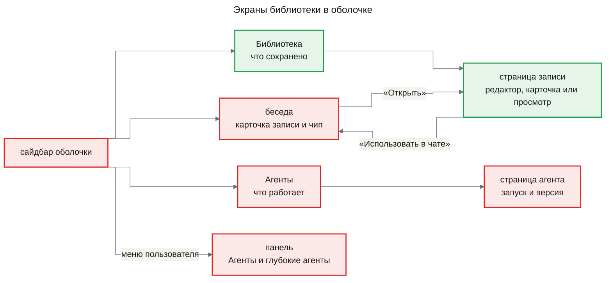
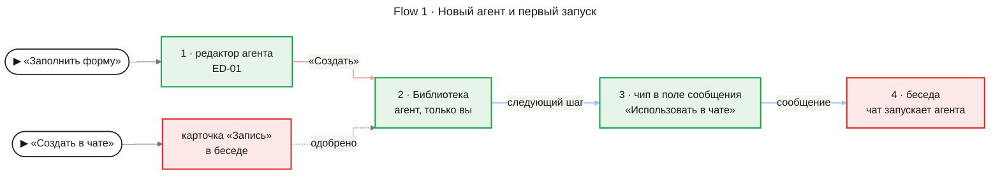

# UXRD: Библиотека агентов (custom-agents)

| Статус | Дата | PRD | Дизайны |
|---|---|---|---|
| Утверждён | 2026-11-22 | [prd.md](./prd.md) | — |

## Snapshot

**Overview.** В сайдбаре есть «Библиотека»: в ней агенты и глубокие агенты сотрудника, записи коллег по его ролям и записи от компании, и у каждой видно автора и кто её видит. Агента проще всего сделать в чате: чат собирает запись и сохраняет её после карточки подтверждения (deep-agents UXRD, DA-11), а потом сотрудник жмёт «Использовать в чате» — агент встаёт в поле сообщения. Обычного агента можно ещё и заполнить в форме. Делятся записью в окне «Поделиться», и коллега видит, кто ею поделился и что запись работает с его собственными правами. В беседе и на странице агента у запуска видно, чей это агент и на какой версии он работает.

- **Не меняется**: беседа, лента, карточки хода и решения — к ним добавляются подпись записи и строки о версии. Запускает только сообщение в беседе: «Использовать в чате» кладёт запись в поле сообщения, но не запускает.
- **Где описан глубокий агент**: карточка глубокого агента, создание и правка словами, панель «Схема», задачи и поручения — [deep-agents UXRD](../deep-agents/uxrd.md).
- **Главный UX-риск**: одноимённые записи разных авторов. Защищает подпись записи с автором и аудиторией везде, где запись видна (KD-5).
- **Открытые вопросы**: нет.

### Key Decisions

| ID | Решение | Почему |
|---|---|---|
| KD-1 | Библиотека — страница `/library` и пункт сайдбара под «Агентами». У записи одна страница `/library/<id>`: владельцу агента она открывает редактор, владельцу глубокого агента — его карточку (deep-agents UXRD, DA-13), остальным — просмотр | `/agents` уже занят запусками. Ссылка одна для всех, кто видит запись: из карточки, дерева и чужой беседы |
| KD-2 | Чат — главный путь создания, и он же замыкает круг. «Создать в чате» — главная кнопка библиотеки, форма — второстепенная. После сохранения следующий шаг всегда «Использовать в чате»: запись встаёт в поле сообщения чипом | Пустая форма — самое трудное место для новичка. Без шага после сохранения сотрудник не знает, как запустить новую запись (FR-26) |
| KD-5 | Одна [подпись записи](../../design-system/components/record-label.md) везде: имя, автор или «от компании» и аудитория простыми словами — «только вы» или названия ролей. В группе «Мои» и в своём редакторе автора нет. Номер версии стоит только там, где объясняет поведение: в запуске, в строке «изменён после запуска» и в подсказке «Запустить с нуля» | Одноимённые записи разных авторов не путаются (FR-17, FR-25), а лишние номера не шумят |
| KD-6 | Правка не теряется. Конфликт решается на месте: «Сохранить мои правки» или «Взять сохранённое». «Отменить изменения» можно вернуть из уведомления, а уход с несохранённым спрашивает подтверждение | Инструкции длинные, их потеря стоит часов |
| KD-7 | Запуск помнит свою версию. Если запись изменилась после старта, карточка хода и страница агента говорят об этом. Действие перезапуска на каждом месте одно: на карточке хода — «Запустить заново» через поле сообщения, на странице агента — привычное «Запустить с нуля», которое пойдёт на новой версии | Работающий агент идёт на своей копии (FR-13, FR-28), и сотрудник видит, почему он ведёт себя по-старому. Две похожие кнопки рядом заставили бы гадать, чем они различаются |

## Terms

Термины продукта — в PRD, раздел Terms; здесь — термины интерфейса.

- **Страница записи** — `/library/<id>`: у владельца агента это редактор, у владельца глубокого агента — карточка, у остальных — просмотр. Не путать со страницей агента `/agents/<id>`, которая показывает запуск.
- **Подпись записи** — имя, источник и аудитория в одну строку.
- **Чип записи** — агент или глубокий агент в поле сообщения после «Использовать в чате»; следующее сообщение запускает именно его.
- **Задание** — то, что PRD называет брифом: вопрос, границы и результат, которые сотрудник подтверждает перед запуском глубокого агента. В интерфейсе слово «задание» значит только это: карточка подтверждения называется «Задание · {имя}» (MC-21).
- **Поручение** — то, что чат или глубокий агент даёт отдельному агенту. На странице агента оно подписано «Поручение», чтобы не путаться с заданием (agent-platform UXRD, MC-9).

## Design System

Фича следует [дизайн-системе](../../design-system/README.md). Библиотека, страницы записей, редактор и окно «Поделиться» — комфортная плотность; раздел панели — компактная ([foundations → Spacing & Density](../../design-system/foundations.md#spacing--density)).

### Component Inventory

Перед решением «new» поиск шёл по `docs/design-system/components/` и `apps/web/src/components/` (`admin`, `agents`, `library`, `shell`, `ui`).

| Компонент | Спецификация | Статус | Примечание |
|---|---|---|---|
| Подпись записи | [record-label.md](../../design-system/components/record-label.md) | new | Автора и аудитории записи нигде нет. Вариант «Чип» — для поля сообщения и «Может запускать» |
| Строка библиотеки | [library-row.md](../../design-system/components/library-row.md) | new | Таблица данных — компактная и для панели, дерево агентов — для запусков |
| Определение записи | [definition-view.md](../../design-system/components/definition-view.md) | new | Ни один блок не показывает определение; строки аргументов вызова — значения, а не текст для чтения |
| Редактор записи | [record-editor.md](../../design-system/components/record-editor.md) | new | Собран на форме настроек; у неё нет длинного текста, «Дополнительно», конфликта и защиты изменений |
| Окно «Поделиться» | [share-dialog.md](../../design-system/components/share-dialog.md) | new | Диалоги панели выдают права, а не аудиторию |
| Карточка решения | [decision-card.md](../../design-system/components/decision-card.md) | extended | Подпись записи в действии и задании |
| Карточка хода | [agent-run-card.md](../../design-system/components/agent-run-card.md) | extended | Подпись записи, «изменён после запуска», пояснение получателю |
| Дерево агентов | [agent-tree.md](../../design-system/components/agent-tree.md) | extended | Колонка «Из библиотеки» (RN-02) |
| Метка состояния | [state-badge.md](../../design-system/components/state-badge.md) | extended | Тексты аудитории и пометок; состояние «Сведения» |
| Композер | chat-shell UXRD, TH-04 | extended | Чип записи над полем (CH-01) |
| Уведомления | chat-shell UXRD, TST-01 | reused | Уведомления с действием: «Вернуть», «Поделиться», «Открыть» |
| Таблица данных, форма настроек | [data-table.md](../../design-system/components/data-table.md), [settings-form.md](../../design-system/components/settings-form.md) | reused | Раздел панели; диалоги копии, удаления и закрытия доступа |
| Вызов инструмента | [tool-call.md](../../design-system/components/tool-call.md) | reused | Отказ запуска (RN-06) |
| Сайдбар | chat-shell UXRD, SB-01; agent-platform UXRD, NV-01 | extended | Пункт «Библиотека» (LB-01) |
| Каркас панели | enterprise-access UXRD, AD-01 | extended | Шестой раздел «Агенты и глубокие агенты» (AL-01) |
| Страница агента | agent-platform UXRD, AV-01, AV-02 | extended | Подпись записи, «изменён после запуска» (RN-03) |
| Экран «не найдено» | chat-shell UXRD, TH-06 | reused | RV-02 |
| Кнопка, диалог, меню, поле, флажок, радиогруппа, список, поиск, вкладки, тултип, скелетон, раскрытие | shadcn `button`, `dialog`, `alert-dialog`, `dropdown-menu`, `input`, `textarea`, `checkbox`, `radio-group`, `select`, `command`, `tabs`, `tooltip`, `skeleton`, `collapsible` | reused | — |

### Где экраны в оболочке

Экранов три: библиотека, страница записи и раздел панели. Беседа связана со страницей записи в обе стороны.



## User Flows

### Primary User Flow

**Flow 1. Новый агент и первый запуск.** Implements: UC-1; AC-01.2, AC-15.4

Из библиотеки сотрудник идёт одним из двух путей. «Создать в чате» открывает беседу с заготовкой: чат собирает запись и показывает карточку подтверждения «Запись» (deep-agents UXRD, Primary flow, DA-11). «Заполнить форму» открывает пустой редактор агента (ED-01). Оба пути кончаются записью, которую видит только автор, и следующим шагом «Использовать в чате»: запись встаёт чипом в поле сообщения, сотрудник пишет задачу и отправляет (CH-01).



У новой записи выбрано «Их чат предлагает и запускает», но пока запись видит только автор, выбор ничего не меняет: своя запись запускается всегда (AC-15.4).

### Alternative Flows

**Flow 2. Поделиться и получить.** Implements: UC-4, UC-8; AC-23.2, AC-03.1, AC-01.1, AC-15.1, AC-15.2, AC-17.1, AC-25.1, AC-26.2, AC-29.1

Аня нажимает «Кто видит: только вы» в шапке редактора, отмечает роль «SRE» и выбирает, как коллеги получают агента (SH-01). Агент сразу появляется у Бориса в группе «От коллег». На странице агента и при первом запуске в своём чате Борис видит пояснение: кто поделился, с какой ролью, с чьими правами агент работает и кто может его убрать (RV-01, RN-01). Карточка решения подписана агентом Ани с меткой «SRE» (RN-04). Глубоким агентом делятся так же, кнопкой «Кто видит» на его карточке.


Пути без своей схемы:

- **Правка в форме** (UC-2; AC-21.1, AC-07.2, AC-13.1). Владелец правит агента в ED-01 и сохраняет; идущие запуски остаются на прежней версии (RN-03). Глубокого агента правят словами в чате (deep-agents UXRD, DA-13).
- **Доработка в чате.** «Доработать в чате» в меню редактора открывает новую беседу с заготовкой MC-7. Запись, открытую ролям, чат не меняет: пункт недоступен с причиной.
- **Просьба поделиться через чат.** Чат не делится записями сам и отвечает текстом: делятся кнопкой «Кто видит» на странице записи или пунктом «Поделиться» в меню строки библиотеки.
- **Копия** (UC-5; AC-05.1, AC-05.2, AC-05.3, AC-05.4, AC-05.5, AC-20.1, AC-20.2). «Скопировать себе» в меню строки или на странице записи (LB-03); копия встаёт в «Мои», правки оригинала её не трогают.
- **Удаление** (FR-11). «Удалить» спрашивает подтверждение (LB-04); идущие запуски доделывают работу.
- **Администратор правит встроенного агента** (UC-6; AC-12.1, AC-12.2, AC-07.3, AC-25.2) в панели (AL-02); новые беседы работают по новой версии.
- **Администратор закрывает доступ и снимает запрет** (UC-7; AC-09.1, AC-09.2, AC-09.3, AC-09.4, AC-24.1). Запись пропадает у роли и становится личной у автора, а поделиться ею автор не может, пока запрет не снят (AL-03, AL-04, ED-01).
- **Одинаковые имена** (FR-15; AC-15.5, AC-15.6, AC-15.7). Просьба по имени запускает свою запись — карточка хода подписывает её «моя». Если своей с таким именем нет, а видимых одноимённых несколько, чат сам берёт ту, чьё описание лучше подходит к просьбе, и ни о чём не спрашивает; карточка хода называет автора (RN-01). Чип запускает ровно ту запись, которую положили в поле сообщения, поэтому на странице записи коллеги с повторяющимся именем подсказка о запуске советует «Использовать в чате» и говорит, кого запустит имя (MC-6).

### Error Flows

- **Сохранение отклонено** (AC-06.1, AC-06.2, AC-06.3, AC-07.1). Занятое имя, имя агента от компании, длинное описание или система без права — ошибка MC-8 у поля редактора. В чате ту же причину называет отказ инструмента записей (deep-agents UXRD, MC-23).
- **Конфликт** (AC-08.1, AC-21.2). Агента сохранили в другом окне или из чата: редактор показывает блок конфликта, правка остаётся в форме (KD-6).
- **Чужая роль** (AC-04.1). Роль, из которой владелец успел уйти, отклоняется с причиной в окне «Поделиться».
- **Делиться нельзя** (AC-09.3). После закрытия доступа «Поделиться» недоступно везде с причиной; попытка в обход интерфейса — ошибка окна с той же причиной.
- **Не найдено** (AC-02.1, AC-04.3, AC-11.1, AC-11.2). Ссылка на чужую личную, закрытую, удалённую или несуществующую запись открывает один экран RV-02.
- **Старт отклонён** (AC-13.2, AC-14.1, AC-14.3, AC-14.4). Блок вызова запуска с исходом «отказано» и причиной; если причина — модель, блок называет её и ведёт к записи (RN-06).

Критерии без видимой поверхности: AC-02.3 (запись просто не появляется), AC-10.1, AC-12.3, AC-12.4, AC-13.3, AC-15.3.

## Screens

### Screen 1: Библиотека (`/library`)

```
┌─────────────┬──────────────────────────────────────────────────────┐
│ ◆ Agent OS  │ ◧ Библиотека      [ Создать в чате ] [ Заполнить форму ]│ LB-02
│ ✎ Новый чат │──────────────────────────────────────────────────────│
│ ⌬ Агенты    │ Мои · 2                                              │
│ ▌▤ Библиоте…│ ⌬ Разбор оплат  SRE                                ⋯ │
│             │   агент · Разбирает падения оплат по логам и тикетам │
│ Сегодня     │ ◈ Разбор инцидента  только вы                      ⋯ │
│  Ошибки оп… │   глубокий агент · Собирает логи и тикеты, пишет …   │
│             │   ⊘ Доступ закрыл администратор · 17 нояб. —         │
│             │     делиться нельзя                                  │
│             │ От коллег · 1                                        │
│             │ ⌬ Сводка дежурства · Борис Ким  SRE                ⋯ │
│             │   агент · Готовит сводку смены по алертам            │
│             │   ⊖ Jira у вас недоступна — агент будет работать     │
│             │     без неё                                          │
│             │ От компании · 3                                      │
│             │ ⌬ Главный чат  от компании                         ⋯ │
│             │ ⌬ general-purpose  от компании                     ⋯ │
│             │ ◈ Глубокий ресерч  от компании                     ⋯ │
└─────────────┴──────────────────────────────────────────────────────┘
```

Мобильный 360 px:

```
┌──────────────────────────────┐
│ ≡  Библиотека            [+] │
│ Мои · 2                      │
│ ⌬ Разбор оплат            ⋯ │
│   SRE                        │
│   агент · Разбирает падени…  │
│ От коллег · 1                │
│ ⌬ Сводка дежурства        ⋯ │
│   Борис Ким  SRE             │
│   ⊖ Jira у вас недоступна…   │
└──────────────────────────────┘
```

**LB-01. Пункт «Библиотека»** — строка меню сайдбара под «Агентами» (agent-platform UXRD, NV-01), иконка `LibraryBig`, подпись MC-1. На `/library` и `/library/<id>` пункт выбран, как активная беседа (chat-shell UXRD, SB-06).

**LB-02. Библиотека.** Заголовок «Библиотека» — `h1` в шапке (chat-shell UXRD, HD-03), композера нет. Три группы одна под другой в колонке ленты (chat-shell UXRD, D-01): «Мои», «От коллег», «От компании». Строки — [строки библиотеки](../../design-system/components/library-row.md) по имени. В «Мои» автора нет, аудитория — «только вы» или роли. У записи коллеги видны только те роли, в которых состоит смотрящий (FR-25), у записи от компании — метка «от компании» без «встроенная» (AC-25.2). Определение чата `chat` стоит в «От компании»: его можно прочитать и скопировать, но не положить в поле сообщения — это и есть чат.

Пометки строки заранее говорят, что будет при запуске (AC-20.1, AC-14.2, AC-15.2, AC-09.3). Первый пункт меню строки — «Использовать в чате» (CH-01); его нет там, где чат смотрящего запись не запустит (AC-26.2). «Создать в чате» открывает новую беседу с заготовкой MC-1 (KD-2), «Заполнить форму» — пустой ED-01; на телефоне обе — в меню кнопки «+».

| Состояние | Что показано | AC |
|---|---|---|
| Loading | Заголовки групп и по две строки-скелетона в каждой | — |
| Default | Три группы | AC-20.1 |
| Своих нет | В «Мои» — MC-3 и «Создать в чате» | — |
| У смотрящего нет ролей | В «От коллег» — MC-3 о ролях | — |
| Группа пуста | Одна строка MC-3 под заголовком группы | AC-02.3 |
| Ошибка | MC-3 и «Повторить» по центру области | — |

**LB-03. Копия.** Если у смотрящего есть доступ ко всем системам записи, «Скопировать себе» копирует сразу и показывает уведомление MC-4 с «Открыть». Иначе сначала открывается [диалог](../../design-system/components/settings-form.md) со списком систем, которые не войдут, у глубокого агента — по сабагентам (AC-05.1, AC-20.2). Если модель записи копирующему недоступна, копия получает модель платформы по умолчанию, а если недоступна и она — первую из моделей копирующего; уведомление MC-4 называет обе модели (AC-05.3, AC-05.4). Если доступных моделей у копирующего нет совсем, копия сохраняется с моделью оригинала: уведомление MC-4 говорит, что копия не запустится, а редактор помечает модель баннером MC-9 без замены (AC-05.5). У записи от компании со «Все системы» диалог называет системы, которые получит копия (FR-07).

**LB-04. Удаление** — `alert-dialog` MC-5, кнопка «Удалить» сплошной `--destructive`. После удаления строка уходит, уведомление MC-5; со страницы записи — возврат в библиотеку.

### Screen 2: Страница записи коллеги (`/library/<id>`)

```
┌──────────────────────────────────────────────────────────────┐
│ ◧ Библиотека / Сводка дежурства · Борис Ким  SRE              │ RV-01
│                    [ Использовать в чате ] [ Скопировать себе ]│
│ Или назовите агента в чате — чат запустит его сам.            │
│──────────────────────────────────────────────────────────────│
│ ⓘ Автор — Борис Ким. Агент открыт вашей роли SRE.             │
│   Работает с вашими правами и подключёнными аккаунтами.       │
│   Изменения в системах — только после вашего подтверждения.   │
│   Убрать агента может автор или администратор.                │
│ Описание        Готовит сводку смены по алертам               │
│ Инструкция      Ты готовишь сводку дежурной смены…            │
│ Модель          Haiku                                         │
│ Максимум шагов  30                                            │
│ Системы         Sentry · Jira ⊖ у вас недоступна              │
└──────────────────────────────────────────────────────────────┘
```

**RV-01. Просмотр** — агент или глубокий агент, который смотрящий видит, но не правит: коллеги по роли или от компании (AC-02.2, AC-04.2). Шапка — подпись записи, «Использовать в чате» (`default`) и «Скопировать себе» (`outline`); под ними подсказка о запуске MC-6. Тело — [определение записи](../../design-system/components/definition-view.md), вариант «На странице»; у записи коллеги над ним пояснение получателю (AC-29.1). Полей и «Сохранить» нет; администратору на записи от компании — ещё «Открыть в панели».

- **Чат не запускает** (AC-15.2, AC-26.2). Если автор открыл запись только для чтения, «Использовать в чате» нет, а вместо подсказки о запуске стоит MC-6 о копии.
- **Модель недоступна** (AC-14.4). Если модель записи смотрящему недоступна, «Использовать в чате» нет, а строка MC-6 говорит, что копия получит его модель; если доступных моделей у смотрящего нет, строка говорит, что не запустится и копия (AC-05.5).

**RV-02. Не найдено** — экран как chat-shell UXRD, TH-06: `SearchX`, MC-6 и «В библиотеку». Один для чужой личной, закрытой, удалённой и несуществующей записи (AC-02.1, AC-04.3, AC-11.1, AC-11.2).

| Состояние | Что показано | AC |
|---|---|---|
| Loading | Скелетон шапки и строк определения | — |
| Ошибка | Как chat-shell UXRD, TH-07, с MC-6 | — |

### Screen 3: Редактор агента (`/library/<id>`, `/library/new/agent`)

```
┌──────────────────────────────────────────────────────────────┐
│ ◧ Библиотека / Разбор оплат      [ Кто видит: SRE ]        ⋯ │ ED-01
│ Чтобы запустить, нажмите «Использовать в чате» или назовите  │
│ агента в чате.                                               │
│──────────────────────────────────────────────────────────────│
│ ⚠ Модель Sonnet вам больше недоступна — агент не запустится. │
│                                       [ Заменить на Haiku ]  │
│ Имя         [ Разбор оплат                                ]  │
│ Описание    [ Разбирает падения оплат по логам и тикетам  ]  │
│             По описанию чат решает, когда звать агента.      │
│ Инструкция                                                   │
│ ┌──────────────────────────────────────────────────────────┐ │
│ │ Ты разбираешь падения оплат. Сначала найди ошибки…       │ │
│ └──────────────────────────────────────────────────────────┘ │
│ Системы                                                      │
│ ☑ Jira      ⊖ у вас недоступна — останется и будет работать  │
│             у тех, у кого есть доступ                        │
│ ☑ Sentry    Ошибки и события                                 │
│ ☐ Инциденты                                                  │
│ ▸ Дополнительно: модель, максимум шагов, кого может запускать│
│──────────────────────────────────────────────────────────────│
│ ● Есть несохранённые изменения  [Отменить изменения][Сохранить]│
└──────────────────────────────────────────────────────────────┘
```

Панель после сохранения и конфликт над ней:

```
│ ⚠ Вы уже сохранили изменения в другом окне или в чате.       │  конфликт
│   Там изменились: Инструкция, Модель.                        │
│   [ Сохранить мои правки ]  [ Взять сохранённое ]            │
│──────────────────────────────────────────────────────────────│
│ Сохранено                           [ Использовать в чате ]  │  после сохранения
```

**ED-01. Редактор агента** — [редактор записи](../../design-system/components/record-editor.md), вариант «Агент», в колонке ленты; поля — MC-7. Новый агент — заголовок «Новый агент» и кнопка «Создать»; после создания страница получает адрес агента.

- **Шапка.** Подпись записи без автора и кнопка аудитории «Кто видит: …», которая открывает SH-01; под шапкой — подсказка о запуске MC-6. Меню «⋯» — «Использовать в чате», «Доработать в чате», «Скопировать себе», «Удалить». «Доработать в чате» недоступна, пока есть несохранённые изменения или пока агент открыт ролям, — с причиной MC-7.
- **Делиться нельзя** (AC-09.3). Под шапкой строка MC-9 с датой, кнопка аудитории недоступна с той же причиной; без ролей — с причиной MC-14.
- **Системы и модель** — только из действующих прав автора (AC-07.1, FR-07). Потерянная система помечена и сохранению не мешает (AC-21.1, AC-07.2). Потерянная модель даёт баннер MC-9 с заменой одним нажатием; без замены сохранение отклоняется ошибкой MC-8. Если доступных моделей у автора нет, баннер MC-9 стоит без замены (AC-05.5).
- **Дополнительно** — свёрнуто, значения по умолчанию уже стоят: модель, максимум шагов, кого агент может запускать (только записи, которые видит автор).
- **После сохранения** панель предлагает «Использовать в чате».

| Состояние | Что показано | AC |
|---|---|---|
| Открыт снова | Те же имя, описание, инструкция и настройки, что сохранены | AC-01.2 |
| Сохранено | «Сохранено» и «Использовать в чате» в панели | AC-08.1 |
| Ошибка поля | MC-8 у поля; фокус — на первое поле с ошибкой | AC-06.1, AC-06.2, AC-06.3, AC-07.1 |
| Конфликт | Блок MC-10 с изменившимися полями; введённое на месте | AC-08.1, AC-21.2 |
| Модель недоступна | Баннер MC-9 с заменой одним нажатием; без доступных моделей — без замены | AC-14.4, AC-05.5 |
| Делиться нельзя | Строка MC-9, кнопка аудитории недоступна | AC-09.3 |
| Уход с изменениями | Диалог MC-11 | — |

### Screen 4: Окно «Поделиться»

**SH-01** — [окно «Поделиться»](../../design-system/components/share-dialog.md); тексты MC-14. Открывается кнопкой аудитории «Кто видит: …» в шапке редактора или карточки глубокого агента, пунктом «Поделиться» в меню строки, а в панели — на записи от компании. Действие видит только тот, кто может делиться: Борис на агенте Ани его не видит (AC-23.1). У определения чата `chat` действия нет: вместо него строка MC-14 о неизменной аудитории (AC-12.5).

- **Сотрудник** — флажки только его ролей: так он видит свои роли (AC-03.1, AC-23.2). Роль, из которой владелец ушёл, остаётся отмеченной с пометкой (AC-11.3).
- **Как коллеги получают** — появляется, когда отмечена хоть одна роль: «Их чат предлагает и запускает» (выбрано у новой записи, AC-15.4) или «Только в библиотеке — прочитать и скопировать» (AC-15.2, AC-15.1).
- **Администратор** на записи от компании — «Все сотрудники» или «Выбранные роли и сотрудники»; роли и сотрудники различаются иконкой. Фраз о владельце в этом варианте нет.
- **Сохранено** — уведомление называет, что изменилось: MC-14 (AC-01.1). Метка аудитории в шапке и строке обновляется.

| Состояние | Что показано | AC |
|---|---|---|
| Роль владельцу больше не принадлежит | Ошибка формы MC-14 при сохранении; аудитория прежняя | AC-04.1 |
| Запрет делиться | Ошибка формы MC-14, если окно открыто в обход недоступной кнопки | AC-09.3 |

### Screen 5: Беседа — чип записи

```
┌──────────────────────────────────────────────────────┐
│ [ ⌬ Разбор оплат ✕ ]                                 │ CH-01
│ Опишите задачу для «Разбор оплат»…                   │
│                                               [ ↑ ]  │
└──────────────────────────────────────────────────────┘
```

**CH-01. Чип записи в поле сообщения** (chat-shell UXRD, TH-04). «Использовать в чате» и «Запустить заново» ставят над полем сообщения [подпись записи](../../design-system/components/record-label.md), вариант «Чип», меняют подсказку поля на MC-20 и ставят фокус в поле. Куда встаёт чип:

- «Использовать в чате» на карточке записи в беседе (deep-agents UXRD, DA-11) — в эту беседу;
- «Запустить заново» на карточке хода — в беседу, где шёл запуск; если этой беседы уже нет — в новую;
- отовсюду ещё (библиотека, страница записи, редактор) — в новую беседу.

Следующее сообщение запускает именно эту запись, даже если у сотрудника есть одноимённая своя (AC-15.6); для глубокого агента чат готовит задание именно этого глубокого агента. Запуска до отправки нет. Чип один: новый заменяет прежний, после отправки чип уходит, «✕» убирает его без отправки.

### Screen 6: Панель — «Агенты и глубокие агенты» (`/admin/library`, `/admin/library/<id>`)

```
│ ◧  Агенты и глубокие агенты                           [ + Создать ] │ AL-01
│  [ Системные ]  Открытые ролям  Запреты                             │
│  Агент или глубокий агент    Вид              Видят               Версия│
│  Главный чат  встроенная     агент            все, у кого есть права  3 ⋯│
│  Глубокий ресерч  встроенная глубокий агент   ◎ SRE                   2 ⋯│
│  general-purpose  встроенная агент            все сотрудники          4 ⋯│
│  Сводка релизов              агент            ◎ Оплаты  ◉ Борис Ким   1 ⋯│
│  Настройки новых записей                                            │
│  Лимит ходов для новой записи  [ 30 ]                               │

│  Системные  [ Открытые ролям ]  Запреты   [ Найти по имени или автору ] │
│  Агент или глубокий агент           Автор                 Роли  В чате  │
│  Разбор оплат                       Аня Смирнова          SRE   да    ⋯ │
│  Разбирает падения оплат по логам…                                      │
│  Сводка дежурства                   Борис Ким ⊖ отключён  SRE   нет   ⋯ │
│  Готовит сводку смены по алертам                                        │

│  Системные  Открытые ролям  [ Запреты ]                                 │
│  Агент или глубокий агент Автор           Доступ закрыт                 │
│  Разбор инцидента         Аня Смирнова    17 нояб.      [ Снять запрет ]│
```

**AL-01. Раздел** — шестой пункт сайдбара панели (enterprise-access UXRD, AD-01) с иконкой `LibraryBig` и подписью MC-18. Три вкладки (shadcn `tabs`) с [таблицами данных](../../design-system/components/data-table.md).

- **«Системные»** — записи от компании. У встроенных — метка «встроенная», в меню строки нет «Удалить» (AC-12.2). В колонке «Видят» роль — иконка `Users` (◎), сотрудник — `User` (◉). «Создать» открывает пустую форму агента AL-02: глубокого агента создают словами в чате (deep-agents UXRD, KD-1). Под таблицей — [форма](../../design-system/components/settings-form.md) «Настройки новых записей» с лимитом ходов (MC-18) и группа самообучения (self-learning UXRD, AS-01).
- **«Открытые ролям»** — только записи сотрудников, открытые ролям, личных нет (AC-24.1): имя и описание второй строкой, автор с меткой «отключён» (AC-09.2), роли и «В чате ролей» — да или нет. Поиск по имени или автору. «Закрыть доступ» — в меню строки.

**AL-02. Запись от компании** — агент открывается ED-01 в варианте «Системная», компактная плотность: модель из каталога, системы из реестра и «Все системы» (AC-07.3); «Поделиться» — вариант администратора. Глубокий агент открывается своей карточкой (deep-agents UXRD, DA-13). У определения чата `chat` вместо «Поделиться» строка MC-14 (AC-12.5). Если запись видят все сотрудники, над панелью сохранения стоит строка MC-18 о том, кто получит изменение. После создания уведомление MC-18 говорит, что агента пока видят только администраторы, и предлагает «Поделиться».

**AL-03. Запись сотрудника** — просмотр: подпись записи с автором, роли, [определение записи](../../design-system/components/definition-view.md) «На странице»; в шапке «Закрыть доступ». Править её администратор не может. «Закрыть доступ» здесь и в меню строки открывает `alert-dialog` MC-18: он говорит, что автор не сможет снова поделиться, пока запрет не снят. После подтверждения строка уходит, уведомление «Доступ закрыт», со страницы — возврат к вкладке (AC-09.1).

**AL-04. Запреты** — имя, автор и дата закрытия, без инструкции (AC-09.4). «Снять запрет» снимает его сразу, без диалога, с уведомлением MC-18; строка уходит.

| Состояние | Что показано | AC |
|---|---|---|
| Вкладка пуста | MC-18 | — |
| Loading, ошибка, «не найдено», нет права | Как в каркасе панели (enterprise-access UXRD, AD-01, AD-02, AD-15) | AC-04.2 |

### Screen 7: Запуск в беседе, в списке и на странице агента

```
┌ ⟳ Работает  Разбор инцидента · Аня Смирнова  SRE · версия 3    14:20 ┐ RN-01
│ Почему с 14:00 падают оплаты                                          │
│ Аня Смирнова · для роли SRE: работает с вашими правами и аккаунтами,  │
│ изменения — только после вашего подтверждения. Убрать может автор     │
│ или администратор.                                                    │
│ ✓ Сбор логов     ошибки gateway за 14:00–15:00                        │
│ ✓ Сбор тикетов   тикеты по оплатам за день                            │
│ ⊘ Сбор логов     предел вызовов исчерпан                              │
│ ✓ Ответ          сводка по найденному                                 │
│ ○ Сбор метрик    не вызывался                                         │
│ ⓘ Глубокий агент изменён после запуска: сейчас версия 4               │
│                                                 [ Запустить заново ]  │
│ Открыть запуск →                                                      │
└───────────────────────────────────────────────────────────────────────┘
┌ ✋ Ждёт подтверждения                                        14:23 ┐ RN-04
│ Агент «Инциденты по оплате» хочет выполнить:                        │
│ Разбор оплат · Аня Смирнова  SRE                                    │
│ Создать заметку об инциденте                                        │

│ ◧  Инциденты по оплате   ✓ Завершён  [↺ Запустить с нуля]           │ RN-03
│  Haiku · запущен 14:20 · из беседы «Ошибки оплаты»                  │
│  Разбор оплат · Аня Смирнова  SRE · версия 3                        │
│  ⓘ Агент изменён после запуска: сейчас версия 4                     │
```

- **RN-01. Карточка хода** ([agent-run-card](../../design-system/components/agent-run-card.md)) — подпись записи, у глубокого агента с версией старта (AC-17.1, AC-27.3). У глубокого агента шаги подписаны именами сабагентов, вызов сверх предела помечен, а после конца запуска не вызванные сабагенты стоят приглушёнными строками (AC-27.1, AC-27.2). При первом запуске записи коллеги в беседе получателя — пояснение MC-17 (AC-29.1).
- **Изменён после запуска** (KD-7, AC-28.1, AC-13.4). Карточка хода и страница агента показывают строку MC-17 с номером новой версии. На карточке хода рядом стоит «Запустить заново»: оно кладёт запись чипом в поле сообщения (CH-01). На странице агента у строки своей кнопки нет — перезапуск там даёт «Запустить с нуля» (RN-03).
- **RN-02. Дерево агентов** — колонка «Из библиотеки», на узкой области — подпись в строке мета ([agent-tree](../../design-system/components/agent-tree.md); AC-17.1).
- **RN-03. Страница агента** — вторая строка мета (agent-platform UXRD, AV-02): подпись записи с версией старта; имя ведёт на страницу записи. Если запись изменена после запуска, под ней строка MC-17 без своей кнопки. Перезапуск на странице один — «Запустить с нуля» (agent-platform UXRD, AV-01): её подсказка называет версию, на которой пойдёт новый старт (AC-13.1, AC-28.1). Если запись недоступна — метка MC-17, а «Запустить с нуля» недоступна с подсказкой MC-17.
- **RN-04. Карточка решения «Действие»** — под источником подпись записи агента, который просит (AC-25.1, AC-25.2). Запрос самого чата подписи не получает.
- **RN-05. Карточка задания** — карточка решения, где сотрудник подтверждает задание глубокого агента (agent-platform UXRD, CV-03): заголовок и итоги — MC-21, поля и кнопки — agent-platform UXRD, MC-20; под заголовком подпись записи глубокого агента.
- **RN-06. Отклонённый старт** — блок вызова запуска с исходом «отказано» и причиной MC-16 в ленте родителя (AC-13.2, AC-14.1, AC-14.3). Если причина — модель, блок называет её и даёт «Открыть» (AC-14.4).

Запуск без записи — у самого чата — подписи не получает.

## Accessibility

- **Целевой уровень**: WCAG 2.1 AA и работа от 360 px — PRD NFR-05 (уровень chat-shell PRD NFR-18 и NFR-22); раздел панели — как остальная панель (enterprise-access PRD NFR-05). Роли, имена и клавиатура компонентов — в их спецификациях.
- **Заголовки**: `h1` — «Библиотека», имя записи, «Новый агент», раздел панели. Заголовок вкладки — MC-1, MC-7, MC-18.
- **Сочетание клавиш**: одно — Ctrl+S или Cmd+S сохраняет, пока фокус в редакторе.

| Событие | Куда фокус |
|---|---|
| Открытие библиотеки, страницы записи, раздела панели | `h1` |
| «Создать в чате», «Доработать в чате» | Поле сообщения новой беседы, курсор после заготовки |
| «Использовать в чате», «Запустить заново» | Поле сообщения рядом с чипом |
| «Сохранить» в редакторе | «Использовать в чате», которая встаёт на её место |
| Конфликт, ошибка формы | Блок конфликта или ошибки |
| Закрытие окна «Поделиться», диалога копии | Кнопка, которая его открыла |
| Удаление в библиотеке | Следующая строка группы, без неё — предыдущая, без строк — заголовок группы |
| Удаление со страницы записи | `h1` библиотеки |

**Объявления** — вежливые (`polite`), тексты MC-19: сохранено; копия сохранена; запись встала в поле сообщения. Конфликт, ошибки форм и отказ в окне «Поделиться» — `alert`.

## Responsive Behavior

| Брейкпоинт | Ширина | Экран | Что меняется |
|---|---|---|---|
| Mobile | < 768 px | Библиотека | «Создать в чате» и «Заполнить форму» сливаются в иконочную кнопку `Plus` с меню; автор и аудитория в подписи переносятся на вторую строку |
| Mobile | < 768 px | Редактор | Панель сохранения во всю ширину, состояние — точкой без текста, «Отменить правки» вместо «Отменить изменения». Кнопка аудитории остаётся в шапке. Поле инструкции растёт по содержимому без своей прокрутки |
| Mobile | < 768 px | Окно «Поделиться» | На весь экран |
| Desktop | ≥ 1024 px | Все экраны | Колонка ленты (chat-shell UXRD, D-01); редактор — одна колонка до 720 px; панель — как enterprise-access UXRD, Responsive Behavior |

На 360 px нет горизонтальной прокрутки страницы; цели касания при грубом указателе — 44 px.

## Content and Microcopy

Тон и знаки — как в chat-shell UXRD, Content and Microcopy. Слова «запись» в интерфейсе нет: текст называет вид. Ниже `{вид}` — «агент» или «глубокий агент», `{Вид}` — то же с заглавной; оба мужского рода: «{Вид} удалён». Сотрудник видит «чат», а не «главный чат», и «системы» по отображаемым именам, а не «серверы». Имена записей, систем, моделей, ролей и тексты авторов не переводятся.

| ID | Где | Текст | Примечание |
|---|---|---|---|
| MC-1 | Библиотека — навигация (LB-01, LB-02) | «Библиотека»; вкладка «Библиотека — Agent OS»; «Мои · {N}», «От коллег · {N}», «От компании · {N}»; «Создать в чате»; «Заполнить форму»; на телефоне «Создать»: «Создать в чате», «Форма агента»; заготовка «Сделай агента, который » | — |
| MC-2 | Строка библиотеки | «агент», «глубокий агент»; «{система} у вас недоступна — {вид} будет работать без неё», несколько — «{системы} у вас недоступны — {вид} будет работать без них»; «Модель {модель} вам недоступна — у вас {вид} не запустится»; «Только для чтения — чтобы пользоваться, скопируйте себе»; «Доступ закрыл администратор · {дата} — делиться нельзя»; меню «Действия: {имя}»: «Использовать в чате», «Открыть», «Поделиться», «Скопировать себе», «Удалить», «Открыть в панели» | Больше трёх систем — «и ещё {N}» |
| MC-3 | Библиотека — состояния | «Своих агентов пока нет» / «Опишите в чате, что должен делать агент, — например: «Сделай агента, который каждое утро собирает новые ошибки Sentry».» + «Создать в чате»; «Коллеги по вашим ролям ещё ничем не поделились»; «У вас нет ролей, поэтому агентов коллег здесь нет»; «От компании для вас ничего нет»; «Не удалось загрузить библиотеку» + «Повторить»; скринридер «Загружаем библиотеку…» | — |
| MC-4 | Копия (LB-03) | «Скопировать «{имя}» себе?» / «Копию увидите только вы. Правки оригинала её не изменят.» / «Не войдут системы, к которым у вас нет доступа: {системы}»; у глубокого агента — «{сабагент}: {системы}»; вместо всех систем — «Копия получит системы, к которым у вас есть доступ: {системы}» / «Скопировать», «Отмена»; имя копии «{имя} — копия», если занято — «{имя} — копия {N}»; «Копия «{имя копии}» сохранена» + «Открыть»; с заменой модели — «Модель {модель} вам недоступна — стоит {ваша модель}»; без доступных моделей — «Копия «{имя копии}» сохранена, но не запустится: у вас нет доступных моделей» + «Открыть»; «Не удалось скопировать: {причина}» | — |
| MC-5 | Удаление (LB-04) | «Удалить «{имя}»?»; только вы — «{Вид} удалится насовсем. Запуски, которые уже идут, доработают.»; роли — «{Вид} пропадёт у вас и у ролей {роли}. Запуски, которые уже идут, доработают.»; от компании — «{Вид} пропадёт у всех, кому открыт. Запуски, которые уже идут, доработают.»; «Удалить»; «{Вид} удалён»; «Не удалось удалить: {причина}» | — |
| MC-6 | Подсказка о запуске, страница коллеги, «не найдено» (ED-01, RV-01, RV-02) | Сохранённый свой — «Чтобы запустить, нажмите «Использовать в чате» или назовите {вид} в чате.»; у коллеги — «Или назовите {вид} в чате — чат запустит его сам.»; если у смотрящего есть свой с таким именем — «У вас есть свой {вид} с таким именем: назовёте в чате — запустится ваш. Чтобы запустить этот, нажмите «Использовать в чате».»; если своего нет, а у коллег таких имён несколько — «Таких имён несколько: назовёте в чате — чат выберет по описанию. Чтобы запустить именно этого, нажмите «Использовать в чате».»; «Использовать в чате», «Скопировать себе», «Открыть в панели»; пояснение получателю — «Автор — {автор}. {Вид} открыт вашей роли {роли}.» / «Работает с вашими правами и подключёнными аккаунтами.» / «Изменения в системах — только после вашего подтверждения.» / «Убрать {вид} может автор или администратор.»; только для чтения — «Автор открыл {вид} только для чтения: ваш чат его не запускает. Чтобы пользоваться, скопируйте себе.»; модель — «Модель {модель} вам недоступна — у вас {вид} не запустится. Копия получит вашу модель.», без доступных моделей — «Модель {модель} вам недоступна, а других моделей у вас нет — не запустится ни {вид}, ни его копия.»; «Не найдено» / «Такого агента или глубокого агента нет: его удалили, закрыли для вас или ссылка неверна.» / «В библиотеку»; вкладка «Не найдено — Agent OS»; «Не удалось загрузить» / «Проверьте подключение и попробуйте ещё раз.» / «Повторить» | Роли — только те, в которых состоит смотрящий |
| MC-7 | Редактор — поля и сохранение (ED-01) | «Новый агент»; вкладка «{имя} — Библиотека — Agent OS»; «Кто видит: {аудитория}» — «только вы», роли через запятую, «все сотрудники», «выбранные», «только администраторы»; «Имя»; «Описание», «По описанию чат решает, когда звать агента.», «{N} / {предел}»; «Инструкция», «Что агент делает и как. Он видит только этот текст и своё поручение.»; «Системы», «Агент получит инструменты только тех систем, к которым есть доступ у запустившего.»; «Дополнительно: модель, максимум шагов, кого может запускать»; «Модель», «Сильнее модель — дольше и дороже. Для большинства задач хватит модели по умолчанию.»; «Максимум шагов», «Сколько шагов агент делает за один запуск. Дойдя до предела, он останавливается и отдаёт то, что успел.»; «Может запускать», «Добавить», «Найти агента…», «Агентов не нашли», «Убрать: {имя}»; меню «Действия: {имя}»: «Использовать в чате», «Доработать в чате», «Скопировать себе», «Удалить»; «Доработать в чате» недоступна — «Сначала сохраните изменения» или «Чат меняет только то, что видите только вы. Сначала закройте доступ в «Кто видит».»; заготовка «Доработай «{имя}»: »; «Создать», «Сохранить», «Сохраняем…»; «Отменить изменения», на телефоне «Отменить правки»; «Изменения отменены» + «Вернуть»; «Есть несохранённые изменения», «Сохранено»; «Использовать в чате»; «{Вид} создан» | — |
| MC-8 | Ошибки сохранения (редактор) | «Введите имя»; «Имя — одной строкой, без управляющих символов»; «У вас уже есть {вид} «{имя}»»; «Так называется агент от компании — выберите другое имя»; «Введите описание»; «Описание длиннее {предел} знаков»; «Введите инструкцию»; «Нет доступа к системе {система} — уберите её»; «Модель {модель} вам недоступна — выберите другую»; «Нужно целое число от {мин} до {макс}»; «Не удалось сохранить: {причина}»; «Не удалось сохранить: нет связи с сервером» | — |
| MC-9 | Пометки прав и баннеры редактора | «у вас недоступна»; у потерянной системы — «у вас недоступна — останется и будет работать у тех, у кого есть доступ»; «{вид} недоступен»; «Модель {модель} вам больше недоступна — агент не запустится» + «Заменить на {модель}»; без доступных моделей, без кнопки — «Модель {модель} вам недоступна, а других моделей у вас нет — агент не запустится»; «Доступ закрыл администратор · {дата} — делиться нельзя»; администратор — «Все системы» / «Агент получит все системы, в том числе подключённые позже.» | — |
| MC-10 | Конфликт | Сотрудник — «Вы уже сохранили изменения в другом окне или в чате. Там изменились: {поля}.»; администратор — «Изменения уже сохранили в другом окне. Там изменились: {поля}.»; «Сохранить мои правки», «Взять сохранённое» | Поля — подписями формы |
| MC-11 | Уход из редактора | «Уйти без сохранения?» / «Изменения в «{имя}» не сохранены и пропадут.» / «Остаться», «Уйти без сохранения» | Новый — «Изменения не сохранены и пропадут.» |
| MC-14 | Окно «Поделиться» (SH-01) | «Поделиться «{имя}»»; «Кто видит»; «Вы видите всегда»; «вы больше не в этой роли»; «Как коллеги получают «{имя}»»: «Их чат предлагает и запускает {вид}», «Только в библиотеке — прочитать и скопировать»; «Коллеги увидят, что {вид} от вас, и он будет работать с их правами.»; администратор — «Все сотрудники», «Выбранные роли и сотрудники», «Найти роль или сотрудника», «Пока видят только администраторы», «Как сотрудники получают «{имя}»», «Убрать: {имя}»; «Сохранить», «Отмена»; «Теперь видят: {роли}», «Теперь видите только вы», «Теперь видят все сотрудники»; «Не удалось сохранить: вы не состоите в роли {роль}»; «Не удалось сохранить: доступ закрыл администратор»; «Не удалось загрузить роли» + «Повторить»; недоступно — «У вас нет ролей — поделиться не с кем», «Доступ закрыл администратор — делиться нельзя»; у `chat` — «Видят все, у кого есть права. Это изменить нельзя.» | — |
| MC-16 | Чат — запуск записи (RN-06) | «{Вид} недоступен: его удалили или закрыли для вас»; «Модель {модель} вам недоступна — {вид} не запустился. Откройте его и выберите другую модель» + «Открыть»; у записи коллеги — «… Скопируйте его себе — копия получит вашу модель» + «Открыть» | Рядом с причинами agent-platform MC-22. Без доступных моделей чат не отвечает — enterprise-access MC-11 |
| MC-17 | Подпись записи и запуск (RN-01 — RN-05) | «моя»; «только вы», «от компании», «встроенная» (только в панели); «версия {N}»; «{Вид} изменён после запуска: сейчас версия {N}», на карточке хода + «Запустить заново»; «{вид} недоступен»; «отключён»; «не вызывался»; «предел вызовов исчерпан»; пояснение получателю — «{автор} · для роли {роли}: работает с вашими правами и аккаунтами, изменения — только после вашего подтверждения. Убрать может автор или администратор.»; подсказка «Запустить с нуля» — «Пойдёт на версии {N}» / «{Вид} недоступен — запустить с нуля нельзя»; скринридер «{имя}, автор {автор}, {аудитория}», «{имя}, мой {вид}, {аудитория}», «{имя}, от компании» | — |
| MC-18 | Панель — «Агенты и глубокие агенты» (AL-01 — AL-04) | «Агенты и глубокие агенты»; вкладка «Агенты и глубокие агенты — Панель — Agent OS»; «Системные», «Открытые ролям», «Запреты»; «Агент или глубокий агент», «Вид», «Видят», «Версия», «Автор», «Роли», «В чате ролей», «да», «нет», «Доступ закрыт»; «встроенная»; «все сотрудники», «все, у кого есть права»; «Найти по имени или автору», «Ничего не нашли»; «Создать»; «Удалить»; «{Вид} пока видят только администраторы» + «Поделиться»; «{Вид} видят все сотрудники — новые запуски пойдут по новой версии»; «Закрыть доступ»; «Закрыть доступ к «{имя}»?» / «{Вид} станет личным у автора, {автор}: роли {роли} перестанут его видеть. Поделиться им снова автор не сможет, пока вы не снимете запрет. Запуски, которые уже идут, доработают.» / «Закрыть доступ»; «Доступ закрыт»; «Снять запрет», «Запрет снят: автор снова может делиться»; «Сотрудники пока ничего не открыли ролям»; «Запретов нет»; «Не удалось загрузить» + «Повторить»; «Настройки новых записей», «Лимит ходов для новой записи», «Это число подставляется в «Максимум шагов» нового агента или глубокого агента. В каждой записи его можно изменить; уже созданные записи не меняются.», «Сохранить», «Лимит ходов сохранён» | — |
| MC-19 | Объявления | «Сохранено»; «Копия «{имя}» сохранена»; ««{имя}» в поле сообщения — опишите задачу и отправьте» | — |
| MC-20 | Чип записи (CH-01) | Подсказка поля «Опишите задачу для «{имя}»…»; у глубокого агента — «Опишите, что разобрать, — чат подготовит задание для «{имя}»…»; «Убрать: {имя}» | — |
| MC-21 | Карточка задания (RN-05) | «Задание · {имя}»; «Задание подтверждено · {время}», «Задание отклонено · {время}»; скринридер «Задание: {вопрос}» | Поля и кнопки — agent-platform UXRD, MC-20; объявление — agent-platform UXRD, MC-25 |

## Update History

| Версия | Дата | Изменение |
|---------|------|--------|
| 1.0 | 2026-11-17 | Первая версия |
| 1.1 | 2026-11-17 | Проверка юзабилити и PRD 1.2 |
| 1.2 | 2026-11-17 | «Задание» и «Поручение»; куда встаёт чип; при нескольких одноимённых чат выбирает по описанию |
| 1.3 | 2026-11-17 | Подсказка о запуске при своём одноимённом агенте; модель копии по PRD 1.3 |
| 1.4 | 2026-11-17 | Просьба поделиться через чат — ответ текстом |
| 1.5 | 2026-11-22 | Сверено с вебом: виды «агент» и «глубокий агент», записи создаёт чат через карточку подтверждения, раздел панели «Агенты и глубокие агенты» |
