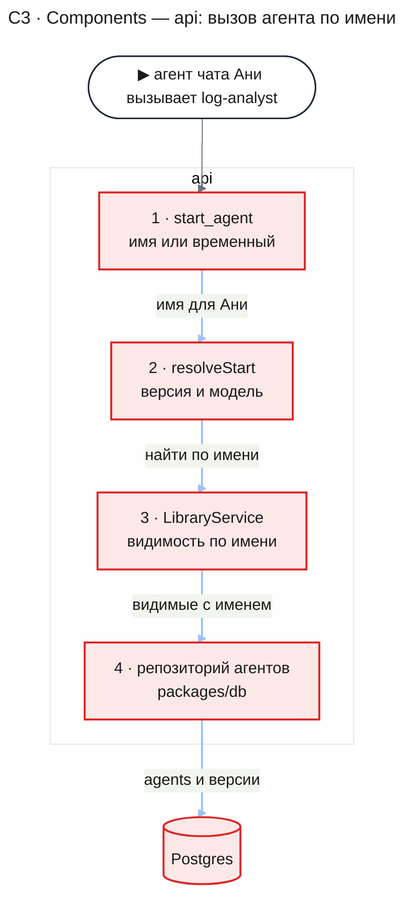
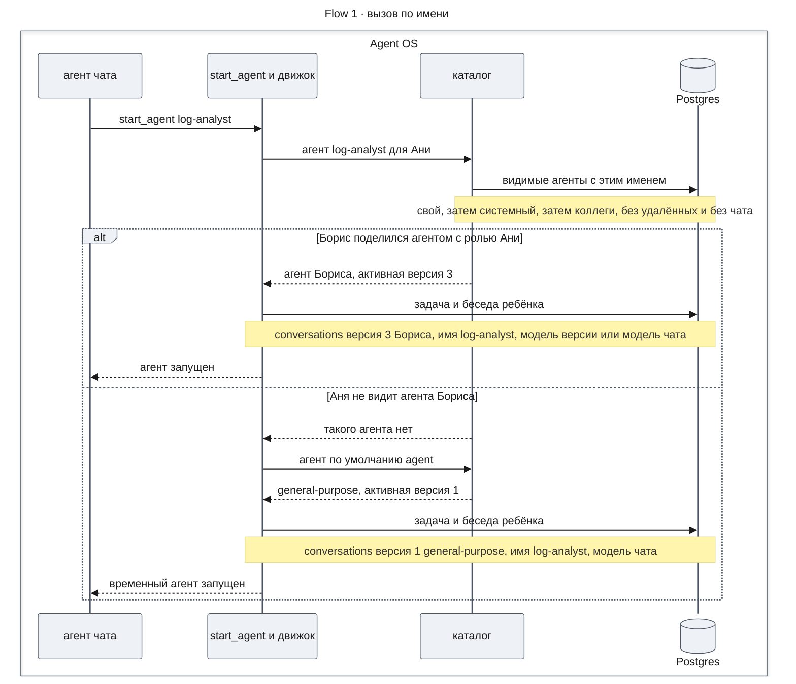
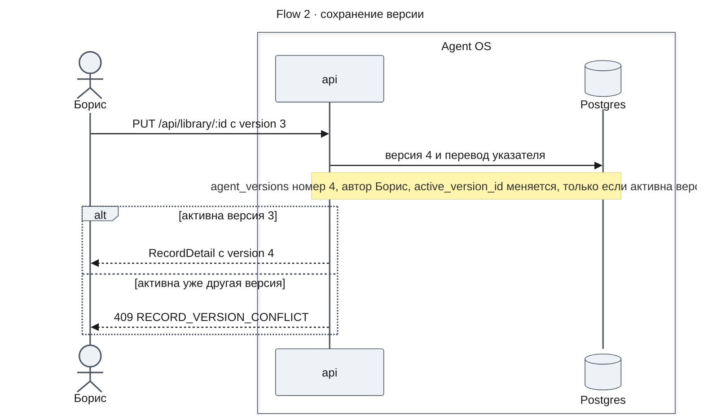
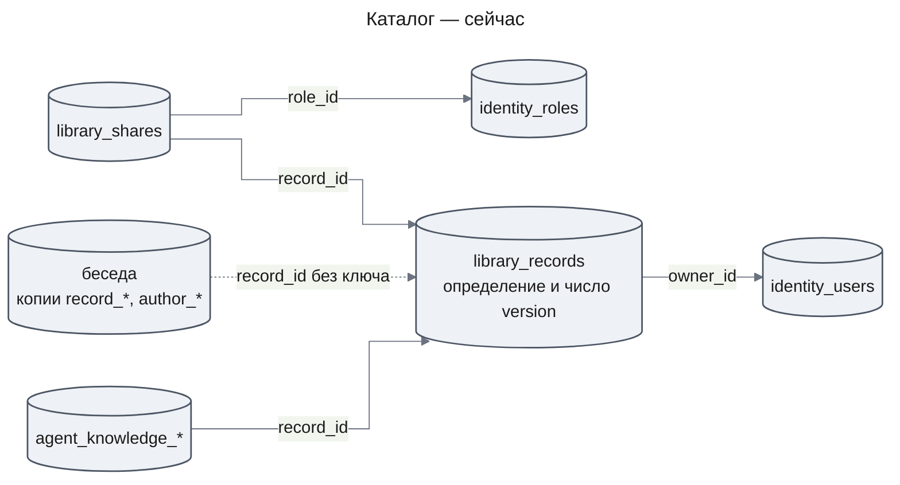
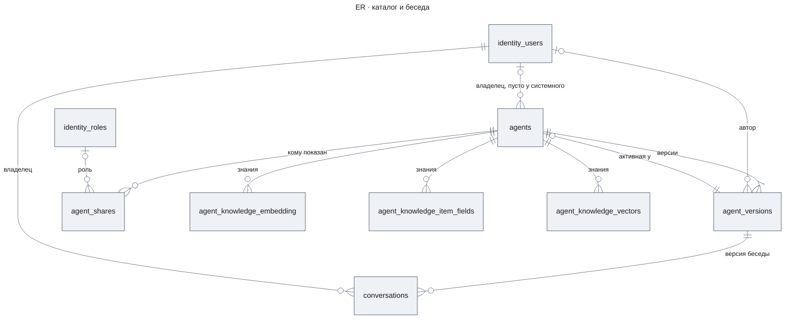

# Модель данных — Design Document — agents

**Status:** Approved · **Date:** 2026-11-23 · **PRD:** нет (требования владельца R1, R4–R6, R10, R13, R17–R21, см. «Part») · **UXRD:** нет · **Depends on:** [design-schema.md](design-schema.md)

## Snapshot

**Overview.** Агент из каталога сегодня — одна строка, которую каждая правка переписывает на месте, а беседа агента копирует его определение в три места. После части агент — строка `agents` (имя, владелец, кому показан), а его определение — неизменные версии `agent_versions`; агент указывает на активную версию. Беседа ссылается на версию, с которой стартовала, и на ней остаётся, сколько бы агента ни правили. Агент вызывает другого агента по имени: если сотрудник видит агента с этим именем, запускается его активная версия, иначе — временный агент, то есть агент по умолчанию своего типа под этим именем и с этим заданием. Агенты по умолчанию — по одному на тип задачи — создаёт миграция; модель беседы берётся из версии агента, затем у родительской беседы, затем из системной настройки.

- **Не меняется**: маршруты API каталога и их ответы, веб (кроме имени нового агента по умолчанию), права на модели и инструменты, таблицы знаний.
- **Меняется для сотрудника**: агент, у которого не задана модель, работает на модели родительской беседы, а не на системной модели по умолчанию (R19); чат и агенты запускают любого видимого агента, а не только предложенного в чате или названного в списке агента (R21); неизвестное имя запускает временного агента вместо отказа.
- **Главный риск**: сабагенты `deep-research` без своей модели начинают работать на модели глубокого агента (`anthropic/claude-sonnet-5-5`), и ресерч дорожает (см. «Risks and Mitigation»).
- **Open questions**: нет.

### Key Decisions

#### KD-1: Агент — строка `agents`, его определение — неизменные строки `agent_versions`, агент указывает на активную

Обычный агент и глубокий агент лежат в одной таблице `agents` и различаются колонкой `kind` (`agent`, `deep_agent`). На строке агента живёт то, что меняется без правки определения: имя, описание, владелец, «предлагать в чате», запрет делиться, ключ агента по умолчанию, отметка удаления, указатель `active_version_id`. В версии живёт то, что агент делает: `content` той же формы, что сегодня (`AgentContentSchema`, `DeepAgentContentSchema`), — промпт, серверы, модель, лимит ходов, список агентов, инструменты, сабагенты, флажки. Указатель стоит под внешним ключом на пару «агент, версия», поэтому может назвать только версию своего агента.

Отвергнуто: имя и описание в версии — уникальность имени и вызов по имени шли бы через соединение с активной версией, а ещё не активная версия могла бы занять чужое имя; флаг «активна» на строке версии — неизменная строка получила бы изменяемую колонку.

#### KD-2: Номер версии растёт по агенту; сохранение сотрудника создаёт версию и делает её активной в одной транзакции

У версии номер `number`, следующий за наибольшим номером версий этого агента. Поле `version` во всех ответах и телах API каталога означает номер активной версии, а `RunOrigin.version` — номер версии, на которой идёт беседа. Сохранение (`LibrarySave.save`: сотрудник, администратор, карточка главного чата) делает две записи в одной точке сохранения: вставляет версию с автором и переводит указатель агента на неё вместе с именем и описанием — только если указатель ещё стоит на версии с номером из запроса. Иначе ответ прежний: 409 `RECORD_VERSION_CONFLICT`, у карточки чата `version_conflict`, и версия не остаётся. Смена аудитории, «предлагать в чате», запрет и снятие запрета пишут только строку агента и номер не меняют, как сегодня. Копия — новый агент с версией 1 из активной версии источника.

Состояний версии три, и колонки состояния нет: **создана** (на неё никогда не указывали), **активна** (на неё указывает агент), **прежняя** (была активной). Переводит указатель только сохранение; маршрута «сделать активной» в этой части нет (R20). В этой части активной становится всегда самая новая версия, поэтому сравнение «изменён после запуска» в вебе (активный номер больше номера беседы) остаётся верным. Будущий флоу переобучения (R18) использует те же две записи по отдельности: создаёт версию, проверяет её и потом переводит указатель.

Автор версии — `author_id`, сотрудник под внешним ключом; пусто, когда автор не человек (строки миграции). Флоу, когда его построят, добавит свою колонку автора с внешним ключом на свою таблицу. Отвергнуто: вид автора и текстовый id в одной паре колонок — ссылка без внешнего ключа, а R14 требует ключ.

#### KD-3: Модель агента — в версии; при старте беседа берёт модель версии, затем родителя, затем системную

Поле модели уже есть в определении: `model` у агента, у глубокого агента и у каждого сабагента, пусто — «не задана». Выбор места для владельца:

| | Модель в версии (рекомендуется) | Модель на строке агента |
|---|---|---|
| Смена модели | новая версия, как любая правка | меняет строку агента, версия та же |
| Идущие беседы | не меняются | не меняются |
| Новые беседы | берут модель активной версии | берут текущую модель агента |
| История версий | каждая версия знает свою модель; проверенная флоу версия запускается на той модели, на которой её проверили | версия не знает своей модели; откат или проверка версии идут на сегодняшней модели |
| Сабагенты | модель агента и сабагентов в одном месте | модель агента на строке, модели сабагентов в версии |

Идущие беседы не меняются в обоих вариантах, потому что модель решается один раз при старте и записывается в `conversations.model`. Документ построен на модели в версии. Отдельной колонки нет: модель остаётся полем `content`, как у сабагентов, а удаление модели из каталога не может обнулить поле неизменной версии.

Цепочка при старте: модель версии (у сабагента — модель сабагента); если пусто — модель родительской беседы; если родителя нет — системная модель (`chatModel` ключа `model_defaults`, читает `AccessService.defaultChatModel()`, контракт [design-schema.md, «Хранилище настроек»](design-schema.md#contract-definitions)); если пусто и там — отказ `model_not_configured`. У родителя модель есть всегда, поэтому этот отказ возможен только у корня. Как идёт цепочка на каждом пути старта, показывает таблица в «Старт: версия, имя и модель беседы».

Права не меняются: старт проверяет итоговую модель от имени владельца (`access.model`, затем готовность провайдера), каждый вызов модели проверяет её снова. Модель, унаследованная от родителя, проверяется так же: если право отозвали, ребёнок получает отказ с id модели и запись `access_denied`.

**Поведение меняется (R19)**: ребёнок, у агента которого модель не задана, работает на модели родителя, а не на системной модели по умолчанию. Это касается детей `start_agent`, временных агентов и сабагентов глубокого агента.

Отвергнуто: модель на строке агента — см. таблицу.

#### KD-4: Агенты по умолчанию — строки миграции встроенных строк; ключ агента равен типу задачи

Миграция встроенных строк ([design-schema.md, «Исходный набор миграций»](design-schema.md#contract-definitions)) создаёт трёх агентов по умолчанию, у каждого `builtin_key` равен типу задачи, и одну версию с номером 1 без автора:

- `chat` — главный чат Ани, корень каждой беседы (сегодняшняя запись `chat` с тем же id).
- `agent` — `general-purpose`, сегодняшний общий агент с тем же id; временные агенты — его запуски.
- `deep_agent` — новый нейтральный глубокий агент «Глубокий агент». Схема требует хотя бы одного сабагента, поэтому у него один: `researcher` собирает данные по одной части задания своими инструментами и отчитывается, до 10 запусков. Последнего сабагента нет — ответ пишет сам глубокий агент. Серверы — все (`*`) у обоих, модель не задана, задачи ведёт глубокий агент, список делегирования включён, самообучение выключено. Общий сабагент `general-purpose` код добавляет, как каждому глубокому агенту.

`deep-research` становится обычным системным агентом: та же миграция вставляет его без ключа, с долей «всем», и дальше администратор правит или удаляет его, как любого системного агента. Сидер `BuiltinRecordsSeeder` и определения `builtin-records.ts` удаляются; id агентов и версий — постоянные значения в миграции.

Агента по умолчанию видит каждый активный сотрудник — правило, которое сегодня есть только у чата, распространяется на все три ключа, поэтому временный агент запускается и у сотрудника без ролей. Администратор правит у агента по умолчанию имя, описание и определение (новая версия с автором-администратором); вид, ключ и аудиторию не меняет (`audience_fixed`), удалить не может (`builtin`). Правка `general-purpose` меняет будущие временные агенты, идущие беседы остаются на своей версии.

Строки проверяет тест: на новой базе каждый агент вместе с активной версией проходит `CreateRecordBodySchema`, каждому из трёх ключей соответствует ровно один агент, а `deep-research` лежит без ключа. Раньше то же проверял разбор на старте API; теперь сломанная строка ломает тест в CI, а не запуск сервера.

Отвергнуто: `deep-research` создаёт администратор вручную — новая база осталась бы без главного сценария; ключ у `deep-research` — по R17 он обычный агент.

#### KD-5: Вызов по имени: один порядок разрешения имени и временный агент для любого другого имени

Имя ищется без учёта регистра среди агентов нужного вида, которых видит владелец дерева, без удалённых и без чата. Если подходят несколько, побеждает свой агент сотрудника, затем системный, затем агент коллеги, созданный раньше всех (затем по id). Свой агент с одним именем у сотрудника один, системный — один (уникальность имён, «Contract Definitions»), поэтому порядок однозначен. Список агентов в описании инструмента показывает только победителя каждого имени, чтобы модель не увидела имя, которое запустит другого агента.

Правило 1 (R21) — вызывает чат или обычный агент (`start_agent`): запускается любой видимый агент с этим именем; «предлагать в чате» и список `agents` вызывающего решают только, кого показать в описании, и запуск не ограничивают. Правило 2 — вызывает глубокий агент (`task`): его список — команда, то есть сабагенты из его версии и общий `general-purpose`. Видимость здесь не проверяется: команду сотрудник получил вместе с глубоким агентом. Запускается член команды с этим именем.

Любое другое имя запускает временного агента. Временный агент — запуск агента по умолчанию своего типа: его активная версия, имя из вызова, задание из вызова. Как определение он нигде не хранится, как в Claude Code (R5). В `task` временный агент — запуск общего `general-purpose` команды под именем из вызова, и запуск засчитывается в его лимит запусков. Имя, которое видимый агент другого вида уже носит, не запускает временного агента: модель получает `not_allowed` с подсказкой, каким инструментом его запускать. Ответ на невидимое и на несуществующее имя одинаков — временный агент, — поэтому вызов не выдаёт, что у коллеги есть агент с таким именем.

Отвергнуто: id в аргументе, как сегодня — R4 требует имени; список `agents` у глубокого агента для правила 2 — новое поле и новая способность запускать агентов каталога, которых R21 не просит.

#### KD-6: Беседа ссылается на свою версию; определение хранится один раз — в версии

У каждой беседы есть `agent_version_id` — обязательная ссылка с внешним ключом на версию, на которой она стартовала. Пустой ссылки не бывает, потому что каждый путь старта, включая временный агент и корень чата, стартует с версии. Версия неизменна, поэтому она и есть снимок, который в Claude Code пишется в транскрипт: определение во вход задачи больше не копируется.

Сегодня снимок во входе задачи держит, кроме содержимого версии: решённые модели, строки агентов из списка `agents` на момент старта, происхождение (запись, вид, версия, имя, автор) и серверы самообучения сабагента. После части:

| Что | Где одна копия |
|---|---|
| Определение агента или сабагента | `agent_versions.content`; сабагент — член команды версии по имени `conversations.subagent` |
| Итоговая модель | `conversations.model` |
| Происхождение для вида (`RunOrigin`) | читается через ссылку: версия → агент → владелец |
| Строки агентов из списка `agents` | читаются на каждом шаге, как список чата сегодня: это витрина, а не право |
| Серверы самообучения сабагента | вычисляются из версии глубокого агента чистой функцией |
| Задание | первая запись истории беседы (`task`), как сегодня |

Вход задачи остаётся запросом старта: ссылка на версию, имя запуска, член команды, итоговая модель, задание, описание, ответвление, значок записи, поля ответа и id вызова, который запустил ребёнка (из него пишется `start_call_id` беседы). Из него один раз делается строка беседы: стартующий или первый шаг ребёнка ([design-schema.md, Flow 1](design-schema.md#flow-1-агент-чата-запускает-другого-агента)), а потом его читает только агент для полей ответа и значка. Колонка `prompt` беседы уходит: её читатели — перезапуск и вектор вопроса — берут задание из первой записи истории.

Отвергнуто: оставить снимок во входе задачи как единственную копию — содержимое версии хранилось бы дважды, а ссылка на версию без внешнего ключа нарушила бы R14.

#### KD-7: Удаление агента — отметка `deleted_at` на строке агента

По R7 (в сужении владельца: отметка — для бесед и агентов) агента не удаляют физически, и схема этого требует: беседы ссылаются на версии внешним ключом с запретом, а версия, на которой шла беседа, не исчезает. Удаление сотрудником, администратором или карточкой чата ставит `agents.deleted_at` и больше ничего не пишет. Удалённый агент отвечает как отсутствующий в каждом чтении каталога: видимость, панель, запреты, имена, проверка существования, поиск по имени. Индексы уникальности имени не считают удалённых, поэтому имя освобождается, как сегодня при физическом удалении. Доли остаются строками, но через удалённого агента их никто не видит. Запрет делиться (`closed_at`) — отдельный факт и не меняется. Беседы, которые уже идут, работают на своей версии до конца. Перезапуск такого агента отвечает `record_unavailable`, а карточка запуска в вебе показывает «недоступен», как сегодня для удалённой записи. Агента по умолчанию удалить нельзя, это держит и CHECK. Знания удалённого глубокого агента остаются (таблицы знаний вне части).

Отвергнуто: использовать `closed_at` как отметку удаления — это запрет делиться у агента сотрудника, его читает список запретов.

## Terms

- **каталог** — агенты, которых сотрудник видит в библиотеке и может запускать; маршруты `/api/library` и `/api/admin/library`.
- **агент** — строка `agents`: обычный агент или глубокий агент с именем и владельцем; системный агент владельца не имеет.
- **версия** — неизменная строка `agent_versions`: определение агента в момент сохранения.
- **активная версия** — версия, на которую указывает агент; по ней запускаются новые беседы и её показывает библиотека.
- **видимость** — правило каталога, кого из агентов видит сотрудник: своих, системных с долей на его роль, на него или на всех, коллег с долей на его роль, и агентов по умолчанию (`visibleTo` в `packages/db/src/repositories/library-records.repository.ts`).
- **агент по умолчанию** — системный агент с ключом, равным типу задачи: `chat`, `agent`, `deep_agent`.
- **временный агент** — запуск агента по умолчанию под именем и с заданием из вызова; как агент нигде не хранится.
- **команда глубокого агента** — его сабагенты и общий `general-purpose`, которых он запускает инструментом `task`.

## Part

PRD по решению владельца нет: требования — список владельца для фичи `data-model`, и этот документ — их дом для этой части:

- **R1** — одна таблица `agents` для обоих видов; версии — отдельные неизменные строки; агент указывает на активную; идущая беседа остаётся на своей версии.
- **R4, R21** — агент вызывает агента по имени; правило 1 для чата и обычных агентов, правило 2 для глубоких.
- **R5** — временный агент не хранится как сущность.
- **R6, R17** — агенты по умолчанию по одному на тип задачи создаёт миграция; нейтральный глубокий агент по умолчанию; `deep-research` — обычный агент каталога.
- **R7 для агентов** — удаление агента — отметка (R7 в сужении владельца относится к беседам и агентам; беседы — часть `schema`).
- **R10 для `library_*`** — таблицы `agents`, `agent_versions`, `agent_shares`.
- **R13 для снимка агента** — определение хранится один раз.
- **R18** — автор версии — сотрудник или флоу; создать версию и сделать её активной — разные шаги; сохранение сотрудника делает оба.
- **R19** — у беседы всегда есть модель; цепочка «агент → родитель → система».
- **R20** — версии в вебе не показываются.

Как часть следует Claude Code: временный агент — запуск встроенного общего агента с заданием из вызова, а не новая сущность; запуск определённого и временного агента хранятся одинаково и различаются только значениями полей; агент вызывается по имени; ответвление копирует историю родителя. Где часть отличается намеренно: у определений есть версии, и беседа закреплена за неизменной версией, а не за копией промпта в транскрипте; имена уникальны в пределах владельца, поэтому нужен порядок разрешения имени (KD-5).

- **Prerequisite ADRs**: [ADR-0016](../../adr/ADR-0016-library-records-and-visibility.md) (каталог в `apps/api` за портом, одна процедура видимости), [ADR-0017](../../adr/ADR-0017-run-snapshots-from-library.md) (одна процедура старта), [ADR-0021](../../adr/ADR-0021-deep-agent-record-kind.md) (глубокий агент — вид записи, сабагенты внутри определения), [ADR-0022](../../adr/ADR-0022-one-database-and-nestjs-modules.md).

**Out of scope**

- Флоу переобучения, маршрут «сделать версию активной», показ версий и истории в вебе (R18, R20).
- Таблицы знаний `agent_knowledge_*`: меняется только цель внешних ключей `record_id` на `agents.id`.
- Код ошибок, маршруты и тела API каталога, `RunOrigin`, `AgentView` — форма та же.
- Снятие отметки удаления агента: маршрута восстановления нет.

**Constraints**

- Без обратной совместимости и переноса данных: схема меняется в том же исходном наборе миграций, базы создаются заново (root `CLAUDE.md`, [design-schema.md, KD-7](design-schema.md#kd-7-миграции--один-сгенерированный-исходный-набор-что-генератор-не-умеет-лежит-в-своих-custom-миграциях)).
- Веб не меняется (R20): числа `version` в ответах растут с каждым сохранением, как сегодня (KD-2).
- Права и изоляция: поиск по имени идёт той же процедурой видимости, что маршруты каталога (ADR-0016); чужой невидимый агент неотличим от отсутствующего (KD-5).

## Building-block Inventory

Follows the [code system](../../code-system/README.md).

| Building block | Pattern | Status | Note |
|---|---|---|---|
| Репозиторий агентов (сегодня `LibraryRecordsRepository`) | [auth-boundary.md](../../code-system/patterns/auth-boundary.md), [repository-over-transaction.md](../../code-system/patterns/repository-over-transaction.md) | extended | видимость с агентами по умолчанию и без удалённых, поиск по имени, вставка версии и перевод указателя |
| `LibraryService`, `LibrarySave`, `LibraryRecords`, `LibraryPanelService`, `LibraryChatService` | [repository-over-transaction.md](../../code-system/patterns/repository-over-transaction.md) | extended | сохранение — версия и указатель, удаление — отметка |
| Порт `RecordLibrary` | [port-module-split.md](../../code-system/patterns/port-module-split.md) | extended | поиск по имени и агент по умолчанию по ключу (Contract Definitions) |
| `resolveStart` | [run-snapshot.md](../../code-system/patterns/run-snapshot.md) | extended | возвращает версию, имя запуска и модель вместо снимка; знает модель родителя |
| `start_agent`, `start_deep_agent`, `task` | [tool-declaration.md](../../code-system/patterns/tool-declaration.md) | extended | имя вместо id, временный агент |
| Строки агентов по умолчанию | [builtin-record.md](../../code-system/patterns/builtin-record.md) | extended | лежат в миграции встроенных строк; сидера нет |

Искал отдельный механизм для временного агента и не нашёл: ближе всего общий агент `general-purpose` и общий сабагент глубокого агента (`delegationTeam` в `packages/agents/src/deep/deep-definition.ts`), и часть строит временный агент на них.

## Acceptance Criteria

Каждый подраздел называет требование владельца. Номера продолжают `DC-1`–`DC-15` части `schema`.

### R1, R18, R20: агенты и версии

- Сохранение агента создаёт новую версию с номером на один больше наибольшего, с автором-сотрудником, и делает её активной; прежние версии не меняются; библиотека отдаёт активную версию и её номер как `version` (DC-16).
- Сохранение с номером, который уже не активен, отвечает 409 `RECORD_VERSION_CONFLICT` и не оставляет ни версии, ни изменений агента (DC-17).
- Идущая беседа после сохранения агента работает на своей версии; новая беседа стартует на новой; `RunOrigin.version` идущей беседы меньше `version` агента в библиотеке (DC-18).

### R19: модель беседы

- Беседа ребёнка, у агента которого модель не задана, получает модель родительской беседы; корень — системную модель; корень без системной модели получает отказ `model_not_configured` (DC-19).
- Унаследованная модель, на которую у владельца нет права, даёт ребёнку отказ `model_not_allowed` и одну запись `access_denied` (DC-20).

### R6, R17: агенты по умолчанию

- Новая база содержит по одному агенту на ключи `chat`, `agent`, `deep_agent` и агента `deep-research` без ключа; каждый вместе с активной версией проходит схему своего вида (DC-21).
- Агента по умолчанию видит каждый активный сотрудник, в том числе без ролей; администратор правит его определение, но удалить или поделиться им не может (DC-22).

### R4, R5, R21: вызов по имени

- Чат или обычный агент, вызвавший имя видимого агента, запускает его активную версию, даже если агент не предложен в чате и не входит в список `agents` вызывающего (DC-23).
- Имя, которого владелец не видит или которого нет, запускает временного агента: беседа ссылается на активную версию `general-purpose` (у `start_deep_agent` — глубокого агента по умолчанию), носит имя из вызова, а в каталоге ничего не появляется (DC-24).
- Из нескольких видимых агентов с одним именем запускается свой, затем системный, затем самый ранний агент коллеги (DC-25).
- Глубокий агент, вызвавший `task` с именем не из команды, запускает общего сабагента под этим именем вместо отказа (DC-26).
- `start_agent` с именем видимого глубокого агента и `start_deep_agent` с именем видимого обычного агента отвечают `not_allowed` (DC-27).

### R10, R13: таблицы и одна копия определения

- Таблицы каталога называются `agents`, `agent_versions`, `agent_shares`; ключи знаний ссылаются на `agents` (DC-28).
- Вход задачи агента не содержит определения; у беседы нет колонок снимка и `prompt`; вид агента (`AgentView`) отдаёт ту же форму `RunOrigin`: `version` — номер версии беседы, `name` и `author` — текущие имя и владелец агента (DC-29).

### R7: удаление агента

- Удалённый агент отсутствует в библиотеке, панели и поиске по имени, его имя можно занять; идущая беседа доходит до конца; перезапуск отвечает `record_unavailable` (DC-30).

## Design

### Как часть встраивается в работу системы

Пример, на котором объясняется документ. Аня пишет в чат «разбери логи за ночь». Агент чата решает поручить это агенту `log-analyst`, которого написал её коллега Борис, и вызывает `start_agent` с этим именем. Если Борис поделился агентом с ролью Ани, запускается активная версия агента Бориса. Если не поделился, Аня его не видит: запускается временный агент `log-analyst` — общий агент `general-purpose` с заданием от чата.

Инструмент ищет имя до транзакции шага (`prepare`), как сегодня ищет запись по id. `resolveStart` получает модель вызывающего и решает модель ребёнка по цепочке (KD-3). `LibraryService` отвечает за порт `RecordLibrary` и ищет имя той же процедурой видимости, что маршруты каталога. Беседу ребёнка пишет транзакция шага чата, как в [design-schema.md, Flow 1](design-schema.md#flow-1-агент-чата-запускает-другого-агента), только вместо снимка она получает ссылку на версию.

C1 и C2 не рисуются: люди, внешние системы, процессы и база те же.

### Runtime Flows

#### Flow 1: агент чата вызывает агента по имени

**Starts when:** шаг агента чата Ани вызывает `start_agent` с именем `log-analyst`, for DC-23, DC-24, DC-25

Обе ветки пишут одно и то же: задачу и беседу ребёнка в транзакции шага чата; в каталоге временный агент ничего не оставляет. Если `log-analyst` оказался глубоким агентом, который Аня видит, инструмент ничего не пишет и отвечает `not_allowed` с подсказкой про `start_deep_agent`. Ответ модели одинаков для невидимого и несуществующего имени.

#### Flow 2: Борис сохраняет агента, пока беседа Ани идёт на прежней версии

**Starts when:** Борис сохраняет `log-analyst` в библиотеке, а беседа Ани с ним ещё работает, for DC-16, DC-17, DC-18

При конфликте точка сохранения откатывается, и версии 4 не остаётся. Беседа Ани ссылается на версию 3 и читает её определение на каждом шаге, поэтому сохранение её не задевает; её карточка в вебе показывает «изменён после запуска», потому что 4 больше 3.

### Старт: версия, имя и модель беседы

Таблица показывает, с какой версии стартует каждый путь, какое имя носит беседа и как идёт цепочка модели (KD-3).

| Путь старта | Версия беседы | Имя беседы | Модель |
|---|---|---|---|
| корень беседы (`StartOperations.start`) | активная версия агента `chat` | имя агента | модель версии → системная → `model_not_configured` |
| `start_agent`, видимый агент | его активная версия | имя агента | модель версии → модель вызывающего |
| `start_agent`, временный | активная версия `general-purpose` | имя из вызова | модель версии → модель вызывающего |
| `start_deep_agent`, видимый или временный | активная версия найденного глубокого агента или `deep_agent` | имя агента или из вызова | модель версии → модель чата |
| `task`, член команды | версия глубокого агента; `subagent` — имя члена | имя члена | модель сабагента → модель глубокого агента |
| `task`, временный | версия глубокого агента; `subagent` — `general-purpose` | имя из вызова | модель глубокого агента |
| ответвление (`fork`) | версия вызывающего | имя вызывающего | модель вызывающего |
| перезапуск агента или корня | активная версия того же агента сейчас | имя перезапущенной беседы | цепочка с тем же родителем |
| перезапуск сабагента или ответвления | версия перезапущенной беседы | то же | модель перезапущенной беседы |

Перезапуск агента, которого владелец больше не видит или который удалён, отвечает `record_unavailable`, как сегодня. Сабагент стартует без нового обращения к каталогу и без новой проверки прав на модель при старте, как сегодня: модель проверяет каждый её вызов.

### Contract Definitions

**Таблицы каталога** (для `packages/db`, `apps/api`, `packages/agents`)

- `agents` — строка на агента. `kind` — `agent` или `deep_agent`, не меняется. `owner_id` — сотрудник или пусто у системного агента. `builtin_key` — только у системного агента и только `chat`, `agent`, `deep_agent`. `closed_at` — только у агента сотрудника. `deleted_at` — отметка удаления; у агента с ключом её нет. `active_version_id` — указатель на версию этого же агента; у сохранённого агента задан всегда: пустым он бывает только внутри транзакции, которая вставляет агента и его первую версию.
- Пустой `agents.owner_id` — явное исключение из правила владельцев ([design-schema.md, «Владельцы и внешние ключи»](design-schema.md#contract-definitions)): там пустой владелец означает работу платформы, а здесь — системного агента, как сегодня у `library_records.owner_id`.
- Имя уникально без учёта регистра среди неудалённых агентов одного сотрудника и среди неудалённых системных агентов; сотрудник не берёт имя системного агента (правило сохранения, как сегодня). Имя `fork` занято за ответвлением: сохранение его отклоняет, как отклоняет `general-purpose` для сабагента.
- `agent_versions` — неизменная строка: агент, номер (уникален у агента), `content` по схеме вида агента, `author_id` или пусто, время создания. Строки не обновляются и не удаляются.
- `agent_shares` — как `library_shares`, ссылка `agent_id` вместо `record_id`; правило «ровно один держатель» и уникальность держателя прежние.

**Беседа** (дополняет [design-schema.md, «Беседа»](design-schema.md#contract-definitions))

- `agent_version_id` — обязательная ссылка на версию, на которой стартовала беседа; не меняется.
- `name` — имя запуска: имя агента, члена команды или имя из вызова у временного агента; не меняется.
- `subagent` — имя члена команды у запуска сабагента (у временного — `general-purpose`), пусто у остальных.
- `model` — итоговая модель по цепочке KD-3; обязательна.
- `description`, `first_run` остаются; `prompt`, `record_id`, `record_kind`, `record_version`, `record_name`, `author_id`, `author_name`, `builtin_key` уходят.
- «Первый запуск» (`first_run`) считает беседы владельца с версиями того же агента; порядок списка чата — запуски каждого агента без сабагентов, ответвлений и корней, как сегодня.

**Происхождение для вида (`RunOrigin`, форма та же)**

- `recordId` — id агента версии беседы; `kind` — его вид; `version` — номер версии беседы; `name` — текущее имя агента; `author` — его владелец с текущим именем или пусто у системного; `builtinKey` — ключ агента; `subagent` — член команды.
- `AgentView.origin` корня остаётся пустым. Временный агент показывает происхождение `general-purpose` (или глубокого агента по умолчанию), а `AgentView.name` — имя из вызова; карточка запуска в вебе показывает это без изменений кода.

**Порт `RecordLibrary`** (объявлен в `packages/agents`, реализует `LibraryService`)

- Поиск агента по имени и виду от имени владельца: агент-победитель KD-5 с активной версией и её разобранным определением или ничего. Невидимый, удалённый и несуществующий ответ одинаков.
- Агент по умолчанию по ключу: агент и его активная версия; есть всегда.
- Поиск по id (перезапуск, значок записи в сообщении, знания) и список видимых остаются; ответ несёт id и номер активной версии.
- Определение версии по её id беседа читает без проверки видимости: видимость проверил старт, а версия неизменна.

**Инструменты модели**

- `start_agent`: аргументы `description`, `agent` — имя агента или `fork`, `prompt`. Описание перечисляет строки «имя (yours | by <автор> | system) — описание»: у корня — видимых своих и предложенных в чате агентов, как сегодня список чата; у обычного агента — агентов из его списка `agents`, прочитанных на этом шаге. Последняя строка говорит, что любое другое имя запускает временного агента. Отказы: `not_allowed` (имя видимого глубокого агента), `depth_limit`, отказы модели и провайдера с id модели. `record_unavailable` этот инструмент больше не возвращает.
- `start_deep_agent` (только корень, с карточкой брифа): аргумент `deepAgent` — имя глубокого агента; список глубоких агентов в описании; другое имя — временный глубокий агент; отказы `not_allowed` (имя видимого обычного агента) и отказы модели и провайдера.
- `task` (глубокий агент): `subagentType` — имя члена команды; другое имя — временный сабагент. Отказы `run_limit`, `depth_limit`, `invalid_arguments`; `not_allowed` больше нет.
- Имя в `agent`, `deepAgent` и `subagentType` проходит ту же схему, что имя записи (длина не больше `RECORD_NAME_MAX_LENGTH`, одна строка, без управляющих символов); иначе — `invalid_arguments`.
- Промпт главного чата в строке миграции говорит запускать агента по имени, а не по id; правила выбора агента (AC-15.5–AC-15.7) остаются.

**Миграция встроенных строк** (дополняет [design-schema.md, «Исходный набор миграций»](design-schema.md#contract-definitions))

- Четыре агента с постоянными id: `chat`, `general-purpose` (ключ `agent`), «Глубокий агент» (ключ `deep_agent`), `deep-research` без ключа с долей «всем»; у каждого версия 1 без автора. `chat`, `general-purpose` и `deep-research` сохраняют сегодняшние id и определения; меняется только текст правил чата про запуск по имени.
- `BUILTIN_NAMES` в `@agent-os/contracts` получает имя ключа `deep_agent` (ru «Глубокий агент», en «Deep agent») и теряет `deep-research`; веб показывает имя агента по умолчанию на языке страницы, как показывает имя чата.

### Data Model

#### Каталог сейчас

Сегодня агент — одна строка `library_records` с числом `version`, которое растёт при каждой правке; прежних определений нет. Беседа копирует происхождение без внешнего ключа, а удаление агента физическое.

#### Каталог после

#### Где живёт каждая колонка `library_records`

| Колонка сегодня | После | Почему |
|---|---|---|
| `id`, `kind`, `owner_id`, `builtin_key`, `created_at`, `updated_at` | `agents` | идентичность и владелец агента |
| `name`, `description` | `agents` | уникальность, вызов по имени, список (KD-1) |
| `offer_in_chat`, `closed_at` | `agents` | меняются без правки определения и номер не двигают |
| `content` | `agent_versions` | определение, неизменное в версии |
| `version` | `agent_versions.number` | номер версии; у агента — номер активной через указатель |
| — | `agents.active_version_id`, `agents.deleted_at` | указатель (KD-1) и отметка удаления (KD-7) |
| — | `agent_versions.author_id`, `created_at` | автор и время версии (KD-2) |

Индексы имени — два частичных уникальных, как сегодня, с добавленным условием «не удалён». У беседы индекс по владельцу и версии заменяет индекс по владельцу и записи: по нему идут «первый запуск» и счётчики списка чата, соединяясь с версией, чтобы взять агента.

#### Внешние ключи

| Ссылка | Правило удаления | Почему |
|---|---|---|
| `agents.owner_id` → сотрудник | каскад | правило владельцев ([design-schema.md, «Владельцы и внешние ключи»](design-schema.md#contract-definitions)); пусто — системный агент, исключение из этого правила (Contract Definitions, «Таблицы каталога») |
| `agents` (`id`, `active_version_id`) → `agent_versions` (`agent_id`, `id`) | запрет | указатель называет только свою версию |
| `agent_versions.agent_id` → агент | каскад | агентов не удаляют физически; правило для будущей чистки |
| `agent_versions.author_id` → сотрудник | обнуление | версия переживает автора, как `settings.updated_by` |
| `agent_shares.agent_id`, `role_id`, `user_id` | каскад | как у `library_shares` |
| `conversations.agent_version_id` → версия | запрет | версия, на которой шла беседа, не исчезает |
| `agent_knowledge_embedding`, `agent_knowledge_item_fields`, `agent_knowledge_vectors` `.record_id` → агент | каскад | меняется только цель ключа |

Без ключа остаются: `record_id` у `agent_knowledge_entities`, `agent_knowledge_relations`, `agent_knowledge_runs` (таблицы знаний вне части); id агентов в списке `agents` внутри `content` (элемент JSON, [design-schema.md, KD-5](design-schema.md#kd-5-каждая-ссылка-внутри-базы--внешний-ключ-исключения-названы-с-причиной)); `audit_events.object_id` (история). Записи аудита каталога сохраняют объект `library_record` и виды `library_*`: журнал аудита не меняется.

#### Порядок работы, при котором код собирается

1. Каталог на версиях: таблицы `agents`, `agent_versions`, `agent_shares`, репозиторий и сервисы каталога (сохранение — версия и указатель, удаление — отметка, видимость агентов по умолчанию), строки агентов в миграции встроенных строк и их тест; сидер и `builtin-records.ts` удаляются. Старт ещё работает на снимке, который строится из активной версии.
2. Беседа на версии: `conversations.agent_version_id` вместо колонок снимка и `prompt`, вход задачи без определения, агент читает определение версии, цепочка модели с моделью родителя, виды читают происхождение через ссылку. Снимок запуска (`RunSnapshot`) удаляется.
3. Вызов по имени: аргументы и описания `start_agent`, `start_deep_agent`, `task`, порядок имени, временные агенты, текст правил чата в строке миграции, имя `fork` в правилах сохранения.
4. Исходный набор миграций создаётся заново тем же способом, что в части `schema`; проверка миграций получает новые имена таблиц и ограничений.

После каждого шага код проверяют `lint` и `typecheck`; сквозные наборы идут в CI после шага 4.

#### Документы, которые часть делает неверными

Сборка обновляет их вместе с кодом; эта часть ничего из списка не правит. ADR-0016 и ADR-0017 меняет новый ADR (кандидаты — в ответе дизайнера).

- `docs/features/custom-agents/design-library.md`, `design-runtime.md` — одна строка на агента, сидер встроенных записей, запуск по id, снимок в задаче, пустая модель как системная.
- `docs/features/deep-agents/design-agent-types.md`, `design-task.md` — встроенный `deep-research`, снимки глубокого агента и сабагента, отказ `task` для имени вне команды.
- `docs/features/model-providers/design-core.md` — пустая модель записи как модель чата по умолчанию на старте.
- `docs/code-system/patterns/builtin-record.md`, `run-snapshot.md`, `auth-boundary.md`; `docs/code-system/packages/agents.md`, `api.md`, `db.md`.

## Test Strategy

Тестов немного: права и изоляция при вызове по имени, временный агент, закрепление версии, модель, строки миграции, удаление. Большинство тестов каталога остаются и меняются под новые таблицы.

- **UC-1: вызов по имени и изоляция** — covers DC-23, DC-24
  - Given: у Бориса агент `log-analyst`, не предложенный в чате; Аня без доли на него.
  - When: агент чата Ани вызывает `log-analyst`; потом Борис делится агентом с ролью Ани, и вызов повторяется.
  - Then: первый раз беседа ребёнка стоит на версии `general-purpose` с именем `log-analyst`, промпта Бориса в ней нет, в каталоге не появилось агентов, список чата Ани имени Бориса не содержит; второй раз — на активной версии агента Бориса.
- **UC-2: порядок имени** — covers DC-25
  - Given: агент `report` у Ани, системный `report` и `report` коллеги, видимые Ане.
  - When: обычный агент Ани вызывает `report`; Аня удаляет своего, вызов повторяется.
  - Then: сначала запускается агент Ани, затем системный.
- **UC-3: команда глубокого агента и вид агента** — covers DC-26, DC-27
  - Given: глубокий агент с сабагентом `gather`.
  - When: он вызывает `task` с `gather` и с `summarize`; чат вызывает `start_agent` с именем этого глубокого агента.
  - Then: `gather` запускается членом команды, `summarize` — общим сабагентом под этим именем; `start_agent` отвечает `not_allowed`.
- **UC-4: закрепление версии** — covers DC-16, DC-17, DC-18
  - Given: беседа Ани идёт на версии 3 агента Бориса.
  - When: Борис сохраняет агента с новым промптом, затем ещё раз с `version` 3.
  - Then: следующий шаг беседы Ани передаёт модели промпт версии 3; новый вызов стартует на версии 4; `RunOrigin.version` — 3; повторное сохранение — 409, версии 5 нет.
- **UC-5: цепочка модели** — covers DC-19, DC-20
  - Given: чат Ани на системной модели A; агент без модели; у глубокого агента модель B и сабагент без модели.
  - When: чат запускает агента и глубокого агента, глубокий агент — сабагента; администратор убирает системную модель, Аня начинает беседу; у Ани отзывают право на A, и чат снова запускает агента.
  - Then: агент на A, сабагент на B; новая беседа получает `model_not_configured`; запуск после отзыва — отказ `model_not_allowed` и одна запись `access_denied`.
- **UC-6: строки миграции** — covers DC-21, DC-22, DC-28
  - Given: база из исходного набора.
  - When: тест читает агентов с активными версиями; сотрудник без ролей открывает библиотеку; администратор пытается удалить `general-purpose` и поделиться им.
  - Then: каждый агент проходит `CreateRecordBodySchema`, ключи `chat`, `agent`, `deep_agent` по одному, `deep-research` без ключа; сотрудник видит трёх агентов по умолчанию; удаление и доля отклонены.
- **UC-7: удаление агента** — covers DC-29, DC-30
  - Given: беседа Ани идёт на агенте Бориса.
  - When: Борис удаляет агента и создаёт нового с тем же именем; Аня перезапускает беседу.
  - Then: удалённого нет в библиотеке и поиске по имени, новый сохранён; беседа Ани доходит до отчёта, её вид показывает агента Бориса с версией беседы; перезапуск — `record_unavailable`; вход её задачи не содержит определения.

## Security Considerations

- **Authentication & Authorization**: поиск по имени идёт процедурой видимости каталога от имени владельца дерева, а не автора агента. Временный агент не читает определения невидимого агента, а ответ не различает невидимое и несуществующее имя. Права на модели и инструменты по-прежнему проверяются на старте и на каждом вызове; R21 снимает только ограничения запуска, а не права.
- **Input Validation**: имя из вызова — ключ поиска и имя запуска; оно проходит схему имени записи, поэтому не добавляет строк в описания инструментов и вывод `list_agents`. Строки миграции проверяет тест схемой вида (KD-4).
- **Sensitive Data Handling**: в версиях нет секретов; автор версии — id сотрудника.

## Risks and Mitigation

- **`deep-research` дорожает** — его сабагенты без своей модели теперь работают на модели глубокого агента `anthropic/claude-sonnet-5-5`, а не на системной модели. Высокая вероятность: это прямое следствие R19. Администратор задаёт сабагентам модель в панели; строки миграции не меняются, чтобы не вшивать id модели каталога, которого может не быть.
- **Значок записи на затенённом имени** — сотрудник выбирает в сообщении агента коллеги, а чат запускает по имени его собственного агента с тем же именем. Низкая вероятность: имена своих агентов уникальны, совпадение возможно только со своим или системным именем. Список чата не показывает затенённого агента, так что модель не обещает его.
- **Строка списка `agents` на каждом шаге** — у обычного агента с непустым списком каждый шаг читает видимых агентов. Цена — один запрос на шаг, как у списка чата сегодня.

## Update History

| Version | Date | Change |
|---------|------|--------|
| 1.0 | 2026-11-23 | Initial version |
