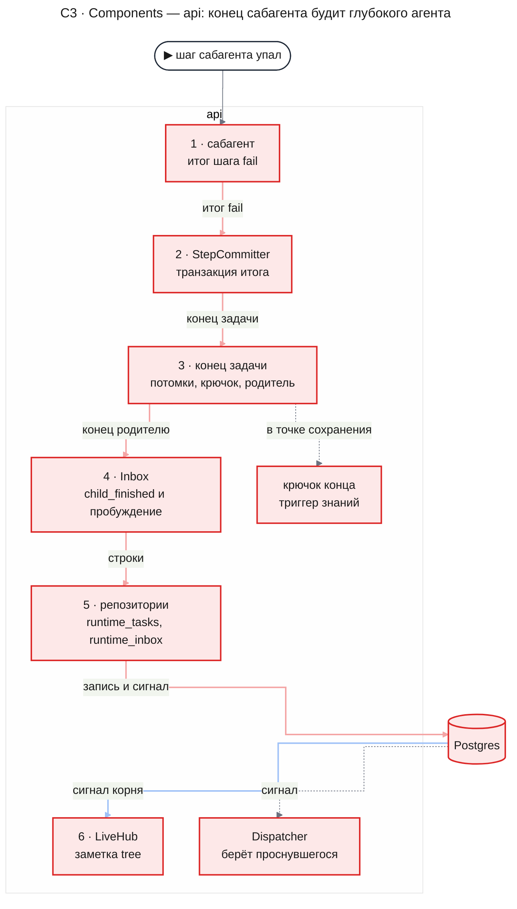
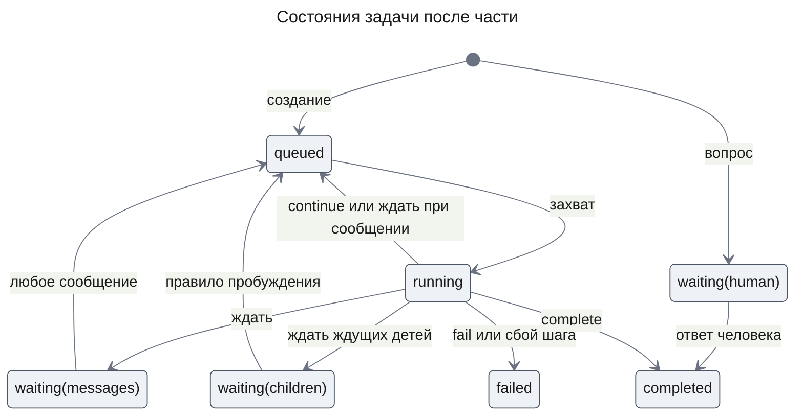
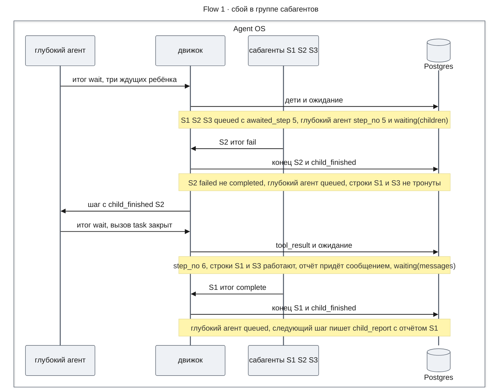
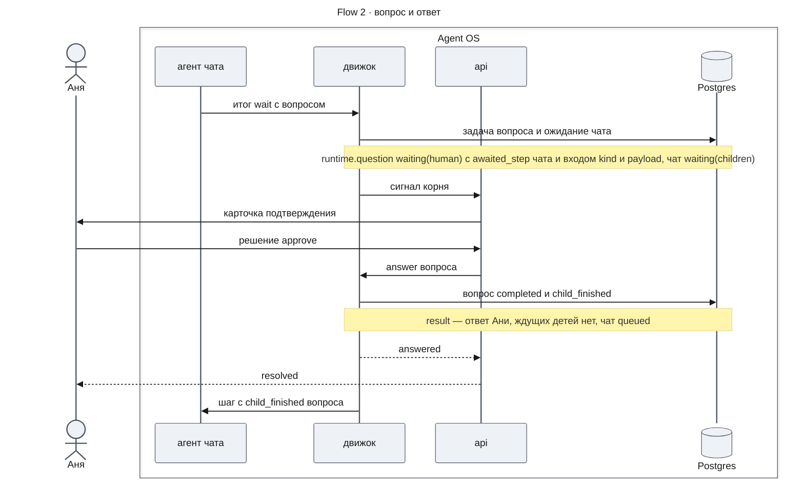
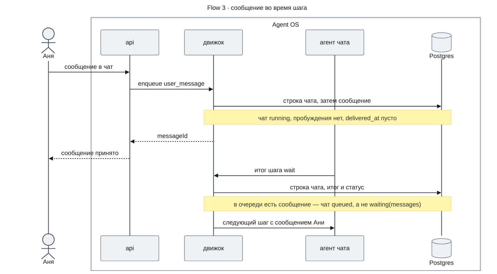
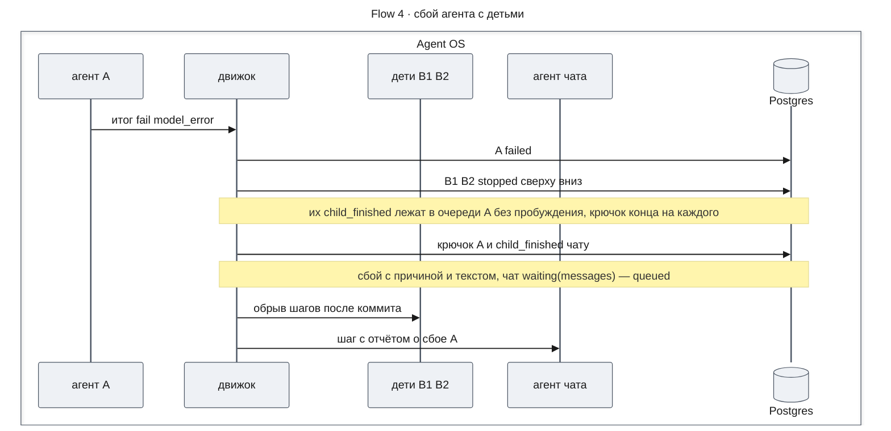
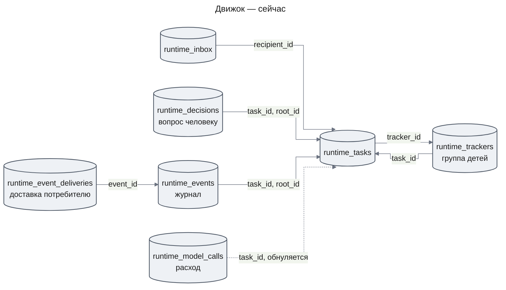
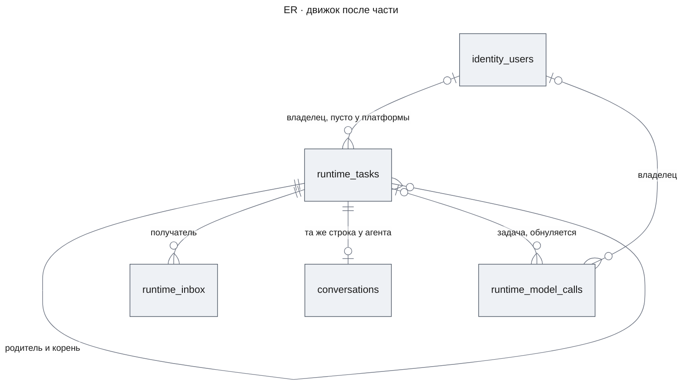

# Модель данных — Design Document — runtime

**Status:** Implemented · **Date:** 2026-11-23 · **PRD:** нет (решения владельца D1–D9 от 2026-11-23, см. «Part») · **UXRD:** нет · **Depends on:** [design-schema.md](design-schema.md), [design-agents.md](design-agents.md)

## Snapshot

**Overview.** Движок задач (`packages/runtime`) выполняет работу шагами: агент чата Ани, каждый его сабагент, вопрос Ане — это задачи, которые переживают перезапуск сервера. Сегодня движок держит семь таблиц: задачи, очередь сообщений, трекеры групп детей, запросы решений человека, журнал событий, доставки событий потребителям и журнал расходов на модели. После части у движка три таблицы — задачи `runtime_tasks`, очередь `runtime_inbox` и журнал расходов `runtime_model_calls`. Работу задач выражают первые две: ребёнок, которого родитель ждёт, помечен номером шага родителя `awaited_step`; вопрос человеку — задача особого типа, которую человек завершает своим ответом; конец каждого ребёнка — одно сообщение `child_finished` родителю, и сбой будит родителя сразу, с текстом ошибки. Журнала событий нет: изменение видно по одному сигналу `pg_notify` с id корня, а история работы — в логах. Журнал расходов не меняется: агенты сообщают в него расход каждого вызова модели.

- **Не меняется**: маршруты API и тела ответов для веба, включая `POST /api/decisions/:decisionId` и список подтверждений беседы; права, квоты и изоляция сотрудников; журнал расходов `runtime_model_calls` и `TokenLedger`; таблицы знаний и флоу самообучения (меняется только то, как его запускает конец задачи).
- **Меняется для сотрудника**: упавший сабагент глубокого агента сообщает о сбое сразу, а не когда закончится вся группа, и модель получает текст ошибки, а не только её код; модель сама решает, ждать ли остальных, запустить ли работу заново или остановиться. Инструмент, который бросил неожиданное исключение, больше не роняет агента: вызов закрывается ошибкой инструмента, и агент продолжает. Упавший агент останавливает своих детей в той же транзакции, а не после доставки события.
- **Главный риск**: после пробуждения сбоем глубокий агент может запустить работу заново, пока прежние сабагенты ещё работают, и расход вырастет (см. «Risks and Mitigation»).
- **Open questions**: нет.

### Key Decisions

#### KD-1: У движка три таблицы: задачи, очередь и журнал расходов

Работу задач движок хранит в двух таблицах — задачи (`runtime_tasks`) и очередь сообщений (`runtime_inbox`) (D1). Обе сохраняют приставку `runtime_`: имя `tasks` спорило бы с `conversation_tasks` (список задач агента), а `inbox` стоит рядом с `messages` (история беседы) (D9). Трекеры, запросы решений, журнал событий и доставки удаляются вместе с репозиториями, сервисами, воркером доставки и контрактами.

Третья таблица, `runtime_model_calls`, — запись расходов, которую агенты сообщают движку: её пишет `TokenLedger.record` вне транзакции шага, и ни один код движка не зависит от неё, чтобы выполнять задачи. Она остаётся как есть, с тем же именем, файлом схемы и репозиторием (решение владельца: «агент просто сообщает расход обратно в runtime»). `ModelClient` и `AgentsEmbeddings` в `packages/agents` пишут через `record`; `AccessService` и `AgentControlService` в `apps/api` читают месячные суммы через `monthSpend` и `monthSpendByModel`.

#### KD-2: Конец ребёнка — одно `child_finished`; ожидание группы — номер шага `awaited_step` и правило пробуждения

Каждый конец задачи с родителем пишет родителю одно сообщение `child_finished`: id ребёнка, статус, результат завершённого, сбой упавшего с причиной и текстом, длительность (D4). Трекера, который глотал концы членов группы до последнего, нет.

Ребёнка, которого родитель ждёт, шаг создаёт с отметкой `awaited_step` — номером шага родителя после коммита, который этого ребёнка создал. Коммит шага пишет родителю `step_no` на один больше, чем было при захвате (`packages/runtime/src/steps/step-commit.ts`), и в той же транзакции создаёт детей, поэтому ребёнок хранит именно это новое значение. Итог «ждать» переводит родителя в `waiting` с причиной `children`. Ждущий ребёнок ждущего родителя — ребёнок, чей `awaited_step` равен текущему `step_no` родителя; у фонового ребёнка отметки нет. Такого родителя будит `child_finished` ждущего ребёнка, если ждущих незаконченных детей больше нет или если этот ребёнок закончился не `completed`. Любое другое сообщение остаётся в очереди и приходит в тот же шаг, что и пробуждение.

Пока родитель ждёт, его `step_no` не меняется: `step_no` пишет только коммит шага, задачу в `waiting(children)` захват не берёт, прерывание её не принимает, а сбой шага, возврат шага при остановке сервера и сборщик потерянных шагов `step_no` не трогают. Пробуждение ничего не снимает и строк детей не пишет. Первый же коммит проснувшегося родителя сдвигает его `step_no`, и оставшиеся работать дети прежней группы перестают совпадать сами — их `child_finished` будит родителя, только если тот ждёт сообщений. Так же не совпадает ребёнок, которого позже оживило сообщение. Подсчёт ждущих детей идёт после записи строки родителя, поэтому два ребёнка, которые кончаются одновременно, считают один за другим, и пробуждение одно.

`stopped` ждущего ребёнка будит родителя так же, как `failed`. Петли нет: остановка дерева идёт сверху вниз, родитель закончен раньше своих детей, а их `child_finished` без `revive` законченную задачу не будит. Остановка одного сабагента из веба будит его родителя, и модель видит, что сабагент остановлен.

Принцип владельца: «если сабагент или задача упали, в очередь ложится системная запись, и модель решает сама». Поэтому шаг глубокого агента после пробуждения сбоем закрывает открытые вызовы `task` сразу: строки законченных детей — с отчётом или текстом сбоя, строки работающих — словами «сабагент ещё работает, его отчёт придёт сообщением» (Contract Definitions, «Инструмент `task`»).

#### KD-3: Вопрос человеку — задача зарезервированного типа `runtime.question`

Вопрос — ребёнок спросившей задачи, которого не исполняет ни один обработчик (D5). Шаг задаёт вопрос через `effects.ask` в коммите: движок создаёт задачу типа `runtime.question` сразу в `waiting` с причиной `human`, с отметкой `awaited_step`, как у ждущего ребёнка, и входом `{kind, payload}`; итог «ждать» переводит спросившего в `waiting(children)`. Ответ человека — операция движка `TaskControl.answer`: она завершает вопрос `completed` с ответом в `result`, и ответ доходит до спросившего обычным `child_finished` по правилу KD-2. Остановка спросившего останавливает вопрос как любого потомка. Виды вопросов прежние: `agents.tool_confirmation`, `agents.brief`, `library.record`.

Список вопросов дерева — задачи этого типа из `TaskControl.listTree`: открытый вопрос — `waiting`, отвеченный — `completed`, отменённый — `stopped`. Поэтому ответ API для веба (`Confirmation`) не меняется: его `decisionId` — id задачи вопроса, `resolution` — её `result`, `resolvedAt` — `finished_at` отвеченного вопроса. Виды, которые перечисляют агентов дерева, задачи вопросов пропускают.

#### KD-4: Журнала событий нет; изменение видно по сигналу, история — в логах

Остаётся сигнал (D6): каждая запись, которая меняет статус задачи или её очередь, отправляет в своей транзакции `pg_notify` на канал `runtime_tree` с id корня. Postgres отправляет уведомления при коммите и сливает одинаковые уведомления одной транзакции в одно, поэтому дерево получает один сигнал на транзакцию. Слушают его, как сейчас, `LiveHub` (`apps/api/src/chat/live-hub.ts`): он шлёт владельцу корня заметку `tree`, и веб перечитывает вид по REST; и `Dispatcher`: сигнал будит его цикл раньше опроса. Событие верхнего слоя `agents.history_appended` уходит: история агента пишется только в коммите шага, а коммит меняет статус и посылает сигнал сам.

Каждое место, которое писало событие, пишет запись лога с идентификаторами (таблица «Логи вместо событий»). Запись о том, что сделала транзакция, пишется после её коммита, чтобы лог не называл записи отката.

#### KD-5: Что делали потребители событий, делает конец задачи

Потребителей событий было два, и оба переезжают в конец задачи (`endTask`, `packages/runtime/src/tasks/task-end.ts`), через который идёт каждый конец (D7):

- **Правило движка: упавшая задача останавливает своих незаконченных потомков в той же транзакции.** Остановка идёт той же процедурой, что `TaskControl.stop`, сверху вниз; шаги остановленных потомков в этом процессе обрываются после коммита, и их объекты отпускаются. Потребитель `packages/agents/src/events/stop-children-on-failure.ts` удаляется.
- **Крючок конца задачи.** Верхний слой регистрирует его в `onModuleInit`; движок зовёт его в транзакции конца, в точке сохранения (`Db.savepoint`). Упавший крючок откатывает только свои записи, пишется в лог и конец задачи не отменяет. Триггер знаний `packages/agents/src/knowledge/knowledge-trigger.ts` становится таким крючком; решение `triggerDecision` и таблицы знаний не меняются. Id события триггер не хранит, а время события (`createdAt`) заменяет `finished_at` задачи: оба — время транзакции конца.

#### KD-6: Сбой доходит до модели текстом; исключение инструмента — ошибка вызова, а не сбой агента

Запись `child_report` и текст ошибки инструмента `task` несут `failure.message`, а не только код причины (D8). Модель получает этот текст после `failureTextOf` (`packages/agents/src/failure-text.ts`): секреты замаскированы, затем текст обрезан до 1 000 знаков. Текст любой ошибки — для `failure.message`, ошибки инструмента и сохранённых ошибок — даёт `errorText` (`packages/common`): у упавшего запроса к базе это сообщение Postgres, без текста запроса и его параметров.

Инструмент, который бросил неожиданное исключение внутри агента, закрывает свой вызов с исходом `tool_error` и текстом ошибки; ошибка целиком пишется в лог, агент продолжает. Инструмент, который работает в транзакции коммита, исполняется в точке сохранения коммита `effects.savepoint`. Его исключение откатывает его записи и всё, что он успел сделать через `effects`: созданных и переданных детей (`spawn`, `adopt`), отправленные сообщения, вопрос и счёт ждущих детей. Поэтому коммит не считает ребёнка, строки которого нет. Ошибка Postgres `40P01` и любая другая ошибка, после которой транзакция не может продолжаться, из точки сохранения не становится `tool_error`: она пробрасывается, и коммит шага повторяется целиком (KD-7). Нарушение правил движка (`invalid_step_result`), обрыв сигналом и отказ владельцу (`owner_disabled`) по-прежнему кончают шаг, как сейчас.

#### KD-7: Порядок взятия строк задач и повтор транзакции движка при взаимной блокировке

Транзакции движка блокируют строки задач охраняемыми `UPDATE` (ADR-0023), и одного полного порядка у них нет: остановка берёт строки сверху вниз (родитель, затем дети), конец ребёнка — снизу вверх (ребёнок, затем родитель ради `child_finished`), а агент может написать любой задаче своего дерева. Поэтому выбраны оба средства:

- **Порядок, который держит код.** Первая запись транзакции — строка задачи, ради которой она идёт: своя у шага, захвата, `guard`, сбоя и возврата шага; верхняя у остановки и удаления дерева; цель у прерывания; вопрос у ответа; получатель у сообщения вне шага; родитель у создания ребёнка вне шага. Дальше строки берутся только вниз по дереву уровень за уровнем, внутри уровня в порядке `task_id` (`listChildren`; остановка, удаление, потомки упавшей задачи), на один уровень вверх (родитель закончившейся задачи) и к получателю сообщения шага. Пробуждение родителя строк его детей не пишет (KD-2), поэтому одновременные концы братьев друг друга не блокируют: они только ждут строку родителя по очереди.
- **Повтор при взаимной блокировке.** Операция движка, которая сама открыла транзакцию, повторяет её после ошибки Postgres `40P01` (deadlock detected) до трёх раз; каждый повтор пишется в лог. Операция, которая вошла в транзакцию вызывающего, ошибку не ловит: откатывается вся транзакция вызывающего, и решает он. Коммит шага уже повторяет транзакцию трижды на любой неожиданной ошибке и остаётся таким. `ControlOperations.deleteRoot` перестаёт оборачивать `TaskControl.deleteTree` своей транзакцией, чтобы удаление повторялось.

Повтор безопасен: каждая транзакция движка охраняет записи статусом и попыткой, а действия вне базы (обрыв шага, отпуск объекта) идут после коммита. Postgres находит взаимную блокировку через `deadlock_timeout` (1 с по умолчанию) и откатывает одну из транзакций; вторая проходит. Решение записано в [ADR-0023](../../adr/ADR-0023-live-task-objects-one-stepping-process.md).

#### KD-8: Вход задачи агента — только то, чего нет в беседе

Строка беседы создаётся в той же транзакции, что задача агента, на каждом пути старта: `StartOperations.create` (корень и перезапуск), `createStartChild` (`start_agent`, `start_deep_agent`, ответвление) и запуск сабагентов `task` (`packages/agents/src/deep/task-delegation.ts`). Поэтому вход задачи агента (`AgentTaskInputSchema` в `packages/agents/src/store/sessions.ts`) теряет всё, что беседа уже хранит: версию, имя, члена команды, модель, описание, ответвление, id вызова старта, а задание и чип — первая запись истории. Во входе остаются только поля ответа `answerFields`. Запрос старта передаётся в `Sessions.ensureSession` аргументом, а `AgentFactory.restore`, перезапуск (`StartOperations`) и вид версии (`ViewOperations.version`) читают версию и члена команды из беседы. Ветка «агент без беседы — его первый шаг делает беседу» (`BaseAgent.startedState`) удаляется: задача агента без беседы — дефект, и её шаг падает с `handler_error`.

#### KD-9: Схемная миграция генерируется заново; база разработчика создаётся заново

Ничего не развёрнуто, поэтому сгенерированная миграция схемы `packages/db/src/migrations/0001_schema.sql` и её снимок в `meta/` удаляются и генерируются заново тем же способом, что в части `schema` ([design-schema.md, KD-7](design-schema.md#kd-7-миграции--один-сгенерированный-исходный-набор-что-генератор-не-умеет-лежит-в-своих-custom-миграциях)). Миграции расширения `0000_vector_extension.sql` и встроенных строк `0002_builtin_rows.sql` остаются: ни одна из них не называет удалённых таблиц. Разработчик удаляет свою базу, создаёт её заново и применяет набор (`pnpm db:migrate`); строки не переносятся.

## Terms

- **задача** — строка `runtime_tasks`: единица работы, которая выполняется шагами и переживает перезапуск сервера (агент, сабагент, вопрос, раунд знаний).
- **шаг** — один ход задачи: движок захватывает её, обработчик или объект задачи делает работу вне транзакции и возвращает итог, а движок фиксирует итог одной транзакцией.
- **итог шага** — что задача делает дальше: продолжить, ждать, завершиться, упасть.
- **очередь** — сообщения задаче в `runtime_inbox`: от сотрудника, от другого агента, команда прерывания и конец ребёнка. Сообщение ждёт, пока его не получит закоммиченный шаг.
- **ждущий ребёнок** — ребёнок, чей `awaited_step` равен текущему номеру шага родителя: родитель стоит в `waiting(children)` и ждёт его конца.
- **пробуждение** — перевод ждущей задачи в `queued`, после которого её возьмёт следующий шаг.
- **вопрос** — задача типа `runtime.question`, которая ждёт ответа человека: подтверждение вызова инструмента, бриф глубокого агента, сохранение записи каталога.
- **крючок конца** — функция верхнего слоя, которую движок зовёт в транзакции каждого конца задачи.
- **сигнал** — `pg_notify` с id корня дерева, по которому веб и цикл движка узнают, что дерево изменилось.
- **взаимная блокировка (deadlock)** — две транзакции ждут строки друг друга; Postgres откатывает одну из них с ошибкой `40P01`.

## Part

PRD по решению владельца нет: часть переделывает устройство движка. Её требования — решения владельца от 2026-11-23, и этот документ — их дом:

- **D1** — трекеры, решения, события и доставки удаляются; журнал расходов `runtime_model_calls` и `TokenLedger` остаются в движке без изменений (решение владельца от 2026-11-23 вместо переименования и переноса).
- **D2** — `runtime_tasks`: без `tracker_id`, `step_claims`, `next_message_seq`; новый `awaited_step` — номер шага родителя, который ждёт эту задачу (решение владельца от 2026-11-23 вместо флага `awaited` и его снятия при пробуждении); причины ожидания `messages`, `children`, `human`; признак потерянного шага — `recoveries > 0`.
- **D3** — `runtime_inbox`: без `sender`, `status`, `delivered_step` и нумерации по получателю; `seq` — порядок вставки, `delivered_at` — время доставки; виды `user_message`, `agent_message`, `interrupt`, `child_finished`.
- **D4** — один путь конца ребёнка и правило пробуждения.
- **D5** — вопрос человеку — задача.
- **D6** — журнала событий нет; сигнал и логи.
- **D7** — остановка потомков упавшей задачи и крючок конца задачи вместо потребителей.
- **D8** — текст сбоя доходит до модели; исключение инструмента — ошибка вызова.
- **D9** — таблицы движка сохраняют приставку `runtime_`.

Таблицы и контракты частей [schema](design-schema.md) и [agents](design-agents.md) эта часть меняет там, где их касаются D1–D9 (раздел «Документы, которые часть делает неверными»).

- **Prerequisite ADRs**: [ADR-0001](../../adr/ADR-0001-durable-runtime-owner.md) (движок на Postgres — единственный владелец задач, fencing по попытке), [ADR-0022](../../adr/ADR-0022-one-database-and-nestjs-modules.md) (одна база, репозитории в `packages/db`), [ADR-0023](../../adr/ADR-0023-live-task-objects-one-stepping-process.md) (один процесс шагов, охраняемые записи), [ADR-0024](../../adr/ADR-0024-every-reference-is-a-foreign-key.md) (каждая ссылка — внешний ключ).

**Out of scope**

- Таблицы знаний `agent_knowledge_*` и флоу самообучения: меняется только то, как триггер знаний получает конец задачи (KD-5).
- Маршруты API и тела ответов для веба, компоненты веба. Веб получает тот же `Confirmation`, `DelegationView`, `AgentStatus` и заметку `tree`.
- Журнал расходов: таблица `runtime_model_calls`, её репозиторий, `TokenLedger`, `monthOf` и их вызывающие не меняются.
- Отметка удаления и правило корня беседы — часть `schema`; версии агентов и вызов по имени — часть `agents`.

**Constraints**

- PoC без обратной совместимости: старые таблицы, контракты, типы и их тесты удаляются в том же изменении; базы создаются заново (root `CLAUDE.md`, KD-9).
- Движок общий и об агентах не знает (`packages/runtime/CLAUDE.md`): тип вопроса — тип движка, его виды (`kind`) и смысл ответа — верхнего слоя; крючок конца — порт без знания о знаниях.
- Каждый запрос к таблице — в `packages/db/src/repositories`; `pg_notify` отправляет метод репозитория задач.
- Логи — через обёртку логгера с идентификаторами, без секретов; текст сбоя в логе целиком, в тексте для модели — замаскированный и обрезанный (KD-6).
- Шаг может выполниться дважды после падения: каждая новая запись держится при повторе, повтор транзакции при взаимной блокировке — тоже (KD-7).

## Building-block Inventory

Follows the [code system](../../code-system/README.md).

| Building block | Pattern | Status | Note |
|---|---|---|---|
| `Tasks`, `StepCommitter`, `TaskControl`, `Inbox`, `endTask` | [step-handler.md](../../code-system/patterns/step-handler.md) | extended | `awaited_step` и правило пробуждения, вопрос, остановка потомков, крючок, сигнал, повтор при `40P01` |
| Репозитории `RuntimeTasksRepository`, `RuntimeInboxRepository` | [repository-over-transaction.md](../../code-system/patterns/repository-over-transaction.md) | extended | подсчёт ждущих детей по `awaited_step` и `step_no` родителя, сигнал, `delivered_at` |
| Реестр крючков конца задачи в `packages/runtime` | [step-handler.md](../../code-system/patterns/step-handler.md) — KD-5 | new | искал в каталоге и коде: ближе всего `HandlerRegistry` (регистрация в `onModuleInit`); он отдаёт обработчик по типу и одного на тип, а крючок зовётся на конце каждой задачи, поэтому реестр отдельный |
| Триггер знаний | — | extended | крючок конца вместо потребителя события |
| Инструмент `task`, `DeepAgent`, `ViewOperations`, `ControlOperations`, шаг инструментов | [tool-call-answer.md](../../code-system/patterns/tool-call-answer.md), [step-handler.md](../../code-system/patterns/step-handler.md) | extended | итоги детей из `child_finished`, вопросы — задачи |

Отдельного механизма «ждать группу» в коде, кроме трекера, нет; часть строит ожидание на отметке шага у ребёнка, номере шага родителя и существующем `child_finished`.

## Acceptance Criteria

Номера продолжают `DC-1`–`DC-31` частей `schema` и `agents`.

### D1, D2, D3, D9: таблицы

- В схеме из таблиц движка есть только `runtime_tasks`, `runtime_inbox` и `runtime_model_calls`; у `runtime_tasks` есть `awaited_step` и нет `tracker_id`, `step_claims`, `next_message_seq`; у `runtime_inbox` есть `delivered_at` и нет `sender`, `status`, `delivered_step` (DC-32).
- Признак «шаг продолжает потерянную попытку» (`resumedAfterLoss`) истинен в шаге, который захвачен после возврата задачи сборщиком потерянных шагов, и ложен после прерывания и после остановки сервера; прерывание без сообщения движок не принимает (DC-33).

### D4: конец ребёнка и пробуждение

- Каждый конец задачи с родителем оставляет в очереди родителя ровно одно `child_finished` с id, статусом, результатом у `completed`, причиной и текстом у `failed` и длительностью (DC-34).
- Родитель, который ждёт трёх детей, переходит в `queued` один раз — после конца последнего, и его шаг получает все три `child_finished`; два ребёнка, которые кончаются одновременно, будят его один раз (DC-35).
- Ждущий ребёнок, который упал или остановлен, будит родителя сразу, и строки остальных детей при этом не меняются; после следующего коммита родителя конец оставшегося ребёнка прежней группы приходит обычным `child_finished` и будит родителя, только если тот ждёт сообщений, — в том числе когда родитель уже ждёт новую группу (DC-36).
- Сообщение сотрудника, пришедшее родителю в `waiting(children)`, остаётся в очереди и приходит в шаг пробуждения (DC-37).

### D5: вопрос человеку

- Шаг, который задаёт вопрос, создаёт задачу `runtime.question` в `waiting(human)` с `awaited_step`, равным новому номеру шага спросившего, а сам переходит в `waiting(children)`; агент показан со статусом `awaiting_confirmation`, вид беседы показывает вопрос открытым (DC-38).
- Ответ на вопрос завершает его `completed` с ответом в `result`, будит спросившего, и его шаг получает ответ и запрос; второй ответ получает `already_resolved`; ответ на вопрос другого сотрудника — 404 `DECISION_NOT_FOUND`; остановка спросившего останавливает вопрос, и вид показывает его отменённым; сообщение задаче вопроса движок отклоняет (DC-39).

### D6: сигнал и логи

- Каждая закоммиченная транзакция, которая меняет статус задачи или её очередь, отправляет на канал `runtime_tree` одно уведомление с id корня; `LiveHub` шлёт владельцу корня заметку `tree` (DC-40).
- На прогоне, где шаг создаёт ждущего ребёнка, уходит в ожидание, получает сообщения, задаёт вопрос и где ребёнок падает, в логе есть записи из «Логи вместо событий» с их идентификаторами (DC-41).

### D7: конец задачи вместо потребителей

- Упавшая задача останавливает своих незаконченных потомков в транзакции своего конца; шаги потомков, идущие в этом процессе, обрываются; родитель упавшей получает `child_finished` с причиной и текстом. Остановка корня останавливает всё дерево и не ставит в очередь ни одной задачи (DC-42).
- Крючок конца получает каждый конец задачи один раз в транзакции конца; крючок, который бросил исключение, записан в лог, а конец задачи закоммичен; флоу самообучения создаёт раунд извлечения после конца глубокого агента, как прежде (DC-43).

### D8: текст сбоя для модели

- `child_report` упавшего ребёнка и текст ошибки инструмента `task` содержат текст сбоя с замаскированными секретами, обрезанный до 1 000 знаков; инструмент, который бросил исключение, закрывает вызов исходом `tool_error` с текстом ошибки, и агент делает следующий шаг (DC-44).
- Точка сохранения коммита, которая откатилась, не оставляет ни созданного в ней ребёнка, ни переданного объекта, ни ожидания этого ребёнка: родитель без других ждущих детей ждёт сообщений (DC-49).

### Остальное

- Операция движка, которая сама открыла транзакцию, после взаимной блокировки повторяет её до трёх раз; одновременные остановка родителя и конец его ребёнка оба доходят до согласованного состояния (DC-45).
- Вход задачи агента содержит только `answerFields`; у каждой задачи агента с момента её создания есть беседа (DC-46).
- Список делегирований глубокого агента (`GET /api/agents/:agentId/tasks`) показывает сабагентов его вызовов `task` с прежними статусами и ответами (DC-48).
- Сообщение с `revive`, которое получил упавший шаг, не возвращает задачу в `queued`: задача остаётся `failed`; новое сообщение с `revive` оживляет её (DC-50).

## Design

### Как часть встраивается в работу системы

Пример, на котором объясняется документ. Аня просит глубокого агента сравнить три поставщика. Глубокий агент одним вызовом `task` запускает трёх сабагентов — по одному на поставщика — и ждёт их. Второй сабагент падает: провайдер модели ответил ошибкой. Конец второго сабагента пишет глубокому агенту `child_finished` с текстом ошибки, и глубокий агент просыпается сразу, не дожидаясь двух других.

`StepCommitter` открывает транзакцию итога шага и зовёт конец задачи: финальный статус, остановка потомков упавшей задачи, крючок конца в точке сохранения, `child_finished` родителю. `Inbox` берёт строку родителя, вставляет сообщение и применяет правило пробуждения. Репозиторий задач отправляет сигнал в той же транзакции; после коммита `LiveHub` шлёт Ане заметку `tree`, а `Dispatcher` берёт проснувшегося глубокого агента. Шаг глубокого агента получает `child_finished` в контексте и закрывает вызов `task`.

C1 и C2 не рисуются: люди, внешние системы, процессы и база те же.

### Состояния задачи

Переходы, которых нет на схеме:

- **Остановка** ведёт в `stopped` из любого незаконченного состояния: `queued`, `running` и всех трёх `waiting`.
- **Сообщение с `revive`** возвращает законченную задачу — `completed`, `failed` или `stopped` — в `queued`; задача вопроса его не получает.
- **Прерывание** принимает только `queued`, `running` и `waiting(messages)` и всегда несёт сообщение `interrupt`: задача получает новую попытку (fencing), `recoveries` обнуляется, и задача остаётся или становится `queued`. `waiting(children)`, `waiting(human)` и законченная задача отвечают `not_active`.
- **Возврат потерянного шага** сборщиком: `running` → `queued` с `recoveries + 1`; после `RUNTIME_MAX_RECOVERIES` подряд — `failed` с `recovery_exhausted`.
- **Остановка сервера**: шаг, который не вернул итог за отведённое время, возвращается в `queued` без счёта потери, и `recoveries` обнуляется.

Инварианты:

- `waiting` ⇔ причина ожидания задана; `waiting(human)` бывает только у задачи вопроса, и задача вопроса бывает только в `waiting(human)`, `completed` или `stopped`.
- `awaited_step` пишется один раз, при создании ребёнка, и не меняется; у фонового ребёнка он пуст. `step_no` родителя меняет только коммит его шага, поэтому за всё время `waiting(children)` набор ждущих детей — тот, что создал последний коммит.
- У родителя в `waiting(children)` есть хотя бы один ребёнок с `awaited_step`, равным его `step_no`.
- Итог «ждать» с ждущими детьми этого коммита — всегда `waiting(children)`, даже если в очереди есть сообщения.
- Законченную задачу снова ставит в очередь только сообщение с `revive`; `child_finished` его никогда не несёт. Задаче вопроса сообщений не пишут.
- После коммита конца упавшей задачи у неё нет незаконченных потомков.
- Каждое сообщение очереди получает не больше одного шага. Коммит шага ставит `delivered_at` сообщениям, которые шаг взял при захвате; сбой шага (`failStep`, `failInvalid`) ставит им `delivered_at` в транзакции сбоя; сборщик, который кончает задачу с `recovery_exhausted`, ставит его всем ожидающим сообщениям задачи. Поэтому `revive` среди них не возвращает задачу в тот же сбой: упавшую задачу оживляет только новое сообщение.
- Сообщение законченной задаче без `revive` остаётся недоставленным, пока задачу не оживит другое сообщение.
- Захват не берёт задачу с `deleted_at`, даже если сообщение оживило её во время удаления дерева (`findReady`).

### Правило пробуждения

| Получатель | Сообщение | Что делает движок |
|---|---|---|
| `waiting(messages)` | любое | `queued` |
| `waiting(children)` | `child_finished` ждущего ребёнка, который закончился не `completed` | `queued` |
| `waiting(children)` | `child_finished` ждущего ребёнка `completed`, и ждущих незаконченных детей больше нет | `queued` |
| `waiting(children)` | любое другое, в том числе `child_finished` ребёнка прежней группы или фонового | ничего, сообщение ждёт |
| `queued`, `running` | любое | ничего: коммит шага увидит сообщение и поставит задачу в `queued` |
| законченная | с `revive` | `queued`, результат и сбой стёрты |
| законченная | без `revive` | ничего |

«Ждущий ребёнок» здесь — ребёнок, чей `awaited_step` равен текущему `step_no` получателя. Пробуждение меняет только строку родителя.

Сообщение вне шага (`Inbox.enqueue`) сначала берёт строку получателя охраняемым `UPDATE`, который меняет только время изменения, затем вставляет сообщение и применяет правило (D3). Коммит шага тоже начинается со строки своей задачи, поэтому сообщение и коммит идут один за другим: коммит, пришедший первым, оставил задачу ждать, и сообщение её будит; коммит, пришедший вторым, видит сообщение.

### Runtime Flows

#### Flow 1: группа ждущих сабагентов, один падает

**Starts when:** глубокий агент Ани вызывает `task` со списком из трёх поставщиков, for DC-34, DC-35, DC-36, DC-44

Конец S2 пишет его статус, крючок конца и `child_finished` с `failure: {reason, message}` в одной транзакции итога шага S2. Если S1 кончается одновременно с S2, обе транзакции берут строку глубокого агента одна за другой и пишут только свои строки и строку родителя, поэтому друг друга не блокируют, и пробуждение одно. После коммита шага пробуждения `step_no` глубокого агента — 6, и `awaited_step` 5 у S1 и S3 больше не совпадает: их концы будят его как концы фоновых детей. Если S1 к моменту пробуждения уже закончился, его `child_finished` ждал в очереди и приходит в тот же шаг: строка S1 в таблице ответа сразу несёт отчёт. Модель видит в тексте вызова причину и текст сбоя S2 и решает сама: ждать S1 и S3, запустить S2 заново или закончить.

#### Flow 2: вопрос человеку

**Starts when:** модель агента чата Ани вызывает инструмент, который требует подтверждения, for DC-38, DC-39, DC-40

Шаг инструментов пишет в коммите с вопросом запись истории `tool_confirmation` с id вызова и id вопроса. Следующий шаг находит среди сообщений `child_finished` этого вопроса, берёт ответ из `result`, а показанное Ане содержимое — из входа вопроса (`TaskControl.get`), и отправляет подтверждённый вызов один раз, как сейчас. Сообщения, которые пришли чату, пока он ждал, остаются в очереди и приходят в этот же шаг. Второй ответ находит вопрос законченным и получает `already_resolved`, ничего не меняя. Если Аня останавливает чат, остановка идёт сверху вниз и останавливает вопрос; вид показывает его отменённым.

#### Flow 3: сообщение сотрудника, пока модель работает

**Starts when:** Аня пишет в чат, пока идёт шаг модели агента чата, for DC-37, DC-40

Если коммит шага берёт строку чата раньше сообщения, чат уходит в `waiting(messages)`, и сообщение будит его своим правилом. Сообщение получает шаг, захваченный после него; коммит этого шага ставит сообщению `delivered_at`. Шаг, который потерян до коммита, сообщения не доставил: оно приходит в повтор шага.

#### Flow 4: агент падает, пока работают его дети

**Starts when:** шаг агента, у которого работают два фоновых ребёнка, кончается сбоем модели, for DC-34, DC-42, DC-43

Все записи — одна транзакция итога шага A; если она откатилась, ни A, ни его дети не изменились. Обрыв шагов B1 и B2 и отпуск их объектов идут после коммита, как после `TaskControl.stop`. Тот же путь проходит сбой шага, который назначает сам движок: исключение обработчика, предел времени шага, `invalid_step_result`, исчерпанные возвраты; сообщения упавшего шага уходят вместе со сбоем («Состояния задачи»). Шаг чата пишет `child_report` с причиной и текстом сбоя A.

### Contract Definitions

**Итог шага и записи коммита** (`packages/runtime/src/steps/step-contract.ts`, для `packages/agents` и любого обработчика)

- Итоги: `continue`, `wait`, `complete` с результатом, `fail` с причиной и текстом. `await_decision` нет.
- `wait`: если коммит создал ждущих детей или задал вопрос — `waiting(children)`; иначе при сообщении в очереди — `queued`; иначе `waiting(messages)`.
- `effects.spawn(child)` создаёт ребёнка в `queued` и сразу отдаёт его id; ждущий ребёнок (`awaited: true`) разрешён только при итоге `wait`, и движок пишет ему `awaited_step` — `step_no`, который этот коммит пишет родителю. Не больше 100 ждущих детей на коммит (прежний предел `TRACKER_MAX_TASKS`, имя константы — реализации); его по-прежнему проверяют правила `task` (`packages/agents/src/deep/delegation-rules.ts`). Нарушение — `invalid_step_result`.
- `effects.ask({kind, payload})` создаёт вопрос (KD-3) и отдаёт его id; только при итоге `wait`, не больше одного на коммит; `payload` не больше `INBOX_PAYLOAD_MAX_BYTES`.
- `effects.enqueue(message)` — сообщение задаче дерева: получатель, вид, данные, `revive`; без отправителя. Вид `child_finished` зарезервирован движком; сообщение задаче вопроса — `TASK_NOT_FOUND`.
- `effects.savepoint(fn)` исполняет `fn` в точке сохранения коммита и отдаёт `{ok, value}` или `{ok: false, error}`. Откат отменяет записи `fn` и всё, что `fn` сделала через `effects`: детей, переданные объекты, сообщения, вопрос и счёт ждущих детей. Ошибку, после которой транзакция не может продолжаться, `savepoint` пробрасывает, и коммит повторяется целиком; нарушение правил `effects` остаётся `invalid_step_result` (KD-6).
- `effects.adopt` не меняется. `effects.openTracker` и `effects.emit` удаляются.

**Контекст шага**

- `ctx.decision` удаляется: ответ на вопрос — `child_finished` вопроса в `ctx.messages`.
- Сообщение шага: id, `seq`, вид, данные, `revive`, время. Отправителя нет. `seq` — один счётчик на всю очередь, не номер у получателя: сообщения одного получателя идут в порядке `seq`, но их номера идут с пропусками.
- `resumedAfterLoss` — `recoveries > 0` у захваченной задачи.

**Сообщение `child_finished`**

- Данные: `taskId`, `status` (`completed`, `failed`, `stopped`), `result` только у `completed`, `failure: {reason, message}` только у `failed`, `durationMs` от создания ребёнка до конца. Пишет его только движок, без `revive`.

**Операции движка** (`TaskControl`, `Inbox`)

- `TaskControl.answer(questionId, ownerId, answer)` — ответ на вопрос в своей транзакции: `answered` — вопрос завершён `completed` с `answer` в `result`, и его конец прошёл правило KD-2; `already_answered` — вопрос уже отвечен или остановлен, ничего не записано. `TASK_NOT_FOUND` — вопроса нет, он другого сотрудника, из удалённого дерева или это не вопрос; `PAYLOAD_TOO_LARGE` — ответ больше `INBOX_PAYLOAD_MAX_BYTES`, ведь он идёт в `child_finished`.
- `TaskControl.interrupt(taskId, ownerId, message)` — сообщение обязательно; `not_active` для законченной задачи, `waiting(children)` и `waiting(human)`.
- `TaskControl.stop`, `deleteTree`, `create`, `get`, `listTree` и `Inbox.enqueue`, `Inbox.listPending` прежние; `stop` и `deleteTree` больше не отменяют запросы решений — вопросы останавливаются как потомки. Код ошибки `DECISION_NOT_FOUND` движок больше не отдаёт.
- `TaskControl.create` с вопросом в роли родителя отвечает `TASK_NOT_FOUND`: у вопроса не бывает детей.
- `Inbox.enqueue` не принимает сведений о законченном ребёнке, которые читает правило пробуждения: их пишет только конец задачи вместе с `child_finished`.
- Каждая операция, которая сама открыла транзакцию, повторяет её после `40P01` до трёх раз (KD-7).

**Тип вопроса**

- Тип `runtime.question` зарезервирован движком: обработчик с этим типом не регистрируется, `TaskControl.create` с ним отвечает `UNKNOWN_TASK_TYPE`, захват и сборщик его не видят.
- Вход: `kind` — вид вопроса верхнего слоя, `payload` — его данные. Результат: ответ, как его передал `answer`.

**Крючок конца задачи**

- Верхний слой регистрирует крючок в `onModuleInit` у сервиса движка, которого внедряет по классу. Движок зовёт каждый зарегистрированный крючок на каждом конце задачи — `completed`, `failed`, `stopped` — в транзакции конца, в своей точке сохранения, после записи статуса и остановки потомков и до `child_finished` родителю.
- Крючок получает id задачи, корня и родителя, владельца, тип, статус, сбой и `finishedAt`. Крючок не зовёт модель и сеть; он пишет строки через репозитории и может создать задачу `TaskControl.create`, которая входит в транзакцию конца.
- Исключение крючка откатывает его точку сохранения, пишется в лог с идентификаторами и именем крючка; конец задачи продолжается. Ошибка `40P01` и любая другая ошибка, после которой транзакция не может продолжаться, пробрасывается, и транзакция конца повторяется целиком (KD-7).

**Сигнал**

- Канал `runtime_tree` (константа движка вместо `RUNTIME_EVENTS_CHANNEL`), данные — JSON с одним полем `rootId`. Отправляет метод `RuntimeTasksRepository` в открытой транзакции при каждой записи статуса задачи, вставке задачи, вставке сообщения и отметке доставки. Других данных сигнал не несёт; `LiveHub` и `Dispatcher` слушают его, `LiveHub` разбирает `rootId`, как сейчас.

**Журнал расходов**

- `TokenLedger` (`record`, `monthSpend`, `monthSpendByModel`) и `monthOf` экспортирует `@agent-os/runtime`, как сейчас; запись идёт своим оператором вне транзакции шага.

**Агенты и их виды** (`packages/agents`, `apps/api`)

- **Инструмент `task`.** Шаг глубокого агента создаёт сабагентов вызова ждущими детьми, а id детей, как сейчас, пишет в `tool_sent` вызова. Шаг пробуждения закрывает каждый отправленный вызов по `child_finished` своих детей из `ctx.messages`: `completed` — отчёт, `failed` — «The subagent failed: `<reason>`: `<message>`.» с текстом сбоя после `failureTextOf` (KD-6), `stopped` — «The subagent was stopped.», ребёнок без `child_finished` в этом шаге — «The subagent is still running; its report will arrive as a message.». Список вызова получает таблицу с этими строками; задача списка, которую назвал вызов, становится `completed`, только если все его дети `completed`.
- **Отчёты детей.** `child_finished` превращается в запись `child_report`, кроме двух случаев: его ребёнок — вопрос, или его ребёнка закрыл вызов `task` в этом же шаге. `child_report` получает поле `message` — текст сбоя после `failureTextOf`, у остальных статусов пусто.
- **Последний сабагент.** Ответ последнего сабагента глубокий агент читает из его задачи (`TaskControl.get`), а не из трекера.
- **Делегирования** (`GET /api/agents/:agentId/tasks`). Строки — дети из `taskIds` всех `tool_sent` вызовов `task` агента в порядке вызовов; статус, ответ и причина — из задач дерева (`TaskControl.listTree`). Форма `DelegationView` прежняя.
- **Подтверждения.** `ViewOperations.confirmations` строит `Confirmation` из задач вопросов дерева (KD-3); форма прежняя. `ControlOperations.resolveConfirmation` проверяет правку аргументов по входу открытого вопроса, зовёт `TaskControl.answer` и отдаёт `resolved` или `already_resolved`; `TASK_NOT_FOUND` вопроса становится 404 `DECISION_NOT_FOUND`, как сейчас.
- **Статус агента.** `awaiting_confirmation` — агент в `waiting(children)`, у которого есть открытый вопрос.
- **Пропуск вопросов.** Виды и инструменты, которые читают дерево, берут только задачи агентов: `list_agents`, `message_agent`, `stop_agent`, подсчёт работающих детей шага модели (`childrenInFlight`), вход раунда знаний (`extraction-input.ts`), список агентов дерева. Операция над агентом по id вопроса отвечает `AGENT_NOT_FOUND`, как для отсутствующего агента (`packages/agents/src/operations/operation-support.ts`).
- **Ожидающие сообщения беседы** (`toPending` в `apps/api/src/chat/conversation-view.ts`) знают виды `user_message`, `agent_message`, `child_finished` и пропускают `interrupt` и `child_finished` вопроса.

### Логи вместо событий

Каждая запись — через логгер шага или сервиса движка, с полями `taskId`, `rootId`, `ownerId`, `type`, `stepNo`, `attempt`, когда они есть; пишется после коммита транзакции. Записи в кавычках уже есть и получают недостающие поля; записи с пометкой «новая:» добавляются, и их текст выбирает реализация.

| Было событие | Запись лога | Поля сверх общих |
|---|---|---|
| `task.created` | «task created» (вне шага); новая: ребёнок создан в шаге | id ребёнка, тип, глубина, `awaited_step` |
| `task.step_started` | «step started» | `messageIds`, `recoveries`, `resumedAfterLoss` |
| `task.step_committed`, `task.waiting`, `inbox.delivered` | «step committed» | итог, статус «было → стало», причина ожидания, доставленные сообщения (id и вид), созданные дети, id вопроса |
| `task.queued` | «step committed», «message enqueued», «lost step requeued…», «step requeued on shutdown», запись конца задачи | причина: шаг, сообщение, возврат, остановка сервера, `revive` |
| `task.interrupted` | «task interrupted» | статус «было → стало», id сообщения |
| `task.completed`, `task.failed`, `task.stopped` | новая: задача закончилась — на каждую законченную задачу | статус «было → стало», причина конца (шаг, остановка, ответ, сбой родителя, возврат, неверный итог, предел времени), `failure.reason` и `failure.message`, id `child_finished`, разбужен ли родитель, ожила ли задача, id остановленных потомков |
| `task.recovered` | «lost step requeued: no step of this process runs the task» | `recoveries`, потерянная попытка |
| `inbox.enqueued` | «message enqueued» (вне шага); сообщение шага — в «step committed» | id и вид сообщения, получатель, `revive`, статус получателя после |
| `decision.requested` | новая: вопрос задан | id вопроса, вид, id спросившего |
| `decision.resolved` | новая: вопрос отвечен — вместо «decision resolve answered» и «decision not resolved» | id вопроса, исход, id спросившего, разбужен ли он |
| `agents.history_appended` | шаговый лог агента (`logStep`) | последний `seq` истории |

Ещё две новые записи: повтор транзакции после взаимной блокировки (`warn`: операция, id задачи, номер попытки) и сбой крючка конца (`error`: имя крючка, id задачи, ошибка целиком). Текст сбоя в логе не обрезается; ответ вопроса и данные сообщений в лог не идут — только их id и вид.

### Data Model

#### Движок сейчас

#### Движок после

#### Таблицы после части

| Таблица | Что хранит | Пример |
|---|---|---|
| `runtime_tasks` | одну задачу: её тип, место в дереве, вход, статус, итог и счётчики шага | глубокий агент Ани в `waiting(children)`; три его сабагента с `awaited_step`, равным его `step_no`; вопрос «отправить заметку в инцидент?» в `waiting(human)` |
| `runtime_inbox` | сообщения задаче по порядку, пока шаг их не получил, и после — с временем доставки | сообщение Ани «и добавь цены»; `child_finished` сабагента S2 со сбоем |
| `runtime_model_calls` | одну строку на законченный вызов модели или эмбеддингов, которую агент сообщает движку: кто, какая модель, токены, цена, когда; задачам движка не нужна | вызов `anthropic/claude-haiku-5-5` в беседе Ани за 0,002 $ |

Удаляются `runtime_trackers` (группа детей: заменяет отметка `awaited_step`), `runtime_decisions` (вопрос: заменяет задача `runtime.question`), `runtime_events` и `runtime_event_deliveries` (журнал и доставка: заменяют сигнал и логи).

#### Колонки `runtime_tasks`

| Колонка | Что с ней | Почему |
|---|---|---|
| `task_id`, `type`, `owner_id`, `parent_id`, `root_id`, `depth` | остаются | задача и её место в дереве |
| `input` | остаётся | вход по схеме типа; у агента — только `answerFields` (KD-8) |
| `status`, `wait_reason` | остаются; причины — `messages`, `children`, `human` | `decision` и `tasks` заменяют вопрос и `awaited_step`, `interrupted` не нужна: прерывание всегда с сообщением |
| `awaited_step` | новая, integer, пусто у фонового ребёнка | номер шага родителя, который ждёт эту задачу: `step_no` родителя после коммита, создавшего задачу; пишется один раз. Номер вместо флага нужен, чтобы пробуждение не писало строки детей: дети прежней группы перестают совпадать, как только родитель коммитит следующий шаг (KD-2) |
| `step_no`, `attempt`, `recoveries` | остаются | номер шага, fencing, потери шага; `recoveries > 0` — признак потерянного шага |
| `step_claims` | уходит | захваты шага считали только ради `resumedAfterLoss`; его даёт `recoveries` |
| `next_message_seq` | уходит | номер сообщения даёт колонка identity очереди |
| `tracker_id` | уходит | трекеров нет |
| `result`, `failure` | остаются | итог завершённой и сбой упавшей |
| `created_at`, `created_seq`, `updated_at`, `finished_at`, `deleted_at` | остаются | время, порядок вставки, отметка удаления дерева |

Индекс `runtime_tasks_tracker_idx` уходит. Подсчёт ждущих незаконченных детей идёт по `runtime_tasks_parent_idx` с условием «`awaited_step` равен `step_no` родителя».

#### Колонки `runtime_inbox`

| Колонка | Что с ней | Почему |
|---|---|---|
| `message_id`, `recipient_id`, `kind`, `payload`, `revive`, `created_at` | остаются | сообщение, получатель, вид, данные, «оживить законченную» |
| `seq` | становится `bigint` identity: один счётчик на всю таблицу | порядок вставки; номер на получателя не нужен: сообщения одного получателя идут в порядке `seq` |
| `delivered_at` | новая, пусто до доставки | заменяет статус и номер шага: пусто — ждёт, задано — получено |
| `sender` | уходит | ни один читатель не различает отправителя: вид сообщения и его данные говорят, от кого оно |
| `status` | уходит | его заменяет `delivered_at` |
| `delivered_step` | уходит | его никто не читает |

Ограничение `runtime_inbox_recipient_seq_key` и CHECK статуса уходят; индекс ожидающих сообщений — по получателю и `seq` с условием «`delivered_at` пусто».

#### Порядок работы, при котором код собирается

1. Логи и сигнал: записи «Логи вместо событий», канал `runtime_tree`; журнал событий, доставки, воркер доставки, реестр потребителей и `agents.history_appended` удаляются; триггер знаний — крючок конца; остановка потомков упавшей задачи — правило конца.
2. Конец ребёнка и ожидание: `awaited_step`, правило пробуждения, `child_finished` на каждый конец, итоги детей у `task`, делегирования и последний сабагент; трекеры удаляются; текст сбоя для модели, исключение инструмента — ошибка вызова.
3. Вопросы: `runtime.question`, `effects.ask`, `TaskControl.answer`, подтверждения, статус агента; решения удаляются.
4. Очередь и задачи: колонки `runtime_inbox` и `runtime_tasks`, причины ожидания, прерывание только с сообщением, повтор при `40P01`, вход задачи агента (KD-8).
5. Схемная миграция генерируется заново (KD-9), проверка миграций получает новый список таблиц и колонок.

После каждого шага код проверяют `lint` и `typecheck`; сквозные наборы идут в CI после шага 5.

#### Что теряют наборы тестов

Сквозные наборы проверяли движок по журналу событий (`eventsOf` в `packages/runtime/test/support/runtimeDb.ts`, `packages/agents/test/support/agentsHarness.ts`), по строкам решений и трекеров. После части они проверяют то же по строкам и логам:

| Наблюдали | Наблюдают |
|---|---|
| число `task.step_committed`, `task.step_started` | `step_no` и `attempt` задачи, записи «step committed» и «step started» в приёмнике логов набора (`logs` у `runtimeHarness`, `stepLogsOf` у агентов); в наборах с дочерним процессом, где логов нет, — строки, которые пишут тестовые обработчики (`handlerRowsOf`) |
| `inbox.delivered` | `delivered_at` строк очереди (`inboxOf`) |
| `task.completed`, `task.stopped`, `task.queued` с `revive` | статус задачи, `child_finished` в очереди родителя, запись конца задачи в логе |
| строки `runtime_decisions` (`decisionOf`) | задача вопроса: статус и `result` |
| строки трекеров, `tasks_finished` | `awaited_step` детей и `step_no` родителя, статус родителя и `child_finished` в его очереди |

Наборы, которые меняются: `packages/runtime/test/agent-platform-runtime.e2e-spec.ts` и `.int.e2e-spec.ts`; `deep-agents-task.int.e2e-spec.ts` становится проверкой правила пробуждения (UC-1), а `deep-agents-task.e2e-spec.ts` удаляется; `verify/runtime-latency.verify.ts`; опоры `runtimeDb.ts`, `runtimeHarness.ts`, `testHandlers.ts`, `runtimeChildHandlers.ts`; в `packages/agents/test` — `agentsHarness.ts`, `agent-platform-agents.int`, `deep-agents-run.int`, `deep-agents-task.int`, `self-learning-core.int`; `packages/db/test/migrations.e2e-spec.ts`; в `apps/api/test` — `agent-platform-chat.int` и `data-model-agents.int`. Новые наборы — `data-model-runtime.int.e2e-spec.ts` в `packages/runtime/test` и в `packages/agents/test`. Модульные тесты, которые меняются: `conversation-view.spec.ts`, `chat-status.spec.ts`, `agent-view.spec.ts`, `call-state.spec.ts`, `provider-messages.spec.ts`, `deliver.spec.ts`, `delegation-rules.spec.ts`; новый — `transaction-retry.spec.ts`. Тесты удалённого кода — журнала, доставки, трекеров, решений — удаляются вместе с ним.

#### Документы, которые часть делает неверными

Решение KD-7 записано в [ADR-0023](../../adr/ADR-0023-live-task-objects-one-stepping-process.md); там же записано, что журнал событий с доставкой из ADR-0001 заменён сигналом и логами. Code system описывает движок без журнала, трекеров и решений: [packages/runtime.md](../../code-system/packages/runtime.md), [step-handler.md](../../code-system/patterns/step-handler.md), [README.md](../../code-system/README.md), [packages/db.md](../../code-system/packages/db.md).

Файл шаблона `docs/code-system/patterns/transactional-outbox.md` описывает удалённый шаблон; его удаляет владелец: `git rm docs/code-system/patterns/transactional-outbox.md`.

Неверными остаются документы, которые эта часть не правит:

- Части этой фичи: [design-schema.md](design-schema.md) — «Методы для движка задач (KD-6)» (номер сообщения, захваты шага, канал `RUNTIME_EVENTS_CHANNEL`), ER «движок и беседы», строки внешних ключей решений, событий и трекеров; [design-agents.md](design-agents.md) — KD-6 (что лежит во входе задачи).
- ADR: [ADR-0001](../../adr/ADR-0001-durable-runtime-owner.md) (переход, событие и доставка в одной транзакции), [ADR-0004](../../adr/ADR-0004-agent-framework-packages.md) (runtime — «задачи, события, outbox»), [ADR-0022](../../adr/ADR-0022-one-database-and-nestjs-modules.md) (регистрация потребителей событий в `onModuleInit`).
- Дизайны других фич: `docs/features/agent-platform/design-runtime.md`, `design-agents.md`, `design-chat.md`; `docs/features/deep-agents/design-task.md`, `design-agent-types.md`; `docs/features/self-learning/design-core.md`; `docs/features/code-execution/design-code-execution.md`.

## Test Strategy

Тестов немного и только на критичное: правило пробуждения и конкуренция концов, вопросы и права на ответ, остановка потомков, крючок конца, повтор при взаимной блокировке. Большинство нынешних сквозных тестов остаются и меняют только то, что наблюдают («Что теряют наборы тестов»).

- **UC-1: группа ждущих детей** — covers DC-34, DC-35, DC-36, DC-37, DC-41
  - Given: тестовый обработчик, который в одном коммите создаёт трёх ждущих детей; дети, которые кончаются по команде теста.
  - When: в первом прогоне один ребёнок кончается `completed`, затем два последних — одновременно; во втором прогоне второй падает одновременно с концом первого, сотрудник пишет родителю, пока тот ждёт, а проснувшийся родитель создаёт новую группу ждущих детей, пока третий ребёнок прежней ещё работает.
  - Then: в первом прогоне родитель переходит в `queued` один раз, после последнего, и шаг получает три `child_finished`; во втором — один раз, сразу после сбоя, без повтора транзакции, сообщение сотрудника приходит в тот же шаг, строки детей не изменились, а конец третьего ребёнка не будит родителя, который ждёт новую группу; в логе есть записи о созданных детях, ожидании и доставке.
  - Уровень: `packages/runtime/test/deep-agents-task.int.e2e-spec.ts`, интеграционный.
- **UC-2: вопрос** — covers DC-38, DC-39, DC-41
  - Given: шаг тестового обработчика задаёт вопрос.
  - When: тест пишет сообщение задаче вопроса; владелец отвечает дважды; в другом прогоне владелец останавливает спросившего и затем отвечает.
  - Then: сообщение отклонено, как для отсутствующей задачи; вопрос `completed` с первым ответом, спросивший получает его в `child_finished`, второй ответ — `already_answered`; ответ после остановки — `already_answered`; в логе записаны вопрос и каждый ответ.
  - Уровень: `packages/runtime/test/data-model-runtime.int.e2e-spec.ts`. Ответ чужого сотрудника проверяет INT-4 в `packages/runtime/test/agent-platform-runtime.int.e2e-spec.ts`: он равен ответу для отсутствующего вопроса. Путь подтверждения агента (статус `awaiting_confirmation`, `POST /api/decisions/:decisionId`, `already_resolved`, 404 для чужого) проверяет `apps/api/test/agent-platform-chat.int.e2e-spec.ts`.
- **UC-3: сбой задачи с детьми** — covers DC-42, DC-34
  - Given: задача с двумя работающими детьми и внуком.
  - When: шаг задачи падает.
  - Then: дети и внук `stopped` в транзакции конца, их шаги оборваны, родитель задачи получил `child_finished` с причиной и текстом.
  - Уровень: `packages/runtime/test/data-model-runtime.int.e2e-spec.ts`. Остановку дерева проверяют INT-3 B и INT-3 C в `agent-platform-runtime.int.e2e-spec.ts`: после остановки в дереве нет незаконченной задачи.
- **UC-4: крючок конца** — covers DC-43
  - Given: зарегистрированный тестовый крючок, который бросает исключение на одной задаче.
  - When: задачи кончаются `completed`, `failed` и `stopped`.
  - Then: крючок позван один раз на каждый конец; конец задачи с упавшим крючком закоммичен, его записи откатаны, в логе — сбой крючка. Флоу самообучения проверяет существующий `self-learning-core.int.e2e-spec.ts`.
- **UC-5: повтор при взаимной блокировке** — covers DC-45
  - Модульный тест `transaction-retry.spec.ts`: `40P01` повторяет транзакцию, другая ошибка — нет, операция в транзакции вызывающего — нет, четвёртый `40P01` пробрасывается; точка сохранения пробрасывает `40P01` и отдаёт другую ошибку результатом.
  - Интеграционный (`data-model-runtime.int.e2e-spec.ts`): остановка родителя и конец ребёнка запускаются одновременно 50 раз подряд — каждая пара кончается без ошибки, дерево `stopped`, у каждого ребёнка один `child_finished`, и хотя бы один повтор после взаимной блокировки записан в лог.
- **UC-6: исключение инструмента** — covers DC-44
  - Given: исполнитель `run_code` бросает исключение.
  - When: шаги агента идут на тестовом провайдере.
  - Then: вызов закрыт `tool_error` с текстом исключения, ошибка записана в лог с id вызова, следующий шаг агента — шаг модели.
  - Уровень: `packages/agents/test/data-model-runtime.int.e2e-spec.ts`. Текст сбоя сабагента проверяют модульные `deliver.spec.ts` (`child_report`, обрезка) и `delegation-rules.spec.ts` (строки закрытого вызова `task`) и интеграционные `deep-agents-task.int` и `deep-agents-run.int` в `packages/agents/test`.
- **Review I-1: откат точки сохранения коммита** — covers DC-49
  - Given: инструмент коммита создаёт ждущего ребёнка, передаёт его объект и бросает исключение внутри `effects.savepoint`.
  - Then: строки ребёнка нет, объект не передан, коммит не называет ребёнка, и родитель ждёт сообщений, а не детей.
  - Уровень: `packages/runtime/test/data-model-runtime.int.e2e-spec.ts`.
- **Review I-2: упавший шаг уносит свои сообщения** — covers DC-50
  - Given: упавшая задача.
  - When: сообщение с `revive` оживляет её, и следующий шаг снова бросает исключение; затем приходит новое сообщение с `revive`.
  - Then: после второго сбоя задача остаётся `failed`, сообщение отмечено доставленным; новое сообщение оживляет её ещё раз.
  - Уровень: `packages/runtime/test/data-model-runtime.int.e2e-spec.ts`.
- **UC-7: схема и вход агента** — covers DC-32, DC-46
  - `packages/db/test/migrations.e2e-spec.ts` сверяет список таблиц; колонки задаёт схема, из которой генерируется миграция, и отдельного теста колонок нет. Тест части `agents` в `apps/api/test/data-model-agents.int.e2e-spec.ts` проверяет, что вход задачи агента и его ребёнка содержит только `answerFields`.
- DC-33 проверяет существующий тест возврата потерянного шага (`agent-platform-agents.int.e2e-spec.ts`, `resumedAfterLoss`); DC-40 — существующий тест заметки `tree` у `LiveHub`; DC-48 — существующий тест списка делегирований.

## Security Considerations

- **Authentication & Authorization**: ответ на вопрос проверяет владельца вопроса в транзакции ответа (`TaskControl.answer`), чужой, отсутствующий и удалённый вопрос отвечают одинаково — 404 `DECISION_NOT_FOUND`. Правка аргументов проверяется только по открытому вопросу этого сотрудника, как сейчас. Задаче вопроса нельзя написать сообщение, поэтому агент не может ни ответить на вопрос за человека, ни оживить его.
- **Input Validation**: ответ человека и данные вопроса ограничены `INBOX_PAYLOAD_MAX_BYTES`, текст сбоя для модели — 1 000 знаками.
- **Sensitive Data Handling**: логи несут id, виды и статусы, но не данные сообщений, ответы и токены; текст сбоя и ошибка инструмента в логе пишутся целиком. Текст ошибки (`errorText` в `packages/common`) у упавшего запроса к базе — сообщение Postgres, без текста запроса и параметров; он идёт в `failure.message`, ошибку инструмента и сохранённые ошибки. Ключи провайдеров и токены доступа и обновления MCP сотрудника зарегистрированы как секреты (`rememberSecret`, `packages/agents/src/mcp/mcp-accounts.ts`), и логгер их маскирует. Текст для модели — текст сбоя сабагента и ошибка инструмента — `failureTextOf` сначала маскирует, потом обрезает до 1 000 знаков, поэтому обрезка не оставляет куска секрета открытым.

## Risks and Mitigation

- **Повторная работа после пробуждения сбоем** — глубокий агент видит сбой одного сабагента, пока остальные работают, и может запустить их работу снова; расход растёт. Средняя вероятность на моделях класса Haiku. Текст вызова говорит, что работающие сабагенты пришлют отчёт сообщением; лимит запусков `task` и квоты владельца ограничивают расход.
- **Взаимная блокировка задерживает транзакцию на секунду** — Postgres находит блокировку через `deadlock_timeout`, поэтому остановка большого дерева, пока его дети кончаются, может ждать около секунды на каждую блокировку. Чаще всего это остановка глубокого агента с десятками сабагентов. Повтор (KD-7) доводит обе транзакции до конца; повтор пишется в лог, и частоту видно в Sentry.
- **Транзакция конца стала тяжелее** — остановка потомков и крючок конца теперь идут в транзакции итога шага. Сбой агента с большим поддеревом держит строки дольше, а крючок знаний делает несколько запросов на каждую законченную задачу. Крючок упавшего вызова не роняет конец (точка сохранения); если длительность коммита в логе «step committed» вырастет, крючок переносится на отдельную задачу.
- **Ответ на вопрос и остановка одновременно** — обе транзакции берут строки вопроса и спросившего, поэтому идут одна за другой. Ответ после остановки получает `already_resolved`, и Аня видит вопрос отменённым. Ответ до остановки будит спросившего, а остановка затем останавливает его; его шаг, если уже начался, обрывается. Оба исхода согласованы.
- **Шаг задачи удалённого дерева** — захват, который прочитал ожившую задачу прямо перед коммитом удаления её дерева, ещё выполнит её шаг: `findReady` отсекает `deleted_at`, а охраняемый переход захвата проверяет только `queued`. Окно — между чтением захвата и его записью.
- **Тесты на журнале событий** — много сквозных проверок теряют наблюдаемое; при переписывании легко ослабить проверку. Таблица «Что теряют наборы тестов» даёт замену каждому наблюдению; аудит тестов части проверяет, что каждый DC назван тестом.

## Update History

| Version | Date | Change |
|---------|------|--------|
| 1.0 | 2026-11-23 | Initial version |
| 1.1 | 2026-11-23 | Решение владельца: отметка шага `awaited_step` вместо флага `awaited`; пробуждение не пишет строки детей |
| 1.2 | 2026-11-23 | Решение владельца: журнал расходов `runtime_model_calls` и `TokenLedger` остаются в движке без изменений; у движка три таблицы |
| 1.3 | 2026-11-23 | Часть построена; документ сверен с кодом: `effects.savepoint`, порядок `task_id` внутри уровня, сообщения упавшего шага (DC-50), захват без `deleted_at`, `errorText` и маскирование текста для модели, `seq` по всей очереди, точка сохранения коммита (DC-49), список тестов после аудита |
