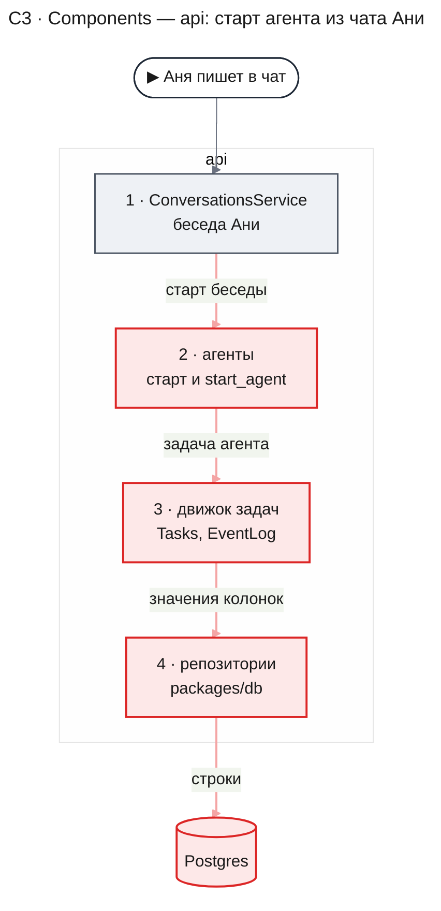
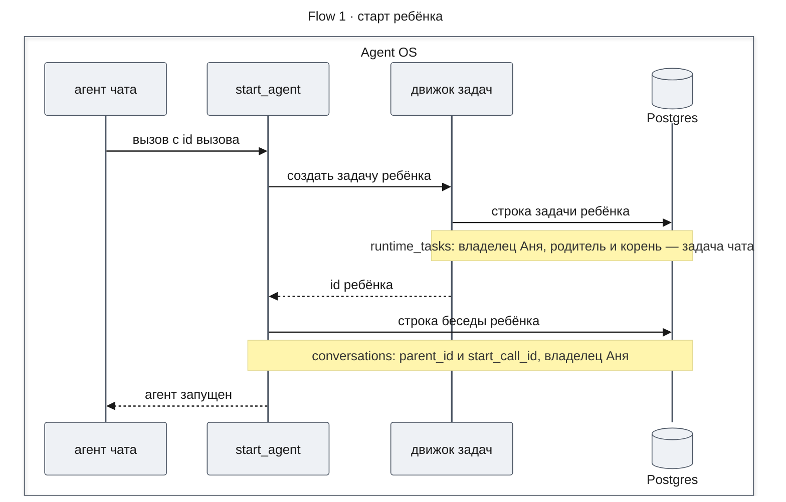
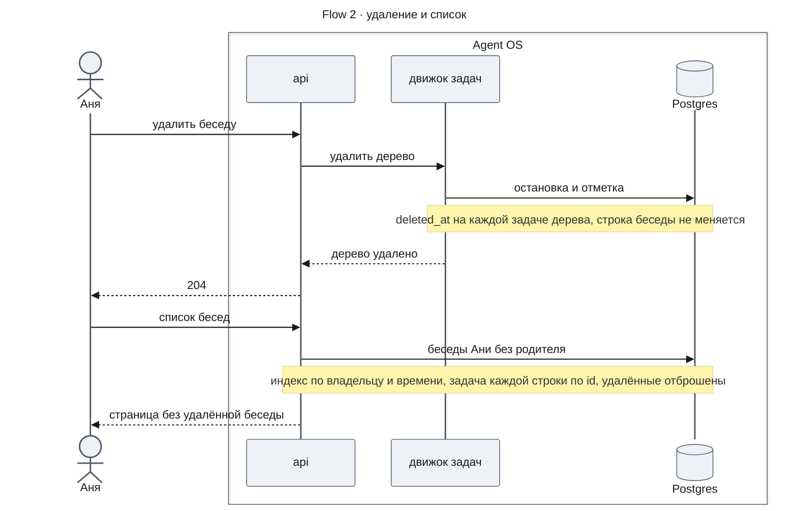
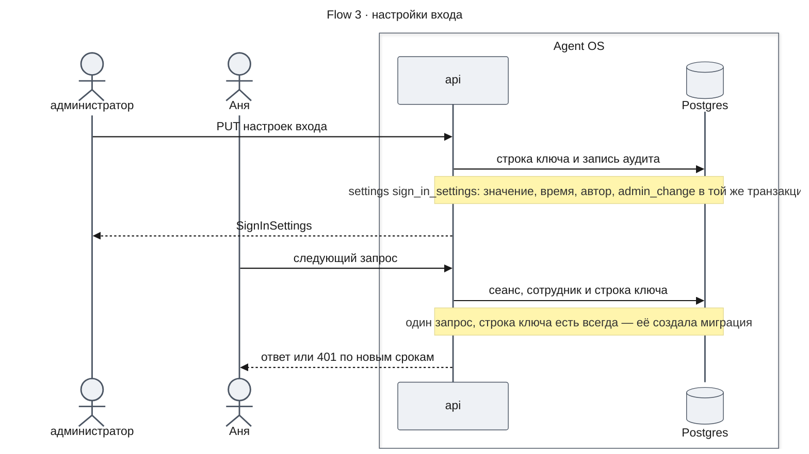
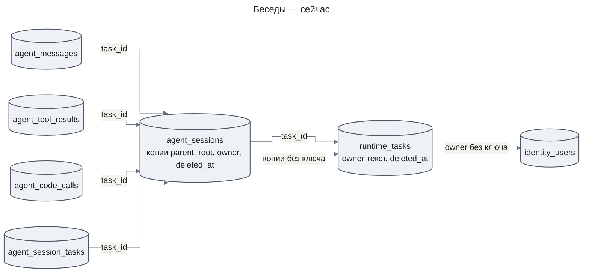
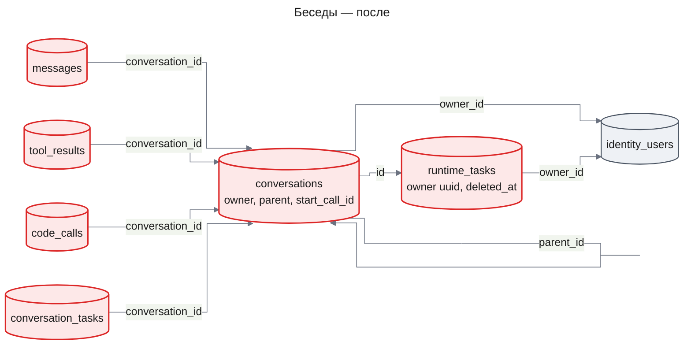
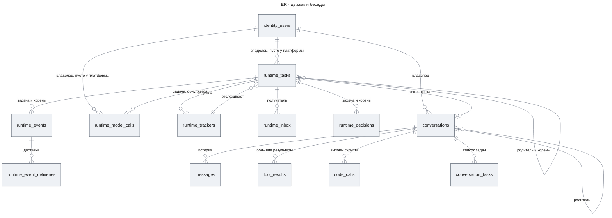
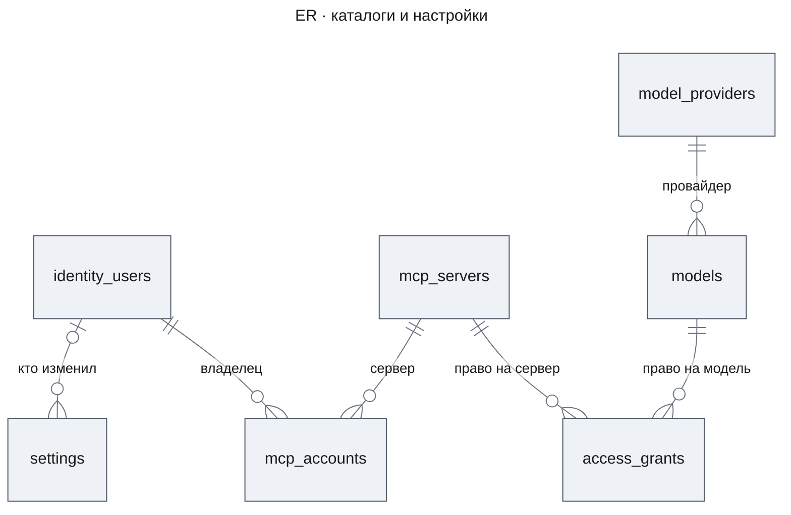

# Модель данных — Design Document — schema

**Status:** Draft · **Date:** 2026-11-23 · **PRD:** нет (требования владельца R2, R3, R7–R16, см. «Part») · **UXRD:** нет · **Depends on:** nothing

## Snapshot

**Overview.** В базе слишком много таблиц, их имена с приставкой `agent_` не говорят, что в них лежит, а одни и те же факты записаны в двух местах без внешних ключей. Эта часть приводит в порядок структуру, не меняя поведения для сотрудника: беседы получают таблицу `conversations` с явным владельцем и родителем, у удаления беседы остаётся одна отметка, четыре таблицы настроек из одной строки становятся одной таблицей `settings` со строкой на ключ, каждая ссылка внутри базы становится внешним ключом, а движок задач перестаёт сам собирать SQL. История миграций сворачивается в один исходный набор, потому что базы создаются заново.

- **Не меняется**: что видит и делает сотрудник, маршруты API и их ответы, правила прав и изоляции, таблицы знаний `agent_knowledge_*` и каталога агентов `library_*` (их переделывает следующая часть, `agents`).
- **Главный риск**: внешний ключ, который порядок вставки нарушает, падает внутри транзакции шага; проверка — сквозные наборы тестов в CI после свёртки миграций.
- **Open questions**: нет.

### Key Decisions

#### KD-1: Беседа — продолжение задачи движка; владелец и родитель хранятся в беседе под внешними ключами, корень — беседа без родителя

Каждый агент работает как задача движка (`runtime_tasks`), а беседа (`conversations`) — это его история и состояние; у беседы тот же id, что у её задачи. Задачи и беседы нельзя слить в одну таблицу: задачи знаний (`knowledge.extract`, `knowledge.embed`) бесед не имеют, и код различает «нет беседы — не агент» (`packages/agents/src/events/stop-children-on-failure.ts`). Беседа хранит владельца и родителя сама, потому что список бесед держится на частичном индексе, а условие частичного индекса не может смотреть в другую таблицу (условие `isRoot` в `packages/db/src/repositories/agent-sessions.repository.ts`). Обе копии неизменны и стоят под внешними ключами, как разрешает R13. Корень — беседа без родителя (`parent_id IS NULL`), а не «у неё есть время изменения».

Отвергнуто: брать владельца и родителя соединением с задачей — список бесед теряет индекс; слить беседу с задачей — у задач знаний нет беседы.

#### KD-2: Отметка удаления беседы одна — на задачах её дерева; беседа читает её соединением со своей задачей

Удаление беседы останавливает её дерево задач и ставит `runtime_tasks.deleted_at` на каждую задачу дерева одним оператором (`TaskControl.deleteTree`). Эту отметку уже читают шесть мест движка: `RuntimeTasksRepository.findOwned` и `listTree`, `RuntimeTrackersRepository.listOwned`, запись входящего сообщения (`packages/runtime/src/messaging/inbox.ts`), решения (`messaging/decisions.ts`) и остановка (`TaskControl.stop`). Второй отметки на строке беседы больше нет: запросы бесед соединяют беседу с её задачей по id и отбрасывают удалённые. Отметка ставится один раз и не снимается, а каждая задача дерева связана с корнем внешним ключом `root_id`, поэтому это неизменная копия под FK по R13.

Отвергнуто: отметка только на беседе — движок общий и о беседах не знает (`packages/runtime/CLAUDE.md`); отметка только на корневой задаче — меняет шесть охраняемых чтений движка в коде перезапуска и конкуренции, где каждое проверяет свою строку под удержанием этой строки (ADR-0023).

#### KD-3: Настройки — таблица `settings`, строка на группу, значение JSON по схеме ключа, строки по умолчанию создаёт миграция

Ключ — это группа настроек, которую администратор меняет одной формой: настройки входа, лимит ходов по умолчанию, большие результаты инструментов, модели по умолчанию. Ключ называется так же, как объект его записи аудита сегодня (`sign_in_settings`, `library_settings`, `tool_result_settings`, `model_defaults`), поэтому журнал аудита не меняется. Значение проверяет zod-схема ключа из `@agent-os/contracts`; правила между полями (срок без запросов не больше общего срока; превью короче порога сохранения) проверяются там же, поэтому строка на поле не подходит. Миграция создаёт строку каждого ключа со значениями по умолчанию (решение владельца), так что ни один читатель не встречает отсутствующий ключ, а проверка сеанса на каждом запросе остаётся одним запросом. Все записи настроек идут через один сервис `apps/api`. Запись администратора он проверяет схемой и пишет вместе с записью аудита в одной транзакции — вместо трёх разных мест аудита сегодня (сервис входа, `AccessService`, контроллер результатов инструментов). Две служебные записи — первое сохранение публичного адреса и очистка модели по умолчанию при её удалении — идут через тот же сервис без аудита и не меняют время и автора изменения, как и сейчас.

Отвергнуто: строка на поле — правила между полями и `updatedAt` группы теряют одно место; значения по умолчанию из схемы при отсутствии строки — проверка сеанса соединялась бы с необязательной строкой, владелец выбрал строки в миграции. Источник: [drizzle-kit custom migrations](https://orm.drizzle.team/docs/kit-custom-migrations).

#### KD-4: Владелец — uuid с внешним ключом на `identity_users`; работа платформы владельца не имеет

`owner_id` становится uuid с FK на сотрудника в каждой таблице, где он остаётся: задачи, беседы, журнал расходов на модели, личные учётные записи MCP. Работа самой платформы — задачи `knowledge.embed` и их строки в журнале расходов — пишется без владельца (null) вместо текста `'platform'` (`PLATFORM_OWNER_ID`). Ни один фильтр по владельцу пустое значение не находит, поэтому такую работу по-прежнему не видит никто, а в месячный расход сотрудника она не входит: журнал читают только суммы по одному сотруднику (`TokenLedger` в `packages/runtime/src/ledger/token-ledger.ts`). Копии владельца в трекерах, входящих и решениях удаляются: каждая из этих строк ссылается на свою задачу, и проверка владельца идёт соединением с ней. Тесты получают владельца как настоящего сотрудника в `identity_users`, потому что внешний ключ не примет выдуманный id.

Это решение берёт вариант, который ADR-0012 отверг (FK от владельца на `identity_users`): довод ADR-0012 о слоях снят ADR-0022, а «служебный владелец» решается пустым значением. ADR-0012 заменяет новый ADR (см. «Документы, которые часть делает неверными»). Отвергнуто: служебный сотрудник в миграции — он появился бы в списках сотрудников, правах и проверке активности владельца.

#### KD-5: Каждая ссылка внутри базы — внешний ключ; исключения названы с причиной

Ссылки на строки, которые существуют на момент записи, становятся внешними ключами (таблица в «Data Model»). Журнал расходов ссылается на задачу с обнулением при её удалении, потому что расход переживает дерево. Без ключа остаются только ссылки, которым не на что ссылаться: вызов инструмента — это элемент JSON внутри ответа модели, а не строка; инструмент в праве доступа — элемент JSON сервера; отправитель сообщения — то задача, то сотрудник; история и аудит называют объект таким, каким он был. Цикл «задача ↔ трекер» остаётся: трекер вставляется раньше своих задач, отложенная проверка не нужна.

Отвергнуто: таблица вызовов инструментов ради ключа — новая сущность ради одного ограничения.

#### KD-6: Движок задач не знает таблиц: SQL — в репозитории, вызывающий передаёт закрытый набор значений

`Tasks` в `packages/runtime` сегодня собирает фрагменты SQL (`attempt + 1`, `now()`, `next_message_seq + 1`) и передаёт свободные `fields` с типом таблицы drizzle (`changeColumns` в `packages/runtime/src/tasks/tasks.ts`, `TaskFields` в `guarded-transition.ts`). После части правила перехода остаются в движке (`assertAllowed`, выбор, какие колонки меняет переход), а репозиторий задач принимает закрытый набор: новый статус и причину ожидания, флаги «следующая попытка», «засчитать захват», «задача закончена» и простые значения колонок — номер шага, захваты шага, восстановления, результат и сбой. Выражения SQL строит только репозиторий. Номер сообщения берёт отдельный метод репозитория, уведомление `pg_notify` отправляет метод репозитория событий. Типы строки задачи и охраны берутся из `@agent-os/db`, собственные копии в движке удаляются.

Отвергнуто: метод репозитория на каждое намерение («зафиксировать шаг», «сбросить счётчики») — смысл переходов переехал бы в репозиторий, а он правил не держит (`packages/db/CLAUDE.md`).

#### KD-7: Миграции — один сгенерированный исходный набор; что генератор не умеет, лежит в своих custom-миграциях

Сгенерированный SQL не правится руками. То, чего генератор не выражает, — расширение `vector` и встроенные строки (роль «Супер-администратор», строки настроек, строка настроек знаний, а в части `agents` агенты по умолчанию) — лежит в custom-миграциях, которые создаёт `drizzle-kit generate --custom` и которые пишутся руками. Исходный набор — три файла по порядку: расширение, схема, встроенные строки. Строки данных есть только в последнем. Правило «миграция не несёт строк данных» заменяется правилом «строки, без которых система не работает, лежат только в миграции встроенных строк».

Отвергнуто: один файл, к сгенерированному SQL которого руками дописаны расширение и строки, — это и есть правка сгенерированного SQL, а следующая генерация её теряет.

## Terms

- **задача движка** — строка `runtime_tasks`: единица работы, которая выполняется шагами и переживает перезапуск сервера.
- **дерево** — задачи, запущенные друг из друга; у каждой есть корень (`root_id`), у корня он указывает на саму задачу.
- **беседа** — история и состояние одного агента: что он получил, ответил и вызвал. Беседа сотрудника — корень дерева; беседа агента, которого запустил другой агент, — его ребёнок.
- **внешний ключ (FK)** — правило базы: значение колонки должно быть id существующей строки другой таблицы; что происходит при удалении той строки, говорит правило `ON DELETE`.
- **частичный индекс** — индекс только по строкам, которые проходят условие; условие видит только свою таблицу.
- **отметка удаления** — время в колонке `deleted_at`: строка остаётся в базе, но отвечает как отсутствующая.
- **ключ настроек** — имя группы настроек в таблице `settings`; значение группы — один JSON.
- **исходный набор миграций** — миграции, которыми пустая база получает всю схему и встроенные строки за один прогон.

## Part

PRD по решению владельца нет: поведение для сотрудника не меняется, переделывается устройство данных. Требования этой части — список владельца для фичи `data-model`, и этот документ — их дом:

- **R2** — одна сущность «беседа» (`conversations`): в неё пишут и чат сотрудника, и агенты.
- **R3** — беседа связана с тем, кто её начал: владелец-сотрудник, беседа родителя и вызов инструмента, который её запустил.
- **R7** — удаление беседы — отметка, а не удаление строк, и отметка одна; всё остальное, что сегодня удаляется физически, удаляется так же.
- **R8** — настройки в одной таблице `settings`, строка на ключ, значение JSON, проверка схемой в коде.
- **R9** — список задач агента сохраняет название «задачи» (`conversation_tasks`).
- **R10** — без приставки `agent_` в именах таблиц; имя говорит, что лежит в таблице.
- **R11** — миграции сворачиваются в один исходный набор, базы создаются заново.
- **R12** — `packages/runtime` не знает таблиц: SQL задач живёт в репозиториях `packages/db`.
- **R13** — изменяемый факт хранится один раз; неизменная копия (владелец, родитель) допустима только под внешним ключом.
- **R14** — каждая ссылка внутри базы — внешний ключ; `owner_id` — uuid с FK на сотрудника.
- **R15** — колонки, которые пишутся и никем не читаются, удаляются.
- **R16** — корень беседы определяется явным правилом, а не косвенным признаком.

R1, R4–R6 и R17–R21 (агенты, версии, агенты по умолчанию и временные, модель агента, вызов по имени) и переименование `library_*` принадлежат части `agents`.

- **Prerequisite ADRs**: [ADR-0003](../../adr/ADR-0003-drizzle-data-layer.md) (Drizzle и миграции), [ADR-0022](../../adr/ADR-0022-one-database-and-nestjs-modules.md) (одна база, репозитории в `packages/db`), [ADR-0023](../../adr/ADR-0023-live-task-objects-one-stepping-process.md) (охраняемый первый `UPDATE` вместо блокировок).

**Out of scope**

- Каталог агентов `library_records`, `library_shares` и их переименование в `agents`, `agent_versions`, `agent_shares`; версии агентов, агенты по умолчанию, временные агенты, модель агента — часть `agents`.
- Колонки беседы, которые копируют снимок агента (имя, описание, промпт, модель, происхождение от записи каталога, автор, подагент), остаются как есть: часть `agents` заменяет их ссылкой на версию агента (Contract Definitions).
- Таблицы знаний `agent_knowledge_*` и их репозитории; меняются только ссылки на переименованные таблицы и пустой владелец задач `knowledge.embed`. `agent_knowledge_settings` остаётся таблицей из одной строки.
- Колонки JSONB остаются непрозрачными для SQL; CHECK вместо перечислений Postgres остаётся.
- Всё, что сегодня удаляется физически (права, участники ролей, сеансы входа, запросы входа, пункты списка задач, серверы и учётные записи MCP, провайдеры, модели, роли), удаляется физически и дальше.

**Constraints**

- Обратной совместимости нет: базы создаются заново, данные не переносятся, старые миграции удаляются (root `CLAUDE.md`).
- Маршруты API и тела ответов для `apps/web` не меняются; переименования таблиц внутри `packages/db` до веба не доходят — ни маршрут, ни код ошибки, ни поле журнала имени таблицы не несут (проверено поиском по `apps/api/src` и `packages/*/src`).
- Список бесед на 200 беседах укладывается в p95 ≤ 300 мс (project-context): индекс остаётся, к каждой строке страницы добавляется поиск её задачи по первичному ключу.
- Порядок записей и охрана в транзакциях движка не меняются (`packages/runtime/CLAUDE.md`, ADR-0023): KD-6 переносит построение SQL, а не порядок операторов.

## Building-block Inventory

Follows the [code system](../../code-system/README.md).

| Building block | Pattern | Status | Note |
|---|---|---|---|
| Репозиторий задач `RuntimeTasksRepository` | [repository-over-transaction.md](../../code-system/patterns/repository-over-transaction.md) | extended | принимает закрытый набор колонок, берёт номер сообщения (KD-6) |
| Репозиторий событий `RuntimeEventsRepository` | [repository-over-transaction.md](../../code-system/patterns/repository-over-transaction.md) | extended | отправляет `pg_notify` в открытой транзакции |
| `Tasks`, `EventLog` в `packages/runtime` | [step-handler.md](../../code-system/patterns/step-handler.md) | extended | без drizzle и без таблицы схемы |
| Репозитории бесед, сообщений, результатов, вызовов кода, списка задач, MCP, провайдеров, моделей | [repository-over-transaction.md](../../code-system/patterns/repository-over-transaction.md) | extended | переименованы по таблице; запросы бесед соединяются с задачей (KD-2) |
| Репозиторий настроек | [repository-over-transaction.md](../../code-system/patterns/repository-over-transaction.md) | new | читает строку ключа, пишет её, заменяет значение, если оно не изменилось |
| Реестр ключей настроек в `@agent-os/contracts` | — | new | ключ → zod-схема значения; чистые значения, не провайдер |
| Сервис настроек в `apps/api` | новый шаблон вместо [settings-row.md](../../code-system/patterns/settings-row.md) — KD-3 | new | искал в каталоге и коде: есть только шаблон строки на модуль, его заменяет этот |
| Сервисы четырёх групп настроек (вход, каталог, результаты инструментов, модели) | [settings-row.md](../../code-system/patterns/settings-row.md) | extended | читают и пишут через сервис настроек |

## Acceptance Criteria

Каждый подраздел называет требование владельца и раскрывает его критериями, которые проверяет тест или статическая проверка.

### R2, R3, R16: беседа и её связи

- Когда Аня отправляет первое сообщение, появляется одна беседа с владельцем Аня и без родителя, и она стоит первой в списке Ани (DC-1).
- Когда агент чата запускает другого агента, беседа ребёнка называет беседу чата родителем и хранит id вызова инструмента, который её запустил; у беседы без родителя id вызова нет (DC-2).
- Список бесед содержит только беседы владельца без родителя и без отметки удаления, последние изменённые первыми, с прежним курсором страницы (DC-3).

### R7: одна отметка удаления

- Удаление беседы ставит отметку только на задачах её дерева; после этого беседа отвечает как отсутствующая на чтение, переименование, список и поток событий, а движок отвечает как прежде на сообщения, решения и остановку задач этого дерева (DC-4).

### R8: таблица настроек

- Новая база содержит строку каждого из четырёх ключей, значение каждой проходит схему своего ключа, и каждый GET настроек отдаёт её с `updatedAt: null` (DC-5).
- PUT настроек пишет строку ключа и одну запись `admin_change` в одной транзакции; значение вне границ отвечает 400 `VALIDATION_FAILED` и ничего не меняет; новые сроки сеанса действуют со следующего запроса (DC-6).
- Удаление модели, выбранной по умолчанию, делает это значение пустым, и старт беседы отвечает `model_not_configured`, как прежде (DC-7).
- Два одновременных первых сохранения публичного адреса оставляют один адрес, и оба запроса получают его (DC-8).

### R9, R10, R11: имена и миграции

- Таблицы называются по списку «Data Model», дочерние таблицы беседы ссылаются на неё колонкой `conversation_id` (DC-9).
- Пустая база получает схему и встроенные строки прогоном исходного набора; `pnpm db:generate` на неизменённой схеме не создаёт новой миграции (DC-10).

### R12: движок без знания таблиц

- `packages/runtime` не импортирует `drizzle-orm` и ни одной таблицы схемы; это проверяет линтер пакета (DC-11).

### R13, R14: одна запись факта, внешние ключи, владельцы

- База отказывает строке, чей владелец не сотрудник, чей родитель не беседа, или праву на незарегистрированный сервер MCP; удаление сервера MCP удаляет права на него (DC-12).
- Задачи `knowledge.embed` и их строки журнала расходов пишутся без владельца; ни один сотрудник их не видит, и в месячный расход сотрудника они не входят (DC-13).
- Беседа, задача, решение, входящее сообщение и трекер другого сотрудника отвечают как отсутствующие (DC-14).

### R15: колонки без читателя

- Колонок из списка «Колонки, которые уходят» нет в схеме, а поведение и проверки, которые на них не опирались, не меняются (DC-15).

## Design

### Как часть встраивается в работу системы

Пример, на котором объясняется весь документ: Аня пишет в чат «разбери логи за ночь». Агент чата отвечает и запускает агента `general-purpose`, чтобы тот прочитал логи. Диаграмма показывает, через какие слои проходит запись этого старта и что в них меняется.

Агенты передают в беседу ребёнка id вызова, который его запустил, и больше не ставят свою отметку удаления. Движок передаёт репозиторию значения, а не SQL (KD-6). Репозитории переименованы по таблицам, а запросы бесед соединяются с задачей (KD-2). Новые компоненты настроек — сервис настроек в `apps/api` и реестр ключей в `@agent-os/contracts` — этот поток не задевают; их путь показывает Flow 3.

### Architecture (C1–C4)

#### C1 · Context

Не рисуется: часть не меняет ни людей, ни внешние системы.

#### C2 · Containers

Не рисуется: процессы и база те же, меняется только схема внутри Postgres.

#### C3 · Components: api

Нарисован выше, в «Как часть встраивается в работу системы»: все изменённые компоненты живут в одном процессе `api`.

### Runtime Flows

#### Flow 1: агент чата запускает другого агента

**Starts when:** шаг агента чата вызывает `start_agent`, for DC-2, DC-12

Обе строки пишутся в транзакции фиксации шага агента чата. Внешние ключи проверяют, что владелец — сотрудник, а родитель — существующая беседа; беседа чата к этому моменту есть, потому что агент чата вызывает инструмент из своего шага. Id вызова попадает и во вход задачи ребёнка, поэтому беседу с тем же id создаёт и первый шаг ребёнка, если её ещё нет. Делегирование `task` и `start_deep_agent` пишут id своего вызова так же; перезапуск ребёнка копирует id вызова из беседы, которую перезапускает.

#### Flow 2: Аня удаляет беседу и открывает список

**Starts when:** Аня удаляет беседу, затем открывает список бесед, for DC-3, DC-4

Удаление пишет одну отметку в одной транзакции и ничего не удаляет физически. Те же соединения с задачей используют чтение одной беседы, переименование, запись заголовка, подъём беседы в списке и поиск владельца корня, который `LiveHub` делает на каждое событие движка.

#### Flow 3: администратор меняет сроки сеанса, следующий запрос Ани их применяет

**Starts when:** администратор сохраняет настройки входа, for DC-5, DC-6

Значение вне границ схема ключа отвергает до транзакции, и ничего не пишется. Проверка сеанса разбирает значение схемой ключа на каждом запросе; кэша нет, как и сейчас.

### Contract Definitions

Эта часть отдаёт части `agents` и остальному коду четыре договорённости. Маршруты API не меняются.

**Беседа (`conversations`)**

- Одна строка на агента; id беседы — id её задачи движка, удаление задачи удаляет беседу.
- `owner_id` — сотрудник, от имени которого идёт всё дерево; обязателен, uuid с FK на `identity_users`.
- `parent_id` — беседа агента, который запустил эту; пусто у беседы сотрудника. Корень — беседа с пустым `parent_id`, других признаков корня нет.
- `start_call_id` — id вызова инструмента в беседе родителя, который запустил эту; задан тогда и только тогда, когда задан `parent_id`. Внешнего ключа нет: вызов — элемент ответа модели, а не строка.
- `title` и `updated_at` заданы тогда и только тогда, когда беседа — корень.
- Удалённая беседа — та, чья задача несёт `deleted_at` (KD-2); своей отметки у беседы нет.
- Часть `agents` заменяет колонки снимка — `name`, `description`, `prompt`, `record_id`, `record_kind`, `record_version`, `record_name`, `author_id`, `author_name`, `builtin_key`, `subagent` — ссылкой на версию агента и решает, где живёт модель; колонка `model` остаётся обязательной. Остальные колонки беседы эта часть фиксирует (таблица в «Data Model»).

**Хранилище настроек**

- Строка ключа хранит значение, время последнего изменения администратором и его id; время и автор пусты, пока стоят значения по умолчанию из миграции. Время отдают ответы всех четырёх групп (`updatedAt`), автора — ответ моделей по умолчанию (`ModelDefaults.updatedBy`).
- Реестр ключей в `@agent-os/contracts` связывает каждый ключ с zod-схемой его значения: `sign_in_settings` — `UpdateSignInSettingsBodySchema`, `library_settings` — `UpdateLibrarySettingsBodySchema`, `tool_result_settings` — `UpdateToolResultSettingsBodySchema`, `model_defaults` — `UpdateModelDefaultsBodySchema`. Значение, которое не проходит свою схему, — сбой, а не значение по умолчанию.
- Чтение ключа возвращает значение, время и автора. Строка ключа есть всегда; её отсутствие — сбой, как сегодня у таблицы из одной строки.
- Запись ключа (сервис настроек `apps/api`) проверяет значение схемой ключа, заменяет строку и пишет `admin_change` с объектом, равным ключу, и значениями «было» и «стало» в транзакции вызывающего; правило поверх схемы (модель из каталога нужного назначения) проверяет сервис своей группы до записи в той же транзакции.
- Условная замена записывает новое значение только если строка не изменилась с прочтения и сообщает, записала ли; ей пользуется первое сохранение публичного адреса (DC-8). Эта запись не пишет `admin_change` и не меняет время и автора.
- Системная модель по умолчанию для части `agents` (R19) — поле `chatModel` ключа `model_defaults`; пусто — модель не настроена. Её по-прежнему читают через `AccessService.defaultChatModel()`. Удаление модели каталога очищает поле, которое её называет, через сервис настроек в транзакции удаления (DC-7), потому что внешнего ключа на значение в JSON нет; очистка не пишет `admin_change` (аудит получает удаление модели) и не меняет время и автора.
- Новый ключ добавляется со своей схемой в реестре и строкой по умолчанию в миграции встроенных строк.

**Владельцы и внешние ключи**

- Каждая колонка владельца — uuid с FK на `identity_users` и `ON DELETE CASCADE` (сотрудников не удаляют, им ставят статус `disabled`, так что правило касается только будущей чистки).
- Пустой владелец допустим только у задачи движка и строки журнала расходов и означает работу платформы. Беседа владельца имеет всегда.
- Каждая новая ссылка на строку внутри базы — внешний ключ; ссылка без ключа допустима только по причинам из KD-5 и называется в описании колонки.
- Тест получает владельца, создавая сотрудника в `identity_users`.

**Исходный набор миграций**

- Три файла в `packages/db/src/migrations`: custom-миграция расширения `vector`, сгенерированная миграция всей схемы, custom-миграция встроенных строк. Журнал `meta/` создаётся заново вместе с ними.
- Встроенные строки: роль «Супер-администратор», строки четырёх ключей настроек, строка `agent_knowledge_settings`.
- Часть `agents` удаляет набор и создаёт его заново тем же способом, добавляя агентов по умолчанию в миграцию встроенных строк; новых нарастающих миграций не появляется.

**Методы для движка задач (KD-6)**

- Охраняемое обновление задачи принимает охрану (задача, допустимые статусы, попытка, причина ожидания) и закрытый набор: новый статус с причиной ожидания, флаги «следующая попытка», «засчитать захват шага», «задача закончена сейчас» и значения номера шага, захватов шага, восстановлений, результата и сбоя. Возвращает строку после записи или ничего, если охрана не совпала. Пустой набор — удержание строки (`Tasks.hold`).
- Взятие номера сообщения увеличивает счётчик входящих задачи в любом статусе и возвращает строку; два отправителя одного номера не получают.
- Уведомление о событии отправляет канал и полезную нагрузку в транзакции, открытой при вызове; канал `RUNTIME_EVENTS_CHANNEL` и форма нагрузки остаются прежними.
- Типы строки задачи и охраны — `RuntimeTaskRow` и `RuntimeTaskRowGuard` из `@agent-os/db`; `TaskRow`, `TaskGuard` и `TaskFields` движка удаляются, `TaskChange` и `assertAllowed` остаются в движке.

### Data Model

#### Группа бесед: сейчас и после

Сегодня беседа (`agent_sessions`) повторяет четыре колонки своей задачи без внешних ключей, а владелец — текст, не связанный с сотрудником.

После части беседа хранит только владельца и родителя, обе копии стоят под ключами, отметка удаления живёт только на задачах.

#### Таблицы части

Таблица показывает каждую таблицу, которую часть переименует, меняет или удаляет, на примере Ани.

| Сейчас | После | Что хранит |
|---|---|---|
| `agent_sessions` | `conversations` | беседу одного агента: беседу Ани с чатом и беседу запущенного им `general-purpose` |
| `agent_messages` | `messages` | историю беседы по порядку: сообщение Ани, ответ модели, вызовы инструментов и их результаты |
| `agent_tool_results` | `tool_results` | полный результат большого вызова MCP, например полный лог, который агент читает по частям |
| `agent_code_calls` | `code_calls` | вызовы инструментов, которые сделал скрипт `run_code`, для аудита |
| `agent_session_tasks` | `conversation_tasks` | список задач, который агент ведёт в своей беседе («1. прочитать логи — в работе») |
| `agent_mcp_servers` | `mcp_servers` | зарегистрированный сервер MCP и его инструменты, например сервер логов |
| `agent_mcp_accounts` | `mcp_accounts` | личные токены сотрудника на сервере MCP |
| `agent_model_providers` | `model_providers` | провайдера моделей с адресом и ключом |
| `access_models` | `models` | модель каталога с ценами; вызывается только модель из каталога |
| `identity_settings`, `library_settings`, `agent_tool_result_settings`, `access_model_defaults` | `settings` | строку на группу настроек: сроки сеанса и публичный адрес, лимит ходов, пороги результатов, модели по умолчанию |

Таблицы движка (`runtime_*`), входа (`identity_*` кроме настроек), прав (`access_grants`), аудита (`audit_events`), каталога агентов (`library_*`) и знаний (`agent_knowledge_*`) имена сохраняют. Файл схемы, символ таблицы, файл и класс репозитория и типы строк называются по таблице, как требует `packages/db/CLAUDE.md`. Имена из предметной области агентов (`Session`, `Sessions`, `SessionInput`) часть не меняет: их переписывает часть `agents` вместе с путём старта.

#### Колонки беседы

| Колонка | Что с ней | Почему |
|---|---|---|
| `id` (сейчас `task_id`) | остаётся, FK на задачу | беседа — продолжение задачи (KD-1) |
| `owner_id` | uuid, FK на сотрудника | индекс списка бесед (KD-1, KD-4) |
| `parent_id` | FK на беседу | правило корня и индекс списка (KD-1) |
| `start_call_id` | новая | вызов, который запустил беседу (R3) |
| `root_id` | уходит | одно чтение берёт корень из задачи |
| `deleted_at` | уходит | отметка живёт на задачах (KD-2) |
| `forked_from_task_id` | уходит | при каждом ответвлении равна `parent_id`: ответвляется только сам вызывающий |
| `forked_through_seq` | остаётся | задана — беседа ответвлена от родителя до этой записи истории |
| `title`, `updated_at` | остаются | только у корня, это проверяет CHECK |
| `turns`, `interrupted`, `closed`, `first_run`, `last_input_tokens`, `last_task_number` | остаются | состояние беседы, а не копии задачи |
| колонки снимка агента и `model` | без изменений | заменяет часть `agents` |
| `created_at` | остаётся | — |

Список бесед ищет беседы владельца без родителя по частичному индексу (`owner_id`, `updated_at` по убыванию, `id` по убыванию) с условием `parent_id IS NULL`, затем для каждой строки находит её задачу по первичному ключу и отбрасывает задачи с `deleted_at`. Удалённые беседы редки, поэтому страница почти не читает лишних строк. Индекс по `root_id` уходит вместе с колонкой.

#### Обзор целевых таблиц

Две диаграммы показывают связи таблиц этой части: движок и беседы, затем каталоги и настройки.

#### Внешние ключи

| Ссылка | Правило удаления | Что меняется |
|---|---|---|
| `conversations.id` → задача | каскад | без изменений |
| `conversations.parent_id` → беседа | каскад | новый ключ |
| `conversations.owner_id`, `runtime_tasks.owner_id`, `runtime_model_calls.owner_id`, `mcp_accounts.owner_id` → сотрудник | каскад | новый ключ, колонка становится uuid |
| `runtime_decisions.root_id` → задача | каскад | новый ключ |
| `runtime_events.task_id` → задача | каскад | новый ключ |
| `runtime_model_calls.task_id` → задача | обнуление | новый ключ: расход переживает дерево |
| `access_grants.server` → сервер MCP | каскад | новый ключ; удаление прав в коде (`AccessService.removeServerGrants`, `AccessGrantsRepository.deleteOfServer`) удаляется |
| `models.provider` → провайдер | запрет | новая колонка: провайдер из первой части id модели; CHECK держит её равной этой части |
| `settings.updated_by` → сотрудник | обнуление | новая таблица |
| `messages`, `tool_results`, `code_calls`, `conversation_tasks` → беседа | каскад | колонка называется `conversation_id` |
| `runtime_tasks.tracker_id` ↔ `runtime_trackers.task_id` | каскад | цикл без изменений: трекер вставляется до задач |

Без ключа остаются: id вызова в `messages.call_id`, `tool_results.call_id`, `code_calls.run_call_id` и `conversations.start_call_id` (вызов — элемент ответа модели); `access_grants.tool` (инструмент — элемент списка сервера); `runtime_inbox.sender` (задача или сотрудник); `audit_events.actor` и `object_id`, `code_calls.server`, `runtime_model_calls.model` (история называет объект таким, каким он был); `conversation_tasks.owner` (подпись, а не сотрудник) и `blocked_by` (номера того же списка). Ссылки колонок снимка беседы на запись каталога и автора — часть `agents`.

Запрет на удаление провайдера, у которого есть модели, база теперь держит сама; код по-прежнему отвечает `MODEL_PROVIDER_HAS_MODELS` до попытки удаления.

#### Колонки, которые уходят

- `runtime_events.causation_id` и `state_revision`: их никто не читает, а `causationId` никто и не передаёт; из события, которое получают потребители, они уходят тоже.
- `messages.model_call_id`: связь ответа модели со строкой журнала расходов никто не читает.
- Копии `runtime_trackers.owner_id`, `runtime_inbox.owner_id`, `runtime_decisions.owner_id` (KD-4) и колонки беседы из таблицы выше.

`runtime_tasks.step_claims` остаётся: из неё шаг узнаёт, что его предыдущий захват потерян (`resumedAfterLoss` в контексте шага), и это проверяют тесты перезапуска. Журнал теряет одну запись — «grants of a removed mcp server deleted» с числом удалённых прав: права уходят каскадом, а удаление сервера по-прежнему пишет аудит. Константа `PLATFORM_OWNER_ID` удаляется, поле `ownerId` в журнале у работы платформы равно null.

#### Порядок работы, при котором код собирается

1. Движок без SQL (KD-6): методы репозиториев задач и событий, типы из `@agent-os/db`. Схема не меняется.
2. Таблица `settings`, реестр ключей и сервис настроек; четыре группы настроек переходят на них, четыре старые таблицы и их репозитории удаляются.
3. Переименования, колонки беседы, одна отметка удаления, владельцы uuid с пустым владельцем платформы, внешние ключи, удалённые колонки; тестовый владелец — настоящий сотрудник.
4. Старые миграции и `meta/` удаляются, исходный набор создаётся заново; проверка миграций получает новый список таблиц и имён ограничений.

После шагов 1–3 код проверяют `lint` и `typecheck`; сквозные наборы идут в CI после шага 4, когда схема и миграции снова совпадают.

#### Документы, которые часть делает неверными

Решения KD-4, KD-5 и KD-7 меняют принятые ADR: ADR-0012 (владелец — текст без FK), ADR-0014 и ADR-0018 (право и модель ссылаются текстом без FK), ADR-0003 (миграция без строк данных). ADR не правится: его заменяет новый ADR, который пишется после утверждения этого документа. Остальное обновляет сборка вместе с кодом; эта часть ничего из списка не правит.

- `docs/code-system/packages/db.md` — правило миграций (KD-7), таблица настроек вместо строки на модуль, имена без приставки `agent_`.
- `docs/code-system/packages/api.md` и `patterns/repository-over-transaction.md` — беседа живёт в `conversations`, корень — беседа без родителя.
- `docs/code-system/packages/agents.md` — файлы репозиториев называются по новым таблицам.
- `docs/code-system/packages/runtime.md` — движок не строит SQL и шлёт уведомление через репозиторий событий.
- `docs/code-system/patterns/settings-row.md` — заменяется шаблоном таблицы настроек с ключами (KD-3); `apps/api/CLAUDE.md` ссылается на новый файл.
- `docs/code-system/patterns/builtin-record.md` и `packages/db/CLAUDE.md` — встроенные строки лежат в миграции встроенных строк (KD-7).
- Разделы «Data Model» дизайнов фич, которые называют старые таблицы: `agent-platform`, `custom-agents`, `deep-agents`, `code-execution`, `agent-harness`, `enterprise-access`, `model-providers`, `self-learning`, `tool-output-shapes`.

## Test Strategy

Тестов немного и только на критичное: права и изоляция, целостность данных, список бесед, удаление, настройки. Большая часть уже есть в сквозных наборах и меняется только под новые имена и одну отметку.

- **UC-1: беседа и её ребёнок** — covers DC-1, DC-2
  - Given: Аня вошла, в каталоге есть агент `general-purpose`.
  - When: Аня пишет в чат, и агент чата запускает `general-purpose`.
  - Then: у беседы чата нет родителя и id вызова, у беседы ребёнка родитель — беседа чата, а id вызова совпадает с вызовом `start_agent` в истории чата.
- **UC-2: список бесед** — covers DC-3
  - Given: у Ани три беседы, одна из них с запущенным ребёнком.
  - When: Аня листает список страницами по две.
  - Then: она видит три беседы без ребёнка, последние изменённые первыми, без повторов между страницами.
- **UC-3: удаление пишет одну отметку** — covers DC-4
  - Given: у беседы Ани есть ребёнок, который ждёт ответа на решение.
  - When: Аня удаляет беседу.
  - Then: отметка стоит на обеих задачах, строка беседы не изменилась, беседа отвечает как отсутствующая, список её не показывает, а решение ребёнка разрешить нельзя.
- **UC-4: изоляция** — covers DC-14
  - Given: беседа и дерево задач Ани.
  - When: Борис читает, переименовывает, удаляет беседу, пишет в её задачу, разрешает её решение, смотрит трекеры и события.
  - Then: каждый ответ такой же, как для отсутствующего объекта, и ничего не меняется.
- **UC-5: настройки новой базы** — covers DC-5
  - Given: база создана исходным набором.
  - When: тест читает каждую из четырёх строк настроек и администратор открывает четыре экрана настроек.
  - Then: каждое значение проходит схему своего ключа, ответы несут `updatedAt: null`, и сотрудник входит без ошибки.
- **UC-6: изменение настроек** — covers DC-6, DC-8
  - Given: администратор и сеанс Ани.
  - When: администратор сохраняет сроки вне границ, затем допустимые; два запроса одновременно впервые сохраняют публичный адрес.
  - Then: первая попытка — 400 и ничего не записано; вторая — одна запись `admin_change`, и следующий запрос Ани проверяется по новым срокам; сохранён один адрес.
- **UC-7: модель по умолчанию и удаление модели** — covers DC-7
  - Given: модель чата выбрана по умолчанию.
  - When: администратор удаляет эту модель, Аня начинает беседу.
  - Then: модель по умолчанию пуста, старт отвечает `model_not_configured`.
- **UC-8: база держит ссылки** — covers DC-12
  - Given: пустая база с исходным набором.
  - When: тест вставляет беседу с владельцем, которого нет среди сотрудников, беседу с несуществующим родителем, право на незарегистрированный сервер; затем удаляет сервер с правами.
  - Then: три вставки отвергнуты базой, права удалённого сервера исчезли.
- **UC-9: работа платформы** — covers DC-13
  - Given: задача `knowledge.embed` и её строка журнала расходов без владельца.
  - When: Аня запрашивает свой месячный расход и ищет эту задачу.
  - Then: расход её не включает, задача отвечает как отсутствующая.
- **UC-10: схема и миграции** — covers DC-9, DC-10, DC-15
  - Given: пустая база.
  - When: проверка миграций применяет исходный набор.
  - Then: таблицы называются по «Таблицы части», ключи совпадают с «Внешние ключи», удалённых колонок нет, встроенные строки на месте, повторная генерация на той же схеме не даёт миграции.
- DC-11 проверяет линтер `packages/runtime`, отдельного теста нет.

## Security Considerations

- **Authentication & Authorization**: проверка владельца остаётся в каждом запросе; там, где копия владельца ушла (трекеры, входящие, решения), её заменяет соединение с задачей, поэтому чужой объект по-прежнему отвечает как отсутствующий (DC-14). Внешний ключ не даёт записать строку с выдуманным владельцем.
- **Input Validation**: значения настроек проверяет схема ключа до записи; CHECK в базе для них больше нет, поэтому схема — единственная граница. Таблицу пишет только сервис настроек, а аудит получает каждая запись администратора.
- **Sensitive Data Handling**: в таблице настроек нет секретов; токены MCP и ключи провайдеров остаются в своих таблицах и в журнал не попадают.

## Risks and Mitigation

- **Внешний ключ ломает вставку в транзакции шага** — шаг падает, если порядок вставок нарушает новый ключ (события задачи, решения по корню, беседа ребёнка). Средняя вероятность. Порядок проверен по коду: задача вставляется до своих событий, корень и беседа родителя существуют раньше детей; сквозные наборы в CI это подтверждают.
- **Гонка удаления модели и выбора её по умолчанию** — два администратора одновременно: один выбирает модель, другой удаляет; значение указывает на удалённую модель. Низкая вероятность: администратор в системе один-два. Экран моделей по умолчанию показывает удалённый id, и администратор выбирает модель заново; защиту от гонки часть не строит.
- **Пропущенное имя таблицы в SQL тестов** — сырой SQL в тестах падает только при запуске. Высокая вероятность при переименовании. Сквозные наборы идут в CI до слияния; проверка миграций сверяет полный список таблиц.

## Update History

| Version | Date | Change |
|---------|------|--------|
| 1.0 | 2026-11-23 | Initial version |
