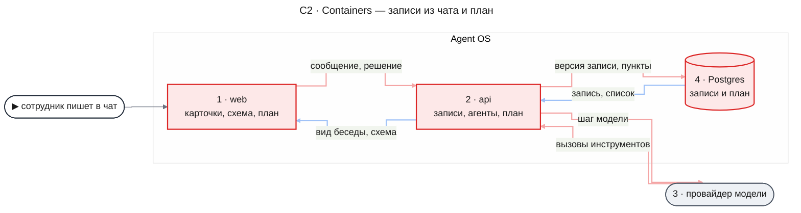
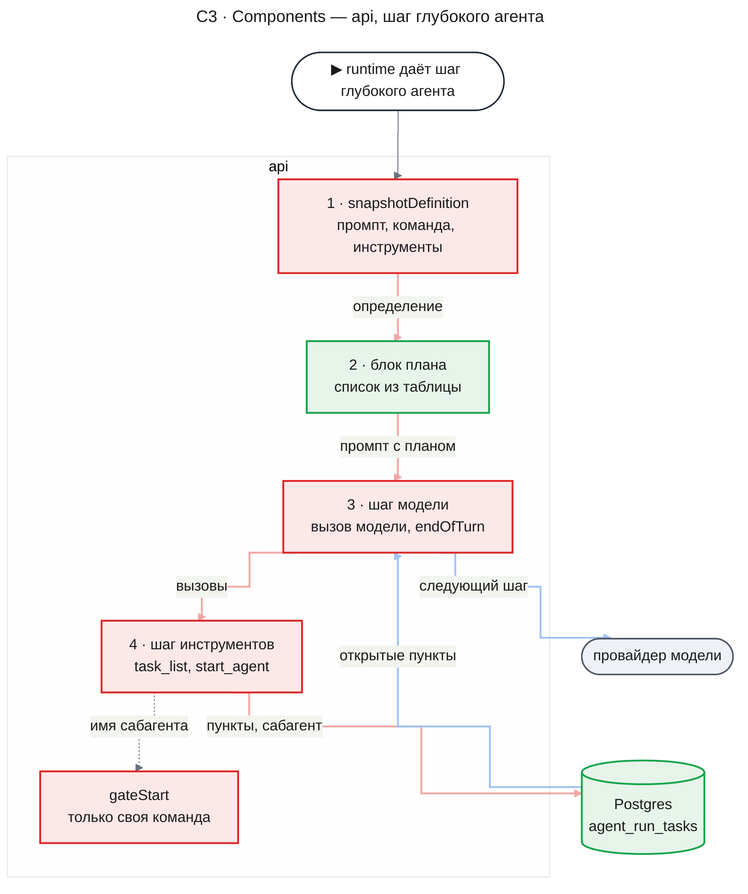
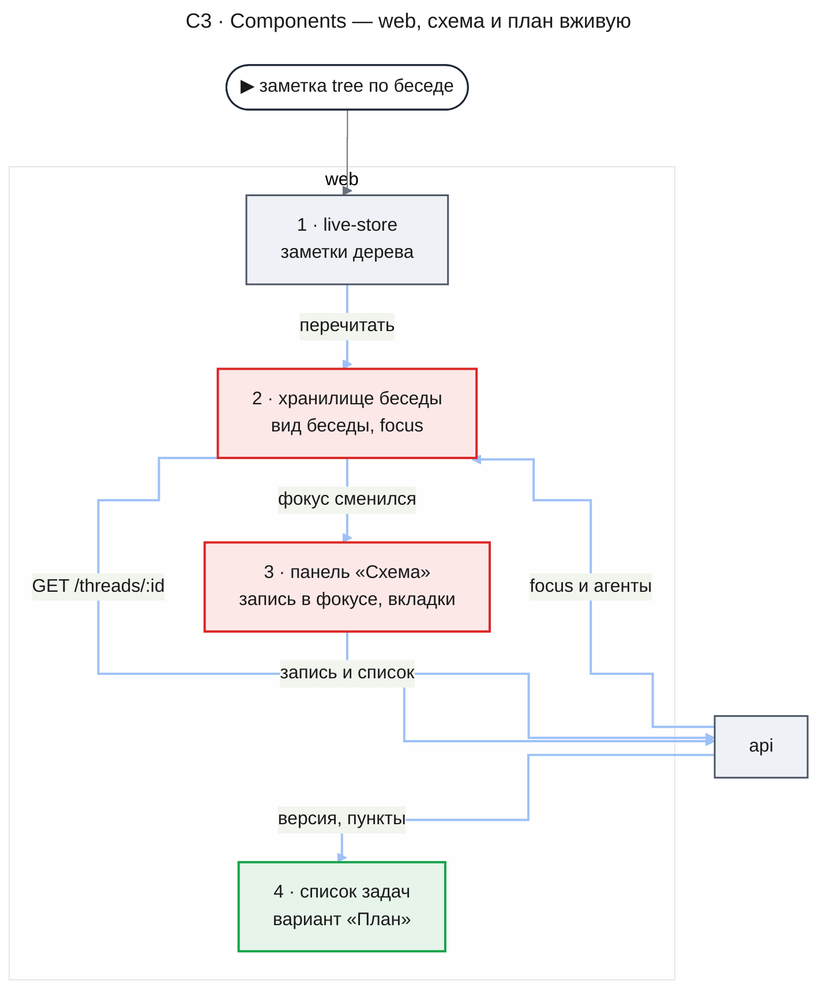
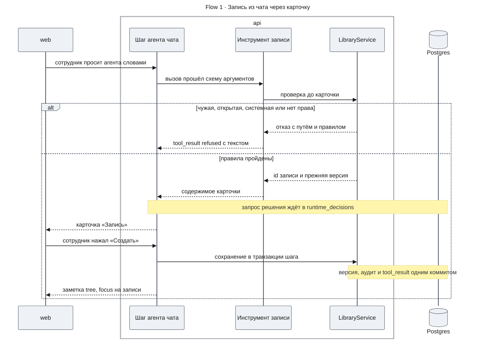
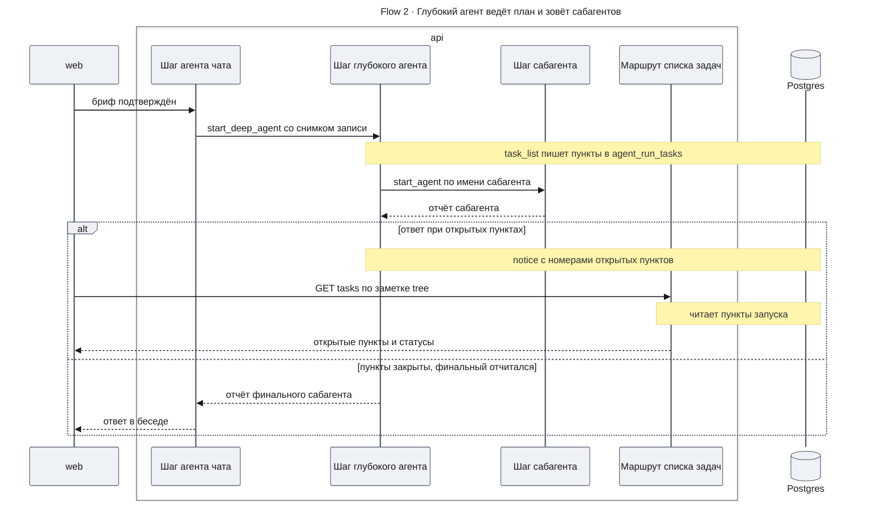
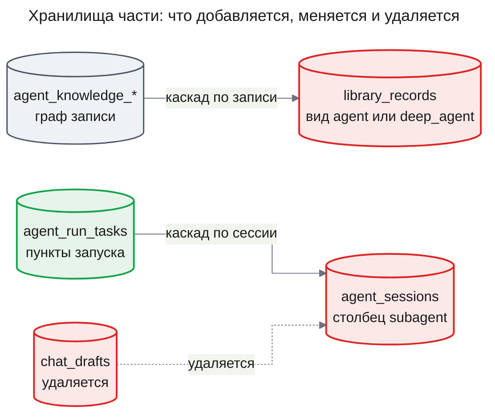
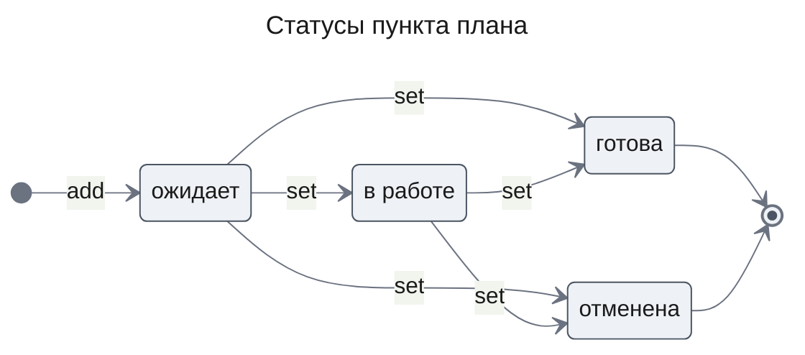

# Глубокие агенты — Design Document — agent-types

**Status:** Draft · **Date:** 2026-11-21 · **PRD:** [prd.md](./prd.md) · **UXRD:** [uxrd.md](./uxrd.md) · **Depends on:** ничего — первая часть

## Snapshot

**Overview.** Сегодня длинную работу в библиотеке описывает workflow: координатор без своих инструментов раздаёт задания исполнителям и держит план в памяти модели. Эта часть заменяет workflow глубоким агентом — агентом со своим промптом, серверами и инструментами, своей командой сабагентов и планом, который хранится в базе и показывается модели на каждом шаге. Записи сотрудник больше не правит формой и черновиком: главный чат читает, создаёт, правит и удаляет их пятью инструментами, а создание, правка и удаление сохраняются только после карточки подтверждения. Ошибку в записи инструмент возвращает чату до карточки, с полем и правилом, чтобы чат исправил запись сам. Рядом с беседой панель «Схема» показывает запись, о которой идёт речь, и план идущего запуска, а в библиотеке глубокий агент открывается карточкой только для чтения.

- **Не меняется**: запуск из чата через подтверждение брифа, права сотрудника на каждый вызов, ход агента кончается текстом, редактор обычного агента.
- **Главный риск**: миграция переписывает встроенный глубокий ресерч на месте и удаляет workflow-записи сотрудников; ошибка в ней теряет граф знаний ресерча.
- **Открытые вопросы**: нет.

### Key Decisions

#### KD-1: Вид записи `deep_agent` заменяет `workflow` везде: в контрактах, базе, снимке запуска и вебе

Глубокий агент — отдельный вид записи, а не обычный агент с необязательной командой. У видов разные правила. Агент хранит список агентов библиотеки, которых может запускать, и запускается инструментом `start_agent`. Глубокий агент хранит сабагентов, финального сабагента и флажок самообучения, а запускается только из чата через бриф. Один вид с необязательными полями размазал бы эти различия по условиям в правилах сохранения, запуска и показа. Содержимое глубокого агента — промпт, серверы, модель, предел шагов, от одного до десяти сабагентов, необязательный финальный сабагент и самообучение. Сабагент — копия внутри записи: имя, описание «когда меня звать», промпт, серверы, модель, предел шагов и предел запусков за запуск, не больше 20.

Ссылки сабагента на агента библиотеки (`source` исполнителя сегодня) нет: сабагент — копия, а «взять новую версию» нужна была только форме. Поэтому уходят состояние источников исполнителей и всё, что их показывает. Снимок запуска получает виды `deep_agent` и `subagent` вместо `workflow` и `executor`. Поле происхождения `executor` и столбец `agent_sessions.executor` переименовываются в `subagent`.

Привязка самообучения переезжает вместе с видом. `learningRunOf` возвращает строку запуска для снимка `deep_agent` с включённым флажком. В множество серверов, по которым проверяются уроки, теперь входят и серверы самого глубокого агента: он вызывает инструменты сам. `subagentSnapshot` передаёт эти серверы каждому сабагенту, как сегодня `executorSnapshot`. Проверка вида в `question-vector.ts` и правило доступа `LibraryService.knowledgeTarget` переходят на `deep_agent`. Без переноса флажок сохранялся бы, а строка запуска не писалась бы, и обучение молча остановилось бы.

#### KD-2: Пакет `packages/workflows` удаляется; запуск через бриф и вид запуска переезжают в `agents`

Всё содержимое пакета — инструмент `start_workflow`, схема брифа, вид запуска и его ошибка. После замены каждый из этих кусков работает с видами, которые уже знает `agents`: снимком, `resolveStart`, `startChild` и списком чата. Отдельный слой ради одного инструмента — лишняя функция сборки, лишний модуль Nest и хак порядка регистрации в `ChatModule`. Поэтому инструмент становится встроенным инструментом `agents` под именем `start_deep_agent`, а его вид подтверждения — `agents.brief`. Вид запуска становится операцией сессий `agents`. Маршрут `GET /api/agents/:agentId/run` остаётся.

Константа `COORDINATOR_PROMPT` становится правилами глубокого агента. Это текст платформы, который `snapshotDefinition` ставит после промпта записи. Он говорит, как звать сабагентов по имени, что они работают в фоне, как вести план инструментом `task_list` и что ответом при финальном сабагенте станет его отчёт. Фразы «ответь одним предложением и остановись» в нём нет: глубокий агент работает сам. Инструменты глубокого агента — серверы его записи, `start_agent`, `message_agent` и `task_list`, а `run_code` добавляет реестр, как всем. Встроенная запись `chat` получает новый промпт: он называет `start_deep_agent`, пять инструментов записей и правило выбора серверов и говорит, что поделиться записью и включить самообучение может только человек на карточке.

#### KD-3: Пять инструментов записей живут в модуле `library` и проверяют запись до карточки новым шагом подтверждения `review`

Инструменты `list_records`, `read_record`, `create_record`, `edit_record` и `delete_record` вызывают `LibraryService` напрямую, поэтому живут в модуле маршрутов `library` в `apps/api`. Модуль регистрирует их в реестре `agents` фабрикой провайдера, как `draft_record` сегодня. Nest строит все провайдеры до `onModuleInit`, где `agents.start()` закрывает регистрацию, и `start_workflow` больше не регистрируется сверху, поэтому инъекция ради порядка уходит. Все пять — `rootOnly`: их получает только корень беседы, а сабагент или глубокий агент получает отказ `tool_not_in_definition` (AC-06.5).

Сегодня шаг инструментов строит карточку синхронно из аргументов, а `prepare` инструмента работает только после одобрения. Права и правила записи требуют чтения библиотеки, поэтому `ToolConfirmation` получает необязательный асинхронный шаг `review`. Шаг инструментов зовёт его до карточки, вне транзакции. `review` отвечает отказом с причиной и текстом или содержимым карточки. Отказ закрывает вызов как `refused`, и карточки нет (AC-06.3, AC-06.4). Содержимое карточки несёт id записи — у создания его заранее выбирает `review` — и номер версии, которую видел сотрудник. После одобрения `execute` получает это содержимое (`confirmed`) и сохраняет в транзакции шага. Сохранение повторяет те же проверки, а версия, которая изменилась после карточки, даёт отказ `version_conflict`.

`LibraryService` получает две операции для чата. Первая проверяет изменение без записи. Вторая проверяет его снова и пишет версию записи с аудитом в точке сохранения транзакции шага, как `saveOwn` сегодня. Область решает цель. Своя запись проверяется по правилам сотрудника, запись другого сотрудника — отказ `read_only`, запись с адресатами — `shared`. Системная запись требует администратора (`admin_only`), а встроенную удалить нельзя (`builtin`). Администратор создаёт системную запись аргументом `system` и проверяется по правилам панели. Узнать, администратор ли сотрудник, инструмент просит у `IdentityDirectory`: он получает операцию `isAdmin` по тому же правилу, что сеанс входа.

Серверы чат выбирает сам (FR-26). Ответ `list_records` после списка записей называет серверы, доступные сотруднику, и имена их инструментов, к которым у него есть право. Для этого `Agents.mcp` получает чтение доступных сотруднику серверов вместе с их инструментами. Описание `create_record` и `edit_record` просит давать каждому сабагенту только нужные серверы. Если чат назвал чужой сервер, текст отказа перечисляет доступные. Отдельного шестого инструмента нет.

#### KD-4: Отказ называет поле и правило: схема содержимого — аргументы инструмента, правила библиотеки — текст отказа

Аргументы `create_record` и `edit_record` содержат запись целиком, и схема аргументов — это схема содержимого вида записи из `contracts` без флажка самообучения. Поэтому `runner.check` сам отклоняет одиннадцать сабагентов, финального сабагента вне команды, пустой промпт или повтор имени. Модель получает отказ `invalid_arguments` с текстом «путь: правило» (`zodErrorText`), и это уже построено частью `core` фичи agent-harness ([design-core.md](../agent-harness/design-core.md#contract-definitions)). Три правила из `superRefine` сегодняшнего `WorkflowContentSchema` переносятся в схему глубокого агента с путями `subagents` и `finalSubagent`. Пределы 1–10 и 1–20 и запрет управляющих символов в имени тоже остаются. Карточки при такой ошибке нет.

Правила, которым нужны данные, решает `decideSave`: имя занято, нет права на сервер или модель, `*` в записи сотрудника, невидимый агент. Его отказ получает путь к части записи и значения, которые нарушили правило, например `subagents.1.servers: jira`. `ToolRunResult` вида `refused` получает необязательный текст, и шаг инструментов пишет его в `tool_result`. Модель читает его тем же каналом, что ошибку аргументов. Веб показывает отказ инструмента записи строкой «Не сохранено:» и текстом платформы как есть, так же как часть `core` показывает текст сбоя транспорта; фразы правила на языке сотрудника (UXRD, MC-23) нет. Так решил владелец (AC-06.4). `ToolRefusalReasonSchema` получает значения `admin_only`, `builtin`, `name_taken`, `system_name`, `server_not_allowed`, `all_servers_not_allowed`, `agent_not_visible` и `version_conflict`.

#### KD-5: План — таблица `agent_run_tasks` пакета `agents`, которую ведёт инструмент `task_list` и которую модель видит блоком промпта на каждом шаге

План принадлежит запуску, то есть сессии глубокого агента. Строки пишет инструмент `task_list` в транзакции шага, вместе с его `tool_result` и событием истории. Поэтому повтор шага не пишет пункт дважды, а рестарт и новое сообщение не теряют план (AC-04.2). У пункта есть номер в запуске с 1, текст и статус. Статусы — «ожидает», «в работе», «готова», «сбой» и «отменена». «Сбой» ставит только платформа задаче с исполнителем, это часть `tasks`. Часть `tasks` добавит в ту же таблицу и тот же инструмент исполнителя, зависимости, ключ, результат и автора, не заменяя их.

История для плана не годится: сжатие заменяет её сводкой, и модель потеряла бы список. Поэтому каждый шаг модели и шаг сжатия читают план из таблицы и ставят его блоком в конец системного промпта. Так же сегодня ставится блок знаний (`withKnowledge`), и оба становятся одним образцом [step-prompt-block.md](../../code-system/patterns/step-prompt-block.md). `endOfTurn` получает открытые пункты плана. Ответ текстом при пункте «ожидает» или «в работе» даёт `notice` с их номерами и текстами (FR-09). Эта ветка стоит после ожидания потомков и до правила финального сабагента. Петлю останавливает предел шагов.

#### KD-6: Панель «Схема» и план обновляются по существующей заметке `tree`; новых каналов нет

Запись в фокусе вычисляет API, а не веб: `ConversationView` получает поле `focus`. Это последняя успешная запись из беседы — чтение, создание, правка или удаление записи либо запуск глубокого агента по брифу — с id записи, действием и временем. Id создания приходит из содержимого карточки (KD-3). Панель читает запись существующим маршрутом `GET /api/library/:id`, а план — новым маршрутом `GET /api/agents/:agentId/tasks` последнего глубокого агента беседы. Карточка записи в библиотеке берёт ту же запись, а вкладка «Задачи» страницы агента — тот же список.

Каждый коммит шага уже пишет событие, а `LiveHub` превращает его в заметку `tree` владельцу. Хранилище беседы перечитывает вид беседы. Панель перечитывает запись, когда сменились фокус или его время, и перечитывает список на каждую заметку дерева этой беседы. Так схема показывает новую версию сразу после одобрения (AC-28.2), а план — новые статусы без перезагрузки.

#### KD-7: Миграция `0003` меняет схему и переписывает строки на месте: встроенный ресерч сохраняет id, прочие workflow удаляются

После baseline проект меняет схему инкрементальными миграциями, которые генерирует `db:generate` ([ADR-0002](../../adr/ADR-0002-app-schema-migrations.md); `0001`, `0002`). Миграция этой части меняет CHECK вида записи на `agent` и `deep_agent`. Она удаляет `chat_drafts`, добавляет `agent_run_tasks` и переименовывает `agent_sessions.executor`. CHECK причины отказа в `agent_code_calls` она строит заново из `ToolRefusalReasonSchema`. Новый CHECK не встанет, пока в таблице есть строки `workflow`, а `recordBody` бросает на таком виде при каждом чтении списка. Поэтому перед CHECK в файл вписываются четыре строки данных.

- Строка встроенного глубокого ресерча переписывается на месте: тот же id, вид `deep_agent` и содержимое из `builtinRecords()`, вписанное литералом при генерации. Граф знаний висит на id записи с каскадом, поэтому он остаётся (AC-08.2). Удалить и вставить строку заново нельзя: каскад стёр бы граф.
- Остальные записи вида `workflow` удаляются вместе с их адресатами и графами. Переносить их запрещает правило «без совместимости» (PRD, Won't Have). Так закрывается вопрос, который PRD оставил владельцу на выкатку (Constraints, «Без совместимости»): пока такие строки есть, CHECK вида не встанет.
- `agent_sessions.record_kind` со значением `workflow` становится `deep_agent`. Без этого `originOf` бросал бы при открытии любой старой беседы с запуском workflow.
- Во входе каждой задачи агента ключ происхождения снимка `executor` переименовывается в `subagent`. Иначе `sessionInputOf` не разобрал бы вход ни одного прежнего запуска, включая корни бесед.

Вход задачи старого запуска workflow хранит снимок вида `workflow` или `executor`. Его читают только продолжение и перезапуск, поэтому такой запуск можно открыть, но не продолжить (Risks). Сидер встроенных записей не меняется: он вставляет недостающую строку и не трогает существующую.

## Terms

- **Глубокий агент, сабагент, финальный сабагент, запуск, список задач, бриф, инструменты записей, карточка подтверждения, панель схемы** — как в [PRD, Terms](./prd.md#terms).
- **План** — пункты списка задач без исполнителя; в этой части других пунктов нет.
- **Пункт** — одна строка списка задач: номер в запуске, текст, статус.
- **Проверка до карточки** (`review`) — шаг подтверждения инструмента, который читает данные и отказывает или строит карточку, прежде чем сотрудник её увидит.
- **Запись в фокусе** — как в [UXRD, Terms](./uxrd.md#terms); в API это поле `focus` вида беседы.
- **Блок промпта** — текст, который шаг агента читает из таблиц на каждом шаге и ставит в конец системного промпта; в историю он не попадает.

## Part

- **Part**: `agent-types`
- **Covers**: FR-01 – FR-09, FR-26 – FR-29
- **Depends on**: ничего — первая часть
- **Prerequisite ADRs**: [ADR-0001](../../adr/ADR-0001-durable-runtime-owner.md), [ADR-0002](../../adr/ADR-0002-app-schema-migrations.md), [ADR-0003](../../adr/ADR-0003-drizzle-data-layer.md), [ADR-0004](../../adr/ADR-0004-agent-framework-packages.md), [ADR-0015](../../adr/ADR-0015-access-gate-and-model-catalogue.md), [ADR-0016](../../adr/ADR-0016-library-records-and-visibility.md), [ADR-0017](../../adr/ADR-0017-run-snapshots-from-library.md)

**Out of scope**

- Задачи с исполнителем, зависимости, ключи, их запуск платформой и сводка задач на карточке хода — часть `tasks`. Стартовые задачи, вид «флоу», образцы и «Сделать свой по образцу» — часть `flows`.
- Сабагента глубокий агент зовёт сам, через `start_agent` по имени, как координатор сегодня; задачи для этого не ставятся.
- Редактор-форма глубокого агента, запуск по расписанию, самообучение, которое меняет записи (PRD, Won't Have).
- Редактор обычного агента, его маршруты и правила; окно «Поделиться», копия, закрытие и бан записи.
- Предел запусков сабагента остаётся 20, предел глубины — `AGENT_MAX_DEPTH`; новых настроек нет.
- Права и аудит вызова MCP: каждый вызов по-прежнему проверяется в момент вызова по правам запустившего (AC-26.2 уже выполняется).

**Constraints**

- Без совместимости: вид `workflow`, его код, тесты, тексты и данные удаляются в той же замене, записи сотрудников не переносятся (KD-7).
- Один владелец долгих задач — `packages/runtime`: сабагента стартует `startChild` в транзакции шага, план — только строки (ADR-0001).
- Ход кончается текстом: инструмента «закончить» нет, отказ ответа — `notice` (KD-5; [design-agents.md](../agent-platform/design-agents.md), KD-2).
- Настройки в базе, новых переменных окружения нет. Пределы плана и текстов — константы кода.
- Журнал — через логгер `common` ([logging.md](../../code-system/patterns/logging.md)): у инструментов записей — сотрудник, агент, вызов, действие, id записи, исход и причина; у `task_list` — запуск, номер, статус. Промпты, содержимое записи и тексты пунктов в журнал не попадают.
- Тестов мало, на нижнем уровне, который ловит дефект ([Test Strategy](#test-strategy)).

**Что меняется в поведении, описанном в соседних документах**

- [agent-platform/design-workflows.md](../agent-platform/design-workflows.md) целиком: workflow, координатор и `start_workflow` заменены глубоким агентом и `start_deep_agent` (KD-1, KD-2).
- [custom-agents/design-library.md](../custom-agents/design-library.md): виды записей, `saveOwn` для черновиков и маршрут решения по черновику заменены операциями для инструментов записей (KD-3). [custom-agents/design-runtime.md](../custom-agents/design-runtime.md): `draft_record` удалён, наборы запуска команды теперь у глубокого агента. [custom-agents/design-web.md](../custom-agents/design-web.md): форма workflow и карточка черновика удалены.
- [self-learning/design-core.md](../self-learning/design-core.md) и [design-web.md](../self-learning/design-web.md): самообучение у глубокого агента, переключатель на карточке записи (KD-1).
- [chat-shell/design-web-shell.md](../chat-shell/design-web-shell.md): рабочая область стала панелью «Схема» и открывается сама (KD-6).

## Building-block Inventory

Follows the [code system](../../code-system/README.md).

| Building block | Pattern | Status | Note |
|---|---|---|---|
| Схема содержимого глубокого агента | — | new | заменяет `WorkflowContentSchema` (KD-1) |
| Снимок, `snapshotDefinition`, `resolveStart` | [run-snapshot.md](../../code-system/patterns/run-snapshot.md) | extended | виды `deep_agent`, `subagent` |
| `gateStart`, `launchSetOf`, `chatListing` | [pure-decision.md](../../code-system/patterns/pure-decision.md) | extended | команда глубокого агента, строки глубоких агентов |
| `endOfTurn` | [pure-decision.md](../../code-system/patterns/pure-decision.md) | extended | открытые пункты плана (KD-5) |
| `start_deep_agent`, вид запуска | — | extended | перенесены из `packages/workflows` (KD-2) |
| `ToolConfirmation`, шаг инструментов | [step-handler.md](../../code-system/patterns/step-handler.md) | extended | `review`, `confirmed`, текст отказа (KD-3, KD-4) |
| Пять инструментов записей | [composition-root.md](../../code-system/patterns/composition-root.md) | new | искали инструмент записи: был только `draft_record`, он удаляется (KD-3) |
| `LibraryService`, `decideSave` | [pure-decision.md](../../code-system/patterns/pure-decision.md) | extended | проверка и сохранение для чата, путь в отказе |
| `IdentityDirectory` | — | extended | `isAdmin` |
| `Agents.mcp` | — | extended | доступные серверы с инструментами |
| Список задач и `task_list` | [repository-over-transaction.md](../../code-system/patterns/repository-over-transaction.md) | new | в `agents` нет состояния сессии вне истории (KD-5) |
| Блок плана в промпте | [step-prompt-block.md](../../code-system/patterns/step-prompt-block.md) | new pattern | второе использование после блока знаний (KD-5) |
| `ConversationView.focus`, маршрут списка | [read-on-open.md](../../code-system/patterns/read-on-open.md) | extended | KD-6 |
| Карточка решения, определение записи | [interface-text.md](../../code-system/patterns/interface-text.md) | extended | вариант «Запись», варианты «Схема», «На странице», «Правка» |
| Панель «Схема» | [shell-store.md](../../code-system/patterns/shell-store.md) | extended | рабочая область оболочки с содержимым |
| Список задач в вебе | [read-on-open.md](../../code-system/patterns/read-on-open.md) | new | вариант «План» [run-task-list.md](../../design-system/components/run-task-list.md) |

Отклонение [pure-decision.md](../../code-system/patterns/pure-decision.md) в `LibraryService.save` — владение, адресаты и смена вида проверяются условиями в сервисе — эта часть не трогает. Новые проверки владения для чата встают туда же, в одну операцию сервиса, а не в инструмент.

## Acceptance Criteria

### FR-01: Глубокий агент вместо workflow

- From the PRD: AC-01.1, AC-01.2
- Вид записи `workflow` не принимает ни один маршрут, инструмент и схема, а сохранённая строка такого вида после миграции не остаётся (DC-1).

### FR-02: Свои изолированные сабагенты

- From the PRD: AC-02.1, AC-02.2, AC-02.3
- Отказ `start_agent` глубокого агента по имени вне команды — `not_allowed` с текстом, который называет команду (DC-2).

### FR-03: Запуск из чата через бриф

- From the PRD: AC-03.1, AC-03.2
- `start_agent` с id глубокого агента у любого агента даёт `not_allowed` с текстом, что глубокого агента запускает только чат после брифа (DC-3).

### FR-04: План глубокого агента

- From the PRD: AC-04.1, AC-04.2
- Модель видит план целиком в начале каждого шага, в том числе после сжатия истории (DC-4).

### FR-05: Ответ финального сабагента

- From the PRD: AC-05.1, AC-05.2

### FR-06: Инструменты записей в главном чате

- From the PRD: AC-06.1, AC-06.2, AC-06.3, AC-06.4, AC-06.5, AC-06.6
- Если запись изменилась между карточкой и одобрением, запись не меняется, а чат получает отказ `version_conflict` (DC-5).
- Администратор не может удалить встроенную запись: отказ `builtin` до карточки (DC-6).

### FR-07: Глубокий ресерч — встроенный глубокий агент

- From the PRD: AC-07.1

### FR-08: Самообучение у глубоких агентов

- From the PRD: AC-08.1, AC-08.2

### FR-09: Напоминание об открытых пунктах плана

- From the PRD: AC-09.1, AC-09.2

### FR-26: Чат сам выбирает MCP-серверы

- From the PRD: AC-26.1, AC-26.2
- Ответ `list_records` называет каждый сервер, на инструмент которого у сотрудника есть право, с именами этих инструментов, и не называет других (DC-7).

### FR-27: Ошибка в записи объясняется чату

- From the PRD: AC-27.1

### FR-28: Панель схемы

- From the PRD: AC-28.1, AC-28.2, AC-28.3

### FR-29: Карточка глубокого агента в библиотеке

- From the PRD: AC-29.1, AC-29.2, AC-29.3

## Design

### Architecture (C1–C4)

Внешних систем и людей часть не добавляет, поэтому C1 не рисуется.

#### C2 · Containers

Схема показывает, какие контейнеры меняет часть: API получает инструменты записей и план, база — таблицу плана, веб — панель и карточки.

Контейнер `packages/workflows` внутри API исчезает (KD-2). Новых каналов между вебом и API нет: живые обновления идут прежней заметкой `tree` (KD-6).

#### C3 · Components: api

**api — запись из чата**

- Шаг инструментов зовёт `review` только для вызова, которому нужна карточка и который прошёл схему аргументов и правило повтора. Отказ `review` закрывается так же, как отказ проверки, с текстом.
- Инструмент записи — тонкий адаптер. Он переводит аргументы и содержимое карточки в изменение для сервиса, а отказ сервиса — в причину и текст. Правила живут только в `LibraryService` и `decideSave`, а не в инструменте.
- `LibraryService` проверяет видимость, владение, адресатов, системность и встроенность записи. Затем он зовёт `decideSave` с выбором сотрудника или панели. Сохранение повторяет то же под блокировкой строки и сверяет версию.

**api — шаг глубокого агента**

- `snapshotDefinition` для снимка `deep_agent` собирает промпт записи, правила глубокого агента и строки команды «имя (до N запусков): когда звать». Серверы он берёт из записи, а не пустые, как у координатора. Для снимка `subagent` он собирает промпт и серверы сабагента без команды.
- Наборы запуска: у глубокого агента — команда по имени, у сабагента — пусто, у корня беседы — агенты через `start_agent` и глубокие агенты через `start_deep_agent`. В `agents` снимка агента входят только записи вида `agent`, поэтому агент не видит глубокого агента среди тех, кого можно звать.
- Шаг модели читает открытые пункты до вызова `endOfTurn`, как сегодня читает отчёт финального исполнителя и потомков в работе.

#### C3 · Components: web

**web — панель «Схема» и вкладка «Задачи»**

- Панель — прежняя рабочая область оболочки с тем же размером, ручкой и закрытием. Состояние «открыта» переезжает из `ShellMain` в стор оболочки, чтобы панель открывал не только заголовок. От 1024 px панель открывается сама, когда `focus` переходит на новое событие с действием «создано», «изменено» или «запущено». После «×» она ждёт следующего такого события.
- Вкладка «Задачи» в панели появляется, когда среди агентов беседы есть глубокий агент, и показывает последнего. На странице глубокого агента список стоит на вкладке «Задачи», выбранная вкладка живёт в адресе страницы (UXRD, DA-04).
- Библиотека открывает глубокого агента карточкой только для чтения. Это определение записи, вариант «На странице», с «Кто видит», копией, удалением и переключателем самообучения. Переключатель сохраняет запись прежним `PUT` записи целиком с перевёрнутым флажком и ожидаемой версией. Отдельного маршрута нет.
- Карточка решения получает вариант «Запись» по виду подтверждения `library.record`. Пометки «изменено», «новый» и «Убрано» веб считает тем же сравнением `changedFields`, что сравнивал черновики, по прежней и новой версии из содержимого карточки.

### Runtime Flows

#### Flow 1: Чат создаёт или правит запись

**Starts when:** модель чата вызывает `create_record` или `edit_record`, for AC-06.1, AC-06.2, AC-06.3, AC-06.4, AC-27.1, AC-28.1, AC-28.2

Отказ по схеме аргументов (AC-27.1) происходит раньше, в `runner.check`, и до инструмента не доходит. Отклонённая карточка закрывает вызов исходом `rejected` и ничего не пишет (AC-06.2). Сохранение после одобрения может отказать, если запись изменилась или стала открытой. Тогда вызов закрывается `refused` с причиной, запись не меняется, а карточка показывает «Не сохранено:» и текст отказа (KD-4).

#### Flow 2: Запуск глубокого агента с планом

**Starts when:** сотрудник подтверждает бриф глубокого агента, for AC-03.1, AC-04.1, AC-04.2, AC-05.1, AC-05.2, AC-07.1, AC-09.1, AC-28.3

Пункты плана — строки в транзакции шага, поэтому рестарт сервера продолжает тот же запуск с тем же планом (AC-04.2). Сабагент начинает с одного задания: `start_agent` пишет в его историю только запись `task` с текстом, который дал глубокий агент (AC-02.2). Без финального сабагента ответом становится текст глубокого агента, когда пункты закрыты и потомки закончили.

### Contract Definitions

Части `tasks` и `flows` опираются на вид записи, снимок, список задач, его инструмент, пять инструментов записей и данные схемы.

**Запись глубокого агента** (`kind: 'deep_agent'`, содержимое в `contracts`)

- `prompt` — текст 1–20 000 символов.
- `servers` — имена серверов реестра или `*`; `*` только у системной записи.
- `model` — id модели или `null` (модель чата по умолчанию на старте); `maxTurns` — 1–200.
- `subagents` — 1–10 сабагентов. У каждого: `name` — до 80 символов без управляющих, уникально в записи; `description` — до 300 символов, «когда меня звать»; `prompt`, `servers`, `model`, `maxTurns` — как у записи; `maxRuns` — 1–20 запусков за запуск глубокого агента.
- `finalSubagent` — имя сабагента команды или `null`.
- `selfLearning` — по умолчанию `false`; меняется только людьми: `PUT` записи и переключатель на карточке.
- Нарушение — ошибка схемы с путём (`subagents`, `subagents.N.name`, `finalSubagent`) и правилом.

**Снимок запуска** (`RunSnapshotSchema`)

- Виды `agent`, `deep_agent`, `subagent`. Снимок `deep_agent` — содержимое записи с моделями, разрешёнными на старте. Снимок `subagent` — сабагент из снимка глубокого агента по имени и серверы обучения или `null`.
- Происхождение сессии (`RunOriginSchema`) — номер, вид, версия, автор записи и `subagent` — имя сабагента или `null`.

**Список задач** (владелец — `agents`)

- Принадлежит запуску — сессии глубокого агента; читается и пишется только по владельцу этой сессии. Удаляется вместе с сессией.
- Пункт: `number` — номер в запуске с 1, не переиспользуется; `text` — до 2 000 символов; `status` — `waiting`, `running`, `done`, `failed`, `cancelled` (`RunTaskStatusSchema`; это не статус задачи runtime `TaskStatusSchema`); `createdAt`, `updatedAt`.
- Пункт этой части не имеет исполнителя и не получает `failed`. `done` и `cancelled` конечны.
- Часть `tasks` добавляет к пункту исполнителя, зависимости, ключ, результат и автора, а к инструменту — эти аргументы. Номер, текст и статус она не меняет. Пункт плана пишется в транзакции шага; задачу с исполнителем пишет транзакция причины ([design-tasks.md](./design-tasks.md), KD-1).

**`task_list`** — встроенный инструмент, у глубокого агента в этой части. Аргументы: `add` — тексты новых пунктов, `set` — пары «номер, статус». Пишет в транзакции шага и возвращает весь список текстом. Отказ `invalid_arguments` с текстом: номера нет в запуске, переход из конечного статуса, `failed` от агента, пустой вызов. Предел пунктов на запуск — константа кода; превышение — тот же отказ.

**Блок плана** — каждый шаг модели и шаг сжатия глубокого агента ставят в конец системного промпта список пунктов с номерами и статусами. В историю он не пишется.

**`endOfTurn`** — получает открытые пункты плана. У глубокого агента без потомков в работе ответ текстом при открытом пункте даёт `notice`. Уведомление называет номера и тексты открытых пунктов, и правило финального сабагента после этого не проверяется. Корень беседы, агент и сабагент не меняются.

**`start_deep_agent`** — встроенный, `rootOnly`. Аргументы: `deepAgent` (id), `question`, `boundaries`, `result`. Карточка вида `agents.brief`, аргументы правятся на карточке. После одобрения — старт по `resolveStart` с ожидаемым видом `deep_agent`. Отказы и ответ — как у `start_workflow` сегодня. Его описание получает строки глубоких агентов из `chatListing`.

**`start_agent`** — у глубокого агента `agent` — имя сабагента. Отказы: имени нет в команде — `not_allowed` с текстом про команду; предел `maxRuns` — `run_limit`. У любого агента id записи `deep_agent` даёт `not_allowed` с текстом, что такую запись запускает только чат после брифа.

**Инструменты записей** — встроенные, `rootOnly`, регистрирует `apps/api`. Отказы до карточки и после одобрения: `record_unavailable` — записи нет или она не видна; `read_only` — чужая; `shared` — у записи есть адресаты; `admin_only` — системная, а сотрудник не администратор; `builtin` — удаление встроенной; `version_conflict` — запись изменилась после карточки. Правила содержимого дают `invalid_arguments` (схема) или `name_taken`, `system_name`, `server_not_allowed`, `all_servers_not_allowed`, `model_not_allowed`, `agent_not_visible` (правила библиотеки). Каждый отказ несёт текст с путём части записи и правилом.

- **`list_records`** — без аргументов. Возвращает текстом записи, которые сотрудник видит: id, вид, имя, описание, чья запись («своя», «открыта вашей роли», «системная»), открыта ли она. У администратора в список входят и системные записи панели. После записей идут серверы, доступные сотруднику, с именами инструментов, на которые у него есть право.
- **`read_record`** — `recordId`. Возвращает определение видимой записи целиком: вид, имя, описание, содержимое, версию, чья она.
- **`create_record`** — `kind`, `name`, `description`, `content` — запись целиком по схеме её вида, но без `selfLearning` — и `system` (по умолчанию `false`, только администратор). Созданная запись получает `selfLearning: false`. После одобрения возвращает id и версию.
- **`edit_record`** — `recordId` и запись целиком, как у создания, тоже без `selfLearning`. Флажок берётся из сохранённой версии. Возвращает новую версию.
- **`delete_record`** — `recordId`. Удаляет запись, как удаление в библиотеке.

**Содержимое карточки `library.record`** (`ConfirmationKindSchema` получает `library.record`; `agents.brief` заменяет `workflows.brief`)

- `action` — `create`, `edit` или `delete`; `recordId` — id записи, у создания — выбранный заранее.
- `kind`, `system` — вид и системность записи.
- `next` — имя, описание и содержимое после изменения; `null` у удаления.
- `previous` — имя, описание, содержимое и `version` сохранённой записи; `null` у создания. Сохранение сверяет `version` (DC-5).

**Изменения в `ToolConfirmation` и `ToolRunResult`** (`agents`)

- `review(args, caller)` — необязательный шаг до карточки. Возвращает отказ (причина и текст) или содержимое карточки; без него карточку строит `content(args, tools)`, как сегодня.
- `InCommitToolInput.confirmed` — содержимое карточки, которую одобрил сотрудник.
- `ToolRunResult` вида `refused` — необязательный `text`; шаг пишет его в `tool_result`, модель читает его после `[refused: <причина>]`.

**Маршруты**

- **`GET /api/agents/:agentId/tasks`** — список задач запуска агента `agentId` по номерам. Возвращает `RunTaskListView` с пунктами выше. Чужой или несуществующий агент — 404 `AGENT_NOT_FOUND`, как у других маршрутов `/api/agents`; у агента без списка — пустой список.
- **`GET /api/threads/:threadId`** — `ConversationView` получает `focus`: `recordId`, `action` (`read`, `created`, `changed`, `deleted`, `started`), `at`; `null`, пока чат не касался записей. Поле `drafts` удаляется.
- **`GET /api/agents/:agentId/run`** — вид запуска глубокого агента (`DeepAgentRunViewSchema` вместо `WorkflowRunViewSchema`): бриф, команда (имя, `maxRuns`, финальный ли), шаги — прямые дети, отказы по пределу.
- Удаляется `POST /api/threads/:threadId/drafts/:draftId`.

### Data Model

- `agent_run_tasks` принадлежит `agents`. Строка — пункт запуска: сессия глубокого агента, номер, текст, статус, время. Номер уникален в запуске, статус проверяет CHECK из `RunTaskStatusSchema`. Удаление сессии удаляет пункты каскадом, как `agent_messages`.
- `library_records.kind` проверяет CHECK из `RecordKindSchema` (`agent`, `deep_agent`). Содержимое по-прежнему проверяет только схема вида в коде.
- `agent_sessions.executor` переименован в `subagent`; `record_kind` без CHECK, как сегодня.
- `agent_code_calls.refusal_reason` — CHECK из расширенного `ToolRefusalReasonSchema`.
- `chat_drafts` удаляется со всеми CHECK и внешним ключом.
- Миграция `0003` генерируется `db:generate`; строки данных из KD-7 вписываются в неё до новых CHECK. Встроенные записи сидер вставляет, как сегодня.

### State Transitions and Invariants

Статусы пункта плана в этой части; все переходы делает глубокий агент инструментом `task_list`.

**Invariants**

1. Пункт плана пишется и меняется в транзакции шага своего запуска, вместе с `tool_result` вызова, который его изменил; задачу с исполнителем пишет транзакция причины ([design-tasks.md](./design-tasks.md), KD-1).
2. Номер пункта не меняется и не повторяется в запуске.
3. Записи меняются из чата только после одобренной карточки, и сохранение проверяет то же, что проверка до карточки, на версии, которую видел сотрудник.
4. Инструменты записей не меняют записей с адресатами, записей других сотрудников и флажка самообучения.
5. Глубокий агент запускает только сабагентов своего снимка, а глубокого агента запускает только `start_deep_agent` корня беседы.

## Test Strategy

- **UC-1: Схема глубокого агента** — covers AC-27.1, AC-01.1
  - Given: содержимое с 11 сабагентами; с финальным сабагентом вне команды; с пустым промптом сабагента; с повтором имени
  - When: схема разбирает содержимое
  - Then: каждое отклонено; ошибка называет путь (`subagents`, `finalSubagent`, `subagents.N.prompt`, `subagents`) и правило, у первого — предел 10
- **UC-2: Правила записи с путём** — covers AC-06.4
  - Given: сотрудник без права на сервер `jira`, глубокий агент, у второго сабагента которого `jira`
  - When: `decideSave` решает сохранение
  - Then: отказ `server_not_allowed` с путём `subagents.1.servers` и значением `jira`
- **UC-3: Чат меняет только своё** — covers AC-06.3, AC-06.6, DC-6
  - Given: запись сотрудника B, своя запись сотрудника A с адресатом-ролью, системная запись, встроенный глубокий ресерч; сотрудник A не администратор, администратор C
  - When: чат A вызывает правку и удаление каждой; чат C правит ресерч и удаляет его
  - Then: у A — отказы `read_only`, `shared`, `admin_only` с текстом, запросов решения нет, версии не изменились; у C правка ведёт к карточке, после одобрения версия ресерча новая и видна сотруднику; удаление — отказ `builtin` до карточки
- **UC-4: Создание через карточку** — covers AC-06.1, AC-06.2, AC-01.2, AC-28.1, DC-5
  - Given: модель чата вызывает `create_record` с глубоким агентом из двух сабагентов
  - When: сотрудник сначала отклоняет карточку, затем модель вызывает снова, и сотрудник одобряет; третья правка одобряется после того, как запись изменили в обход карточки
  - Then: после отклонения записи нет; после одобрения запись есть в библиотеке сотрудника с id из карточки, `focus` беседы указывает на неё с действием `created`; третья правка — отказ `version_conflict`, версия прежняя
- **UC-2a: Чат видит только свои серверы** — covers DC-7
  - Given: сервер `jira`, на один инструмент которого у сотрудника есть право, и сервер `logs` без прав
  - When: `list_records` отвечает сотруднику
  - Then: `jira` назван только с этим инструментом, `logs` не назван
- **UC-5: Только своя команда** — covers AC-02.1, AC-03.2, DC-2, DC-3
  - Given: наборы запуска глубокого агента с командой «сбор», «ответ» и агента, у которого в списке есть id глубокого агента
  - When: `gateStart` решает запуск «отчёт» и запуск глубокого агента
  - Then: оба `not_allowed`; запуск «сбор» разрешён до `maxRuns`
- **UC-6: Глубокий ресерч по команде** — covers AC-07.1, AC-02.2, AC-05.1, AC-05.2, AC-03.1
  - Given: встроенный глубокий ресерч, сценарий модели: план, два сбора, раннее «готово», ответ
  - When: сотрудник подтверждает бриф и запуск идёт
  - Then: раннее «готово» получает `notice` про финального сабагента; в истории каждого сабагента одно задание; ответ беседы — отчёт сабагента ответа без пересказа
- **UC-7: План переживает рестарт и чужого не видно** — covers AC-04.1, AC-04.2, DC-4
  - Given: глубокий агент добавил три пункта и первый перевёл в «в работе»
  - When: процесс API перезапускается и сотрудник пишет агенту; другой сотрудник читает `GET /api/agents/:agentId/tasks`
  - Then: владелец видит те же три пункта и статусы, промпт следующего шага содержит блок плана; другой сотрудник получает 404
- **UC-8: Ответ при открытых пунктах** — covers AC-09.1, AC-09.2
  - Given: глубокий агент без потомков в работе; план с пунктом «в работе»; план, где все пункты закрыты
  - When: `endOfTurn` решает ответ текстом
  - Then: первый — `notice` с номером пункта; второй — ответ принят
- **UC-9: Самообучение у глубокого агента** — covers AC-08.1
  - Given: глубокий агент с включённым самообучением
  - When: его запуск закончился
  - Then: строка запуска знаний записана при старте, задача извлечения создана после конца
- **UC-10: Схема и карточка в вебе** — covers AC-28.1, AC-28.2, AC-28.3, AC-29.1
  - Given: вид беседы с `focus` на глубоком агенте с тремя сабагентами, затем с новой версией без одного, затем с запущенным глубоким агентом
  - When: приходят заметки `tree`
  - Then: панель показывает трёх сабагентов, затем двух без перезагрузки, затем вкладку «Задачи» с пунктами; карточка записи в библиотеке не даёт править ни одного поля

DC-1 проверяет сборка: после удаления вида из `RecordKindSchema` ни одна схема и маршрут его не принимают, а CHECK из той же схемы не даёт строке остаться. AC-02.3 и AC-26.2 проверяют существующие тесты прав вызова: снимок глубокого агента идёт тем же путём, что снимок агента. AC-06.5 проверяет существующий тест `rootOnly` в реестре. AC-08.2 проверяет владелец, применив миграцию к базе разработки с графом ресерча: в CI графа до миграции нет. AC-26.1 проверяет владелец вручную (PRD). AC-29.2 и AC-29.3 держат прежние «Кто видит» и закрытие, а отказ `shared` проверяет UC-3. Тесты `workflow`, `draft_record` и `packages/workflows` удаляются вместе с кодом; тесты самообучения переписываются на глубокого агента.

## Security Considerations

- **Authentication & Authorization**: инструменты записей есть только у корня беседы. Права решает `LibraryService` от имени владельца беседы, а не модель. Системные записи меняет только администратор, а проверку `isAdmin` делает `IdentityDirectory` по тому же правилу, что сеанс. Маршрут списка задач отвечает только владельцу сессии. Серверы записи не дают прав: вызов проверяется в момент вызова по правам запустившего.
- **Input Validation**: запись от модели проверяют схема вида в `runner.check` и правила библиотеки до карточки и снова при сохранении. Текст из результатов инструментов может подтолкнуть чат вписать чужую инструкцию в промпт. Защита — карточка с определением целиком и пометками изменённого, а также запрет менять открытые записи (PRD, Risks).
- **Sensitive Data Handling**: журнал инструментов записей и `task_list` несёт id, действие, исход и причину, но не промпты, содержимое и тексты пунктов. Для этого `loggedArgs` у инструментов записей называет только `recordId`, `kind` и `name`. Секретов записи не содержат: серверы названы по имени.

## Risks and Mitigation

- **Миграция теряет граф ресерча** — если строку ресерча удалить, а не переписать, каскад сотрёт граф; вероятность низкая. KD-7 переписывает строку на месте, а владелец проверяет граф после миграции на базе разработки.
- **Старые запуски workflow не продолжаются** — вход задачи хранит снимок прежнего вида, и продолжение или перезапуск падают на разборе; влияние — только база разработки. Старые беседы открываются, потому что `record_kind` переименован (KD-7).
- **Слабая модель шлёт неполную запись при правке** — правка передаёт запись целиком, и модель может потерять сабагента; вероятность средняя. Карточка помечает убранное строкой «Убрано», а сотрудник отклоняет карточку.
- **Модель не закрывает пункты** — напоминание тратит шаги; петлю останавливает предел шагов записи. Число напоминаний видно в журнале (PRD, Success Criteria).
- **Пересечение с переводом веба** — другая сессия переводит интерфейс в тех же файлах. Это каталоги `messages/{en,ru}` (`library`, `agents`, `tools`, `admin`, `shell`, `errors`, `announce`), `components/library`, `components/agents`, `components/admin/library`, `lib/feed` и `components/shell`. Веб этой части начинают после того, как работа перевода влита, и перед началом сверяют `git status`. Тексты со словом «workflow» в select `{kind, select, agent {...} other {...}}` переписываются целиком, а не точечно.
- **Длинное описание серверов в ответе списка** — у сотрудника с десятками инструментов ответ `list_records` растёт; влияние — расход контекста чата. Ответ обрезается константой кода с пометкой.

## Open Questions

Нет.

## Update History

| Version | Date | Change |
|---------|------|--------|
| 1.0 | 2026-11-21 | Первая версия |
| 1.1 | 2026-11-21 | Invariant 1 и контракт списка задач: правило транзакции шага — для пунктов плана, задачу с исполнителем пишет транзакция причины (design-tasks.md, KD-1). Решение владельца: веб показывает отказ инструмента записи как «Не сохранено:» и текст платформы; открытый вопрос закрыт |
