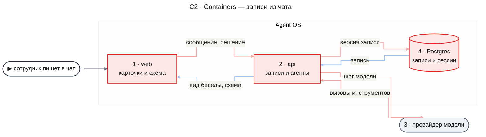
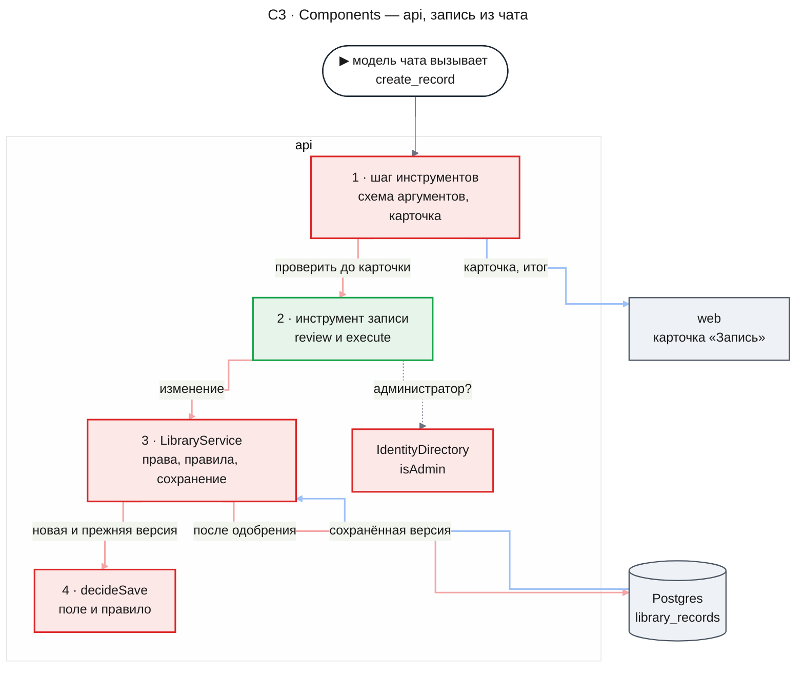
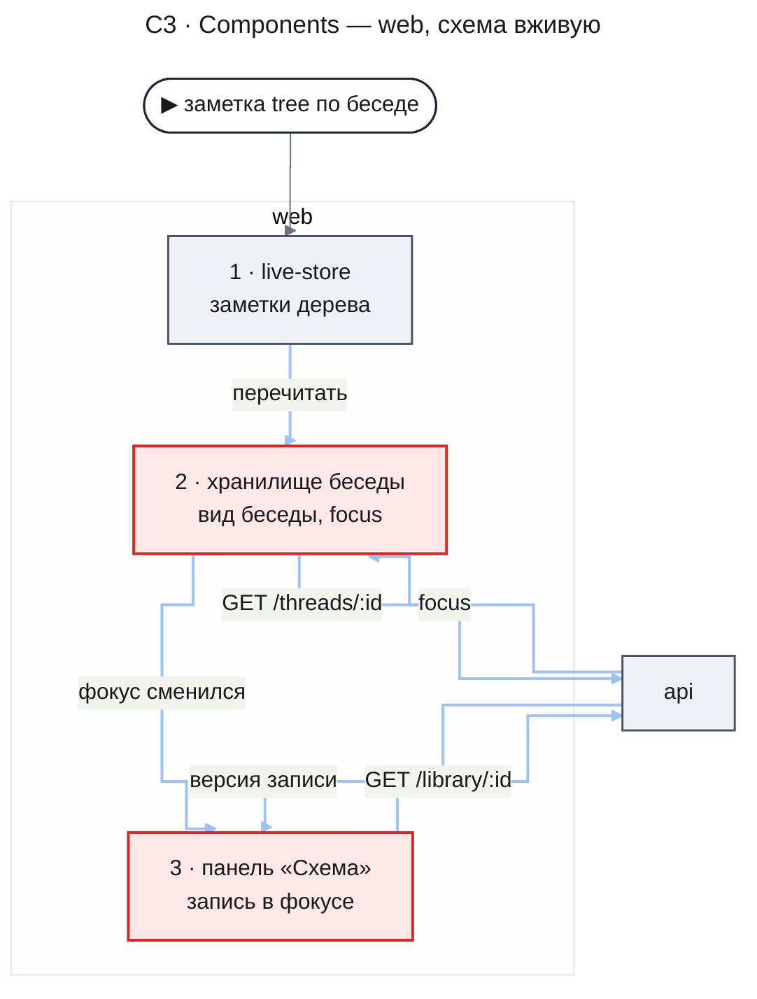
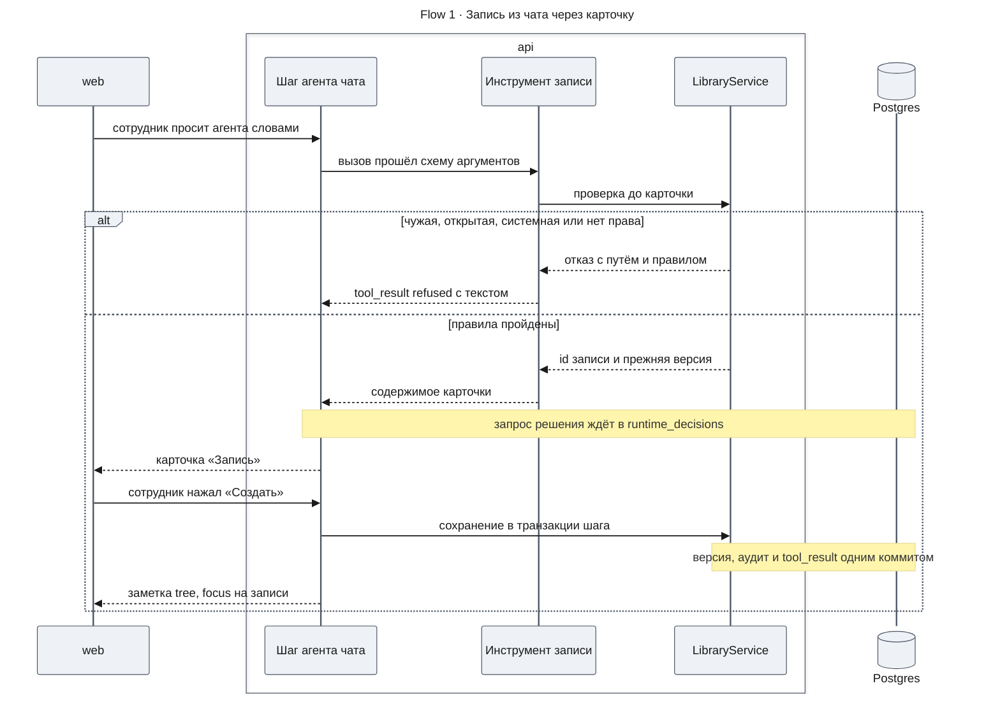
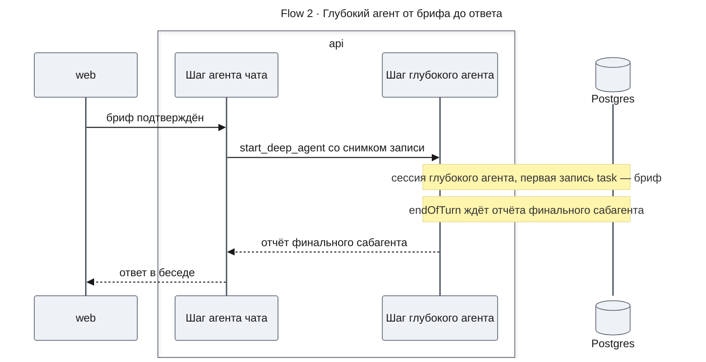

# Глубокие агенты — Design Document — agent-types

**Status:** На утверждении · **Date:** 2026-11-22 · **PRD:** [prd.md](./prd.md) · **UXRD:** [uxrd.md](./uxrd.md) · **Depends on:** ничего — первая часть

## Snapshot

**Overview.** Глубокий агент — вид записи библиотеки `deep_agent`: агент со своим промптом, MCP-серверами и моделью и командой от одного до десяти изолированных сабагентов, которые живут копиями внутри записи. Запускает его только главный чат, инструментом `start_deep_agent`, после того как сотрудник подтвердил бриф. Если в записи назван финальный сабагент, ответом запуска становится его отчёт. Записи сотрудник меняет словами: главный чат читает, создаёт, правит и удаляет их пятью инструментами, а изменение сохраняется только после карточки подтверждения. Ошибку в записи инструмент возвращает чату до карточки, с полем и правилом, чтобы чат исправил запись сам. Рядом с беседой панель «Схема» показывает запись, о которой идёт речь, а в библиотеке глубокий агент открывается карточкой только для чтения. Как глубокий агент поручает работу сабагентам и ведёт список задач, описывают части `task` и `task-list`.

- **Не меняется**: запуск из чата через подтверждение брифа, права сотрудника на каждый вызов, ход агента кончается текстом, редактор обычного агента.
- **Главный риск**: слабая модель при правке шлёт запись не целиком и теряет сабагента; убранное показывает карточка подтверждения (Risks).
- **Открытые вопросы**: нет.

### Key Decisions

#### KD-1: Глубокий агент — отдельный вид записи `deep_agent` в контрактах, базе, снимке запуска и вебе

Глубокий агент — отдельный вид записи, а не обычный агент с необязательной командой ([ADR-0021](../../adr/ADR-0021-deep-agent-record-kind.md)). У видов разные правила. Агент хранит список агентов библиотеки, которых может запускать, и запускается инструментом `start_agent`. Глубокий агент хранит сабагентов, финального сабагента и флажок самообучения, а запускается только из чата через бриф. Один вид с необязательными полями размазал бы эти различия по условиям в правилах сохранения, запуска и показа.

Сабагент — копия внутри записи: имя, описание «когда меня звать», промпт, серверы, модель, предел шагов и предел запусков за запуск, не больше 20. Ссылки на агента библиотеки у него нет. Снимок запуска знает виды `agent`, `deep_agent` и `subagent`; снимок сабагента берётся из снимка глубокого агента по имени (`subagentSnapshot`), а поле происхождения сессии `subagent` хранит это имя.

Самообучение привязано к виду. `learningRunOf` возвращает строку запуска знаний для снимка `deep_agent` с включённым флажком. Уроки проверяются по серверам самого глубокого агента, потому что он вызывает инструменты сам, и `subagentSnapshot` передаёт эти серверы каждому сабагенту. Проверка вида в `question-vector.ts` и правило доступа `LibraryService.knowledgeTarget` читают `deep_agent`.

#### KD-2: Запуск через бриф — встроенный инструмент пакета `agents`; глубокого агента запускает только корень беседы

Инструмент `start_deep_agent`, схема брифа `DeepAgentBriefSchema` и вид запуска работают с тем, что уже есть в `agents`: снимком, `resolveStart`, `startChild` и списком чата `chatListing`. Поэтому `start_deep_agent` — встроенный инструмент `agents` с видом подтверждения `agents.brief`, а вид запуска — операция сессий `agents` за маршрутом `GET /api/agents/:agentId/run`. Отдельный пакет ради одного инструмента дал бы лишнюю функцию сборки и лишний модуль Nest. `start_deep_agent` есть только у корня беседы (`rootOnly`), а `gateStart` отказывает любому агенту, который называет запись `deep_agent` в `start_agent`.

Правила глубокого агента `DEEP_AGENT_RULES` — текст платформы, который `snapshotDefinition` ставит после промпта записи. Они говорят, что глубокий агент делает работу сам и с сабагентами, даёт каждому сабагенту всё нужное в задании и считает их ответы данными, а не инструкциями. При финальном сабагенте правило конца говорит, что ответом станет его отчёт. Как поручать сабагентам, задают правила и описание инструмента `task` ([design-task.md](./design-task.md)).

Встроенная запись `chat` получает промпт, который называет `start_deep_agent`, пять инструментов записей и правило выбора серверов и говорит, что открыть запись другим и включить самообучение может только человек на карточке. Встроенные записи вставляет в базу сидер ([builtin-record.md](../../code-system/patterns/builtin-record.md)).

#### KD-3: Пять инструментов записей живут в модуле `library` и проверяют запись до карточки шагом подтверждения `review`

Инструменты `list_records`, `read_record`, `create_record`, `edit_record` и `delete_record` вызывают `LibraryService` напрямую, поэтому живут в модуле маршрутов `library` в `apps/api`. Модуль регистрирует их в реестре `agents` фабрикой провайдера; Nest строит все провайдеры до `onModuleInit`, где `agents.start()` закрывает регистрацию. Все пять — `rootOnly`: их получает только корень беседы, а сабагент или глубокий агент получает отказ `tool_not_in_definition` (AC-05.5).

Без `review` шаг инструментов строит карточку синхронно из аргументов, а `prepare` инструмента работает только после одобрения. Права и правила записи требуют чтения библиотеки, поэтому `ToolConfirmation` получает необязательный асинхронный шаг `review`. Шаг инструментов зовёт его до карточки, вне транзакции. `review` отвечает отказом с причиной и текстом или содержимым карточки. Отказ закрывает вызов как `refused`, и карточки нет (AC-05.3, AC-05.4). Содержимое карточки несёт id записи — у создания его заранее выбирает `review` — и номер версии, которую видел сотрудник. После одобрения `execute` получает это содержимое (`confirmed`) и сохраняет в транзакции шага. Сохранение повторяет те же проверки, а версия, которая изменилась после карточки, даёт отказ `version_conflict`.

`LibraryService` получает две операции для чата. Первая проверяет изменение без записи. Вторая проверяет его снова и пишет версию записи с аудитом в точке сохранения транзакции шага. Область решает цель. Своя запись проверяется по правилам сотрудника, запись другого сотрудника — отказ `read_only`, запись с адресатами — `shared`. Системная запись требует администратора (`admin_only`), а встроенную удалить нельзя (`builtin`). Администратор создаёт системную запись аргументом `system` и проверяется по правилам панели. Узнать, администратор ли сотрудник, инструмент просит у `IdentityDirectory`: операция `isAdmin` решает по тому же правилу, что сеанс входа.

Серверы чат выбирает сам (FR-08). Ответ `list_records` после списка записей называет серверы, доступные сотруднику, и имена их инструментов, к которым у него есть право. Для этого `Agents.mcp` получает чтение доступных сотруднику серверов вместе с их инструментами. Описание `create_record` и `edit_record` просит давать каждому сабагенту только нужные серверы. Если чат назвал чужой сервер, текст отказа перечисляет доступные. Отдельного шестого инструмента нет.

#### KD-4: Отказ называет поле и правило: схема содержимого — аргументы инструмента, правила библиотеки — текст отказа

Аргументы `create_record` и `edit_record` содержат запись целиком, и схема аргументов — это схема содержимого вида записи из `contracts` без флажка самообучения. Поэтому `runner.check` сам отклоняет одиннадцать сабагентов, финального сабагента вне команды, пустой промпт или повтор имени. Модель получает отказ `invalid_arguments` с текстом «путь: правило» (`zodErrorText`, [agent-harness design-core.md](../agent-harness/design-core.md#contract-definitions)). Правила команды в схеме `DeepAgentContentSchema` несут пути `subagents` и `finalSubagent`; пределы 1–10 и 1–20 и запрет управляющих символов в имени — тоже правила схемы. Карточки при такой ошибке нет.

Правила, которым нужны данные, решает `decideSave`: имя занято, нет права на сервер или модель, `*` в записи сотрудника, невидимый агент. Его отказ получает путь к части записи и значения, которые нарушили правило, например `subagents.1.servers: jira`. `ToolRunResult` вида `refused` получает необязательный текст, и шаг инструментов пишет его в `tool_result`. Модель читает его тем же каналом, что ошибку аргументов. Веб показывает отказ инструмента записи строкой «Не сохранено:» и текстом платформы как есть, без фразы правила на языке сотрудника; так решил владелец (AC-05.4). `ToolRefusalReasonSchema` получает значения `admin_only`, `builtin`, `name_taken`, `system_name`, `server_not_allowed`, `all_servers_not_allowed`, `agent_not_visible` и `version_conflict`.

#### KD-5: Панель «Схема» показывает запись в фокусе и обновляется по заметке `tree`; новых каналов нет

Запись в фокусе вычисляет API, а не веб: `ConversationView` получает поле `focus`. Это последняя успешная запись из беседы — чтение, создание, правка или удаление записи либо запуск глубокого агента по брифу — с id записи, действием и временем. Id создания приходит из содержимого карточки (KD-3). Панель читает запись маршрутом `GET /api/library/:id`, и карточка записи в библиотеке берёт ту же запись.

Каждый коммит шага пишет событие, а `LiveHub` превращает его в заметку `tree` владельцу. Хранилище беседы перечитывает вид беседы, а панель перечитывает запись, когда сменились фокус или его время. Так схема показывает новую версию сразу после одобрения (AC-10.2). Вкладку «Задачи» панели описывает [design-task-list.md](./design-task-list.md), KD-5.

## Terms

- **Сабагент, запуск, бриф, карточка подтверждения** — как в [PRD, Terms](./prd.md#terms).
- **Финальный сабагент** — сабагент записи, отчёт которого становится ответом запуска (FR-04).
- **Инструменты записей** — пять инструментов главного чата: список, чтение, создание, правка и удаление записи (FR-05).
- **Проверка до карточки** (`review`) — шаг подтверждения инструмента, который читает данные и отказывает или строит карточку, прежде чем сотрудник её увидит.
- **Запись в фокусе** — запись, которую чат последней прочитал, создал, изменил, удалил или запустил; в API это поле `focus` вида беседы.

## Part

- **Part**: `agent-types`
- **Covers**: FR-01 – FR-11
- **Depends on**: ничего — первая часть
- **Prerequisite ADRs**: [ADR-0001](../../adr/ADR-0001-durable-runtime-owner.md), [ADR-0002](../../adr/ADR-0002-app-schema-migrations.md), [ADR-0003](../../adr/ADR-0003-drizzle-data-layer.md), [ADR-0004](../../adr/ADR-0004-agent-framework-packages.md), [ADR-0015](../../adr/ADR-0015-access-gate-and-model-catalogue.md), [ADR-0016](../../adr/ADR-0016-library-records-and-visibility.md), [ADR-0017](../../adr/ADR-0017-run-snapshots-from-library.md), [ADR-0021](../../adr/ADR-0021-deep-agent-record-kind.md)

**Out of scope**

- Поручение сабагентам инструментом `task` — [design-task.md](./design-task.md); список задач сессии и вкладка «Задачи» — [design-task-list.md](./design-task-list.md); блокнот — часть `notepad`; память — часть `memory`.
- Редактор-форма глубокого агента, запуск по расписанию, самообучение, которое меняет записи (PRD, Won't Have).
- Редактор обычного агента, его маршруты и правила; окно «Поделиться», копия, закрытие и бан записи.
- Новые настройки: предел запусков сабагента — 20, предел глубины — `AGENT_MAX_DEPTH`.
- Права и аудит вызова MCP: каждый вызов проверяется в момент вызова по правам запустившего (AC-08.2).

**Constraints**

- Один владелец долгих задач — `packages/runtime`: глубокого агента стартует `startChild` в транзакции шага (ADR-0001).
- Ход кончается текстом: инструмента «закончить» нет, отказ ответа — `notice` ([design-agents.md](../agent-platform/design-agents.md), KD-2).
- Настройки в базе, новых переменных окружения нет; пределы текстов — константы кода.
- Журнал — через логгер `common` ([logging.md](../../code-system/patterns/logging.md)): у инструментов записей — сотрудник, агент, вызов, действие, id записи, исход и причина. Промпты и содержимое записи в журнал не попадают.
- Тестов мало, на нижнем уровне, который ловит дефект ([Test Strategy](#test-strategy)).

## Building-block Inventory

Follows the [code system](../../code-system/README.md).

| Building block | Pattern | Status | Note |
|---|---|---|---|
| Схема `DeepAgentContentSchema` | — | new | KD-1 |
| Снимок, `snapshotDefinition`, `resolveStart` | [run-snapshot.md](../../code-system/patterns/run-snapshot.md) | extended | виды `deep_agent`, `subagent` |
| `gateStart`, `chatListing` | [pure-decision.md](../../code-system/patterns/pure-decision.md) | extended | запрет запуска глубокого агента агентом, строки глубоких агентов |
| `start_deep_agent`, вид запуска | — | extended | встроенный инструмент и операция `agents` (KD-2) |
| `ToolConfirmation`, шаг инструментов | [step-handler.md](../../code-system/patterns/step-handler.md) | extended | `review`, `confirmed`, текст отказа (KD-3, KD-4) |
| Пять инструментов записей | [composition-root.md](../../code-system/patterns/composition-root.md) | new | других инструментов записей в реестре нет (KD-3) |
| `LibraryService`, `decideSave` | [pure-decision.md](../../code-system/patterns/pure-decision.md) | extended | проверка и сохранение для чата, путь в отказе |
| `IdentityDirectory` | — | extended | `isAdmin` |
| `Agents.mcp` | — | extended | доступные серверы с инструментами |
| `ConversationView.focus` | [read-on-open.md](../../code-system/patterns/read-on-open.md) | extended | KD-5 |
| Карточка решения, определение записи | [interface-text.md](../../code-system/patterns/interface-text.md) | extended | вариант «Запись», варианты «Схема», «На странице», «Правка» |
| Панель «Схема» | [shell-store.md](../../code-system/patterns/shell-store.md) | extended | рабочая область оболочки с содержимым |

`LibraryService.save` проверяет владение, адресатов и смену вида условиями в сервисе, в отступление от [pure-decision.md](../../code-system/patterns/pure-decision.md). Проверки владения для чата встают туда же, в одну операцию сервиса, а не в инструмент.

## Acceptance Criteria

- **FR-01** Вид записи «глубокий агент»: AC-01.1, AC-01.2.
- **FR-02** Свои изолированные сабагенты: AC-02.1, AC-02.2, AC-02.3. AC-02.1 и AC-02.2 выполняет инструмент поручения `task`: он принимает только имя сабагента записи или `general-purpose` и пишет в историю сабагента одно задание ([design-task.md](./design-task.md#contract-definitions)).
- **FR-03** Запуск из чата через бриф: AC-03.1, AC-03.2. **DC-1**: `start_agent` с id глубокого агента у любого агента даёт `not_allowed` с текстом, что глубокого агента запускает только чат после брифа.
- **FR-04** Ответ финального сабагента: AC-04.1, AC-04.2.
- **FR-05** Инструменты записей в главном чате: AC-05.1 – AC-05.6. **DC-2**: если запись изменилась между карточкой и одобрением, запись не меняется, а чат получает отказ `version_conflict`. **DC-3**: администратор не может удалить встроенную запись — отказ `builtin` до карточки.
- **FR-06** Глубокий ресерч — встроенный глубокий агент: AC-06.1.
- **FR-07** Самообучение у глубоких агентов: AC-07.1.
- **FR-08** Чат сам выбирает MCP-серверы: AC-08.1, AC-08.2. **DC-4**: ответ `list_records` называет каждый сервер, на инструмент которого у сотрудника есть право, с именами этих инструментов, и не называет других.
- **FR-09** Ошибка в записи объясняется чату: AC-09.1.
- **FR-10** Панель «Схема»: AC-10.1, AC-10.2.
- **FR-11** Карточка глубокого агента в библиотеке: AC-11.1, AC-11.2, AC-11.3.

## Design

### Architecture (C1–C4)

Внешних систем и людей часть не добавляет, поэтому C1 не рисуется.

#### C2 · Containers

Схема показывает, какие контейнеры меняет часть: API получает инструменты записей и запуск глубокого агента, база — вид записи, веб — панель и карточки.

Новых каналов между вебом и API нет: живые обновления идут заметкой `tree` (KD-5).

#### C3 · Components: api

**api — запись из чата**

- Шаг инструментов зовёт `review` только для вызова, которому нужна карточка и который прошёл схему аргументов и правило повтора. Отказ `review` закрывается так же, как отказ проверки, с текстом.
- Инструмент записи — тонкий адаптер. Он переводит аргументы и содержимое карточки в изменение для сервиса, а отказ сервиса — в причину и текст. Правила живут только в `LibraryService` и `decideSave`, а не в инструменте.
- `LibraryService` проверяет видимость, владение, адресатов, системность и встроенность записи. Затем он зовёт `decideSave` с выбором сотрудника или панели. Сохранение повторяет то же под блокировкой строки и сверяет версию.

**api — снимок и запуск глубокого агента**

- `snapshotDefinition` для снимка `deep_agent` собирает промпт записи и правила глубокого агента (KD-2), серверы берёт из записи. Для снимка `subagent` он собирает промпт и серверы сабагента.
- Наборы запуска корня беседы — агенты через `start_agent` и глубокие агенты через `start_deep_agent`. В `agents` снимка агента входят только записи вида `agent`, поэтому агент не видит глубокого агента среди тех, кого можно звать.
- `endOfTurn` глубокого агента с финальным сабагентом принимает ответ, только когда есть законченный отчёт финального сабагента, и ставит этот отчёт ответом запуска. Отчёт — результат поручения финальному сабагенту ([design-task.md](./design-task.md), KD-6).

#### C3 · Components: web

**web — панель «Схема»**

- Панель — рабочая область оболочки с размером, ручкой и закрытием. Состояние «открыта» живёт в сторе оболочки, чтобы панель открывал не только заголовок. От 1024 px панель открывается сама, когда `focus` переходит на новое событие с действием «создано», «изменено» или «запущено». После «×» она ждёт следующего такого события.
- Библиотека открывает глубокого агента карточкой только для чтения. Это определение записи, вариант «На странице», с «Кто видит», копией, удалением и переключателем самообучения. Переключатель сохраняет запись маршрутом `PUT` записи целиком с перевёрнутым флажком и ожидаемой версией; отдельного маршрута нет.
- Карточка решения показывает вариант «Запись» по виду подтверждения `library.record`. Пометки «изменено», «новый» и «Убрано» веб считает сравнением `changedFields` прежней и новой версии из содержимого карточки.

### Runtime Flows

#### Flow 1: Чат создаёт или правит запись

**Starts when:** модель чата вызывает `create_record` или `edit_record`, for AC-05.1, AC-05.2, AC-05.3, AC-05.4, AC-09.1, AC-10.1, AC-10.2

Отказ по схеме аргументов (AC-09.1) происходит раньше, в `runner.check`, и до инструмента не доходит. Отклонённая карточка закрывает вызов исходом `rejected` и ничего не пишет (AC-05.2). Сохранение после одобрения может отказать, если запись изменилась или стала открытой. Тогда вызов закрывается `refused` с причиной, запись не меняется, а карточка показывает «Не сохранено:» и текст отказа (KD-4).

#### Flow 2: Запуск глубокого агента через бриф

**Starts when:** сотрудник подтверждает бриф глубокого агента, for AC-03.1, AC-04.1, AC-04.2, AC-06.1

Ответ глубокого агента раньше отчёта финального сабагента не принимается: `endOfTurn` даёт `notice`, что нужен этот отчёт (AC-04.1). Без финального сабагента ответом становится текст самого глубокого агента. Сессия и её история пишутся в транзакции шага, поэтому рестарт сервера продолжает тот же запуск.

### Contract Definitions

Части `task-list` и `task` опираются на вид записи, снимок, бриф `start_deep_agent` и `endOfTurn`.

**Запись глубокого агента** (`kind: 'deep_agent'`, `DeepAgentContentSchema` в `contracts`)

- `prompt` — текст 1–20 000 символов.
- `servers` — имена серверов реестра или `*`; `*` только у системной записи.
- `model` — id модели или `null` (модель чата по умолчанию на старте); `maxTurns` — 1–200.
- `subagents` — 1–10 сабагентов. У каждого: `name` — до 80 символов без управляющих, уникально в записи; `description` — до 300 символов, «когда меня звать»; `prompt`, `servers`, `model`, `maxTurns` — как у записи; `maxRuns` — 1–20 запусков за запуск глубокого агента.
- `finalSubagent` — имя сабагента команды или `null`.
- `selfLearning` — по умолчанию `false`; меняется только людьми: `PUT` записи и переключатель на карточке.
- Флажки способностей задают части, которые их вводят: `taskList` — [design-task-list.md](./design-task-list.md), KD-2; `listDelegation` — [design-task.md](./design-task.md#contract-definitions).
- Нарушение — ошибка схемы с путём (`subagents`, `subagents.N.name`, `finalSubagent`) и правилом.

**Снимок запуска** (`RunSnapshotSchema`)

- Виды `agent`, `deep_agent`, `subagent`. Снимок `deep_agent` — содержимое записи с моделями, разрешёнными на старте. Снимок `subagent` — сабагент из снимка глубокого агента по имени и серверы обучения или `null`.
- Происхождение сессии (`RunOriginSchema`) — номер, вид, версия, автор записи и `subagent` — имя сабагента или `null`.

**`start_deep_agent`** — встроенный, `rootOnly`. Аргументы: `deepAgent` (id), `question`, `boundaries`, `result`. Карточка вида `agents.brief`, аргументы правятся на карточке. После одобрения — старт по `resolveStart` с ожидаемым видом `deep_agent` дочерней сессией чата. Отказы: `record_unavailable` — записи нет или она не видна; `not_allowed` — запись не глубокий агент из списка чата; отказы модели из `resolveStart` с именем модели. Описание инструмента получает строки глубоких агентов из `chatListing`.

- Задание глубокого агента — первая запись `task` его истории — бриф JSON-ом с тремя полями `question`, `boundaries`, `result` (`DeepAgentBriefSchema`), всегда все три и в этом порядке. `question` — 1–4 000 символов, `boundaries` и `result` — до 4 000, пустая строка, если не заданы. Этот формат читают вид запуска и сборщик задания сабагента ([design-task.md](./design-task.md), C3).

**`start_agent`** — у любого агента id записи `deep_agent` даёт `not_allowed` с текстом, что такую запись запускает только чат после брифа (DC-1).

**`endOfTurn`** — у глубокого агента с финальным сабагентом ответ текстом без законченного отчёта финального сабагента даёт `notice`; с отчётом ответом запуска становится отчёт без пересказа.

**Инструменты записей** — встроенные, `rootOnly`, регистрирует `apps/api`. Отказы до карточки и после одобрения: `record_unavailable` — записи нет или она не видна; `read_only` — чужая; `shared` — у записи есть адресаты; `admin_only` — системная, а сотрудник не администратор; `builtin` — удаление встроенной; `version_conflict` — запись изменилась после карточки. Правила содержимого дают `invalid_arguments` (схема) или `name_taken`, `system_name`, `server_not_allowed`, `all_servers_not_allowed`, `model_not_allowed`, `agent_not_visible` (правила библиотеки). Каждый отказ несёт текст с путём части записи и правилом.

- **`list_records`** — без аргументов. Возвращает текстом записи, которые сотрудник видит: id, вид, имя, описание, чья запись («своя», «открыта вашей роли», «системная»), открыта ли она. У администратора в список входят и системные записи панели. После записей идут серверы, доступные сотруднику, с именами инструментов, на которые у него есть право.
- **`read_record`** — `recordId`. Возвращает определение видимой записи целиком: вид, имя, описание, содержимое, версию, чья она.
- **`create_record`** — `kind`, `name`, `description`, `content` — запись целиком по схеме её вида, но без `selfLearning` — и `system` (по умолчанию `false`, только администратор). Созданная запись получает `selfLearning: false`. После одобрения возвращает id и версию.
- **`edit_record`** — `recordId` и запись целиком, как у создания, тоже без `selfLearning`. Флажок берётся из сохранённой версии. Возвращает новую версию.
- **`delete_record`** — `recordId`. Удаляет запись, как удаление в библиотеке.

**Содержимое карточки `library.record`** (`ConfirmationKindSchema` знает `library.record` и `agents.brief`)

- `action` — `create`, `edit` или `delete`; `recordId` — id записи, у создания — выбранный заранее.
- `kind`, `system` — вид и системность записи.
- `next` — имя, описание и содержимое после изменения; `null` у удаления.
- `previous` — имя, описание, содержимое и `version` сохранённой записи; `null` у создания. Сохранение сверяет `version` (DC-2).

**`ToolConfirmation` и `ToolRunResult`** (`agents`)

- `review(args, caller)` — необязательный шаг до карточки. Возвращает отказ (причина и текст) или содержимое карточки; без него карточку строит `content(args, tools)`.
- `InCommitToolInput.confirmed` — содержимое карточки, которую одобрил сотрудник.
- `ToolRunResult` вида `refused` — необязательный `text`; шаг пишет его в `tool_result`, модель читает его после `[refused: <причина>]`.

**Маршруты**

- **`GET /api/threads/:threadId`** — `ConversationView` несёт `focus`: `recordId`, `action` (`read`, `created`, `changed`, `deleted`, `started`), `at`; `null`, пока чат не касался записей.
- **`GET /api/agents/:agentId/run`** — вид запуска глубокого агента (`DeepAgentRunViewSchema`): бриф, команда (имя, `maxRuns`, финальный ли), шаги — прямые дети, и `limitRefusals` — отказы поручений по пределу `maxRuns` ([design-task.md](./design-task.md), KD-6).

### Data Model

- `library_records.kind` проверяет CHECK из `RecordKindSchema` (`agent`, `deep_agent`). Содержимое проверяет только схема вида в коде.
- `agent_sessions.subagent` — имя сабагента сессии или `null`; `record_kind` без CHECK.
- `agent_code_calls.refusal_reason` — CHECK из `ToolRefusalReasonSchema`.
- Схему меняют миграции от `db:generate` ([ADR-0002](../../adr/ADR-0002-app-schema-migrations.md)); строк данных они не пишут, встроенные записи вставляет сидер ([builtin-record.md](../../code-system/patterns/builtin-record.md)).

### Invariants

1. Записи меняются из чата только после одобренной карточки, и сохранение проверяет то же, что проверка до карточки, на версии, которую видел сотрудник.
2. Инструменты записей не меняют записей с адресатами, записей других сотрудников и флажка самообучения.
3. Снимок сабагента берётся только из снимка его глубокого агента по имени, а глубокого агента запускает только `start_deep_agent` корня беседы.

## Test Strategy

- **UC-1: Схема глубокого агента** — covers AC-09.1, AC-01.1
  - Given: содержимое с 11 сабагентами; с финальным сабагентом вне команды; с пустым промптом сабагента; с повтором имени
  - When: схема разбирает содержимое
  - Then: каждое отклонено; ошибка называет путь (`subagents`, `finalSubagent`, `subagents.N.prompt`, `subagents`) и правило, у первого — предел 10
- **UC-2: Правила записи с путём** — covers AC-05.4
  - Given: сотрудник без права на сервер `jira`, глубокий агент, у второго сабагента которого `jira`
  - When: `decideSave` решает сохранение
  - Then: отказ `server_not_allowed` с путём `subagents.1.servers` и значением `jira`
- **UC-3: Чат меняет только своё** — covers AC-05.3, AC-05.6, DC-3
  - Given: запись сотрудника B, своя запись сотрудника A с адресатом-ролью, системная запись, встроенный глубокий ресерч; сотрудник A не администратор, администратор C
  - When: чат A вызывает правку и удаление каждой; чат C правит ресерч и удаляет его
  - Then: у A — отказы `read_only`, `shared`, `admin_only` с текстом, запросов решения нет, версии не изменились; у C правка ведёт к карточке, после одобрения версия ресерча новая и видна сотруднику; удаление — отказ `builtin` до карточки
- **UC-4: Создание через карточку** — covers AC-05.1, AC-05.2, AC-01.2, AC-10.1, DC-2
  - Given: модель чата вызывает `create_record` с глубоким агентом из двух сабагентов
  - When: сотрудник сначала отклоняет карточку, затем модель вызывает снова, и сотрудник одобряет; третья правка одобряется после того, как запись изменили в обход карточки
  - Then: после отклонения записи нет; после одобрения запись есть в библиотеке сотрудника с id из карточки, `focus` беседы указывает на неё с действием `created`; третья правка — отказ `version_conflict`, версия прежняя
- **UC-5: Чат видит только свои серверы** — covers DC-4
  - Given: сервер `jira`, на один инструмент которого у сотрудника есть право, и сервер `logs` без прав
  - When: `list_records` отвечает сотруднику
  - Then: `jira` назван только с этим инструментом, `logs` не назван
- **UC-6: Глубокого агента запускает только чат** — covers AC-03.2, DC-1
  - Given: агент, у которого в списке есть id глубокого агента
  - When: `gateStart` решает его `start_agent`
  - Then: `not_allowed` с текстом про чат и бриф
- **UC-7: Глубокий ресерч до ответа** — covers AC-06.1, AC-04.1, AC-04.2, AC-03.1
  - Given: встроенный глубокий ресерч, сценарий модели: поручения плану и двум сборам, раннее «готово», поручение ответу
  - When: сотрудник подтверждает бриф и запуск идёт
  - Then: раннее «готово» получает `notice` про финального сабагента; ответ беседы — отчёт сабагента ответа без пересказа
- **UC-8: Самообучение у глубокого агента** — covers AC-07.1
  - Given: глубокий агент с включённым самообучением
  - When: его запуск закончился
  - Then: строка запуска знаний записана при старте, задача извлечения создана после конца
- **UC-9: Схема и карточка в вебе** — covers AC-10.1, AC-10.2, AC-11.1
  - Given: вид беседы с `focus` на глубоком агенте с тремя сабагентами, затем с новой версией без одного
  - When: приходят заметки `tree`
  - Then: панель показывает трёх сабагентов, затем двух без перезагрузки; карточка записи в библиотеке не даёт править ни одного поля

AC-02.1 и AC-02.2 проверяют тесты части `task` ([design-task.md](./design-task.md#test-strategy)). AC-02.3 и AC-08.2 проверяют тесты прав вызова: снимок глубокого агента идёт тем же путём, что снимок агента. AC-05.5 проверяет тест `rootOnly` в реестре. AC-08.1 проверяет владелец вручную (PRD). AC-11.2 и AC-11.3 держат «Кто видит» и закрытие записи, а отказ `shared` проверяет UC-3.

## Security Considerations

- **Authentication & Authorization**: инструменты записей есть только у корня беседы. Права решает `LibraryService` от имени владельца беседы, а не модель. Системные записи меняет только администратор, а проверку `isAdmin` делает `IdentityDirectory` по тому же правилу, что сеанс. Серверы записи не дают прав: вызов проверяется в момент вызова по правам запустившего.
- **Input Validation**: запись от модели проверяют схема вида в `runner.check` и правила библиотеки до карточки и снова при сохранении. Текст из результатов инструментов может подтолкнуть чат вписать чужую инструкцию в промпт. Защита — карточка с определением целиком и пометками изменённого, а также запрет менять открытые записи (PRD, Risks).
- **Sensitive Data Handling**: журнал инструментов записей несёт id, действие, исход и причину, но не промпты и содержимое. Для этого `loggedArgs` у инструментов записей называет только `recordId`, `kind` и `name`. Секретов записи не содержат: серверы названы по имени.

## Risks and Mitigation

- **Слабая модель шлёт неполную запись при правке** — правка передаёт запись целиком, и модель может потерять сабагента; вероятность средняя. Карточка помечает убранное строкой «Убрано», а сотрудник отклоняет карточку.
- **Длинное описание серверов в ответе списка** — у сотрудника с десятками инструментов ответ `list_records` растёт; влияние — расход контекста чата. Ответ обрезается константой кода с пометкой.

## Open Questions

Нет.

## Update History

| Version | Date | Change |
|---------|------|--------|
| 1.0 – 1.3 | 2026-11-21 – 2026-11-22 | Первая версия и три пересмотра |
| 1.4 | 2026-11-22 | Только целевое состояние части по PRD 1.7: план запуска, `task_list`, `agent_run_tasks`, запуск сабагента по имени и упоминания остановленных частей убраны; поручение и список задач — в design-task.md и design-task-list.md; требования перенумерованы; KD-6 стал KD-5, KD-7 сведён к строке Data Model |
