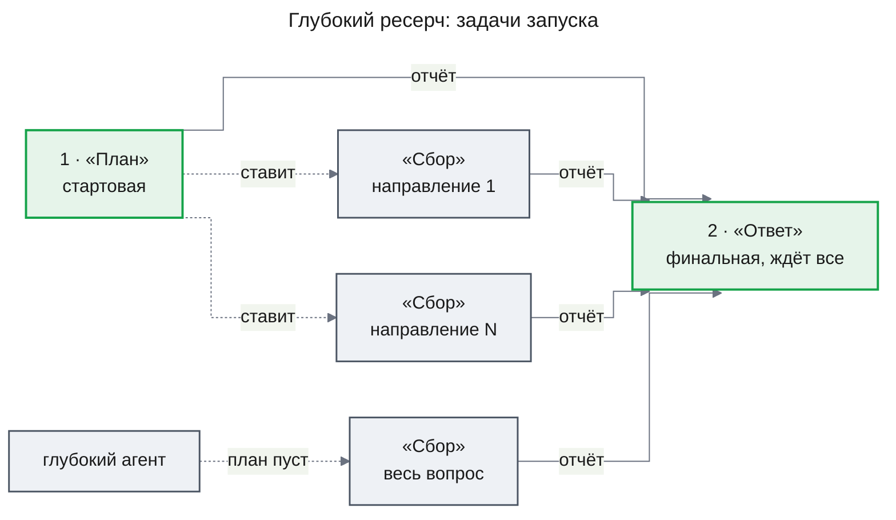
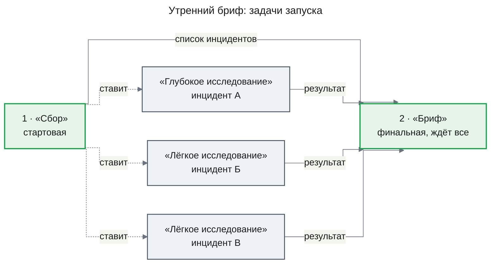
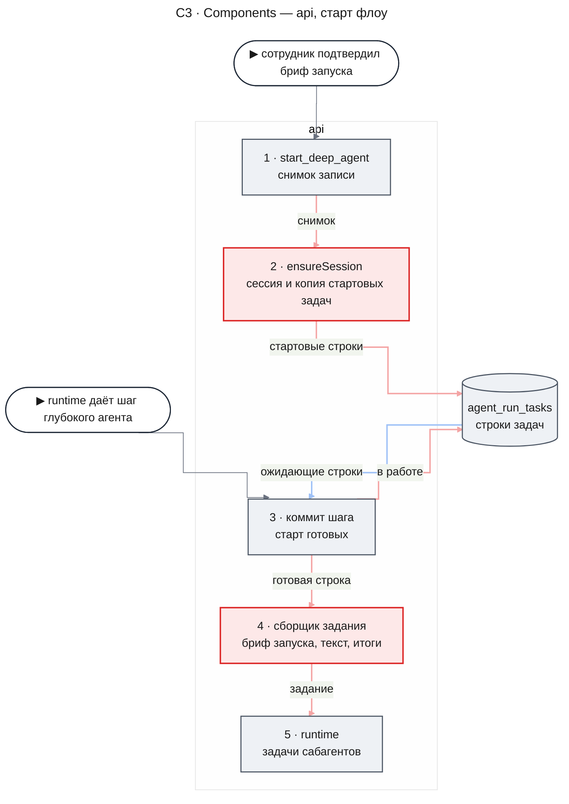
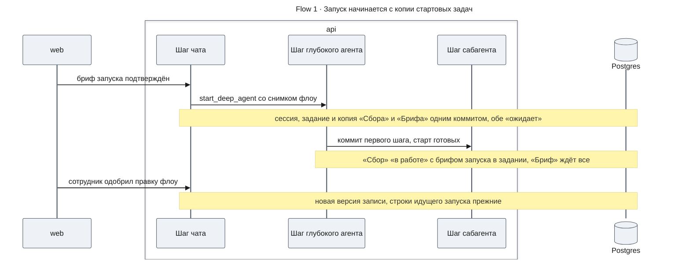
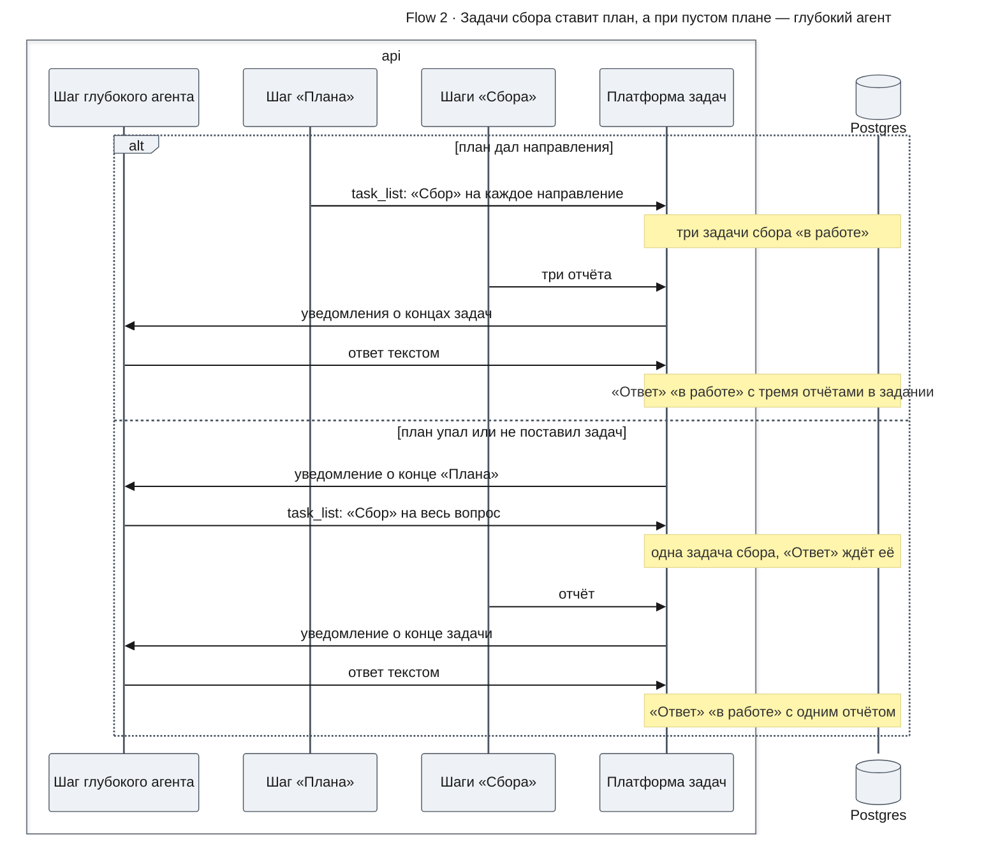
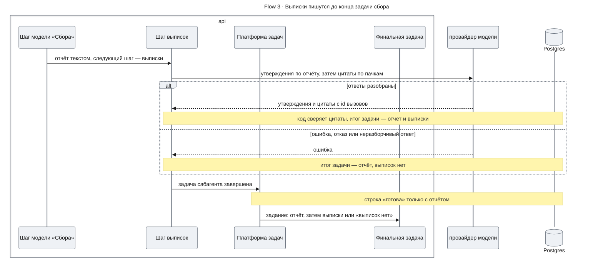

# Глубокие агенты — Design Document — flows

**Status:** На утверждении · **Date:** 2026-11-21 · **PRD:** [prd.md](./prd.md) · **UXRD:** [uxrd.md](./uxrd.md) · **Depends on:** [design-tasks.md](./design-tasks.md#contract-definitions)

## Snapshot

**Overview.** После частей `agent-types` и `tasks` у глубокого агента есть список задач, но каждый запуск начинается с пустого списка: порядок работы держит только промпт, и малая модель может начать не с того. Эта часть добавляет в запись глубокого агента стартовые задачи — текст, исполнителя и зависимости. Когда создаётся сессия запуска, платформа копирует их в список, готовые стартуют в первом коммите шага глубокого агента, а дальше задачи ставят сами агенты, как в части `tasks`. Глубокого агента со стартовыми задачами библиотека называет флоу, а чат делает новый флоу по образцу: читает чужую запись и сохраняет свою через карточку подтверждения. Встроенный глубокий ресерч переписывается на месте как флоу, рядом встаёт встроенный флоу «Утренний бриф», а необязательный шаг выписок подкрепляет утверждения сбора цитатами, которые сверяет код.

- **Не меняется**: запуск задач, их статусы, финальная задача и пределы — как в части `tasks`; записи меняются только через карточку подтверждения; сидер встроенных записей.
- **Главный риск**: запасной сбор глубокого ресерча держится на промпте — если глубокий агент после пустого плана ответит текстом, ответ напишется без данных (Risks).
- **Открытые вопросы**: нет.

### Key Decisions

#### KD-1: Стартовые задачи — поле `startingTasks` содержимого глубокого агента, и все их правила проверяет схема содержимого

Флоу — не третий вид записи, а глубокий агент со стартовыми задачами ([ADR-0021](../../adr/ADR-0021-deep-agent-record-kind.md)). Поэтому стартовые задачи — поле того же содержимого, а флоу — запись, у которой это поле не пусто. Стартовая задача — текст, имя сабагента-исполнителя и номера стартовых задач, которых она ждёт. Номер — позиция в списке с 1, и в запуске задача получает тот же номер (UXRD, KD-5).

Все правила зависят только от содержимого, поэтому живут в `superRefine` схемы глубокого агента рядом с правилами команды ([design-agent-types.md](./design-agent-types.md), KD-4). Эту схему проходят тела HTTP, аргументы `create_record` и `edit_record`, сид и снимок запуска, и модель чата получает отказ «путь: правило» ещё до карточки. Так запись, которую удалось сохранить, при копировании не нарушит ни одного правила `task_list`, и копию второй раз проверять не нужно.

Поле по умолчанию пустое, как `selfLearning`: записи и снимки без него читаются как глубокий агент без стартовых задач, и переписывать их не надо. Правка, в которой модель потеряла стартовые задачи, видна на карточке строкой «Убрано», как потерянный сабагент ([design-agent-types.md](./design-agent-types.md), Risks). Обязательное поле от этого не спасло бы, а старые записи пришлось бы переписывать миграцией.

#### KD-2: Копию пишет создание сессии глубокого агента, а стартуют готовые стартовые задачи в первом коммите его шага

Каждый запуск должен начаться ровно с одной копии. Сессию глубокого агента создаёт `ensureSession` — и при старте из чата в коммите `start_deep_agent`, и при «Запустить с нуля», — причём строку создаёт только одна попытка. В той же транзакции сегодня пишется строка запуска самообучения, и копия встаёт рядом с ней. Копия берётся из снимка, поэтому правка записи после старта список не меняет (AC-21.2), а откат или повтор транзакции не оставляют ни лишней строки, ни строки без сессии.

Строки копии стартует процедура «старт готовых» части `tasks` ([design-tasks.md](./design-tasks.md), KD-1): её вызывает каждый коммит шага глубокого агента, а первый шаг наступает сразу после старта. Поэтому готовые стартовые задачи ждут только первого вызова модели глубокого агента. Финальную задачу эта процедура не стартует: её запускает только исход «стартовать финальную», когда глубокий агент ответил текстом.

Взвешивался вызов «старта готовых» прямо в коммите `start_deep_agent`: задачи стартовали бы на один вызов модели раньше. Но «Запустить с нуля» создаёт сессию другим путём, и ради нескольких секунд пришлось бы держать вторую точку вызова.

#### KD-3: Бриф запуска платформа ставит в начало задания каждого сабагента задачи

Текст стартовой задачи лежит в записи и одинаков во всех запусках, а вопрос сотрудника есть только в задании самого глубокого агента. Сабагент видит только своё задание ([design-tasks.md](./design-tasks.md), KD-5). Сегодня бриф каждому исполнителю пересказывает координатор по правилу записи, а в новой модели пересказывать некому: задачу стартует платформа.

Поэтому задание сабагента любой задачи начинается с брифа запуска — строк «Вопрос», «Границы» и «Результат» из задания глубокого агента, без пустых, — а за ним идут текст задачи и итоги зависимостей. Правило одно для всех задач, а не только для стартовых: план ставит задачи сбора текстом до 2 000 символов, а каждое поле брифа бывает до 4 000, так что модель не перенесла бы бриф целиком. Задание собирает часть `tasks`, и правило записано в её контракте «Задание сабагента задачи» ([design-tasks.md](./design-tasks.md#contract-definitions)).

Взвешивались подстановка брифа запуска в текст стартовой задачи при копии — она упирается в тот же предел текста — и бриф запуска только у стартовых задач, при котором задачи сбора от плана зависели бы от того, не забыла ли модель пересказать вопрос.

#### KD-4: Флоу в списке узнаётся по признаку строки `flow`, а образец — обычное чтение записи

Строка библиотеки несёт только вид записи, а слово «флоу», значок и действие «Сделать свой по образцу» (UXRD, DA-01, DA-10) нужны в списке без открытия записи. Поэтому строка получает производный признак `flow`: вид `deep_agent` и хотя бы одна стартовая задача. Его вычисляет функция, которая строит строку, так что маршруты сотрудника и панели получают его без новых запросов. Карточке записи, панели «Схема» и карточке подтверждения признак не нужен: они получают содержимое целиком.

Образец своего механизма не получает. Чат находит образец по имени в `list_records`, читает его `read_record` и создаёт новую запись `create_record`, поправив стартовые задачи под просьбу; описание поля `startingTasks` в аргументах говорит модели, как это делать. Образец не меняется, потому что пишется только новая запись (AC-22.2). Список чата (`RecordHeader`, строки `start_deep_agent`) флоу не отличает: образец выбирают по имени, а запускается флоу как любой глубокий агент.

#### KD-5: Во встроенных флоу задачи ставят сабагенты, а глубокий агент ждёт и закрывает одну дыру

Код не судит текст, поэтому «на какие направления делить вопрос» и «что считать инцидентом» решают модели, а платформа только запускает готовое. Направления знает план, поэтому сабагент «План» сам ставит по задаче «Сбору» на направление. Инциденты знает сбор утреннего брифа: он ставит по задаче на инцидент и сам выбирает исполнителя — «Глубокое исследование» или «Лёгкое исследование» (приём «classify and act»). Глубокий агент в обоих флоу данных не собирает и ответа не пишет.

Одна дыра остаётся на глубоком агенте глубокого ресерча. Если «План» закончился, а задач сбора в списке нет, глубокий агент в шаге с этим уведомлением ставит одну задачу «Сбору» на весь вопрос (FR-24). Код этого не проверяет: «план пуст» — суждение о тексте отчёта. Сбой сбора утреннего брифа глубокий агент не чинит: «Бриф» называет его в тексте.

#### KD-6: Сидер вставляет только недостающие встроенные записи, а новое содержимое существующей переписывает миграция данных

«Утренний бриф» — новая встроенная запись с новым `builtinKey`, и сидер вставит её в любую базу сам. Глубокий ресерч уже лежит в каждой базе, и сидер его не тронет, а пересоздать строку нельзя: граф знаний висит на id записи с каскадом. Поэтому миграция этой части, как `0003` ([design-agent-types.md](./design-agent-types.md), KD-7), переписывает строку `deep-research` на месте литералом из `builtinRecords()`. Новыми становятся содержимое и описание, а id, имя, адресаты и `selfLearning` из сохранённого содержимого остаются; версия растёт на 1.

Сидер, который переписывал бы встроенные записи при каждом старте, отменял бы правку администратора на каждом рестарте сервера (AC-06.6). Миграция тоже стирает правку администратора, но один раз и только у этой записи — принятая цена PoC. Правило «сидер вставляет, изменённое переписывает миграция» записано образцом [builtin-record.md](../../code-system/patterns/builtin-record.md); шаг выписок пользуется им же, когда включает выписки у «Сбора».

Имена и описания встроенных флоу показываются на языке страницы. `BUILTIN_NAMES` получает «Утренний бриф» и “Morning brief”, а рядом встают описания встроенных флоу на двух языках с тем же правилом, что у имён: описание, равное засеянному русскому, показывается на языке страницы, изменённое администратором — как есть.

#### KD-7: Шаг выписок — последний шаг задачи сабагента сбора; выписки лежат в итоге задачи runtime, и в задание финальной их добавляет сборщик задания

Проход должен закончиться раньше, чем финальная задача прочтёт отчёт, и пережить рестарт. Поэтому он — последний шаг задачи runtime самого сабагента: получив ответ текстом, шаг модели возвращает «продолжить», а обработчик отдаёт следующий шаг проходу ([step-handler.md](../../code-system/patterns/step-handler.md)). Задача кончается только после прохода, строка списка до этого «в работе», и финальная ждёт проход без нового механизма. Проход включает поле сабагента `excerpts`, по умолчанию выключенное.

Источники — сохранённые результаты вызовов той же задачи, прочитанные по её id и владельцу, как читает `findForRun`; чужих задач проход не читает. Сначала один вызов модели видит только отчёт и возвращает утверждения, затем вызовы по пачкам источников привязывают к их номерам цитаты и id вызовов из карты, которую построил код. Каждый вызов отвечает одним вызовом инструмента ([tool-call-answer.md](../../code-system/patterns/tool-call-answer.md)), и раунд «вызов, разбор, одна повторная попытка» выносится из `extract.handler.ts` в общий модуль, как требует образец. Цитату сверяет чистая функция: снять экранирование конверта данных, свести пробелы, остальное — точное совпадение; утверждение без совпавшей цитаты получает «без цитаты» и не удаляется.

Пределы прохода — константы кода: не больше 30 утверждений, цитата до 300 знаков, пачка до 24 000 токенов по оценке «байты / 4» и не больше шести вызовов цитат. Вызов утверждений просит не больше 30 главных утверждений отчёта, а более длинный ответ обрезается до первых 30, а не отклоняется. Любая неудача вызова кончает проход без выписок, а задача всё равно завершается отчётом. Выписки пишет коммит, который завершает задачу, в её итог рядом с отчётом; строка списка получает только отчёт, поэтому веб выписок не показывает (PRD, Won't Have). В задание финальной выписки после отчёта своей задачи добавляет сборщик задания части `tasks` ([design-tasks.md](./design-tasks.md), KD-5); без шага выписок ни поля, ни выписок нет, и остальная часть не меняется.

## Terms

- **Стартовая задача** — задача, записанная в самой записи глубокого агента; каждый запуск начинается с её копии.
- **Флоу** — глубокий агент хотя бы с одной стартовой задачей; **образец** — флоу, который чат читает и берёт за основу нового (в PRD — «шаблон»).
- **Бриф запуска** — вопрос, границы и результат, которые сотрудник подтвердил при старте глубокого агента. «Бриф» в кавычках-ёлочках — сабагент утреннего брифа, который пишет сам бриф.
- **Встроенная запись** — системная запись, которую поставляет код (`builtinRecords()`): главный чат, `general-purpose`, глубокий ресерч и утренний бриф.
- **Задание сабагента** — текст, с которого начинается сабагент задачи; **сборщик задания** — код части `tasks`, который его собирает ([design-tasks.md](./design-tasks.md), KD-5).
- **Выписка** — утверждение из отчёта сбора с дословной цитатой и id вызова-источника либо с пометкой «без цитаты»; **шаг выписок** — проход модели и проверка цитат кодом в конце задачи сабагента.
- Глубокий агент, сабагент, финальная задача, коммит шага, потребитель событий — как в [design-tasks.md, Terms](./design-tasks.md#terms).

## Part

- **Part**: `flows`
- **Covers**: FR-21 – FR-25; FR-25 — Could Have
- **Depends on**: [`tasks`](./design-tasks.md#contract-definitions) — `task_list` с исполнителем, «старт готовых», финальная задача, задание сабагента, строка списка; через неё [`agent-types`](./design-agent-types.md#contract-definitions) — содержимое глубокого агента, снимок, инструменты записей, панель «Схема»
- **Prerequisite ADRs**: [ADR-0001](../../adr/ADR-0001-durable-runtime-owner.md), [ADR-0002](../../adr/ADR-0002-app-schema-migrations.md), [ADR-0016](../../adr/ADR-0016-library-records-and-visibility.md), [ADR-0017](../../adr/ADR-0017-run-snapshots-from-library.md), [ADR-0021](../../adr/ADR-0021-deep-agent-record-kind.md)

**Out of scope**

- Старт задач, статусы, финальная задача, остановка, рестарт задачи, `task_list` и его отказы остаются, как их строит часть `tasks`; копия только кладёт строки, которые эта машина уже умеет вести.
- Инструменты записей, карточка подтверждения, `start_deep_agent`, промпт главного чата и правила глубокого агента не меняются.
- Самообучение не меняется: сабагенты стартовых задач получают снимок той же функцией, что сабагенты любых задач ([design-tasks.md](./design-tasks.md), KD-3).
- MCP-фикстура не меняется: утренний бриф работает на её тикетах и логах как есть.
- Запуск по расписанию, флоу кодом, редактор-форма и показ выписок в вебе (PRD, Won't Have).

**Constraints**

- **Один владелец долгих задач** (ADR-0001): копия пишет только строки списка, задачи сабагентов создаёт «старт готовых» через runtime.
- **Код не судит текст**: копия, признак `flow` и проверка цитаты сравнивают поля, номера и строки; на что делить вопрос и что считать инцидентом, решают промпты (KD-5).
- **Без совместимости**: правила координатора уходят из встроенной записи целиком; записи и снимки без стартовых задач читаются с пустым полем, ничего не переносится.
- **Новых настроек нет**: пределы выписок — константы кода, предел стартовых задач — предел пунктов на запуск из `agent-types`.
- **Журнал** — через логгер `common` ([logging.md](../../code-system/patterns/logging.md)). Копия пишет запись «задача добавлена» на каждую строку, как `task_list`, с автором «стартовая задача»; шаг выписок — одну запись со счётчиками. Текстов задач, брифа запуска, утверждений и цитат в журнале нет.
- **Тестов мало**, на нижнем уровне, который ловит дефект ([Test Strategy](#test-strategy)).

## Building-block Inventory

Follows the [code system](../../code-system/README.md).

| Building block | Pattern | Status | Note |
|---|---|---|---|
| Схема содержимого глубокого агента | — | extended | `startingTasks`, `excerpts` сабагента (KD-1) |
| `ensureSession` | [run-snapshot.md](../../code-system/patterns/run-snapshot.md) | extended | копия рядом со строкой запуска знаний (KD-2) |
| Список задач | [repository-over-transaction.md](../../code-system/patterns/repository-over-transaction.md) | extended | строки копии без автора |
| «Старт готовых» | [transactional-outbox.md](../../code-system/patterns/transactional-outbox.md) | reused | из части `tasks` |
| Сборщик задания | — | reused | бриф запуска и выписки — по контракту `tasks` (KD-5) |
| Строка библиотеки, маршрут списка | [read-on-open.md](../../code-system/patterns/read-on-open.md) | extended | `flow` (KD-4) |
| `builtinRecords()`, сидер | [builtin-record.md](../../code-system/patterns/builtin-record.md) | extended | ресерч, бриф; сидер прежний |
| Миграция встроенного ресерча | [builtin-record.md](../../code-system/patterns/builtin-record.md) | new | образец со второго использования (KD-6) |
| Имена и описания встроенных | [interface-text.md](../../code-system/patterns/interface-text.md) | extended | описания встроенных флоу |
| Строка, схема, список задач в вебе | [read-on-open.md](../../code-system/patterns/read-on-open.md) | extended | «флоу», стартовые задачи, «стартовая задача» |
| Шаг выписок | [step-handler.md](../../code-system/patterns/step-handler.md) | new | вид шага у сабагента (KD-7) |
| Раунд структурного ответа | [tool-call-answer.md](../../code-system/patterns/tool-call-answer.md) | extended | вынесен из `extract.handler.ts` |
| Проверка цитаты | [pure-decision.md](../../code-system/patterns/pure-decision.md) | new | — |
| `ModelClient.call` | — | extended | `costUsd` в ответе |

Механизм копии искали в `agents`: строку, которая пишется с сессией и один раз на запуск, уже пишет `ensureSession` для самообучения. Механизм обновления встроенных записей искали в модуле `library`: сидер только вставляет, а переписать строку на месте умеет только миграция `0003`.

## Acceptance Criteria

### FR-21: Стартовые задачи

- From the PRD: AC-21.1, AC-21.2, AC-21.3
- Запуск «с нуля» получает свою копию стартовых задач; продолжение сообщением копию не повторяет, а рестарт сервера не удваивает ни строк, ни сабагентов (DC-1).
- Запись не сохраняется, если стартовая задача называет сабагента вне команды, ждёт свою, более позднюю или финальную задачу, если у финальной есть зависимости, если финальных две или если задач одного исполнителя больше его `maxRuns`; отказ называет путь `startingTasks…` и правило (DC-2).
- В подробностях стартовой задачи «Поставил» — «стартовая задача» (DC-3).

### FR-22: Флоу по образцу из чата

- From the PRD: AC-22.1, AC-22.2
- Флоу в библиотеке и в панели администратора назван «флоу», а у флоу коллеги и компании есть «Сделать свой по образцу» (DC-4).

### FR-23: Шаблон «Утренний бриф»

- From the PRD: AC-23.1, AC-23.2
- Задание сабагента каждой задачи запуска начинается с брифа запуска (DC-5).
- «Утренний бриф» назван и описан на языке страницы (DC-6).

### FR-24: Глубокий ресерч как флоу

- From the PRD: AC-24.1, AC-24.2
- После выкатки у глубокого ресерча прежние id, граф знаний и значение самообучения, а версия выросла (DC-7).

### FR-25: Выписки в глубоком ресерче

- From the PRD: AC-25.1, AC-25.2, AC-25.3, AC-25.4
- Проход читает только сохранённые результаты своей задачи и только от имени её владельца (DC-8).
- Выписки не попадают в результат строки списка (DC-9).
- Выписки покрывают до 30 утверждений отчёта; у каждого из них есть цитата или пометка «без цитаты» (DC-10).

## Design

### Встроенные флоу

Две схемы ниже показывают граф задач одного запуска. Зелёные — стартовые задачи из записи, серые — задачи, которые ставят агенты; пунктир — кто ставит задачу, сплошная линия — чей итог попадает в задание финальной.

| Сабагент | Что делает | Запусков |
|---|---|---|
| «План» | делит вопрос на 2–5 направлений и ставит по задаче «Сбору» на каждое | 1 |
| «Сбор» | собирает данные по одному направлению | 5 |
| «Ответ» | финальный: пишет ответ по отчётам | 2 |

Стартовые задачи: «Составить план и поставить задачи сбора» для «Плана» и финальная «Написать ответ по отчётам сбора» для «Ответа». «План» ставит задачи одним вызовом `task_list`: текст — направление и подходящие инструменты, ключ элемента — номер направления, так что повторный вызов не удвоит задачи. Прежний сабагент ответа получал бриф и отчёты от координатора, а теперь получает их от платформы (KD-3; [design-tasks.md](./design-tasks.md), KD-5), поэтому его промпт меняется только словами о том, откуда отчёты. «Сбор» получает все серверы сотрудника, как сегодня, а «Ответ» и сам глубокий агент — ни одного.

Промпт глубокого агента говорит: работу ведут стартовые задачи и задачи «Плана»; пока они идут, отвечай одним предложением; когда «План» закончился, а задачи «Сбору» в списке нет, поставь одну задачу «Сбору» на весь вопрос; когда финальная кончилась сбоем, поставь задачу «Ответу» заново. Правила координатора «кого и когда запускать» из записи уходят (FR-24).

| Сабагент | Что делает | Запусков |
|---|---|---|
| «Сбор» | находит инциденты за период из брифа запуска в тикетах и логах и ставит по задаче исследования на каждый | 1 |
| «Глубокое исследование» | разбирает сложный инцидент: несколько систем, неясная причина | 20 |
| «Лёгкое исследование» | коротко проверяет простой инцидент | 20 |
| «Бриф» | финальный: пишет бриф по всем результатам | 2 |

Стартовые задачи: «Собрать инциденты за период» для «Сбора» и финальная «Написать бриф» для «Брифа». Инцидента как сущности в фикстуре нет, поэтому «Сбор» сам собирает их из тикетов (`search_tickets`) и всплесков событий в логах (`aggregate_logs`, `search_logs`). На каждый инцидент он ставит задачу с ключом элемента — id первого тикета инцидента, а у инцидента только из логов — «сервис/событие». Отчёт «Сбора» перечисляет все найденные инциденты с ключами и номерами задач, и инцидент, для которого задачу поставить не удалось, назван в нём «не поставлен». Так «Бриф» называет каждый инцидент, а не поставленные и упавшие — неисследованными (AC-23.2).

Вызов `task_list` принимается или отклоняется целиком, поэтому промпт «Сбора» велит ставить задачи вызовами по десять. При отказе `run_limit` оставшиеся инциденты он отдаёт «Лёгкому исследованию» или называет непоставленными. Исследования и «Сбор» получают все серверы сотрудника, «Бриф» и глубокий агент — ни одного. Глубокий агент только ждёт и отвечает одним предложением; сбой «Сбора» он не чинит.

Названия и описание: «Утренний бриф» / “Morning brief”, описание — UXRD, MC-19. Глубокий ресерч сохраняет имя из `BUILTIN_NAMES`, а его описание — «Отвечает на глубокий вопрос по источникам» / “Answers a deep question from the sources”.

### Architecture (C1–C4)

Внешних систем, людей и контейнеров часть не добавляет: меняются компоненты api, содержимое записей и данные экранов веба. Поэтому рисуется только C3 api.

#### C3 · Components: api

**api — старт флоу**

- `ensureSession` пишет копию только тогда, когда сам создал строку сессии, и только для снимка `deep_agent` с непустыми `startingTasks`. Строки копии получают номера 1…n по порядку записи, текст, исполнителя, номера зависимостей, признак финальной, id будущего сабагента и пустого автора; статус у всех «ожидает». Решение о добавлении `task_list` копия не зовёт: оно отвергло бы зависимость внутри одного вызова, а правила уже проверила схема (KD-1).
- Коммит шага глубокого агента и «старт готовых» — из части `tasks`; эта часть их не меняет. Сборщик задания ставит бриф запуска впереди (KD-3), а при шаге выписок — выписки после отчёта (KD-7); оба правила — в контракте задания части `tasks`.
- Миграция данных переписывает строку встроенного ресерча (KD-6); сидер вставляет «Утренний бриф» на старте приложения, как любую недостающую встроенную запись.

**web.** Веб меняет данные, а не путь обновления. Строка библиотеки по признаку `flow` называет вид словом «флоу» (MC-1), ставит значок и даёт «Сделать свой по образцу» у флоу коллеги и компании (DA-10). Действие открывает новую беседу с заготовкой MC-19 в поле сообщения и ничего не отправляет. Определение записи в панели «Схема», на карточке подтверждения и на карточке DA-13 показывает раздел стартовых задач с исполнителями и «ждёт {номера}», а у финальной — «ждёт все остальные» (MC-25). Подробности строки списка задач с автором `starting` показывают «Поставил: стартовая задача» (MC-13). Описание встроенной записи веб показывает тем же правилом, что имя (KD-6).

### Runtime Flows

#### Flow 1: Запуск флоу

**Starts when:** сотрудник подтверждает бриф запуска флоу, for AC-21.1, AC-21.2

Если сервер упал после коммита старта, но до первого шага глубокого агента, runtime отдаст этот шаг после рестарта, и копия уже лежит в базе одна (DC-1). Если сервер упал посреди коммита, не осталось ни сессии, ни строк, и повтор шага чата пишет всё заново. «Запустить с нуля» создаёт новую сессию и вместе с ней новую копию, а сообщение в идущий запуск сессию не создаёт и копию не повторяет.

#### Flow 2: Глубокий ресерч: направления и запасной сбор

**Starts when:** заканчивается задача «Плана», for AC-24.1, AC-24.2

«Платформа задач» — коммиты шагов, потребитель концов и «старт готовых» части `tasks` ([design-tasks.md](./design-tasks.md), Flow 1 и Flow 2). Если глубокий агент на уведомление о пустом плане ответит текстом, финальная стартует без отчётов сбора, и «Ответ» скажет, что данных нет: код «пустой план» не распознаёт (KD-5).

#### Flow 3: Шаг выписок

**Starts when:** сабагент «Сбора» с выписками отвечает текстом без вызовов, for AC-25.1, AC-25.2, AC-25.3, AC-25.4

Шаг выписок, как и шаг сжатия, ходом не считается. Если аренда шага истекла посреди прохода, следующая попытка повторяет проход целиком: шаг не зафиксирован, выписки не записаны, а журнал токенов показывает вызовы обеих попыток. Одна запись журнала `excerpt pass finished` пишется на каждый проход, и при неудаче тоже (AC-25.4).

### Contract Definitions

Содержимое глубокого агента, снимок, список задач и его строка, `task_list` и сборщик задания — как в [design-agent-types.md](./design-agent-types.md#contract-definitions) и [design-tasks.md](./design-tasks.md#contract-definitions); ниже только то, что добавляет эта часть.

**Содержимое глубокого агента** (`contracts`)

- `startingTasks` — стартовые задачи по порядку, по умолчанию пустой список, не больше предела пунктов на запуск из `agent-types`. У задачи `text` — 1–2 000 символов, как текст задачи списка; `assignee` — имя сабагента этой записи; `dependsOn` — номера более ранних стартовых задач, считая с 1, по умолчанию пусто.
- Задача, у которой `assignee` равен `finalSubagent`, — финальная. Её зависимости не хранятся: «ждёт все остальные» выводится.
- Нарушение — ошибка схемы с путём и правилом; индекс в пути считается с 0, как у `subagents.N`. `startingTasks.N.assignee` — нет такого сабагента. `startingTasks.N.dependsOn` — номер своей или более поздней задачи, номера нет, ссылка на финальную или зависимости у финальной. `startingTasks` — вторая финальная или задач одного исполнителя больше его `maxRuns`.
- Описание поля для модели говорит, что стартовые задачи стоят в начале каждого запуска, а флоу по образцу берёт их из `read_record` образца и правит под просьбу.
- `subagents.N.excerpts` (FR-25) — логическое, по умолчанию `false`; включает шаг выписок у задач этого сабагента.

**Строка библиотеки** (`RecordSummarySchema`; `GET /api/library` и списки панели)

- `flow` — `true` у записи вида `deep_agent` хотя бы с одной стартовой задачей, иначе `false`.

**Копия стартовых задач** — пишется в транзакции, которая создаёт сессию глубокого агента; строки с номерами 1…n по порядку записи, текстом, исполнителем, `dependsOn` из записи, признаком финальной и статусом «ожидает». Ключей элемента у них нет.

**Строка списка задач** (`RunTaskListView`)

- `addedBy` получает третий вид — `starting`, без имени и номера. Его получают строки копии, и только они.

**Итог задачи сабагента с выписками** (FR-25; `runtime_tasks.result`)

- `report` — текст последнего ответа модели, как сегодня.
- `excerpts` — `null`, когда выписок нет: нет источников или проход не удался. Иначе список до 30 выписок в порядке утверждений: `claim` — до 500 знаков; `mark` — `supported` или `unsupported`; у `supported` ещё `quote` — до 300 знаков, `callId` — id вызова этой задачи и `tool` — `<server>/<tool>`.
- Уведомлению глубокому агенту и строке списка по-прежнему доходит только `report`.

**Выписки в задании финальной** (FR-25; их ставит сборщик задания, [design-tasks.md](./design-tasks.md), KD-5)

- После отчёта задачи, у итога которой есть `excerpts`, идут строки выписок. Строка начинается с пометки `[supported by quote]` — с утверждением, цитатой и инструментом — или `[no quote]` с утверждением. У `excerpts: null` — одна строка `[no excerpts]`; у задачи без поля `excerpts` ничего не добавляется.
- Пометки — договор кода с промптом «Ответа»: утверждение с `[no quote]` он не выдаёт за подтверждённое.

**Ответ модели** (FR-25; `ModelClient.call`)

- Ответ (`kind: 'answer'`) несёт `costUsd` — цену вызова, которую уже считает журнал токенов, или `null`, если у модели нет цены.

**Встроенные записи** (`contracts`, `apps/api`)

- «Утренний бриф» — новая встроенная системная запись с постоянным id, `builtinKey` `morning-brief`, видна всем; `BUILTIN_NAMES` получает её имя на двух языках.
- Описания глубокого ресерча и утреннего брифа хранятся рядом с именами на двух языках. Глубокий ресерч — «Отвечает на глубокий вопрос по источникам» / “Answers a deep question from the sources”; утренний бриф — UXRD, MC-19. Описание, равное засеянному русскому, показывается на языке страницы, изменённое — как есть.

**Журнал**

- Копия — запись «задача добавлена» на каждую строку по контракту журнала задач `tasks` (NFR-01), с автором `starting`.
- `excerpt pass finished` — одна на проход, info, а при неудаче warn: id сабагента (он же id задачи), id глубокого агента (запуск), владелец, модель, исход (`done`, `no_sources`, `refused`, `model_error`, `invalid_answer`), `claims`, `supported`, `mismatched`, `unquoted`, `supportedShare`, `sources`, `pagesLeftOut`, `modelCalls`, токены входа и выхода, `costUsd`, `durationMs`. Текстов утверждений, цитат, отчёта и результатов в ней нет.

### Data Model

Новых таблиц и столбцов нет.

- `library_records.content` глубокого агента получает `startingTasks`, а сабагент — `excerpts`. Записи без них читаются со значениями по умолчанию.
- Строки `agent_run_tasks`, которые написала копия, — с пустым автором: так строка списка узнаёт стартовую задачу.
- `runtime_tasks.result` сабагента с выписками получает `excerpts` (FR-25).
- Миграция только с данными переписывает строку с `builtinKey` `deep-research` по KD-6; на новой базе строки ещё нет, и миграция ничего не меняет, а сидер вставляет запись уже с новым содержимым. Шаг выписок, когда его строят, приносит такую же миграцию: она включает `excerpts` у «Сбора» и правило пометок в промпте «Ответа».

## Test Strategy

- **UC-1: Правила стартовых задач** — covers DC-2
  - Given: глубокий агент с командой «Сбор» (`maxRuns` 1) и «Бриф» (финальный) и стартовыми задачами: исполнитель «Отчёт»; зависимость от своей и от более поздней задачи; зависимость от финальной; финальная с зависимостью; две финальные; две задачи «Сбору»
  - When: схема содержимого разбирает каждую
  - Then: каждая отклонена с путём `startingTasks.N.assignee`, `startingTasks.N.dependsOn` или `startingTasks` и правилом; две задачи «Сбору» — по правилу `maxRuns`; запись с «Сбором» и финальным «Брифом» без зависимостей принята
- **UC-2: Копия при старте** — covers AC-21.1, AC-21.2, DC-1, DC-3
  - Given: флоу со стартовыми задачами «Сбор» и финальной «Бриф»; сценарий модели по имени агента
  - When: чат стартует флоу; процесс API перезапускается до первого шага глубокого агента; чат правит стартовые задачи записи; запуск заканчивается, и сотрудник запускает его с нуля
  - Then: в списке две строки с номерами 1 и 2 и автором `starting`, у «Сбора» ровно один сабагент, «Бриф» ждёт; правка не меняет строк идущего запуска; новый запуск получает свою копию
- **UC-3: Утренний бриф** — covers AC-21.1, AC-23.1, DC-5
  - Given: встроенный «Утренний бриф»; сценарий модели по тексту задачи: «Сбор» ставит три задачи исследования с ключами, повторяет одну из них и отчитывается
  - When: сотрудник подтверждает бриф запуска, и запуск идёт до ответа
  - Then: в списке ровно три задачи исследования, повтор отклонён `duplicate_item`; задание каждого сабагента начинается с брифа запуска; задание «Брифа» содержит отчёт сбора и три результата; ответ запуска — отчёт «Брифа»
- **UC-4: Глубокий ресерч как флоу** — covers AC-24.1, AC-24.2
  - Given: встроенный глубокий ресерч; два сценария модели: «План» ставит три задачи «Сбору»; «План» кончается сбоем, и глубокий агент ставит одну задачу на весь вопрос
  - When: запуск идёт до ответа
  - Then: в первом три задачи сбора с автором «План», и «Ответ» стартует после всех трёх с тремя отчётами; во втором одна задача сбора от глубокого агента, и ответ приходит в беседу
- **UC-5: Флоу по образцу** — covers AC-22.1, AC-22.2, DC-4
  - Given: сотрудник видит «Утренний бриф»; сценарий модели чата: `read_record` образца, затем `create_record` с подправленными стартовыми задачами
  - When: сотрудник одобряет карточку
  - Then: до одобрения записи нет; после — новая запись сотрудника с `flow: true` в списке и стартовыми задачами; версия образца прежняя
- **UC-6: Схема и строка флоу в вебе** — covers AC-21.3, DC-3, DC-4, DC-6
  - Given: строки библиотеки с `flow` и без; запись флоу с «Сбором» и финальным «Брифом»; строка списка с автором `starting`; встроенный «Утренний бриф» с засеянным описанием
  - When: страницы показывают библиотеку, панель «Схема» и подробности задачи на русском и английском
  - Then: «флоу» и «Сделать свой по образцу» только у флоу коллеги и компании; в схеме «Бриф» «ждёт все остальные»; «Поставил: стартовая задача»; имя и описание брифа на языке страницы
- **UC-7: Проверка цитаты** — covers AC-25.2
  - Given: источник с переносами строк; цитаты: тот же текст с другими пробелами, с одной изменённой цифрой, с id вызова не из карты, с `&quot;` вместо кавычки, пустая
  - When: функция проверки ставит пометки
  - Then: подкреплено; без цитаты, утверждение осталось; без цитаты; подкреплено; без цитаты
- **UC-8: Шаг выписок** — covers AC-25.1, AC-25.3, AC-25.4, DC-9, DC-10
  - Given: две задачи «Сбора» с выписками и сохранёнными результатами; модель первой возвращает 35 утверждений; у второй вызов прохода получает ошибку провайдера; секрет в результате вызова
  - When: обе заканчиваются, и стартует «Ответ»
  - Then: у первой 30 выписок, у каждой цитата или «без цитаты», у второй `[no excerpts]` в задании «Ответа», запуск не упал; результат строк — только отчёты; в журнале по одной записи прохода со счётчиками и ценой, без секрета и текстов
- **UC-9: Только свои результаты** — covers DC-8
  - Given: сохранённые результаты двух задач двух сотрудников
  - When: проход читает результаты своей задачи от имени её владельца и от имени другого сотрудника
  - Then: в первом случае только свои строки по порядку вызовов, во втором ничего

DC-7 и AC-08.2 проверяет владелец: применяет миграцию к своей базе с графом ресерча и включённым самообучением и смотрит id, граф и флажок. В CI графа до миграции нет. AC-23.2 владелец проверяет вручную (PRD). UC-7 – UC-9 пишутся вместе с шагом выписок, и только если его строят.

## Security Considerations

- **Authentication & Authorization**: новых маршрутов нет. Образец чат читает `read_record`, которое видит только видимые сотруднику записи, а сохраняет новую запись через карточку и правила библиотеки. Копия берётся из снимка, который `resolveStart` построил от имени сотрудника; сабагенты стартовых задач работают по его правам, и каждый вызов проверяется в момент вызова. Шаг выписок читает только сохранённые результаты своей задачи при совпадении владельца (DC-8).
- **Input Validation**: стартовые задачи проверяет схема содержимого на каждом входе — HTTP, инструменты записей, сид, снимок (KD-1). Бриф запуска — текст сотрудника; он попадает в задание сабагента как данные и прав не даёт. Источники прохода модель видит в конверте данных, утверждения приходят только из отчёта, ответ разбирает схема, а каждую цитату проверяет код (KD-7).
- **Sensitive Data Handling**: сохранённые результаты уже очищены от известных секретов, поэтому их нет и в цитатах. Журнал копии и прохода несёт id, счётчики, исходы и цену; текстов задач, брифа запуска, утверждений, цитат и секретов в нём нет.

## Risks and Mitigation

- **Глубокий агент отвечает текстом после пустого плана** — финальная стартует без отчётов сбора, и ответ говорит, что данных нет; вероятность средняя на малой модели. Правило стоит в промпте записи, блок плана показывает, что задач «Сбору» нет, а первые запуски владелец смотрит по списку (PRD, Success Criteria).
- **Миграция стирает правку администратора во встроенном ресерче** — содержимое и описание становятся новыми; влияние — только на базах с такой правкой. Id, имя, адресаты и самообучение остаются (KD-6).
- **Стартовые задачи ждут первого шага глубокого агента** — несколько секунд одного вызова модели. Если этот вызов упал, глубокий агент кончается сбоем, и потребитель концов отменяет его ожидающие задачи ([design-tasks.md](./design-tasks.md), Flow 3).
- **Сбор утреннего брифа на фикстуре** — в `search_tickets` нет фильтра по дате, тикетов 1 200 по 100 на странице, а данные лежат в одной неделе 2026-09-14…21; малая модель может пролистать не всё или сгруппировать инциденты не так. Период брифа для показа берётся внутри этой недели; ключ элемента не даёт удвоить инцидент; качество группировки владелец видит в отчёте «Сбора».
- **Предел 20 исследований на вид** — инциденты сверх предела остаются без исследования; «Сбор» называет их непоставленными, а «Бриф» — неисследованными (FR-14).
- **Бриф запуска в каждом задании** — задания длиннее; его поля ограничены схемой брифа, а отчёты зависимостей обрезает бюджет задания ([design-tasks.md](./design-tasks.md), KD-5).
- **Совпадение цитаты не значит подтверждение** — цитата из одного числа находится почти везде; вероятность средняя. Промпт цитат просит целую строку со значениями утверждения, а доли `supported` и `mismatched` видны в журнале; модели-судьи нет (PRD, Won't Have).
- **Экранирование внутри JSON** — модель может переписать `\n` из результата настоящим переносом, и цитата не найдётся. Утверждение остаётся «без цитаты», а рост `mismatched` в журнале покажет проблему.
- **Пересечение с работой в `apps/web`** — другая сессия меняет те же компоненты библиотеки и оболочки. Веб этой части начинают после того, как та работа влита, и сверяют `git status`.

## Open Questions

Нет.

## Update History

| Version | Date | Change |
|---------|------|--------|
| 1.0 | 2026-11-21 | Первая версия |
| 1.1 | 2026-11-21 | Закрыты четыре вопроса: бриф запуска и выписки в задании записаны в design-tasks.md 1.1 (KD-5), переписывание `chat` в `0003` — в design-agent-types.md 1.2 (KD-7), описание глубокого ресерча на двух языках задано здесь |
