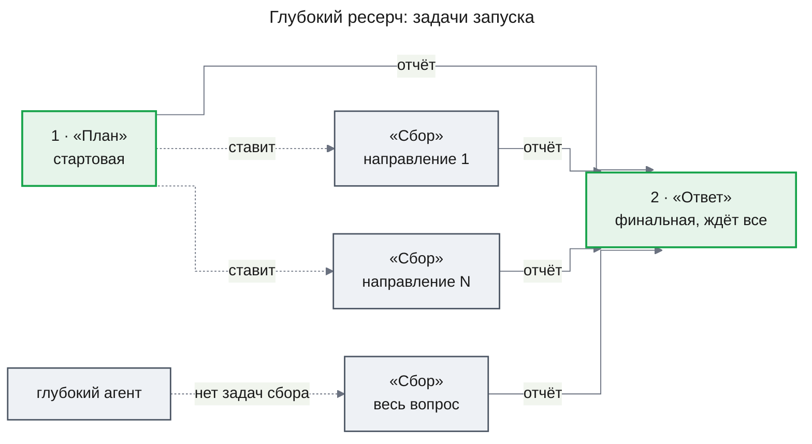
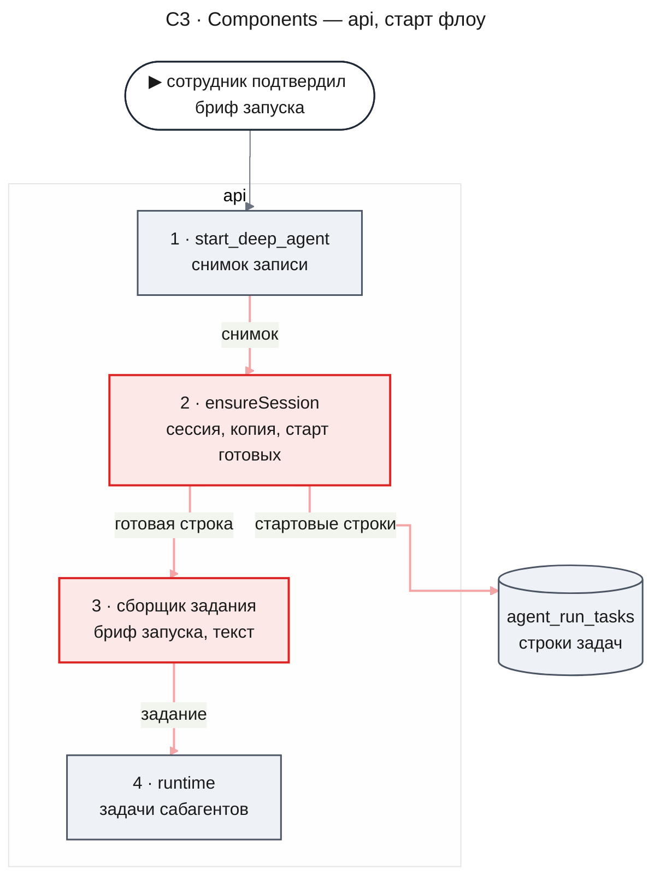
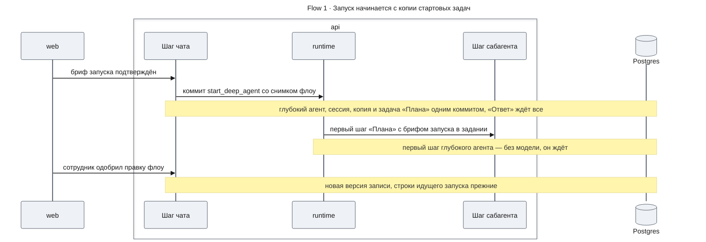
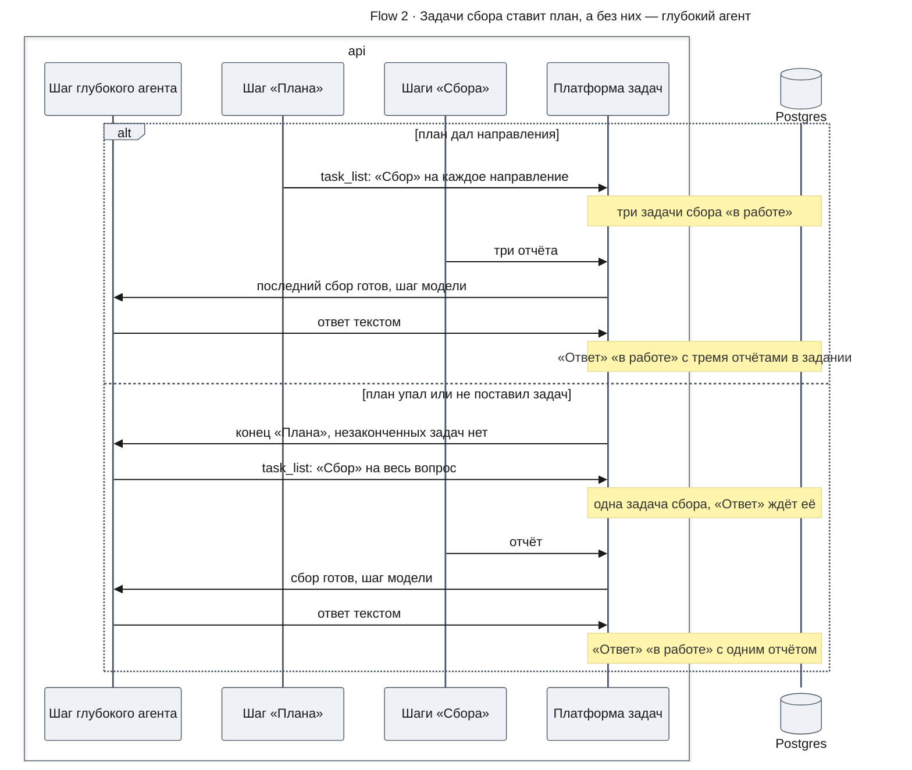

# Глубокие агенты — Design Document — flows

**Status:** На утверждении · **Date:** 2026-11-22 · **PRD:** [prd.md](./prd.md) · **UXRD:** [uxrd.md](./uxrd.md) · **Depends on:** [design-tasks.md](./design-tasks.md#contract-definitions)

## Snapshot

**Overview.** После частей `agent-types` и `tasks` у глубокого агента есть список задач, но каждый запуск начинается с пустого списка: порядок работы держит только промпт, и малая модель может начать не с того. Эта часть добавляет в запись глубокого агента стартовые задачи — текст, исполнителя и зависимости — и имена сабагентов, без задачи которых финальная не стартует. Транзакция, которая создаёт запуск, копирует стартовые задачи в список и сразу стартует готовые, а дальше задачи ставят сами агенты, как в части `tasks`. Глубокого агента со стартовыми задачами называют флоу; чат делает новый флоу по образцу: читает чужую запись и сохраняет свою через карточку подтверждения. Встроенный глубокий ресерч становится флоу — единственным встроенным.

- **Не меняется**: запуск задач, их статусы, финальная задача и пределы — как в части `tasks`; записи меняются только через карточку подтверждения; сидер встроенных записей.
- **Главный риск**: модель чата при правке может потерять стартовые задачи, и это видно только строкой «Убрано» на карточке (KD-1).
- **Открытые вопросы**: нет.

### Key Decisions

#### KD-1: Стартовые задачи и `requiredBeforeFinal` — поля содержимого глубокого агента, и все их правила проверяет схема содержимого

Флоу — не третий вид записи, а глубокий агент со стартовыми задачами ([ADR-0021](../../adr/ADR-0021-deep-agent-record-kind.md)). Поэтому стартовые задачи — поле того же содержимого, а флоу — запись, у которой это поле не пусто. Стартовая задача — текст, имя сабагента-исполнителя и номера стартовых задач, которых она ждёт. Номер — позиция в списке с 1, и в запуске задача получает тот же номер (UXRD, KD-5). Рядом лежит `requiredBeforeFinal` — имена сабагентов, у которых до финальной должна быть хотя бы одна задача в запуске; правило старта держит часть `tasks` ([design-tasks.md](./design-tasks.md), KD-2).

Все правила зависят только от содержимого, поэтому живут в `superRefine` схемы глубокого агента рядом с правилами команды ([design-agent-types.md](./design-agent-types.md), KD-4). Эту схему проходят тела HTTP, аргументы `create_record` и `edit_record`, сид и снимок запуска, и модель чата получает отказ «путь: правило» ещё до карточки. Так запись, которую удалось сохранить, при копировании не нарушит ни одного правила `task_list`, и копию второй раз проверять не нужно.

Оба поля по умолчанию пустые, как `selfLearning`: записи и снимки без них читаются как глубокий агент без стартовых задач, и переписывать их не надо. Правка, в которой модель потеряла стартовые задачи, видна на карточке строкой «Убрано», как потерянный сабагент ([design-agent-types.md](./design-agent-types.md), Risks). Обязательное поле от этого не спасло бы, а записи, сохранённые до этой части, перестали бы читаться.

#### KD-2: Транзакция, которая создаёт сессию глубокого агента, пишет копию и стартует готовые стартовые задачи

Каждый запуск должен начаться ровно с одной копии. Сессию глубокого агента создаёт `ensureSession` — при старте из чата в коммите `start_deep_agent`, при «Запустить с нуля» и в первом шаге, если стартовавший её ещё не создал, — причём строку создаёт только одна попытка. В той же транзакции сегодня пишется строка запуска самообучения, и копия встаёт рядом с ней. Копия берётся из снимка, поэтому правка записи после старта список не меняет (AC-21.2), а откат или повтор транзакции не оставляют ни лишней строки, ни строки без сессии.

В той же транзакции «старт готовых» части `tasks` ([design-tasks.md](./design-tasks.md), KD-1) запускает готовые строки копии. `tasks.create` блокирует родителя — строку глубокого агента в `runtime_tasks`. При старте из чата эту строку вставила сама транзакция, и Postgres блокирует её без ожидания; в первом шаге её уже держит шаг, а при «Запустить с нуля» строка закоммичена раньше. Порядок «предок раньше потомка» соблюдён: чат, глубокий агент, сабагент. Финальную задачу эта процедура не стартует: её запускает только исход «стартовать финальную» ([design-tasks.md](./design-tasks.md), KD-2). Так стартовые задачи не ждут вызова модели глубокого агента, и сбой этого вызова старт не роняет.

#### KD-3: Бриф запуска платформа ставит в начало задания каждого сабагента задачи

Текст стартовой задачи лежит в записи и одинаков во всех запусках, а вопрос сотрудника есть только в задании самого глубокого агента. Сабагент видит только своё задание ([design-tasks.md](./design-tasks.md), KD-5). Сегодня бриф каждому исполнителю пересказывает координатор по правилу записи, а в новой модели пересказывать некому: задачу стартует платформа.

Поэтому задание сабагента любой задачи начинается с брифа запуска — строк «Вопрос», «Границы» и «Результат» из задания глубокого агента, без пустых, — а за ним идут текст задачи и итоги зависимостей. Правило одно для всех задач, а не только для стартовых: план ставит задачи сбора текстом до 2 000 символов, а каждое поле брифа бывает до 4 000, так что модель не перенесла бы бриф целиком. Задание собирает часть `tasks`, и правило записано в её контракте «Задание сабагента задачи» ([design-tasks.md](./design-tasks.md#contract-definitions)).

Взвешивались подстановка брифа запуска в текст стартовой задачи при копии — она упирается в тот же предел текста — и бриф запуска только у стартовых задач, при котором задачи сбора от плана зависели бы от того, не забыла ли модель пересказать вопрос.

#### KD-4: Флоу по образцу — обычное чтение записи

Образец своего механизма не получает. Чат находит образец по имени в `list_records`, читает его `read_record` и создаёт новую запись `create_record`, поправив стартовые задачи под просьбу; описание поля `startingTasks` в аргументах говорит модели, как это делать. Образец не меняется, потому что пишется только новая запись (AC-22.2). Ни библиотека, ни список чата флоу не отличают: образец выбирают по имени, а запускается флоу как любой глубокий агент.

#### KD-5: В глубоком ресерче задачи ставят сабагенты, а финальную держит код, пока у нужного сабагента нет задачи

Код не судит текст, поэтому «на какие направления делить вопрос» решает модель, а платформа только запускает готовое. Направления знает план, поэтому сабагент «План» сам ставит по задаче «Сбору» на направление. Глубокий агент данных не собирает и ответа не пишет.

Если «План» упал или не поставил задач, ресерчу нужна одна задача «Сбору» на весь вопрос (FR-24). «Задач сбора нет» — счёт строк, поэтому его держит код: у ресерча `requiredBeforeFinal` — «Сбор», и ответ текстом без такой задачи получает от `endOfTurn` уведомление с этим именем вместо старта финальной ([design-tasks.md](./design-tasks.md), KD-2). Шаг модели глубокий агент в этот момент получает, потому что незаконченных задач нет ([design-tasks.md](./design-tasks.md), KD-7). Строка промпта «когда задач «Сбору» нет, поставь одну на весь вопрос» остаётся подсказкой, а не защитой.

#### KD-6: Встроенный флоу определён в коде, и в базу его вставляет сидер; миграции данных нет

Глубокий ресерч получает в `builtinRecords()` новое содержимое и описание, а его id и `builtinKey` остаются константами кода. Существующую строку сидер не трогает, а записи проект не переносит ([design-agent-types.md](./design-agent-types.md), KD-7). Поэтому новое содержимое ресерча попадает в базу, когда база разработки пересоздана: сидер вставляет запись уже с ним. Правило записано образцом [builtin-record.md](../../code-system/patterns/builtin-record.md).

Сидер, который переписывал бы встроенные записи при каждом старте, отменял бы правку администратора на каждом рестарте сервера (AC-06.6).

## Terms

- **Стартовая задача** — задача, записанная в самой записи глубокого агента; каждый запуск начинается с её копии.
- **Флоу** — глубокий агент хотя бы с одной стартовой задачей; **образец** — флоу, который чат читает и берёт за основу нового (в PRD — «шаблон»).
- **Бриф запуска** — вопрос, границы и результат, которые сотрудник подтвердил при старте глубокого агента. «Бриф» в кавычках-ёлочках — сабагент утреннего брифа, который пишет сам бриф.
- **Встроенная запись** — системная запись, которую поставляет код (`builtinRecords()`): главный чат, `general-purpose` и глубокий ресерч.
- **Задание сабагента** — текст, с которого начинается сабагент задачи; **сборщик задания** — код части `tasks`, который его собирает ([design-tasks.md](./design-tasks.md), KD-5).
- Глубокий агент, сабагент, финальная задача, коммит шага, шаг без модели — как в [design-tasks.md, Terms](./design-tasks.md#terms).

## Part

- **Part**: `flows`
- **Covers**: FR-21, FR-22, FR-24; FR-23 снят решением владельца 2026-11-22
- **Depends on**: [`tasks`](./design-tasks.md#contract-definitions) — `task_list` с исполнителем, «старт готовых», финальная задача и `endOfTurn`, задание сабагента, строка списка; через неё [`agent-types`](./design-agent-types.md#contract-definitions) — содержимое глубокого агента, снимок, инструменты записей, панель «Схема»
- **Prerequisite ADRs**: [ADR-0001](../../adr/ADR-0001-durable-runtime-owner.md), [ADR-0002](../../adr/ADR-0002-app-schema-migrations.md), [ADR-0016](../../adr/ADR-0016-library-records-and-visibility.md), [ADR-0017](../../adr/ADR-0017-run-snapshots-from-library.md), [ADR-0021](../../adr/ADR-0021-deep-agent-record-kind.md)

**Out of scope**

- Выписки (FR-25, Could Have) отложены.
- Встроенного флоу «Утренний бриф» нет (FR-23 снят): это пример владельца того, что флоу выражает задачами, — сбор ставит по задаче на каждый найденный элемент («classify and act»).
- Слово «флоу» и значок в строке библиотеки, «Сделать свой по образцу» и описания встроенных записей на двух языках не строятся.
- Старт задач, статусы, финальная задача, остановка, рестарт задачи, `task_list` и его отказы остаются, как их строит часть `tasks`; копия только кладёт строки, которые эта машина уже умеет вести.
- Инструменты записей, карточка подтверждения, `start_deep_agent`, промпт главного чата и правила глубокого агента не меняются.
- Самообучение не меняется: сабагенты стартовых задач получают снимок той же функцией, что сабагенты любых задач ([design-tasks.md](./design-tasks.md), KD-3).
- Запуск по расписанию, флоу кодом и редактор-форма (PRD, Won't Have).

**Constraints**

- **Один владелец долгих задач** (ADR-0001): копия пишет только строки списка, задачи сабагентов создаёт «старт готовых» через runtime.
- **Код не судит текст**: копия и `requiredBeforeFinal` сравнивают поля, номера и имена; на что делить вопрос, решает промпт (KD-5).
- **Без совместимости**: правила координатора уходят из встроенной записи целиком; записи и снимки без новых полей читаются с пустыми значениями, ничего не переносится.
- **Новых настроек нет**: предел стартовых задач — предел пунктов на запуск из `agent-types`.
- **Журнал** — через логгер `common` ([logging.md](../../code-system/patterns/logging.md)). Копия пишет запись «задача добавлена» на каждую строку, как `task_list`, с автором «стартовая задача». Текстов задач и брифа запуска в журнале нет.
- **Тестов мало**, на нижнем уровне, который ловит дефект ([Test Strategy](#test-strategy)).

## Building-block Inventory

Follows the [code system](../../code-system/README.md).

| Building block | Pattern | Status | Note |
|---|---|---|---|
| Схема содержимого глубокого агента | — | extended | `startingTasks`, `requiredBeforeFinal` (KD-1) |
| `ensureSession` | [run-snapshot.md](../../code-system/patterns/run-snapshot.md) | extended | копия и старт готовых рядом со строкой запуска знаний (KD-2) |
| Список задач | [repository-over-transaction.md](../../code-system/patterns/repository-over-transaction.md) | extended | строки копии без автора |
| «Старт готовых» | [transactional-outbox.md](../../code-system/patterns/transactional-outbox.md) | reused | из части `tasks` |
| Сборщик задания | — | reused | бриф запуска — по контракту `tasks` |
| `builtinRecords()`, сидер | [builtin-record.md](../../code-system/patterns/builtin-record.md) | extended | ресерч; сидер прежний |
| Схема и список задач в вебе | [read-on-open.md](../../code-system/patterns/read-on-open.md) | extended | стартовые задачи, «стартовая задача» |

Механизм копии искали в `agents`: строку, которая пишется с сессией и один раз на запуск, уже пишет `ensureSession` для самообучения. Механизм обновления встроенных записей искали в модуле `library`: сидер только вставляет недостающие, и новое содержимое приходит с пересозданной базой (KD-6).

## Acceptance Criteria

### FR-21: Стартовые задачи

- From the PRD: AC-21.1, AC-21.2, AC-21.3
- Запуск «с нуля» получает свою копию стартовых задач; продолжение сообщением копию не повторяет, а рестарт сервера не удваивает ни строк, ни сабагентов (DC-1).
- Запись не сохраняется, если стартовая задача называет сабагента вне команды, ждёт свою, более позднюю или финальную задачу, если у финальной есть зависимости, если финальных две, если задач одного исполнителя больше его `maxRuns` или если `requiredBeforeFinal` называет сабагента вне команды или финального; отказ называет путь и правило (DC-2).
- В подробностях стартовой задачи «Поставил» — «стартовая задача» (DC-3).

### FR-22: Флоу по образцу из чата

- From the PRD: AC-22.1, AC-22.2

### FR-23: Шаблон «Утренний бриф»

- Снят решением владельца 2026-11-22: утренний бриф — пример, встроенной записи нет.
- Задание сабагента каждой задачи запуска начинается с брифа запуска (DC-5); правило общее для всех флоу.

### FR-24: Глубокий ресерч как флоу

- From the PRD: AC-24.1, AC-24.2
- DC-7 снят решением владельца 2026-11-22: ресерч не переписывается в существующей базе, а приходит сидером в пересозданную (KD-6).
- Финальная ресерча не стартует, пока у «Сбора» нет задачи (DC-12).

## Design

### Встроенный флоу

Схема ниже показывает граф задач одного запуска. Зелёные — стартовые задачи из записи, серые — задачи, которые ставят агенты; пунктир — кто ставит задачу, сплошная линия — чей итог попадает в задание финальной.

| Сабагент | Что делает | Запусков |
|---|---|---|
| «План» | делит вопрос на 2–5 направлений и ставит по задаче «Сбору» на каждое | 1 |
| «Сбор» | собирает данные по одному направлению | 5 |
| «Ответ» | финальный: пишет ответ по отчётам | 2 |

Стартовые задачи: «Составить план и поставить задачи сбора» для «Плана» и финальная «Написать ответ по отчётам сбора» для «Ответа»; `requiredBeforeFinal` — «Сбор» (KD-5). «План» ставит задачи одним вызовом `task_list`: текст — направление и подходящие инструменты, ключ элемента — номер направления, так что повторный вызов не удвоит задачи. Прежний сабагент ответа получал бриф и отчёты от координатора, а теперь получает их от платформы (KD-3; [design-tasks.md](./design-tasks.md), KD-5), поэтому его промпт меняется только словами о том, откуда отчёты. «Сбор» получает все серверы сотрудника, как сегодня, а «Ответ» и сам глубокий агент — ни одного.

Промпт глубокого агента говорит: работу ведут стартовые задачи и задачи «Плана»; когда задач «Сбору» нет, поставь одну на весь вопрос; когда финальная кончилась сбоем, поставь задачу «Ответу» заново. Правила координатора «кого и когда запускать» из записи уходят (FR-24).

Глубокий ресерч сохраняет имя из `BUILTIN_NAMES`, а его описание — «Отвечает на глубокий вопрос по источникам».

### Architecture (C1–C4)

Внешних систем, людей и контейнеров часть не добавляет: меняются компоненты api, содержимое записей и данные экранов веба. Поэтому рисуется только C3 api.

#### C3 · Components: api

**api — старт флоу**

- `ensureSession` пишет копию только тогда, когда сам создал строку сессии, и только для снимка `deep_agent` с непустыми `startingTasks`. Строки копии получают номера 1…n по порядку записи, текст, исполнителя, номера зависимостей, признак финальной, id будущего сабагента и пустого автора; статус у всех «ожидает». Решение о добавлении `task_list` копия не зовёт: правила уже проверила схема (KD-1). Затем та же транзакция зовёт «старт готовых», и готовые строки, кроме финальной, становятся «в работе» (KD-2).
- Сборщик задания ставит бриф запуска впереди (KD-3); правило — в контракте задания части `tasks`.
- Сидер на старте приложения вставляет недостающие встроенные записи; в пересозданную базу — и глубокий ресерч с новым содержимым (KD-6).

**web.** Веб меняет данные, а не путь обновления. Определение записи в панели «Схема», на карточке подтверждения и на карточке DA-13 показывает раздел стартовых задач с исполнителями и «ждёт {номера}», а у финальной — «ждёт все остальные» (MC-25). Подробности строки списка задач с автором `starting` показывают «Поставил: стартовая задача» (MC-13).

### Runtime Flows

#### Flow 1: Запуск флоу

**Starts when:** сотрудник подтверждает бриф запуска флоу, for AC-21.1, AC-21.2

Если сервер упал после коммита старта, копия и задача «Плана» уже лежат в базе по одной, и runtime отдаёт их шаги после рестарта (DC-1). Если сервер упал посреди коммита, не осталось ни сессии, ни строк, ни задачи, и повтор шага чата пишет всё заново. «Запустить с нуля» создаёт новую сессию и вместе с ней новую копию со стартом, а сообщение в идущий запуск сессию не создаёт и копию не повторяет.

#### Flow 2: Глубокий ресерч: направления и запасной сбор

**Starts when:** заканчивается задача «Плана», for AC-24.1, AC-24.2

«Платформа задач» — коммиты шагов, потребитель концов и «старт готовых» части `tasks` ([design-tasks.md](./design-tasks.md), Flow 1 и Flow 2). Концы «Плана» и сборов, после которых ещё есть незаконченные задачи, проходят шагами без модели. Если глубокий агент на конец «Плана» сразу ответит текстом, `endOfTurn` вернёт уведомление «нет задачи для «Сбора»», финальная не стартует, и следующий ответ ставит задачу (KD-5, DC-12).

### Contract Definitions

Содержимое глубокого агента, снимок, список задач и его строка, `task_list`, `endOfTurn` и сборщик задания — как в [design-agent-types.md](./design-agent-types.md#contract-definitions) и [design-tasks.md](./design-tasks.md#contract-definitions); ниже только то, что добавляет эта часть.

**Содержимое глубокого агента** (`contracts`)

- `startingTasks` — стартовые задачи по порядку, по умолчанию пустой список, не больше предела пунктов на запуск из `agent-types`. У задачи `text` — 1–2 000 символов, как текст задачи списка; `assignee` — имя сабагента этой записи; `dependsOn` — номера более ранних стартовых задач, считая с 1, по умолчанию пусто.
- Задача, у которой `assignee` равен `finalSubagent`, — финальная. Её зависимости не хранятся: «ждёт все остальные» выводится.
- `requiredBeforeFinal` — имена сабагентов этой записи, кроме финального, у каждого из которых до старта финальной должна быть хотя бы одна задача в запуске; по умолчанию пусто. Правило старта — `endOfTurn` части `tasks`.
- Нарушение — ошибка схемы с путём и правилом; индекс в пути считается с 0, как у `subagents.N`. `startingTasks.N.assignee` — нет такого сабагента. `startingTasks.N.dependsOn` — номер своей или более поздней задачи, номера нет, ссылка на финальную или зависимости у финальной. `startingTasks` — вторая финальная или задач одного исполнителя больше его `maxRuns`. `requiredBeforeFinal.N` — нет такого сабагента или это финальный.
- Описание поля `startingTasks` для модели говорит, что стартовые задачи стоят в начале каждого запуска, а флоу по образцу берёт их из `read_record` образца и правит под просьбу.

**Копия стартовых задач** — пишется в транзакции, которая создаёт сессию глубокого агента; строки с номерами 1…n по порядку записи, текстом, исполнителем, `dependsOn` из записи, признаком финальной и статусом «ожидает». Ключей элемента у них нет. Та же транзакция стартует готовые строки, кроме финальной.

**Строка списка задач** (`RunTaskListView`)

- `addedBy` получает третий вид — `starting`, без имени и номера. Его получают строки копии, и только они.

**Встроенные записи** (`contracts`, `apps/api`)

- Глубокий ресерч получает стартовые задачи «Плана» и «Ответа» и `requiredBeforeFinal` «Сбор».

**Журнал**

- Копия — запись «задача добавлена» на каждую строку по контракту журнала задач `tasks` (NFR-01), с автором `starting`.

### Data Model

Новых таблиц и столбцов нет.

- `library_records.content` глубокого агента получает `startingTasks` и `requiredBeforeFinal`. Записи без них читаются с пустыми значениями.
- Строки `agent_run_tasks`, которые написала копия, — с пустым автором: так строка списка узнаёт стартовую задачу.
- Миграции данных нет: новое содержимое записи с `builtinKey` `deep-research` вставляет сидер в пересозданную базу (KD-6).

## Test Strategy

- **UC-1: Правила содержимого** — covers DC-2
  - Given: глубокий агент с командой «Сбор» (`maxRuns` 1) и «Ответ» (финальный) и стартовыми задачами: исполнитель «Отчёт»; зависимость от своей и от более поздней задачи; зависимость от финальной; финальная с зависимостью; две финальные; две задачи «Сбору»; `requiredBeforeFinal` с «Отчётом» и с «Ответом»
  - When: схема содержимого разбирает каждую
  - Then: каждая отклонена с путём `startingTasks.N.assignee`, `startingTasks.N.dependsOn`, `startingTasks` или `requiredBeforeFinal.N` и правилом; две задачи «Сбору» — по правилу `maxRuns`; запись с «Сбором» и финальным «Ответом» без зависимостей и с `requiredBeforeFinal` «Сбор» принята
- **UC-2: Копия и старт при создании запуска** — covers AC-21.1, AC-21.2, DC-1, DC-3
  - Given: флоу со стартовыми задачами «Сбор» и финальной «Ответ»; сценарий модели по имени агента
  - When: чат стартует флоу; процесс API перезапускается сразу после коммита старта; чат правит стартовые задачи записи; запуск заканчивается, и сотрудник запускает его с нуля
  - Then: в списке две строки с номерами 1 и 2 и автором `starting`; «Сбор» «в работе» с ровно одним сабагентом, созданным в коммите старта до вызова модели глубокого агента; «Ответ» ждёт; правка не меняет строк идущего запуска; новый запуск получает свою копию
- **UC-3: Глубокий ресерч как флоу** — covers AC-24.1, AC-24.2, DC-12
  - Given: встроенный глубокий ресерч; два сценария модели: «План» ставит три задачи «Сбору»; «План» кончается сбоем, глубокий агент сначала отвечает текстом, затем ставит одну задачу на весь вопрос
  - When: запуск идёт до ответа
  - Then: в первом три задачи сбора с автором «План», и «Ответ» стартует после всех трёх с тремя отчётами; во втором первый ответ получает уведомление «нет задачи для «Сбора»» и финальная не стартует, затем одна задача сбора от глубокого агента, и ответ приходит в беседу
- **UC-4: Флоу по образцу** — covers AC-22.1, AC-22.2
  - Given: сотрудник видит глубокий ресерч; сценарий модели чата: `read_record` образца, затем `create_record` с подправленными стартовыми задачами
  - When: сотрудник одобряет карточку
  - Then: до одобрения записи нет; после — новая запись сотрудника со стартовыми задачами; версия образца прежняя
- **UC-5: Схема и подробности в вебе** — covers AC-21.3, DC-3
  - Given: запись флоу с «Сбором» и финальным «Ответом»; строка списка с автором `starting`
  - When: страницы показывают панель «Схема» и подробности задачи
  - Then: в схеме «Ответ» «ждёт все остальные»; «Поставил: стартовая задача»

## Security Considerations

- **Authentication & Authorization**: новых маршрутов нет. Образец чат читает `read_record`, которое видит только видимые сотруднику записи, а сохраняет новую запись через карточку и правила библиотеки. Копия берётся из снимка, который `resolveStart` построил от имени сотрудника; сабагенты стартовых задач работают по его правам, и каждый вызов проверяется в момент вызова.
- **Input Validation**: стартовые задачи и `requiredBeforeFinal` проверяет схема содержимого на каждом входе — HTTP, инструменты записей, сид, снимок (KD-1). Бриф запуска — текст сотрудника; он попадает в задание сабагента как данные и прав не даёт.
- **Sensitive Data Handling**: журнал копии несёт id запуска, номер, исполнителя и автора; текстов задач, брифа запуска и секретов в нём нет.

## Risks and Mitigation

- **Бриф запуска в каждом задании** — задания длиннее; его поля ограничены схемой брифа.
- **Пересечение с работой в `apps/web`** — другая сессия меняет те же компоненты библиотеки и оболочки. Веб этой части начинают после того, как та работа влита, и сверяют `git status`.

## Open Questions

Нет.

## Update History

| Version | Date | Change |
|---------|------|--------|
| 1.0 | 2026-11-21 | Первая версия |
| 1.1 | 2026-11-21 | Закрыты четыре вопроса: бриф запуска и выписки в задании записаны в design-tasks.md 1.1 (KD-5), переписывание `chat` в `0003` — в design-agent-types.md 1.2 (KD-7), описание глубокого ресерча на двух языках задано здесь. KD-7 и контракт «Выписки в задании финальной»: выписки идут после отчёта зависимости в задании любой зависимой задачи, как в контракте задания design-tasks.md; во встроенных флоу это финальная |
| 1.2 | 2026-11-22 | Решение владельца: миграции данных нет, продакшен-базы нет. KD-6: встроенные флоу определены в коде, и в базу их вставляет сидер; новое содержимое ресерча приходит с пересозданной базой. Снят DC-7; убраны строка инвентаря «Миграция встроенного ресерча», проверка графа владельцем и риск стёртой правки. Snapshot, KD-1, Building-block Inventory, api, Data Model, Test Strategy, Risks — в согласии с KD-6 |
| 1.3 | 2026-11-22 | Решения владельца: стартовые задачи стартуют в транзакции создания запуска (KD-2); `requiredBeforeFinal` держит финальную кодом вместо запасного сбора в промпте (KD-1, KD-5, DC-12). Убраны встроенный «Утренний бриф» и FR-23 (только пример), выписки и FR-25 (отложен), признак `flow` и «Сделать свой по образцу», описания встроенных на двух языках |
