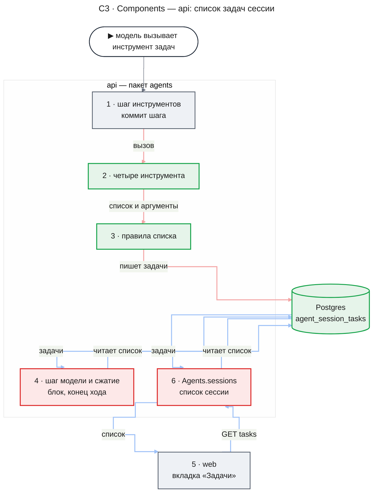
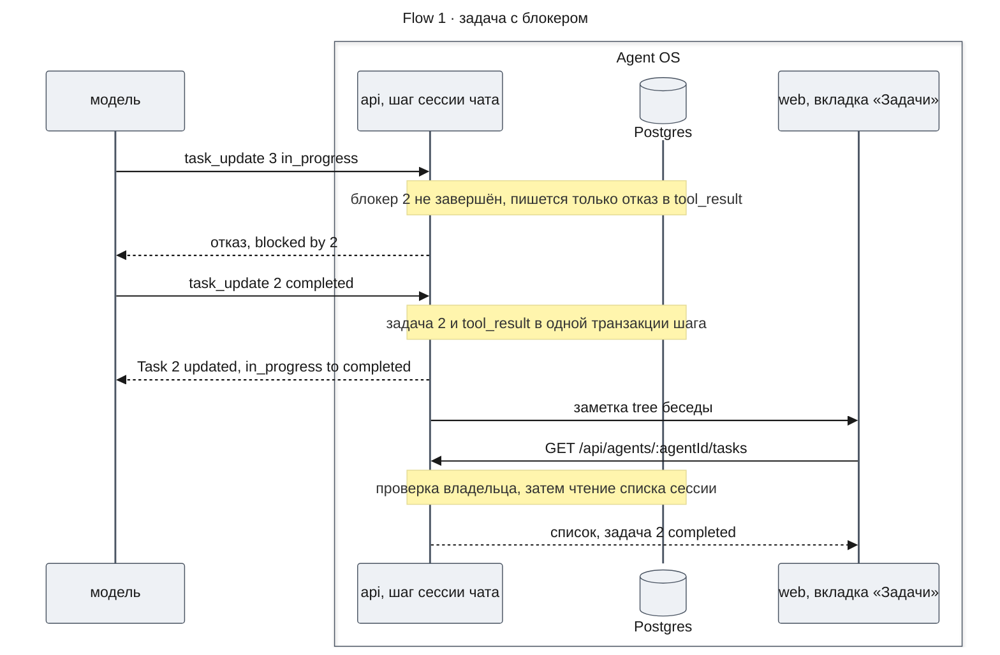

# Глубокие агенты — Design Document — task-list

**Status:** На утверждении · **Date:** 2026-11-22 · **PRD:** [prd.md](./prd.md) · **UXRD:** [uxrd.md](./uxrd.md) · **Depends on:** [design-agent-types.md](./design-agent-types.md#contract-definitions)

## Snapshot

**Overview.** У каждой сессии агента — свой список задач, как у Claude Code: модель ведёт его инструментами `task_create`, `task_update`, `task_get` и `task_list`. Список лежит в базе вне истории, поэтому переживает сжатие, продолжение и рестарт, а модель видит его на каждом шаге в конце системного промпта. Код назначает номера, проверяет поля и зависимости и не даёт начать задачу, пока её блокер не завершён; агент, кроме главного чата, не заканчивает ход с открытыми задачами. Сотрудник видит список той сессии, на которую смотрит: чата — во вкладке «Задачи» панели рядом с чатом, глубокого агента — на его странице. Сегодняшний план `task_list` с `add` и `set` удаляется целиком.

- **Не меняется**: из списка ничего не запускается; сотрудник правит список только просьбой в чате.
- **Главный риск**: слабая модель не закрывает задачи и упирается в уведомление конца хода ([Risks](#risks-and-mitigation)).
- **Открытые вопросы**: [два](#open-questions), оба о соседних документах.

### Key Decisions

#### KD-1: Список — новая таблица `agent_session_tasks` по сессии; номер — счётчик сессии, который не идёт назад

Строка списка ссылается на сессию и удаляется вместе с ней. Номер — следующее значение счётчика сессии с 1, и номер удалённой задачи не достаётся новой: слабая модель не спутает старую «5» с новой. Claude Code так же хранит старший выданный номер рядом со списком. Зависимость хранится одним направлением — блокеры у задачи; «блокирует» код вычисляет из списка, который всё равно читается целиком.

`owner` — свободная метка. Это шов с поручением ([design-task.md](./design-task.md)): поручение назовёт номер задачи, код запишет сабагента меткой и закроет задачу по ответу, а связь «поручение — задача» будет храниться на стороне поручения. Таблицу списка менять не придётся; сейчас этого не строим.

Таблицу создаёт и `agent_run_tasks` удаляет новая миграция `0004` от `db:generate`. `0003` не правим: она уже в `origin/feat/agent-harness` и применена к тестовой базе, а ADR-0003 запрещает менять применённый файл. Строк не переносим.

#### KD-2: Способность — флажок `taskList` в содержимом записи: четыре инструмента, блок промпта и правило конца хода

Флажок есть у записи агента, глубокого агента и каждого сабагента (FR-64); снимок запуска несёт его как есть. Корень беседы — главный чат — получает инструменты и блок всегда, флажок для него не читается: так список чата не выключит и администратор, который правит встроенную запись. Выключенный флажок убирает инструменты и блок; советов о задачах в промпте нет, они в описаниях инструментов. У новой записи агента и глубокого агента флажок по умолчанию включён, у сабагента — выключен: Claude Code держит эти инструменты включёнными как раз для моделей класса Haiku ([tools reference](https://code.claude.com/docs/en/tools-reference.md)).

Встроенные записи: глубокий ресерч — включён; сабагенты ресерча и `general-purpose` — выключен, их работа одноразовая и короткая. В базу встроенные записи попадают через сидер ([builtin-record.md](../../code-system/patterns/builtin-record.md)).

#### KD-3: Правила — одна чистая функция; инструмент исполняется в коммите шага

Вызов читает список сессии в транзакции коммита шага, решает чистой функцией и пишет изменения вместе со своим `tool_result`. Поэтому повтор потерянного шага не создаёт задачу дважды. Писать список может только шаг этой же сессии, а рантайм ведёт шаги одной сессии по одному (ADR-0001); маршрут только читает. Лишняя блокировка поэтому не нужна.

От Claude Code отличаются три правила: задача с незавершённым блокером не переходит в `in_progress` и `completed`; агент, кроме главного чата, не заканчивает ход с открытыми задачами (KD-4); метка `owner` пока только информирует. Остальное, например «одна задача в работе», — совет в описании инструмента.

#### KD-4: Открытые задачи в конце хода дают уведомление, как сегодня; главный чат его не получает

Ветка `endOfTurn` остаётся на месте — после ожидания потомков, до правила финального сабагента, — но её вход теперь задачи `pending` и `in_progress` сессии. Главный чат — корень беседы — не заканчивает ход, а ждёт сообщения: первая ветка «корень ждёт» не меняется. Поле `openPlanItems` записи `notice` переименовано в `openTasks`. Петлю останавливает предел шагов.

#### KD-5: Вкладка показывает свою сессию: в панели — только список чата

Маршрут `GET /api/agents/:agentId/tasks` отдаёт список любой сессии сотрудника, включая корень. Вкладка «Задачи» панели показывает список главного чата и появляется с его первой задачей. Список идущего глубокого агента — только на его странице, куда ведут карточка хода и дерево агентов. Одно правило проще, чем панель, которая переключается между чатом и последним запуском. Веб перечитывает список по каждой заметке `tree` своей беседы, как сегодня ([design-agent-types.md](./design-agent-types.md), KD-6).

## Terms

- **Сессия** — один агент в дереве беседы со своей историей: главный чат (корень), глубокий агент, сабагент; её id — `agentId`.
- **Блокер** — задача, которую надо завершить раньше; задача заблокирована, пока хоть один её блокер не `completed`.
- **Открытая задача** — в статусе `pending` или `in_progress`.
- **Блок задач** — текст со списком в конце системного промпта шага; в историю не пишется.

## Part

- **Part**: `task-list`, перед частью `task`
- **Covers**: FR-60 – FR-65
- **Depends on**: [`agent-types`](./design-agent-types.md#contract-definitions), построена
- **Prerequisite ADRs**: [ADR-0001](../../adr/ADR-0001-durable-runtime-owner.md), [ADR-0003](../../adr/ADR-0003-drizzle-data-layer.md), [ADR-0004](../../adr/ADR-0004-agent-framework-packages.md), [ADR-0017](../../adr/ADR-0017-run-snapshots-from-library.md)

В [design-agent-types.md](./design-agent-types.md) этот документ заменяет KD-5, контракты «`task_list`», «Блок плана» и «Список задач», таблицу `agent_run_tasks` и статусы пункта плана, а также правило вкладки панели в KD-6. В [UXRD](./uxrd.md) он заменяет правило панели в KD-3 и DA-12 (теперь KD-5) и статусы «Сбой» и «Отменена» в MC-11 (FR-60).

**Out of scope**: поручение задачи сабагенту и запись `owner` кодом (часть `task`); правка списка в интерфейсе; мягкое удаление.

**Constraints**: без совместимости — старый план с кодом, текстами и тестами удаляется в той же замене; настроек нет — пределы в коде, флажок в записи; журнал через логгер `common` ([logging.md](../../code-system/patterns/logging.md)); тестов мало ([Test Strategy](#test-strategy)).

## Building-block Inventory

Follows the [code system](../../code-system/README.md). Искали другое состояние сессии вне истории в `packages/agents` и `apps/web`: есть только план, его и заменяем.

| Блок | Образец | Статус |
|---|---|---|
| Таблица и репозиторий | [repository-over-transaction](../../code-system/patterns/repository-over-transaction.md) | new |
| Правила, `endOfTurn` | [pure-decision](../../code-system/patterns/pure-decision.md) | new, extended |
| Четыре инструмента | [composition-root](../../code-system/patterns/composition-root.md) | new |
| Блок задач | [step-prompt-block](../../code-system/patterns/step-prompt-block.md) | extended |
| Флажок в записи и снимке | [run-snapshot](../../code-system/patterns/run-snapshot.md) | extended |
| Маршрут и вкладки | [read-on-open](../../code-system/patterns/read-on-open.md) | extended |

**Что удаляется, меняется и остаётся**

| Что | Судьба |
|---|---|
| `decideTaskList`, `task_list` с `add`/`set`, `run-tasks.repository.ts`, `agent_run_tasks`, `RunTaskStatusSchema`, `RUN_TASK_TEXT_MAX_LENGTH` | удаляются; имя `task_list` переходит к инструменту чтения ([Open Questions](#open-questions)) |
| Строка о `task_list` в `DEEP_AGENT_RULES`, копия заголовка блока в `agentsHarness.ts` | удаляются |
| `plan-block.ts` | блок задач; читается по флажку, а не по виду |
| `endOfTurn`, `noticeContent`, `openPlanItems` | открытые задачи, поле `openTasks` |
| `snapshotDefinition`, схемы содержимого, встроенные записи | инструменты из флажка `taskList` |
| `Agents.sessions.taskList`, маршрут, `RunTaskListView` | корень принят, новая строка |
| `RunTaskList`, `useRunTasks`, вкладки, ключи `agents.tasks.*`, `agents.event.planItemsOpen`, `tools.json` | новая строка и правило KD-5, оба каталога |
| `withStepBlocks`, режим `in_commit`, текст отказа, `loggedArgsOf`, заметка `tree` | остаются |

## Acceptance Criteria

- From the PRD: AC-60.1, AC-60.2, AC-61.1, AC-61.2, AC-62.1 – AC-62.5, AC-63.1 – AC-63.3, AC-64.1, AC-65.1, AC-65.2; AC-60.3 — [Open Questions](#open-questions).
- **DC-1.** Новая задача получает номер после наибольшего выданного в сессии; номер удалённой задачи не повторяется.
- **DC-2.** Неизвестный номер, ребро на себя, слишком длинное поле и 51-я задача отказаны текстом, который называет поле и правило; список не меняется.
- **DC-3.** Повтор потерянного шага не создаёт задачу второй раз.
- **DC-4.** У сессии с выключенным `taskList`, кроме главного чата, нет ни инструментов, ни блока задач, а на вкладке «Задачи» глубокого агента списка нет.

## Design

### Architecture (C1–C4)

#### C3 · Components: api

Правила решают по списку и аргументам, не читая базу: принять изменения или отказать с текстом. Шаг модели и шаг сжатия читают список перед каждым вызовом модели; шаг модели ещё передаёт открытые задачи в `endOfTurn`. `Agents.sessions` проверяет владельца сессии до чтения.

### Runtime Flows

#### Flow 1: задача с блокером и вкладка сотрудника

**Starts when:** модель главного чата начинает задачу 3, которую блокирует незавершённая задача 2, для AC-62.1, AC-63.1.

Шаг, потерянный после записи, рантайм повторяет, и правила видят уже записанное: задача не пишется второй раз.

### Contract Definitions

#### Инструменты

Отказ — `refused` с причиной `invalid_arguments` и текстом, который называет поле и правило; модель читает его в `tool_result` ([agent-harness design-core.md](../agent-harness/design-core.md#contract-definitions)). Однострочные поля сворачиваются в одну строку до проверки длины.

- **`task_create`** — `subject` (1–200, одна строка), `description` (1–4 000), необязательный `activeForm` (до 200, одна строка). Создаёт задачу `pending`. Возвращает «Task 4 created: тема». Отказ: в списке уже 50 задач.
- **`task_update`** — `taskId` и любое из: `status` (`pending`, `in_progress`, `completed`, `deleted`), `subject`, `description`, `activeForm`, `owner` (до 100, одна строка), `addBlockedBy`, `addBlocks`. Меняются только переданные поля, рёбра только добавляются; при `deleted` прочие поля не применяются. Возвращает «Task 4 updated: status pending → in_progress; subject» или «Task 4 deleted». Отказы: нет задачи; нечего менять; номер в ребре не из списка; ребро на себя; цикл; `in_progress` или `completed` при незавершённых блокерах — с их номерами.
- **`task_get`** — `taskId`. Задача целиком: номер, тема, статус, `activeForm`, метка, блокеры, кого блокирует, описание. Нет задачи — «There is no task 7».
- **`task_list`** — без аргументов. По строке на задачу: номер, статус, тема, метка, блокеры; без описаний. Пустой — «No tasks».

Описания инструментов (английский) советуют: заводить список при трёх и более шагах, перечне от сотрудника или длинной работе; держать в работе одну задачу; ставить `in_progress` до начала и `completed` сразу после; не отмечать завершённым незаконченное; задавать порядок блокерами.

#### Блок, уведомление, запись, маршрут

- **Блок задач** — после блока знаний, если список не пуст. Заголовок называет задачи собственными заметками агента, а не инструкциями. Строка: номер, статус, у `in_progress` — `activeForm`, иначе тема, блокеры, метка.
- **Уведомление конца хода** — `notice` «You cannot finish yet» со строками открытых задач в формате блока; `openTasks` — их номера, по ним лента пишет строку события.
- **`taskList`** — логическое поле содержимого записей `agent`, `deep_agent` и сабагента; умолчания и правило корня — KD-2. Инструменты записей и экран определения показывают его, как `selfLearning`.
- **`GET /api/agents/:agentId/tasks`** — список любой сессии сотрудника, включая корень. Ответ `tasks` по номеру; у строки `id`, `subject`, `description`, `activeForm` или `null`, `status`, `owner` или `null`, `blockedBy`. Чужая или несуществующая сессия — `AGENT_NOT_FOUND`.
- **Вкладка «Задачи»** — только чтение. Строка: номер, тема, статус, у `in_progress` — `activeForm`, «ждёт {номера}», метка, если задана; описание раскрывается. Тексты — ключи в `ru` и `en`; вид — UXRD DA-12, кроме правила панели (KD-5) и статусов (FR-60).
- **Журнал** — сервис `agents.session-tasks`, запись на создание, смену статуса и удаление: `agentId`, `rootId`, `ownerId` (сотрудник), `callId`, номер, статус до и после; на отказ — поле и правило. Тем, описаний, `activeForm` и меток в журнале нет; `loggedArgs` называет только номера, статус и имена полей.

### Data Model

- **`agent_session_tasks`** — строка на задачу: сессия (каскадное удаление), номер, тема, описание, `activeForm`, статус с CHECK из трёх значений, метка, номера блокеров, время. Ключ — сессия и номер.
- **`agent_sessions.last_task_number`** — последний выданный номер, 0 у новой сессии.

Инварианты: задачи, счётчик и `tool_result` пишутся в одной транзакции коммита шага; блокеры — номера того же списка, не свой, без циклов; в момент перехода в `in_progress` или `completed` у задачи нет незавершённых блокеров; задач в списке не больше 50.

## Test Strategy

- **UC-1: Правила** — covers AC-60.2, AC-62.1 – AC-62.3, DC-1, DC-2. Одна таблица над чистой функцией: заблокированная задача не начинается и не завершается, цикл и ребро на себя отказаны, удаление убирает рёбра, неизвестный номер отказан, одно поле — одно изменение, номер не повторяется, 51-я задача отказана.
- **UC-2: Изоляция** — covers AC-61.2, AC-65.1. Интеграционный тест операций: сабагент не видит задач родителя, маршрут на сессию другого сотрудника — `AGENT_NOT_FOUND`, на свой корень — список чата.
- **UC-3: Повтор, рестарт, сжатие, продолжение** — covers AC-61.1, AC-62.5, DC-3. Сессия с тестовой моделью ведёт список; после повтора шага, рестарта, сжатия и нового сообщения он тот же, и блок с последним изменением есть в каждом вызове модели.
- **UC-4: Главный путь** — covers AC-60.1, AC-62.4, AC-63.1. API e2e: чат создаёт три задачи и одну начинает, маршрут корня их отдаёт; глубокий агент с открытой задачей получает уведомление, после завершения — принятый ответ. Строки открытых задач в таблице `turn-rules.spec.ts` проверяют ветку `endOfTurn`.
- **UC-5: Состав инструментов** — covers AC-64.1, DC-4: строки сабагента с выключенным флажком, глубокого агента с включённым и корня в таблице `tool-registry.spec.ts`.

Переписываются: `task-list.spec.ts` (станет UC-1), строки плана в `turn-rules.spec.ts`, `snapshot-definition.spec.ts`, `tool-registry.spec.ts`, строки `taskList` в `agent-platform-agents.int.e2e-spec.ts` (UC-2), план в `deep-agents-agent-types.int.e2e-spec.ts` (UC-3) и в `apps/api/test/deep-agents-agent-types.e2e-spec.ts` (UC-4), таблица в `migrations.e2e-spec.ts`, вкладки в `deep-agents-web.int.test.tsx`, поле в `to-feed.test.ts`. Вкладку (AC-63.2, AC-63.3) и журнал (AC-65.2) владелец смотрит вручную на первых запусках.

## Security Considerations

- **Authentication & Authorization**: инструмент пишет только список вызвавшей сессии — её id берётся из контекста вызова, не из аргументов; маршрут сначала проверяет владельца.
- **Input Validation**: схема аргументов и правила. Однострочные поля свёрнуты, поэтому текст из результата инструмента не подделает строки блока, а заголовок блока называет задачи заметками, а не инструкциями.
- **Sensitive Data Handling**: тексты задач в журнал не пишутся. Вызов инструмента задач сессией, которой его не предлагали, журналируется правилом `loggedArgs` зарегистрированного инструмента, тоже без текстов.

## Risks and Mitigation

- **Слабая модель не закрывает задачи и получает уведомление снова и снова** — вероятность средняя, тратит шаги. Уведомление называет задачи, петлю обрывает предел шагов.

## Open Questions

- AC-60.3 требует, чтобы инструмента `task_list` не было ни у одного агента, а решение владельца называет так новый инструмент чтения списка. Документ держит имя `task_list`, а AC-60.3 читает как «нет `task_list` с `add` и `set`». Это блокирует проверку AC-60.3; решает владелец — поправить AC-60.3 или переименовать инструмент.
- Часть `task` ([design-task.md](./design-task.md)) читает флажок `plan`, статусы `RunTaskStatusSchema` и поле `tasks` маршрута. Это блокирует её контракт маршрута; согласует автор части `task`.

## Update History

| Version | Date | Change |
|---------|------|--------|
| 1.0 | 2026-11-22 | Initial version |
