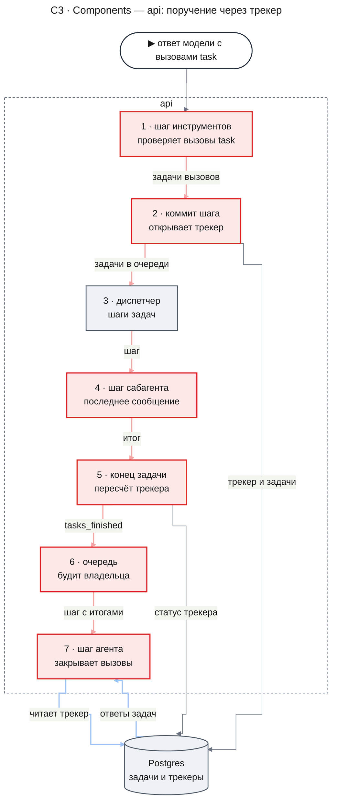
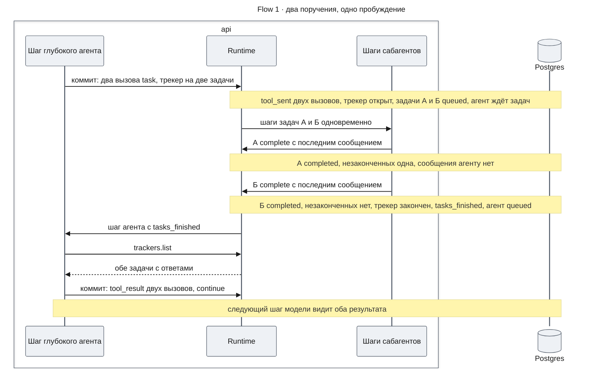
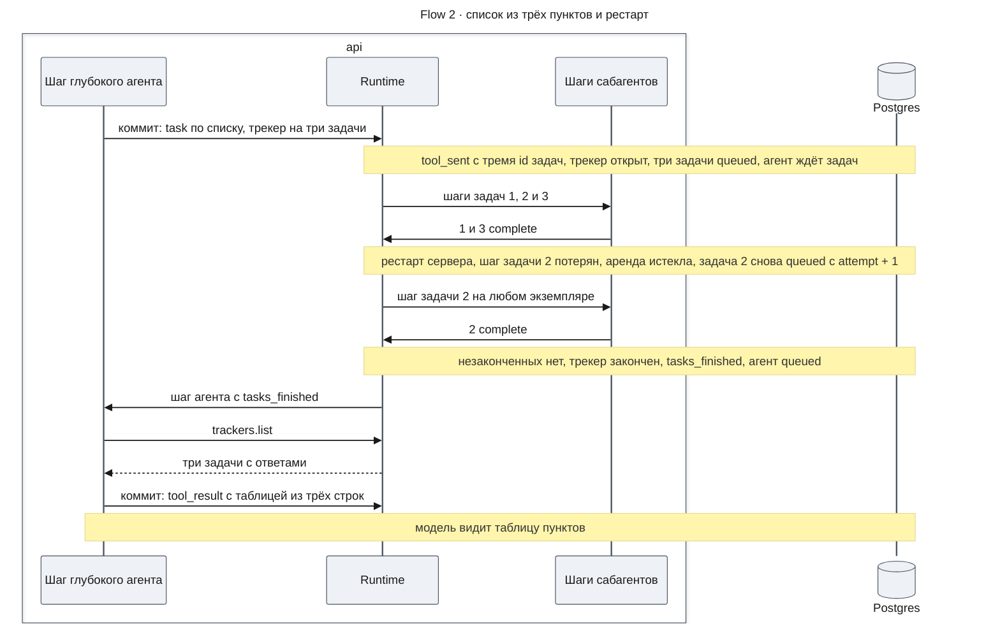

# Глубокие агенты — Design Document — task

**Status:** На утверждении · **Date:** 2026-11-22 · **PRD:** [prd.md](./prd.md) · **UXRD:** [uxrd.md](./uxrd.md) · **Depends on:** [design-agent-types.md](./design-agent-types.md#contract-definitions)

## Snapshot

**Overview.** Глубокий агент поручает работу сабагентам одним инструментом `task`, как в LangChain Deep Agents: называет сабагента и задание, а последнее сообщение сабагента возвращается результатом того же вызова. Вторая форма вызова даёт одну инструкцию и список, и код запускает по сабагенту на каждый пункт, так что ни один не пропущен. Ждать сабагентов помогает новый механизм рантайма — трекер задач: шаг агента открывает его в своём коммите вместе с задачами, рантайм исполняет их как обычные дочерние задачи и будит агента один раз, когда закончились все. Трекер, задачи и пробуждение пишутся в тех же транзакциях, что и сами задачи, поэтому рестарт сервера не теряет и не удваивает ни одной. Рантайм ничего не знает об агентах: трекер принадлежит задаче, которая его открыла.

- **Не меняется**: долгими задачами владеет только `packages/runtime`; права сотрудника проверяются на каждый вызов сабагента; план `task_list` остаётся заметкой агента и с трекером не связан.
- **Главный риск**: поручение по списку разом ставит в очередь до ста сабагентов, а бюджета на запуск нет (Risks).
- **Открытые вопросы**: нет.

### Key Decisions

#### KD-1: Трекер — часть рантайма: шаг открывает его в своём коммите, задачи трекера — дети этого шага

Сегодня шаг может создать ребёнка (`StepEffects.spawn`), но ждать детей нечем: агент ждёт в `endOfTurn`, и каждое `child_finished` без открытых вызовов стоит ему шага модели. Поэтому у `StepEffects` появляется действие «открыть трекер» с N задачами — тип обработчика и вход у каждой. Рантайм создаёт их, как `spawn`, дочерними задачами шага и связывает с новой строкой трекера в транзакции коммита. Откат коммита не оставляет ничего, а повтор потерянного шага создаёт трекер один раз.

Трекер в `agents` поверх потребителя событий отвергнут: это второй механизм ожидания рядом с рантаймом, со своими повторами доставки, против ADR-0001. Пользователь у трекера пока один — `task`; вторым станет главный чат ([шов](#шов-со-списком-сессии-и-главный-чат)). Поэтому зависимостей, приоритетов и частичного пробуждения у трекера нет.

#### KD-2: «Все закончились» решает процедура конца задачи под блокировкой владельца; будит одно сообщение

Любая задача кончается через `endTask`: из коммита шага, сбоя шага, исчерпанного восстановления и остановки дерева. Каждый путь сначала блокирует родителя, потому что `notifyParent` пишет ему. У задачи трекера родитель — владелец, так что все писатели трекера уже упорядочены блокировкой строки владельца в `runtime_tasks`.

Поэтому у задачи открытого трекера `endTask` вместо `child_finished` пересчитывает его незаконченные задачи и на последней закрывает трекер и пишет владельцу одно `tasks_finished`. Пересчёт выбран вместо счётчика: законченную задачу может оживить сообщение с `revive`, и трекер дождётся её снова. Задача уже закрытого трекера кончается обычным `child_finished`, чтобы владелец не ждал оживлённого сабагента вечно. Ответы в сообщение не входят — владелец читает их `trackers.list`, потому что сто ответов до `INBOX_PAYLOAD_MAX_BYTES` каждый не поместятся в одно сообщение.

#### KD-3: Пока трекер открыт, владелец «ждёт задач»: другие сообщения ждут, остановка отменяет задачи

Рантайм ставит владельцу причину ожидания `tasks`, которую будит только `tasks_finished`. Прочие сообщения ждут в очереди и приходят вместе с итогами, как при ожидании решения: модель не может отвечать, пока её вызовы `task` не закрыты. По той же причине `tasks.interrupt` отвечает `not_active`.

Остановка владельца останавливает дерево, задачи кончаются `stopped`, и `tasks_finished` ложится в очередь остановленного владельца. Сообщение сотрудника потом оживляет агента, и первый шаг получает итоги: ответы законченных задач, остальные — «отменена». Сбоя владельца при открытом трекере не бывает: падает только идущий шаг, а владелец ждёт.

#### KD-4: Вызов `task` открыт до пробуждения; все вызовы `task` одного ответа — один трекер

Образец — путь подтверждения: вызов с намерением `tool_sent` без `tool_result` живёт через несколько шагов. Шаг инструментов исполняет остальные вызовы ответа как сейчас, а оставшиеся вызовы `task` проверяет вместе: отказы закрывает текстом, для принятых пишет `tool_sent` с id их задач и открывает один трекер. Модель получает следующий ход один раз, со всеми результатами, и не сопоставляет поздние уведомления с давними вызовами.

Отправленный вызов `task` не становится «исход неизвестен», как прочие потерянные вызовы: его закрывает только `tasks_finished`. Шаг с этим сообщением читает трекер, пишет `tool_result` каждого вызова и идёт к шагу модели; потерянный шаг повторяется с тем же недоставленным сообщением.

#### KD-5: Список обходит код; таблица ответов ограничена, полные ответы читаются по ссылке

Документация Deep Agents признаёт, что модель с сотнями пунктов «покрывает выборку, а не каждый пункт», и решает это скриптом ([subagents](https://docs.langchain.com/oss/python/deepagents/subagents)). Владелец хочет инструмент, поэтому пункты, данные прямо в вызове, перебирает код. Пунктов не больше `TRACKER_MAX_TASKS`; задачи сверх `RUNTIME_CONCURRENCY` ждут очереди.

Результат — таблица в пределе `TASK_TABLE_MAX_CHARS`: не помещаются ответы — каждый обрезается до равной доли, а полная таблица сохраняется результатом вызова в `agent_tool_results` и читается существующими `read_tool_result` и `search_tool_result`. Часть `files` добавит список из файла запуска и ссылки на файлы с длинными ответами (FR-42) новым необязательным аргументом и новой ссылкой в той же таблице, не меняя остального контракта `task`.

#### KD-6: У глубокого агента поручают только через `task`

PRD требует одного способа поручить (AC-30.3). У глубокого агента нет `start_agent` и `message_agent` — сабагент одноразовый, — а есть `task` и, если план включён, `task_list`. У главного чата и агентов вида `agent` четыре инструмента агентов остаются и работают на любых потомках.

Удаляются без вызывающего ветка команды в `LaunchSet` и `gateStart`, цель `subagent` в `StartTarget`, `history.startedCount`, источник `subagent` в `resolveStart` и запрет fork для глубокого агента; снимок сабагента строит `subagentSnapshot`. Три правила записи PRD берут данные из вызовов `task`:

- `maxRuns` (FR-01) считается по дочерним сессиям глубокого агента с этим сабагентом от одиночных поручений. Пункты списка в него не входят, как рекомендует PRD (Undetermined Items). Длину списка держит константа `TRACKER_MAX_TASKS`, а не настройка в базе: это предел рантайма на один трекер, общий для любого владельца, а не правило записи.
- `limitRefusals` карточки запуска читаются из отказов `task`.
- Ответ финального сабагента (FR-05) — последний законченный результат одиночного поручения ему; `endOfTurn` решает, как сейчас. `child_report` остаётся детям главного чата и агентов вида `agent`.

#### KD-7: Поля ответа — исключение из правила «ход кончается текстом»

[design-agents.md](../agent-platform/design-agents.md), KD-2, оставил ходу агента только свободный текст. Для одного случая это отменяется: поручение может назвать поля ответа, и `endOfTurn` сабагента принимает только JSON-объект с непустой строкой в каждом поле. Иначе он даёт уведомление с именами пропущенных и лишних полей, как уже даёт его об открытых пунктах плана, и сабагент отвечает снова. Повторы ограничивает его `maxTurns`: `turn_limit` — сбой задачи с причиной (AC-33.2). Без полей ответ — свободный текст, как сегодня.

## Terms

Поручение, поручение по списку, трекер задач, сабагент общего назначения и последнее сообщение — как в [PRD, Terms](./prd.md#terms).

- **Владелец трекера** — задача рантайма, шаг которой открыл трекер; сейчас это сессия глубокого агента.
- **Задача трекера** — дочерняя задача владельца, связанная с трекером; её id равен id сессии сабагента.
- **Коммит шага** — транзакция, которой рантайм фиксирует итог шага вместе с записями обработчика.
- **Ожидание задач** — `waiting` с причиной `tasks`: владельца будит только `tasks_finished`.

## Part

- **Part**: `task`
- **Covers**: FR-30 – FR-36, NFR-01
- **Depends on**: [`agent-types`](./design-agent-types.md#contract-definitions) — снимки `deep_agent` и `subagent`, `task_list`, бриф `start_deep_agent`, маршрут списка, `endOfTurn`
- **Prerequisite ADRs**: [ADR-0001](../../adr/ADR-0001-durable-runtime-owner.md), [ADR-0004](../../adr/ADR-0004-agent-framework-packages.md), [ADR-0017](../../adr/ADR-0017-run-snapshots-from-library.md), [ADR-0021](../../adr/ADR-0021-deep-agent-record-kind.md)

**Out of scope**

- Файлы запуска и вынос в них списков и длинных ответов — часть `files`; навыки и память — часть `skills-memory`.
- Запуск по расписанию с доставкой результата; вызов сабагентов из `run_code`.
- Зависимости между задачами, финальная задача, обязательные исполнители, стартовые задачи в записи — остановлены (PRD, Won't Have).
- Список задач сессии со статусами, правкой и зависимостями, в том числе у главного чата и на виду у сотрудника, переделывается по образцу задач Claude Code следующей работой. Здесь `task_list` не меняется, кроме выключателя в записи (FR-36).
- Главный чат и агенты вида `agent` поручают через `start_agent`, как сейчас.

**Constraints**

- **Один владелец долгих задач** (ADR-0001, ADR-0004): задачи трекера создаёт, восстанавливает и останавливает рантайм; своей очереди и потребителя событий у `task` нет (KD-1).
- **Рантайм не знает об агентах**: трекер хранит задачи и итоги, но не тексты, имена сабагентов и промпты.
- **Без совместимости**: что потеряло вызывающего, удаляется с тестами (KD-6); базу разработки пересоздают.
- **Новых настроек нет**: `TRACKER_MAX_TASKS` и `TASK_TABLE_MAX_CHARS` — константы кода, выключатели — поля записи.
- **Журнал** — через логгер `common` ([logging.md](../../code-system/patterns/logging.md)): одна запись на событие поручения, без текстов заданий, пунктов и ответов (NFR-01).

## Building-block Inventory

Follows the [code system](../../code-system/README.md).

| Building block | Pattern | Status | Note |
|---|---|---|---|
| Трекер в рантайме | [step-handler.md](../../code-system/patterns/step-handler.md) | extended | действие коммита, причина ожидания, пересчёт в `endTask` |
| Таблица трекеров | [repository-over-transaction.md](../../code-system/patterns/repository-over-transaction.md) | new | владеет рантайм, как `runtime_decisions` |
| Инструмент `task` | [step-handler.md](../../code-system/patterns/step-handler.md) | new | открытый вызов, как подтверждение |
| Проверка вызова, таблица ответов | [pure-decision.md](../../code-system/patterns/pure-decision.md) | new | по образцу `gateStart` |
| Снимок `general-purpose` | [run-snapshot.md](../../code-system/patterns/run-snapshot.md) | extended | рядом с `subagentSnapshot` |
| `endOfTurn` | [pure-decision.md](../../code-system/patterns/pure-decision.md) | extended | поля ответа, финальный сабагент из `task` |
| Сохранённый результат | — | reused | правило `agent_tool_results` для MCP |
| Маршрут и вкладка «Задачи» | [read-on-open.md](../../code-system/patterns/read-on-open.md) | extended | поручения рядом с планом |

Ожидание детей искали в `packages/runtime` и `packages/agents`: есть только `child_finished` на каждого ребёнка и ожидание в `endOfTurn`. Ближе всего путь ожидания решения, и трекер повторяет его форму.

## Acceptance Criteria

- **FR-30**: AC-30.1, AC-30.2, AC-30.3. Когда в ответе есть вызовы `task` и другие, другие исполняются первыми, а все `task` уходят одним трекером (DC-1).
- **FR-31**: AC-31.1, AC-31.2. Список длиннее `TRACKER_MAX_TASKS` получает отказ с числом пунктов и пределом, никто не запущен (DC-2). Обрезанную таблицу `read_tool_result` по id вызова читает целиком (DC-3).
- **FR-32**: AC-32.1, AC-32.2.
- **FR-33**: AC-33.1, AC-33.2.
- **FR-34**: AC-34.1 – AC-34.5. Сообщение агенту, ждущему задач, приходит ему вместе с итогами после конца последней задачи (DC-4). Оживлённый сообщением остановленный агент первым шагом закрывает вызовы `task` итогами (DC-5).
- **FR-35**: AC-35.1, AC-35.2, AC-35.3.
- **FR-36**: AC-36.1. При выключенном поручении по списку у `task` нет полей списка и правил о списках (DC-6).
- **NFR-01**: как в PRD.

## Design

### Architecture (C1–C4)

#### C3 · Components: api

Глубокий агент, рантайм и сабагенты работают в одном процессе API. Изменены звенья пути поручения; диспетчер и хранилище остались прежними.

Шаг инструментов собирает каждой задаче снимок сабагента и задание и в коммите пишет `tool_sent` и сессии сабагентов, как сегодня [`createStartChild`](../../../packages/agents/src/tools/builtin/start-child.ts). Задание — одна запись `task` истории сабагента: бриф запуска строками «Вопрос», «Границы», «Результат», если агента запустил `start_deep_agent`, затем описание или инструкция с пунктом, затем правило ответа, если названы поля. Бриф платформа берёт из первой записи истории глубокого агента, поэтому модель его не пересказывает.

### Runtime Flows

#### Flow 1: Два поручения в одном ответе

**Starts when:** модель глубокого агента ответила двумя вызовами `task`, for AC-30.1, AC-30.2, AC-34.4

Если Б кончилась сбоем, её вызов закрывается исходом `error` с причиной, вызов А — ответом, и агент работает дальше (AC-34.4). Сабагент, ждущий подтверждения изменяющего вызова, держит трекер открытым.

#### Flow 2: Поручение по списку с рестартом посередине

**Starts when:** модель глубокого агента вызвала `task` со списком из трёх пунктов, for AC-31.1, AC-34.1, AC-34.2

Рестарт до коммита не оставляет ничего, после — три задачи в очереди, которые диспетчер запустит по разу (AC-34.1). Потерянный шаг возвращает `RecoverySweeper`, поздний итог старой попытки отвергается по `attempt`, и второго сабагента нет (AC-34.2). Пробуждение пишется в транзакции конца последней задачи, поэтому рестарт между ними невозможен.

### Contract Definitions

#### Рантайм

- **Открыть трекер** — новое действие `StepEffects` в коммите шага. Принимает от одной до `TRACKER_MAX_TASKS` задач (тип и вход), создаёт каждую дочерней задачей шага в `queued` и возвращает id трекера и id задач в том же порядке. Второй трекер в коммите, итог шага кроме `wait`, неизвестный тип, неверный вход или превышение предела — `invalid_step_result`, коммит откатывается.
- **Причина ожидания `tasks`** в `WaitReasonSchema`. Шаг, открывший трекер, кончается ожиданием задач, даже если в очереди есть сообщения; будит его только `tasks_finished`. `tasks.interrupt` отвечает `not_active`; `tasks.stop` останавливает владельца с его задачами.
- **`tasks_finished`** — зарезервированный вид сообщения рантайма, как `child_finished`. Несёт id трекера и пары «id задачи — статус» в исходном порядке; ровно одно на трекер, без `revive`.
- **`trackers.list(taskId, ownerId)`** — новая операция `Runtime`: трекеры задачи от старого к новому, у каждого статус, время открытия и конца и задачи с id, статусом, `result` и `failure`. Чужая или несуществующая задача даёт пустой список.
- **Конец задачи трекера**: пока трекер открыт, родитель не получает её `child_finished`; после конца трекера её новый конец — обычное `child_finished`.
- **`TRACKER_MAX_TASKS`** — 100, константа рантайма.

#### Инструмент `task`

- **Аргументы**: `subagent_type` — имя сабагента записи или `general-purpose`; затем либо `description` до 8 000 символов, либо `instruction` до 8 000 символов с `items` (строки до 2 000 символов); необязательно `answer_fields` — до десяти полей с именем и описанием. Поля списка есть в схеме, только если поручение по списку включено. Лишний ключ — отказ: модели прячут инструкции под выдуманными ключами, и Deep Agents отклоняет их так же.
- **Отказы** — `refused` с текстом, который называет поле и правило: нет такого сабагента, формы смешаны или нет ни одной, лишний ключ, `maxRuns` исчерпан, список пуст или длиннее предела, пункт длиннее предела. Сабагенты не стартуют.
- **Результат одного поручения** — последнее сообщение сабагента, с `answer_fields` — его JSON-объект; сбой — исход `error` с причиной, остановка — `error` «отменена». Длиннее порога `agent_tool_results` — сохранённый результат с началом текста, как у MCP.
- **Результат по списку** — таблица «номер, пункт, статус, ответ или причина», поля ответа — столбцы, предел `TASK_TABLE_MAX_CHARS` 20 000 символов. Обрезанная таблица кончается строкой, что полная читается `read_tool_result` по id вызова.
- **`general-purpose`** есть у каждого глубокого агента: модель, серверы и `maxTurns` глубокого агента, промпт из двух предложений — сделай задание сам, глубокий агент увидит только твоё последнее сообщение. Сабагент записи с этим именем запрещён правилом записи; `task` нет ни у одного сабагента.

#### Запись и маршрут

- **`plan`** и **`listDelegation`** — флажки содержимого записи глубокого агента (FR-36). Выключенный флажок убирает `task_list` или поля списка `task` вместе с их правилами в промпте. Встроенный глубокий ресерч включает оба; инструменты записей и экран определения их показывают.
- **`GET /api/agents/:agentId/tasks`** отвечает `RunTaskListView`: `tasks` — пункты плана, как сейчас, и новое `delegations` — задачи трекеров агента по порядку. У строки `agentId` сабагента, `subagent`, `item` — описание или пункт до 200 символов, `status` из `RunTaskStatusSchema` (`queued` → `waiting`, идёт или ждёт → `running`, `completed` → `done`, `failed` → `failed`, `stopped` → `cancelled`), `answer` до 300 символов или `null`, `reason` или `null`. Чужой агент отвечает как отсутствующий (AC-35.2). Как вкладка «Задачи» показывает эти строки (AC-35.3), решает UXRD.

### Data Model

- **`runtime_trackers`** — строка на трекер: задача-владелец (удаляется вместе с ней), сотрудник, статус «открыт» или «закончен», время. Пишет её только рантайм, под блокировкой строки владельца.
- **`runtime_tasks.tracker_id`** — у задачи трекера ссылка на трекер. Итог задачи — её `status`, `result` и `failure`, второй копии нет.
- **`agents`**: `tool_sent` вызова `task` хранит id его задач, вход сессии сабагента — вид поручения и поля ответа.

Инварианты: трекер, его задачи и `tool_sent` коммитятся вместе; у владельца не больше одного открытого трекера, и пока тот открыт, владелец ждёт задач или остановлен; трекер закрывается один раз, в транзакции конца последней задачи, вместе с единственным `tasks_finished`.

#### Шов со списком сессии и главный чат

Трекер поручений и список задач сессии хранятся раздельно: трекер — в `runtime_*` без текстов, список — в `agent_run_tasks`. Маршрут отдаёт их полями `tasks` и `delegations`, вкладка — двумя разделами. Будущий список по образцу Claude Code покажет поручение своей строкой по `agentId` сабагента, не трогая трекер.

Главному чату для `task` нужны инструмент и `general-purpose` в его записи и маршрут задач для корня, который сейчас корень не принимает. Главное — пока чат ждёт задач, сообщения сотрудника стоят в очереди, поэтому чату понадобится прерывание, которое останавливает незаконченные задачи и закрывает вызовы итогами. Рантайм и трекер для этого не меняются.

## Test Strategy

- **UC-1: Два поручения — одно пробуждение** — covers AC-30.1, AC-30.2, AC-34.4, DC-1
  - Given: агент с тестовой моделью ответил двумя `task`, вторая задача падает
  - When: обе кончаются
  - Then: один шаг агента, первый вызов закрыт ответом, второй — сбоем с причиной; у сабагента в истории одно задание
- **UC-2: Список из пяти пунктов** — covers AC-31.1, AC-31.2, DC-2, DC-3
  - Given: список из пяти пунктов, один сабагент падает, ответы длиннее доли таблицы
  - When: все кончаются
  - Then: пять задач, пять строк, сбойная с причиной; `read_tool_result` отдаёт полные ответы; тот же вызов со списком длиннее предела получает отказ без единой задачи
- **UC-3: Рестарт** — covers AC-34.1, AC-34.2, DC-4
  - Given: трекер на три задачи и точки падения рантайма до коммита, после него и в шаге задачи
  - When: процесс падает и поднимается
  - Then: задач три или ноль, у каждой один сабагент, `tasks_finished` одно, а ждущее сообщение сотрудника приходит вместе с ним
- **UC-4: Остановка владельца** — covers AC-34.3, DC-5
  - Given: две задачи трекера в работе
  - When: сотрудник останавливает агента, затем пишет ему
  - Then: обе `stopped`, новых нет, первый шаг закрывает вызовы итогами
- **UC-5: Изоляция** — covers AC-34.5, AC-35.2
  - Given: трекеры двух сессий одного сотрудника и сессия другого
  - When: `trackers.list` и маршрут зовут с чужой задачей или чужим сотрудником
  - Then: пустой список и «не найдено»
- **UC-6: Поля ответа** — covers AC-33.1, AC-33.2
  - Given: поручение с полями «вывод» и «источники»
  - When: сабагент отвечает без «источников»; в другом прогоне так и не исправляется
  - Then: уведомление с полем и результат с обоими полями; во втором прогоне сбой `turn_limit`

Отдельных тестов нет у состава инструментов (AC-30.3, AC-32.1, AC-32.2, AC-36.1, DC-6) — это данные снимка; у AC-35.1 — его держит тест шлюза доступа; вкладку (AC-35.3) и журнал (NFR-01) владелец смотрит на первых запусках (PRD, Success Criteria).

## Security Considerations

- **Authentication & Authorization**: сабагент работает под сотрудником владельца, шлюз доступа проверяет каждый вызов модели и инструмента, изменяющий ждёт подтверждения. `trackers.list` сверяет задачу и сотрудника, маршрут — владельца агента.
- **Input Validation**: строгая схема аргументов `task` с пределами длины; лишние ключи отклоняются.
- **Sensitive Data Handling**: тексты заданий, пункты и ответы не попадают в журнал; `tasks_finished` несёт только id и статусы.

## Risks and Mitigation

- **Разлёт поручений** — до ста сабагентов на вызов без бюджета запуска. Держат `TRACKER_MAX_TASKS`, очередь `RUNTIME_CONCURRENCY`, `maxTurns` сабагентов и месячная квота.
- **Агент не слышит сотрудника, пока ждёт задач.** Сотрудник может остановить агента и написать ему: итоги законченных задач не потеряются (KD-3).

## Update History

| Version | Date | Change |
|---------|------|--------|
| 1.0 | 2026-11-22 | Initial version |
