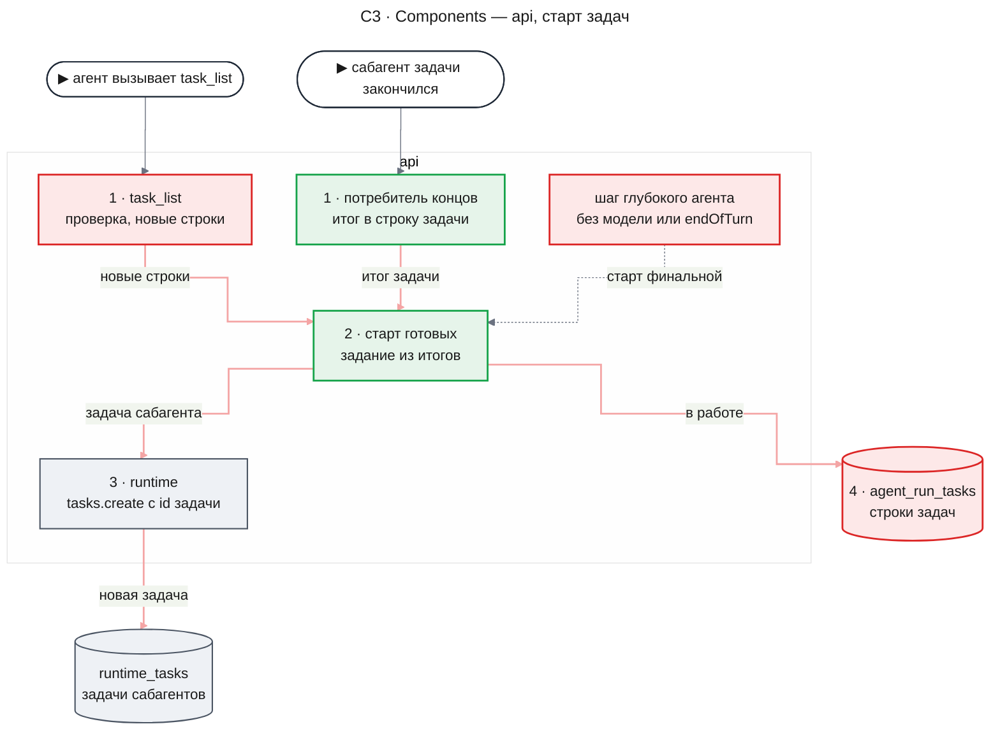
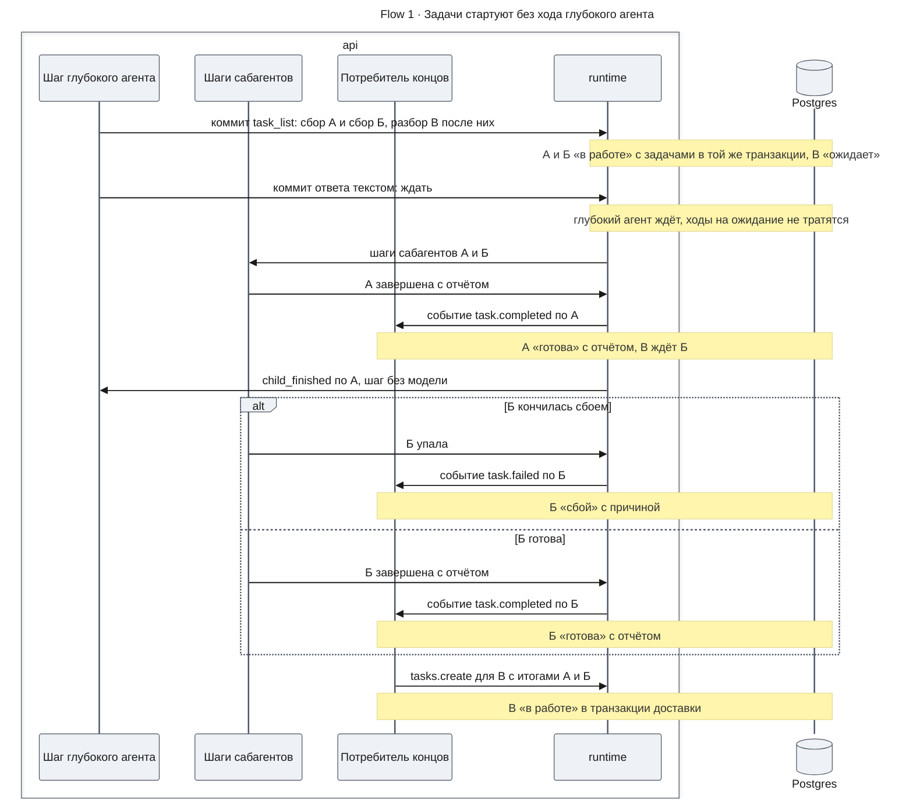
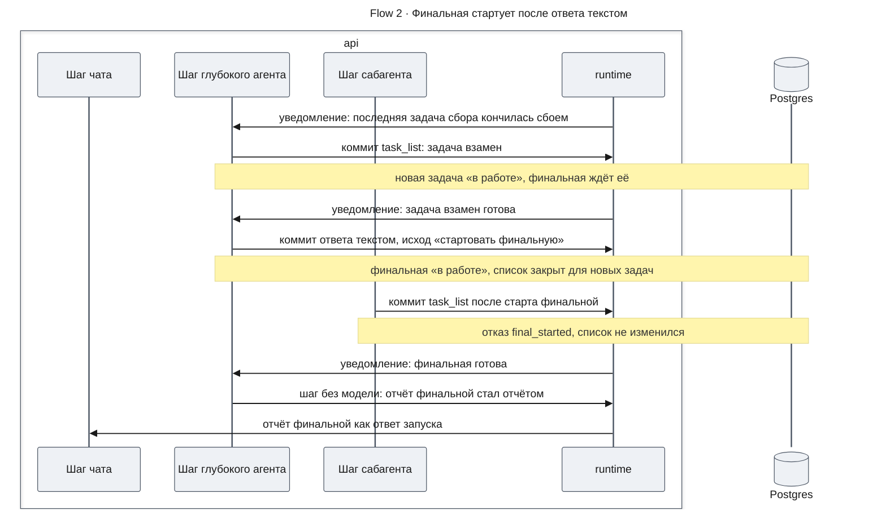
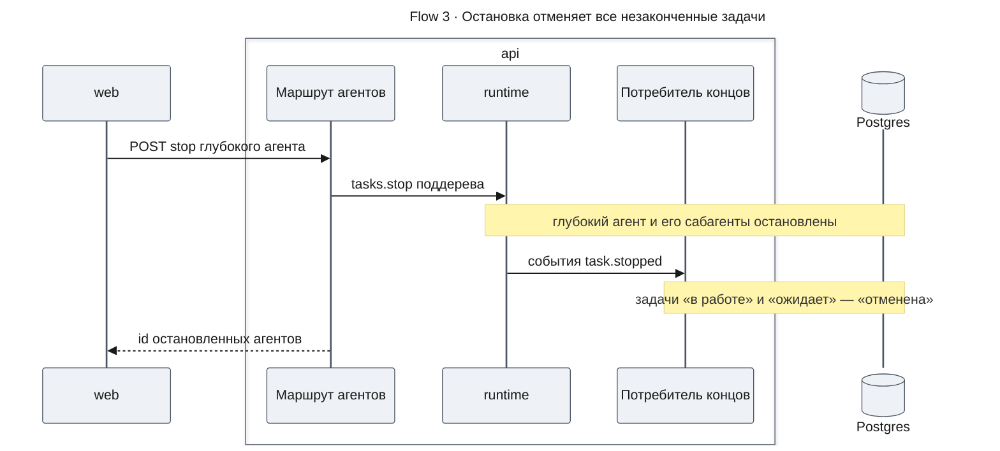
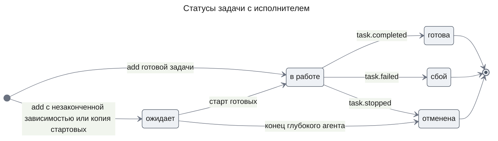

# Глубокие агенты — Design Document — tasks

**Status:** На утверждении · **Date:** 2026-11-22 · **PRD:** [prd.md](./prd.md) · **UXRD:** [uxrd.md](./uxrd.md) · **Depends on:** [design-agent-types.md](./design-agent-types.md#contract-definitions)

## Snapshot

**Overview.** Часть `agent-types` дала глубокому агенту план — список задач запуска, который он ведёт сам. Эта часть добавляет в тот же список задачи с исполнителем: агент называет сабагента своей команды, задачи, которые надо дождаться, и ключ элемента, а платформа запускает задачу сама, как только та готова. Задачу запускает та же транзакция, которая сделала её готовой, — создание запуска, коммит шага, добавившего задачу, или доставка события о конце другого сабагента, — поэтому рестарт сервера не теряет и не удваивает запуск. Конец задачи не стоит глубокому агенту вызова модели: модель думает, только когда задача упала или незаконченных задач не осталось. Финальная задача стартует, когда глубокий агент увидел итоги всех остальных задач и ответил текстом; пока она в работе или готова, задачи не добавляются. Прямого запуска сабагента у глубокого агента больше нет: каждый запуск сабагента — строка списка.

- **Не меняется**: долгими задачами владеет только `packages/runtime` — список лишь решает, когда создать задачу сабагента, а очередь, восстановление и остановку ведёт runtime. Права проверяются на каждый вызов, ход кончается текстом.
- **Главный риск**: доставка события о конце сабагента, которая сдалась после пяти попыток, задерживает старт зависимых задач до ближайшего шага глубокого агента (Risks).
- **Открытые вопросы**: нет.

### Key Decisions

#### KD-1: Задачу запускает транзакция, которая сделала её готовой; id сабагента выбран заранее

Задача становится готовой в двух случаях: её добавили без незаконченных зависимостей или закончилась последняя задача, которую она ждала. Поэтому одна процедура «старт готовых» вызывается в обоих местах. Первое — коммит шага, в котором `task_list` добавил задачи, будь то шаг глубокого агента или сабагента. Второе — потребитель событий `task.completed`, `task.failed` и `task.stopped`: в транзакции доставки он пишет итог в строку задачи и запускает тех, кто её ждал. Так сделан триггер самообучения, и [transactional-outbox.md](../../code-system/patterns/transactional-outbox.md) описывает именно это: потребитель создаёт задачу runtime в транзакции доставки.

Задачу сабагента процедура создаёт через `runtime.tasks.create` в транзакции вызывающего, с родителем — глубоким агентом, и в той же транзакции пишет сессию с заданием, как `createRoot`. Id сабагента выбирается при добавлении задачи и хранится в строке. Строка «в работе» и задача runtime коммитятся вместе, а второй старт с тем же id runtime отвергает (`TASK_EXISTS`). Повтор коммита шага и повтор доставки поэтому не создают второго сабагента, а откат не оставляет строку без сабагента.

Взвешивались два варианта. Только коммит шага не годится для концов: сбой, `step_timeout`, исчерпанное восстановление и остановку заканчивает runtime без кода `agents`, и упавшая зависимость не отпустила бы ждущих. `effects.spawn` делает ребёнка того, чей шаг, и задача от сабагента стала бы его внуком. Только шаг глубокого агента ждал бы конца его вызова модели или подтверждения, против FR-10.

Доставка, которая не удалась пять раз, получает `needs_attention` и больше не повторяется. Поэтому каждый коммит шага глубокого агента тоже вызывает «старт готовых», а шаг, доставивший `child_finished`, пишет итог в строку, если она ещё «в работе». Конец сабагента будит глубокого агента, так что такой шаг случится, обычно без вызова модели (KD-7): потребитель ускоряет старт, а не держит корректность.

Задачи появляются в списке ещё одним путём — копией стартовых задач части `flows`. Её строки пишет транзакция, которая создаёт сессию глубокого агента (`ensureSession`), с автором `starting`, и в той же транзакции «старт готовых» запускает готовые из них; финальную — нет ([design-flows.md](./design-flows.md), KD-2).

#### KD-2: Финальная задача стартует в коммите шага, где глубокий агент ответил текстом, увидев итоги всех задач

PRD требует, чтобы глубокий агент успел поставить задачу взамен упавшей (AC-15.3). Ответ на уведомление — часто вызов `task_list`, а он исполняется отдельным шагом инструментов после шага модели. Поэтому финальную запускает не шаг доставки, а первый ответ текстом, после которого незаконченных задач и недоставленных уведомлений нет. Это решение `endOfTurn`: у него новый исход «стартовать финальную». Коммит этого шага проверяет условия ещё раз под блокировкой запуска (KD-8): если сабагент успел добавить задачу, финальная ждёт её, а если финальная стартовала первой, добавление получает отказ `final_started`.

Запись может назвать сабагентов, у которых до финальной должна быть хотя бы одна задача в запуске (`requiredBeforeFinal`, [design-flows.md](./design-flows.md#contract-definitions)). Пока у такого сабагента нет строки, `endOfTurn` вместо «стартовать финальную» даёт уведомление с его именем, как при открытых пунктах плана. «Задачи нет» — счёт строк, а не суждение о тексте, поэтому правило держит код, а не промпт.

Финальная задача — задача, исполнитель которой — финальный сабагент. Своих зависимостей у неё нет, она ждёт все остальные задачи с исполнителем, и ждать её саму нельзя. Если она кончилась сбоем или отменой, список снова открыт и можно поставить новую финальную: после сбоя — сразу, после отмены — когда сотрудник возобновил глубокого агента сообщением. Иначе запуск, которому FR-05 разрешает кончиться только законченным отчётом финального сабагента, крутился бы до предела шагов. Пока финальная ждёт, вторую поставить нельзя.

#### KD-3: Прямой запуск сабагента убран, предел запусков считается по строкам списка

У глубокого агента больше нет `start_agent`: каждый запуск сабагента — задача (FR-10). Сегодня предел `maxRuns` держит `history.startedCount`, то есть число успешных `start_agent` самого вызывающего. Задачи, поставленные сабагентами, в истории глубокого агента не появляются, поэтому предел считается по строкам списка: число задач с этим исполнителем в запуске, в любом статусе, включая строки копии стартовых задач. Проверка идёт в той же транзакции, что добавление.

Без вызывающего остаются и удаляются в этой же части: ветка команды в `LaunchSet`, `StartTarget` и `gateStart`, `history.startedCount`, `limitRefusals` вида запуска и источник `subagent` в `resolveStart`. Снимок сабагента строит чистая функция из снимка глубокого агента: `resolveStart` читает шлюз доступа и провайдеров и в потребителе работать не может, а каждый вызов модели и инструмента и так проверяется в момент вызова.

Правила глубокого агента — текст платформы после промпта записи — теперь велят раздавать работу задачами с исполнителем, зависимостями и ключом элемента, а не звать сабагента по имени.

#### KD-4: Сабагент ставит задачи тем же `task_list`, но только с исполнителем и не видя списка

Приём «classify and act» требует, чтобы сабагент сбора ставил задачу на каждый найденный элемент (FR-13). Второго инструмента не нужно: снимок сабагента называет `task_list`, а инструмент различает вызывающего по виду снимка. Сабагент может только добавлять задачи и только с исполнителем: свои пункты плана и статусы — дело глубокого агента. В ответ он получает номера добавленных задач, а не весь список: он работает в своём контексте и видит только своё задание (FR-02).

Чтобы выбрать исполнителя, сабагенту нужна команда: описание `task_list` у сабагента называет её строками «имя (до N запусков): когда звать» из снимка глубокого агента, который лежит во входе его задачи. Отдельного снимка команды нет.

#### KD-5: Задание сабагента — бриф запуска, текст задачи и итоги её зависимостей; итоги в пределах одного бюджета

Сабагент начинает с одной записи истории `task`, и её текст — единственное, что он получает. Поэтому при старте платформа собирает задание. Первым идёт бриф запуска: строки «Вопрос», «Границы» и «Результат» из задания самого глубокого агента, пустые поля опускаются. Затем текст задачи, затем у каждой зависимости номер, статус и отчёт или причина сбоя. Финальная задача получает так все остальные задачи с исполнителем. Отчёты копируются из строк списка дословно, без пересказа моделью.

Бриф лежит в записи `task` истории глубокого агента: `start_deep_agent` пишет туда три поля брифа JSON-ом ([design-agent-types.md](./design-agent-types.md), KD-2). Бриф стоит в задании любой задачи, а не только стартовой: текст задачи ограничен 2 000 символов, поле брифа — 4 000, и модель не перенесла бы бриф в текст целиком. Поэтому правила глубокого агента велят не пересказывать бриф в тексте задачи.

Задание — весь стартовый контекст малой модели сабагента, поэтому размер итогов зависимостей ограничен константой кода. Бриф в этот бюджет не входит: его поля ограничивает схема брифа. Если отчёты не помещаются, каждый длиннее своей равной доли обрезается, и обрезка помечена текстом с номером задачи. Ссылки на отчёт с инструментом чтения нет: это второй механизм ради редкого случая. Длинный контекст финальной — риск качества (Risks).

#### KD-6: Веб получает строки целиком из маршрута списка

Маршрут `GET /api/agents/:agentId/tasks` из `agent-types` отдаёт строки со всеми полями, которые нужны строке и подробностям списка (UXRD DA-05). Порядок — по номеру, финальная последней. «Ждёт подтверждения» маршрут выводит из статуса сабагента, а не хранит. Статус и итог строки — те, что в неё записаны: пока потребитель или шаг глубокого агента не записал итог, строка «в работе».

Связь сабагента с задачей держит id: id сабагента равен id задачи. Описание сабагента начинается с номера — «3 · текст задачи», — поэтому дерево агентов несёт номер без новых полей.

#### KD-7: Конец задачи не будит модель глубокого агента: шаг без модели пишет итог и стартует готовые

Сегодня каждое уведомление `child_finished` без открытых вызовов ведёт к шагу модели ([model-step.ts](../../../packages/agents/src/step/model-step.ts)): вызов модели, ход в счёт `maxTurns` и полный отчёт сабагента в истории ([deliver.ts](../../../packages/agents/src/step/deliver.ts)). Глубокий агент с `maxTurns` 30 и десятками задач упал бы `turn_limit` посреди запуска, а его ожидающие задачи были бы отменены.

Поэтому обработчик шага глубокого агента выбирает шаг без модели, если открытых вызовов нет, сообщения шага — только `child_finished` задач списка, ни одна из них не кончилась сбоем или отменой и осталась незаконченная задача, кроме финальной. Такой шаг пишет уведомления в историю и итог в строку, зовёт «старт готовых» и ждёт; модель не вызывается, счётчик ходов не меняется. Конец финальной с отчётом шаг без модели делает отчётом глубокого агента (FR-05). Шаг модели остаётся на сбой или отмену задачи, когда можно поставить замену, и на конец последней задачи, кроме финальной, когда можно добавить ещё или ответить текстом и стартовать финальную (KD-2). Он же — на сообщение сотрудника или агента, на конец ребёнка вне списка и на первый шаг при пустом списке.

Уведомление о задаче списка — номер, статус и причина сбоя, без отчёта: отчёты получают только зависимые задачи и финальная (KD-5), а статусы строк модель видит в блоке плана. Запуск из N успешных задач, которые ставят стартовые задачи и сабагенты, стоит глубокому агенту одного шага модели; если задачи ставит он сам — ещё двух, вызова `task_list` и ответа текстом. От N это не зависит, а ожидание ходов `maxTurns` не тратит. Не будить глубокого агента вовсе значило бы править runtime, который будит родителя на каждое `child_finished`.

#### KD-8: Записи в список упорядочивает блокировка строки глубокого агента в `runtime_tasks`

Сегодня `runTasks` полагается на то, что список пишут только шаги одной сессии по очереди ([run-tasks.repository.ts](../../../packages/agents/src/store/run-tasks.repository.ts)). Теперь писателей три — шаг глубокого агента, шаг сабагента с `task_list` и потребитель концов, — а копию пишет ещё создание сессии. Каждый сначала блокирует строку глубокого агента в `runtime_tasks` FOR UPDATE и только потом читает последний номер и статус финальной. Коммит шага глубокого агента эту блокировку уже держит, а `tasks.create` всё равно берёт её у родителя. Так номера не повторяются, а добавление задач и старт финальной идут по очереди (Invariant 4).

Порядок блокировок runtime — предок раньше потомка ([task-control.ts](../../../packages/runtime/src/task-control.ts)), и его нарушает один писатель: коммит шага сабагента держит свою строку, а `task_list` затем блокирует родителя. Если в этот момент остановка держит глубокого агента и ждёт сабагента, Postgres прерывает одну из транзакций, и обе повторяются через `retryingTransaction`: остановка проходит, а коммит сабагента находит задачу остановленной и ничего не пишет. Это принято: обойти случай можно только правкой коммита runtime ради редкой гонки.

## Terms

- **Задача** — строка списка с исполнителем; **пункт плана** — строка без исполнителя ([design-agent-types.md, Terms](./design-agent-types.md#terms)). Глубокий агент, сабагент, финальный сабагент, запуск, готовая задача, зависимость, ключ элемента — как в [PRD, Terms](./prd.md#terms).
- **Финальная задача** — задача, исполнитель которой — финальный сабагент записи.
- **Сабагент задачи** — агент, которого платформа запустила для задачи; его id равен id задачи.
- **Коммит шага** — транзакция, которой runtime фиксирует итог шага агента вместе с записями `agents`.
- **Шаг без модели** — шаг глубокого агента, который пишет итоги и стартует готовые задачи, не вызывая модель (KD-7).
- **Потребитель событий** — обработчик журнала событий runtime: получает событие в своей транзакции доставки и пишет только в базу.
- **`needs_attention`** — статус доставки, которая не удалась пять раз; её больше не повторяют.

## Part

- **Part**: `tasks`
- **Covers**: FR-10 – FR-20, NFR-01
- **Depends on**: [`agent-types`](./design-agent-types.md#contract-definitions) — список задач, `task_list`, блок плана, снимки `deep_agent` и `subagent`, текст отказа `ToolRunResult`, маршрут списка, `endOfTurn` с пунктами плана
- **Prerequisite ADRs**: [ADR-0001](../../adr/ADR-0001-durable-runtime-owner.md), [ADR-0004](../../adr/ADR-0004-agent-framework-packages.md), [ADR-0017](../../adr/ADR-0017-run-snapshots-from-library.md), [ADR-0021](../../adr/ADR-0021-deep-agent-record-kind.md)

**Out of scope**

- Стартовые задачи в записи, `requiredBeforeFinal`, флоу, образцы и пометка «стартовая задача» в «Поставил» — часть `flows`.
- Пункты плана: их статусы, напоминание об открытых пунктах и блок плана остаются, как их построила часть `agent-types`.
- Правка списка сотрудником, предел параллельности, бюджет токенов на запуск, поиск дублей по смыслу текста (PRD, Won't Have).
- Страница сабагента задачи не меняется: ссылки на задачу, номера в строке мета и запрета «Запустить с нуля» нет.
- `message_agent` глубокого агента, вызовы MCP, проверка прав и подтверждение изменяющих вызовов сабагента — без изменений.
- Агент вида `agent` по-прежнему запускает агентов своего списка через `start_agent`.

**Constraints**

- **Один владелец долгих задач** (ADR-0001). Задачи сабагентов создаёт, ставит в очередь, восстанавливает и останавливает runtime. Список только решает, когда вызвать `tasks.create`, и своей очереди или таймеров не держит (KD-1).
- **Код не судит текст.** Платформа сравнивает номера, статусы, исполнителей и ключи; ключи — как строки.
- **Без совместимости.** Прямой старт сабагента, счётчик по истории и всё, что лишилось вызывающего, удаляются в той же замене вместе с тестами (KD-3).
- **Новых настроек нет.** Предел запусков — `maxRuns` записи, бюджет задания — константа кода, переменных окружения не добавляется.
- **Журнал** — через логгер `common` ([logging.md](../../code-system/patterns/logging.md)): на каждый переход задачи и на каждый шаг без модели одна запись, без текстов задач, ключей и отчётов (NFR-01).
- **Тестов мало**, на нижнем уровне, который ловит дефект ([Test Strategy](#test-strategy)).

## Building-block Inventory

Follows the [code system](../../code-system/README.md).

| Building block | Pattern | Status | Note |
|---|---|---|---|
| Список задач и `task_list` | [repository-over-transaction.md](../../code-system/patterns/repository-over-transaction.md) | extended | исполнитель, зависимости, ключ, итог; вызов от сабагента; блокировка запуска (KD-8) |
| Решения о добавлении и о готовности | [pure-decision.md](../../code-system/patterns/pure-decision.md) | new | по образцу `gateStart` и `endOfTurn` |
| Старт готовых задач | [transactional-outbox.md](../../code-system/patterns/transactional-outbox.md) | new | `tasks.create` в транзакции вызывающего и сессия, как `createRoot` |
| Потребитель концов задач | [transactional-outbox.md](../../code-system/patterns/transactional-outbox.md) | new | образец — `agents.knowledge-trigger` |
| Шаг без модели | [step-handler.md](../../code-system/patterns/step-handler.md) | new | вид шага глубокого агента (KD-7) |
| `endOfTurn` | [pure-decision.md](../../code-system/patterns/pure-decision.md) | extended | ожидающие задачи, `requiredBeforeFinal`, старт финальной (KD-2) |
| Снимок сабагента | [run-snapshot.md](../../code-system/patterns/run-snapshot.md) | reused | чистая функция из снимка глубокого агента |
| `gateStart`, `LaunchSet`, `StartTarget` | [pure-decision.md](../../code-system/patterns/pure-decision.md) | extended | ветка команды удаляется; корень и агент вида `agent` без изменений (KD-3) |
| `history.startedCount`, `limitRefusals` | [pure-decision.md](../../code-system/patterns/pure-decision.md) | removed | без вызывающего (KD-3) |
| Маршрут списка | [read-on-open.md](../../code-system/patterns/read-on-open.md) | extended | поля строки (KD-6) |
| Список задач в вебе | [read-on-open.md](../../code-system/patterns/read-on-open.md) | extended | вариант «Задачи» [run-task-list.md](../../design-system/components/run-task-list.md) |

Отдельного механизма запуска искали в `agents` и `runtime`: `createStartChild` делает только ребёнка вызывающего, `createChild` пишет задачу и сессию двумя транзакциями. Подошёл путь `createRoot` и `agents.knowledge-trigger`: `tasks.create` с транзакцией вызывающего.

## Acceptance Criteria

### FR-10: Задачу с исполнителем запускает платформа

- From the PRD: AC-10.1, AC-10.2
- Сабагент задачи — ребёнок глубокого агента, кто бы ни поставил задачу; его id равен id задачи, а описание начинается с номера задачи (DC-1).

### FR-11: Зависимости и результаты

- From the PRD: AC-11.1, AC-11.2
- Итоги зависимостей в задании не длиннее бюджета; отчёт, обрезанный под бюджет, помечен в задании с номером своей задачи (DC-2).

### FR-12: Статусы задач с исполнителем ведёт платформа

- From the PRD: AC-12.1, AC-12.2
- Задача, чей сабагент уже стоит в очереди runtime, но ещё не сделал ни шага, — «в работе» (DC-3).
- Успешный конец задачи, после которого осталась незаконченная задача, кроме финальной, не вызывает модель глубокого агента и не меняет его счётчик ходов; уведомление о задаче несёт номер, статус и причину, без отчёта (DC-11).

### FR-13: Задачи ставят агенты запуска

- From the PRD: AC-13.1
- Сабагент добавляет только задачи с исполнителем, не меняет статусов и в ответ получает номера своих задач, а не список (DC-4).

### FR-14: Границы задачи

- From the PRD: AC-14.1, AC-14.2, AC-14.3
- Вызов `task_list` принимается целиком или отклоняется целиком; при отказе список не меняется, а причина — одно из значений в [Contract Definitions](#contract-definitions) (DC-5).

### FR-15: Конец запуска и финальная задача

- From the PRD: AC-15.1, AC-15.2, AC-15.3, AC-15.4
- «Шаг, в котором глубокий агент получил последнее уведомление», — его первый ответ текстом, после которого нет незаконченных задач и недоставленных уведомлений; финальная стартует в коммите этого шага (DC-6).
- Пока финальная задача «в работе» или «готова», добавление отклоняется; после её сбоя или отмены можно поставить новую финальную. Вторая финальная, пока первая ждёт, зависимость финальной и зависимость от финальной отклоняются (DC-7).
- Пока у сабагента из `requiredBeforeFinal` нет задачи в запуске, финальная не стартует, а ответ текстом получает уведомление с его именем (DC-12).

### FR-16: Остановка запуска и сбой задачи

- From the PRD: AC-16.1, AC-16.2

### FR-17: Рестарт не теряет и не дублирует задачи

- From the PRD: AC-17.1, AC-17.2

### FR-18: Права и изоляция

- From the PRD: AC-18.1, AC-18.2, AC-18.3

### FR-19: Список задач на экране агента

- From the PRD: AC-19.1

### FR-20: Ключ элемента против дублей

- From the PRD: AC-20.1

### NFR-01: Журнал событий задачи

- From the PRD: NFR-01
- Записи журнала задач не содержат текстов задач, ключей элементов и отчётов (DC-10).

## Design

### Architecture (C1–C4)

Внешних систем, людей и контейнеров часть не добавляет: меняются компоненты API, таблица `agent_run_tasks` и данные экранов веба. Поэтому рисуется только C3 API.

#### C3 · Components: api

**api — старт задач**

- `task_list` проверяет вызов решением о добавлении: команда, номера и позиции зависимостей, предел, финальная, ключ. Затем он пишет строки в транзакции шага и зовёт «старт готовых».
- Потребитель концов находит строку по id закончившейся задачи; задача без строки — не задача списка, и событие пропускается. Итог он пишет так: `task.completed` — «готова» с отчётом из истории сабагента, `task.failed` — «сбой» с причиной события, `task.stopped` — «отменена». Конец самого глубокого агента отменяет его ожидающие задачи.
- «Старт готовых» выбирает чистой функцией задачи, у которых все зависимости закончились, собирает задание (KD-5), создаёт задачу runtime с id строки и сессию с записью `task`, ставит строке «в работе». `PARENT_FINISHED` от runtime значит, что глубокий агент уже закончился, и задача становится «отменена».
- Шаг глубокого агента зовёт ту же процедуру в каждом коммите. На конец задачи он не вызывает модель, пока решать нечего (KD-7), а финальную разрешает только исход «стартовать финальную» (KD-2).

Веб меняет данные, а не путь обновления, который нарисовала часть `agent-types`. Список задач получает вариант «Задачи». Строки события ленты MC-15 берут номер у ребёнка с тем же id. Отказ `task_list` блок вызова показывает фразой MC-16 по причине, а значения фразы берёт из аргументов вызова, списка и вида запуска, которые страница уже прочитала.

### Runtime Flows

#### Flow 1: Задача стартует сама и передаёт итог

**Starts when:** глубокий агент или сабагент добавляет задачи, for AC-10.1, AC-11.1, AC-11.2, AC-12.1, AC-13.1, AC-16.2, AC-17.1

В ждёт А и Б по их позициям в том же `add`. Сабагент добавляет задачи так же, в коммите своего шага, а родитель новых задач — глубокий агент (DC-1). Повтор доставки находит строку закончившейся и ничего не пишет; повтор коммита и рестарт до коммита не оставляют ничего, потому что строка и задача runtime пишутся вместе (AC-17.1). Сабагент, работавший во время рестарта, runtime вернёт с тем же id задачи (AC-17.2). О каждой задаче глубокий агент получает короткое уведомление, а модель зовётся только на сбой Б или после конца В (KD-7, AC-12.1). Сбой одной задачи не трогает остальные (AC-16.2).

#### Flow 2: Финальная задача и конец запуска

**Starts when:** последняя задача перед финальной кончилась сбоем, for AC-15.1, AC-15.2, AC-15.3, AC-15.4

Если последняя задача кончилась успешно, путь короче: глубокий агент сразу отвечает текстом, и финальная стартует в коммите этого ответа (AC-15.1). Если у сабагента из `requiredBeforeFinal` нет задачи, этот ответ получает уведомление «поставьте задачу для X», и финальная ждёт (DC-12). Без финального сабагента ответ текстом при задаче «ожидает» или «в работе» ждёт, как сегодня агент ждёт детей, а когда всё закончилось, становится отчётом (AC-15.4). Если финальная кончилась сбоем, глубокий агент получает шаг модели, `endOfTurn` даёт уведомление «поставьте новую задачу для X», и список снова принимает задачи (DC-7).

#### Flow 3: Остановка запуска

**Starts when:** сотрудник нажимает «Остановить» у глубокого агента, for AC-16.1

Старт, который пришёлся на остановку, runtime упорядочивает блокировкой родителя: либо новая задача успела и остановлена вместе с деревом, либо `tasks.create` отвечает `PARENT_FINISHED`, и строка становится «отменена»; взаимоблокировку с `task_list` сабагента разрешает повтор (KD-8). Сбой глубокого агента останавливает его детей прежним потребителем `agents.stop-children-on-failure`, дальше всё идёт так же. Удаление беседы останавливает дерево тем же путём. Возобновлённый сообщением глубокий агент находит отменённые задачи отменёнными и может ставить новые.

### Contract Definitions

Номер, текст, статусы пункта и маршрут списка — как в [design-agent-types.md](./design-agent-types.md#contract-definitions); ниже только то, что меняет эта часть.

**`task_list`** (встроенный; у глубокого агента и у сабагента)

- `add` — новые задачи. У каждой `text`; `assignee` — имя сабагента команды, без него это пункт плана; `dependsOn` — номера задач, которые уже есть в списке этого запуска; `dependsOnInCall` — позиции (с 1) более ранних задач того же `add`; `itemKey` — ключ элемента, строка до 200 символов.
- `set` — пары «номер, статус», как в `agent-types`, только для пунктов плана.
- Номера новым задачам даются по порядку `add`, после последнего номера запуска, а позиции из `dependsOnInCall` платформа заменяет этими номерами. Цепочку агент строит одним вызовом и номеров между вызовами не помнит. Номер, которого нет в списке, и позиция не раньше своей задачи — `unknown_task`.
- Вызов принимается целиком или отклоняется целиком. Глубокому агенту возвращается весь список текстом: номер, статус, исполнитель, зависимости, пометка финальной, без отчётов. Сабагенту — номера добавленных задач.
- Сабагент передаёт только `add`, и у каждой его задачи есть `assignee`. Иначе — `invalid_arguments`.
- Описание инструмента у сабагента называет команду строками «имя (до N запусков): когда звать».
- `loggedArgs` — число задач, исполнители, номера зависимостей и статусов; без текстов и ключей.

Отказы — `refused` с причиной и текстом для модели. Текст называет значения: имя и состав команды, номер, предел, номер существующей задачи.

| Причина | Когда |
|---|---|
| `not_in_team` | исполнителя нет в команде |
| `unknown_task` | номера зависимости нет в списке запуска; позиция в вызове не раньше своей |
| `run_limit` | у исполнителя уже `maxRuns` задач |
| `final_started` | финальная «в работе» или «готова» |
| `platform_status` | `set` у задачи с исполнителем |
| `duplicate_item` | ключ уже есть в запуске |
| `invalid_arguments` | как в `agent-types`; зависимость у финальной или от финальной; вторая финальная; вызов сабагента не по правилам |

`ToolRefusalReasonSchema` получает `not_in_team`, `unknown_task`, `final_started`, `platform_status` и `duplicate_item`.

**Блок плана** глубокого агента показывает у строки исполнителя, номера зависимостей и пометку финальной; отчётов в нём нет.

**Уведомление о задаче списка** — запись `child_report` истории глубокого агента с номером задачи, статусом и причиной сбоя; текста отчёта в ней нет (KD-7). Уведомление о ребёнке без строки списка — как сегодня, с отчётом.

**Задание сабагента задачи** — текст записи `task` его истории, по порядку (KD-5):

- бриф запуска — строки «Вопрос: …», «Границы: …», «Результат: …» из полей `question`, `boundaries`, `result` брифа, который `start_deep_agent` записал в запись `task` истории глубокого агента; строка пустого поля опускается;
- текст задачи;
- по каждой зависимости номер, статус и отчёт или причина; у финальной так перечислены все остальные задачи с исполнителем.

Итоги зависимостей не больше бюджета; бриф в бюджет не входит.

**`endOfTurn`** получает ещё три входа: число ожидающих задач с исполнителем, кроме финальной, признак «финальная ждёт» и имена сабагентов из `requiredBeforeFinal` снимка, у которых нет задачи в запуске. Правила по порядку:

1. Корень беседы ждёт.
2. Незаконченные дети, недоставленные уведомления или ожидающие задачи — ждать.
3. Открытые пункты плана — уведомление, как в `agent-types`.
4. Сабагент из `requiredBeforeFinal` без задачи — уведомление «нет задачи для X, поставьте её» с его именем.
5. Финальная ждёт — исход «стартовать финальную»; коммит шага стартует её, если условия ещё верны, и агент ждёт.
6. Отчёт финального сабагента законченный — он становится отчётом. Иначе уведомление: нет задачи для финального сабагента или прошлая кончилась так-то, «поставьте задачу для X».
7. Без финального сабагента текст ответа — отчёт.

**`GET /api/agents/:agentId/tasks`** — `RunTaskListView`: строки по номеру, финальная последней. Ошибки — как в `agent-types`. Поля строки:

- `number`, `text`, `createdAt`, `updatedAt` — как в `agent-types`.
- `status` — `RunTaskStatusSchema`, как записан в строке.
- `awaitingConfirmation` — сабагент задачи ждёт решения сотрудника.
- `assignee` — имя сабагента или `null` у пункта плана; `final` — финальная ли.
- `dependsOn` — номера задач, которых ждёт.
- `addedBy` — `deep_agent`, `subagent` с именем и номером его задачи или `starting` у строки копии стартовых задач ([design-flows.md](./design-flows.md), KD-2).
- `itemKey` — ключ или `null`.
- `agentId` — id сабагента после старта, иначе `null`.
- `startedAt`, `finishedAt` — время старта и конца или `null`.
- `result` — отчёт у `done`, иначе `null`; `failureReason` — причина у `failed`, иначе `null`.

**`GET /api/agents/:agentId/run`** — из вида запуска удаляется `limitRefusals`. Отказы по пределу видны блоками вызова `task_list` в ленте.

### Data Model

Строка `agent_run_tasks` получает:

- исполнителя — имя сабагента или пусто у пункта плана — и признак финальной, который вычисляется при добавлении из снимка;
- номера зависимостей и ключ элемента; ключ уникален в запуске;
- id сабагента, выбранный при добавлении задачи с исполнителем, — он же id задачи runtime после старта;
- автора — id агента, вызвавшего `task_list`; у строк копии стартовых задач автор пуст, и маршрут списка отдаёт их как `starting`;
- отчёт или причину сбоя, время старта и конца.

Миграцию генерирует `db:generate`. Она добавляет столбцы и уникальность ключа и заново строит CHECK `agent_code_calls.refusal_reason` из расширенного `ToolRefusalReasonSchema`. Строк для переноса нет.

### State Transitions and Invariants

Статусы задачи с исполнителем; все переходы делает платформа.

**Invariants**

1. У задачи с исполнителем не больше одного сабагента: строка «в работе» и задача runtime с id из строки пишутся одной транзакцией.
2. Статус задачи с исполнителем меняет только платформа, закончившаяся задача статуса не меняет.
3. Задача ждёт только задачи с меньшими номерами того же запуска, поэтому циклов нет.
4. Добавление задач и старт финальной упорядочены блокировкой строки глубокого агента (KD-8): пока финальная «в работе» или «готова», задача не добавляется.
5. Задач одного исполнителя в запуске не больше его `maxRuns`.
6. Родитель сабагента задачи — глубокий агент, кто бы ни поставил задачу.

## Test Strategy

- **UC-1: Решение о добавлении** — covers AC-12.2, AC-14.1, AC-14.2, AC-14.3, AC-15.2, AC-20.1, DC-4, DC-5, DC-7
  - Given: список с задачами и пунктами, команда с пределом 5 у «лёгкого исследования», задача с ключом `INC-42`
  - When: решение получает вызовы: чужой исполнитель, номер не из запуска, позиция не раньше своей, шестая задача, задача при финальной «в работе», ключ `INC-42`, `set` задачи с исполнителем, пункт плана от сабагента, зависимость от финальной, цепочка из трёх задач одним вызовом, новая финальная после сбоя прежней
  - Then: отказы `not_in_team`, `unknown_task`, `unknown_task`, `run_limit`, `final_started`, `duplicate_item` с номером существующей, `platform_status`, `invalid_arguments`, `invalid_arguments`; цепочка принята, и позиции стали номерами; последняя задача принята
- **UC-2: Какие задачи готовы** — covers AC-11.1, AC-11.2, AC-15.1, AC-15.3
  - Given: Б ждёт А; финальная и три задачи сбора; задача взамен упавшей
  - When: решение о готовности получает статусы
  - Then: Б готова, только когда А «готова» или «сбой»; финальная не готова, пока хоть одна задача не закончилась
- **UC-3: Конец хода с задачами** — covers AC-15.4, DC-6, DC-7, DC-12
  - Given: глубокий агент без финального сабагента с ожидающей задачей; с ждущей финальной; с упавшей финальной; с ждущей финальной и «Сбором» из `requiredBeforeFinal` без задачи
  - When: `endOfTurn` решает ответ текстом
  - Then: ждать; «стартовать финальную»; уведомление «поставьте задачу для X»; уведомление с именем «Сбор»
- **UC-4: Основной путь** — covers AC-10.1, AC-10.2, AC-12.1, AC-13.1, AC-15.1, AC-19.1, DC-1, DC-2, DC-4, DC-11
  - Given: глубокий агент со сбором, исследованием и финальным «брифом»; сценарий модели по ключу агента: две задачи сбора, сбор ставит три задачи исследования, бриф
  - When: запуск идёт до ответа
  - Then: задачи стартуют без шага глубокого агента; после постановки задач его следующий шаг модели — после конца последней, концы остальных прошли без модели и без роста счётчика ходов, уведомления без отчётов; конец «брифа» кончает глубокого агента без вызова модели; у каждого ребёнка глубокого агента есть строка с его id и номером в описании; задание брифа содержит отчёты всех пяти задач; список отдаёт все поля строки; ответ — отчёт брифа
- **UC-5: Рестарт без потерь и дублей** — covers AC-17.1, AC-17.2
  - Given: конец задачи А, после которого готова Б; второй экземпляр, который получает ту же доставку; работающий сабагент с истёкшей арендой
  - When: доставка обрабатывается дважды, процесс умирает до её коммита, аренда истекает
  - Then: у Б ровно одна задача runtime; сабагент продолжает с тем же id
- **UC-6: Гонка добавления и финальной** — covers AC-15.2, AC-15.3
  - Given: все задачи закончились, глубокий агент отвечает текстом, сабагент в этот же момент добавляет задачу
  - When: оба коммита идут параллельно на настоящей базе
  - Then: либо задача добавлена и финальная ждёт её, либо финальная стартовала и добавление получило `final_started`; финальной без новой задачи в её задании нет
- **UC-7: Остановка и сбой** — covers AC-16.1, AC-16.2
  - Given: две задачи «в работе», одна ожидает
  - When: сотрудник останавливает глубокого агента; в другом запуске сабагент задачи падает
  - Then: все три «отменена», новых задач runtime нет; упавшая — «сбой» с причиной, остальные работают
- **UC-8: Список в вебе** — covers AC-19.1
  - Given: строки всех статусов, сабагент на подтверждении
  - When: страница глубокого агента показывает вкладку «Задачи»
  - Then: финальная последней, у строки на подтверждении «Ждёт подтверждения», подробности со всеми полями

AC-18.1 и AC-18.3 держат существующие тесты прав вызова и подтверждения: сабагент задачи идёт тем же путём, что любой агент. AC-18.2 держит тест маршрута списка из `agent-types`: задачу в чужом запуске поставить нечем, а номер чужого запуска — `unknown_task` (UC-1). DC-3 и DC-10 проверяются ревью кода. NFR-01 проверяет владелец по журналу первого запуска глубокого ресерча. Тесты прямого старта сабагента, `startedCount` и `limitRefusals` удаляются вместе с кодом.

## Security Considerations

- **Authentication & Authorization**: сабагент задачи наследует владельца глубокого агента; каждый его вызов модели и инструмента проверяет шлюз доступа в момент вызова, изменяющий вызов ждёт подтверждения. Определение сабагента берётся из снимка глубокого агента, а не из живой библиотеки. Задачу можно поставить только из шага агента своего запуска, а маршрут списка отвечает только владельцу (404 `AGENT_NOT_FOUND`).
- **Input Validation**: аргументы `task_list` проверяют схема и решение о добавлении; исполнитель — только имя из команды снимка, зависимости — только номера этого запуска и позиции того же вызова. Текст задачи, который сабагент взял из тикета или лога, доходит до другого сабагента как задание — данные, а не права: тот работает только по правам сотрудника.
- **Sensitive Data Handling**: записи журнала задач несут id запуска, номер, id сабагента, исполнителя, сотрудника, автора, статус, причину и длительность. Текстов задач, ключей, отчётов и секретов в них нет: `loggedArgs` у `task_list` и поля записей перечислены явно.

## Risks and Mitigation

- **Доставка сдалась после пяти попыток** — зависимые задачи не стартуют сразу; вероятность низкая, причина — повторяющаяся ошибка базы или взаимоблокировка писателей одного запуска. Каждый шаг глубокого агента пишет итог из уведомления и стартует готовое, а конец любого сабагента этот шаг вызывает (KD-1).
- **Разлёт задач** — десятки задач стартуют разом, а очередь runtime держит 16 шагов на экземпляр. Тормоза — `maxRuns`, предел глубины и шагов, бриф и квота (PRD, Risks); нового дизайн не вводит.
- **Длинное задание финальной** — отчёты десятков задач снижают точность малой модели. Бюджет и пометка обрезки (KD-5); качество брифа видно на первых запусках (PRD, Success Criteria).
- **Сообщение или «Запустить с нуля» у закончившегося сабагента задачи** — сообщение возобновляет сабагента, а перезапуск создаёт второго ребёнка вне списка. Глубокий агент получает их отчёты как от ребёнка без строки, шагом модели, а строка задачи не меняется. Веб этого не запрещает; для PoC принято.
- **Пересечение с работой в `apps/web`** — другая сессия меняет те же компоненты. Веб этой части начинают после того, как та работа влита, и сверяют `git status`.

## Open Questions

Нет.

## Update History

| Version | Date | Change |
|---------|------|--------|
| 1.0 | 2026-11-21 | Первая версия |
| 1.1 | 2026-11-21 | KD-5 и контракт задания: бриф запуска в начале задания вне бюджета, выписки как точка расширения шага выписок `flows`. Стартовые задачи `flows`: копия при создании сессии с автором `starting`, старт в первом коммите шага, счёт в `maxRuns`. Закрыты вопросы к Invariant 1 `agent-types` (версия 1.1) и к PRD (версия 1.2, FR-15, AC-15.2) |
| 1.2 | 2026-11-22 | Решения владельца: шаг без модели на конец задачи (KD-7, DC-11), старт стартовых задач при создании запуска (KD-1), `requiredBeforeFinal` (KD-2, DC-12), блокировка запуска (KD-8), `dependsOnInCall`. Убраны DC-8, DC-9, `AgentView.taskNumber`, `NOT_RESTARTABLE`, выписки |
