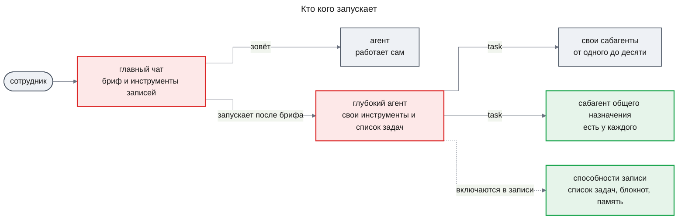
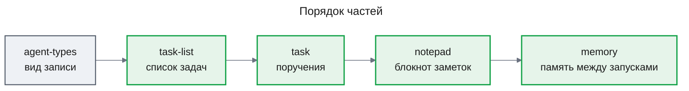

# PRD: Глубокие агенты (deep-agents)

| Date | Depth |
|---|---|
| 2026-11-22 | full |

## Snapshot

**Overview.** Глубокий агент — общий вид агента в библиотеке Agent OS, устроенный по образцу LangChain Deep Agents: у него свой промпт, свои инструменты и свои изолированные сабагенты. Сотрудник создаёт и правит такие записи словами в главном чате и запускает их после подтверждения брифа. Работу ведёт список задач по образцу Claude Code: свой у главного чата, у каждого запуска и у сабагента, с зависимостями, которые соблюдает платформа, и на виду у сотрудника. Глубокий агент поручает работу сабагентам одним инструментом `task`, в том числе по сабагенту на каждый пункт перечня, запуск делит общий блокнот заметок, а память живёт между запусками. Каждая способность включается в записи, поэтому отчёты для сотрудников владелец потом соберёт на глубоком агенте сам.

- **Не меняется**: запуск из чата через подтверждение брифа, права сотрудника на каждый вызов, ход агента кончается текстом, кроме ответа с полями результата (FR-21).
- **Части**: `agent-types` (построена) → `task-list` → `task` → `notepad` → `memory`.
- **Главный риск**: поручение по списку может разом запустить десятки сабагентов, а бюджета на один запуск нет.
- **Открытые вопросы**: два, в [Undetermined Items](#undetermined-items).

## Terms

- **Агент** — запись библиотеки: промпт, MCP-серверы, модель, предел шагов.
- **Сабагент** — агент внутри записи глубокого агента, как субагент в Claude Code: имя, описание «когда меня звать», промпт, серверы, модель, предел шагов. Работает в своём контексте и видит только своё задание.
- **Последнее сообщение** — последний текст сабагента без вызовов инструментов; оно становится результатом поручения.
- **Запуск** — одна работа глубокого агента от брифа до ответа, вместе с его сабагентами.
- **Список задач** — задачи одной сессии, которые агент ведёт сам четырьмя инструментами по образцу Claude Code (FR-12). Это заметки агента о своей работе, а не задания сабагентам. **Задача списка** — один пункт такого списка; её не путают с задачей поручения ниже.
- **Поручение** — вызов инструмента `task`: глубокий агент отдаёт работу сабагенту и получает его последнее сообщение. **Поручение по списку** — одна инструкция, которую платформа выполняет отдельным сабагентом на каждый пункт перечня, переданного в вызове.
- **Задача** — один запуск сабагента по поручению; поручение по списку даёт по задаче на каждый пункт.
- **Трекер задач** — механизм рантайма, который ведёт поручения одной сессии: запускает сабагентов, ждёт их и будит сессию.
- **Карточка подтверждения** — карточка в беседе перед изменяющим вызовом; вызов выполняется, только когда сотрудник её одобрил.
- **Бриф** — вопрос, границы и форма результата, которые сотрудник подтверждает в чате до запуска.
- **Модель класса Haiku** — малая дешёвая модель, на которой платформа держит рабочие роли.

## Background

Длинной работе нужен агент, который сам ведёт свой план, отдаёт части работы изолированным сабагентам и не теряет нить между шагами. Глубокий агент даёт это одним общим видом записи. Цель — чтобы он умел то же, что LangChain Deep Agents, и на нём собирались сценарии отчётов для сотрудников.

[LangChain Deep Agents](https://docs.langchain.com/oss/python/deepagents/overview) ([код](https://github.com/langchain-ai/deepagents)) — библиотека, которая превращает обычный цикл модели в агента для долгой работы. Её держат шесть приёмов:

- сабагент работает в изолированном контексте и возвращает одно последнее сообщение;
- файлы служат внешней памятью, общей для агента и сабагентов, а большие результаты инструментов уходят в файлы, а не в контекст;
- длинный контекст сжимается;
- поведение модели задают описания инструментов и ошибки с кодом;
- когда важна полнота, обход списка ведёт код, а не модель;
- каждая способность — отдельный модуль, который включают или не включают.

Инструмент плана в библиотеке необязателен, и ничто не заставляет агента выполнить свой список. Планировщика, прав пользователей, бюджетов и интерфейса в ней нет, а в Agent OS права и интерфейс уже есть, как и сжатие контекста и хранение больших результатов по ссылке. Вместо файлов у запуска в Agent OS блокнот текстовых заметок в базе.

Список задач устроен по образцу Claude Code. Claude Code ведёт задачи четырьмя инструментами с зависимостями между задачами и по умолчанию включает их только у Haiku 4.5 и более старых моделей, а у новейших выключает ([справочник инструментов](https://code.claude.com/docs/en/tools-reference.md)). Agent OS работает как раз на том классе моделей, для которого эти инструменты задуманы.

### Агент, глубокий агент и сабагенты

У сабагентов нет инструмента `task`, поэтому работа идёт не глубже двух уровней.

### Одно поручение

Глубокий агент не тратит шаги на ожидание: трекер будит его один раз, когда закончились оба сабагента.

### Поручение по списку

Список обходит код, а не модель: малая модель из тридцати тикетов может забыть пять, а код не забудет ни одного.

## Users and Use Cases

### Users

- **Сотрудник** — запускает глубоких агентов из чата и читает ответ; ему важно, чтобы работа не терялась и не шла сверх его прав.
- **Автор записи** — сотрудник или администратор, который описывает агента в чате и одобряет собранную запись.
- **Владелец платформы** — собирает на глубоком агенте сценарии отчётов и разбирает запуски.

### Use Cases

- **UC-1**: Автор описывает в чате глубокого агента → видит схему и сохраняет после подтверждения, без формы и кода.
- **UC-2**: Сотрудник запускает глубокого агента → видит его список задач и поручения со статусами и понимает, на каком шаге работа.
- **UC-3**: Глубокому агенту нужно разобрать тридцать тикетов → он поручает это одним вызовом, на каждый тикет работает свой сабагент, и ни один не пропущен.
- **UC-4**: Сотрудник задаёт глубокий вопрос → глубокий ресерч делит его на направления, поручает сбор по каждому и отвечает по всем.
- **UC-5**: Владелец собирает на глубоком агенте отчёт для сотрудников → включает блокнот и память и обходится без нового кода.
- **UC-6**: Владелец разбирает неудачный запуск → по вкладке «Задачи» страницы глубокого агента и журналу видит, какое поручение кому ушло и чем кончилось, и знает, какой промпт править.
- **UC-7**: Сотрудник даёт главному чату работу из нескольких шагов → видит рядом с чатом список задач беседы, видит, какая задача ждёт другую, и просит чат поправить список.

## Functional Requirements

### Must Have (MVP)

#### Глубокий агент — часть `agent-types`

- **FR-01. Вид записи «глубокий агент».** У записи глубокого агента имя, описание, промпт, MCP-серверы, модель, предел шагов, от одного до десяти сабагентов, необязательный финальный сабагент и флажок самообучения; у сабагента есть ещё предел запусков за запуск, не больше 20.
  - AC-01.1: Given сотрудник открывает библиотеку или просит чат создать запись, then видами записей названы только «агент» и «глубокий агент».
  - AC-01.2: Given чат создал глубокого агента с двумя сабагентами, then запись есть в библиотеке, и чат может предложить её к запуску.

- **FR-02. Свои изолированные сабагенты.** Глубокий агент работает своими инструментами и отдаёт часть работы только сабагентам своей записи и сабагенту общего назначения (FR-20), выбирая их по описаниям. Сабагент начинает с чистого контекста: видит своё задание, а не историю глубокого агента.
  - AC-02.1: Given глубокий агент пытается отдать работу агенту библиотеки, которого нет в его записи, then платформа отказывает с причиной, и ничего не запускается.
  - AC-02.2: Given глубокий агент отдал работу сабагенту, then в истории сабагента только его задание, а глубокий агент получает только его результат.
  - AC-02.3: Given в записи глубокого агента есть MCP-сервер, when глубокий агент сам вызывает его инструмент, then вызов идёт по правам запустившего сотрудника.

- **FR-03. Запуск из чата через бриф.** Глубокого агента запускает только главный чат и только после того, как сотрудник подтвердил бриф. Другие агенты глубоких агентов не запускают.
  - AC-03.1: Given чат запускает глубокого агента, then сотрудник видит бриф, а агент стартует только после подтверждения.
  - AC-03.2: Given другой агент пытается запустить глубокого агента, then платформа отказывает, и ничего не запускается.

- **FR-04. Ответ финального сабагента.** Если в записи назван финальный сабагент, запуск кончается только его законченным отчётом, и этот отчёт без пересказа становится ответом в беседе.
  - AC-04.1: Given финальный сабагент назван, when глубокий агент отвечает раньше его отчёта, then ответ не принят, а агент получает уведомление, что нужен отчёт финального сабагента.
  - AC-04.2: Given финальный сабагент закончил работу отчётом, then сотрудник получает этот отчёт как ответ запуска.

- **FR-05. Инструменты записей в главном чате.** Сотрудник управляет записями словами, а только главный чат — пятью инструментами записей: список (с пометкой, чья запись), чтение полного определения, создание, правка и удаление. Изменения выполняются только после карточки подтверждения и касаются только своих записей сотрудника, никому не открытых; администратор так же меняет системные, но встроенные не удаляет. Открыть запись другим и включить самообучение может только человек.
  - AC-05.1: Given чат вызывает создание, then сотрудник видит карточку с определением, а в библиотеке ничего не появляется до его одобрения.
  - AC-05.2: Given сотрудник отклонил карточку, then запись не изменена, а чат получает отказ.
  - AC-05.3: Given запись чужая, открыта ролям или системная, а сотрудник не администратор, when чат вызывает правку или удаление, then инструмент отказывает с причиной до карточки.
  - AC-05.4: Given в записи назван сервер, на который у сотрудника нет права, when чат её создаёт, then инструмент отказывает, и записи нет.
  - AC-05.5: Given глубокий агент или сабагент работает в беседе, then инструментов записей у него нет.
  - AC-05.6: Given администратор одобрил карточку правки системного глубокого ресерча, then сотрудники с доступом видят новую версию.

- **FR-06. Глубокий ресерч — встроенный глубокий агент.** Встроенный глубокий ресерч — глубокий агент с сабагентами плана, сбора и ответа; ответ — финальный сабагент. Это единственный встроенный сценарий.
  - AC-06.1: Given сотрудник задаёт глубокий вопрос и подтверждает бриф, then работают план, сбор по направлениям и ответ, и ответ приходит в беседу.

- **FR-07. Самообучение у глубоких агентов.** У глубокого агента есть флажок самообучения и свой граф знаний ([self-learning](../self-learning/prd.md)). У обычного агента флажка нет.
  - AC-07.1: Given у глубокого агента включено самообучение, when запуск закончился, then в его графе знаний появляются новые записи.

- **FR-08. Чат сам выбирает MCP-серверы.** Чат выбирает серверы агенту и каждому сабагенту из доступных сотруднику и даёт каждому только нужные: малая модель хуже выбирает инструмент, когда их много. Сотрудник может попросить добавить или убрать сервер. Каждый вызов проверяется по правам запустившего.
  - AC-08.1: Given у сотрудника пять серверов, и он просит агента для разбора ночных логов, then у сабагента сбора в схеме сервер логов и нет ненужных. Проверка ручная.
  - AC-08.2: Given запись сотрудника A называет сервер, на который у запустившего сотрудника B нет права, when сабагент вызывает его инструмент, then платформа отказывает по правам B.

- **FR-09. Ошибка в записи объясняется чату.** Запись с ошибкой — больше десяти сабагентов, финальный сабагент вне команды, пустой промпт — инструмент не сохраняет и называет чату поле и нарушенное правило, чтобы чат исправил запись сам.
  - AC-09.1: Given чат создаёт глубокого агента с одиннадцатью сабагентами, then инструмент отказывает до карточки и называет поле команды и предел в десять сабагентов.

- **FR-10. Панель «Схема».** Рядом с беседой панель показывает запись, которую чат последней прочитал, создал или изменил: агента и сабагентов с описаниями и серверами. Панель только показывает и после правки сразу рисует новую версию. Вкладка «Задачи» в этой панели показывает список задач самой беседы (FR-15).
  - AC-10.1: Given чат создал глубокого агента с тремя сабагентами, then рядом с беседой видна схема с ним и тремя сабагентами.
  - AC-10.2: Given сотрудник одобрил правку, которая убирает сабагента, then схема показывает запись без него без перезагрузки страницы.

- **FR-11. Карточка глубокого агента в библиотеке.** В библиотеке и панели администратора глубокий агент открывается карточкой только для чтения со схемой и всеми текстами. С карточки запись открывают ролям и закрывают, копируют, удаляют, переключают самообучение; изменить её просят чат. Редактор обычного агента остаётся.
  - AC-11.1: Given сотрудник открывает своего глубокого агента в библиотеке, then видит схему и тексты, и ни одно поле не правится.
  - AC-11.2: Given сотрудник открыл свою запись роли с карточки, then сотрудник этой роли видит её в библиотеке.
  - AC-11.3: Given запись открыта ролям, when владелец закрывает её с карточки и просит чат поправить, then чат меняет её после карточки подтверждения.

#### Список задач — часть `task-list`

- **FR-12. Четыре инструмента задач.** Агент ведёт список задач четырьмя инструментами, как в Claude Code: создать задачу (`task_create`), изменить её (`task_update`), прочитать одну (`task_get`) и показать весь список (`task_list`). У задачи есть короткий номер, который даёт платформа, тема, описание, текст, который виден, пока задача в работе, статус («ожидает», «в работе», «готова»), метка исполнителя и зависимости от других задач того же списка. Изменение меняет только названные поля и может удалить задачу.
  - AC-12.1: Given агент создал задачу, then она стоит в списке со статусом «ожидает» и номером, который дала платформа.
  - AC-12.2: Given агент меняет у задачи только статус, then тема, описание и зависимости остались прежними.

- **FR-13. Свой список у каждой сессии.** У сессии один список, и он хранится вне контекста разговора. Свой список у главного чата, у каждого запуска глубокого агента и у сабагента, если способность у него включена. Сессия читает и меняет только свой список; списки разных сессий и сотрудников не смешиваются.
  - AC-13.1: Given у сессии есть список, when контекст сжат, сервер перезапустился или сотрудник продолжил беседу, then список тот же, с теми же номерами и статусами.
  - AC-13.2: Given главный чат и запущенный из него глубокий агент ведут списки, then ни один не видит и не меняет задач другого.

- **FR-14. Правила списка соблюдает платформа.** Задачу, которую блокирует незаконченная задача, нельзя начать или закончить, и агенту называют блокирующие задачи. Зависимости не образуют цикла. Удаление задачи убирает зависимости, которые её называют. Агент, кроме главного чата, не может закончить работу, пока в его списке есть незаконченные задачи, и получает их перечень; бесконечную петлю останавливает предел шагов. Текущий список агент видит на каждом шаге.
  - AC-14.1: Given задача 2 зависит от незаконченной задачи 1, when агент переводит задачу 2 в «в работе» или «готова», then инструмент отказывает и называет задачу 1.
  - AC-14.2: Given задача 2 зависит от задачи 1, when агент делает задачу 1 зависимой от задачи 2, then инструмент отказывает из-за цикла, и список не изменён.
  - AC-14.3: Given задача 2 зависит от задачи 1, when агент удаляет задачу 1, then у задачи 2 этой зависимости нет.
  - AC-14.4: Given у глубокого агента в списке задача «в работе», when он отвечает текстом, then ответ не принят, а агент получает уведомление с этой задачей; у главного чата такой ответ принят.
  - AC-14.5: Given агент изменил задачу, then на следующем шаге он видит в контексте список с этим изменением.

- **FR-15. Сотрудник видит список своей сессии.** Сотрудник видит список задач сессии, которая перед ним, только для чтения и сразу после каждого изменения: список беседы — на вкладке «Задачи» рядом с чатом, список глубокого агента — на вкладке «Задачи» его страницы. У задачи видны статус, текст, пока она в работе, и отметка, какими задачами она заблокирована. Изменить список сотрудник просит чат.
  - AC-15.1: Given чат создал три задачи и одну начал, then на вкладке «Задачи» рядом с беседой без перезагрузки страницы видны три задачи и текст той, что в работе.
  - AC-15.2: Given задача ждёт незаконченную задачу, then у неё видна отметка с этой задачей.
  - AC-15.3: Given сотрудник просит чат отметить задачу готовой, then чат меняет свой список, а на вкладке нет способа изменить задачу самому.

- **FR-16. Список задач включается в записи.** Способность включается в записи агента, глубокого агента и каждого сабагента, как остальные способности (FR-24); у главного чата список есть всегда.
  - AC-16.1: Given у сабагента в записи список задач выключен, а у глубокого агента включён, then у сабагента нет инструментов задач, а у глубокого агента они есть.

- **FR-17. Права и журнал списка.** Маршрут, который отдаёт список экрану, и инструменты задач проверяют владельца сессии. Журнал пишет каждый переход задачи — создана, сменила статус, удалена — через обёртку логгера `packages/common` с id сессии, задачи, агента и сотрудника, без темы и описания задачи.
  - AC-17.1: Given сессия принадлежит сотруднику A, when сотрудник B запрашивает её список, then B не получает ни одной задачи.
  - AC-17.2: Given агент перевёл задачу в «готова», then в журнале одна запись с id сессии, задачи и сотрудника, а темы и описания задачи в ней нет.

#### Поручение `task` — часть `task`

- **FR-18. Одно поручение.** Глубокий агент поручает работу одним инструментом `task`: называет сабагента и описывает задание. Сабагент работает в своём контексте, а его последнее сообщение возвращается результатом того же вызова. Несколько поручений в одном ответе работают одновременно, и агент видит все результаты вместе. Другого способа поручить нет. Поручение может назвать задачу из списка глубокого агента: тогда платформа записывает сабагента её исполнителем и закрывает задачу по его отчёту.
  - AC-18.1: Given глубокий агент в одном ответе сделал два вызова `task`, then оба сабагента работают одновременно, а агент получает следующий ход один раз, с двумя результатами.
  - AC-18.2: Given сабагент закончил работу, then результат вызова — его последнее сообщение, а в истории сабагента только его задание.
  - AC-18.3: Given поручение назвало задачу 3 из списка глубокого агента, then исполнитель задачи 3 — этот сабагент, а после его отчёта она «готова».

- **FR-19. Поручение по списку.** Глубокий агент называет сабагента, одну инструкцию и перечень пунктов прямо в вызове. Перечень обходит платформа и запускает по одному сабагенту на пункт, так что каждый пункт покрыт. Агент получает короткую таблицу: пункт, статус, ответ.
  - AC-19.1: Given перечень из пяти пунктов, then работают ровно пять сабагентов, и в таблице пять строк.
  - AC-19.2: Given один из пяти сабагентов кончился сбоем, then его строка в статусе «сбой» с причиной, а остальные четыре — с ответами.

- **FR-20. Сабагент общего назначения; сабагенты не поручают дальше.** У каждого глубокого агента рядом с его сабагентами есть сабагент общего назначения с инструментами самого глубокого агента, кроме `task`: сабагенты дальше не поручают.
  - AC-20.1: Given в записи только сабагент «сбор», when глубокий агент поручает сабагенту общего назначения, then тот работает и возвращает результат.
  - AC-20.2: Given сабагент работает, then инструмента `task` среди его инструментов нет.

- **FR-21. Поля результата.** Поручение может назвать поля, которые сабагент должен вернуть. Платформа проверяет ответ, и сабагент, получив ошибку с именем поля, исправляет его; повторы останавливает предел шагов сабагента.
  - AC-21.1: Given поручение требует поля «вывод» и «источники», when сабагент отвечает без «источников», then он получает ошибку с этим полем и отвечает снова, а результат несёт оба поля.
  - AC-21.2: Given сабагент исчерпал предел шагов, так и не вернув поля, then поручение кончается сбоем с причиной.

- **FR-22. Трекер задач в рантайме.** Поручения сессии ведёт трекер задач рантайма. Сессию он будит один раз, когда закончились все её задачи, а рестарт сервера не теряет и не удваивает ни одной задачи. Остановка сессии отменяет её незаконченные задачи, а сбой задачи сообщается сессии и не роняет её. Трекер изолирован: его видит только сессия, которая его открыла.
  - AC-22.1: Given поручение принято, а сабагент его задачи ещё не стартовал, when сервер перезапускается, then этот сабагент стартует ровно один раз.
  - AC-22.2: Given сабагент задачи в работе, when сервер перезапускается, then работа продолжается в том же запуске сабагента, второго нет.
  - AC-22.3: Given две задачи в работе, when сотрудник останавливает глубокого агента, then оба сабагента остановлены, обе задачи «отменена», новых запусков нет.
  - AC-22.4: Given сабагент кончился ошибкой, then глубокий агент получает результат «сбой» с причиной и работает дальше.
  - AC-22.5: Given сессии двух сотрудников поручают одновременно, then ни одна не видит задач и результатов другой.

- **FR-23. Права и поручения на виду.** Сабагент, запущенный через `task`, не может ничего, чего не может тот, кто его запустил: каждый вызов проверяется по правам сотрудника, изменяющий ждёт его подтверждения. На вкладке «Задачи» страницы глубокого агента сотрудник видит поручения запуска: сабагента, задание, статус, результат и переход к работе сабагента.
  - AC-23.1: Given у сотрудника нет права на инструмент X, when сабагент вызывает X, then платформа отказывает, аудит пишет отказ, а сервер не вызывается.
  - AC-23.2: Given запуск принадлежит сотруднику A, when сотрудник B запрашивает его задачи, then B не получает ни одной.
  - AC-23.3: Given у запуска поручения разных статусов, when сотрудник открывает вкладку «Задачи» страницы глубокого агента, then видит у каждого сабагента, статус и результат и может открыть работу сабагента.

- **FR-24. Способности включаются в записи.** Поручение по списку включается в записи глубокого агента. Когда способность выключена, у агента нет ни её инструмента, ни её правил в промпте. Так же включаются список задач (FR-16), блокнот (FR-28) и память (FR-29).
  - AC-24.1: Given в записи поручение по списку выключено, then глубокий агент не может поручить по списку, и правил о списках в его промпте нет.

#### Блокнот — часть `notepad`

**Блокнот** — именованные текстовые заметки, которые платформа хранит в базе, а не в контексте агента. Это более простой аналог файлов Deep Agents.

- **FR-25. Заметки через инструменты.** Агент записывает, читает, перечисляет и удаляет именованные заметки. Заметка — простой текст не больше предела размера, а длинную заметку агент читает по страницам. Заметки хранятся вне контекста разговора: их не теряют сжатие контекста, рестарт и продолжение беседы.
  - AC-25.1: Given агент записал заметку «итоги», then в перечне заметок есть «итоги», а чтение возвращает её текст.
  - AC-25.2: Given заметка длиннее одной страницы, then агент дочитывает её по страницам до конца.
  - AC-25.3: Given текст больше предела, then инструмент отказывает и называет предел, а заметка не изменена.
  - AC-25.4: Given заметка записана, when контекст сжат, сервер перезапустился или сотрудник продолжил беседу, then заметка та же.

- **FR-26. Один блокнот на запуск.** Блокнот запуска один на весь запуск: его читают и пишут глубокий агент и все его сабагенты, так что сабагент оставляет подробности в заметке и отвечает коротко. У беседы главного чата свой блокнот. Сессия достаёт только блокнот своего запуска или своей беседы.
  - AC-26.1: Given сабагент записал заметку, then глубокий агент и другие сабагенты того же запуска её читают.
  - AC-26.2: Given заметка записана в запуске сотрудника A, then ни другой запуск, ни беседа, ни сотрудник B её не читают.

- **FR-27. Сотрудник читает заметки, а меняет их чат.** Сотрудник видит заметки беседы или запуска, которые перед ним, только для чтения. Сам он заметки не правит: изменить заметку беседы он просит чат.
  - AC-27.1: Given глубокий агент записал две заметки, then сотрудник видит на странице запуска обе с текстом и не может их изменить.
  - AC-27.2: Given сотрудник просит чат исправить заметку беседы, then чат меняет заметку, а на экране нет способа изменить её самому.

- **FR-28. Блокнот включается в записи и пишется в журнал.** Способность включается в записи, как остальные (FR-24). Журнал пишет каждую операцию с заметкой через обёртку логгера `packages/common` с идентификаторами и размером, без текста заметки.
  - AC-28.1: Given у сабагента в записи блокнот выключен, then у него нет инструментов заметок.
  - AC-28.2: Given агент записал заметку, then в журнале одна запись с id сессии, сотрудника и размером, а текста заметки в ней нет.

#### Память — часть `memory`

- **FR-29. Память.** У агента есть заметка памяти, которая живёт между запусками и всегда стоит в его контексте; агент может её дополнить. Чья это память и кто её видит, решает владелец ([Undetermined Items](#undetermined-items)). Способность включается в записи.
  - AC-29.1: Given агент дополнил память, when тот же сотрудник запускает того же агента снова, then дополнение стоит в контексте нового запуска.

### Should Have

Нет.

### Could Have

Нет.

### Won't Have

- Зависимости между поручениями и стартовые задачи в записи — в модели Deep Agents их нет, а порядок работы задаёт список задач (FR-14).
- Навыки — отложены, могут вернуться отдельной фичей.
- Файловая система запуска — вместо неё блокнот (FR-25); большие результаты инструментов хранятся по ссылке с чтением по страницам и поиском, как сейчас.
- Правка списка задач и заметок на экране — их меняет агент, а сотрудник просит об этом чат (FR-15, FR-27).
- Встроенные сценарии кроме глубокого ресерча, например утренний бриф, — такие сценарии владелец соберёт на глубоком агенте сам.
- Запуск по расписанию и доставка отчёта — отдельная фича позже: для отчётов она нужна, но планировщика нет, а запуск без сотрудника требует своих решений о правах.
- Вызов сабагентов из `run_code` — поручать можно только через `task`.
- Редактор-форма глубокого агента («расширенный режим») — отдельная фича; здесь запись правят словами в чате.
- Самообучение, которое меняет агентов, — отдельная фича; здесь самообучение наполняет только граф знаний.
- Выписки, которые привязывают утверждения к цитатам из источников, — решение отложено до первых сценариев отчётов.
- Профили промптов под отдельные модели — не нужны, пока все роли идут на одном классе моделей.
- Бюджет токенов на запуск — не эта фича; риск разлёта описан в Risks.
- Глубокий агент в роли сабагента — нет: сабагенты не поручают дальше (FR-20).

## Non-Functional Requirements

### Observability

- **NFR-01** (часть `task`): каждое событие поручения — принято, отклонено, стартовало, закончилось, сбой, отменено — пишется одной записью журнала через обёртку логгера `packages/common`: id запуска, сессии, задачи, сабагента, сотрудника, статус, причина, длительность. Секретов и токенов в записях нет. Проверка — поручение по списку: на каждое событие каждого пункта в журнале ровно одна запись.

## Delivery Parts

| Part | Covers | Cut along | Depends on | Rationale |
|------|--------|-----------|------------|-----------|
| `agent-types` | FR-01 – FR-11 | domain | — | Вид записи, запуск, инструменты записей и их экраны |
| `task-list` | FR-12 – FR-17 | domain | `agent-types` | Список задач — свой механизм каждой сессии, в том числе главного чата, а связь поручения с задачей в `task` опирается на него |
| `task` | FR-18 – FR-24, NFR-01 | domain | `task-list` | Поручение — механизм рантайма поверх команды сабагентов |
| `notepad` | FR-25 – FR-28 | domain | `task` | Блокнот делят глубокий агент и сабагенты, которых он запускает через `task` |
| `memory` | FR-29 | domain | `notepad` | Память — та же заметка, только она живёт между запусками и всегда стоит в контексте агента |

Что владелец запускает и видит после каждой части:

- **`agent-types`** (построена) — описывает в чате глубокого агента со своими изолированными сабагентами, одобряет карточку подтверждения, видит запись в панели «Схема» и на карточке библиотеки только для чтения, запускает её через бриф; встроенный глубокий ресерч работает как глубокий агент. Проверено: все автоматические наборы тестов проходят на свежей базе. Не проверено: запусков на настоящей модели не было, интерфейс в браузере не смотрели.
- **`task-list`** — чат и глубокий агент ведут свои списки задач с зависимостями; сотрудник видит список беседы на вкладке «Задачи» рядом с чатом, а список запуска — на странице глубокого агента.
- **`task`** — глубокий агент поручает одному сабагенту, нескольким сразу и по списку; вкладка «Задачи» страницы глубокого агента показывает каждое поручение и пункт со статусом и ответом.
- **`notepad`** — сабагент оставляет подробности в заметке и отвечает коротко, глубокий агент и другие сабагенты запуска её читают; у беседы свой блокнот; сотрудник читает заметки, а заметку беседы меняет через чат.
- **`memory`** — агент помнит в следующем запуске то, что записал в память.

## Success Criteria

Стенда оценки в проекте нет (project-context, бизнес-ограничение 6): владелец проверяет вручную.

- **Малая модель ведёт весь запуск.** Десять запусков встроенного глубокого ресерча на постоянном списке вопросов с моделью класса Haiku во всех ролях, включая самого глубокого агента, дают ответ в каждом запуске, где сбор нашёл данные. Качество ответов владелец оценивает вручную, стоимость читается из журнала токенов (бизнес-ограничение 7). Проверка платная, после выпуска части `task`.
- **Поручение по списку покрывает каждый пункт.** Поручение по списку не меньше чем из 30 пунктов запускает ровно одного сабагента на пункт: ни один не пропущен и ни один не запущен дважды. Читается на вкладке «Задачи» страницы глубокого агента и в журнале, после выпуска части `task`.
- **Список задач на виду.** UC-2 и UC-7 проходят на первых запусках после части `task-list`: сотрудник видит список своей сессии, а глубокий агент не заканчивает работу с незакрытыми задачами.

## Constraints and Risks

### Constraints

- **PoC без совместимости.** Старые форматы и инструменты удаляются сразу, данные не переносятся, базу разработки пересоздают.
- **Один владелец долгих задач.** Поручения запускает и восстанавливает после рестарта только рантайм `packages/runtime` (ADR-0001, ADR-0004); второго планировщика нет.
- **Настройки в базе**, новых переменных окружения нет.
- **Ход кончается текстом** ([design-agents.md](../agent-platform/design-agents.md), KD-2), кроме ответа на поручение, которое назвало поля результата (FR-21).
- **Код не судит текст.** Платформа сравнивает имена, статусы и пункты списка и не оценивает смысл задания или ответа.
- **Права, аудит и изоляция** (бизнес-ограничения 1–3). Каждый агент и сабагент работает по правам запустившего сотрудника, каждый вызов пишется в аудит, а запуск и его задачи видит только его владелец. Граф знаний глубокого агента общий для всех его запусков ([self-learning/prd.md](../self-learning/prd.md), Constraints).
- **Бюджет запуска** (бизнес-ограничение 4) не выполняется: расход ограничивает только месячная квота сотрудника.

### Assumptions

- Модель класса Haiku в роли глубокого агента выбирает между одним поручением и поручением по списку и выбирает сабагента по описанию. Проверка — прогон ресерча на Haiku во всех ролях (Success Criteria).

### Risks

- **Разлёт поручений.** Поручение по списку может разом запустить десятки сабагентов: растёт расход, а MCP-сервер может начать отказывать по частоте запросов. Тормоза — предел шагов, подтверждение брифа и месячная квота; бюджета на запуск нет.
- **Инъекция через данные.** Текст тикета или лога может попасть в задание сабагенту. Сабагенты работают только по правам сотрудника, а изменяющие вызовы ждут его подтверждения.
- **Инъекция в сохранённую запись.** Текст из результата инструмента может подтолкнуть чат вписать чужую инструкцию в промпт. Защита — карточка подтверждения с полным определением (FR-05); остаётся риск, что сотрудник одобрит длинное определение не читая.
- **Перегрузка инструментами.** Малая модель путается, когда инструментов много. Чат даёт только нужные серверы (FR-08), но сабагент общего назначения получает все инструменты глубокого агента, так что лишний сервер в записи вредит дважды.

## Undetermined Items

- **Предел запусков сабагента против поручения по списку.** У сабагента не больше 20 запусков за запуск (FR-01), а критерий успеха требует перечня из 30 пунктов. Блокирует: правило счёта в дизайне части `task`. Решает: владелец. Рекомендация: поручение по списку не считать в этот предел, а длину перечня ограничить отдельной настройкой в базе.
- **Чья память.** Память может быть своей у каждого сотрудника или общей для всех запусков агента, как граф знаний; общая смешивает данные сотрудников. Блокирует: FR-29 и дизайн части `memory`. Решает: владелец.

## Update History

| Version | Date | Change |
|---------|------|--------|
| 1.0 – 1.6 | 2026-11-21 – 2026-11-22 | Первая версия и шесть пересмотров |
| 1.7 | 2026-11-22 | Только целевое состояние: план запуска и напоминание о пунктах плана удалены, блокнот общий на запуск, заметки сотрудник меняет через чат, требования перенумерованы по порядку частей |
